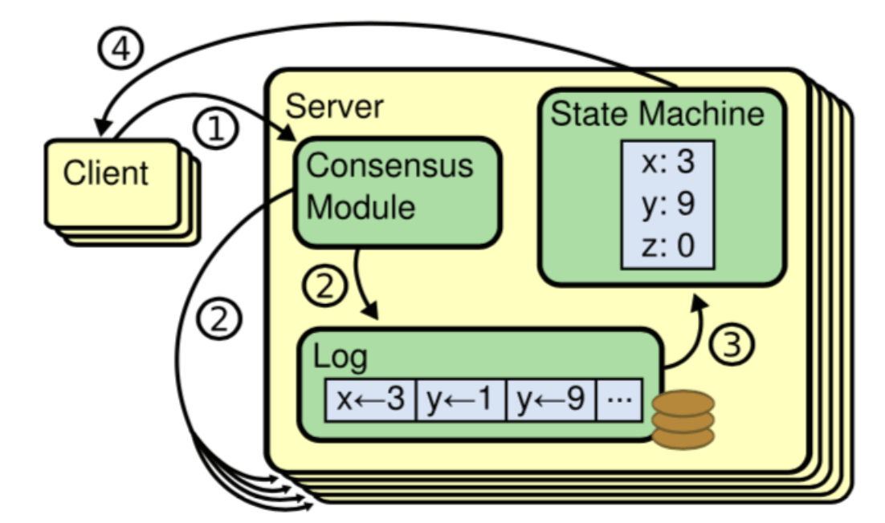
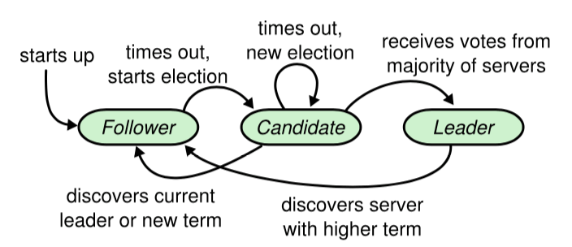
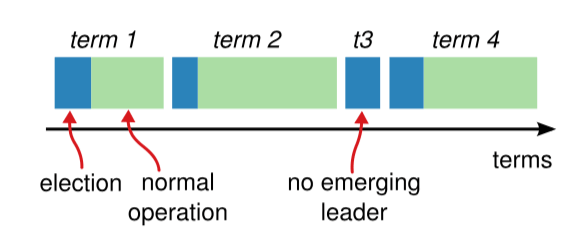
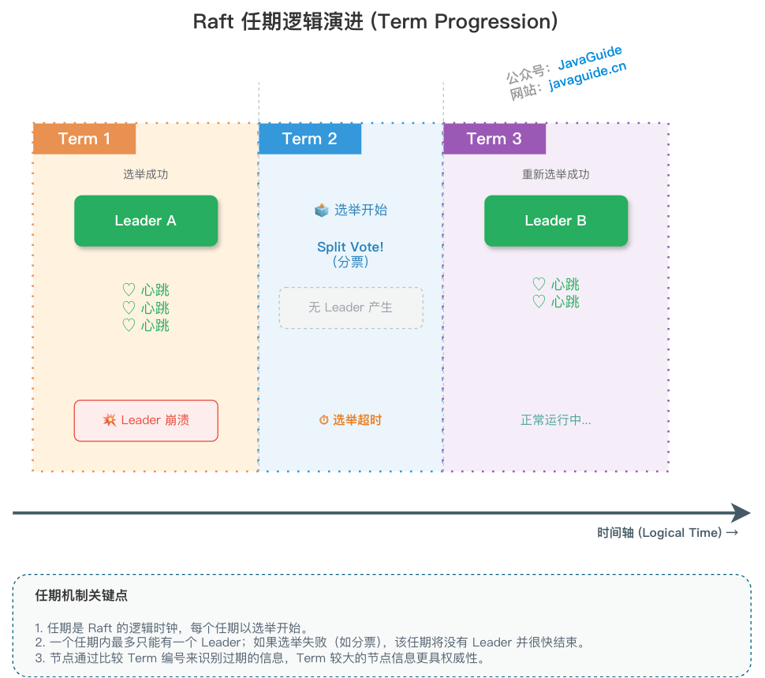
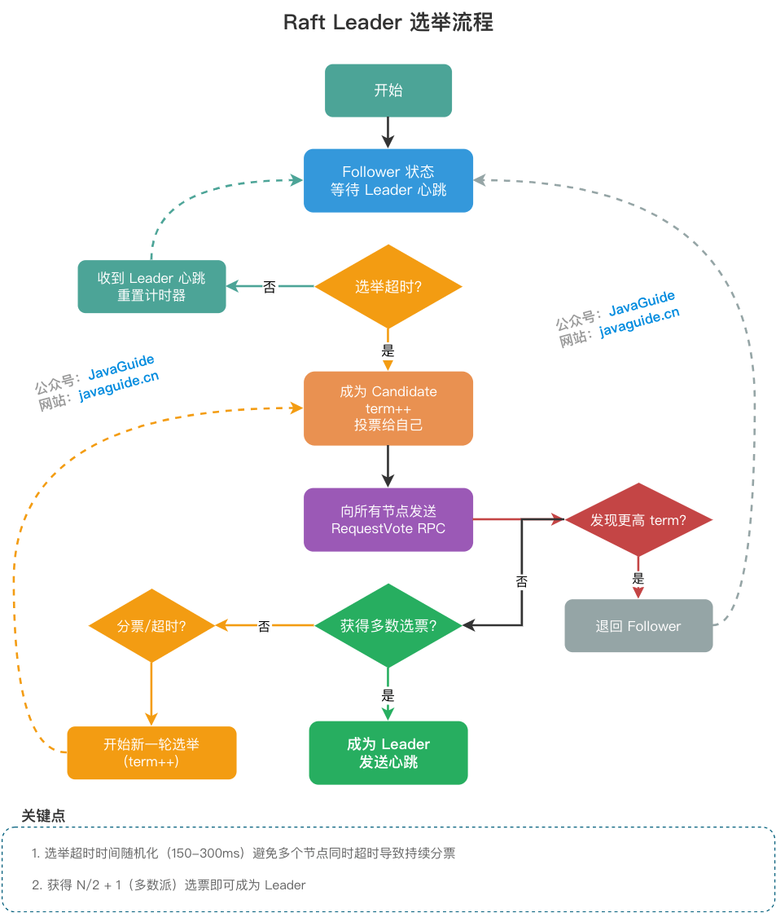

> This article was written by [SnailClimb](https://github.com/Snailclimb) and [Xieqijun](https://github.com/jun0315).

## 1. Background

Modern Internet systems often scale horizontally to handle heavy traffic. As the number of machines grows, crashes and network outages become routine. How can servers that may disconnect at any time stay in sync and avoid returning conflicting data? This is the problem addressed by **distributed consensus algorithms**.

Diego Ongaro and others published the Raft algorithm in 2014. Its mission was clear: **make consensus easier to understand and implement than Paxos**. Raft breaks the consensus problem into several parts:

- **Leader election:** Uses randomized election timeouts (commonly 150–300 ms or a wider range, depending on the network and failure model).
- **Log replication:** The Leader broadcasts log entries using AppendEntries RPCs.
- **Safety:** Includes election restrictions and log matching.

Raft is widely used in production. Implementations such as etcd and Consul are important parts of distributed systems. Researchers and practitioners have extended and optimized Raft in several ways:

- **Pre-Vote** (2014): Prevents a node isolated by a network partition from disrupting elections in a stable cluster.
- **Read Index** (2014): Improves read performance with linearizable reads during the Leader's term.
- **Lease Read:** Provides linearizable reads based on a Lease.
- **Joint Consensus:** Changes cluster membership safely through a transitional configuration, typically moving from the old configuration to a joint configuration and then to the new configuration.

Systems must handle servers joining and leaving during normal operation. They need to react to changes and adapt automatically within seconds; visible interruptions are usually unacceptable to customers.

Distributed consensus helps address these challenges.

### 1.1 Leader election under non-Byzantine assumptions

Raft assumes **crash fault tolerance (CFT), not Byzantine fault tolerance**. Nodes may crash or lose network connectivity, but they do not act as traitors and send deliberately false information.

Imagine three generals, A, B, and C, with no current commander. Each has a randomized election timer. When one timer expires first, that candidate calls for votes. Other generals vote for it if they have not already started an election or voted for someone else. Once the candidate receives a **majority** of votes, it becomes the Leader. If messages are lost and no candidate receives enough votes, the nodes reset their timers and try again.

### 1.2 What is a consensus algorithm?

The goal of a consensus algorithm is to **make a group of machines behave like one machine**. As long as a majority of the cluster is available, the system can continue operating.

This is commonly implemented with a **replicated state machine**. Each node keeps the same log. If all nodes apply the same commands in the same order, they reach the same state. A consensus algorithm's essential job is to **keep the nodes' logs consistent**. Consensus is a fundamental problem in fault-tolerant systems: servers must agree on shared state even when failures occur.



## 2. Basic concepts

Before looking at Raft in detail, learn its three node roles, term mechanism, and log structure.

### 2.1 Node roles

A Raft cluster contains several servers. Consider a typical five-server cluster. At any time, each server is in one of three states:

- **Leader:** Handles client requests, appends entries to its log, and replicates them to other nodes. It sends regular heartbeats to maintain its authority.
- **Follower:** Waits for requests from the Leader and Candidates, responding to heartbeats and log replication.
- **Candidate:** A temporary state. If a Follower does not receive a Leader heartbeat before its election timeout, it becomes a Candidate and requests votes.

Under normal conditions, one server is the Leader and the others are Followers. Followers are passive: they do not initiate work but respond to requests from Leaders and Candidates.



### 2.2 Terms



Raft divides time into terms of arbitrary length and assigns each term a consecutive number. Each term begins with an election. One or more Candidates try to become Leader. If a Candidate wins, it serves as Leader for that term. If no Candidate wins—for example, because votes are split—the term may have no Leader. After another election timeout, the nodes start a new term and election. If a majority is available and the network eventually becomes reachable, the system can usually elect a Leader after several rounds.

Each node stores its current term. Nodes exchange terms when they communicate. If a node sees a higher term, it updates its term. A Candidate or Leader that discovers its term is stale immediately returns to the Follower state. A server rejects a request with a stale term.

The hand-drawn diagram below illustrates how Raft terms progress:



### 2.3 Logs

Only the Leader can append entries to the log. Each log entry contains three key fields: `<term, index, command>`.

Two progress pointers are important:

- **`commitIndex`:** The highest log index known to be safely committed, meaning replicated on a majority of nodes.
- **`lastApplied`:** The highest log index this server has applied to its local state machine.

## 3. Leader election



Raft uses heartbeats to maintain a Leader and trigger elections when needed.

If a server keeps receiving valid AppendEntries RPCs from the Leader, either as heartbeats or log replication, it remains a Follower and resets its election timer.

The Leader periodically sends heartbeats to all Followers. If a Follower does not receive a heartbeat during its timeout interval, an **election timeout** occurs. The Follower assumes there is no available Leader and starts an election.

To start an election, a Follower increments its term and becomes a Candidate. It then sends a RequestVote RPC to every node. The Candidate remains in this state until one of three events occurs:

- It wins the election.
- Another node wins the election.
- The election ends without a winner.

A Candidate wins when it receives votes from a majority of the cluster (`N/2 + 1`) in the current term.

While waiting for votes, a Candidate may receive a heartbeat from a node claiming to be Leader:

- If the Leader's term is greater than or equal to the Candidate's, the Candidate accepts that the other node is Leader and returns to the Follower state.
- If the Leader's term is lower, the Candidate rejects the request and tells that node to update its term.

Several Candidates may start elections at nearly the same time, splitting the votes so that none receives a majority. Without a way to redistribute votes, this could repeat indefinitely.

Raft avoids this with randomized election timeouts. Each Candidate chooses a new random timeout after starting an election. This spreads out election attempts so that, in most cases, one server times out first and wins before the others time out.

## 4. Log replication

After election, the Leader begins accepting client requests. Each request contains a command for the **replicated state machine** to execute.

When the Leader receives a request, it creates an entry containing `<index, term, command>`, appends it to its own log, and broadcasts it to the other servers for replication.

If a Follower accepts the entry, it appends it to its log and acknowledges the Leader.

After the Leader receives successful replication responses from a majority of Followers, it advances its `commitIndex`. It then applies committed entries to its state machine in order and returns the result to the client.

A key restriction applies: the Leader may advance `commitIndex` based on a log entry from the **current term** once that entry has been replicated to a majority. A Leader must not directly commit an entry from an earlier term merely because it is replicated on a majority. It can commit a new entry from its current term—often a no-op entry appended after election—which then allows prior entries to be committed indirectly.

Followers do not determine the commit point themselves. They learn the latest commit index from `leaderCommit` in the Leader's AppendEntries RPC. Each Follower updates its local `commitIndex` to `min(leaderCommit, lastLogIndex)` and applies entries to its state machine in order.

### 4.1 Log Matching Property

Raft's **Log Matching Property** is a foundation of its safety: logs do not diverge. It provides two guarantees:

- **Guarantee 1:** If two logs contain entries with the same index and term, the entries contain the same command.
- **Guarantee 2:** If two logs contain entries with the same index and term, all preceding entries in both logs are also identical.

#### Inductive proof

The Log Matching Property follows by induction:

1. **Base case:** The property holds when the logs are empty.
2. **Inductive step:** Assume that logs match through index N. When the Leader appends entry N+1, the consistency check in the AppendEntries RPC verifies the preceding entry:

```text
AppendEntries RPC parameters:
- prevLogIndex: index of the preceding entry that the Leader believes matches the Follower
- prevLogTerm: term of the preceding entry
- entries[]: new log entries to append
```

**Consistency check:**

- After receiving AppendEntries, the Follower checks its log entry at `prevLogIndex`.
- If that entry's term equals `prevLogTerm`, the Leader's and Follower's logs match through `prevLogIndex`, so the check succeeds.
- If the entry does not exist or the term differs, the Follower rejects the append and returns failure.

**Key point:** Checking the `prevLogIndex`/`prevLogTerm` pair lets the Leader and Follower verify that their log histories match at the last known common point. New entries are appended only after that point has been confirmed. This creates an inductive chain:

```text
entry[0] matches → entry[1] matches → entry[2] matches → ... → entry[N] matches
      ↑_________ recursively verified by prevLogIndex/prevLogTerm _________↑
```

Therefore, two different values cannot both be committed at the same index; the log does not fork.

#### Implementation optimizations

Production implementations such as etcd 3.5.x add engineering optimizations to the basic consistency check:

- **Fast backup:** If the AppendEntries consistency check fails, the Follower returns the conflicting term and its boundary indexes (the first and last index in that term). The Leader can skip the whole conflicting range instead of retrying with a decremented `nextIndex` for every entry.
- **Retry-storm protection:** Under heavy load, repeated AppendEntries failures may create a retry storm. Implementations may use:
  - **Jittered backoff:** Add random variation to retry intervals so Followers do not all retry at once.
  - **Backpressure:** Limit the retry rate for each Follower to avoid excessive network use.

These optimizations do not change the theoretical correctness of log matching; they improve recovery efficiency during failures.

### 4.2 Recovering from inconsistent logs

During normal operation, the Leader's and Followers' logs are synchronized. If an old Leader crashes suddenly, however, the cluster may contain unaligned entries left behind during the transition.

When the new Leader sends AppendEntries, the consistency check may fail. Raft resolves the conflict by following the current Leader's log: inconsistent entries on a Follower are removed and replaced with the Leader's entries.

The Leader searches backward for the last point at which the two logs match. Once it finds this **divergence point**, the Follower deletes entries after it and copies the Leader's current log.

The Leader tracks each Follower separately using a `nextIndex` pointer, which estimates the next log index to send. When elected, the new Leader initially sets each Follower's `nextIndex` to one more than its own last log index. If a Follower is behind or has conflicting entries, its first AppendEntries request fails. There are two ways to find the divergence point:

- **Basic approach (one entry at a time):** The Leader decrements `nextIndex` and retries. It continues stepping backward until the logs match.
- **Production optimization (fast backup):** Stepping back one entry at a time can be slow. With fast backup, a Follower rejecting an entry reports the term of its conflicting entries and that term's first and last indexes. The Leader can skip the entire conflicting term at once, greatly reducing network retries.

After these retries, `nextIndex` points to the last matching position. AppendEntries then succeeds, the Follower's conflicting entries are removed, and missing entries from the Leader are added. The two logs remain aligned for the rest of the term.

## 5. Safety

### 5.1 Election restriction

The Leader must contain every committed log entry. This ensures that entries flow only from Leader to Follower; a Leader never overwrites an existing committed entry.

When a Candidate sends a RequestVote RPC, it includes information about its last log entry. Each node compares that log with its own and rejects the vote if its own log is more up to date.

To compare logs, the one with the higher term is more up to date. If their terms match, the log with the higher index is more up to date.

### 5.2 Commit rule: commit entries from the current term

To advance `commitIndex`, the Leader must have replicated an entry from its current term to a majority. It must not directly commit an old-term entry just because it is replicated to a majority. The Leader usually commits a new entry from its current term (often a no-op), which indirectly commits older entries. This restriction prevents a committed entry from being overwritten after repeated Leader changes.

### 5.3 Node crashes and network partitions

If a Follower or Candidate crashes, handling is straightforward. RequestVote and AppendEntries RPCs sent to it fail. Raft's requests are idempotent, so the sender can retry. After the node recovers, it receives new requests and can accept or reject entries.

If the Leader crashes, nodes that receive no heartbeat before their election timeout start a new election. Until the election finishes, the system usually cannot provide linearizable writes (or linearizable reads), creating a period of unavailability.

**Quantitative example:** In a five-node cluster, the unavailability window after a Leader crash is usually under one second (P99 under 500 ms for the election timeout plus one election round). This illustrates PACELC: during a partition (P), the system sacrifices availability (A) to preserve consistency (C). Idempotent retries let nodes safely catch up after recovery.

#### Isolated node and Term inflation

In standard Raft, **a single isolated node can cause Term inflation**, disrupting a healthy majority when it rejoins.

**Scenario:**

Suppose a five-node cluster has Leader A and Followers B, C, D, and E. A network partition completely isolates E:

```text
Healthy partition: {A, B, C, D}  (Leader A + majority; continues serving)
Isolated partition: {E}         (cannot receive heartbeats)
```

| Time | Healthy partition `{A, B, C, D}`                             | Isolated partition `{E}`                                                     |
| ---- | ------------------------------------------------------------ | ---------------------------------------------------------------------------- |
| T0   | Leader A serves normally, Term = 5.                          | E misses heartbeats and times out.                                           |
| T1   | The cluster continues operating.                             | E increments its Term and starts an election (Term 6), but gets no response. |
| T2   | …                                                            | E keeps incrementing (Terms 7, 8, …), perhaps reaching Term 99.              |
| T3   | E reconnects with Term 99.                                   | E broadcasts RequestVote (Term 99) to `{A, B, C, D}`.                        |
| T4   | Node A sees Term 99 > Term 5 and is **forced to step down**. | E's high Term disrupts the healthy cluster.                                  |

**Analysis:**

- `{A, B, C, D}` is a valid majority (4/5), so the cluster should be able to continue operating.
- E is a minority (1/5), so its isolation should not affect the cluster.
- **The problem:** E's inflated Term forces healthy Leader A to step down.
- **Result:** The cluster must hold another election, causing an unnecessary write interruption.

This is a known edge case in standard Raft: repeated elections by a minority node can disrupt a healthy majority.

#### Pre-Vote

Raft implementations use the **Pre-Vote** extension to address this problem. Before starting a real election, a node first conducts a pre-vote:

1. **Pre-vote phase:** The Candidate sends PreVoteRequest messages with its log information.
2. **Pre-vote conditions:**
   - The candidate's log is at least as up to date as the recipient's (election restriction).
   - **The recipient confirms that it has lost contact with the Leader** (it has not received a heartbeat for longer than `electionTimeout`).
3. **Formal election:** Only after receiving pre-vote responses from a majority does the Candidate increment its term and send RequestVote RPCs.

**How Pre-Vote prevents Term inflation:**

- In the isolated-node scenario, while E is partitioned, the other nodes can still receive heartbeats from Leader A.
- They therefore **reject E's PreVote requests** because their connection to the Leader is healthy.
- E cannot receive a majority of pre-vote responses and **does not increment its Term**.
- After the network recovers, E's Term remains low and does not disrupt Leader A.

**Core idea:** A node should increase its Term only after confirming that it has lost contact with the Leader. This prevents a minority node's inflated Term from disrupting the majority.

Pre-Vote is widely used in production Raft implementations such as etcd, TiKV, and Consul.

### 5.4 Timing and availability

Raft's safety must not depend on timing: the system must not produce an incorrect result just because events happen faster or slower than expected. A useful timing relationship is:

`broadcastTime << electionTimeout << MTBF`

- `broadcastTime`: Average response time when sending messages to other nodes in parallel.
- `electionTimeout`: Election timeout interval.
- `MTBF` (mean time between failures): Average time that a machine remains healthy.

`broadcastTime` should be an order of magnitude smaller than `electionTimeout`, so the Leader can send heartbeats regularly and prevent Followers from starting elections.

`electionTimeout` should also be several orders of magnitude smaller than `MTBF`, so the system remains stable. When a Leader crashes, the system is unavailable for about one election timeout; this should be a small fraction of total operating time.

Because `broadcastTime` and `MTBF` depend on the system, operators need to choose an appropriate `electionTimeout`.

Typical values are `0.5–20 ms` for `broadcastTime`, `10–500 ms` for `electionTimeout` (commonly `150–300 ms` in practice), and one or two months for `MTBF`.

## 6. References

- <https://tanxinyu.work/raft/>
- <https://github.com/OneSizeFitsQuorum/raft-thesis-zh_cn/blob/master/raft-thesis-zh_cn.md>
- <https://github.com/ongardie/dissertation/blob/master/stanford.pdf>
- <https://knowledge-sharing.gitbooks.io/raft/content/chapter5.html>

<!-- @include: @article-footer.snippet.md -->
