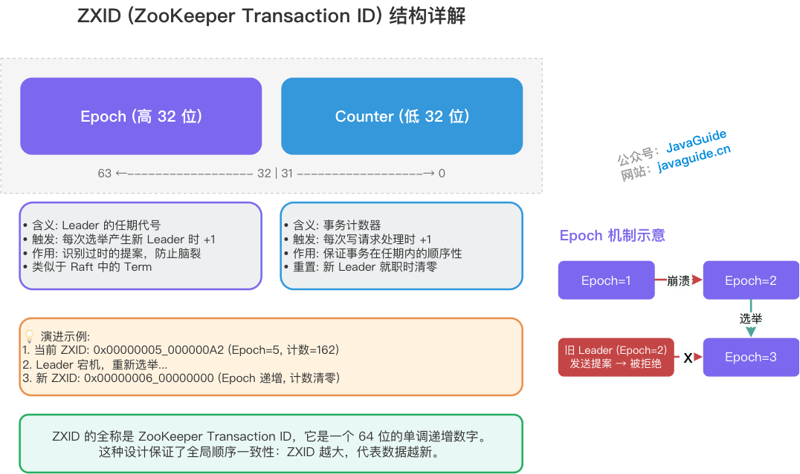
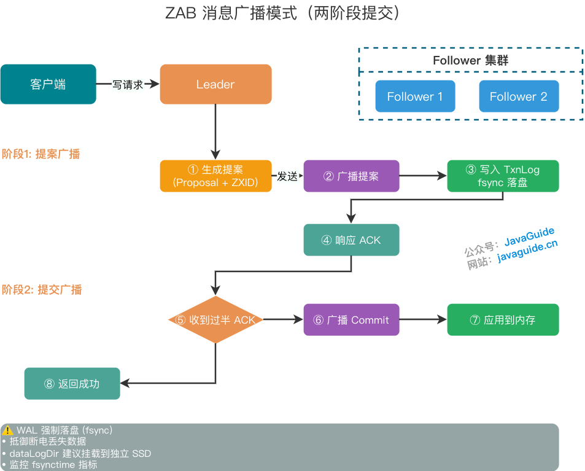
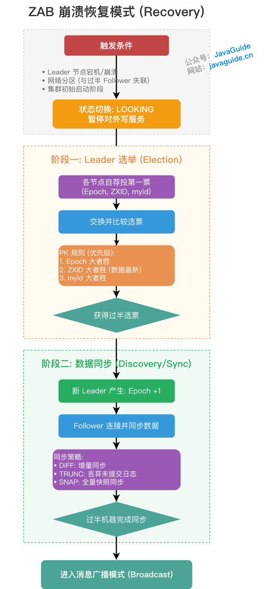

ZooKeeper is a distributed coordination framework known for high availability and data consistency. Although it is sometimes described as using Paxos, its consensus protocol is **ZAB (ZooKeeper Atomic Broadcast)**, which was designed for ZooKeeper.

Unlike the general-purpose Paxos algorithm, ZAB is an **atomic message broadcast algorithm designed for ZooKeeper with crash recovery**. ZooKeeper uses it in a primary-replica architecture to keep cluster replicas consistent.

This article focuses on the protocol. For ZNodes, Watchers, sessions, and use cases, start with [ZooKeeper Fundamentals](../distributed-process-coordination/zookeeper/zookeeper-intro.md). For general concepts such as Leader, Quorum, and split brain, see [Distributed Coordination](./centralized-and-decentralized.md).

## Cluster roles and states

A ZooKeeper cluster has three main roles:

- **Leader:** The cluster's sole coordinator of write requests. It starts votes and coordinates transactions; writes pass through the Leader.
- **Follower:** Handles client reads and forwards writes to the Leader. Followers can vote and be elected during Leader election.
- **Observer:** Handles reads like a Follower but cannot vote or be elected. Observers scale read capacity without increasing the number of votes needed for consensus.

Nodes are typically in one of four states:

- `LOOKING`: Searching for a Leader during an election.
- `LEADING`: Acting as Leader.
- `FOLLOWING`: Following the Leader.
- `OBSERVING`: Acting as an Observer.

## ZXID and Epoch

ZAB uses a globally increasing transaction ID, **ZXID**, to order messages. ZXID is a 64-bit `long`:

- **High 32 bits (Epoch):** Identify the Leader's term. A new Leader advances the Epoch.
- **Low 32 bits (transaction ID):** An increasing counter for write requests. It resets when a new Leader takes over.

## ZAB's two modes

ZAB alternates between **message broadcast** during normal operation and **crash recovery** during startup or failures.

### 1. Message broadcast

The cluster enters broadcast mode when it has a healthy Leader and a majority of nodes have synchronized. The process resembles a simplified two-phase commit:

1. **Create a proposal:** The Leader converts a write request into a proposal with a ZXID.
2. **Send in order:** The Leader maintains a FIFO TCP queue for each Follower so proposals arrive in creation order.
3. **Log and acknowledge:** A Follower appends the proposal to its local transaction log (TxnLog) and calls `fsync` to flush buffered data to disk before sending an `ACK`. This protects against data loss during power failure. A dedicated SSD for ZooKeeper's transaction log directory (`dataLogDir`) can reduce contention with other I/O workloads and avoid `fsync` delays affecting P99 response time. Monitor `fsynctime`; frequent average flush times above 100 ms can threaten cluster stability.
4. **Broadcast commit:** Once a **majority** acknowledges, the Leader considers the write successful. It updates its quorum count when writing its own log rather than sending itself an explicit ACK. After reaching a majority, it responds to the client and broadcasts `Commit`; Followers then apply the data in memory.

### 2. Crash recovery

At startup, or when the Leader crashes or loses contact with a majority of Followers, the cluster pauses service and enters `LOOKING`. Recovery has two stages: **Leader election** and **data recovery**.

#### Stage 1: Leader election

The core principle is to **prefer the node with the most recent data**. Each node initially votes for itself, including `(Epoch, ZXID, myid)` in its vote. Nodes exchange votes and compare candidates in order:

1. **Epoch:** Prefer the higher Epoch.
2. **ZXID:** If Epochs match, prefer the higher ZXID, which indicates newer data.
3. **myid:** If both match, prefer the higher unique server ID.

A candidate becomes Leader after receiving a **majority** of votes. ZooKeeper recommends an odd number of servers to provide majority fault tolerance efficiently.

#### Stage 2: Data recovery

After election, synchronization must provide two guarantees:

1. **Transactions committed by the old Leader are eventually committed by all nodes**, preventing data loss.
2. **Proposals made by the old Leader but not yet committed are discarded**, preventing incomplete data from interfering.

The new Leader advances the highest current `Epoch` and compares its state with each Follower. Each Follower reports the latest `lastZxid` in its transaction log, including proposals that have not yet committed. The Leader chooses **incremental synchronization (DIFF)**, **truncation of uncommitted entries (TRUNC)**, or **full snapshot transfer (SNAP)**.

The Leader must identify incomplete proposals left in a Follower's log by the old Leader before it can issue TRUNC. Reporting only the latest committed ZXID would hide those entries and prevent this recovery path.

The new Epoch also protects the cluster from an old Leader that resumes after a long JVM Full GC pause. If it sends proposals from an old Epoch after a majority has accepted the newer Epoch and joined the new Leader's quorum, those nodes reject the proposals. **Epochs and a majority quorum work together** to prevent split brain: rejecting an old Epoch alone is insufficient unless a majority has joined the new Leader.

Once a majority has synchronized with the new Leader, the cluster leaves recovery and resumes message broadcast.

## Comparison with Raft

ZAB and Raft are similar: both use one Leader, identify terms with Epochs or Terms, and commit after acknowledgment by a majority. This primary-replica and majority-based structure is common in distributed consensus.

Raft is often considered more general and easier to implement because it separates Leader election, log replication, and safety. ZAB is tailored to ZooKeeper's atomic broadcast requirements.

Raft is used by systems including etcd in Kubernetes, HashiCorp Consul, Apache Kafka's Raft-based KRaft after KIP-500, and TiKV. ZAB is primarily tied to ZooKeeper. New projects may choose Raft to avoid ZooKeeper's additional operational complexity and potential scaling bottlenecks. Raft also has an active community and variants for other use cases, including blockchain. For a system already integrated with ZooKeeper, ZAB remains the natural choice; for new, general-purpose consensus designs, Raft is often more practical.

## Summary

ZAB uses Leader election and majority acknowledgment to favor consistency and partition tolerance. During a partition, it can sacrifice availability while electing a Leader to preserve consistency.

**ZAB does not guarantee linearizable reads by default; ZooKeeper provides sequential consistency.** A Follower can serve reads before it has caught up with the Leader, so clients can receive stale data. For operations requiring fresh data, such as distributed locking, the source recommends calling `sync()` before `read()` to bring the connected Follower up to date with the Leader's state.

During a network partition, a client connected to an isolated minority Follower may be unable to write while still reading stale data. Account for this boundary when using ZAB.
