::: tip

- This article covers Dubbo 2. Dubbo 3 builds on it, improving usability, large-scale microservices, cloud-native infrastructure, and security.
- Many links in this article have stopped working because the official documentation URLs changed.

:::

This article assumes you understand the basic RPC call flow. If dynamic proxies, serialization, network transport, or service discovery are unfamiliar, start with [RPC Explained](./rpc-intro.md). The [ZooKeeper guide](../distributed-process-coordination/zookeeper/) provides related context on registries, load balancing, and cluster fault tolerance.

The author compiled this guide from the official documentation and practical experience; contributions are welcome.

## Dubbo basics

### What is Dubbo?


[Apache Dubbo](https://github.com/apache/dubbo) is a high-performance, lightweight open-source web and RPC framework. Its [documentation](https://dubbo.apache.org/zh/) lists six core capabilities:

1. High-performance, interface-based RPC through proxies.
2. Fault tolerance and load balancing.
3. Automatic service registration and discovery.
4. Extensibility.
5. Runtime traffic scheduling.
6. Visual service governance and operations.

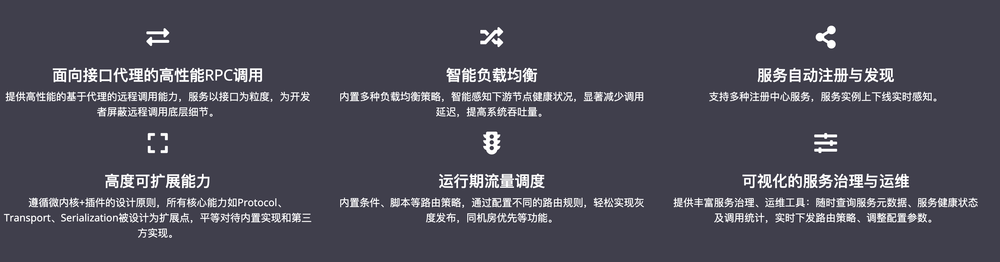

**Dubbo provides remote calls and ready-to-use capabilities such as load balancing.** The source reports approximately 34.4k GitHub stars. In the 2020 OSC China open-source project rankings, Dubbo placed seventh among development frameworks and infrastructure components, lower than in previous years.

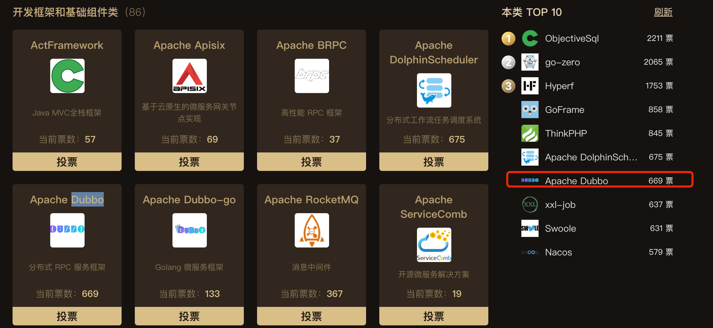

Alibaba open-sourced Dubbo, which later joined Apache. Its adoption helped more companies use distributed architectures.

### Why use Dubbo?

As websites and their user bases grow, a single application or vertical application architecture may no longer meet their needs. A distributed service architecture splits the system into independently provided services, such as messaging and security.

Frameworks such as Java RMI and Hessian can expose and call remote services, but call relationships grow more complex as services multiply. Increasing traffic also creates a need for load balancing and monitoring. Hardware such as F5 can balance traffic, but adds cost and a potential single point of failure.

Dubbo addresses needs including:

1. **Load balancing:** Selecting an instance when a service runs on multiple machines.
2. **Call-chain visibility:** Understanding complex dependencies and calls between services as the system grows.
3. **Traffic and duration statistics, resource scheduling, and governance:** Managing cluster capacity based on traffic to improve utilization.
4. Other service-governance capabilities.

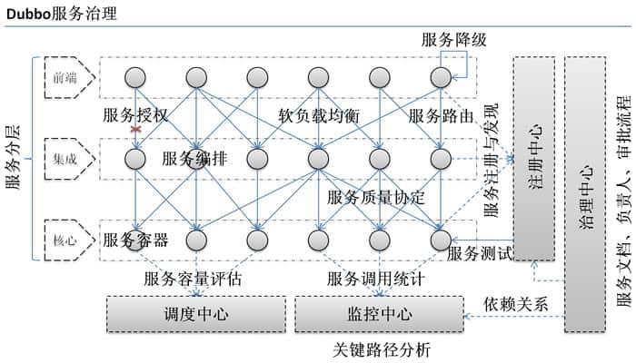

Dubbo can be used in distributed and microservice systems. The author notes that Spring Cloud is more commonly associated with microservices in their experience.

## Distributed systems basics

### What is a distributed system?

A distributed service architecture splits a system into services deployed on different servers to reduce the load on a monolith and improve capacity and performance. For example, an e-commerce system can separate orders, products, and login. Each service can run on a different machine, and a high-traffic service can run on multiple machines.

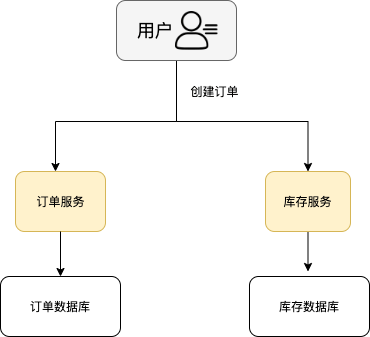

### Why distribute a system?

A monolith concentrates code in one application; a distributed system separates it by business function. Teams can develop separate services, and the resulting boundaries can make maintenance and extension easier. Deploying services separately can also improve scalability and performance.

## Dubbo architecture

### What are the core roles?

The [framework design documentation](https://dubbo.apache.org/zh/docs/v2.7/dev/design/) describes the architecture in detail. The main roles are:

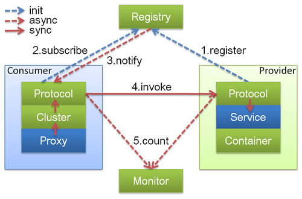

- **Container:** Loads and runs service providers; required.
- **Provider:** Exposes a service and registers it with the registry; required.
- **Consumer:** Calls remote services and subscribes to the services it needs; required.
- **Registry:** Handles service registration and discovery, returning provider addresses to consumers; optional.
- **Monitor:** Collects call counts and durations periodically from consumers and providers; optional.

### What is an Invoker?

`Invoker` is a central concept in Dubbo's domain model and appears throughout the source code, including load balancing. It abstracts a remote invocation.

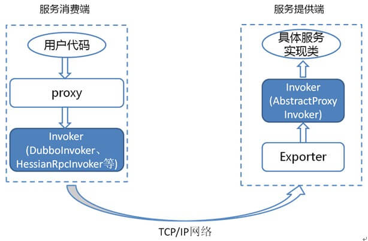

Dubbo distinguishes provider and consumer Invokers. A dynamic proxy hides remote-call details from the caller; the corresponding `Invoker` implementation performs the actual invocation.

### How does Dubbo work?

The diagram shows Dubbo's overall design as ten layers with one-way dependencies.

> Interfaces on the light blue left side are used by consumers, those on the light green right side by providers, and those in the center by both.

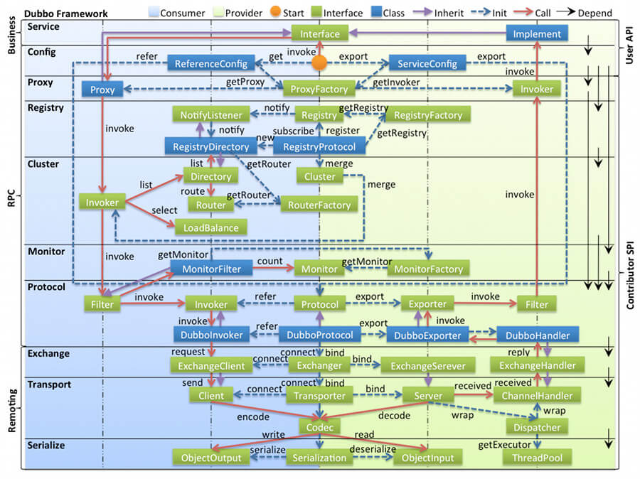

- **config:** Configuration through code or Spring, centered on `ServiceConfig` and `ReferenceConfig`.
- **proxy:** Makes remote calls resemble local calls; centered on `ServiceProxy`.
- **registry:** Encapsulates service address registration and discovery.
- **cluster:** Routes and load-balances across providers and connects to the registry; centered on `Invoker`.
- **monitor:** Tracks RPC call counts and durations; centered on `Statistics`.
- **protocol:** Encapsulates RPC calls; centered on `Invocation` and `Result`.
- **exchange:** Encapsulates request-response communication and converts synchronous calls to asynchronous processing; centered on `Request` and `Response`.
- **transport:** Abstracts Mina and Netty behind a common interface; centered on `Message`.
- **serialize:** Serializes data for network transmission.

### How does Dubbo SPI work, and how can a default implementation be extended?

SPI (Service Provider Interface) dynamically locates implementations of a service or feature, such as a load-balancing strategy. Implementations are listed in configuration files; at runtime, the program reads the configuration and loads classes through reflection. This allows implementations to be replaced dynamically, similar to IoC's decoupling principle.

Java provides SPI, but Dubbo extends the standard mechanism to meet its requirements. For example, implement `LoadBalance` or extend `AbstractLoadBalance` to create a custom strategy:

```java
package com.xxx;

import org.apache.dubbo.rpc.cluster.LoadBalance;
import org.apache.dubbo.rpc.Invoker;
import org.apache.dubbo.rpc.Invocation;
import org.apache.dubbo.rpc.RpcException;

public class XxxLoadBalance implements LoadBalance {
    public <T> Invoker<T> select(List<Invoker<T>> invokers, Invocation invocation) throws RpcException {
        // ...
    }
}
```

Add its class path under `resources/META-INF/dubbo/org.apache.dubbo.rpc.cluster.LoadBalance`:

```java
src
 |-main
    |-java
        |-com
            |-xxx
                |-XxxLoadBalance.java (implements LoadBalance)
    |-resources
        |-META-INF
            |-dubbo
                |-org.apache.dubbo.rpc.cluster.LoadBalance (plain text file containing: xxx=com.xxx.XxxLoadBalance)
```

`org.apache.dubbo.rpc.cluster.LoadBalance`:

```plain
xxx=com.xxx.XxxLoadBalance
```

See the [official documentation](https://cn.dubbo.apache.org/zh-cn/overview/home/) for other extension points.

### What is Dubbo's microkernel architecture?

Dubbo uses a **microkernel and plugin** pattern. The microkernel assembles plugins. The book _Software Architecture Patterns_ describes this pattern as a core application extended with versioned, downloadable plugins, separating functionality and allowing applications to add capabilities.

A microkernel architecture has a **core system** and **plugin modules**:

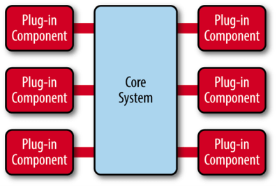

The core provides essential capabilities; plugins extend them. IDEs such as IntelliJ IDEA and VS Code are familiar examples. Dubbo's architecture likewise lets users replace features, such as its serialization implementation.

Microkernels commonly manage plugin lifecycles with factories, IoC, or OSGi. To avoid depending on Spring or creating its own IoC container, Dubbo uses a factory approach and the JDK SPI extension mechanism (`java.util.ServiceLoader`).

### Architecture review questions

#### What does the registry do?

It registers and looks up service addresses as a directory service. Providers and consumers interact with it at startup.

#### What happens when a provider fails?

The registry pushes an event to notify consumers.

#### What does the monitor do?

It records metrics such as service call counts and durations.

#### Do services fail if both the registry and monitor are down?

No. Running providers and consumers can continue because consumers cache provider lists locally. Both components are optional, and a consumer can connect directly to a provider.

## Dubbo load balancing

### What is load balancing?

Load balancing distributes work across resources such as computers, clusters, network links, CPUs, or disks. Its goals include better resource use and throughput, lower response time, and avoiding overload. Multiple components can also improve reliability through redundancy, often with dedicated software or hardware.

For example, when a popular service runs on multiple servers, a load balancer selects which server handles each client request instead of sending all traffic to one machine.

### Which strategies does Dubbo provide?

Dubbo offers several strategies; `random` is the default. Custom strategies can be added through Dubbo SPI. The implementations discussed here extend `AbstractLoadBalance`, which implements `LoadBalance` and supplies shared logic:

```java
public abstract class AbstractLoadBalance implements LoadBalance {

    static int calculateWarmupWeight(int uptime, int warmup, int weight) {
    }

    @Override
    public <T> Invoker<T> select(List<Invoker<T>> invokers, URL url, Invocation invocation) {
    }

    protected abstract <T> Invoker<T> doSelect(List<Invoker<T>> invokers, URL url, Invocation invocation);


    int getWeight(Invoker<?> invoker, Invocation invocation) {

    }
}
```

Its implementations include:

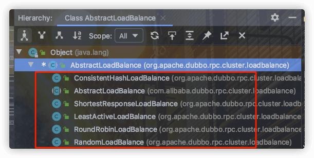

The [official documentation](https://dubbo.apache.org/zh/docs/v2.7/dev/source/loadbalance/#m-zhdocsv27devsourceloadbalance) explains these strategies in detail.

#### RandomLoadBalance

This default strategy uses weighted random selection. Suppose servers S1 and S2 have weights 7 and 3. Assign S1 the interval `[0, 7)` and S2 `[7, 10)`, then generate a random number in `[0, 10)` and select the corresponding server.

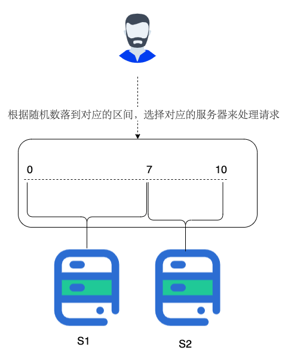

The following source is from Dubbo 2.7.9 on the master branch:

```java
public class RandomLoadBalance extends AbstractLoadBalance {

    public static final String NAME = "random";

    @Override
    protected <T> Invoker<T> doSelect(List<Invoker<T>> invokers, URL url, Invocation invocation) {

        int length = invokers.size();
        boolean sameWeight = true;
        int[] weights = new int[length];
        int totalWeight = 0;
        // Calculate the total provider weight,
        // and check whether all providers have the same weight.
        for (int i = 0; i < length; i++) {
            int weight = getWeight(invokers.get(i), invocation);
            totalWeight += weight;
            weights[i] = totalWeight;
            if (sameWeight && totalWeight != weight * (i + 1)) {
                sameWeight = false;
            }
        }
        if (totalWeight > 0 && !sameWeight) {
            // Choose a random number in [0, totalWeight).
            int offset = ThreadLocalRandom.current().nextInt(totalWeight);
            // Find the provider whose interval contains it.
            for (int i = 0; i < length; i++) {
                if (offset < weights[i]) {
                    return invokers.get(i);
                }
            }

        return invokers.get(ThreadLocalRandom.current().nextInt(length));
    }

}

```

#### LeastActiveLoadBalance

This strategy selects the provider with the fewest active calls. Each provider starts with an active count of zero for a particular method. The count increases when a request arrives and decreases when it completes. Dubbo favors a lower count as an indication that the provider is processing requests faster.

If multiple providers have the same minimum count, weighted random selection resolves the tie:

```java
public class LeastActiveLoadBalance extends AbstractLoadBalance {

    public static final String NAME = "leastactive";

    @Override
    protected <T> Invoker<T> doSelect(List<Invoker<T>> invokers, URL url, Invocation invocation) {
        int length = invokers.size();
        int leastActive = -1;
        int leastCount = 0;
        int[] leastIndexes = new int[length];
        int[] weights = new int[length];
        int totalWeight = 0;
        int firstWeight = 0;
        boolean sameWeight = true;
        // Find the invoker with the fewest active calls.
        // For ties, record their indexes, total their weights, and compare weights.
        for (int i = 0; i < length; i++) {
            Invoker<T> invoker = invokers.get(i);
            // Get the active call count for this invoker.
            int active = RpcStatus.getStatus(invoker.getUrl(), invocation.getMethodName()).getActive();
            int afterWarmup = getWeight(invoker, invocation);
            weights[i] = afterWarmup;
            if (leastActive == -1 || active < leastActive) {
                leastActive = active;
                leastCount = 1;
                leastIndexes[0] = i;
                totalWeight = afterWarmup;
                firstWeight = afterWarmup;
                sameWeight = true;
            } else if (active == leastActive) {
                leastIndexes[leastCount++] = i;
                totalWeight += afterWarmup;
                if (sameWeight && afterWarmup != firstWeight) {
                    sameWeight = false;
                }
            }
        }
       // Return the only invoker with the minimum active count.
        if (leastCount == 1) {
            return invokers.get(leastIndexes[0]);
        }
        // If tied invokers have different weights,
        // select using the same approach as RandomLoadBalance.
        if (!sameWeight && totalWeight > 0) {
            int offsetWeight = ThreadLocalRandom.current().nextInt(totalWeight);
            for (int i = 0; i < leastCount; i++) {
                int leastIndex = leastIndexes[i];
                offsetWeight -= weights[leastIndex];
                if (offsetWeight < 0) {
                    return invokers.get(leastIndex);
                }
            }
        }
        return invokers.get(leastIndexes[ThreadLocalRandom.current().nextInt(leastCount)]);
    }
}

```

`RpcStatus` stores active counts in a `ConcurrentMap`, keyed by provider URL and method name. Each method's count is independent:

```java
public class RpcStatus {

    private static final ConcurrentMap<String, ConcurrentMap<String, RpcStatus>> METHOD_STATISTICS =
            new ConcurrentHashMap<String, ConcurrentMap<String, RpcStatus>>();

   public static RpcStatus getStatus(URL url, String methodName) {
        String uri = url.toIdentityString();
        ConcurrentMap<String, RpcStatus> map = METHOD_STATISTICS.computeIfAbsent(uri, k -> new ConcurrentHashMap<>());
        return map.computeIfAbsent(methodName, k -> new RpcStatus());
    }
    public int getActive() {
        return active.get();
    }

}
```

#### ConsistentHashLoadBalance

This strategy uses **consistent hashing**, also common in sharded databases and clusters. It does not use weights; request parameters determine the provider, so requests with the same parameters go to the same provider.

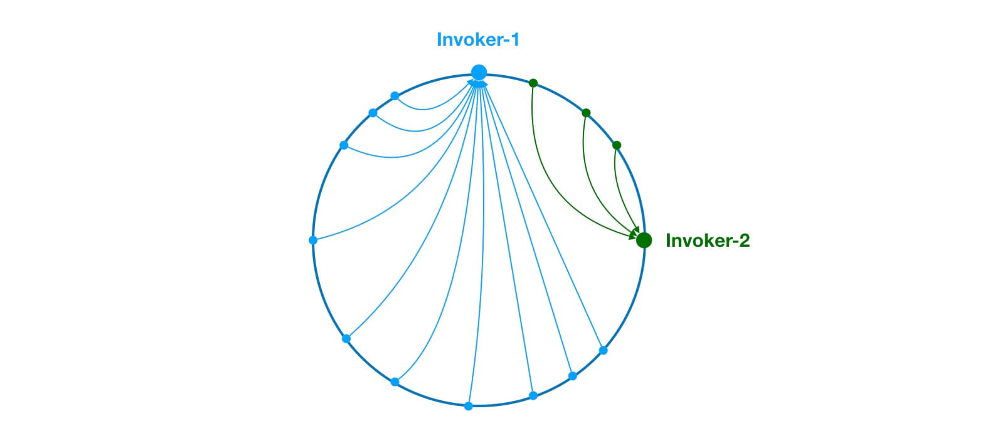

Dubbo uses virtual nodes to distribute positions more evenly and reduce the risk that many requests land on one node.

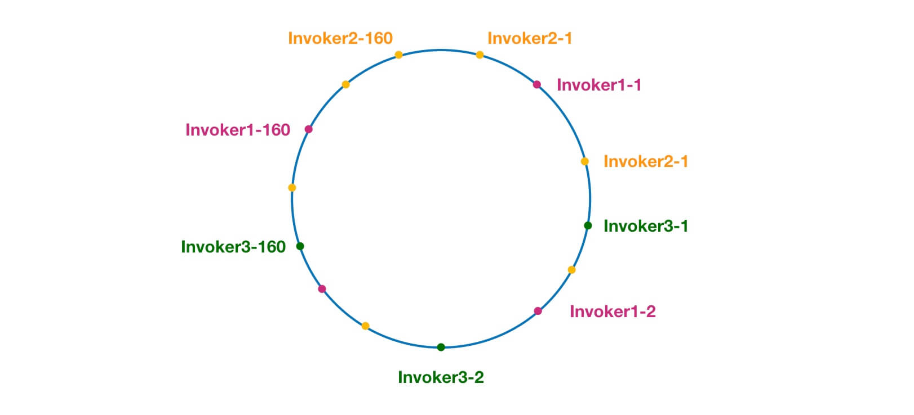

The [official source analysis](https://dubbo.apache.org/zh/docs/v2.7/dev/source/loadbalance/#23-consistenthashloadbalance) gives more detail. [PR #5440](https://github.com/apache/dubbo/pull/5440) fixes bugs in older versions of `ConsistentHashLoadBalance`.

#### RoundRobinLoadBalance

This is weighted round-robin load balancing. Ordinary round robin assigns requests to providers in turn; weighted round robin sends more requests to providers with higher weights. With S1 weighted 7 and S2 weighted 3, seven out of ten requests go to S1 and three to S2. Weighted random selection might instead send nine of ten to S1 because its results are probabilistic.

`RoundRobinLoadBalance` has been revised several times. Dubbo 2.6.5 uses smooth weighted round robin.

## Dubbo serialization protocols

### Which serialization methods does Dubbo support?

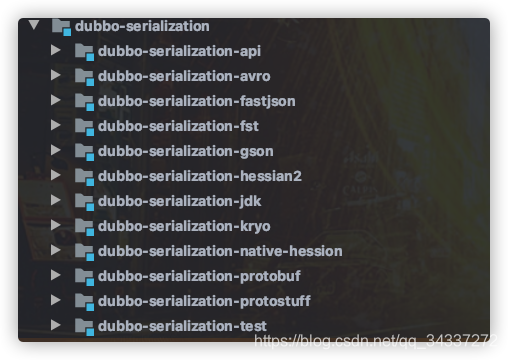

Dubbo supports JDK serialization, Hessian2, JSON, Kryo, FST, Protostuff, Protocol Buffers, and others. The version discussed here defaults to Hessian2.

### How do these protocols compare?

JDK serialization is generally avoided for two reasons:

1. **No cross-language support:** It cannot directly support services implemented in other languages.
2. **Performance:** Serialized byte arrays can be relatively large, increasing transmission costs.

The source also advises against JSON when performance is critical. Protostuff, Protocol Buffers, and Hessian2 can be considered for cross-language calls. Kryo and FST were added later and offer good performance, but target Java. A Dubbo article recommends Kryo for production use.

The Dubbo documentation provides a [serialization performance comparison](https://dubbo.apache.org/zh/docs/v2.7/user/serialization/#m-zhdocsv27userserialization):

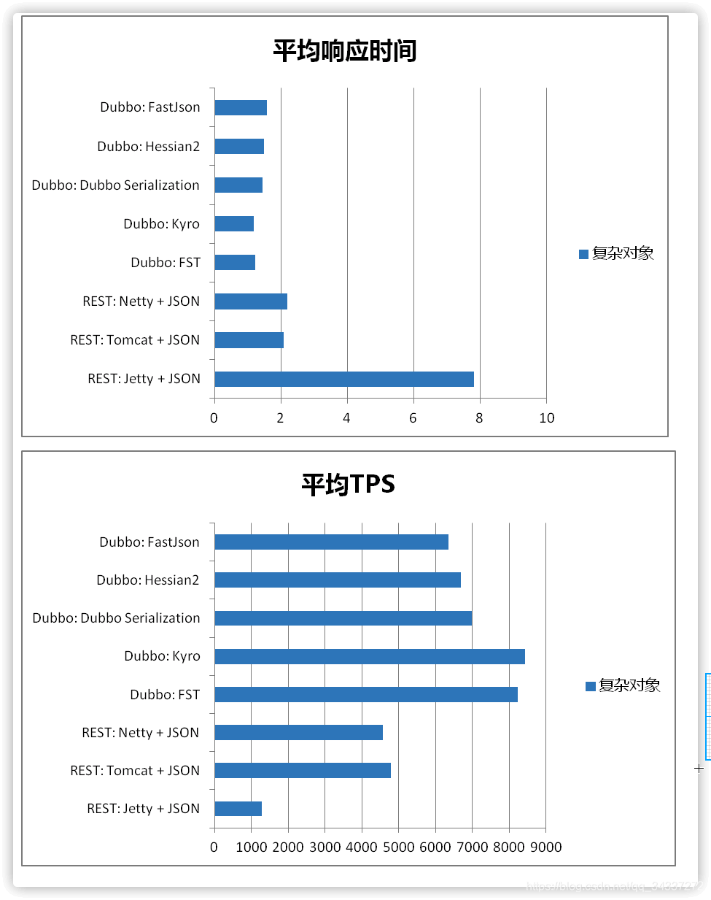

<!-- @include: @article-footer.snippet.md -->
