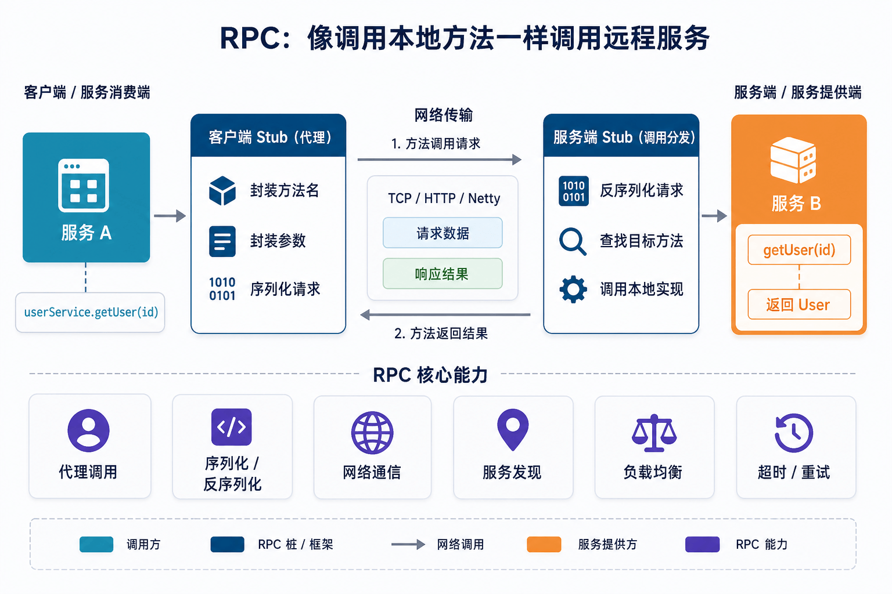
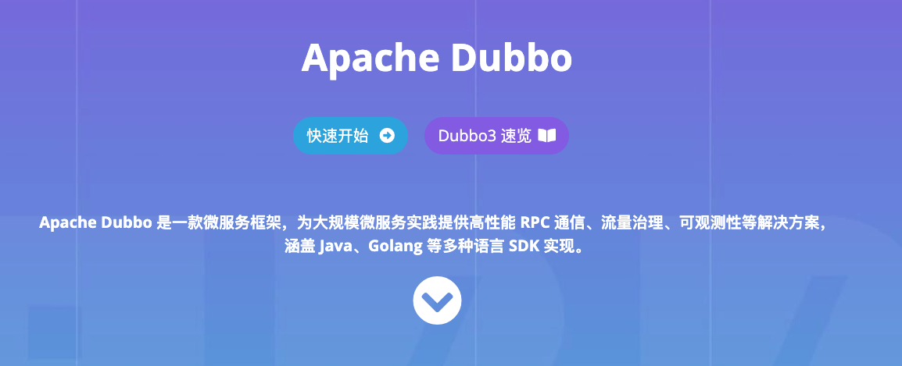
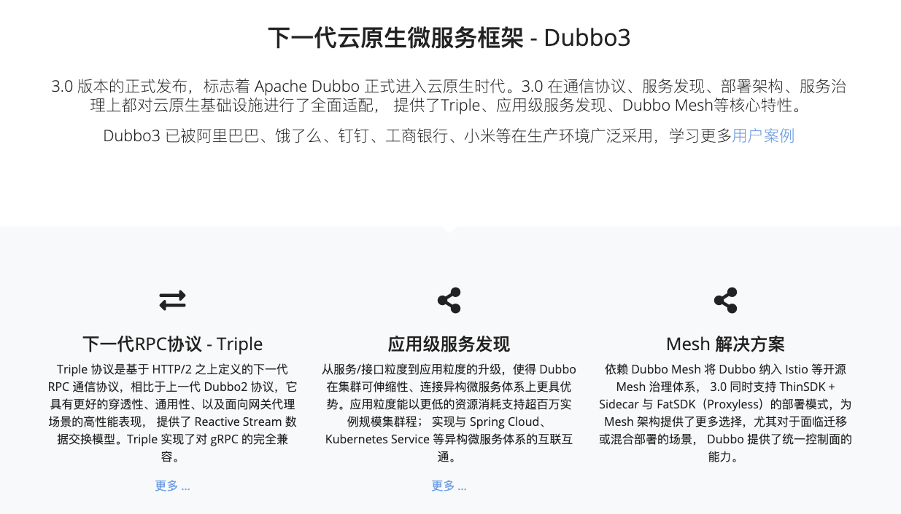
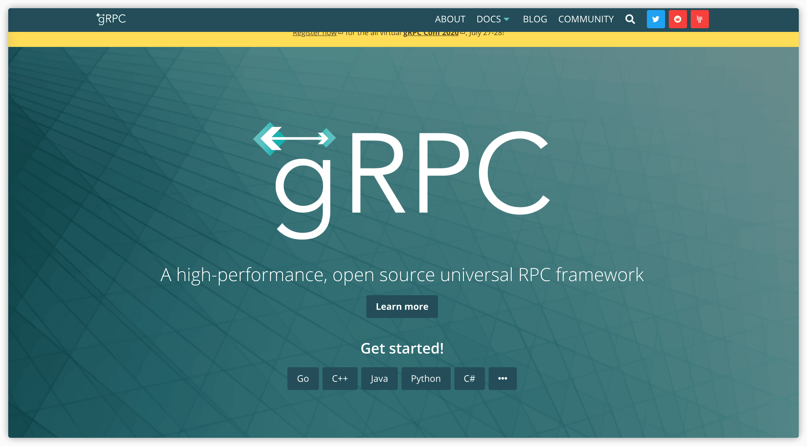
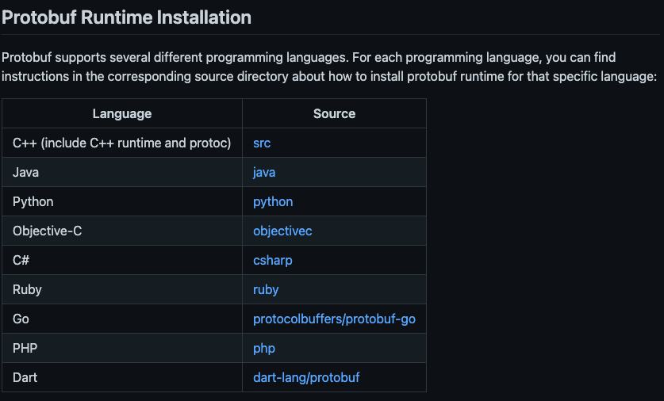
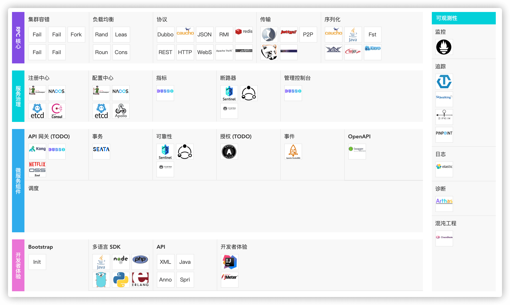
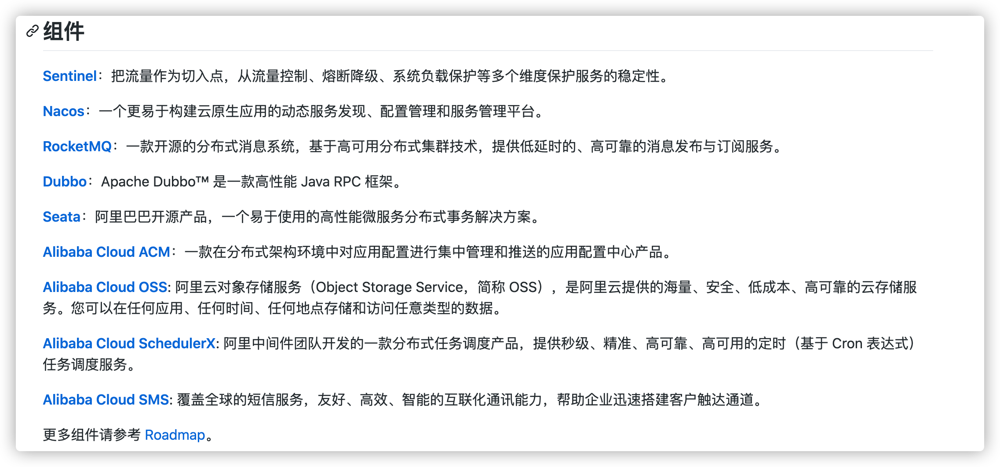
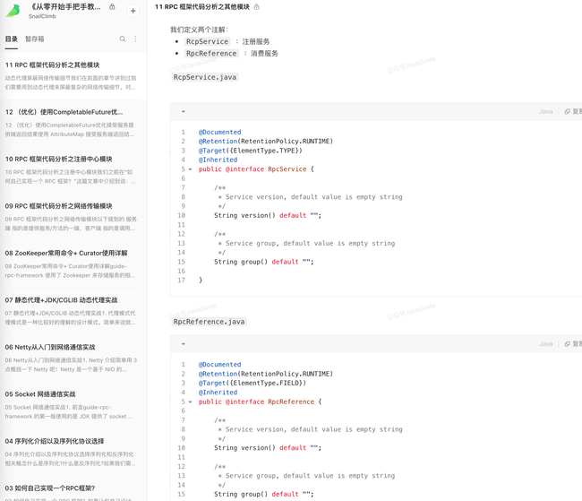

This article introduces the basics of RPC.

In a distributed system, RPC addresses **how services call one another**. External requests typically enter through an [API gateway](../api-gateway.md); internal services then collaborate through RPC, HTTP clients, message queues, or other mechanisms. For service governance in a mature RPC framework, see [Dubbo Interview Questions](./dubbo.md).

## What is RPC?

**RPC (Remote Procedure Call)** focuses on calling procedures in another process or machine.

**Why use RPC?** Services on different servers do not share a memory space. The caller must send method arguments over a network and receive the result over that network. Implementing the entire process manually requires work on transport choices such as TCP or UDP, serialization, and related details.

**What does RPC provide?** It lets a program call a method provided by a service on a remote machine through an interface resembling a local call, without implementing the underlying network communication itself.

For example, if services A and B run on different machines, A can use RPC to call a method provided by B. The goal is to make that remote call convenient while hiding much of the transport machinery.

## How does RPC work?

An RPC framework can be viewed as five parts:

1. **Client (service consumer):** Calls the remote method.
2. **Client stub:** A proxy that passes the method, class, arguments, and other call information to the server.
3. **Network transport:** Sends the request to the server and returns its result. Implementations can use sockets or a library such as Netty.
4. **Server stub:** Receives a request, invokes the corresponding method, and returns the result.
5. **Server (service provider):** Provides the remote method.

A typical call proceeds as follows:

1. The client invokes the remote service through a local-style call.
2. The client stub serializes the method and arguments into an `RpcRequest` message.
3. The client stub finds the remote service's address and sends the message.
4. The server stub deserializes the message into a Java `RpcRequest` object.
5. The server stub uses the class, method, and arguments in the request to invoke the local method.
6. The server stub serializes the result into an `RpcResponse` and sends it back.
7. The client stub deserializes the response into a Java `RpcResponse`, giving the caller the result.

For interviews, practice drawing and explaining this flow as well as understanding the individual components.

## Common RPC frameworks

Here, an RPC framework lets a client invoke server methods through a local-style interface, as with Dubbo, Motan, or gRPC. A framework that primarily constructs and parses HTTP requests and responses, such as Feign, is not classified as an RPC framework in this discussion.

### Dubbo

Apache Dubbo is a microservice framework offering high-performance RPC communication, traffic management, and observability for large-scale services. It has SDKs for languages including Java and Go.

Dubbo provides service governance capabilities from service definition, discovery, and communication through traffic control. Its features include the Triple protocol, defined on HTTP/2; application-level service discovery; and Dubbo Mesh, part of Dubbo 3's cloud-native support.

Alibaba open-sourced Dubbo, which later joined Apache. Its adoption helped more companies use distributed architectures, and its source code is useful study material.

- [GitHub](https://github.com/apache/incubator-dubbo)
- [Official website](https://dubbo.apache.org/zh/)

### Motan

Motan is an RPC framework open-sourced by Sina Weibo and reportedly supports hundreds of billions of calls there. The author has seen relatively little adoption and documentation elsewhere.

Motan is often compared with Dubbo because both originated at large Chinese companies. After reviewing documentation and some source code, the author describes **Motan as a more streamlined framework that appears to draw on ideas from Dubbo**.

The author recommends Dubbo for practical projects because of its more active community and broader ecosystem.

- [RPC framework design through Motan](http://kriszhang.com/motan-rpc-impl/)
- [Motan documentation in Chinese](https://github.com/weibocom/motan/wiki/zh_overview)

### gRPC

gRPC is a high-performance, general-purpose RPC framework open-sourced by Google. It uses HTTP/2 features such as bidirectional streaming and header compression to save bandwidth, uses Protocol Buffers for serialization, and supports many languages.

**What is Protocol Buffers?** [Protocol Buffers](https://github.com/protocolbuffers/protobuf) is a flexible, efficient, platform-independent data format for communication and storage. It supports most mainstream languages, though defining interfaces and data types can require extra work.

gRPC's communication layer influenced the improvements in [Dubbo-go 3.0](https://dubbogo.github.io/). The article notes that gRPC provides limited built-in service governance and suggests using additional components such as Tencent's PolarisMesh when those capabilities are needed.

- [GitHub](https://github.com/grpc/grpc)
- [Official website](https://grpc.io/)

### Thrift

Apache Thrift is a cross-language RPC framework open-sourced by Facebook and donated to the Apache Foundation. Its language support and performance have led many Internet companies to adopt it; some build additional features such as service registration and discovery on top.

Thrift supports languages including C++, Java, Python, PHP, and Ruby. The source describes its language support as broader than gRPC's.

- [Official website](https://thrift.apache.org/)
- [Introduction to Thrift](https://www.jianshu.com/p/8f25d057a5a9)

### Summary

gRPC and Thrift support cross-language RPC but provide fewer integrated service-governance components. The author favors Dubbo for its features, ecosystem, active community, production use at companies such as Dangdang and Didi, and available learning material.

The following diagram shows Dubbo's ecosystem:

Dubbo is also a component of Spring Cloud Alibaba.

The source notes that Dubbo and Motan have traditionally focused on Java, despite supporting some other languages, and suggests gRPC for calls across many languages. For a Java backend choosing an RPC framework, the author recommends considering Dubbo.

## How do you design and implement an RPC framework?

**Building an RPC Framework** is a booklet in the author's [Knowledge Planet](https://javaguide.cn/about-the-author/zhishixingqiu-two-years.html). Its 12 articles explain how to build a simple RPC framework from scratch using Netty, Kryo, and ZooKeeper.

The project has detailed code comments, a clear structure, and Checkstyle integration, making it suitable for study.

**Contents overview:**

## Why use RPC when HTTP exists?

For a detailed answer, see [Why use RPC when HTTP exists?](../../cs-basics/network/http-vs-rpc.md).

<!-- @include: @article-footer.snippet.md -->
