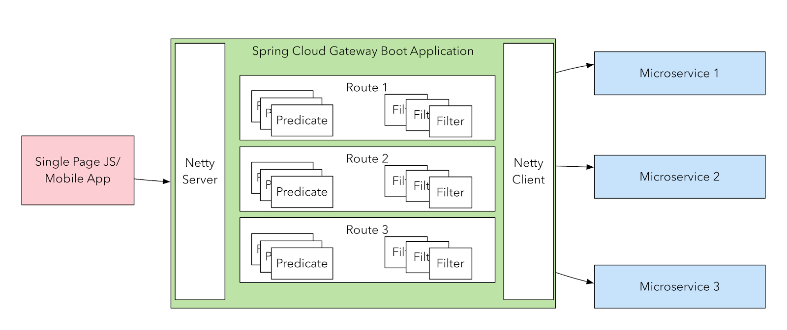
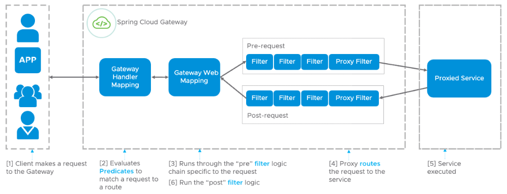
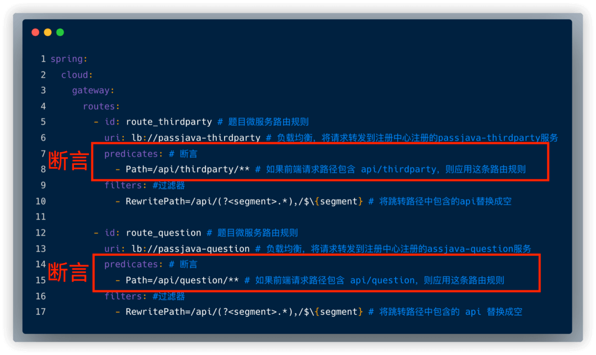
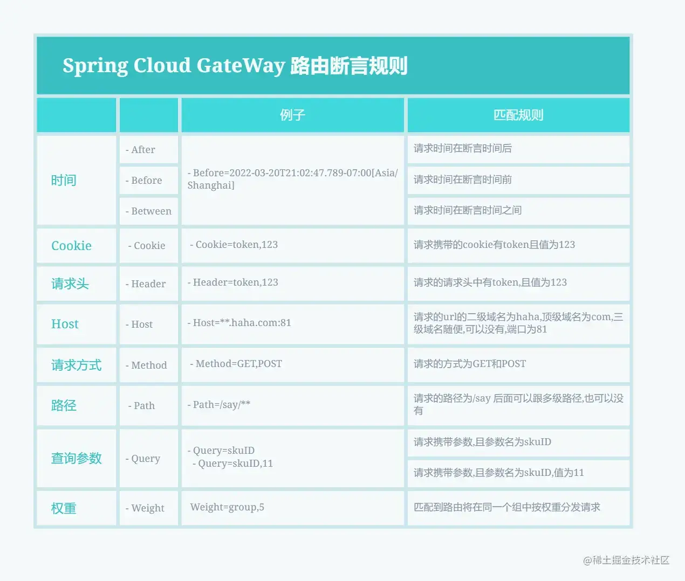
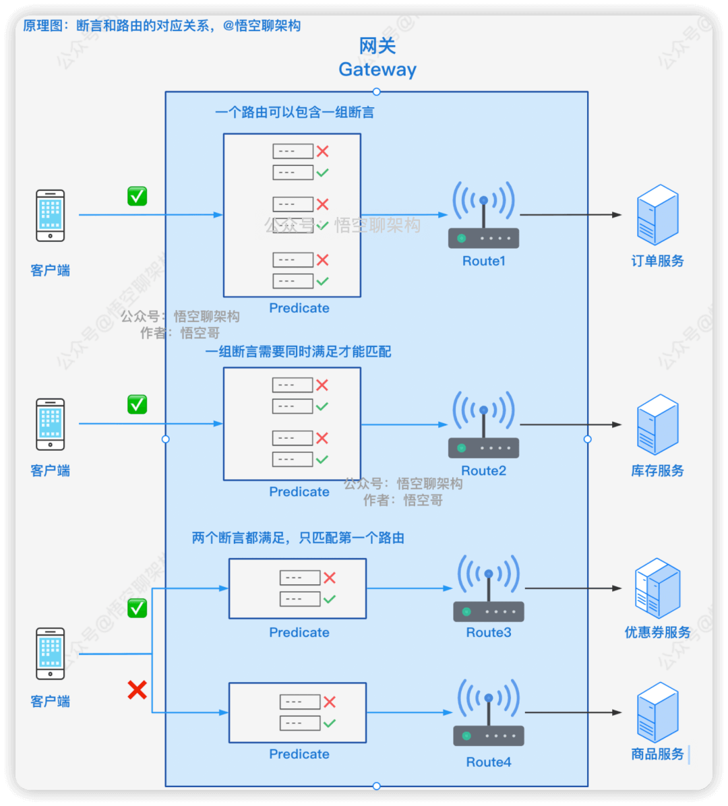
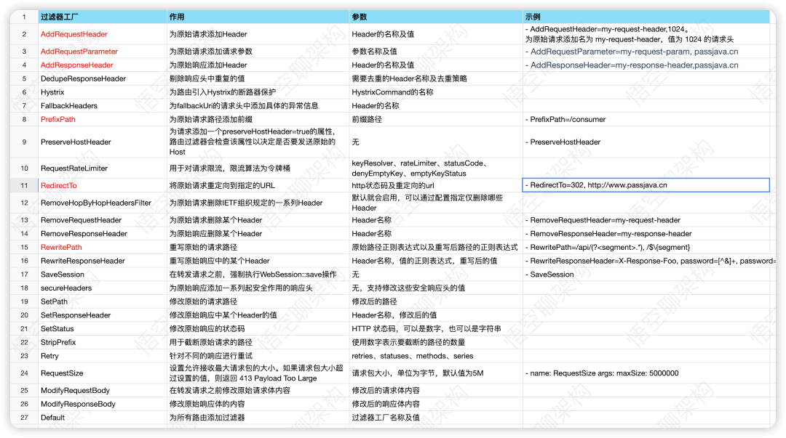
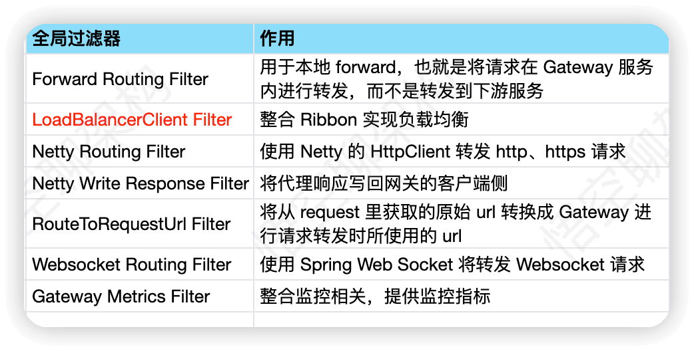

> This article was adapted from [Understanding Spring Cloud Gateway's Principles](https://mp.weixin.qq.com/s/XjFYsP1IUqNzWqXZdJn-Aw).

This guide covers common Spring Cloud Gateway interview topics. For why gateways exist, their relationship to RPC, and choosing among Zuul, Gateway, Kong, and APISIX, start with [API Gateways](./api-gateway.md).

## What is Spring Cloud Gateway?

Spring Cloud Gateway is a gateway in the Spring Cloud ecosystem, created primarily as an alternative to **Zuul 1.x**. Zuul 1.x uses blocking Servlet I/O, which can limit performance under high concurrency. Zuul 2.x uses nonblocking Netty I/O, but Spring Cloud did not officially integrate it. Spring Cloud Gateway began before Zuul 2.x.

Gateway is based on Spring WebFlux, which uses Reactor for reactive programming and Netty for nonblocking I/O.



It provides routing and a filter chain for gateway functions such as security, monitoring, metrics, and rate limiting. Like Zuul 2.x, it processes requests with filters; the source recommends Gateway because of its closer Spring Cloud integration.

- [GitHub](https://github.com/spring-cloud/spring-cloud-gateway)
- [Official website](https://spring.io/projects/spring-cloud-gateway)

## How does a request flow through Gateway?



The diagram comes from the [Spring blog](https://spring.io/blog/2022/08/26/creating-a-custom-spring-cloud-gateway-filter):

1. **Route matching:** Gateway Handler Mapping evaluates predicates to find a route mapped to a backend service.
2. **Request filtering:** Gateway Web Handler runs the filter chain. Filters can intercept or change the request, for example by adding headers or validating parameters, before forwarding it. These are logically called pre-filters.
3. **Service processing:** The backend handles the request.
4. **Response filtering:** The response passes through filters again, logically called post-filters.
5. **Return:** The filtered response goes back to the client.

In short, Gateway matches a route, filters and forwards the request, then filters the backend response before returning it.

## What is a predicate?

A predicate tests a request condition. If true, the request matches the route; if false, Gateway can try other routes. A matching route forwards the request to its configured service.

The example configures two routes. A request URL containing `api/thirdparty` matches `route_thirdparty`:



Common route predicate rules:



## How do routes and predicates relate?



- **One to many:** A route can contain multiple predicates, as Route1 does in the diagram.
- **All must match:** Route2 matches only if the request satisfies both configured predicates.
- **First match:** If a request matches more than one route, the first matching route is selected. In the diagram, the request matches Route3 and Route4, but Route3 appears earlier in the configuration.

## How can routes be updated dynamically?

The basic documentation examples configure routes in files or code. As an entry point for microservices, a gateway should support runtime configuration changes without requiring a restart for each change.

One approach uses Nacos. Gateway can obtain service metadata, such as service names and paths, from the registry and generate route rules. As service instances are added, removed, or updated, the gateway can discover changes and adjust routing without manually maintaining every route.

Nacos Server and Spring Cloud Alibaba Nacos Config can support dynamic configuration changes. See the [Nacos Config documentation](https://github.com/alibaba/spring-cloud-alibaba/wiki/Nacos-config).

## What filters are available?

By request phase:

- **Pre-filters** intercept or modify requests before they reach a service, for example for parameter validation, authorization, traffic monitoring, logging, or protocol conversion.
- **Post-filters** process responses after the service handles a request, for example to modify response bodies or headers, log, or monitor traffic.

By scope:

- **GatewayFilter:** A route-specific filter applied to one route or a group of routes. Common filters are highlighted in red in the source diagram.
- **GlobalFilter:** A filter applied to all routes.

### Route-specific filters



This example removes `api` from a matching URL:

```yaml
filters: # Filters
  - RewritePath=/api/(?<segment>.*),/$\{segment} # Remove the api prefix
```

Custom filters can also be implemented; they are outside this article's scope.

### Global filters



A common global-filter use is load balancing:

```yaml
spring:
  cloud:
    gateway:
      routes:
        - id: route_member # Microservice route
          uri: lb://passjava-member # Load-balance requests to the registered service
          predicates: # Predicates
            - Path=/api/member/** # Match this request path
          filters: # Filters
            - RewritePath=/api/(?<segment>.*),/$\{segment} # Remove the api prefix
```

The `lb` URI uses `LoadBalancerClientFilter`. When the route matches, the service name `passjava-member` is resolved to a host and port, and the request is forwarded with load balancing.

## Does Gateway support rate limiting?

Gateway includes a rate-limiting filter and a `RateLimiter` interface. The source describes `RedisRateLimiter`, based on Redis and Lua, as its built-in implementation and notes that its capabilities are relatively simple.

Since Sentinel 1.6.0, Sentinel has provided a Spring Cloud Gateway adapter supporting rate limits by route or custom API, enabling more advanced gateway traffic control.

## How can global exceptions be handled?

In a Spring Boot application, global exception handling commonly uses `@RestControllerAdvice` and `@ExceptionHandler`. The source notes that this approach does not apply to Spring Cloud Gateway.

One common option is to implement `ErrorWebExceptionHandler` and override `handle`:

```java
@Order(-1)
@Component
@RequiredArgsConstructor
public class GlobalErrorWebExceptionHandler implements ErrorWebExceptionHandler {
    private final ObjectMapper objectMapper;

    @Override
    public Mono<Void> handle(ServerWebExchange exchange, Throwable ex) {
        // ...
    }
}
```

## References

- [Spring Cloud Gateway documentation](https://cloud.spring.io/spring-cloud-gateway/reference/html/)
- [Creating a Custom Spring Cloud Gateway Filter](https://spring.io/blog/2022/08/26/creating-a-custom-spring-cloud-gateway-filter)
- [Global exception handling](https://zhuanlan.zhihu.com/p/347028665)

<!-- @include: @article-footer.snippet.md -->
