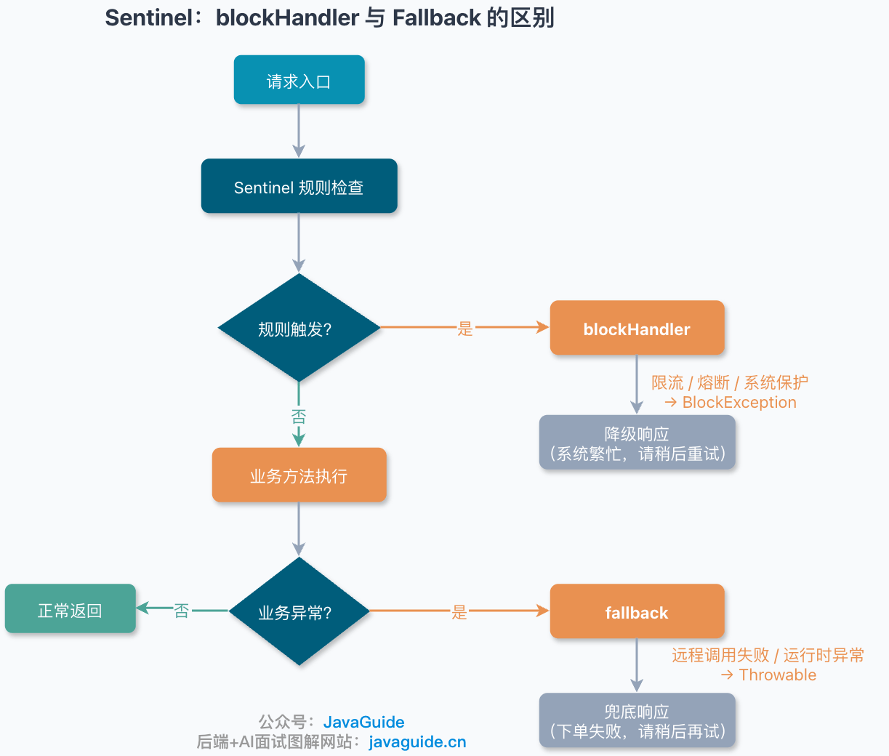
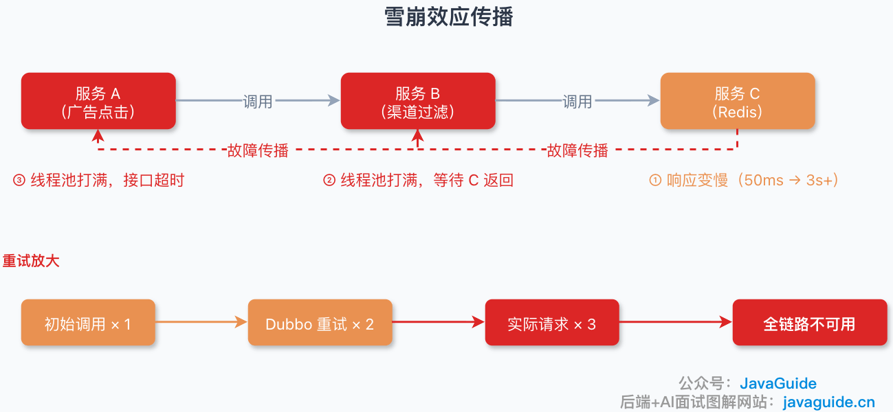
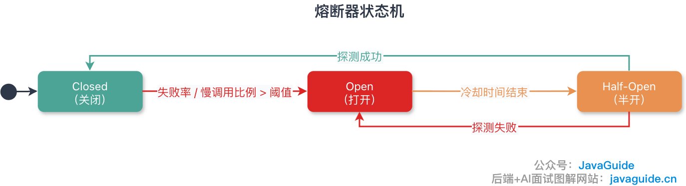
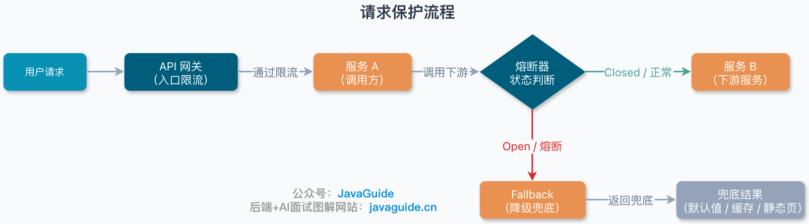
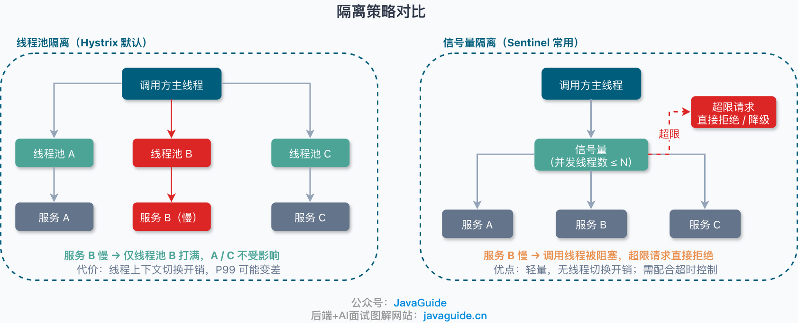

In a microservices architecture, a request often passes through several services. If one service in the chain has a problem—such as slow responses, timeouts, or a crash—it can exhaust upstream resources and trigger a cascading failure across the entire chain. Service fallback and circuit breaking are two defenses against this: fallback sheds nonessential work under pressure, while circuit breaking stops calls to a persistently failing downstream service.

This guide explains the core ideas behind fallbacks and circuit breakers, including fallback strategies, fallback switches, circuit-breaker state machines, isolation strategies, and how to choose between Sentinel, Hystrix, and Resilience4j.

## What Is Service Fallback?

Service fallback means **temporarily sacrificing nonessential features when the system is under pressure, so resources remain available for critical workflows.**

For example, during a major e-commerce sale, nonessential features such as recommendations, ad placements, and promotional images can be disabled, while ordering, payment, and inventory deduction should remain available. Users can live without a recommendation; being unable to place an order is a real incident.

Fallback should be designed in advance. It is not a matter of returning an arbitrary default after the system fails. Decide ahead of time when to trigger it, which features to disable, what to return, and how to recover.

### When Should Fallback Be Triggered?

Fallback is often associated only with high machine load, but there are several other triggers.

Common triggers include:

- Excessive system load, such as high CPU usage, saturated thread pools, or sharply increased response times.
- A downstream service acting up, such as a spike in timeouts from inventory, pricing, or recommendation services.
- A failure in a data center, region, or network link.
- Planned disabling of nonessential features before a major sale, flash sale, or campaign launch.
- A temporary need by operations to control access to a feature.

Regardless of the trigger, the goal is the same: **preserve critical functions and shed nonessential ones.**

### How Granular Can Fallback Be?

Fallback can be applied at different levels of granularity.

At a coarse level, you can fall back for an entire service. For example, if the recommendation service fails, return an empty list for all recommendations.

More narrowly, you can disable a single section of a page. For example, keep the product details page available but hide its “You may also like” section.

You can also fall back for a specific API, feature switch, user group, or business scenario.

In practice, features are usually assigned priorities. For example:

- Recommendations, ads, and rankings: low priority; disable these first when problems occur.
- Product details and shopping carts: higher priority; keep them available if possible.
- Orders, payments, and inventory: critical workflows; consider falling back on these only as a last resort.

Labels such as L0–L4 or priority levels 1–10 are team conventions, not industry standards. What matters is deciding in advance **which features can be sacrificed and which must be preserved.**

### Fallback Strategies

#### 1. Deferred Processing

Some operations do not need to complete synchronously and can be placed on an MQ for later processing.

For example, awarding points after a review, tracking user behavior, or generating reports can usually be delayed by a few seconds without the user noticing. The main workflow can return success first, leaving the rest to an asynchronous task.

There is a caveat: the MQ can also accumulate a backlog. If consumers are already falling behind, repeated producer retries can make the problem worse. Use backoff and jitter for retries, and apply rate limiting when needed.

#### 2. Page-Section Fallback

This is the most straightforward approach: keep the main page content and disable nonessential sections.

For example, on a product details page, preserve the title, price, and inventory information, while hiding recommendations, ad placements, and campaign widgets.

This approach is simple and effective, but it requires feature switches and fallback logic to be prepared in advance. Changing code and deploying after an incident starts is usually too late.

#### 3. API Fallback

Some page APIs load asynchronously, such as delivery estimates, price forecasts, and recommendation lists. If they time out, return a default or cached value.

For example, if the delivery estimate API fails, display “Expected delivery in 2–3 days.” If the recommendation API fails, return popular products from the cache.

Prepare fallback data in advance. Do not wait for an API to fail before querying the database or regenerating its cache; that may amplify the failure.

#### 4. Redirect to a Simpler Page

If the full page is too resource-intensive, redirect users to a simplified or static page.

For example, if a major-sale page receives too much traffic, temporarily switch to a static page. During system maintenance, redirect users to a maintenance notice.

This may seem simple, but prepare the static page, routing rules, and switch in advance. It is rarely practical to build them during a production incident.

#### 5. Write Fallback

Write fallback suits cases where data can be persisted later.

Operations such as awarding points, sending notifications, or recording inventory changes can first write to Redis, a message table, or a local persistent queue, then synchronize to the database through an MQ or scheduled task.

Write fallback has a clear cost: you must handle eventual consistency. Plan how to prevent message loss and duplicate writes, compensate for synchronization failures, and reconcile data.

In particular, **an in-memory queue is not suitable for critical data**. A node restart will erase its contents.

#### 6. Read Fallback

Read fallback usually means “read from the cache only; do not call the backend service.”

Read-heavy, write-light data such as product details, store information, and popular rankings are good candidates for cached fallback. If the backend fails, return stale cached data so the page can still load.

If the cache also misses, do not keep calling downstream services. Return a default value, an empty result, or a fallback page. Otherwise, one user request may bring down a chain of backend services.

### How Should Fallback Switches Be Implemented?

Fallback must be quick to enable and disable; it should not require code changes, a deployment, and a restart each time.

Common approaches include:

| **Approach**          | **Characteristics**                          | **Suitable use cases**                                |
| --------------------- | -------------------------------------------- | ----------------------------------------------------- |
| Config file + restart | Simple, but slow to take effect              | Nonurgent switches that rarely change                 |
| Database switch table | Supports auditing, but is not very real-time | When you need to record who changed a switch and when |
| Configuration center  | Real-time; common in production              | Critical and dynamic fallback switches                |
| Redis switch          | Lightweight and quick to integrate           | Simple services and temporary controls                |

In production, configuration centers such as Nacos and Apollo are generally better choices for fallback switches. They are more reliable than editing a config file and restarting, and are better suited to emergencies.

However, “real-time push” does not mean “instantaneous and simultaneous activation on every machine.” For example, Nacos 2.x uses persistent gRPC connections to push configuration changes to clients, but actual activation still depends on the number of clients, network conditions, server load, and local cache refreshes.

When designing fallback switches, assume that **different machines may briefly have inconsistent settings.**

### What Should You Consider When Using Nacos for Fallback Switches?

If your project uses Nacos, be aware of several potential issues.

First, Nacos 2.x and 1.x do not use exactly the same communication methods. Nacos 2.x added gRPC, so in addition to the main port 8848, it uses ports such as 9848 and 9849. The official documentation specifies that 9848 handles client gRPC requests to the server, while 9849 is used for server-to-server communication.

Second, consider compatibility when upgrading. A Nacos 2.0 server can work with 1.x clients, but 2.x clients cannot connect to a 1.x server because they use gRPC.

Third, configure port mappings in advance if the network path includes Docker, firewalls, security groups, Nginx, or a VIP. If port 9848 is blocked, clients may fail to connect or fetch configuration. The official documentation also notes that VIP/Nginx setups need TCP forwarding, not ordinary HTTP forwarding.

Fourth, during a network partition or persistent connection failure, a client may continue using its old local configuration. The incident plan should specify how the system behaves if a fallback switch is not delivered to every node promptly.

This is why fallback should not rely on a single switch. Critical workflows should also use timeouts, circuit breakers, rate limiting, and cached fallback.

### What Types of Service Fallback Are There?

Fallback can be classified by whether it is automated:

- **Automatic fallback** (triggered by a rules engine, circuit breaker, rate limiter, or monitoring alert).
- **Manual fallback** (triggered by on-call staff or an operations plan through a configuration platform, such as during a flash sale or major e-commerce campaign).

Common types of automatic fallback by trigger include:

- **Timeout fallback**: Trigger when response time (RT) stays above a threshold. The threshold can be informed by P99/P999 monitoring baselines, but frameworks trigger on per-request RT aggregated over a window; they do not directly compare against P99. Return a default value after triggering. Protect against duplicate work with idempotency, or retry storms may be worse than the original failure.
- **Failure-rate fallback**: Trigger when the exception rate exceeds a threshold, such as 50%, and return fallback data. Prewarm this data in the cache.
- **Fault fallback**: Trigger on hard errors such as downstream HTTP 5xx responses, RPC exceptions, or DNS failures, and return cached data. If there is a cache miss, return a default instead of making another downstream call.
- **Rate-limit fallback**: Trigger when QPS exceeds a threshold and return a queue page, an out-of-stock message, or an error page. Protect the queue page against repeated submissions with an idempotency token; otherwise, repeated refreshes defeat its purpose.

> **Retry storm:** As soon as a service recovers, all clients retry at once and bring it down again. Mitigate this with exponential backoff and jitter, token-bucket rate limiting, and staggered recovery in groups.

## How Do Large-Scale Distributed Systems Apply Fallback?

Large-scale distributed systems may have hundreds or thousands of services. Before major campaigns, teams often apply fallback in batches based on business importance and service dependencies.

### Capabilities of a Fallback Platform

Large internet companies often use a centralized fallback platform. It should support:

- **Tiered management**: Rank services by priority (levels 1–10 or L0–L4, depending on team conventions). Review critical business services and map dependencies in advance.
- **Batch fallback**: Execute by priority or group, with an orchestrated order, versioned pushes, and one-click rollback. Complete canary rollout, preview, and approval before acting; do not disable everything at once and discover that a critical path was affected. Strict 2PC atomicity is usually unnecessary.
- **Dynamic switches**: Push changes through a configuration center such as Nacos 2.x over gRPC or Apollo, without requiring a restart.
- **Effect verification**: Use canary rollout and monitoring to compare metrics and confirm that fallback took effect without causing collateral damage.
- **One-click rollback**: Version configurations, audit changes, and enable fast rollback if a problem occurs.

### Creating a Fallback Plan

1. **Rank business functions**: Identify services that must remain available, such as ordering and payment, and features that can be disabled, such as recommendations and comments. Set priorities.
2. **Analyze dependencies**: Map call chains, critical paths, and single points of failure—identify which failures could affect many services.
3. **Define fallback strategies**: Design a fallback for each noncritical service, including what happens on failure.
4. **Run drills**: Rehearse fallback regularly; a plan on paper is not enough.

> During a network partition, focus on practical decisions: should each service read from its local cache or reject requests, should cross-region writes stop, how will critical workflows be preserved, and should the system switch to read-only mode?
>
> **Further reading:** [CAP and BASE Explained](https://javaguide.cn/distributed-system/protocol/cap-and-base-theorem.html).

## What Is a Fallback?

Fallback means **returning a prepared result when the normal operation cannot complete**.

Normally, a request runs the actual business logic, such as fetching recommendations, product details, or user information. If the call fails or is blocked by a rate limiter or circuit breaker, the system should return a prepared result instead of exposing the exception to the user.

For example, return an empty list if the recommendation service is down, stale cached data if the product-details API times out, or a static page if the campaign API fails.

That is the purpose of fallback: **keep one failure from bringing down the entire request chain.**

Fallback does not fix the underlying problem. It keeps the system usable during an incident. The content may be incomplete or stale, but the page can still load.

### What Is the Difference Between `blockHandler` and `fallback` in Sentinel?

In Sentinel, `blockHandler` and `fallback` are easy to confuse. Both provide an alternative result, but they are triggered for different reasons.

In short:

| **Scenario**                                                                                       | **Handler**  | **Common exception** |
| -------------------------------------------------------------------------------------------------- | ------------ | -------------------- |
| Blocked by a Sentinel rule, such as rate limiting, circuit breaking, or system protection          | blockHandler | BlockException       |
| An exception from business code, such as a null pointer, remote-call failure, or runtime exception | fallback     | Throwable            |

For example, if Sentinel rate-limits an endpoint, the request is stopped before the business method runs, so `blockHandler` handles it.

If the request has entered the business method but a call to the inventory service fails with a `RuntimeException`, `fallback` handles it.

If both `blockHandler` and `fallback` are configured, Sentinel rule exceptions go to `blockHandler`; business exceptions go to `fallback`. Keep this distinction clear to make production incidents easier to diagnose.



### Common Fallback Strategies

Common fallback strategies include:

- **Return a default value**: Return a static default object. Use `[]` for an unavailable recommendation list or a default configuration when none is found. Keep its structure consistent with the normal response; returning `null` can cause an NPE upstream.
- **Use a cache as fallback**: Read the most recent successful result from a local cache or Redis. This works well for read-heavy data such as product details and user information. Cached data can expire, so indicate its age where appropriate. If the cache misses, return a default rather than continuing to push the request downstream.
- **Show a fallback page**: Return static HTML or a simplified page, often for campaign pages and marketing features. Plan for failures of the static resources too, including what happens if the CDN origin is unavailable.
- **Degrade writes**: Write to Redis or a local message table first, then synchronize to the database asynchronously. This is common for high-concurrency writes such as flash-sale deductions and point awards. It requires eventual consistency, reconciliation, and compensation. An in-memory queue loses data if a node crashes.

### Common Fallback Pitfalls

Fallback can fail too, and these failures can be harder to spot than ordinary ones. Common pitfalls include:

- **A remote call hidden inside fallback**: If fallback calls Redis, a database, or another service and that dependency is also down, the cascade gets worse. Prefer Caffeine, a local map, or a static default. If Redis is necessary, use a separate connection pool, timeout, and circuit breaker. Return a default on a cache miss; do not continue the call chain.
- **Returning `null`**: An upstream NPE can start another exception chain. Keep the response structure consistent with the normal result and use an Empty Object instead of `null`.
- **Fallback logic that is too complex**: Slow fallback can tie up the calling threads. Keep fallback minimal and out of complex business processing.
- **Sharing one cache across multiple fallbacks**: Cache saturation can make every fallback fail. Isolate caches by business function and use a separate cache instance for critical paths.

Fallback is the last line of defense, so it must be faster and simpler than the normal call. A synchronous remote call without a timeout inside fallback creates another failure point.

## What Is Circuit Breaking?

Circuit breaking is a way to limit damage when a dependency fails. It protects a microservice call chain from cascading failures, much like a fuse in an electrical circuit.

In a microservices architecture, services often call one another. Under normal conditions, a request travels down the chain:

```text
Service A -> Service B -> Service C
```

If Service C suddenly slows down, Service B's threads wait for its responses. Once B runs out of threads, calls from A to B start timing out too. Services calling A can then be affected as well.

The result is a common failure pattern: **a problem in Service C brings down the entire call chain.**

Circuit breakers help prevent this.

The idea is simple: when a downstream service is clearly unhealthy, stop calling it and return a fallback result. After a waiting period, allow a small number of requests through as probes. If the service has recovered, gradually resume normal traffic.

Like a fuse, the circuit breaker opens during an abnormal condition to protect the rest of the system.

### How Does a Cascading Failure Happen?

Many production cascades spread through the system one layer at a time.

Consider the same call chain:

```text
Service A -> Service B -> Service C
```

It may start with a slower response from Service C: a request that used to take 50 ms now takes 3 seconds.

Next, Service B's threads queue up while waiting for C. When all its thread-pool threads are waiting, new requests have to queue too.

Then calls from A to B start timing out. A's threads are tied up as well, and its endpoints get slower.

If clients, the RPC framework, or application code keep retrying, the request volume grows further. Eventually, multiple services slow down and the entire chain becomes unavailable.

This is a cascading failure.



### A More Realistic Example

Consider an ad-click call chain:

```text
Ad Click Service A -> Channel Filtering Service B -> Redis
```

Normally, Service A processes 30,000–40,000 clicks per minute. One day, traffic suddenly rises above 80,000.

The problem starts in B. It reads filtering data from Redis, but the value is so large that a single `get` takes more than three seconds.

As a result, calls from A to B start timing out in large numbers.

If an RPC interface using a framework such as Dubbo retries failed calls twice, one original call can become three calls. Whether this happens depends on the Dubbo version, interface configuration, and call type. Avoid enabling retries by default for write operations; use them with particular care.

The retries send more requests to B, quickly saturating its thread pool and causing it to reject requests. A continues to receive timeouts and exceptions, while connections, file descriptors, and threads are consumed.

In the end, a slow Redis read brings down A, B, and the upstream call chain.

In incidents like this, retries often accelerate the failure. Without rate limiting and circuit breaking, they can turn a local problem into a failure across the whole chain.

Retries are not always wrong in production, but they need clear limits: a timeout, a maximum number of attempts, a backoff policy, and rate limiting and circuit breaking.

### What States Does a Circuit Breaker Have?

Circuit breakers have three states:

| State         | Description                               | Behavior                                                                   | Transition condition                                                                                                                     |
| ------------- | ----------------------------------------- | -------------------------------------------------------------------------- | ---------------------------------------------------------------------------------------------------------------------------------------- |
| **Closed**    | Normal state; requests are allowed        | Track the failure rate and slow-call ratio                                 | Failure rate or slow-call ratio exceeds the threshold → Open                                                                             |
| **Open**      | Circuit is tripped; requests are rejected | Return fallback quickly without calling downstream                         | After a cooldown period (called `sleepWindow` in Hystrix or `waitDurationInOpenState` in Resilience4j; typically 10 seconds) → Half-Open |
| **Half-Open** | Probe whether the service has recovered   | Allow a small number of test requests; the number depends on the framework | Successful probes → Closed; a failed probe → Open                                                                                        |



### Half-Open and Warm-Up Are Different

These concepts are easy to confuse.

Half-Open answers: **Has the downstream service recovered?**

Warm-up answers: **Should traffic be ramped up gradually after recovery?**

Half-Open probes the service; warm-up gradually ramps up traffic.

For example, after a restart, the cache may be cold, JIT compilation may still be warming up, and the database connection pool may still be initializing. A successful probe does not mean the service can immediately handle full traffic.

Safer recovery looks like this:

1. Allow a small number of requests in Half-Open to probe the service.
2. After successful probes, do not immediately send full traffic.
3. Use warm-up, rate limiting, or a staged rollout to restore traffic gradually.

Sentinel's Warm Up is a cold-start strategy for flow control. Its default `coldFactor` is 3, so the initial QPS starts at around `threshold / 3` and gradually rises to the configured threshold.

During recovery, do not rely only on average latency, which can hide a small number of very slow requests. Also monitor P99 and P999 latency, active threads, active database connections, and the error rate.

### Which Circuit-Breaking Strategies Does Sentinel Support?

Since Sentinel 1.8.0, circuit breaking and degradation have supported three main strategies: slow-call ratio, exception ratio, and exception count. Its `DegradeRule` documentation describes related fields such as `count`, `timeWindow`, `minRequestAmount`, `statIntervalMs`, and `slowRatioThreshold`.

**1. Slow-call ratio**

This strategy measures the proportion of slow requests.

For example, if the maximum RT is 500 ms, requests taking longer than that count as slow calls. Sentinel then calculates the slow-call ratio over a statistical window.

The circuit opens when the request count in the window reaches the minimum and the slow-call ratio exceeds its threshold.

This strategy suits cases where the downstream service is getting slower but is not returning errors.

**2. Exception ratio**

This strategy measures the proportion of failed requests.

For example, the circuit opens if the request count reaches the minimum and the exception ratio exceeds 50% during the observation period.

It suits cases where the downstream service starts returning many errors, such as RPC exceptions, runtime exceptions, or HTTP 5xx responses.

**3. Exception count**

This strategy counts exceptions.

For example, the circuit opens if more than 50 exceptions occur within one minute.

This is more straightforward than an exception ratio, but it is sensitive to traffic volume. High-QPS and low-QPS endpoints should not use the same threshold.

### Can P99 Be Used Directly as a Circuit-Breaking Condition?

That is not a good way to think about it.

P99 is a monitoring metric for observing overall endpoint performance. It can also help you choose a circuit-breaker threshold.

Sentinel does not simply compare P99 with a threshold to trigger a circuit breaker. Its logic is closer to this:

1. Check whether each request is a slow call or an exception.
2. Calculate the ratio or count over a statistical window.
3. Once the request count reaches the minimum, determine whether to open the circuit.

P99 is more useful for answering: **Is my threshold reasonable?**

For example, if an endpoint's usual P99 is 120 ms and its slow-call threshold is 100 ms, normal traffic may trigger the rule.

If its usual P99 is 120 ms but suddenly rises to 800 ms, the downstream service may have a real problem. Evaluate the circuit-breaker threshold against this baseline.

Take extra care with low-QPS endpoints. A short window and a low minimum request count can let one or two unusually slow calls open the circuit. Consider a longer window or a higher minimum request count.

## What Is the Difference Between Fallback and Circuit Breaking?

Fallback and circuit breaking are often discussed together, but they solve different problems.

Fallback focuses on how to keep serving users when something goes wrong.

For example, if the recommendation service is down, hide the recommendation section instead of leaving the product page blank. If a campaign API times out, show a static campaign page. If user tags are unavailable, treat the user as a regular user for now.

Fallback is a business decision about which features can be sacrificed and which critical paths must remain available.

Circuit breaking focuses on whether to keep calling an unhealthy downstream service.

For example, if calls from the order service to the inventory service are frequently timing out, continuing to send requests will slow inventory further and may exhaust the order service's thread pool. The circuit breaker stops calls when it detects this failure, returns a fallback quickly, and allows a small number of probes after a waiting period.

In short: **fallback determines how to keep serving users during a failure; circuit breaking determines whether to keep calling an unhealthy dependency.**

### What Do Rate Limiting, Circuit Breaking, and Fallback Each Handle?

These three concepts are also easy to confuse.

**Rate limiting controls incoming traffic.** It decides whether to admit all requests when there are too many. For example, if 100,000 requests arrive during a flash sale but the system can handle only 10,000, some requests must be rejected.

**Circuit breaking protects against unhealthy downstream services.** It decides whether to keep calling a dependency that is slow or unavailable. Continuing to call it can prevent it from recovering and bring down the caller too.

**Fallback determines the response.** When a request is rate-limited, a downstream call is blocked by a circuit breaker, or business logic fails, fallback decides what to return: a default value, cached data, a static page, or a response with a noncritical feature disabled.

In simpler terms:

- **Rate limiting**: Keep too many requests from entering.
- **Circuit breaking**: Stop calling an unhealthy downstream service.
- **Fallback**: Keep serving users another way when something fails.
- **Fallback result**: The actual substitute response returned to the caller.

Fallback is not a separate traffic-management strategy. It is the substitute response used after rate limiting, circuit breaking, or another failure triggers it.

> Imagine the system as a shopping mall. Rate limiting controls how many people enter and queues them at the door when it is crowded. Fallback means temporarily closing nonessential areas such as restaurants and cinemas while keeping core areas like the supermarket and pharmacy open. Circuit breaking means pausing orders from a supplier that is having problems, then trying a few orders later to see if it has recovered.

### How Do They Work Together for One Request?

In a real request path, rate limiting, circuit breaking, and fallback usually apply at different layers.

1. **Gateway or ingress rate limiting**: When a request arrives, check whether incoming traffic exceeds system capacity. If it does, return "System busy. Please try again later" instead of forwarding the request.
2. **In-service rate limiting**: A request may pass the gateway while a service's thread pool, connection pool, or database is nearing capacity. The service can limit traffic internally to protect these resources.
3. **Circuit-breaker check**: Before calling downstream, check whether the circuit is open. If it is, skip the call and use fallback.
4. **Business execution and fallback**: If the downstream call fails, business code throws an exception, or a rule blocks the request, return a prepared result such as an empty list, cached data, a default object, or a static page.

In short: **rate limiting controls ingress, circuit breaking stops calls to unhealthy dependencies, fallback preserves critical functions, and the fallback result is returned to the caller.**



### Minimal Example Using Sentinel Annotations

This example shows the roles of `blockHandler` and `fallback`:

```java
@RestController
public class OrderController {

    @SentinelResource(
        value = "createOrder",
        blockHandler = "createOrderBlockHandler",
        fallback = "createOrderFallback",
        exceptionsToIgnore = {IllegalArgumentException.class}
    )
    @PostMapping("/order")
    public OrderVO createOrder(@RequestBody OrderDTO dto) {
        return orderService.create(dto);
    }

    // Called when a Sentinel rule blocks the request, such as rate limiting or circuit breaking
    public OrderVO createOrderBlockHandler(OrderDTO dto, BlockException ex) {
        return OrderVO.degraded("Too many orders right now. Please try again later.");
    }

    // Business exceptions are handled by fallback
    // The signature must match the original method, optionally with an extra Throwable parameter
    public OrderVO createOrderFallback(OrderDTO dto, Throwable t) {
        return OrderVO.failure("Order failed. Please try again later.");
    }
}
```

Keep a few points in mind:

`blockHandler` handles Sentinel blocking exceptions (`BlockException`), such as those raised by rate limiting, circuit breaking, or system protection. `fallback` handles exceptions thrown by business code, such as remote-call failures and runtime exceptions. Its method signature must match the original method, optionally with an additional `Throwable` parameter.

If both `blockHandler` and `fallback` are configured, exceptions raised by Sentinel rules go to `blockHandler`, not `fallback`. This is easy to get wrong.

Not every business exception should trigger fallback. Validation failures, insufficient permissions, and insufficient inventory should be reported clearly to the caller instead of being turned into a generic "system busy" response. Exclude these with `exceptionsToIgnore`.

## What Solutions Are Available?

Common circuit-breaking, rate-limiting, and fallback solutions in the Spring Cloud ecosystem include:

- **Hystrix 1.5.18**: A long-standing component used by many early Spring Cloud Netflix projects. It is now in maintenance mode, with no active development, so it is generally not recommended for new projects.
- **Sentinel 1.8.x**: Alibaba's open-source traffic-management component, commonly used with Spring Cloud Alibaba. It supports rate limiting, circuit breaking, traffic shaping, hotspot-parameter rate limiting, and system adaptive protection.
- **Resilience4j 2.x**: A lightweight fault-tolerance library with separate modules for circuit breaking, rate limiting, retries, and bulkhead isolation. It is often considered for Spring Boot 3 and Java 17 projects.
- **Spring Retry**: Primarily handles retries; it is not a complete circuit-breaking and fallback framework. It is usually combined with Spring Cloud CircuitBreaker or application-level timeout policies.

Avoid treating version numbers as fixed. Sentinel and Resilience4j are still updated; this article reflects releases available when it was written. Check each project's GitHub Releases and compatibility matrix for current versions.

### How Should You Choose Between Hystrix, Sentinel, and Resilience4j?

Start with your project's needs instead of memorizing a feature matrix.

**Existing Hystrix project: If it is stable, do not rush to replace it, but plan a migration.**

Hystrix was once widely used and helped popularize thread-pool isolation, circuit breaking, and fallback. Netflix has said that Hystrix is now in maintenance mode and is no longer actively developed.

If an existing project already uses Hystrix, there is no need to rebuild it just to use something newer. If the system is stable, keep using it for now and include migration in a future Spring Boot or Spring Cloud upgrade plan. For a new project, there is little reason to start with Hystrix; compatibility work can grow as Java, Spring Boot, and Spring Cloud are upgraded.

**Spring Cloud Alibaba or Dubbo project: Consider Sentinel first.**

Sentinel's advantage is its broader traffic-management feature set, not only circuit breaking. It supports rate limiting, circuit breaking and fallback, hotspot-parameter rate limiting, and system adaptive protection. Its dashboard can show live metrics and manage rules. Integration is usually simpler for projects using Spring Cloud Alibaba or Dubbo.

Do not treat Sentinel Dashboard as a production configuration center. It is useful for managing rules and viewing their effects, but production systems usually connect a data source such as Nacos or Apollo to persist rules; otherwise, rules may be lost after a restart.

**New Spring Boot 3 or Java 17+ project: Consider Resilience4j first.**

Resilience4j is lightweight and modular. Add `CircuitBreaker` for circuit breaking, `RateLimiter` for rate limiting, `Retry` for retries, and `Bulkhead` for isolation.

It integrates naturally with functional programming, Reactor, and Spring Boot 3. For a Spring Boot 3 and Java 17+ project that does not depend on the Spring Cloud Alibaba ecosystem, Resilience4j is often a straightforward choice.

### Comparison

| Dimension                      | Sentinel                                                   | Hystrix                            | Resilience4j                                           |
| ------------------------------ | ---------------------------------------------------------- | ---------------------------------- | ------------------------------------------------------ |
| **Maintenance**                | Actively maintained                                        | Maintenance mode                   | Actively maintained                                    |
| **Primary role**               | Traffic management                                         | Circuit breaking and fallback      | Lightweight fault tolerance                            |
| **Circuit breaking**           | Slow-call ratio, exception ratio, exception count          | Primarily exception ratio          | Exception ratio, slow calls, exception count, and more |
| **Rate limiting**              | Broad support: QPS, concurrent threads, hotspot parameters | Limited                            | Includes a RateLimiter module                          |
| **Isolation**                  | Concurrent-thread limits                                   | Thread-pool or semaphore isolation | SemaphoreBulkhead / ThreadPoolBulkhead                 |
| **Traffic shaping**            | Warm-up and uniform-rate queuing                           | Limited support                    | Limited support                                        |
| **System adaptive protection** | Supported                                                  | Not supported                      | Not supported                                          |
| **Dashboard**                  | Sentinel Dashboard                                         | Hystrix Dashboard is outdated      | Usually integrated with an existing monitoring stack   |
| **Suitable for**               | Spring Cloud Alibaba, Dubbo, Java projects                 | Existing projects                  | Spring Boot 3, Java 17+, lightweight projects          |

Three rules of thumb: keep a stable legacy Hystrix project for now and plan its migration; consider Sentinel for Spring Cloud Alibaba or Dubbo; consider Resilience4j for new Spring Boot 3 and Java 17+ projects.

### How Do Isolation Strategies Work?

Circuit breaking stops calls to an unhealthy downstream service. Isolation prevents one dependency from consuming all available resources.

**Thread-pool isolation**: Give a downstream dependency its own thread pool. For example, calls from the order service to the inventory service can use a dedicated pool. If inventory slows down, it may saturate that pool without exhausting the order service's main pool. Isolation is stronger, but it costs more: extra threads increase context-switching overhead, pool sizing is difficult, and P99 latency may worsen. Hystrix uses thread-pool isolation by default.

**Semaphore isolation**: Limit the number of concurrent requests. For example, allow at most 100 simultaneous calls to the inventory service and reject or degrade additional calls. This is lightweight because calls do not need to move to another thread pool. However, a blocked downstream call still occupies the business thread, so semaphore isolation usually needs timeout controls. Sentinel's concurrent-thread limits are similar to semaphore isolation.

> The cost of thread-pool isolation is not "GC scanning," as is sometimes assumed; it is context switching. With too many threads, the CPU spends more time scheduling, waking, and suspending them. System CPU usage (`sy`) rises, and P99 tail latency can worsen. Assess the impact using thread count, the CPU `sy`/`us` ratio, queue wait time, and P99 instead of guessing.



### What Is Sentinel System Adaptive Protection?

Basic rate limiting usually relies on a manually set threshold, such as limiting traffic above 1,000 QPS. Real systems are more complex: CPU, load, response time (RT), thread count, and ingress QPS all affect whether the system is near its limits.

Sentinel's system adaptive protection addresses this by looking at system load, not just individual endpoints, to decide whether to reject some requests. Its documentation says the approach was inspired by TCP BBR and aims to maintain high throughput while keeping the system reliable. This is not a full implementation of TCP BBR: Sentinel borrows the idea and uses real-time statistics and rule thresholds; it does not dynamically probe bandwidth or adjust a congestion window like TCP.

The idea can be approximated as:

**`Current concurrent requests > maximum system QPS × minimum RT`**

If the number of in-flight requests exceeds the system's estimated capacity, some traffic is rejected. System rules can also use these metrics:

| Metric                 | Description                               | Typical use                                                   |
| ---------------------- | ----------------------------------------- | ------------------------------------------------------------- |
| **Load**               | Linux `load1` value                       | Trigger protection when load is well above the CPU core count |
| **Average RT**         | Average response time for ingress traffic | Protect the system when average latency keeps rising          |
| **Concurrent threads** | Number of requests being processed        | Prevent thread exhaustion                                     |
| **Ingress QPS**        | Incoming request rate                     | Control overall ingress load                                  |

One caveat: Sentinel's system rules use average RT, not P99. Averages can hide tail latency, so production monitoring should also track P99, P999, thread pools, connection pools, and error rates.

### Recommendations by Use Case

| Scenario                             | Recommendation                                               | Reason                                                                           |
| ------------------------------------ | ------------------------------------------------------------ | -------------------------------------------------------------------------------- |
| Existing Hystrix project             | Keep it for now and plan a migration                         | Prioritize stability; do not replace it without a reason                         |
| Spring Cloud Alibaba project         | Sentinel                                                     | Better ecosystem integration, dashboard, and rule model                          |
| Dubbo project                        | Sentinel                                                     | Mature integration and traffic-management features                               |
| New Spring Boot 3 / Java 17+ project | Resilience4j or Sentinel                                     | Resilience4j is lighter; Sentinel has broader traffic management                 |
| Retries only                         | Spring Retry / Resilience4j Retry                            | Avoid adding a full traffic-management framework just for retries                |
| System-wide overload protection      | Sentinel, a gateway, a service mesh, or an internal platform | Sentinel is the broadest of these three libraries, but it is not the only option |

If your team already uses Nacos and Spring Cloud Alibaba, Sentinel is usually easier to adopt. If it uses Spring Boot 3 with Micrometer and Prometheus, Resilience4j may fit more naturally.

### What Should You Consider When Migrating from Hystrix to Sentinel?

Migrating an existing project from Hystrix to Sentinel involves more than replacing annotations.

**1. Separate fallback handlers.** Many Hystrix projects use a single `fallbackMethod` for rate limiting, circuit breaking, and business exceptions. In Sentinel, `blockHandler` handles requests blocked by Sentinel rules (rate limiting, circuit breaking, or system protection), while `fallback` handles exceptions thrown by business code. Separate the old fallback logic during migration.

**2. Isolation models differ.** Hystrix uses thread-pool isolation by default, so many calls run in a Hystrix thread pool. Sentinel more commonly limits concurrent threads; it does not automatically move downstream calls to a separate pool. After migrating, review timeout handling, interruption, and thread-pool isolation. For slow downstream calls, Sentinel's concurrency limit alone is not enough without a separate timeout.

**3. Rule configuration differs.** Hystrix rules are often defined in code or configuration files. Sentinel rules are usually managed dynamically through the dashboard and persisted and pushed through a data source such as Nacos or Apollo. Do not rely only on in-memory dashboard rules in production; rules may be lost when a service or dashboard restarts.

**4. Reconnect monitoring.** Hystrix projects commonly use Hystrix Dashboard and Turbine. After migrating, Sentinel Dashboard can show live calls and rule effects, but production metrics usually also need to feed into Prometheus, Grafana, or an internal monitoring platform. If you use cluster-wide rate limiting, account for Token Server deployment and availability.

> It is often safer to migrate alongside a major Spring Boot or Spring Cloud upgrade; a standalone migration can expose compatibility issues. If an existing system uses Hystrix annotations extensively, the Sentinel [Hystrix adapter](https://github.com/alibaba/Sentinel/tree/master/sentinel-adapter/sentinel-hystrix) may help as a transition, but check its maintenance status first.

### Summary

Hystrix is generally not recommended for new projects because it is in maintenance mode; it is better suited to existing systems. Sentinel is often a natural fit for projects using Spring Cloud Alibaba, Nacos, or Dubbo. Resilience4j is lighter for new Spring Boot 3 and Java 17+ projects built around Micrometer, Prometheus, and Reactor.

Choose based on your team's stack, Spring Cloud version, monitoring setup, need for dynamic rule updates, and who will maintain the system—not just the size of a feature list.
