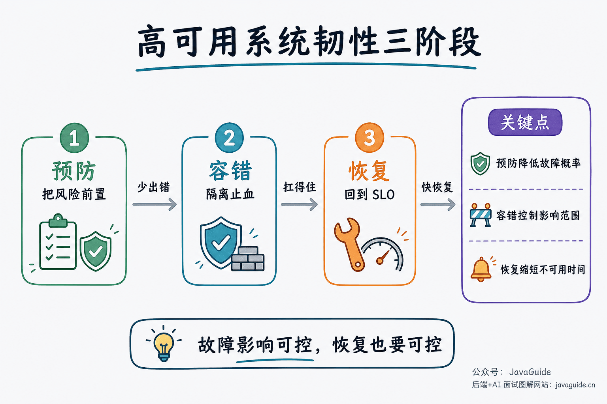

Whether users are browsing a shopping site, paying online, or using an internal business system, their tolerance for service outages is shrinking. An outage lasting only a few minutes can drive users away and cause direct financial losses.

Keeping a system reliable under abnormal conditions is therefore a central concern in backend development and architecture. This guide covers core high-availability practices, including SLA metrics, single-point-of-failure controls, rate limiting, circuit breaking, fallback, cache availability, asynchronous load smoothing, redundancy, canary releases, and recovery.

## What Is High Availability, and How Is It Measured?

**High availability (HA)** is a system's ability to provide normal service most of the time, including during hardware failures and system upgrades.

Availability is often expressed as a percentage of "nines." For example, 99.9999% availability means the system is unavailable for 0.0001% of its operating time. Systems with poor availability may not even reach 90% (one nine).

| Availability | Percentage | Annual downtime | Typical use case         |
| ------------ | ---------- | --------------- | ------------------------ |
| One nine     | 90%        | 36.5 days       | Personal blog            |
| Two nines    | 99%        | 3.65 days       | General business system  |
| Three nines  | 99.9%      | 8.76 hours      | Online service           |
| Four nines   | 99.99%     | 52.6 minutes    | Financial trading system |
| Five nines   | 99.999%    | 5.26 minutes    | Carrier-grade system     |

Availability can also be measured as **the proportion of successful requests for a feature**. For example, if 10 out of 1,000 requests to a website fail, availability is 99%.

An **SLA (Service Level Agreement)** is a formal commitment between a service provider and its customer. It usually specifies availability targets. For example, a cloud provider's 99.95% monthly SLA allows about 22 minutes of downtime per month.

## What Causes System Outages?

Causes of outages can be grouped into **internal** and **external** factors:

**Internal factors:**

1. **Code defects**: Memory leaks, deadlocks, circular dependencies, null-pointer exceptions, and other code-quality issues are common causes of production incidents.
2. **Architectural flaws**: Single points of failure, missing rate limits, and tightly coupled services can become visible during traffic peaks.
3. **Resource exhaustion**: Exhausted CPU, memory, disk, or connection pools can make a service unavailable.
4. **Configuration errors**: Incorrect changes, such as a bad database connection string or timeout, can cause failures.

**External factors:**

1. **Hardware failures**: Server outages, disk damage, and network-device failures.
2. **Traffic spikes**: Sudden user traffic, such as a flash sale, exceeds system capacity.
3. **Network attacks**: DDoS and CC attacks can exhaust system resources.
4. **Dependency failures**: Databases, caches, message queues, and third-party APIs become unavailable.
5. **Natural disasters**: Data-center power outages, fires, earthquakes, and other events beyond the team's control.

## How Can System Availability Be Improved?

Plan availability across three stages: **prevention**, **fault tolerance**, and **recovery**.

### Maintain Code Quality and Test Thoroughly

**Code quality is the foundation of availability.** Memory leaks, circular dependencies, and other code-quality problems can seriously harm system reliability. Rate limiting, fallback, and circuit breaking matter, but improving code quality is an essential first step.

One practical way to improve code quality is **code review**. The roughly extra hour it takes each day can prevent costly defects.

Other useful tools include:

- [SonarQube](https://www.sonarqube.org/): A static-analysis platform that detects code smells, security vulnerabilities, and bugs.
- [Arthas](https://arthas.aliyun.com/doc/), Alibaba's Java diagnostic tool: Diagnose JVM problems online and update code at runtime.
- [Alibaba Java Coding Guidelines](https://github.com/alibaba/p3c): Includes an IntelliJ IDEA plugin for real-time checks.
- Code-analysis tools built into IntelliJ IDEA.

### Use Clusters to Reduce Single Points of Failure

A **single point of failure (SPOF)** is a major threat to availability. For example, Redis clustering can avoid a single-instance failure and improve cache availability.

If a single Redis instance is used as a cache, its failure can make the entire cache unavailable. In a cluster, another instance can take over through failover. Failover time depends on the deployment and configuration; Redis Sentinel or Cluster can take seconds to tens of seconds, not necessarily less than one second.

Common Redis deployment modes:

- **Primary-replica replication**: One primary handles writes and replicas handle reads. If the primary fails, failover must be performed manually or through Sentinel.
- **Sentinel mode**: Adds Sentinel nodes to primary-replica replication for automatic failure detection and failover.
- **Redis Cluster**: Redis's official sharding solution since 3.0. Each shard has primary and replica nodes, providing availability and horizontal scaling.

### Rate Limiting

**Rate limiting** is the first line of defense. It monitors metrics such as QPS and concurrent threads, then controls traffic when a configured threshold is reached to prevent a sudden spike from overwhelming the application. — [Alibaba Sentinel wiki](https://github.com/alibaba/Sentinel "Sentinel")

Common rate-limiting algorithms include:

- **Fixed-window counter**: Simple to implement, but allows bursts at window boundaries.
- **Sliding-window counter**: Reduces boundary bursts and provides smoother limits.
- **Leaky bucket**: Processes requests at a fixed rate; useful for traffic shaping.
- **Token bucket**: More flexible and allows limited bursts.

### Configure Timeouts and Retries

If a request does not receive a response within a certain period, it should time out. This is critical: many production incidents result from **missing or incorrectly configured timeouts**.

Timeouts and retries are especially useful when calling third-party services. RPC frameworks usually provide settings for both. Without timeouts, responses may be slow and requests may pile up until the system can no longer process them.

**A common maximum is three retries.** Additional retries may not help and can increase server load; some operations should not be retried at all. Use **exponential backoff** to reduce retry storms.

Retried operations must be idempotent. Prevent duplicate execution of non-idempotent writes, such as order creation and account debits, with a unique request ID, business-unique key, or state machine. Do not simply resend a failed write. Reads can usually be retried more freely; before retrying a write, check whether the previous request took effect.

### Circuit Breaking

Along with timeouts and retries, **circuit breaking** is important. The system monitors resource use and performance of its dependencies. When a dependency degrades or failures exceed a threshold, the circuit breaker enters the Open state. Subsequent calls fail fast without reaching the downstream service, preventing the failure from spreading. Circuit breaking is often paired with fallback, such as returning cached data or calling a backup service.

Circuit breakers have three states:

- **Closed**: Normal state; requests pass through.
- **Open**: Circuit is tripped; requests fail immediately without calling downstream.
- **Half-Open**: Recovery is being tested; a small number of requests probe the downstream service.

Netflix Hystrix (now in maintenance mode) and Alibaba Sentinel have both been widely used for traffic management and circuit breaking. Sentinel or Resilience4j is generally a better choice for new projects.

### Fallback

**Fallback** temporarily disables noncritical features when the system is overloaded or some services are unavailable, preserving core functionality.

Fallback strategies include:

- **Feature fallback**: Disable noncritical features such as recommendations and comments.
- **Data fallback**: Return cached or default data instead of querying in real time.
- **Page fallback**: Return a static or simplified page.

### Asynchronous Calls

With an asynchronous call, the caller does not block while waiting for the result. It returns immediately, and the work is completed later. This is common in flash-sale systems.

Asynchronous processing may require **changes to the business workflow**. For example, after a user submits an order, the system cannot confirm that it succeeded until the message-queue consumer has processed it, or even until it has shipped. It can then notify the user by email or text message.

Applications often use **message queues** for asynchronous processing. Queues can improve performance by absorbing traffic peaks and reducing response time, while also reducing coupling between services.

### Use Caches

Under high concurrency, sending every request directly to the database may overwhelm it. Cache frequently accessed data to serve it from memory and reduce database load.

Common caching patterns include:

- **Hot-data caching**: Store frequently accessed data in Redis or another cache.
- **Page caching**: Cache rendered pages to reduce server load.
- **Local caching**: Use Caffeine or Guava Cache to reduce network calls.

Account for common cache failure modes too:

- **Cache penetration**: Requests for nonexistent data all reach the database. Validate parameters, cache empty results, or use a Bloom filter.
- **Cache breakdown**: When a hot key expires, many requests hit the database at once. Use a mutex, logical expiration, or a non-expiring hot key with asynchronous refresh.
- **Cache avalanche**: Many keys expire at once or the cache cluster becomes unavailable. Add random offsets to expiration times, use multiple cache layers, and make the cache cluster highly available.

### Other Practices

- **Prioritize better hardware for critical services**: Use higher-specification servers and SSDs for core workloads.
- **Monitor resource usage and configure alerts**: Use tools such as Prometheus and Grafana, with sensible alert thresholds.
- **Keep backups and roll back when needed**: Back up databases regularly, track code versions, and support quick rollbacks.
- **Use canary releases**: Divide the cluster into groups and deploy to one group at a time. Monitor stability before continuing over several days. If a problem appears, roll back only the updated instances.
- **Inspect and replace hardware regularly**: For self-managed infrastructure, inspect hardware periodically and replace or upgrade components when needed.

<!-- @include: @article-footer.snippet.md -->
