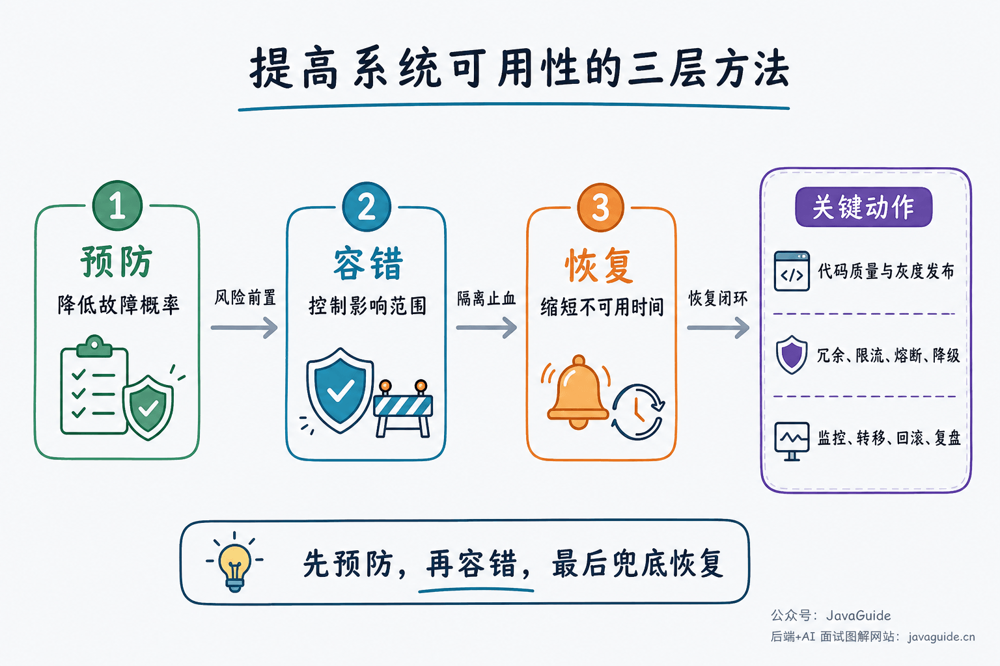
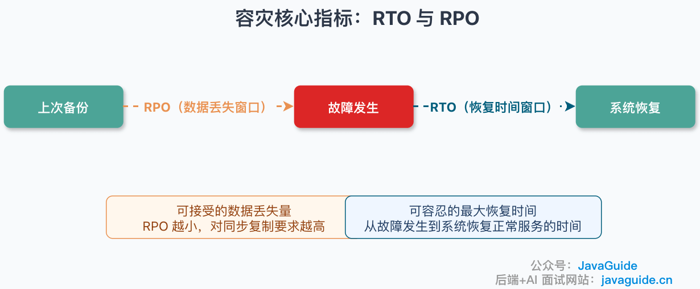
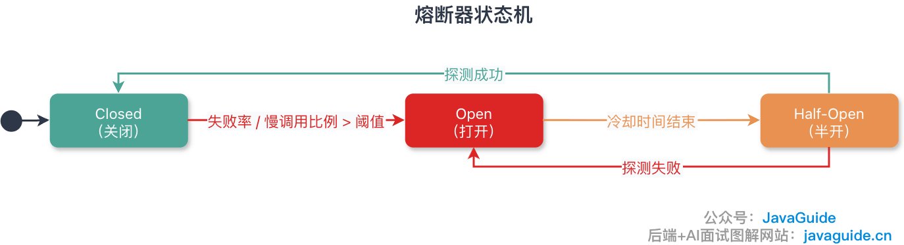
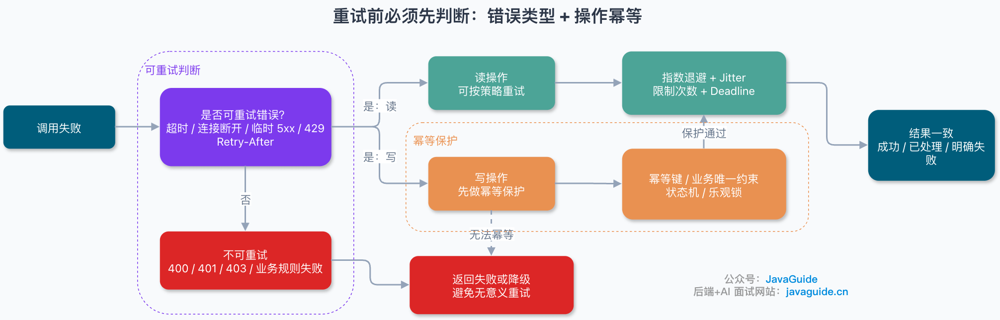
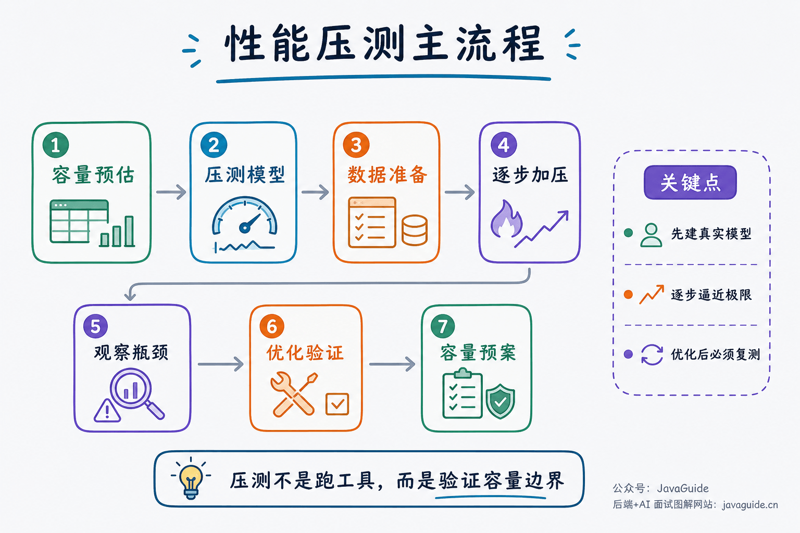

<!-- @include: @article-header.snippet.md -->

High-availability interviews often start with "How do you keep a system from going down?" Follow-up questions cover single points of failure, rate limiting, circuit breaking, timeouts, retries, API idempotency, and geo-disaster recovery. Listing components is not enough; explain how failures are detected, how their impact is contained, how service recovers, and how data remains correct.

This is the review guide for JavaGuide's high-availability section. It is organized into five areas: availability fundamentals, redundancy and disaster recovery, rate limiting and fallback, timeouts/retries/idempotency, and performance testing and incident management. Detailed answers and implementations are in the linked guides.

If you are short on time, start with [Common High-Availability System Interview Questions](https://interview.javaguide.cn/high-availability/high-availability-system-interview-questions.html). Note the questions you cannot answer, then return here to review the principles and engineering details.

## What Should You Focus on First?

| Area                                          | What to explain                                                             | Common follow-ups                                                    |
| --------------------------------------------- | --------------------------------------------------------------------------- | -------------------------------------------------------------------- |
| Availability fundamentals                     | Measure availability and reduce failures and their impact                   | SLA, availability metrics, single points of failure, canary releases |
| Redundancy and disaster recovery              | Transfer traffic and data to standby resources after a node or site failure | RTO, RPO, cold/hot standby, active-active, failover, split brain     |
| Rate limiting, fallback, and circuit breaking | Protect services from excess traffic or unhealthy dependencies              | Algorithms, fallback, circuit breaking, isolation, Sentinel          |
| Timeouts, retries, and idempotency            | Decide when to retry a remote call and prevent duplicate writes             | Deadlines, backoff, retry budgets, idempotency keys, state machines  |
| Performance and incident management           | Estimate capacity, find bottlenecks, and verify fault tolerance             | P99, load testing, capacity planning, cache failures, failure drills |

Understand these mechanisms as part of one call chain. Rate-limit excessive ingress, time out slow downstream calls, retry transient errors within a budget, and open the circuit for persistent failures. Use idempotency to prevent duplicate side effects on writes.

## Availability Fundamentals

High availability does not mean that failures never happen. System design must address how to reduce failures, contain their impact, and restore service. Adding application instances reduces application-level single points of failure, but databases, caches, message queues, configuration centers, DNS, and load balancers can still fail.

Related guide: [High-Availability System Design](https://javaguide.cn/high-availability/high-availability-system-design.html)

Common interview questions:

- What is high availability, and how does it differ from simply deploying more machines?
- How much downtime do 99.9%, 99.99%, and 99.999% availability allow?
- How can code, releases, traffic, infrastructure, and external dependencies cause outages?
- What are the main ways to improve availability?
- What is a single point of failure? Why might redundant instances still leave one?
- How do canary releases control change risk? How do rollout, monitoring, and rollback work together?

When discussing availability, define how it is measured. Calendar month or year, whether planned maintenance counts, and whether different endpoints share an SLA all affect the result. Every additional nine also increases redundancy, operational, and drill costs.

## Redundancy and Disaster Recovery

Redundancy provides standby resources; disaster recovery also covers detection, failover, replication, and recovery. Removing a failed stateless instance is usually straightforward. Database promotion, cross-region traffic shifts, and financial workflows carry data risks and need careful confirmation and failback plans.

Related guide: [Redundancy Design](https://javaguide.cn/high-availability/redundancy.html)

Common interview questions:

- What is redundancy? How can services, databases, caches, and data centers be made redundant?
- What do RTO and RPO constrain? What does RPO = 0 cost?
- How do cold, warm, and hot standby differ from active-active?
- When should you choose same-city disaster recovery, same-city active-active, or geo-active-active?
- What is failover? When is automatic switching appropriate, and when is manual confirmation safer?
- What can happen if failure detection is too fast or too slow?
- Why can a network partition cause split brain? How do quorum, leases, and fencing prevent dual-primary writes?
- Can Redis Sentinel failover guarantee RPO = 0? What role does `quorum` play in an election?

RTO and RPO define recovery targets, but configuring a system does not prove it can meet them. Regular drills must verify that backups can be restored, traffic can be shifted, and data remains complete after failover. Order queries and financial ledger updates have different tolerances for recovery time and data loss, so they do not need identical targets.

## Rate Limiting, Fallback, and Circuit Breaking

These mechanisms address different problems. Rate limiting controls incoming requests, fallback reduces functionality based on business priority, and circuit breaking stops calls to persistently unhealthy dependencies. Isolation separates threads, connections, or concurrency limits so one dependency cannot consume all resources.

Related guides:

- [Rate Limiting](https://javaguide.cn/high-availability/limit-request.html)
- [Fallback and Circuit Breaking](https://javaguide.cn/high-availability/fallback-and-circuit-breaker.html)

Common interview questions:

- Why is rate limiting needed? Should a limited request be rejected, queued, or given a fallback response?
- What use cases suit fixed windows, sliding windows, leaky buckets, and token buckets?
- Why can a fixed window create a burst at the boundary?
- How does local rate limiting differ from distributed rate limiting? What fallback should apply if Redis-based limiting fails?
- How should gateway, endpoint, user, IP, and tenant limits be combined?
- How do Guava `RateLimiter`'s `SmoothBursty` and `SmoothWarmingUp` differ?
- What triggers fallback and circuit breaking? How does recovery differ?
- How does a circuit breaker transition between Closed, Open, and Half-Open?
- How do timeouts, retries, rate limiting, circuit breaking, and isolation work together in one call chain?
- What are the costs of thread-pool and semaphore isolation?
- Why should fallback avoid making additional remote calls?
- How should you choose between Hystrix, Sentinel, and Resilience4j?

Do not state thresholds without explaining how they were chosen and how recovery works. Production behavior depends on how long the circuit stays Open, how much probe traffic Half-Open allows, whether rate-limited responses include `Retry-After`, and how fallback results are labeled and monitored.

## Timeouts, Retries, and Idempotency

A timeout means the caller did not receive a result before its deadline; it does not prove that the server failed to execute the request. Queries can be retried within a total time budget. Writes such as payments, order creation, and inventory deductions must use idempotency keys, unique constraints, or state machines to prevent duplicate execution.

Related guides:

- [Timeouts and Retries](https://javaguide.cn/high-availability/timeout-and-retry.html)
- [API Idempotency](https://javaguide.cn/high-availability/idempotency.html)

Common interview questions:

- Why must remote calls have timeouts? What do connect, read, connection-pool, and overall deadlines limit?
- Should timeout values be based on P99/P999, business wait time, or the downstream SLA?
- How should a timeout budget propagate through a call chain?
- Why can retries amplify an outage? What do exponential backoff and jitter address?
- Which network errors and HTTP statuses are retryable? Which should fail immediately?
- What is a retry budget? What happens when multiple SDK layers retry at the same time?
- What is idempotency? How does HTTP idempotency differ from business idempotency?
- Which scenarios suit idempotency keys, unique indexes, Redis, optimistic locks, and state machines?
- How should a payment API handle the first request, concurrent duplicates, and duplicate notifications?
- How do deduplication and idempotency differ? Why can ingress deduplication not replace server-side idempotency?
- What are the risks of consuming a token before or after processing a request?
- How can pessimistic locks avoid range locks, deadlocks, and long transactions?

Discuss ambiguous outcomes: the server may have completed a debit while the response was lost. If the caller retries after a timeout without a stable business request ID, it may cause a second debit.

## Performance Testing and Failure Management

Without capacity data and drill results, a high-availability plan remains theoretical. Load tests measure latency, throughput, and resource use at different traffic levels. Failure drills verify that protection and recovery behave as expected when a node fails, a dependency slows down, or a network is partitioned.

Related guide: [Introduction to Performance Testing](https://javaguide.cn/high-availability/performance-test.html)

Common interview questions:

- What do RT, QPS, TPS, concurrency, throughput, and error rate measure?
- Why does average RT not represent tail latency? How should P95 and P99 be interpreted?
- How do performance, load, stress, and stability tests differ?
- Why should capacity planning look beyond application servers? How can database, cache, and connection-pool bottlenecks be found?
- What causes cache penetration, breakdown, and avalanche?
- What is a failure drill, and how does it differ from a load test?
- How would you design a highly available system and connect redundancy, rate limiting, circuit breaking, idempotency, and observability in your answer?
- After deploying timeouts and retries, why monitor both first-attempt and final success rates?

If the first-attempt success rate keeps falling while the final success rate stays stable, retries may be hiding a downstream failure. Check retry QPS, timeout rate, thread-pool queues, connection-pool wait time, and circuit-breaker state in addition to final success rate.

## Review Plan by Available Time

| Time available   | Suggested plan                                                                                                                                                                                                                                           | Goal                                                                       |
| ---------------- | -------------------------------------------------------------------------------------------------------------------------------------------------------------------------------------------------------------------------------------------------------- | -------------------------------------------------------------------------- |
| 1–2 days         | Review [Common High-Availability System Interview Questions](https://interview.javaguide.cn/high-availability/high-availability-system-interview-questions.html), focusing first on rate limiting, circuit breaking, timeouts, retries, and idempotency. | Answer common questions and explain key risks and limitations.             |
| 3–7 days         | Review RTO/RPO, failover, isolation, capacity planning, and cache availability; then diagram a complete call chain.                                                                                                                                      | Explain how mechanisms work together and reason through failure scenarios. |
| More than a week | Read all the guides and prepare a case from your own project involving a release, timeout, traffic spike, or dependency failure.                                                                                                                         | Explain the business SLA, solution choice, metrics, recovery, and review.  |

For experienced and senior roles, prepare to discuss real project constraints. If asked why a timeout is 500 ms, expect follow-ups about the latency distribution, upstream budget, retry count, downstream capacity, and dynamic adjustment. For designs you have not worked on, explain what you learned and researched; do not invent production data.

<!-- @include: @article-footer.snippet.md -->
