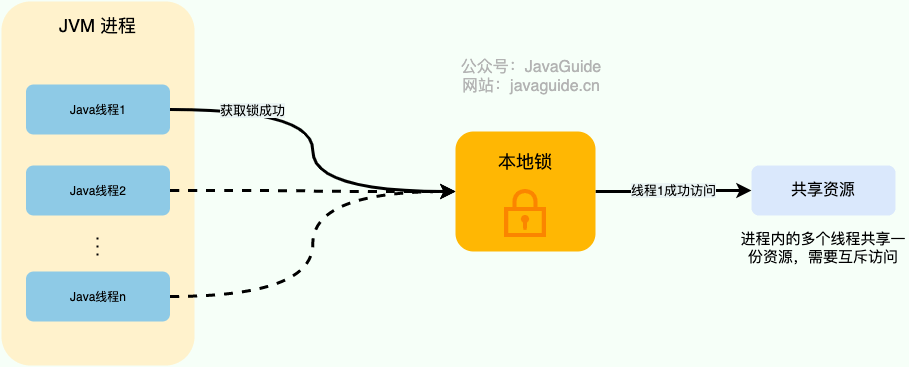
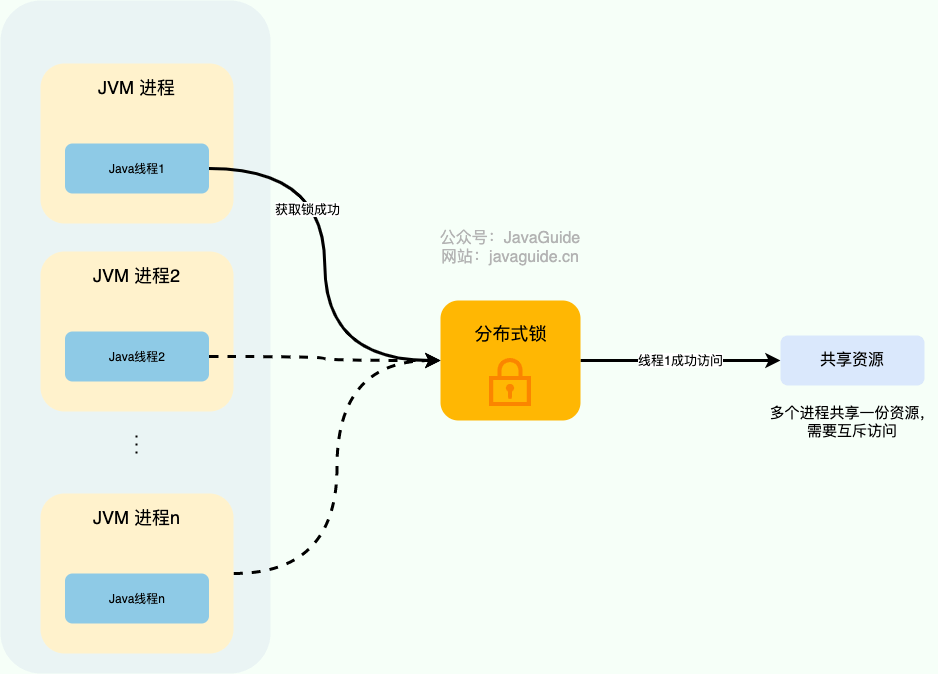
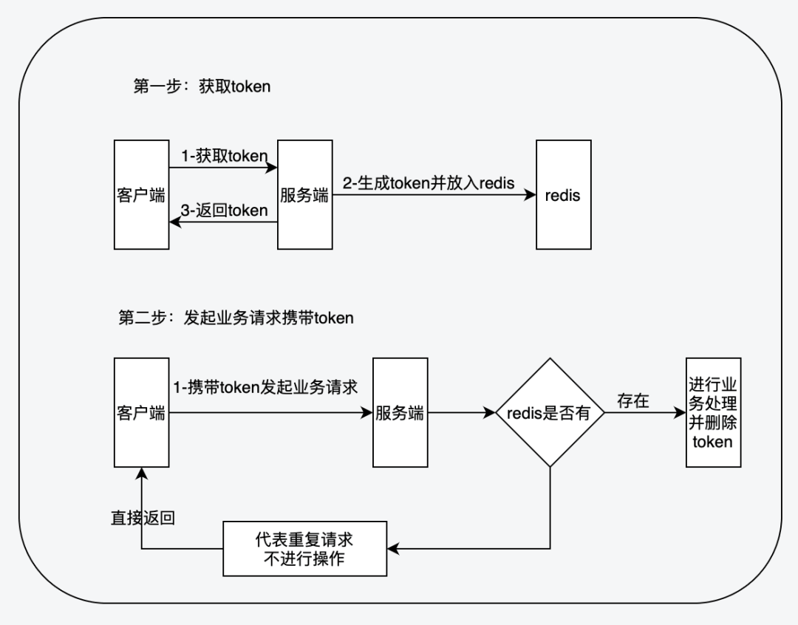

API idempotency is a common interview topic and a frequent concern in everyday development.

## What Is Idempotency?

Idempotency is a mathematical concept, common in abstract algebra. It means that performing an operation once has the same effect as performing it multiple times. For a function, this can be written as $f(f(x)) = f(x)$. For example, $f(x)=|x|$ is idempotent because taking the absolute value of a number once or repeatedly produces the same result.

For an API, idempotency means that repeating the same request has the same intended effect on server-side resources as making it once. Whether the response content must also be identical depends on the design; financial APIs often require a stable business result as well.

For data operations:

- Insert operations need a business-unique key or idempotency key to prevent duplicate records.
- For updates, distinguish assignments from increments. An assignment such as `update set status = 'PAID'` is easier to make idempotent. An increment such as `update set balance = balance - 100` needs additional protection against duplicate execution.

API idempotency issues are commonly triggered by network interruptions, repeated user actions, client or gateway retries after a timeout, and duplicate message delivery. Slow responses make duplicate requests more likely.

**What happens if an API is not idempotent?**

Lack of idempotency can cause serious production bugs, especially in financial workflows. For example, if a user clicks the payment button several times and the backend processes every debit request, the account may be charged repeatedly. This is a high-risk incident in any financial system.

Handle idempotency carefully for payments, inventory, orders, and coupons. Frontend protection alone is not enough; the backend must enforce it too.

## How Can API Idempotency Be Guaranteed?

The frontend can disable a button after submission to reduce repeated clicks, but this does not guarantee idempotency. Users can refresh a page, replay a request, or bypass the frontend; gateways can retry after timeouts, and message queues can redeliver messages. Enforce idempotency on the server, especially for APIs that change payment, inventory, or order state.

Backend idempotency takes more work. Common approaches include pessimistic locks, unique indexes, deduplication tables, optimistic locking, distributed locks, and tokens.

Pessimistic and distributed locks use locking to ensure that only one request runs at a time. Locking alone is not enough; also check idempotency against business rules. For example, check whether a phone number, email, or username is already registered, or verify the order state before processing a payment.

Production systems commonly combine approaches: **a business key or idempotency key identifies duplicate requests, a database unique index or deduplication table provides a safeguard, and a state machine prevents invalid state transitions. Use a distributed lock only when operations on the same business resource must be serialized.**

Common scenarios:

- **Duplicate form submissions**: Disabling the frontend button only reduces repeated clicks. Use a one-time server-side token too, so the same form can succeed only once.
- **Order creation**: Use a unique business key such as an order number or request ID, backed by a database unique index. On a duplicate request, return the existing order instead of creating another one.
- **Payment callbacks**: Use the third-party transaction ID to identify each callback, together with an order state machine and a deduplication table, to prevent posting the same payment twice.
- **Inventory deduction**: Prevent duplicate deductions and overselling with state checks, optimistic locking, Redis Lua, or a database transaction.
- **Message consumption**: Messages may be delivered more than once. Record processing results by message ID or business transaction ID, then skip or acknowledge messages already processed.

Use these priorities when choosing an approach:

1. Prefer a business-unique key when it solves the problem.
2. Use a database unique index as a safeguard instead of relying only on a cache.
3. Use a state machine to prevent duplicate execution and invalid state transitions.
4. Consider a distributed lock when a critical section must protect the same business resource.
5. Add multiple safeguards for high-risk financial workflows; do not rely on a single mechanism.

### Pessimistic Locking

In Java, JDK mechanisms such as `ReentrantLock` and the `synchronized` keyword can ensure that only one thread modifies data at a time. These are local locks and cannot coordinate processes across a distributed system.



Databases also provide exclusive locks (X locks), in addition to JDK pessimistic locks. An exclusive lock, also called a write or exclusive lock, is acquired by a transaction when it modifies a record. Multiple transactions cannot hold it at the same time, and other transactions cannot acquire an incompatible lock on that record.

In MySQL, use `SELECT ... FOR UPDATE` to acquire an exclusive lock:

```sql
SELECT ... FOR UPDATE
```

Exclusive locks require a transactional storage engine such as InnoDB and must be used inside a transaction. Ensure that `SELECT ... FOR UPDATE` uses an appropriate index. Otherwise, InnoDB may scan and lock many records, with an effect close to a table-wide lock that severely reduces concurrency. Under MySQL's default RR (REPEATABLE READ) isolation level, InnoDB may use next-key locks (record locks plus gap locks), so use `EXPLAIN` to confirm that the query plan uses an index.

Under high concurrency, lock contention blocks threads. Many blocked threads increase context switching and system overhead. Pessimistic locks can also cause deadlocks. Keep lock ordering consistent, keep transactions short, make queries use indexes, and use `EXPLAIN` and deadlock logs to investigate lock waits.

### Optimistic Locking

Optimistic locking is usually implemented with a version field or a CAS algorithm.

With version-based locking, add a version field to the table and check it against the stored value on each update. If the versions match, update the data and increment the version. If they differ, the update fails because another request has already changed the data.

```sql
-- Update price, increment version, and check that version is 1 (assuming an initial version of 1)
update goods set price = price + 100, version = version + 1 where id = 1 and version = 1;
-- The version is now 2, so the following SQL update does not take effect
update goods set price = price + 100, version = version + 1 where id = 1 and version = 1;
```

Under high concurrency, optimistic locking usually avoids the long waits associated with pessimistic locks and reduces thread buildup from lock contention, which can improve performance. Database updates may still use row locks, so complex transactions are not entirely free of deadlock risk. If conflicts are frequent, repeated failures and retries can also hurt performance and drive CPU usage up. This approach is mainly suited to update operations.

Plan how to handle failed optimistic-lock updates: return a clear conflict for the caller to handle, retry a limited number of times (such as two or three), or check the current state and return the existing result. Avoid blind automatic retries in financial workflows; return a conflict or check the final state instead.

### Unique Indexes

Add a unique index to a table to enforce data uniqueness. An attempt to insert a duplicate raises an exception that the application can catch and handle. This approach applies to insert operations.

```sql
create table t_order(
    id int unsigned PRIMARY KEY AUTO_INCREMENT COMMENT "Primary key",
    `code` varchar(200) not null COMMENT "Transaction number",
    `customer_id`  int unsigned COMMENT "Customer ID",
    `amount` decimal(10,2) unsigned not null COMMENT "Total amount",
    -- Other order fields omitted
    -- Other indexes omitted
    -- Order transaction number must be unique
    UNIQUE unq_code(`code`)
) COMMENT="Order table";
```

Do not rely on a unique index for all idempotency logic, but use one as a database-level safeguard for inserts to prevent duplicates under concurrency.

### Deduplication Tables

A deduplication table is another use of a unique index. It stores request data and has a unique index on a field that identifies each request. When a client sends a request, the server inserts identifying information, such as an order number or transaction ID. If the insert succeeds, this is the first request and the server can proceed. If it fails, the request is a duplicate and can be returned or ignored.

```sql
CREATE TABLE deduplication_table (
    id int unsigned PRIMARY KEY AUTO_INCREMENT COMMENT "Primary key",
    processed_code varchar(200) not null COMMENT "Processed order transaction number",
    -- Other fields omitted
    UNIQUE unq_processed_code(processed_code)
) COMMENT="Deduplication table";
```

Insert into the deduplication table and perform the business operation in the same database transaction. A successful commit then means that the deduplication record exists and the business operation is complete. If the business operation fails and rolls back, the deduplication record must roll back too, so a later request can be processed. Otherwise, the record may say a request was handled when the business operation did not complete. If sharding places the deduplication and business tables in different physical databases, consider a distributed transaction approach such as TCC or Saga, or use another design that preserves consistency.

### Distributed Locks

In a distributed system, services and clients usually run in separate JVM processes. If operations on the same business resource must be serialized across JVMs, consider a **distributed lock**.



MySQL can be used to implement a distributed lock with `SELECT ... FOR UPDATE` or a unique index, but it is generally less performant and reliable than a dedicated coordination service, so it is less common in production.

Redis and ZooKeeper are common choices for implementing distributed locks; Redis is used more often.

Relational databases can also help control concurrency in distributed systems through unique-index safeguards, state-machine checks, and row-lock serialization. However, optimistic locking and unique indexes are not usually classified as distributed locks.

For more detail on distributed locks and their implementations with Redis and ZooKeeper, see these guides:

- [Introduction to Distributed Locks](https://javaguide.cn/distributed-system/distributed-lock.html)
- [Common Distributed Lock Implementations](https://javaguide.cn/distributed-system/distributed-lock-implementations.html)

Note that this distributed lock is created from a unique identifier, such as an order number. Acquiring the lock only means the request can enter the critical section; it does not mean the operation has never been processed. Once inside, still check the business state or idempotency record. For example, a payment API must check whether the order is already paid and whether the transaction ID has been processed before running the operation or returning the previous result.

The following pseudocode uses `RLock` from Redisson 3.x to implement an idempotent operation:

```java
// Unique identifier
String uniqueId = "order123";

    // 1. Create a distributed lock using the unique identifier
RLock lock = redisson.getLock("lock:" + uniqueId);
boolean locked = false;

try {
    // 2. Wait up to 3 seconds for the lock; release it after 30 seconds
    locked = lock.tryLock(3, 30, TimeUnit.SECONDS);
    if (!locked) {
        // If lock acquisition fails, return "processing," ask the caller to retry later, or query the previous result
        return;
    }

    // 3. Still check business idempotency inside the critical section
    // For example, check the order state or whether an idempotency record exists
    // Run the operation only if it has not been processed; otherwise, return the previous result
    ...
} finally {
    // 4. Release the lock only if the current thread holds it
    if (locked && lock.isHeldByCurrentThread()) {
        lock.unlock();
    }
}
```

If `leaseTime` is not specified, Redisson's watchdog renews the lock while it is held. If `leaseTime` is specified, the lock is released automatically after that lease. The 30 seconds above is only an example; choose a value based on the maximum operation time, usually around two or three times the estimated duration.

When using distributed locks, also consider:

- **Lock granularity**: Lock by order number, user ID, or resource ID; avoid a global lock.
- **Lock timeout**: If the operation exceeds `leaseTime`, the lock may be released too early.
- **Lock release**: Verify the current thread or owner before unlocking; do not release another owner's lock.
- **Lock acquisition failure**: Decide whether to return "processing," ask the caller to retry later, or query the previous result.
- **Business safeguards**: Check the order state or idempotency record after acquiring the lock; do not rely on the lock alone.

### Token-Based Idempotency

The token approach creates a unique token for each operation. The server should generate tokens that are random, unpredictable, and short-lived. If tokens are stored server-side, Redis can record them for one-time consumption. Stateless tokens also need a signature, tamper protection, and an expiration time.

This requires two requests to complete one business operation:

1. Request a token from the server. Give it a short expiration time and store it server-side, usually in a cache.
2. Send the actual request with the token in a header or request parameter. The server validates the token and runs the operation if it is valid; otherwise, it rejects the request.

When validating a token, do not run `GET` and then `DEL` as separate operations. Redis 6.2.0 and later support `GETDEL`; older versions can use a Lua script to atomically validate and delete the token, ensuring that only one request can consume it.

The Dewu Tech article [Concurrency Control Solutions for Distributed System Design](https://mp.weixin.qq.com/s/yvKASWcRLfOok-NFPrIRsw) illustrates this process.



Should the server run the business operation before deleting the token, or delete it first? Both options have risks:

- If the operation runs first, the client may send another request while the token still exists, and that request will pass validation too.
- If the token is deleted first, a timeout or network interruption may force the client to retry after the token has already been consumed.

Usually, consume the token atomically before running the operation. Also plan for failure responses, token renewal, transaction rollback, and idempotency records. For financial operations, do not rely on a token alone; check the order state and transaction record as well.

Token-based idempotency may rely on Redis to manage token lifetimes, so plan what to do if Redis is unavailable. A regular form can ask the user to retry later. For financial APIs, do not bypass the check when a circuit breaker opens; return a failure rather than risk duplicate charges or postings.

### Idempotent Payment Callback Flow

Payment callbacks are a common idempotency scenario. A payment provider may send the same transaction callback more than once because of a timeout or a lost response. A safer flow is:

1. The callback includes the provider's transaction ID, `transaction_id`.
2. Add a unique index on `transaction_id` in the callback record table.
3. Check the order state and allow only valid transitions, such as `UNPAID -> PAID`.
4. Update the order state, write the financial ledger entry, and record the callback in one database transaction.
5. Return success for a duplicate callback so the provider does not keep retrying.

## How Can You Verify an Idempotency Design?

Do not verify idempotency by reviewing code alone; confirm it with tests and data checks. For orders, payments, and inventory, test duplicate requests, timeouts, failures, and rollbacks as well as a single successful request.

Useful verification methods include:

1. **Concurrent load test**: Send 50–100 simultaneous requests with the same order number, payment ID, or idempotency key. The business operation should run only once. Other requests should return the same result or a status such as "processing" or "already processed". They must not create multiple orders or ledger entries or deduct inventory repeatedly.
2. **Retry test**: Simulate retries by clients, gateways, payment providers, and duplicate MQ delivery. Confirm that repeated requests find the idempotency record or business state instead of rerunning the operation.
3. **Failure test**: Inject failures midway through an operation, such as after updating an order but before writing a ledger entry, after consuming a token but before a transaction rolls back, or after acquiring a distributed lock and restarting the service. After recovery, the data must remain consistent, without a partially completed operation.
4. **Data validation**: After load or failure tests, cross-check the order, ledger, inventory, and deduplication tables. For example, a payment should have only one successful ledger entry, an order should transition from `UNPAID` to `PAID` only once, and inventory deductions should match the number of successful business orders.
5. **Log audit**: Logs should include the idempotency key, request ID, business order number, processing state, and response. These fields help determine whether a request was new, duplicated, still processing, or rejected by idempotency logic.

In short, idempotency is not verified by checking whether an API returns success. Check that duplicate requests and failure paths still leave business data correctly processed only once.

## References

- How to guarantee API idempotency under high concurrency: <https://mp.weixin.qq.com/s/7P2KbWjjX5YPZCInoox-xQ>
- A mnemonic for solving idempotency problems: <https://mp.weixin.qq.com/s/EatpiCzNlTw1viO_flQIpg>
