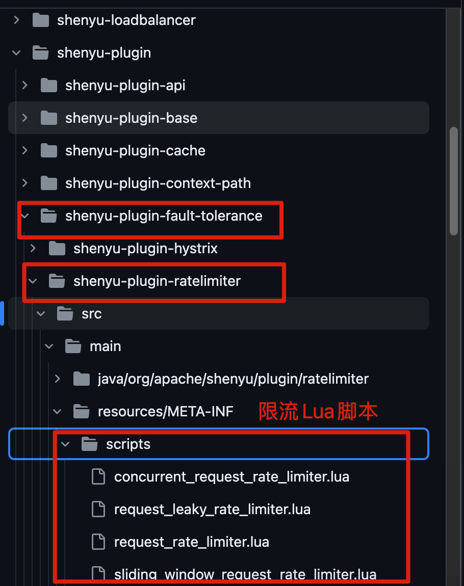

In a software system, rate limiting controls the rate of incoming requests to prevent a sudden traffic spike from overwhelming the system. Every system has limited capacity; if request volume exceeds it, the system may fail.

Rate limiting may reject a request or delay its processing, but this is often the best trade-off for system stability.

Rate limiting is common in everyday life too. For example, ticket queues prevent too many people from arriving at once and overwhelming ticket sellers.

## Common Rate-Limiting Algorithms

Here are four straightforward rate-limiting algorithms that are easy to understand and implement.

> The images are from InfoQ's article [Practical Rate Limiting for Distributed Services](https://www.infoq.cn/article/Qg2tX8fyw5Vt-f3HH673).

### Fixed-Window Counter

A fixed-window counter divides time into intervals of a fixed size and limits the number or rate of requests within each interval. In other words, it sets how many requests the system can process per unit of time.

Suppose an endpoint may be called at most 33 times per minute. A fixed-window counter works as follows:

- Divide time into fixed windows, in this case one minute each.
- Use a `counter` variable to track the number of requests handled in the current window. Initialize it to 0.
- Increment `counter` for every request. Once it reaches 33 in the current minute, reject all further requests until the window ends.
- Reset `counter` to 0 at the start of the next minute.


**Advantages:** Simple to implement and understand.

**Disadvantages:**

- Traffic is not smoothed. If an endpoint is limited to 30 requests per minute and all 30 arrive in the first 30 seconds, it cannot handle any more requests during the remaining 30 seconds.
- A burst can occur at a window boundary. If an endpoint is limited to 1,000 requests per minute, 1,000 requests could arrive in the final second of one window and another 1,000 in the first second of the next. Because the counter resets, the system may allow 2,000 requests in two seconds, far above the expected QPS of `1000/60≈16.7`.

### Sliding-Window Counter

The **sliding-window counter** improves on the fixed-window counter by using finer-grained intervals.

Its key improvement is to **divide a fixed window into smaller subwindows**.

For example, to limit an endpoint to 60 requests per minute, divide the minute into 60 one-second subwindows and move the window every second. If the total request count in the current window exceeds the limit, reject further requests.

**The more subwindows there are, the smoother the window movement and the more precise the rate calculation.**


**Advantages:**

- Significantly reduces bursts at window boundaries compared with a fixed-window algorithm.
- Uses finer-grained intervals for more precise rate control.

**Disadvantages:**

- Like the fixed-window counter, it does not fully smooth traffic.
- More complex to implement and understand than a fixed-window counter.

### Leaky-Bucket Algorithm

Think of incoming requests as water flowing into a bucket and request processing as water leaking out. Water can enter at any rate but leaves at a fixed rate. If the bucket overflows, excess requests are dropped. The fixed capacity controls the overall rate.

This is simple to implement: put requests in a queue and process them at regular intervals. This is similar to using a message queue to absorb bursts and limit throughput.


**Advantages:**

- Simple to implement and understand.
- Controls the output rate, helping prevent network congestion and system overload.

**Disadvantages:**

- Cannot handle sudden traffic spikes because requests are processed at a fixed rate, which may underuse system resources.
- If requests arrive faster than they can be processed, the bucket stays full and new requests are dropped, reducing service quality.

The leaky bucket has a narrower range of use cases. A token bucket is usually better when some burst traffic is acceptable. The leaky bucket remains suitable when the output rate must be strictly controlled, such as when calling a third-party API with a fixed QPS limit.

### Token-Bucket Algorithm

The token-bucket algorithm also uses a bucket, but the bucket holds tokens. A request must acquire and consume a token before processing. If no token is available, the request waits or is rejected. Tokens are added at a configured rate, up to the bucket's capacity.


**Advantages:**

- Limits the average rate while allowing short bursts up to the bucket's capacity.
- The token-generation rate can be adjusted dynamically.

**Disadvantages:**

- Poorly chosen token-generation rates or bucket capacity can cause problems such as dropped requests or system overload.
- More complex to implement and understand than some other rate-limiting algorithms.

## What Should Be Rate-Limited?

In a real project, decide what to limit. Common rate-limiting keys include:

- **IP address**: Broadly applicable and straightforward.
- **Business ID**: Use a unique business identifier for more targeted limits, such as a user ID.
- **Custom rules**: Apply different policies based on user attributes or behavior, such as exempting VIP users while limiting regular users. Rules can also adapt to system metrics such as QPS, concurrent calls, and load, reducing allowed requests per second when load is high.

IP-based rate limiting is common, but make sure you obtain the client's real IP correctly. `X-Forwarded-For` and TCP option fields can carry the source IP. Although `X-Forwarded-For` can be spoofed, many projects use it because it is simple to implement.

Other, more advanced keys are available too. Alibaba Sentinel supports [rate limiting by call relationship](https://github.com/alibaba/Sentinel/wiki/流量控制#基于调用关系的流量控制), including limits by caller, call-chain entry, or associated traffic. It also supports finer-grained [hotspot-parameter rate limiting](https://github.com/alibaba/Sentinel/wiki/热点参数限流), which tracks frequently used parameter values and limits calls to resources based on those values.

A project can combine multiple rate-limiting keys to meet its business requirements.

## Local Rate Limiting

Local rate limiting applies to a single application instance.

For local rate limiting, use Guava's `RateLimiter`, which is based on a token bucket and can handle bursts.

> Guava: <https://github.com/google/guava>

In addition to smooth-burst rate limiting, Guava's `RateLimiter` provides **smooth warm-up rate limiting**.

Smooth-burst rate limiting adds tokens at a configured rate. Smooth warm-up gradually increases the rate to the configured value over a warm-up period.

The following examples demonstrate both approaches.

Add the Guava dependency to the project:

```xml
<dependency>
    <groupId>com.google.guava</groupId>
    <artifactId>guava</artifactId>
    <version>31.0.1-jre</version>
</dependency>
```

> These examples use Guava 31.x. The core `RateLimiter` API remains compatible with later versions.

Here is a simple Guava smooth-burst rate-limiting example:

```java
import com.google.common.util.concurrent.RateLimiter;

/**
 * Search WeChat for JavaGuide and reply "Interview Sprint" to receive the Java interview guide.
 *
 * @author Guide
 * @date 2021/10/08 19:12
 **/
public class RateLimiterDemo {

    public static void main(String[] args) {
        // Add 5 tokens per second, or 1 token every 0.2 seconds
        RateLimiter rateLimiter = RateLimiter.create(5);
        for (int i = 0; i < 10; i++) {
            double sleepingTime = rateLimiter.acquire(1);
            System.out.printf("get 1 tokens: %ss%n", sleepingTime);
        }
    }
}

```

Output:

```bash
get 1 tokens: 0.0s
get 1 tokens: 0.188413s
get 1 tokens: 0.197811s
get 1 tokens: 0.198316s
get 1 tokens: 0.19864s
get 1 tokens: 0.199363s
get 1 tokens: 0.193997s
get 1 tokens: 0.199623s
get 1 tokens: 0.199357s
get 1 tokens: 0.195676s
```

Note that `acquire()` blocks while waiting for a token. In production, `tryAcquire(timeout)` is usually preferable because it limits the wait and prevents threads from blocking for too long. The first wait is `0.0s` because a newly created `RateLimiter.create(5)` starts with available tokens.

Here is a simple Guava smooth warm-up example:

```java
import com.google.common.util.concurrent.RateLimiter;
import java.util.concurrent.TimeUnit;

/**
 * Search WeChat for JavaGuide and reply "Interview Sprint" to receive the Java interview guide.
 *
 * @author Guide
 * @date 2021/10/08 19:12
 **/
public class RateLimiterDemo {

    public static void main(String[] args) {
        // Add 5 tokens per second, or 1 token every 0.2 seconds
        // Over the 3-second warm-up period, gradually increase the rate to 1 token every 0.2 seconds
        RateLimiter rateLimiter = RateLimiter.create(5, 3, TimeUnit.SECONDS);
        for (int i = 0; i < 20; i++) {
            double sleepingTime = rateLimiter.acquire(1);
            System.out.printf("get 1 tokens: %sds%n", sleepingTime);
        }
    }
}
```

Output:

```bash
get 1 tokens: 0.0s
get 1 tokens: 0.561919s
get 1 tokens: 0.516931s
get 1 tokens: 0.463798s
get 1 tokens: 0.41286s
get 1 tokens: 0.356172s
get 1 tokens: 0.300489s
get 1 tokens: 0.252545s
get 1 tokens: 0.203996s
get 1 tokens: 0.198359s
```

**Bucket4j** is another useful rate-limiting library based on token-bucket and leaky-bucket algorithms.

> Bucket4j: <https://github.com/vladimir-bukhtoyarov/bucket4j>

Compared with Guava's rate limiter, Bucket4j offers more features. It supports local and distributed rate limiting and can integrate with monitoring tools such as Prometheus and Grafana.

Guava is a general-purpose utility library, but its ready-to-use rate limiter is still practical for many single-instance use cases.

Spring Cloud Gateway's built-in `RedisRateLimiter` uses Redis and Lua. Bucket4j and Resilience4j integrate with gateways through separate extensions or Spring ecosystem components; they are not successor implementations of the built-in gateway limiter.

Resilience4j is a lightweight fault-tolerance library inspired by Hystrix. After [Netflix announced that Hystrix would no longer be actively developed](https://github.com/Netflix/Hystrix/commit/a7df971cbaddd8c5e976b3cc5f14013fe6ad00e6), Spring and Netflix began recommending Resilience4j for rate limiting and circuit breaking.

> Resilience4j: <https://github.com/resilience4j/resilience4j>

In general, rate limiting and circuit breaking are both needed for system availability.

Resilience4j includes rate limiting, circuit breaking, bulkhead isolation, and automatic retries. It also has a broad ecosystem, and many gateways use it for rate limiting and circuit breaking.

Resilience4j may be a better choice for many use cases. Guava or Bucket4j can work well for simpler rate-limiting needs.

## Distributed Rate Limiting

Distributed rate limiting applies to distributed and microservice architectures, where a service may run on multiple instances. To enforce a global quota, instances must share rate-limit state. However, distributed rate limiting is not always necessary: if the quota can be divided among instances (for example, 1,000 QPS total across 10 instances, each limited to 100 QPS), local limits may offer better performance and simpler implementation.

Common approaches include:

- **Use middleware**: Use Sentinel or implement rate limiting with Redis.
- **Rate-limit at the gateway**: A common approach is to apply limits at the gateway, usually with middleware or a framework. Spring Cloud Gateway's distributed `RedisRateLimiter`, for example, uses Redis and Lua; Spring Cloud Gateway can also integrate with Sentinel.

If you implement rate limiting with Redis, use a Lua script.

**Why use Redis and Lua?** There are two main reasons:

- **Less network overhead**: A Lua script can run multiple Redis commands in one request, reducing network round trips.
- **Atomicity**: Redis executes the Lua script as one operation. Other scripts or Redis commands cannot run in the middle and interfere with it.

Lua scripts execute atomically in Redis, which means they block other Redis operations while running. Keep rate-limiting scripts lightweight, avoid complex calculations and large scans, and configure Redis's `lua-time-limit` to prevent execution from running too long.

This guide does not include a rate-limiting script, but several good examples are available. Apache ShenYu's RateLimiter plugin, for example, uses Redis and Lua to implement token buckets, concurrent token buckets, leaky buckets, and sliding windows.

> ShenYu: <https://github.com/apache/incubator-shenyu>



If you do not want to write Lua scripts yourself, Redisson's `RRateLimiter` can provide distributed rate limiting. It uses Lua and a token-bucket algorithm internally.

Redisson is an open-source Redis client for Java. It provides ready-to-use features such as common Java data structures, distributed locks, and delayed queues. It supports standalone Redis, Redis Sentinel, Redis Cluster, and other deployment modes.

`RRateLimiter` is straightforward to use: get an instance from the Redisson client, then configure the rate limit.

```java
// Create a Redisson client
RedissonClient redissonClient = Redisson.create();
// Get a rate limiter named "javaguide.limiter"
RRateLimiter rateLimiter = redissonClient.getRateLimiter("javaguide.limiter");
// Set the rate to 100 permits per hour
// RateType supports OVERALL (global) and PER_CLIENT (per-client, similar to local rate limiting)
rateLimiter.trySetRate(RateType.OVERALL, 100, 1, RateIntervalUnit.HOURS);
```

Call `acquire()` or `tryAcquire()` to acquire a permit.

```java
// Acquire one permit, waiting if the rate limit has been reached
// acquire() is synchronous; use acquireAsync() for the asynchronous version
rateLimiter.acquire(1);
// Try to acquire one permit within 5 seconds; return true on success or false otherwise
// tryAcquire() is synchronous; use tryAcquireAsync() for the asynchronous version
boolean res = rateLimiter.tryAcquire(1, 5, TimeUnit.SECONDS);
```

`RRateLimiter` precision depends on Redis performance and network latency, so slight overages may occur under extremely high concurrency. If Redis fails or a primary-replica switch occurs, `tryAcquire()` may throw an exception. Decide in advance whether to fall back to local rate limiting, reject requests, or temporarily allow them, based on the business trade-off between stability and availability.

## Summary

This guide covered common rate-limiting algorithms, choosing rate-limit keys, and implementing local and distributed rate limiting.

## References

- Resilience4j, a lightweight circuit-breaking framework for service governance: <https://xie.infoq.cn/article/14786e571c1a4143ad1ef8f19>
- Detailed explanation of the Guava RateLimiter algorithm: <https://cloud.tencent.com/developer/article/1408819>
- Practical rate limiting with Spring Cloud Gateway 👍: <https://www.aneasystone.com/archives/2020/08/spring-cloud-gateway-current-limiting.html>
- How Redisson implements distributed rate limiting: <https://juejin.cn/post/7199882882138898489>
- Implementing a Java rate limiter: Alibaba Cloud Developer: <https://mp.weixin.qq.com/s/A5VYjstIDeVvizNK2HkrTQ>
- Exploring and practicing distributed rate limiting: Tencent Cloud Developer: <https://mp.weixin.qq.com/s/MJbEQROGlThrHSwCjYB_4Q>

<!-- @include: @article-footer.snippet.md -->
