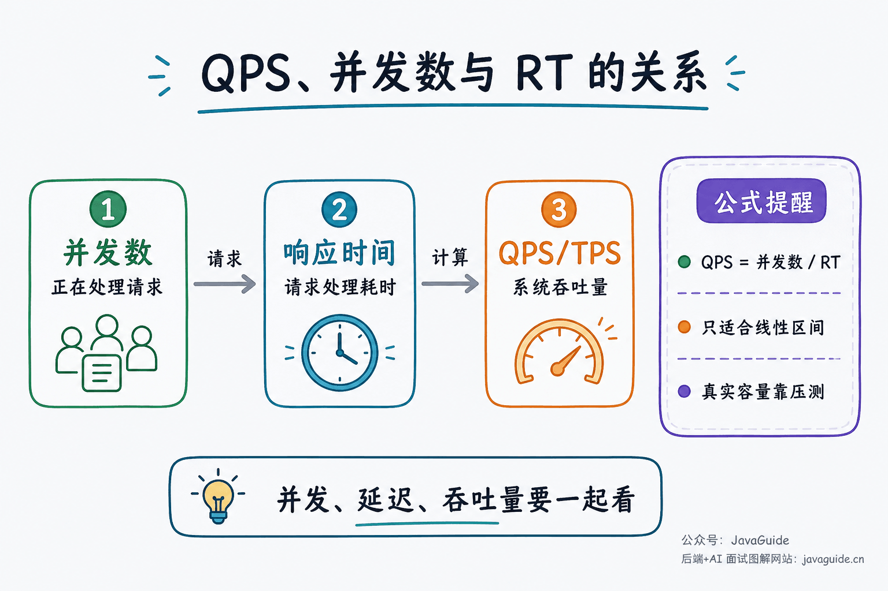
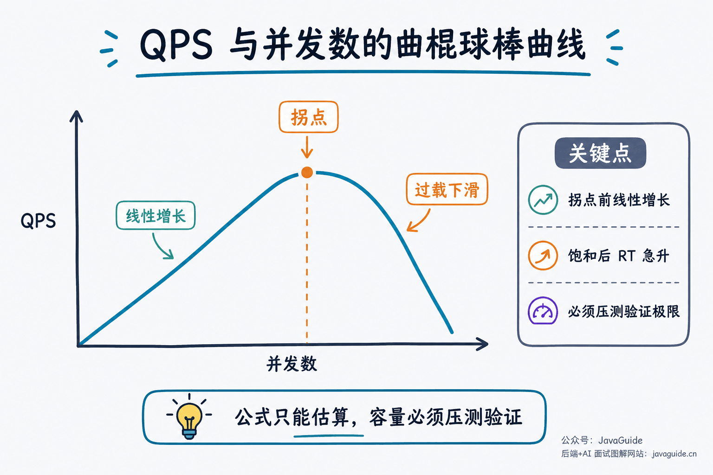
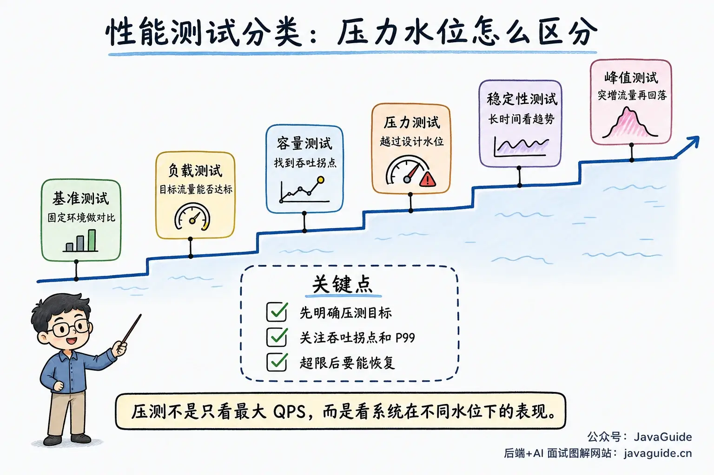
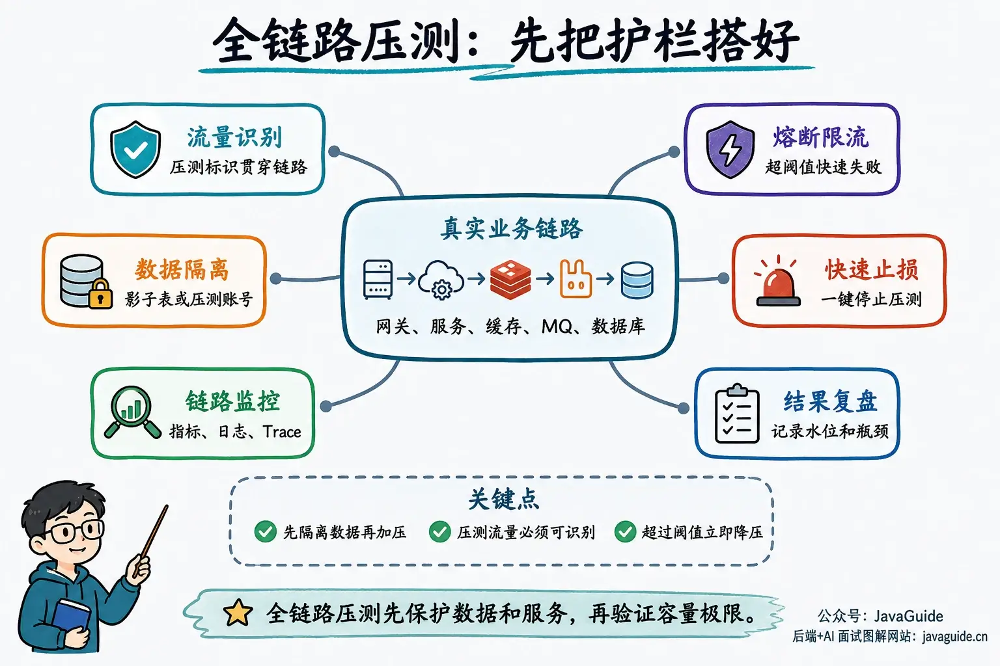

Performance testing is often handled by a dedicated QA team, so why should developers learn about it? Understanding its metrics, types, and tools helps us write better-performing software. Performance-testing experience can also strengthen a developer's résumé.

This guide draws on my experience, discussions with QA teams, and several useful books. I hope you find it helpful.

The term "load test" is often used broadly for performance testing: tools simulate user requests while we observe throughput, response times, error rates, and resource use under different loads. Before running a test, define what it should verify.

## How Different Roles View Website Performance

### Users

When users open a website, they care most about **how quickly it responds**. For example, how long does Taobao take to show its home page? How long does it take to respond after a user submits an order?

Users often judge a website's performance by its response speed.

### Developers

Both users and developers care about speed, which is essentially how quickly the system **processes user requests**.

Developers may find it hard to assess a website's performance directly, so they often estimate it based on the architecture and infrastructure. For example:

1. Is the project distributed?
2. Does it use a cache and message queue?
3. Are high-concurrency workflows handled specially?
4. Is the database design sound?
5. Can the algorithms be optimized?
6. Does the system have memory leaks?
7. How large is the Redis cache? How powerful are the servers? Do they use HDDs or SSDs?
8. ……

### QA Engineers

QA engineers usually run performance tests with specialized tools and summarize results in a report. It may include:

1. Response time.
2. Request success rate.
3. Throughput.
4. ……

### Operations Engineers

Operations engineers tend to judge performance by **infrastructure and resource utilization**: whether server resources are used efficiently and whether the database is overloaded. The role has evolved as DevOps has become more common, but it remains useful to consider it separately here.

## What to Consider Before Performance Testing

Many performance-testing guides explain how to test and which metrics to use but overlook the following considerations.

### Define the Test Objective

Define the objective first. Otherwise, you may end up with a running tool and a report but no clear conclusion.

Common objectives include:

1. **Pre-release capacity planning**: Verify that the current machine specifications, instance count, database configuration, and cache strategy can handle expected traffic.
2. **Validate an optimization**: Confirm whether throughput, RT, or error rate improved after changes to slow SQL, caches, thread pools, JVM settings, or architecture.
3. **Find bottlenecks**: Increase load gradually and monitor CPU, memory, GC, database connection pools, thread pools, and MQ backlogs to find the first constraint.

These objectives require different tests. Capacity planning focuses on peak load and safety margins; optimization validation compares results before and after a change; bottleneck analysis needs detailed monitoring and tracing.

### Understand the Business Workload

**Understand the system's business workload before testing.** Without that context, it is easy to test the wrong part of the system and overlook the areas that need performance testing most.

For example, a system may let users configure email addresses and send emails, processing tens of thousands of email requests each day. It may seem natural to test the email endpoint first, but email delivery may not be the bottleneck. If many users send emails, user management could be the real bottleneck.

### Use Historical Data

Historical data is valuable. It can reveal which endpoints receive the most calls and which services carry the most load, helping you focus performance tests and analysis.

These components may be the system's weak points; improving them can make a significant difference.

### Model Realistic Traffic

A single-endpoint load test shows only how that endpoint performs under current conditions; it does not represent the system's real capacity. Users log in, browse, search, order, pay, or submit forms, and these endpoints have dependencies, sequences, and different traffic proportions.

Design test scripts around real business flows: send more traffic to frequent endpoints and less to infrequent ones. Do not overstate write traffic in a read-heavy system. Prepare valid test data for endpoints that require authentication, inventory, or order-state transitions. Otherwise, a high measured QPS may still fail to predict production behavior.

### Prepare a Stop Mechanism

Before any load test, especially one against production, prepare stop controls and safety thresholds: maximum QPS and concurrency, error rate, P99 RT, CPU and memory, and database connection-pool limits.

If 5xx responses surge, RT keeps rising, queues stop draining, or database connections are exhausted, the test must stop quickly or trip an automatic circuit breaker. The goal is to find problems, not to take production offline.

## Common Performance Metrics

Do not interpret load-test metrics in isolation. RT, throughput, and concurrency together show whether the system is processing requests normally or beginning to queue them.

### Response Time

First, define where response time is measured. For backend API load tests, **RT (Response Time)** usually measures the time from when the load-testing client sends a request until it receives the response, including network transfer, gateway handling, server processing, and the return trip. Frontend experience also depends on HTML parsing, JavaScript execution, resource loading, rendering, and interaction latency; use tools such as Lighthouse, Chrome DevTools, or WebPageTest for those issues.

Average RT shows only the overall trend. User experience is more affected by tail latency such as P95 and P99. API load tests and production monitoring usually track **P50, P90, P95, and P99**. For critical paths, also track **P999** when the sample size is large enough.

For example, P99 = 500 ms means 99% of requests return within 500 ms. The slowest 1% may result from cache misses, slow SQL, or GC stop-the-world pauses, and can occupy connections and worker threads for a long time. Under high concurrency, the thread pool fills up and new requests queue or get rejected. Upstream retries can amplify the traffic. Many fast responses lower the average and hide the tail-latency problem.

These are example targets for a low-latency online API, not universal standards:

| Percentile | Example target | Description                                         |
| ---------- | -------------- | --------------------------------------------------- |
| P90        | < 200 ms       | Typical experience for most users                   |
| P99        | < 500 ms       | Tail experience and thread-occupancy risk           |
| P999       | < 1 s          | Extreme tail latency on high-traffic critical paths |

Derive thresholds from the business SLO, user-experience requirements, upstream timeouts, downstream capacity, and historical baselines. P999 is sensitive to sample size: with only a few thousand requests, occasional jitter can distort it. It is also of limited value for a low-QPS endpoint. For these cases, start with P99 or run the test longer to collect more samples.

> **Failure mode**: If a downstream service briefly jitters and P999 spikes, missing timeouts, rate limits, or circuit breakers can leave requests holding connections, threads, or coroutines for too long. Retries can then exhaust thread and connection pools, grow queues, and increase errors; in severe cases, the system may run out of memory.

### Concurrency

**Concurrency is the number of requests the system is handling at the same time.**

Concurrency reflects system **load capacity**. Distinguish these terms:

- **Concurrent users**: The number of users online at the same time.
- **Concurrent requests**: The number of requests being processed at the same time.
- **Maximum concurrency**: The maximum number of concurrent requests the system can handle before performance degrades or it fails.

### RPS, QPS, and TPS

- **RPS (Requests Per Second)**: HTTP/RPC requests handled by the server each second; commonly used for API load tests.
- **QPS (Queries Per Second)**: Queries handled each second. Commonly used for database and search queries, and sometimes broadly for request throughput.
- **TPS (Transactions Per Second)**: Business transactions completed per second, such as an order, payment, or registration.

> QPS vs. TPS: TPS has a business meaning. One order may count as one TPS but involve four HTTP/RPC requests for inventory lookup, order creation, inventory deduction, and payment. That may count as four RPS and generate even more database queries per second.

### Throughput

**Throughput** is the number of requests a system processes per unit of time. RPS, QPS, and TPS are common measures.

**Little's Law**: In a stable system below saturation, `average in-flight requests ≈ throughput × average response time`. Here, concurrency means the average number of requests being processed or queued, not the number of online users. Use average response time, not P99, and the average completion rate for throughput.

For example, with an average of 500 QPS and an average RT of 200 ms (0.2 s), the average number of in-flight requests is about `500 × 0.2 = 100`.

This formula applies only in the linear response range. As concurrency rises further, CPU scheduling, lock contention, and queueing amplify one another. RT often increases nonlinearly, while throughput plateaus or drops after a tipping point. The **hockey-stick curve** illustrates this: after the turning point, QPS falls as the system enters the nonlinear range.

Therefore, formulas alone cannot determine production capacity; validate the real limits with end-to-end load testing.

## User Activity Metrics

### PV (Page Views)

**Page views** count how often users view or click pages. Each page open or refresh during the reporting period counts once, including repeated views of the same page. PV measures page loads and refreshes.

### UV (Unique Visitors)

**Unique visitors** count the number of users who visit a site in one day. Multiple visits by the same user on that day count as one UV. UV measures activity by individual users.

### DAU (Daily Active Users)

**Daily active users** are the unique users who log in to or use a product in one day.

### MAU (Monthly Active Users)

**Monthly active users** are the unique users who log in to or use a product in one month.

### Capacity-Planning Example

> **Production capacity planning**: Estimating peak traffic from DAU and a fixed multiplier can underestimate campaign traffic. Flash sales and scheduled launches can peak far above average daily traffic. Estimate average QPS from historical daily requests, then apply a business-specific peak multiplier (for example, 3–10 times average) to get an initial peak QPS. Use Little's Law to estimate target concurrency and add a safety margin of 1.5–2 times. This is only a starting point for load testing. Measure actual throughput with **end-to-end load tests**, using recorded and replayed traffic with a tool such as [GoReplay](https://goreplay.org/).

## Types of Performance Tests

| Test type               | Goal                                                         | Typical approach                                                                   |
| ----------------------- | ------------------------------------------------------------ | ---------------------------------------------------------------------------------- |
| **Benchmark**           | Establish a baseline for comparison                          | Keep environment, script, and data fixed                                           |
| **Load test**           | Verify the system meets targets under expected load          | Gradually increase traffic according to the expected model                         |
| **Capacity test**       | Find the system's current capacity limit                     | Increase load and observe throughput turning points and resource bottlenecks       |
| **Stress test**         | Observe degradation, protection, and recovery above capacity | Exceed expected load and verify rate limiting, circuit breaking, and self-recovery |
| **Soak/endurance test** | Verify long-term stability                                   | Run for an extended period near realistic load                                     |
| **Spike test**          | Verify tolerance for sudden traffic increases                | Raise traffic quickly, then lower it and observe recovery                          |

The main difference is how far the load is increased: load testing checks whether the target traffic is supported; capacity testing goes further to find the limit; stress testing exceeds expected load to observe failure and recovery.

### Benchmark Testing

Benchmark testing keeps the environment, script, data, and parameters fixed to compare performance before and after an optimization. For example, test the same endpoint on the same machine before and after adding an index, then compare average RT, P99, throughput, and CPU utilization.

### Load Testing

Load testing verifies that the system meets requirements under an expected traffic model. Combine login, search, order, and payment requests according to historical production proportions, then increase load to the target QPS and check response times, error rates, and resource use.

### Capacity Testing

Capacity testing keeps increasing request load until a server resource saturates or response times and error rates exceed requirements. It focuses on the limits of the current architecture and resource configuration.

### Stress Testing

Stress testing deliberately pushes traffic beyond the designed capacity. Fast failures such as 429 or 503 responses are acceptable; requests hanging indefinitely, unreleased connections, thread-pool queues, growing backlogs, and continued upstream retries are not. Verify that token buckets, semaphores, queue limits, circuit breakers, and fallback work. After removing the load, check that connections, threads, queues, and throughput return to normal.

### Stability Testing

Stability testing focuses on long-term trends. Some problems appear only after hours of normal operation. Run traffic close to production levels for hours, a day, or longer, and watch for heap growth that never recedes, more frequent Full GCs, persistently saturated connection pools, steadily increasing thread counts, growing MQ or local queues, and gradually rising error rates. A 7×24-hour test is common for demanding workloads, but is not a universal requirement.

### Spike Testing

Spike testing simulates sudden traffic bursts, such as a campaign launch, scheduled flash sale, or message push. Increase traffic sharply over a short period, then return it to normal. Check whether rate limiting, queueing, and fallback behave as expected, and whether RT, error rate, thread pools, and queues recover afterward.

## End-to-End Load Testing

A single-endpoint test only shows that endpoint's throughput under a particular script. In complex systems, the bottleneck may be downstream: gateway authentication works while inventory queues requests; the order API responds while the MQ backlog grows; application CPU is low while the database connection pool saturates. An order may pass through the gateway, authentication, catalog, inventory, order, payment, message queue, cache, and database. A bottleneck anywhere in that path affects the user request.

End-to-end load testing sends traffic through the real business path from the system's entry point, putting load on every service, component, and infrastructure layer. It is closer to production traffic than a single-endpoint test, but it can also affect real data and services. Prepare the following:

1. **Isolate test data**: Use test accounts and labels, shadow tables, or shadow databases to avoid polluting real orders, payments, and inventory.
2. **Identify test traffic**: Ensure gateways, services, logs, monitoring, and traces can identify load-test traffic for measurement and quick mitigation.
3. **Monitor the full path**: Observe application, host, database, and cache metrics, MQ backlogs, slow SQL, GC, and thread-pool state.
4. **Enable circuit breakers and rate limits**: Confirm that rate limiting, fallback, circuit breaking, and queue limits are active before testing.
5. **Record results for review**: For each run, record concurrency, QPS, P90/P99, error rate, resource utilization, and bottlenecks to compare with later optimizations.

If the business does not yet need a production end-to-end testing platform, start with JMeter, Gatling, or wrk to test the critical paths. A setup that can find bottlenecks, protect data, and stop quickly covers most capacity-planning and bottleneck-analysis needs. Consider building a dedicated platform when frequent production tests become necessary.

## Common Performance-Testing Tools

### Backend Tools

Since system design includes performance, interviewers may ask: **How do you performance-test a system?**

Common tools include:

| Tool           | Language/script                             | Features                                                                                                       | Suitable for                                      |
| -------------- | ------------------------------------------- | -------------------------------------------------------------------------------------------------------------- | ------------------------------------------------- |
| **JMeter**     | Java, GUI + CLI                             | Full-featured; GUI is useful for writing and debugging scripts, while CLI is recommended for formal load tests | Complex enterprise scenarios and API-chain tests  |
| **Gatling**    | Java, JavaScript, TypeScript, Scala, Kotlin | Code-driven; integrates well with reports and CI                                                               | Script maintenance by development teams and CI/CD |
| **k6**         | JavaScript scripts, Go engine               | Good integration with metrics, thresholds, and CI                                                              | API load tests and SLO regression                 |
| **Locust**     | Python                                      | Define user behavior in Python; supports distributed scaling                                                   | Python teams and complex user behavior models     |
| **wrk**        | C, with Lua scripting support               | Lightweight and high-performance                                                                               | High-concurrency HTTP benchmarks                  |
| **ab**         | C                                           | Simple, lightweight, included with Apache                                                                      | Quick smoke or rough benchmark tests              |
| **LoadRunner** | Commercial suite                            | Broad protocol support and management features                                                                 | Large-scale enterprise testing                    |

Except for **LoadRunner**, the tools above have open-source or free versions.

**Choosing a tool:**

- **Quick checks**: Use `ab` or `wrk` for simple endpoint tests.
- **Complex scenarios**: Use `JMeter`, which supports script recording, parameterization, and assertions.
- **Code-driven tests**: Use `Gatling` or `k6` to maintain scripts as code and integrate them with CI.
- **Complex user behavior**: Use `Locust` to model user behavior in Python.

### Frontend Tools

| Tool                            | Main use                                                                                            |
| ------------------------------- | --------------------------------------------------------------------------------------------------- |
| **Chrome DevTools Performance** | Record and analyze runtime performance, long tasks, JavaScript execution, and rendering bottlenecks |
| **Lighthouse**                  | Audit page performance, accessibility, best practices, and SEO, then generate a report              |
| **WebPageTest**                 | Test page loading in real browsers across networks and regions                                      |
| **Fiddler/Charles**             | Capture, modify, and debug HTTP requests                                                            |

## Common Performance-Optimization Checks

Before optimizing, trace the request path: ingress gateway, application thread pool, cache, database, MQ, and external APIs. Start with the first place where requests queue.

Use these questions to guide performance work:

| Area             | Questions to ask                                                                      |
| ---------------- | ------------------------------------------------------------------------------------- |
| **Caching**      | Does the system need a cache? Are hot keys cached?                                    |
| **Architecture** | Is the architecture itself a bottleneck? Are read/write splitting or sharding needed? |
| **Concurrency**  | Are there deadlocks? Is lock granularity appropriate?                                 |
| **Memory**       | Are there memory leaks? Is GC too frequent?                                           |
| **Database**     | Are indexes used effectively? Are there slow queries?                                 |
| **Algorithms**   | Can the time complexity of core algorithms be improved?                               |
| **I/O**          | Are there unnecessary network calls? Can operations be batched?                       |

<!-- @include: @article-footer.snippet.md -->
