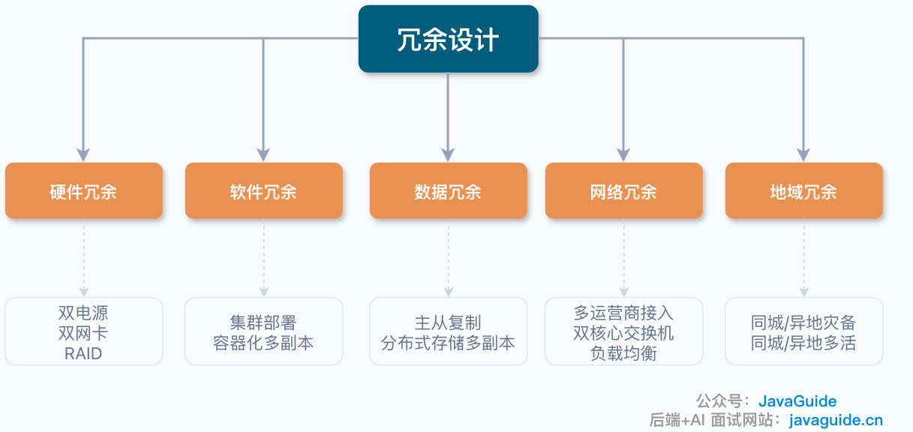
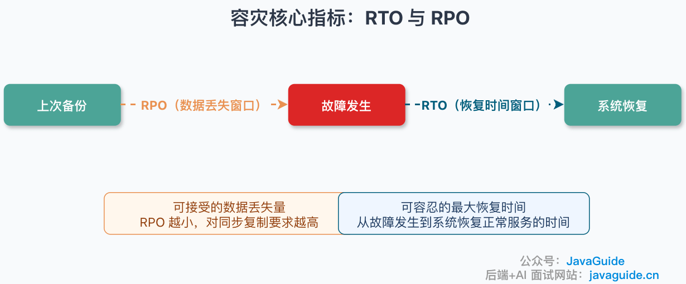
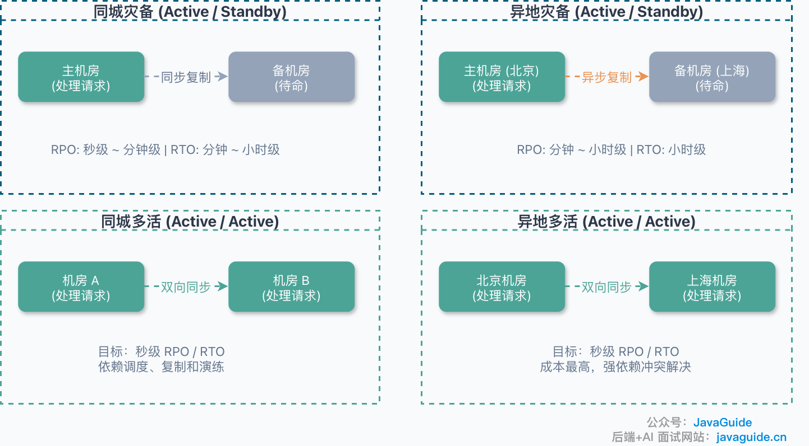
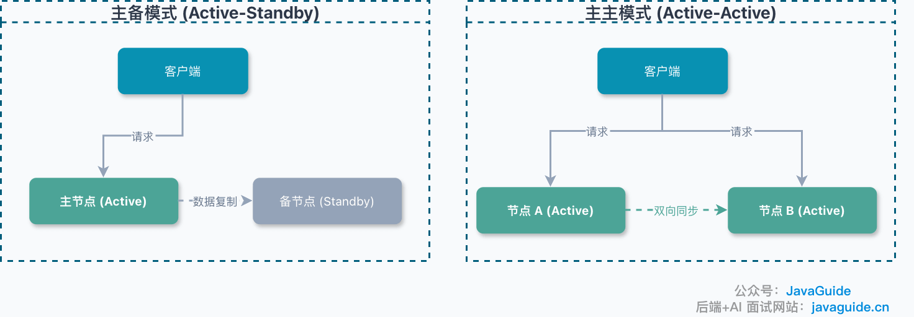
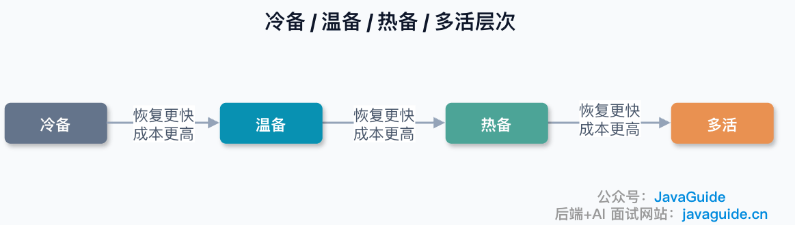
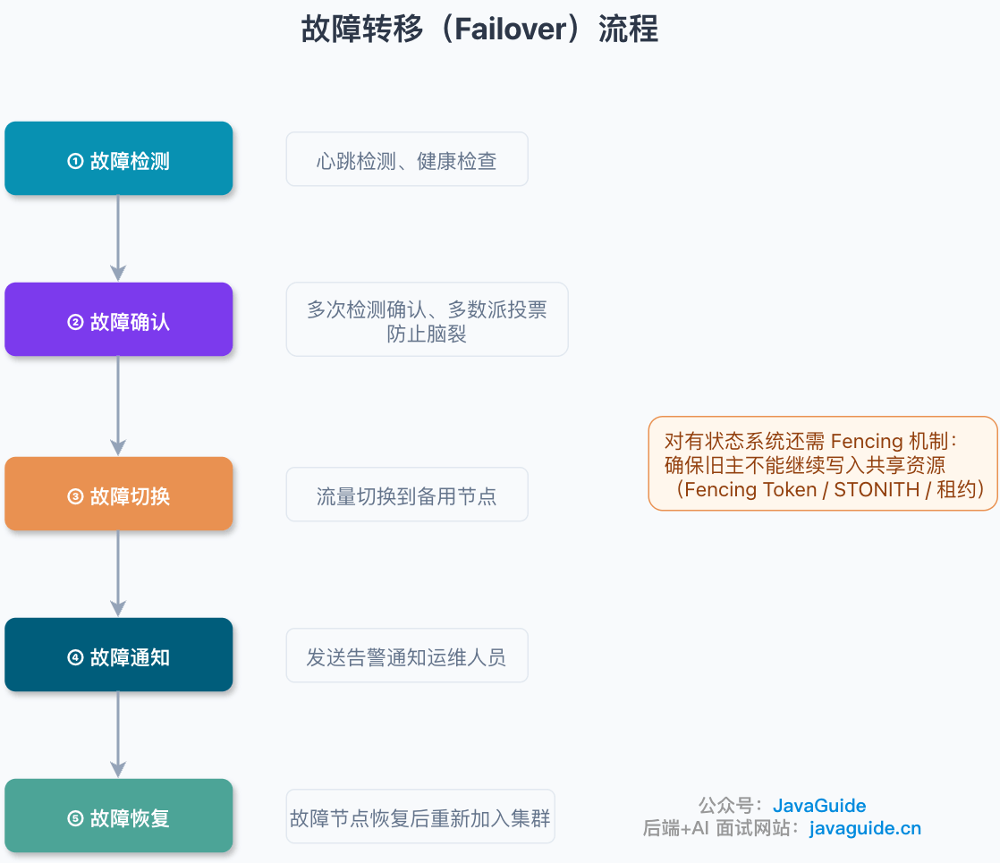
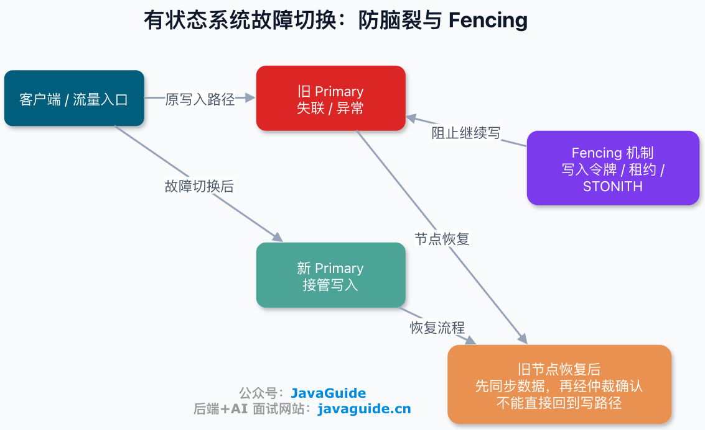
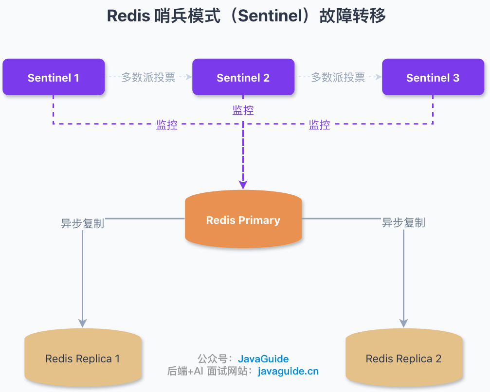
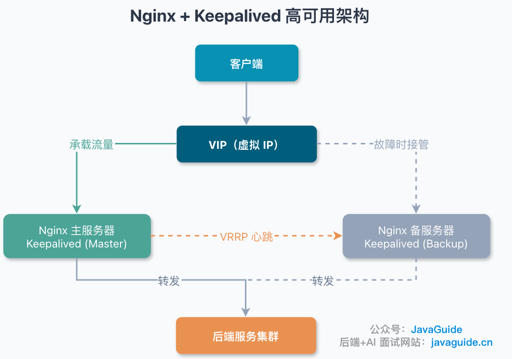
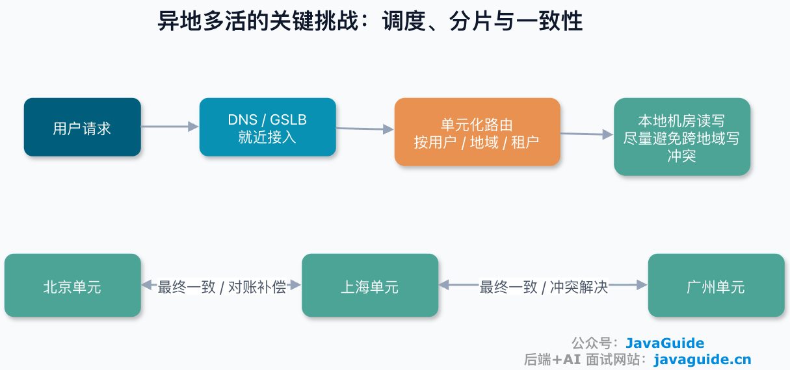

Whether the problem is a hardware failure, a data-center outage, or a service crash, a single point of failure is the system's weakest link. One basic and effective way to tolerate failures is **redundancy**: keep extra copies of critical resources so another can take over if one fails.

This guide covers the core ideas and common approaches to redundancy, from the disaster-recovery metrics RTO and RPO to high-availability clusters, disaster recovery across sites, geo-active-active architectures, and failover tools such as Redis Sentinel and Keepalived.

## What Is Redundancy?

**Redundancy** is a common way to improve system availability and data durability. Its core idea is to **deploy multiple copies of a resource so that another can take over if one fails, keeping the system available**.

Redundancy is a foundation for availability, but it does not provide high availability by itself. It must be paired with failure detection, traffic switching, data replication, recovery drills, monitoring, and alerts to reduce the impact of failures.

Redundancy can be considered across several dimensions:

| Type           | Description                           | Typical implementations                                                   |
| -------------- | ------------------------------------- | ------------------------------------------------------------------------- |
| **Hardware**   | Multiple copies of critical hardware  | Redundant power supplies, network cards, RAID                             |
| **Software**   | Multiple application instances        | Cluster deployment, multiple container replicas                           |
| **Data**       | Multiple copies of stored data        | Database replication, replicas in distributed storage                     |
| **Network**    | Redundant network links and devices   | Multiple carriers, dual core switches and links, redundant load balancers |
| **Geographic** | Deploy systems in different locations | Same-city or geo-disaster recovery, same-city or geo-active-active        |

**Service redundancy** deploys two or more instances of a service and switches to a healthy instance when one fails, reducing downtime and improving availability.

**Data redundancy** stores multiple copies of the same data. If one copy is lost, another can restore it, improving data durability and availability.

Redundancy is common in everyday life too. For example, I sync important files to both GitHub and a personal cloud drive so I can recover them if my computer's disk fails.

## Core Disaster-Recovery Metrics: RTO and RPO

Before discussing disaster-recovery architectures, understand these two key metrics:

- **RPO (Recovery Point Objective)**: The acceptable data-loss window after a disaster, or how far back restored data may go. A lower RPO places greater demands on synchronous replication, log replication, cross-site consistency, and write latency. RPO = 0 usually requires writes to be acknowledged by multiple failure domains or an equivalent strongly consistent commit mechanism. This increases write latency and requires a trade-off between availability and consistency during a network partition.
- **RTO (Recovery Time Objective)**: The **maximum acceptable recovery time**, from the start of a failure until normal service resumes. RTO = 0 means no perceptible interruption is allowed by the target. In practice, teams more often aim for near-zero recovery or a seamless switch, which still depends on failure detection, traffic switching, and client retries.

> **RTO and RPO are targets, not guarantees.** They express business requirements for disaster recovery. Actual recovery depends on detection speed, failover automation, replication lag, manual procedures, and operational capability. Stating an RTO or RPO does not prove that production can meet it; verify it with regular drills and load tests. Different business paths can have different targets.

The following RPO/RTO values are **rough references** for typical configurations. Actual results depend on replication mode (synchronous or asynchronous), failure-detection thresholds, failover automation, and operational capability. Whether an active-active system can achieve second-level RTO/RPO depends on traffic routing, data replication, failure detection, client retries, conflict resolution, and drill maturity.

| Architecture                | RPO                        | RTO              | Cost        |
| --------------------------- | -------------------------- | ---------------- | ----------- |
| Single instance, no backup  | Potentially all data       | Unpredictable    | Low         |
| Local backup                | Depends on backup interval | Hours            | Low         |
| Same-city disaster recovery | Seconds to minutes         | Minutes to hours | Medium      |
| Geo-disaster recovery       | Minutes to hours           | Hours            | Medium-high |
| Same-city active-active     | Seconds                    | Seconds          | High        |
| Geo-active-active           | Seconds                    | Seconds          | Very high   |

## Redundancy Architecture Patterns

High-availability clusters (HA clusters), same-city and geo-disaster recovery, and same-city and geo-active-active deployments are common applications of redundancy in high-availability design.

### High-Availability Clusters

A **high-availability cluster** runs two or more instances of a service and switches to another instance if the one in use fails.

Two common cluster modes are:

| Mode               | Description                                    | Advantages                                        | Disadvantages                                                                                        |
| ------------------ | ---------------------------------------------- | ------------------------------------------------- | ---------------------------------------------------------------------------------------------------- |
| **Active-standby** | The primary serves requests; the standby waits | Simple; single-writer behavior is easy to control | Low resource utilization; standby is idle                                                            |
| **Active-active**  | Multiple nodes serve requests at the same time | High resource utilization; no single active node  | The application must resolve write conflicts; auto-increment IDs and unique constraints may conflict |

Active-standby usually makes the write path easier to control. Synchronous replication improves consistency but increases write latency; asynchronous replication may lose data that has not reached the standby when failover occurs. An HA cluster provides service redundancy but **does not specify geographic separation**. Same-city or geo-disaster recovery and active-active deployments add geographic redundancy.

### Same-City Disaster Recovery

**Same-city disaster recovery** means deploying the primary and standby services in **separate data centers in the same city**, not merely in different racks in one data center. A common active-passive setup sends production traffic to the primary site; the standby handles no traffic or only a small amount of validation traffic until failover. Whether it is cold, warm, or hot standby depends on cost and RTO requirements.

This prevents an outage at one data center, such as a power failure or fire, from making the service completely unavailable.

- **Suitable for**: Organizations with minute-level RTO requirements and limited budgets.
- **Typical setup**: There is no universal distance or latency standard for two sites in one city. Evaluate dedicated-link latency, failure-domain separation, independent power, and carrier paths. Decide whether synchronous replication is acceptable based on actual RTT and the write-latency budget.

### Geo-Disaster Recovery

**Geo-disaster recovery** is similar to same-city disaster recovery, but deploys the same services in data centers **far apart, often in different cities or countries**.

- **Suitable for**: Critical systems that need protection from regional disasters such as earthquakes or floods.
- **Challenge**: Network latency is higher, so data is usually replicated asynchronously and some data loss may occur.

### Same-City Active-Active

**Same-city active-active** resembles same-city disaster recovery, but multiple data centers in the city handle production traffic instead of using a primary and standby. This uses resources more fully and can increase system throughput.

- **Suitable for**: Systems with high performance and availability requirements.
- **Technical considerations**: Data replication, traffic routing, and session management.

### Geo-Active-Active

**Geo-active-active** deploys services in **data centers in different regions**, with all sites **serving traffic at the same time**.

Compared with traditional disaster recovery, the key feature of same-city and geo-active-active is that **all sites serve traffic simultaneously**. Geo-active-active can help with fires, earthquakes, regional network outages, data-center failures, and regulatory requirements.

The main difference between same-city and geo-active-active is **the distance between data centers**. Geo deployments are farther apart, often in different cities or countries.

### Cold, Warm, and Hot Standby, and Active-Active

Disaster-recovery levels form a spectrum from lower to higher readiness:

| Level             | Resource state                                                      | Recovery time      | Cost      | Typical use case                                        |
| ----------------- | ------------------------------------------------------------------- | ------------------ | --------- | ------------------------------------------------------- |
| **Cold standby**  | Backup resources are stopped and must be started manually           | Hours to days      | Low       | Noncritical services                                    |
| **Warm standby**  | Some resources run continuously and must be scaled up on takeover   | Minutes            | Medium    | General disaster recovery                               |
| **Hot standby**   | Resources and data are continuously synchronized for quick failover | Seconds to minutes | High      | Critical services                                       |
| **Active-active** | Multiple sites serve production traffic                             | Near real time     | Very high | Critical services with strict availability requirements |

Different services can use different levels; there is no need to make the entire system active-active. Choose based on business impact, failure probability, and implementation cost.

## Failover

Redundancy alone is not enough; it needs a **failover** mechanism. Failover **quickly moves traffic from a failed node to a healthy one**.

Failover can be fully automatic or require manual confirmation after automatic detection. Stateless services and caches usually favor automatic switching. For high-risk operations such as database promotion, cross-region traffic shifts, or financial workflows, teams may retain human confirmation or approval.

Failover usually includes these steps:

1. **Failure detection**: Detect the failed node with heartbeats or health checks. Set thresholds to balance false positives and missed failures: overly sensitive checks cause unnecessary failovers, while overly conservative checks prolong outages.
2. **Failure confirmation**: Use repeated checks to avoid false positives, and use quorum voting, an arbitrator, or leases to prevent split brain.
3. **Failover**: Move traffic to a standby node.
4. **Notification**: Alert operations staff.
5. **Recovery**: Rejoin the recovered node to the cluster.

Stateful systems also need **fencing** to prevent the old primary from writing to shared resources after a disconnection or recovery. Without it, a successful promotion can still lead to dual-primary writes and split brain. Common techniques include fencing tokens, STONITH (Shoot The Other Node In The Head), write tokens, and leases. After recovery, the old primary must not rejoin the write path until its data is synchronized and quorum approval is obtained.

### Redis Sentinel Example

Redis Sentinel monitors the primary (also called master in older documentation). After a majority of Sentinels consider it down, they elect and promote a replica (called a slave in older documentation) to primary. Sentinel does not guarantee RPO = 0: Redis replication is usually asynchronous, so failover may lose data that has not reached the replica.

Production deployments commonly use at least three Sentinels. `quorum` specifies how many Sentinels must agree that the primary is objectively down; initiating failover also requires a Sentinel majority and leader election. Do not treat `quorum` as simply half the total number of Sentinels. Pay attention to settings such as `down-after-milliseconds` (how long an instance must be unreachable before being considered down) and `failover-timeout` (the failover timeout).

For Redis Sentinel in production, monitor:

| Category          | Metrics                                                          |
| ----------------- | ---------------------------------------------------------------- |
| Replication lag   | Replica lag relative to the primary                              |
| Failure detection | Number of `down-after-milliseconds` triggers                     |
| Failover duration | Time from failover initiation to completion                      |
| Client impact     | Client reconnection time and write-failure rate during promotion |
| Cluster status    | Sentinel quorum and majority status; Sentinel availability       |

### Nginx and Keepalived Example

Nginx can use Keepalived for high availability. Keepalived manages a virtual IP (VIP) with VRRP and can move it between primary and standby nodes, providing a highly available ingress IP. If the primary Nginx server fails, Keepalived can automatically fail over through VRRP and promote the standby Nginx server. The external IP remains the same because the setup uses a **VIP**.

Keep in mind:

- **Keepalived does not guarantee lossless migration of existing TCP connections.** Failover also depends on ARP or neighbor-table refresh, the Layer 2 network, cloud-provider VIP support, and health-check scripts.
- VIP movement is suited to one data center or a shared Layer 2 network; it does not directly solve cross-region traffic routing.
- In a cloud environment, confirm support for custom VIPs and ARP or route switching.
- Health checks should verify the Nginx process and service port, not only the Keepalived process.
- Choose preemptive or non-preemptive mode based on the workload to avoid an unnecessary second failover when the primary recovers.

## Challenges of Geo-Active-Active

Geo-active-active architectures are difficult to implement and involve many considerations:

| Challenge              | Description                                   | Possible approach                                                                                                                                                                  |
| ---------------------- | --------------------------------------------- | ---------------------------------------------------------------------------------------------------------------------------------------------------------------------------------- |
| **Data consistency**   | Keep data consistent across sites             | Cell-based routing, eventual consistency, TCC/Saga, and conflict resolution                                                                                                        |
| **Network latency**    | High latency between distant sites            | Route users to nearby sites and partition data                                                                                                                                     |
| **Traffic routing**    | Assign users to the appropriate site          | Smart DNS and GSLB                                                                                                                                                                 |
| **Session management** | Share user sessions across sites              | Prefer stateless design or route each user to the same cell and site. Cross-region session sharing is possible, but adds latency and consistency and failure-isolation challenges. |
| **Cost**               | High cost to build and operate multiple sites | Deploy by business criticality                                                                                                                                                     |

The core trade-offs in geo-active-active can be understood through CAP: cross-region latency and network partitions are unavoidable, so systems must trade off strong consistency and availability. The engineering challenges extend beyond CAP to latency, traffic routing, data partitioning, conflict resolution, cost, compliance, and operational drills. A common approach is to partition into cells by user or region so most reads and writes stay within one site. Cross-cell operations then use TCC or Saga, reconciliation and compensation, or business-level conflict resolution to achieve eventual consistency.

**Not every business needs geo-active-active.** Evaluate these cases carefully:

- Workloads with frequent strongly consistent writes and many cross-region conflicts.
- Data models that cannot be partitioned by user, region, or tenant.
- Financial workflows without adequate reconciliation and compensation.
- Teams without the operational capability to run drills and maintain the system.
- Systems whose implementation cost exceeds the expected cost of failures.

Evaluate business impact, failure probability, and implementation cost together.

For further reading on geo-active-active architectures:

- [Geo-Active-Active Explained: One Guide to Get Started — Shui Di and Silver Bullet, 2021](https://mp.weixin.qq.com/s/T6mMDdtTfBuIiEowCpqu6Q)
- [Build a Geo-Active-Active Architecture in Four Steps](https://mp.weixin.qq.com/s/hMD-IS__4JE5_nQhYPYSTg)
- [Learn Architecture from Scratch — 28: Geo-Active-Active for Business Availability](http://gk.link/a/10pKZ)

<!-- @include: @article-footer.snippet.md -->
