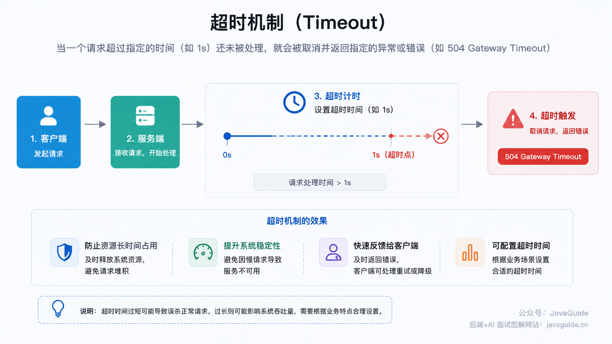
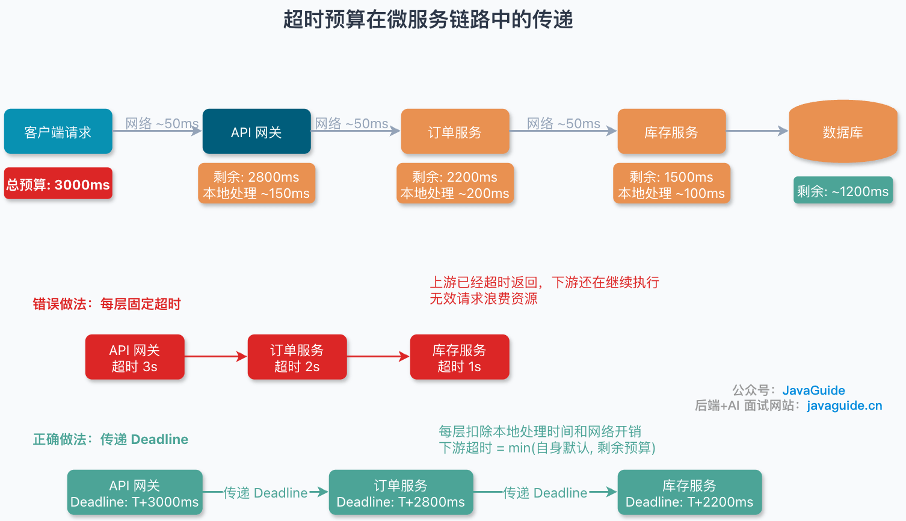
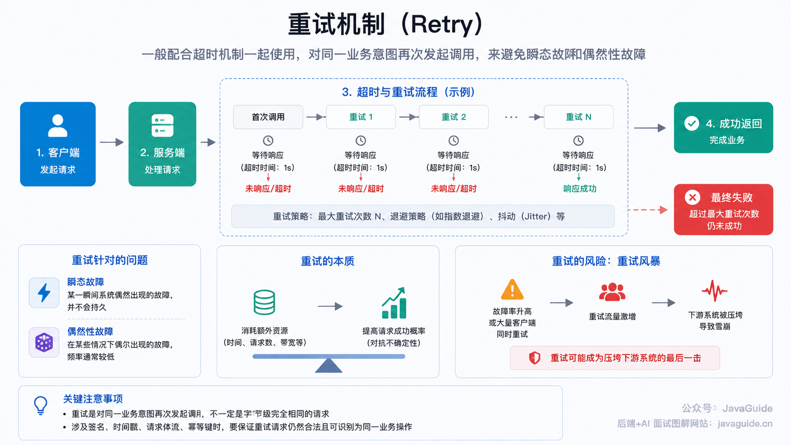
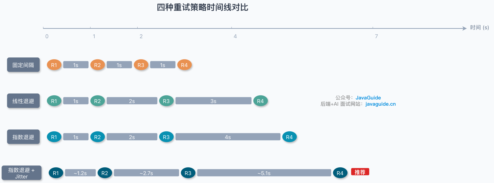
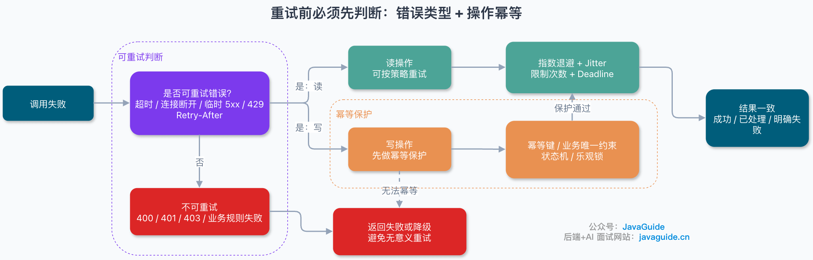
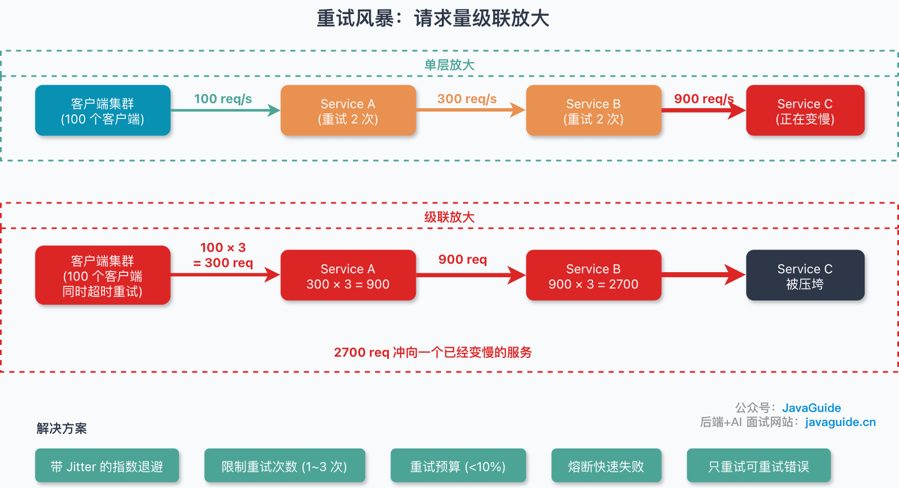

Because of network fluctuations, hardware failures, process errors, and unavailable dependencies, no system or service can remain available at all times.

To reduce the impact of failures, systems use **timeouts** and **retries**.

The basic ideas are simple, but using timeouts and retries correctly in production takes care. Most systems that make remote calls use them. They are especially important in microservices, where services call one another over the network in addition to calling databases, caches, third-party APIs, and middleware.

## Timeouts



### What Is a Timeout?

A **timeout** cancels a request and raises an error, such as `504 Gateway Timeout`, if it has not completed within a specified period, such as one second.

Two common timeout types are:

| Timeout type        | Description                                    | Suggested value |
| ------------------- | ---------------------------------------------- | --------------- |
| **Connect timeout** | Maximum time to establish a TCP connection     | 1,000–5,000 ms  |
| **Read timeout**    | Maximum time to wait for data after connecting | 1,000–3,000 ms  |

Connect and read timeouts are a useful starting point, but **production systems may need more granular timeout settings**:

| Timeout phase           | Description                                       |
| ----------------------- | ------------------------------------------------- |
| DNS lookup timeout      | Maximum time allowed for domain-name resolution   |
| Connection-pool timeout | Maximum time to obtain a connection from the pool |
| Connect timeout         | Maximum time to establish a TCP connection        |
| TLS handshake timeout   | Maximum time for the TLS/SSL handshake            |
| Write timeout           | Maximum time to write the request body            |
| Read / response timeout | Maximum time to wait for response data            |
| Call timeout / deadline | Total timeout for all phases of the call          |
| Idle-connection timeout | Maximum idle lifetime of a pooled connection      |

> HTTP and RPC clients differ in what their read, response, and call timeouts cover. Check the documentation for the specific client you use.

### Why Are Timeouts Needed?

Without timeouts, **server connection counts can explode** and **requests can pile up**.

Queued connections and requests consume resources and delay new requests. In severe cases, they can bring down the service or system.

> I encountered this in a production project: the site could no longer handle requests, and server load was near its limit. Incorrect timeout settings combined with client-side request-handling errors caused the server to accumulate nearly 400,000 connections, which brought down the system.

### How Should Timeout Values Be Set?

Choose timeout values based on the workload. **Values that are too high or too low both carry risks**:

| Configuration | Risk                                                                                                                                   |
| ------------- | -------------------------------------------------------------------------------------------------------------------------------------- |
| **Too high**  | Makes timeouts less effective; slow requests may still pile up.                                                                        |
| **Too low**   | During slowdowns, such as a sudden traffic spike, many requests may time out and retry, adding load and potentially causing a cascade. |

As a starting point:

- **Read timeout**: For latency-sensitive internal RPC calls, use historical **P99/P999 latency**, the critical-path **SLO**, and the acceptable false-timeout rate to set an initial value, then adjust it through load testing. AWS, for example, recommends choosing an acceptable false-timeout rate (such as 0.1%) and using the corresponding latency percentile, such as P99.9, as a starting point.
- **Connect timeout**: Adjust it for the network. Calls within one data center should usually have a shorter timeout; cross-region, public-network, proxy, and cold TLS connections may need more time. With connection pools, distinguish new connections from reused ones. A starting range is **1,000–5,000 ms**.

**There is no one-size-fits-all value.** Tune timeouts based on the project's requirements and observed behavior.

In a microservice call chain, **downstream timeouts should be shorter than upstream timeouts**, with time reserved for network overhead and local processing.

Prefer propagating a **deadline or timeout budget**. An incoming request has a total time budget, and each layer accounts for local processing, queueing, network overhead, and downstream calls. Set each downstream timeout below the caller's remaining budget instead of assigning arbitrary fixed values such as 3, 2, and 1 seconds at each layer. Otherwise, downstream work may continue after the upstream request has already timed out, wasting resources.



Timeouts can also be **configuration parameters** instead of fixed values. For example, following the idea in Meituan's guide to [dynamically configuring Java thread-pool parameters](https://tech.meituan.com/2020/04/02/java-pooling-pratice-in-meituan.html), store timeout values in a configuration center so they can be adjusted based on system or service conditions.

> Roll out dynamic timeout changes gradually. Monitor P99/P999 latency, timeout rate, thread-pool queues, connection-pool wait time, and retry volume. Do not push a change to every instance at once.

### Combining Timeouts, Retries, Circuit Breakers, and Rate Limiting

Timeouts and retries alone are not enough. They help a system recover from transient failures, but retries can amplify a persistent downstream failure. Production systems usually combine **timeouts, retries, circuit breakers, and rate limiting**:

| Mechanism              | Role                                 | Key point                                                            |
| ---------------------- | ------------------------------------ | -------------------------------------------------------------------- |
| **Timeout**            | Release waiting resources promptly   | Prevent requests from piling up                                      |
| **Retry**              | Handle transient failures            | Limit attempts; use backoff and jitter                               |
| **Rate limiting**      | Limit incoming request volume        | Protect downstream services from overload                            |
| **Circuit breaker**    | Stop calls to unhealthy dependencies | Fail fast and give the dependency time to recover                    |
| **Bulkhead isolation** | Limit the impact of a failure        | Isolate thread pools or use semaphores to prevent cascading failures |

## Retries



### What Is a Retry?

A **retry** is usually used with a timeout. It repeats a call with the **same business intent to recover from transient or intermittent failures**.

- **Transient failure**: A brief failure that does not persist.
- **Intermittent failure**: An occasional failure that occurs infrequently under certain conditions.

A retry repeats the business intent, but the request may not be byte-for-byte identical. If it uses signatures, timestamps, request-body streams, or idempotency keys, make sure the retry is still valid and identifiable as the same operation.

Retries **spend additional resources to increase the chance that a request succeeds**. Their extra load is usually manageable when failures are rare and the number of clients is limited. But if the failure rate rises or many clients retry at once, retry traffic can overwhelm the downstream system. This is known as a **retry storm**.

### What Retry Strategies Are Common?

Common strategies include:

| Strategy                            | Description                                               | Advantage                      | Disadvantage                                            | Suitable for                                 |
| ----------------------------------- | --------------------------------------------------------- | ------------------------------ | ------------------------------------------------------- | -------------------------------------------- |
| **Fixed interval**                  | Same delay between attempts, such as 1 second             | Simple to implement            | Can cause a retry storm                                 | When recovery time is stable and predictable |
| **Linear backoff**                  | Delay grows linearly, such as 1, 2, and 3 seconds         | Gentler than a fixed interval  | Grows slowly                                            | General use                                  |
| **Exponential backoff**             | Delay grows exponentially, such as 1, 2, 4, and 8 seconds | Gentler than a fixed interval  | Clients may still retry together; waits can become long | When recovery time is long or unpredictable  |
| **Exponential backoff with jitter** | Adds randomness to exponential backoff                    | Spreads retries across clients | Slightly more complex                                   | Recommended for distributed systems          |

**Exponential backoff with jitter is generally preferred in distributed systems.** Jitter can use full jitter, equal jitter, or decorrelated jitter; all aim to spread out synchronized retries from multiple clients.



### How Many Times Should You Retry?

Avoid too many retries; they can put significant additional load on the system.

**Keep retries for synchronous online requests conservative, often one to three attempts.** For example:

- After the first failure, wait 1 second before retrying.
- After the second failure, wait 2 seconds before retrying.
- After the third failure, wait 4 seconds before retrying.

Asynchronous jobs and MQ consumers can retry more times, but they still need backoff, a maximum attempt count, a dead-letter queue, alerts, and manual compensation.

More retries are not always better. With a 1.5-second read timeout, three retries, and backoff delays of 1, 2, and 4 seconds, the worst-case duration is about `1.5s × 4 + 1s + 2s + 4s = 13s`. That tail latency may be unacceptable for an online request. Read operations can usually be retried more freely; writes require idempotency, and noncritical paths can fail fast.

### Retry Only Errors That May Recover

The most important step in implementing retries is to **distinguish retryable errors from non-retryable errors**. Blind retries waste resources and can make an incident worse:

| Category            | Examples                                                                               | Handling                                                 |
| ------------------- | -------------------------------------------------------------------------------------- | -------------------------------------------------------- |
| **Retryable**       | Connection timeout, read timeout, connection reset, temporary 502/503/504              | Retry with backoff                                       |
| **Retryable**       | 429 rate-limit response with a `Retry-After` header                                    | Wait for the specified period, then retry                |
| **Retry with care** | Writes such as payments, orders, inventory deductions, and coupon issuance             | Require an idempotency key or business-unique constraint |
| **Do not retry**    | Invalid parameters (400), authorization failures (401/403), and business-rule failures | Return the error                                         |
| **Do not retry**    | Business errors such as insufficient balance or inventory                              | Return the error                                         |

In general, retry timeouts, connection failures, temporary 5xx responses, and rate-limit responses that explicitly allow retries. Do not retry validation, authorization, or business-rule failures, definitive 4xx responses, or writes that cannot be made idempotent.



### What Risks Do Retries Introduce?

Retries can improve availability, but using them incorrectly introduces risks:

| Risk                     | Description                                                              | Mitigation                                           |
| ------------------------ | ------------------------------------------------------------------------ | ---------------------------------------------------- |
| **Retry storm**          | Many clients retry at once, further overloading the downstream service   | Use exponential backoff with jitter                  |
| **Cascading failure**    | Retries cause upstream services to time out and retry too                | Set a retry budget and use circuit breakers          |
| **Duplicate operations** | A non-idempotent operation runs repeatedly and creates inconsistent data | Make the operation idempotent                        |
| **Wasted resources**     | Retrying permanent failures has no benefit                               | Distinguish retryable errors from non-retryable ones |

A **retry budget** limits retries to a proportion of total requests within a time window, such as 10%. Track original and retried requests by caller, endpoint, or downstream service. If retries exceed the budget, fail fast or allow only first attempts.



### Why Must Retries Account for Idempotency?

When using timeouts and retries, ensure that **running an operation once or multiple times has the same effect on system state**. This is idempotency. Deduplication prevents repeated execution; idempotency allows duplicate requests to arrive while keeping the result consistent. The two are often used together.

A request can run more than once if the client times out while waiting, even though the server has already processed it. A brief network interruption may only delay the response on its way back to the client.

> For example, retries could charge a user twice for the same course. Before processing the purchase, check whether the user has already bought it. This prevents a retry from creating a duplicate purchase.

Common ways to implement idempotency:

| Method                         | Description                                                   | Suitable for                            |
| ------------------------------ | ------------------------------------------------------------- | --------------------------------------- |
| **Unique request ID**          | Each request carries a unique ID that the server deduplicates | General use                             |
| **Database unique constraint** | A unique index prevents duplicate inserts                     | Create operations                       |
| **Optimistic locking**         | A version field controls updates                              | Update operations                       |
| **State machine**              | State transitions prevent reprocessing completed states       | Orders, payments, and similar workflows |

Under HTTP semantics, RFC 9110 defines PUT, DELETE, and safe methods (GET, HEAD, OPTIONS, and TRACE) as idempotent. POST is not idempotent by default, but an application can make it idempotent with an idempotency key or a business-unique constraint. Protocol semantics alone do not guarantee safe server behavior; explicitly design idempotency for side effects such as creating orders, charging accounts, issuing coupons, or publishing messages.

### How Can Retries Be Implemented in Java?

Retry logic can be written with a `for` or `while` loop or with recursion. In most cases, use an established library instead:

| Library                                 | Features                                                                        | Latest version     | Suitable for                                                                                                 |
| --------------------------------------- | ------------------------------------------------------------------------------- | ------------------ | ------------------------------------------------------------------------------------------------------------ |
| **Spring Retry**                        | Spring ecosystem, annotation-based, simple configuration                        | 2.0.12             | Spring Boot 2.x/3.x                                                                                          |
| **Retry built into Spring Framework 7** | Native `@Retryable`; no extra dependency                                        | Spring Framework 7 | Spring Boot 4.x                                                                                              |
| **Resilience4j**                        | Lightweight, functional style; also supports circuit breaking and rate limiting | 2.4.0              | Microservices                                                                                                |
| **Failsafe**                            | No dependencies; supports async retries, timeouts, and circuit breaking         | 3.3.2              | Fine-grained control                                                                                         |
| **Guava Retrying**                      | Flexible retry policies                                                         | 2.0.0              | General Java projects (⚠️ long inactive; not an official core Guava module, so check its maintenance status) |

#### Spring Retry Example

A simple Spring Retry example:

```java
@Configuration
@EnableRetry
public class RetryConfig {
}

@Retryable(
    retryFor = {RestClientException.class},
    maxAttempts = 3,
    backoff = @Backoff(delay = 1000, multiplier = 2)
)
public String callRemoteService(String requestId) {
    return remoteClient.call(requestId);
}

@Recover
public String recover(RestClientException e, String requestId) {
    // Fallback after all retry attempts are exhausted
    return "fallback";
}
```

The first parameter of `@Recover` is the exception type. Its remaining parameters must match those of the `@Retryable` method; Spring Retry selects the recovery method by parameter type.

Keep in mind:

- `@Retryable` uses a Spring AOP proxy. A call to `this.method()` within the same class does not trigger retries; call it through a Spring-managed proxy.
- For **Spring Boot 3.x / Spring Framework 6**, confirm that Spring Retry 2.x is compatible with the project's Spring and Java 17+ versions. Do not mix it with older releases.
- Starting with **Spring Boot 4.x / Spring Framework 7**, retry support is built into `spring-core` and can be enabled with `@EnableResilientMethods`; no separate `spring-retry` dependency is needed. Spring Retry is in maintenance-only mode and is not accepting new features.

#### Resilience4j Retry Example

```java
RetryConfig config = RetryConfig.custom()
    .maxAttempts(3)
    .waitDuration(Duration.ofMillis(1000))
    .retryOnException(e -> e instanceof SocketTimeoutException
        || e instanceof ConnectException)
    .ignoreExceptions(BusinessException.class, AuthException.class)
    .intervalFunction(IntervalFunction.ofExponentialBackoff(1000, 2))
    .build();

Retry retry = Retry.of("remoteService", config);

// Capture retry events for monitoring
retry.getEventPublisher()
    .onRetry(event -> log.warn("Retry attempt {}", event.getNumberOfRetryAttempts()));

String result = Retry.decorateSupplier(retry, () -> remoteClient.call(requestId))
    .get();
```

When combining Retry and CircuitBreaker, decorator order affects what the circuit breaker counts. `Retry.decorateSupplier(CircuitBreaker.decorateSupplier(supplier))` means a successful retry does not open the circuit. Reversing the order sends every attempt through the circuit-breaker statistics.

## Production Metrics

Validate timeouts and retries with metrics after deployment; otherwise, problems such as retry storms can be hard to detect. Key metrics include:

| Category          | Metrics                                                                |
| ----------------- | ---------------------------------------------------------------------- |
| Request volume    | Original request QPS, retry QPS, retry ratio                           |
| Latency           | P99/P999 latency, timeout rate                                         |
| Success rate      | Final success rate, first-attempt success rate                         |
| Downstream health | Downstream 5xx count, rate-limit count, circuit-breaker state          |
| Resources         | Thread-pool queue depth, connection-pool wait time, active connections |
| Retry budget      | Proportion of retry budget consumed                                    |

## References

- Managing timeouts for calls between microservices: <https://www.infoq.cn/article/eyrslar53l6hjm5yjgyx>
- Timeouts, retries, and backoff with jitter (AWS Builders' Library): <https://aws.amazon.com/cn/builders-library/timeouts-retries-and-backoff-with-jitter/>
- AWS Architecture Blog - Exponential Backoff and Jitter：<https://aws.amazon.com/blogs/architecture/exponential-backoff-and-jitter/>
- RFC 9110 - HTTP Semantics：<https://www.rfc-editor.org/rfc/rfc9110>

<!-- @include: @article-footer.snippet.md -->
