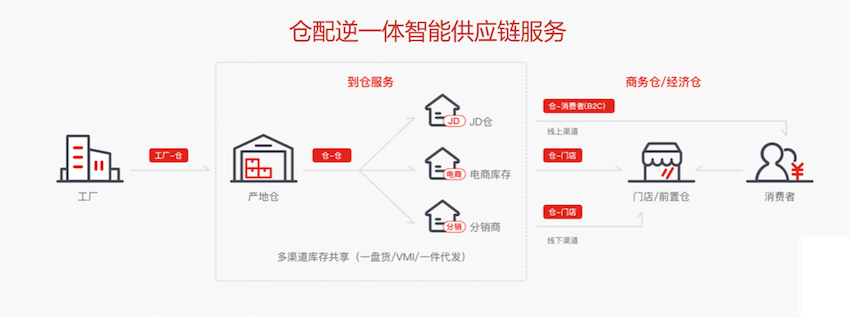
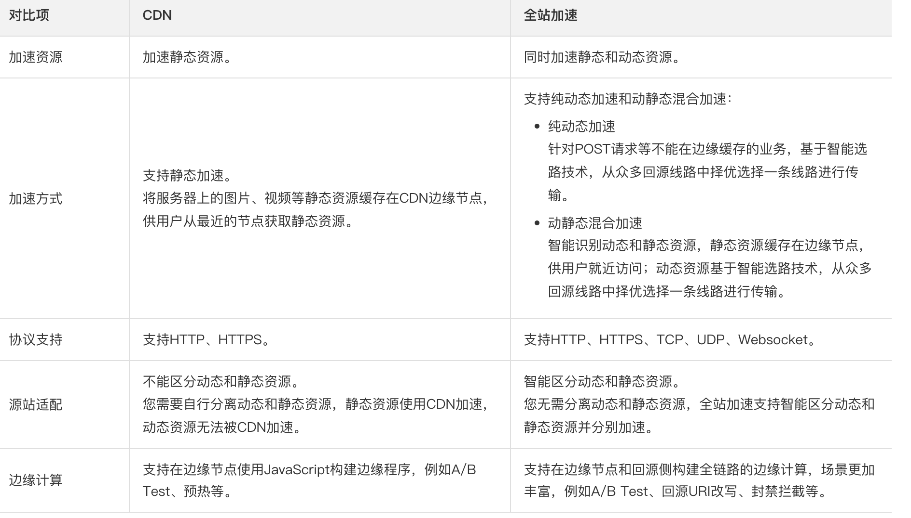
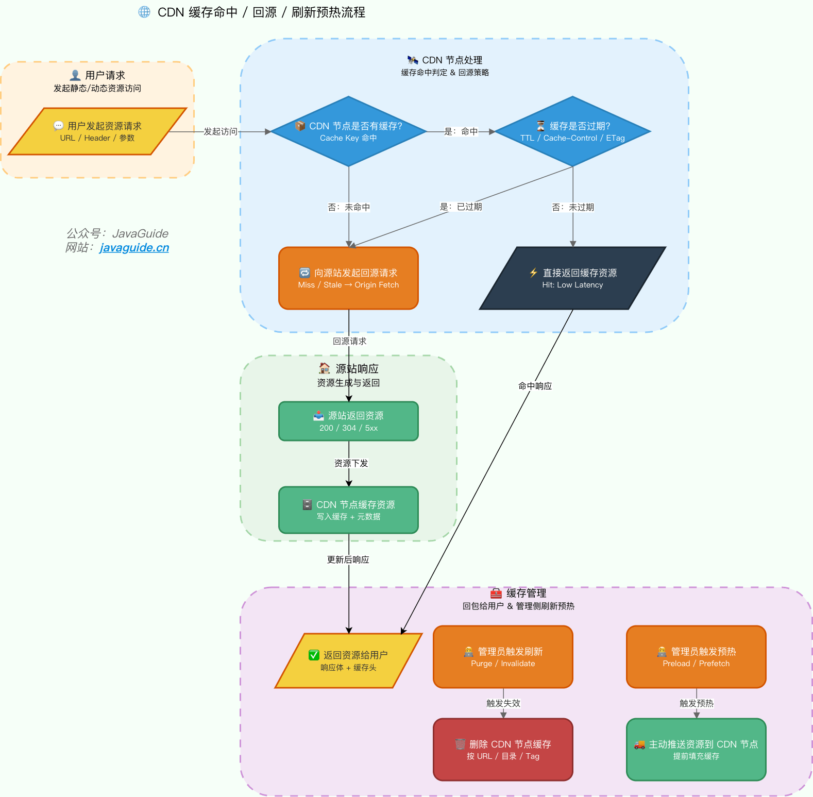
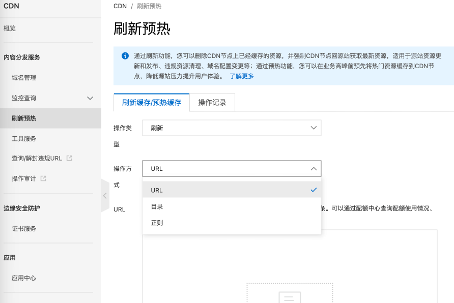
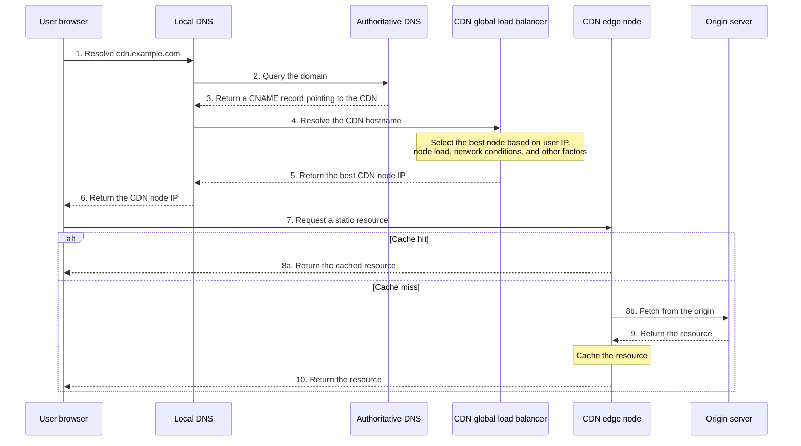
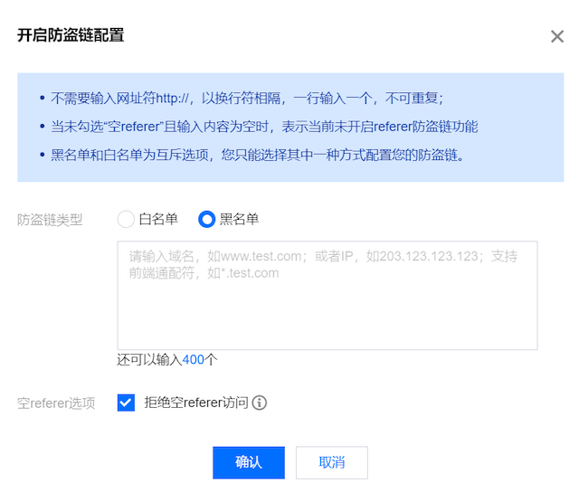
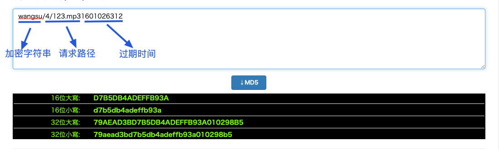
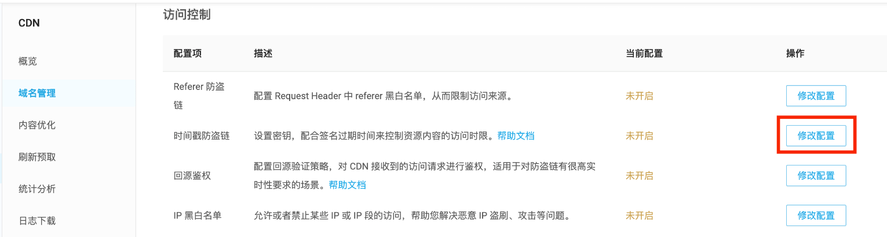

## What Is a CDN?

**CDN** stands for Content Delivery Network or Content Distribution Network.

The name describes two parts:

- **Content**: Static resources such as images, videos, documents, JavaScript, CSS, and HTML.
- **Delivery network**: Servers in multiple geographic locations that distribute these resources for **nearby access**. For example, a user in Beijing can fetch data from a Beijing data center.

In short, **a CDN distributes static resources to multiple locations so users can access them nearby, improving load speed and reducing load and bandwidth use at the origin server.**

Think of JD's extensive warehousing and delivery network. Its warehouses cover almost every county in China. As soon as a customer places an order, the product ships from the nearest warehouse to a local delivery station, then to the customer's home.



You can think of a CDN as a **specialized cache layer** distributed across regions, mainly serving requests for static resources.


Do not confuse whole-site acceleration with a content delivery network. **Whole-site acceleration** (called ECDN by Tencent Cloud and DCDN by Alibaba Cloud) can accelerate both static and dynamic content. A traditional **CDN** mainly serves **static resources**.



Most companies use a CDN, but few build and operate one themselves. For cost, reliability, and ease of use, choose a ready-to-use CDN from a cloud provider such as Alibaba Cloud, Tencent Cloud, Huawei Cloud, or QingCloud, or a CDN provider such as ChinaNetCenter or ChinaCache.

## Why Not Deploy the Entire Service in Multiple Locations?

You may ask: **If nearby access is the goal, why not deploy the entire service in multiple locations?**

This comes down to separating the architecture for **static resources and dynamic requests**:

1. **Cost**: Deploying the full application, databases, and middleware in multiple locations is expensive. A CDN only needs to store static resources, keeping costs manageable.
2. **Different resource characteristics**: Static resources such as images, JavaScript, and CSS are large, frequently accessed, and unchanging, so they are well suited to caching. Dynamic requests need real-time computation and must be sent to the origin.
3. **Resource use**: Serving static resources directly from application servers consumes CPU, memory, and bandwidth that may be needed for core business workloads.
4. **Specialized optimization**: CDNs optimize static-resource delivery with features such as compression, protocol optimization, and edge computing, which ordinary application servers may not provide.

> **Note**: Deploying multiple copies of the same service in different locations—for same-city or geo-disaster recovery, or same-city or geo-active-active—is intended to provide **high availability**, not simply nearby access.

## How Does a CDN Work?

To understand how a CDN works, answer these three questions:

1. How are static resources cached on CDN nodes?
2. How does a user find the best CDN node?
3. How can static resources be protected from unauthorized use?

In production, also monitor:

- **Cache hit rate**: A higher hit rate means fewer requests reach the origin and less pressure on it.
- **Origin latency and error rate**: Slow origin requests or more origin errors can also slow down CDN nodes.

A CDN does not guarantee better performance by itself. Poor cache rules, unstable static-resource URLs, or frequent cache purges can send many requests to the origin at once, increasing its load beyond what it would face without a CDN.

### How Are Static Resources Cached on CDN Nodes?

CDNs cache static resources in two main ways: **prefetching** and **origin pulls**.

- **Prefetch**: Proactively push origin resources to CDN nodes. Users can then fetch them from a CDN node on their first request without an origin pull. Useful before major sales and popular content releases.

- **Origin pull**: When a requested resource is missing from a CDN node or its cached copy has expired, the node fetches the latest version from the origin.

> **Note**: A request that triggers an origin pull may be slower than a direct request to the origin because it adds a CDN hop. Improving the **cache hit rate** is therefore a key CDN optimization goal.

The diagram below shows the full CDN cache lifecycle:



When a resource changes, **purge** the old copy from CDN nodes so the next request fetches the latest version from the origin.

Nearly all cloud CDN services support cache purging and prefetching. The image below shows these features in Alibaba Cloud CDN:



**Cache hit rate** and **origin-request rate** are two key measures of CDN quality:

- **Hit rate**: The proportion of user requests served directly by a CDN node. **Higher is better.**
- **Origin-request rate**: The proportion of requests that need to fetch content from the origin. **Lower is better.**

Common ways to improve the hit rate:

- **Add a content hash to static filenames**: For example, `app.8f3a1c.js`. When the content changes, the filename changes, allowing a longer cache duration.
- **Use short cache lifetimes for entry files**: Avoid long caching for HTML, sitemaps, and `robots.txt` so they do not reference old resources that have been deleted.
- **Prefetch popular resources**: Push hot resources to CDN nodes before a major sale, campaign, or software release.
- **Avoid unnecessary purges**: A full-site purge can make many edge nodes fetch from the origin at once. Purge specific URLs or directories instead.
- **Keep old versions temporarily**: Do not delete old hash-named resources immediately after deploying a new version; older HTML may still reference them and otherwise get a 404.

If the hit rate suddenly drops, check for changes to cache rules, random query parameters in resource URLs, a full-site purge, or origin response headers that prevent caching.

### How Does a User Find the Best CDN Node?

**GSLB (Global Server Load Balancing)** is the brain of a CDN. It coordinates traffic across CDN nodes and is most commonly implemented through DNS.

The diagram below shows the full CDN request-routing process:



**Detailed flow:**

1. The user's browser sends a DNS lookup request to its local DNS server.
2. The local DNS server queries authoritative DNS and finds a **CNAME (Canonical Name) record** pointing to the CDN provider's domain.
3. The local DNS server asks the CDN's **GSLB** to resolve the CDN hostname.
4. GSLB evaluates the **user's IP address and CDN node status, including load, performance, response time, and bandwidth**, then returns the best node's IP address.
5. The browser requests the resource directly from that CDN edge node.
6. The CDN node checks its cache. It returns a hit directly; on a miss or expiration, it fetches from the origin and then returns the resource.

> **Additional detail**: The diagram is simplified. GSLB can be viewed as a combination of a **CDN-specific DNS server** and a **load-balancing system**. The DNS server returns the load balancer's IP address, and the browser requests that IP to reach the appropriate CDN node.

### How Can Unauthorized Use of Resources Be Prevented?

Unauthorized use of static resources by other users or websites can create substantial bandwidth costs. Common hotlink-protection mechanisms include:

| Mechanism                  | How it works                                                              | Security | Implementation cost | Bypass difficulty                                 |
| -------------------------- | ------------------------------------------------------------------------- | -------- | ------------------- | ------------------------------------------------- |
| **Referer protection**     | Check the Referer field in the HTTP request header                        | Low      | Low                 | Low (Referer can be forged or omitted)            |
| **Timestamp signature**    | Put a signature and expiration time in the URL; the URL expires afterward | Medium   | Medium              | Medium (requires obtaining the signing algorithm) |
| **IP allowlist/blocklist** | Allow or block specific IP addresses                                      | Medium   | Low                 | Medium (can be bypassed with a proxy)             |
| **Token authentication**   | The application server generates a token that the CDN validates           | High     | High                | High                                              |

#### Referer-Based Hotlink Protection

Check the **Referer** field in the HTTP request header to determine whether the request source is allowed. Configure an allowlist of domains and reject requests from other sources.

Nearly all CDN providers support this basic hotlink-protection mechanism:



> **Note**: If the rules allow an empty Referer, an attacker can omit the field and bypass the check. Referer protection should usually be combined with other mechanisms.

#### Timestamp-Based Hotlink Protection

**Timestamp-based hotlink protection** is stronger. The URL contains a **signature** and **expiration time**. The CDN node validates the signature and checks its expiration before serving the request; expired URLs are rejected.

The signature is usually an MD5 hash of the **secret key, request path, and expiration time**.

Example timestamp-protected URL:

```plain
http://cdn.example.com/video/123.mp4?wsSecret=79aead3bd7b5db4adeffb93a010298b5&wsTime=1601026312
```

- `wsSecret`: Signature generated by the server from the secret key and request details.
- `wsTime`: Expiration time in Unix timestamp format.



Most CDN providers support timestamp-based hotlink protection out of the box:



> **Recommendation**: In production, combine **Referer checks and timestamp-based hotlink protection** to balance security and implementation cost. For highly sensitive resources such as paid content, add token authentication.

## How Does a CDN Accelerate Dynamic Content?

Traditional CDNs cache static resources such as images, CSS, and JavaScript. **Dynamic content**—such as API endpoints, real-time queries, payment requests, and `.jsp`, `.asp`, or `.php` pages—changes in real time and cannot usually be cached, so a traditional CDN often forwards it directly to the origin with limited acceleration.

**Dynamic Content Acceleration** addresses this problem. Instead of caching content, it improves the speed and reliability of dynamic requests through smart routing and protocol optimization.

Dynamic acceleration mainly uses these techniques:

1. **Smart routing and path selection**: A dynamic request first reaches the CDN edge node nearest the user. The CDN uses **real-time network monitoring** to assess latency, packet loss, and bandwidth load, avoid congested or poor-quality public-network routes, and choose an optimal path to the origin.

2. **Transport protocol optimization**:

   - **TCP optimization**: Tune TCP slow start and congestion control to improve transmission efficiency in high-latency or lossy networks.
   - **Connection reuse**: Keep connections (Keep-Alive) open between edge nodes and the origin to reduce repeated handshake latency.

3. **Combined static and dynamic acceleration**: Modern CDNs such as Alibaba Cloud DCDN and Tencent Cloud ECDN can identify the type of resource requested:
   - **Static resources**: Return them from the edge cache.
   - **Dynamic resources**: Use smart routing to fetch them from the origin.

> **In short**: Dynamic acceleration combines smart probing, dynamic route selection, and protocol optimization to make dynamic requests faster and more reliable.

Dynamic acceleration has limits: it optimizes the network path but does not reduce business computation, database query time, or third-party API latency. If an endpoint is slow because of SQL, lock contention, or a downstream dependency, dynamic acceleration does not address the root cause. A useful distinction is that static resources benefit mainly from cache hits, while dynamic requests depend on path optimization and origin performance.

## How Can a CDN Improve HTTPS Performance?

HTTPS is secure, but the TLS handshake and encryption add latency. CDNs use several techniques to improve HTTPS performance while preserving security.

| Technique              | How it works                                                                                                                          | Effect                                                         |
| ---------------------- | ------------------------------------------------------------------------------------------------------------------------------------- | -------------------------------------------------------------- |
| **Session resumption** | The node caches session data after the first HTTPS connection and reuses it on later visits, reducing full TLS handshakes             | Lower handshake latency                                        |
| **OCSP stapling**      | The CDN node caches certificate status and sends it during the TLS handshake, so the browser does not need to query the CA separately | Faster handshakes                                              |
| **False Start**        | Send encrypted data before the TLS handshake is fully complete                                                                        | Save one RTT                                                   |
| **HTTP/2**             | Supports multiplexing and header compression                                                                                          | Fewer connections and lower transfer latency                   |
| **QUIC**               | UDP-based transport protocol with 0-RTT connection setup                                                                              | Faster connection setup and better experience on weak networks |

**Benefits of CDN certificate management:**

CDN providers such as Tencent Cloud and Alibaba Cloud often provide **free SSL certificates** and **automatic renewal**, with benefits including:

- **Less maintenance**: No manual certificate renewal, reducing failures caused by expiration.
- **Flexible configuration**: Upload a certificate in the CDN console or request a free one.
- **Multiple encryption modes**: Choose **partial encryption** (HTTPS from the user to the CDN, HTTP from the CDN to the origin) or **end-to-end encryption** (HTTPS on both connections).

**HTTPS acceleration configuration tips:**

1. **Basic setup**: Enable HTTPS in the CDN console and configure a certificate.
2. **Performance**: Enable **OCSP stapling** and **HTTP/2**.
3. **Security**: Enable **HSTS** to force browsers to use HTTPS when stronger security is required.
4. **Weak-network performance**: Enable **QUIC** to improve mobile access on unreliable networks.

In production, ensure the certificate and origin protocol are configured consistently. If user-to-CDN traffic uses HTTPS but CDN-to-origin traffic uses HTTP, the latter remains unencrypted. If the origin requires HTTPS, configure certificate validation and SNI correctly for origin pulls to avoid failures.

## Summary

- **Core value**: Distribute static resources to multiple locations for **nearby access**, faster delivery, and lower origin-server load and bandwidth use.
- **Choosing a CDN**: For cost, reliability, and ease of use, use a managed service from a cloud or CDN provider.
- **Role of GSLB**: Route users to the **best CDN node** based on location, node status, and other factors.
- **Key metrics**: A higher **cache hit rate** is better; a lower **origin-request rate** is better.
- **Hotlink protection**: Combine **Referer checks and timestamp signatures** to balance security and implementation cost.
- **Dynamic acceleration**: Improve dynamic request speed and reliability with **smart routing**, **protocol optimization**, and **combined static/dynamic acceleration**.
- **HTTPS acceleration**: Optimize TLS handshakes and transfers with **session resumption**, **OCSP stapling**, **False Start**, **HTTP/2**, and **QUIC**.

## References

- Timestamp-based hotlink protection — Qiniu Cloud CDN: <https://developer.qiniu.com/fusion/kb/1670/timestamp-hotlinking-prevention>
- What Is a CDN? A Complete Guide: <https://mp.weixin.qq.com/s/Pp0C8ALUXsmYCUkM5QnkQw>
- Understanding HTTP — 37: CDN, Accelerating Network Services: <http://gk.link/a/11yOG>

<!-- @include: @article-footer.snippet.md -->
