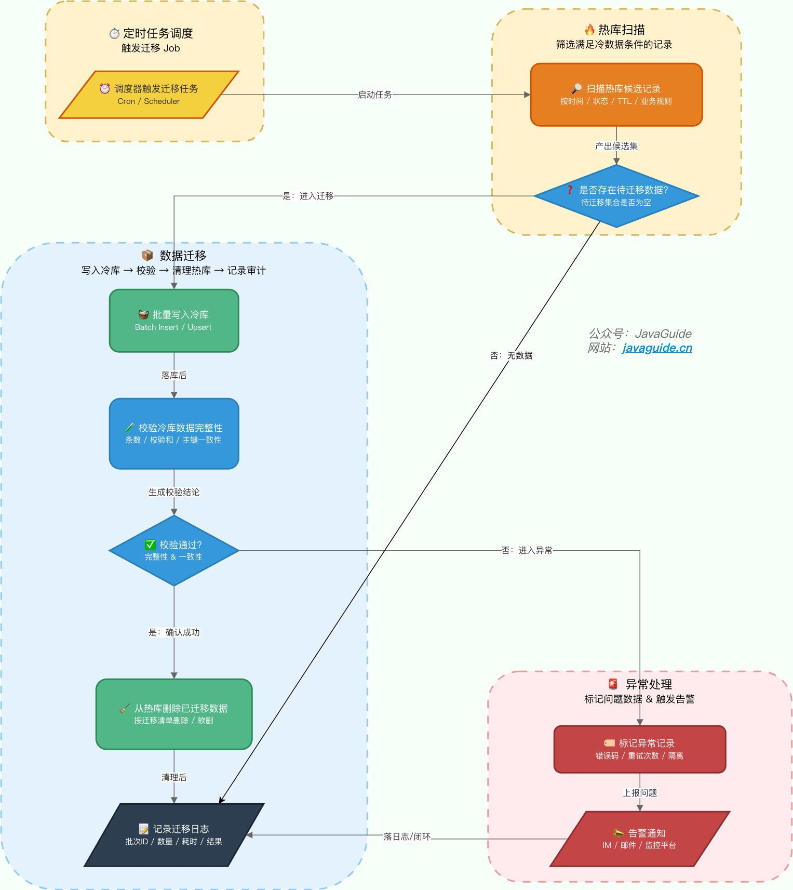

## What Is Hot/Cold Data Separation?

Hot/cold data separation is an architectural strategy that classifies data by **access frequency** and **business importance**, then stores hot and cold data on media with different performance and cost characteristics.

It has three main goals:

1. **Improve query performance**: Store hot data on high-performance media such as SSDs and memory to keep core workflows responsive.
2. **Reduce storage costs**: Move cold data to lower-cost media such as HDDs or object storage.
3. **Meet compliance requirements**: Industries such as finance and healthcare may require long-term data retention. Hot/cold separation can balance compliance and cost.

### Hot and Cold Data

**Hot data** is accessed or updated frequently and needs fast responses. **Cold data** is rarely accessed, has less immediate business value, but must be retained long term.

There are two main ways to classify data:

1. **By time**: Classify data by creation, update, or expiration time. For example, an order system may mark orders older than 90 days or one year as cold. This is simple and inexpensive when **access frequency is strongly correlated with age**.
2. **By access frequency**: Treat frequently accessed data as hot and rarely accessed data as cold. For example, a content system may mark articles with **views below a threshold** as cold. This requires tracking access frequency and suits cases where **access patterns depend more on the data itself than on its age**.

**How should you choose a classification strategy?**

- If business data is inherently time-sensitive, such as orders, logs, or bills, prefer **time-based** classification for lower implementation cost.
- If data value is not tied to age, such as articles, products, or user profiles, consider **access frequency**.
- In practice, combine both: use age as the primary rule and access frequency as a secondary signal.

Do not let the technical team choose hot/cold rules by guesswork alone. Order, billing, audit, support, and operations queries determine whether cold data must remain searchable, how quickly it must be returned, and whether full results are required. List critical query paths before choosing when to migrate data.

### Multi-Tier Hot/Cold Separation

In practice, "hot" and "cold" are not always a strict binary. Use **progressive tiers** instead:

| Tier        | Data characteristics                           | Example rule                             | Storage strategy                         |
| ----------- | ---------------------------------------------- | ---------------------------------------- | ---------------------------------------- |
| **Hot**     | Frequent access; fast responses                | Last 30 days and all incomplete orders   | MySQL hot database (SSD)                 |
| **Warm**    | Occasional access; may be queried              | Orders 30–90 days old                    | MySQL warm database (HDD)                |
| **Cold**    | Rare access; occasional queries                | Historical orders 90 days to 3 years old | Separate cold database or object storage |
| **Archive** | Almost never accessed; retained for compliance | Orders older than 3 years                | Object storage (summary only)            |

**Practice**: Manage classification rules dynamically through a **configuration center** to avoid code changes whenever business requirements change.

### What Should Happen When Cold Data Is Accessed?

If cold data is accessed unexpectedly, such as when a user requests an order from three years ago, should it be promoted to a hotter tier?

| Strategy                        | Suitable for                              | Advantages                              | Disadvantages                                |
| ------------------------------- | ----------------------------------------- | --------------------------------------- | -------------------------------------------- |
| **Do not migrate back**         | Rare queries                              | Simple to implement                     | Slow queries                                 |
| **Cache layer**                 | Moderate query frequency                  | Faster queries without changing storage | Requires a cache component                   |
| **Asynchronous migration back** | Frequent queries requiring ongoing access | Addresses the performance issue         | Complex and may introduce consistency issues |

**Recommendation**: In most cases, combine **no migration back with a cache layer**. Check the cache first when querying cold data. On a miss, query the cold store and cache the result. For occasional queries, a short TTL of 5–15 minutes is often sufficient.

**⚠️ Note**: To prevent an attacker from repeatedly querying nonexistent data with random parameters and overwhelming the cold store, put a **Bloom filter** before the cache or cache **empty-value placeholders**. See [Common Redis Interview Questions, Part 2](https://javaguide.cn/database/redis/redis-questions-02.html) for Redis transactions, performance, production issues, clustering, and usage practices.

### The Idea Behind Hot/Cold Separation

The core idea is **tiered storage**: assign data to storage media based on its access pattern. Enterprise storage architectures commonly use these tiers:

| Tier        | Data characteristics                        | Typical storage media             | Access latency           |
| ----------- | ------------------------------------------- | --------------------------------- | ------------------------ |
| **Hot**     | Frequent access, real-time responses        | NVMe SSD, memory                  | Milliseconds             |
| **Warm**    | Moderate access, recent data                | SATA SSD, high-speed HDD          | Hundreds of milliseconds |
| **Cold**    | Rare access, historical data                | High-capacity HDD, object storage | Seconds                  |
| **Archive** | Almost never accessed, compliance retention | Tape library, archival storage    | Minutes to hours         |

Tiering is widely used in IT infrastructure, including filesystems, object storage, and CDN caches—not just databases.

### Advantages and Disadvantages

**Advantages:**

- **Faster hot-data queries**: Concentrating hot data on high-performance storage reduces table size and improves index efficiency, benefiting most user operations.
- **Lower storage costs**: Cold data can move to HDDs or object storage. **The per-unit cost difference between SSDs and HDDs can be 5–10 times**, which matters at large scale.
- **Easier maintenance**: A smaller hot database can be backed up and restored faster, and DDL operations such as adding an index take less time.

**Disadvantages:**

- **More system complexity**: Requires migration components, routing logic, and monitoring, increasing consistency risks.
- **Slower cross-database queries**: Queries spanning hot and cold data, such as annual reports, require cross-database joins or aggregation, increasing latency and development cost.
- **Ongoing migration-policy maintenance**: Classification rules need tuning to avoid moving hot data by mistake.

## Cold-Data Migration

### How Is Cold Data Migrated?

Migration is a core part of hot/cold separation. Three common approaches are:

| Approach                    | How it works                                                             | Advantages                                    | Disadvantages                                                          | Suitable for                                      |
| --------------------------- | ------------------------------------------------------------------------ | --------------------------------------------- | ---------------------------------------------------------------------- | ------------------------------------------------- |
| **Application-level logic** | Check whether data is hot or cold during writes and route it accordingly | Real-time                                     | Intrusive business-code changes; complex rules                         | Rarely used                                       |
| **Scheduled migration**     | Scan the hot database periodically and batch-migrate eligible data       | Simple                                        | Migration lag; scans may pollute the buffer pool                       | Time-based classification                         |
| **Binlog-based migration**  | Watch database change logs and migrate in real or near-real time         | Responsive and non-intrusive to business code | Requires a component such as Canal; less suitable for time-based rules | **Access-frequency classification (recommended)** |

**Scheduled migration** is the most common approach. Distributed schedulers such as XXL-Job and Elastic-Job can implement it. See [Java Scheduled Tasks](https://javaguide.cn/system-design/schedule-task.html) for more on job scheduling.

> ⚠️ **Risk**: Scheduled migration can hurt performance at large scale. Broad scans, such as `SELECT * FROM orders WHERE create_time < 'xxx' LIMIT 10000`, can pollute the InnoDB buffer pool and evict genuinely hot business data. **In production:**
>
> - Use **primary-key range queries** instead of full table scans.
> - Limit the **batch size** and migrate in chunks.
> - Run migration jobs during **off-peak hours**.
> - For very large datasets, prefer **Binlog-based migration** to reduce pressure on the hot database.

Typical flow:



**Practice**: If DBAs are available, first **manually migrate existing cold data** in bulk. Then automate **incremental migration** with a scheduler.

### How Is Consistency Maintained During Migration?

The hardest migration question is: **What happens if a record is updated while it is being moved?**

#### Common Approaches

| Approach                         | Implementation                                                                 | Advantages                   | Disadvantages                                     |
| -------------------------------- | ------------------------------------------------------------------------------ | ---------------------------- | ------------------------------------------------- |
| **Lock before migration**        | Take a write lock before migration and release it afterward                    | Strong consistency           | Blocks writes and reduces throughput              |
| **Optimistic version check**     | Record the version during migration and check for changes before deleting      | No lock; good performance    | Requires a version column; conflicts need retries |
| **State marker and idempotency** | Add a migration-state field to the hot database and mark rows before migration | Traceable; supports rollback | Requires changing the business table              |

> **Note**: Hot and cold databases are usually **separate database instances**, so an `INSERT` into the cold database and a `DELETE` from the hot database cannot share one local transaction. Cross-database atomicity needs special handling.

#### Recommended: State Markers and Idempotent Migration

Add a `migrate_status` field to the hot table and use a state machine to make migration traceable and safe to retry:

```sql
-- 1. Add a migration-state field to the hot table
ALTER TABLE orders ADD COLUMN migrate_status TINYINT DEFAULT 0
    COMMENT '0-not migrated, 1-in progress, 2-migrated';
```

```java
// 2. Migration flow (pseudocode; with a separate cold database, execute each step in the application)

// Step 1: Mark as migrating (hot-database transaction)
hotDb.execute("UPDATE orders SET migrate_status = 1 WHERE id = ? AND migrate_status = 0", id);

// Step 2: Read from the hot database and write to the cold database (switch database connections)
Order order = hotDb.query("SELECT * FROM orders WHERE id = ?", id);
coldDb.execute("INSERT IGNORE INTO orders_cold VALUES (?, ?, ...)", order.id, order.data...);

// Step 3: Mark as migrated (hot-database transaction)
hotDb.execute("UPDATE orders SET migrate_status = 2 WHERE id = ? AND migrate_status = 1", id);

// Step 4: Delete from the hot database later (optional; verify the cold copy first)
hotDb.execute("DELETE FROM orders WHERE id = ? AND migrate_status = 2", id);
```

> **Note**: With a separate cold database, standard MySQL cannot directly run a cross-instance `INSERT ... SELECT`. The application must split it into two steps: read from the hot database, then write to the cold database.

**Advantages:**

- **Idempotency**: `INSERT IGNORE` makes cold-store writes idempotent, while `migrate_status` makes hot-store updates idempotent.
- **Traceability**: Check migration progress through the state field and intervene manually when needed.
- **Rollback**: Reset the state to 0 and retry after a migration failure.
- **Gradual deletion**: Keep data in the hot database until the cold copy is verified, then clean it up to reduce risk.

> **Reclaiming disk space**: After `DELETE`, InnoDB marks pages as deleted but does not immediately return physical space to the operating system. To reclaim disk space, rebuild the table with `OPTIMIZE TABLE` or `ALTER TABLE ... ENGINE=InnoDB` during **off-peak hours**.

**Safeguards:**

- **Scheduled reconciliation**: Scan periodically for records stuck in `migrate_status = 1` beyond a threshold, then reset them or alert. **Note**: `migrate_status` has low cardinality, so pair it with a composite index such as `idx_create_time_migrate_status` to constrain the scan and avoid a full table scan.
- **Frequently updated records**: Set a maximum retry count for records repeatedly skipped because of updates. After that, force migration or request manual intervention.

## How Should Cold Data Be Stored?

Choose cold storage for **high capacity, low cost, and high reliability**, accepting slower access when appropriate.

### Small and Medium-Sized Systems

Use **MySQL or PostgreSQL**, the same database type as the hot store, to reduce operational complexity. Common setups include:

- **Separate tables in the same database**: Add a cold-data table such as `order_history` and distinguish tiers by table name.
- **Separate cold database**: Use a dedicated database instance and route queries to the hot or cold database in the application.

**⚠️ Note**: A separate cold database requires **cross-database queries**. If the business needs queries across hot and cold data, assess whether data synchronization or an aggregation layer is needed.

### Large-Scale Systems

Large-scale systems often use storage engines designed for massive datasets:

| Storage option              | Characteristics                                                      | Suitable for                                              |
| --------------------------- | -------------------------------------------------------------------- | --------------------------------------------------------- |
| **HBase**                   | Column-family storage, high throughput, supports petabyte-scale data | Archiving logs, user behavior, and IoT data               |
| **RocksDB**                 | High-performance key-value store using an LSM tree                   | Embedded use and storage engine for other systems         |
| **Doris/ClickHouse**        | OLAP engines that support real-time analytics                        | Cold data that needs aggregation and analysis             |
| **Cassandra**               | Distributed, highly available, no single point of failure            | Geo-deployed archives with high availability requirements |
| **Object storage (OSS/S3)** | Very low cost and elastic capacity                                   | Very large cold datasets and compliance archives          |

### TiDB (Recommended)

If the technology stack allows, consider a distributed relational database such as **TiDB**, which supports hot/cold separation natively.

TiDB 6.0 introduced **Placement Rules in SQL**, which lets you configure where data is placed in a TiKV cluster through SQL.

- **Hot data**: Use placement rules to store it on **SSD nodes** for query performance.
- **Cold data**: Place it on **HDD nodes** to reduce storage costs.

```sql
-- Create a placement policy for hot data on SSD nodes
CREATE PLACEMENT POLICY hot_data
  CONSTRAINTS="[+disk=ssd]";

-- Create a placement policy for cold data on HDD nodes
CREATE PLACEMENT POLICY cold_data
  CONSTRAINTS="[+disk=hdd]";

-- Apply placement policies to a table or partition
ALTER TABLE orders PLACEMENT POLICY = hot_data;
ALTER TABLE orders PARTITION p2022 PLACEMENT POLICY = cold_data;
```

The advantage is that **the application does not need to handle hot/cold routing**. TiDB routes the data automatically, reducing application complexity.

> **Complete approach**: `Placement Rules` specify the storage medium, but moving data from hot to cold partitions also requires **range partitioning**. Create partitions by time range, assign HDD policies to historical partitions and SSD policies to active partitions, then maintain partition creation and removal as time passes.

## How Should Cold Data Be Queried?

Cold data is rarely accessed, but queries may still be needed for audits, reconciliation, or annual reports. How can those queries stay efficient?

### Analyze Query Requirements

First ask: **Does the business really need to query cold data?**

- **No**: Remove cold data from the business database and keep only an archive, such as object storage, for manual retrieval if needed.
- **Yes**: Design a query strategy that balances performance and cost.

### Cold-Data Query Optimizations

| Optimization                         | Implementation                                                                | Suitable for                |
| ------------------------------------ | ----------------------------------------------------------------------------- | --------------------------- |
| **Dedicated read-only cold replica** | Isolate cold queries from the hot database                                    | Frequent cold-data queries  |
| **Query routing**                    | Route to the hot or cold database based on the time range                     | Queries spanning both tiers |
| **Pre-aggregation**                  | Generate monthly or quarterly reports from cold data and query the aggregates | Analytics                   |
| **Columnar storage**                 | Use an OLAP engine such as ClickHouse or Doris                                | Large-scale analytics       |

**Queries across hot and cold data:**

If a query spans both tiers, such as "orders from the last two years," there are two options:

1. **Split the query**: Query the hot and cold databases separately and merge the results in the application.
2. **Limit the range**: Ask the user to narrow the query to avoid a cross-database request.

> **Preventing overload**: For **globally sorted pagination**, such as `ORDER BY create_time LIMIT 10000, 20`, the application would need to fetch `10000 + 20` rows from each database and merge them in memory. A large offset can easily cause an **OOM**. **Requirements:**
>
> - Limit the time range to avoid broad cross-database queries.
> - Alternatively, route the query to a synchronized wide table in a system such as ClickHouse.
> - Do not perform deep merged pagination in the application.

### How Should the Application Route Hot and Cold Data?

| Approach                 | Implementation                                             | Advantages                      | Disadvantages                                            |
| ------------------------ | ---------------------------------------------------------- | ------------------------------- | -------------------------------------------------------- |
| **Hard-coded**           | Implement routing rules in code                            | Simple                          | High maintenance cost; rule changes require code updates |
| **Configuration center** | Store routing rules in Nacos, Apollo, or a similar service | Dynamic changes without restart | Requires an additional component                         |
| **Proxy layer**          | Introduce middleware such as ShardingSphere or ProxySQL    | Transparent to business code    | More architectural complexity                            |

**Recommendation**: Use a **configuration center** for small and medium-sized systems, and a **proxy layer** at larger scale.

> ⚠️ **Risk**: With a proxy layer, cross-tier aggregations such as global sorting and `GROUP BY` merged pagination load the proxy's CPU and memory. Strictly cap the number of returned rows to avoid an **OOM (out-of-memory error)** on the proxy.

## Monitoring and Rollback

After deployment, monitor at least:

- **Migration progress**: Rows waiting, successful and failed migrations, and retry count.
- **Migration lag**: Time from when data becomes eligible for cooling to when migration completes.
- **Consistency checks**: Row counts, key-field checksums, and totals for monetary fields across both databases.
- **Query distribution**: Proportion of queries to the hot database, cold database, and both tiers.
- **Cold-store load**: QPS, RT, slow queries, connections, and storage growth.
- **Unexpected access**: Cache hit rate and cold-store load when cold data suddenly receives frequent queries.

Design rollback in advance. A safer approach is to copy data without deleting it during the initial migration. After query routing and consistency checks are stable, clean up the hot database later. If cold-store queries fail, traffic can temporarily return to the hot database.

## Hot/Cold Separation vs. Archiving vs. Partitioning

These concepts are easy to confuse:

| Dimension                     | Hot/cold separation                                    | Data archiving                                              | Partitioned table                              |
| ----------------------------- | ------------------------------------------------------ | ----------------------------------------------------------- | ---------------------------------------------- |
| **Data accessibility**        | Cold data remains in the business query path           | Archived data is usually removed from the business database | All partitions remain accessible               |
| **Storage media**             | Hot and cold data can use separate instances and media | Usually moved to lower-cost storage                         | Same instance                                  |
| **Implementation complexity** | Medium                                                 | Low                                                         | Low                                            |
| **Typical use case**          | Time-sensitive orders and logs                         | Compliance retention and backups                            | Large tables that do not need separate storage |

**Partitioning limitation**: MySQL can partition a table by time, but all partitions remain in the same instance, so it **cannot separate storage media**. Partitioning does not replace hot/cold separation when the goal is lower storage cost.

## Typical Use Cases

> **Note**: These storage strategies are examples. Choose based on data volume, query requirements, the team's technology stack, and budget.

### Order System

| Tier    | Data range                         | Storage strategy                             | Description                                     |
| ------- | ---------------------------------- | -------------------------------------------- | ----------------------------------------------- |
| Hot     | Last 90 days and incomplete orders | MySQL hot database (SSD)                     | Frequently accessed; preserve query performance |
| Cold    | 90 days to 3 years                 | MySQL cold database (HDD) or TiDB            | May need queries; keep relational storage       |
| Archive | Older than 3 years                 | Object storage, HBase, or summary table only | Rarely queried; prioritize cost                 |

### Log System

| Tier | Data range         | Storage strategy                                                           | Description                                             |
| ---- | ------------------ | -------------------------------------------------------------------------- | ------------------------------------------------------- |
| Hot  | Last 7 days        | Elasticsearch hot nodes                                                    | Real-time search and frequent queries                   |
| Warm | 7–30 days          | Elasticsearch warm nodes                                                   | Occasional queries at lower storage cost                |
| Cold | Older than 30 days | Elasticsearch cold nodes, compressed object-storage archive, or ClickHouse | Choose based on query needs; ClickHouse suits analytics |

### Content System

| Tier | Data range                               | Storage strategy                              | Description                                     |
| ---- | ---------------------------------------- | --------------------------------------------- | ----------------------------------------------- |
| Hot  | Published within 3 months or highly read | MySQL hot database                            | Frequently accessed                             |
| Cold | Older than 3 months and rarely read      | MySQL cold database, HBase, or object storage | Rarely accessed; can move to lower-cost storage |

**Recommendations:**

- **Transactions or complex queries**: Prefer a MySQL cold database or TiDB.
- **Large-scale aggregation and analytics**: Prefer ClickHouse or Doris.
- **Occasional detail lookups only**: Use object storage such as OSS or S3 and load data on demand.
- **Very large, rarely accessed datasets**: HBase or object storage may offer the best cost efficiency.

## Case Studies

- [How to Quickly Optimize an Order Table with Tens of Millions of Rows — Programmer Jidian, 2023](https://www.cnblogs.com/fulongyuanjushi/p/17910420.html)
- [Hot/Cold Separation for Large Datasets: Design and Practice — ByteDance Tech Team, 2022](https://mp.weixin.qq.com/s/ZKRkZP6rLHuTE1wvnqmAPQ)

<!-- @include: @article-footer.snippet.md -->
