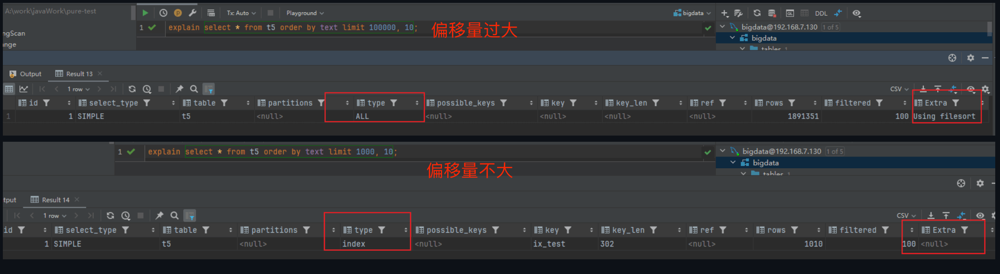
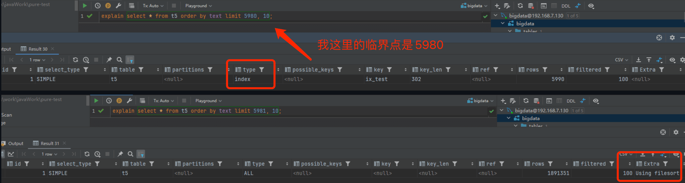
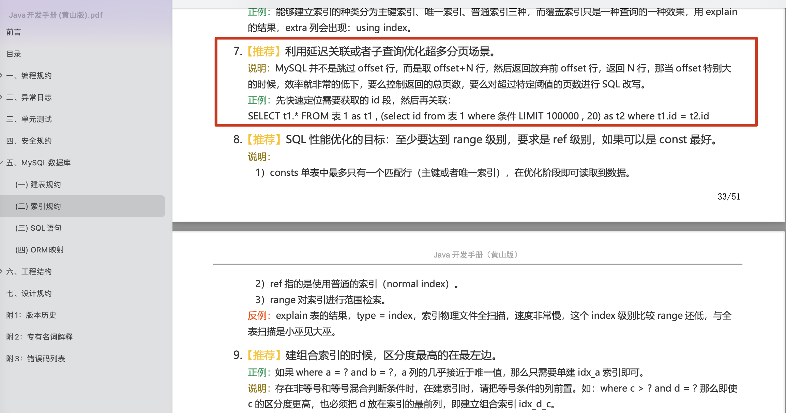

## What Is Deep Pagination, and Why Does It Happen?

Deep pagination is a query with a very large offset, which can cause poor performance. For example:

```sql
# Skip 1,000,000 rows and fetch 10 more; MySQL may not be able to use an index
SELECT * FROM t_order ORDER BY id LIMIT 1000000, 10
```

With a very large offset, MySQL's query optimizer may choose a full table scan instead of using an index.

The **root cause of slow deep pagination** is how MySQL executes `LIMIT offset, N`: it does not jump directly to `offset`; it scans `offset + N` rows from the beginning. If the query uses a secondary index that does not cover the requested fields, MySQL performs unnecessary **table lookups for the first `offset` rows, causing a large amount of random I/O**, then discards those rows. Even if the optimizer switches to a full table scan because it estimates that to be cheaper, scanning a million rows is still expensive.



The offset at which performance starts to degrade varies by machine and depends on hardware such as CPU and disk speed, table size, index type, and statistics.



MySQL's query optimizer uses a cost-based strategy to choose an execution plan. It estimates CPU and I/O costs to decide between an index scan and a full table scan. If a full scan appears cheaper, it may avoid the index. However, even with a large offset, MySQL may still use a **covering index** to avoid table lookups.

## Deep-Pagination Optimizations

> **This guide uses MySQL 8.0 with InnoDB.** Optimizer behavior may differ across versions.

### Range Queries (Cursor Pagination)

Record the ID of the last row on the current page, then use `WHERE id > last_id LIMIT n` to fetch the next page:

```sql
# Use the last row's ID from the previous result to fetch the next page
SELECT * FROM t_order WHERE id > 100000 ORDER BY id LIMIT 10
```

**The key advantage of cursor pagination is that it does not depend on consecutive IDs.** MySQL locates `last_id` in the B+ tree and reads the next `n` rows sequentially. Gaps, such as deleted IDs, do not affect correctness or performance.

Limitations:

1. **No direct page jumps**: You cannot jump directly to page N; pages must be fetched in sequence, forward or backward.
2. **Sorting constraints**: If sorting by a field such as creation time instead of ID, use a composite cursor `(sort_field, id)` to preserve a unique, deterministic order.
3. **Concurrent changes**: Inserts or deletes while paging can cause:
   - **Skipped rows**: A new row inserted into the first page may be pushed into the second page, but the second-page query based on the previous last ID may skip it.
   - **Duplicate rows**: If a row at the end of the first page is deleted, the first row of the second page may shift upward and appear again on the next query.

### Subqueries

First use a subquery to find the primary key at the requested offset. Then filter by that key and apply `LIMIT`; this can be faster.

Alibaba's Java Development Manual describes this approach:

> Use deferred joins or subqueries to optimize deep pagination.
>
> 

```sql
-- Use the primary-key index in a subquery to find the starting ID
SELECT * FROM t_order
WHERE id >= (
    SELECT id FROM t_order ORDER BY id LIMIT 1000000, 1
) ORDER BY id LIMIT 10;
```

**How it works:**

1. The subquery `(SELECT id FROM t_order ORDER BY id LIMIT 1000000, 1)` scans the primary-key index, skips the first 1,000,000 rows, and returns the primary key of row 1,000,001.
2. The main query `SELECT * FROM t_order WHERE id >= ... ORDER BY id LIMIT 10` starts from that key and retrieves the next 10 full rows.

In some cases, a subquery can create a temporary table and hurt performance. For complex queries, consider a deferred join first.

> **Complex filtering**: In paginated queries with complex filters, such as `WHERE status = 1 ORDER BY id LIMIT 1000000, 10`, matching IDs are often sparse. A subquery can be especially useful here: use a composite index such as `(status, id)` for a covering-index scan, skip the first million matching rows, and locate the target IDs. The main query then needs only 10 table lookups.

You can also use a subquery to retrieve the target page's IDs, then fetch the rows for those IDs. However, this is cumbersome compared with a deferred join using `INNER JOIN`.

### Deferred Joins

Deferred joins use a similar idea to subqueries: move the `LIMIT` operation to the primary-key index to reduce table lookups. Instead of using a standalone subquery, an `INNER JOIN` incorporates the subquery result into the main query and may avoid a temporary table. MySQL can use indexes for the join, so this often performs better than a direct subquery for deep pagination.

```sql
-- Use INNER JOIN for a deferred join
SELECT t1.*
FROM t_order t1
INNER JOIN (
    -- This subquery can use a covering index
    SELECT id FROM t_order ORDER BY id LIMIT 1000000, 10
) t2 ON t1.id = t2.id;
```

**How it works:**

1. The subquery `(SELECT id FROM t_order ORDER BY id LIMIT 1000000, 10)` scans the primary-key index, skips the first 1,000,000 rows, and returns the 10 IDs for the target page.
2. `INNER JOIN` matches those IDs against `t_order` to retrieve the full rows.

You can also join the subquery with comma syntax:

```sql
-- Use comma syntax for a deferred join
SELECT t1.* FROM t_order t1,
(SELECT id FROM t_order ORDER BY id LIMIT 1000000, 10) t2
WHERE t1.id = t2.id;
```

**Note**: Comma syntax can produce a similar result, but `INNER JOIN` is clearer and easier to maintain.

### Covering Indexes

A query uses a covering index when the index contains all fields it needs to retrieve.

**Benefits of a covering index:**

- **Avoid a second lookup in InnoDB**: InnoDB stores rows in clustered-index order. A secondary index stores the primary key in its leaf nodes, so a query using a secondary index normally needs another lookup by primary key to retrieve the requested row. A covering index contains all requested data in the secondary-index entries, avoiding this lookup and reducing I/O.
- **Reduce random I/O from table lookups**: A covering index returns data directly instead of using each secondary-index primary key to look up the clustered index. Those lookups are effectively random I/O.

Suppose there is a composite index on `(code, type)`. The following query can use it as a covering index:

```sql
# InnoDB secondary indexes include the primary key ID
# If only id, code, and type are needed, a composite index on (code, type) can cover the query
SELECT id, code, type FROM t_order
ORDER BY code
LIMIT 1000000, 10;
```

**⚠️ Note:**

- If the result set is a large fraction of the table, MySQL's optimizer may avoid the index and choose a full table scan.
- `FORCE INDEX` can make the optimizer use an index, but may prevent it from choosing a better execution plan. It does not always improve performance.

## Production Recommendations

Choose a pagination strategy that fits the product. Admin systems often need page jumps and exact counts, while feeds, comments, and order lists usually need only previous/next or "load more." If the product does not need page 10,000, do not sacrifice query performance to support traditional offset pagination.

Common choices:

| Use case                               | Recommended approach         | Reason                                                      |
| -------------------------------------- | ---------------------------- | ----------------------------------------------------------- |
| Feeds, comments, and message lists     | Cursor pagination            | Supports next/previous navigation with stable performance   |
| Admin lists and operations queries     | Deferred join or subquery    | Supports traditional page numbers, but cap the maximum page |
| Rankings with fixed fields             | Covering index               | Few fields are queried, reducing table lookups              |
| Complex search and multi-field sorting | Search engine or OLAP system | MySQL is not suited to large-range search and sorting       |

### Monitoring and Alerts

- **Slow-query monitoring**: Find SQL statements with large `LIMIT` offsets in the slow-query log.
- **Threshold alerts**: Configure `long_query_time` to capture deep-pagination queries.
- **Execution-plan checks**: Regularly use `EXPLAIN` on critical pagination queries to verify that the optimizer uses indexes as expected.
- **API rate limiting**: Apply a separate rate limit to deep-page requests so crawlers or unusual traffic do not overwhelm the database.
- **Maximum page limit**: For example, allow only the first 100 pages and ask users to narrow their search for deeper results.

### Common Misconceptions

| Misconception                                   | Fact                                                                                               |
| ----------------------------------------------- | -------------------------------------------------------------------------------------------------- |
| Assuming `FORCE INDEX` fixes every problem      | Forcing an index may prevent the optimizer from choosing a better plan; use it carefully.          |
| Assuming covering indexes suit every query      | Indexes with many fields are costly to maintain, and a large result set may still use a full scan. |
| Assuming cursor pagination solves every problem | Cursor pagination does not support page jumps and requires a specific sort order.                  |

## Summary

Deep pagination is slow because a large `LIMIT` offset makes MySQL scan and skip many rows before it reaches the target. The optimizer may choose a full table scan, and even an index cannot avoid many table lookups when it does not cover the query.

This guide covered four common deep-pagination optimizations:

| Approach           | Core idea                                                                             | Suitable for                                         | Limitation                                                                 |
| ------------------ | ------------------------------------------------------------------------------------- | ---------------------------------------------------- | -------------------------------------------------------------------------- |
| **Range query**    | Record the last ID and fetch the next page with `WHERE id > last_id LIMIT n`          | ID-sorted cursor pagination                          | No page jumps; other sort orders need a composite cursor                   |
| **Subquery**       | Find the starting primary key, then filter by it                                      | Traditional offset pagination                        | May create a temporary table and depends on an index for the sort field    |
| **Deferred join**  | Use `INNER JOIN` to move pagination to the primary-key index and reduce table lookups | Large datasets that need traditional page navigation | More complex SQL                                                           |
| **Covering index** | Add a composite index containing all queried fields                                   | Fixed set of query fields and a suitable index       | Indexes with many fields are costly; large result sets may use a full scan |

**Choosing an approach:**

- **Prefer deferred joins**: They offer a good balance of performance and maintainability for most cases that need traditional `LIMIT offset, size` pagination.
- **Consider range queries (cursor pagination)**: If the product supports next-page navigation, such as social feeds or infinite scrolling, range queries provide stable performance.
- **Use covering indexes as a supplement**: Add one when the query fields are fixed and few, and combine it with another approach if useful.

**Keep in mind:**

- Whichever approach you use, monitor execution plans with `EXPLAIN` and verify that the optimizer uses indexes as expected.
- For extremely deep pagination, such as offsets in the millions, confirm that the product really needs it. Consider limiting the maximum page or using another search system.

## References

- Solving deep pagination in MySQL — Jian Tianluo: <https://juejin.cn/post/7012016858379321358>
- Deep pagination and database optimization — JD Retail Technology: <https://mp.weixin.qq.com/s/ZEwGKvRCyvAgGlmeseAS7g>
- MySQL deep-pagination optimization — Dewu Tech: <https://juejin.cn/post/6985478936683610149>
