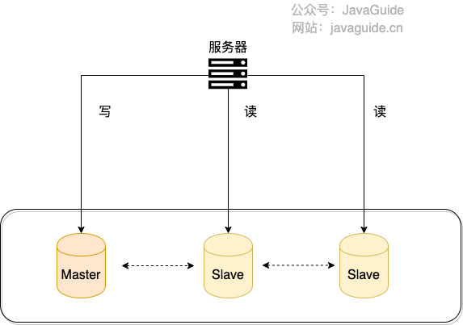
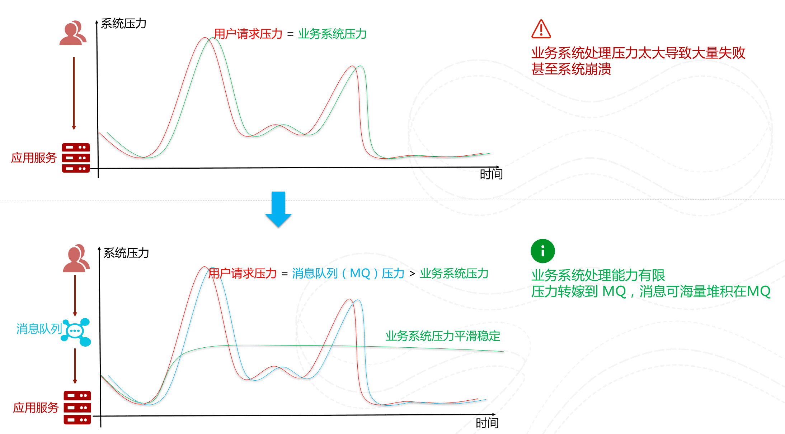

<!-- @include: @article-header.snippet.md -->

High-performance system interviews often begin with a specific symptom: a slow endpoint, rising database CPU, a message backlog, or campaign traffic exceeding capacity. First clarify QPS, P99, data volume, and read/write ratio. Then trace the request through ingress, application, cache, database, and message queue. Simply saying "add a cache," "use an MQ," or "shard the database" invites follow-up questions.

This is the review guide for JavaGuide's high-performance section. It is organized into four areas: traffic ingress, database optimization, message queues, and overall system design. Each section lists common follow-up questions; detailed principles and implementations are covered in the linked guides.

If you are short on time, start with [Common High-Performance System Interview Questions](https://interview.javaguide.cn/high-performance/high-performance-system-interview-questions.html). Note the questions you cannot answer, then return here to review the principles and engineering details.

## What Should You Focus on First?

| Area                      | What to explain                                                             | Common follow-ups                                                                  |
| ------------------------- | --------------------------------------------------------------------------- | ---------------------------------------------------------------------------------- |
| **Traffic ingress**       | Bring users closer to content and distribute requests across healthy nodes  | CDN, origin pulls, cache policies, Layer 4/7 balancing, routing algorithms         |
| **Database optimization** | Find and reduce database bottlenecks as reads, writes, and data volume grow | SQL, indexes, read/write splitting, sharding, deep pagination, hot/cold separation |
| **Message queues**        | Identify work that can be asynchronous and handle traffic bursts            | Reliability, duplicate consumption, ordering, backlogs, Kafka, RocketMQ, RabbitMQ  |
| **System design**         | Derive solutions from metrics, bottlenecks, and business constraints        | Capacity, load tests, consistency, cost, canary releases, rollback                 |

There is no fixed checklist of components for performance optimization. The same slow query may be caused by a missing index, deep pagination, hot data, connection-pool waits, or a slow downstream API. Use metrics to identify the bottleneck before discussing a solution and its cost.

## CDN and Load Balancing

A CDN puts cacheable content on edge nodes close to users, reducing cross-region transfers and origin load. A load balancer distributes incoming requests across service instances. They handle content delivery and request routing respectively, and often appear together at the ingress layer in system-design questions.

Related guides:

- [How CDNs Work](https://javaguide.cn/high-performance/cdn.html)
- [Load-Balancing Principles and Algorithms](https://javaguide.cn/high-performance/load-balancing.html)

Common interview questions:

- Why does a CDN reduce latency? Which requests still need to reach the origin?
- How should caching be configured for HTML, hashed JavaScript/CSS, images, and downloadable files?
- What should you check if the cache hit rate falls or origin traffic suddenly increases?
- What is load balancing? At which OSI layers do Layer 4 and Layer 7 load balancing work?
- How should you choose between round robin, weighted round robin, random selection, least connections, and consistent hashing?
- How do health checks, connection draining, and sticky sessions affect nodes joining or leaving a cluster?
- How does server-side load balancing differ from client-side load balancing?

Do not assume all content should be cached for a long time. If cached HTML references old static resources that have been removed, users may receive a page that cannot load. Dynamic responses involving identity or permissions must not be shared across users.

## Database Performance Optimization

When a database slows down, check slow SQL, execution plans, index use, lock waits, connection pools, and disk I/O. If an individual query can still be optimized, sharding immediately will only magnify query, transaction, and operational problems. Read/write splitting and sharding address capacity and throughput; they do not replace SQL and index optimization.

Related guides:

- [Read/Write Splitting and Sharding](https://javaguide.cn/high-performance/read-and-write-separation-and-library-subtable.html)
- [Hot/Cold Data Separation](https://javaguide.cn/high-performance/data-cold-hot-separation.html)
- [SQL Optimization Techniques](https://javaguide.cn/high-performance/sql-optimization.html)
- [Deep Pagination: Problems and Optimizations](https://javaguide.cn/high-performance/deep-pagination-optimization.html)

Common interview questions:

- What problem does read/write splitting solve? How do replication and read routing work together?
- What business problems can replica lag cause? Which requests must read from the primary?
- When is sharding needed? How does vertical partitioning differ from horizontal partitioning?
- After sharding, how should cross-database joins, pagination, sorting, transactions, and scaling be handled?
- How should a shard key be chosen? What problems can hot tenants or merchants cause?
- Where should SQL optimization start: slow-query logs, execution plans, or indexes?
- Which query patterns can prevent index use? How should columns be ordered in a composite index?
- Why does `LIMIT offset, size` slow down on later pages? When should cursor pagination, deferred joins, or covering indexes be used?
- How should hot and cold data be classified? During migration, how should dual writes, incremental replication, and data validation be handled?

These questions often lead to consistency. Read/write splitting exposes replica lag, sharding increases cross-shard transaction and query costs, and hot/cold migration temporarily leaves data in both stores. Explain how much inconsistency the business can tolerate and how errors are validated and compensated for.

## Message Queues and Traffic Smoothing

Message queues move non-real-time work out of the synchronous call chain and buffer requests during traffic spikes. Once an MQ is introduced, calls become asynchronous; producer acknowledgments, broker persistence, consumer processing, and retry policies all affect the outcome.

Related guides:

- [Message-Queue Interview Questions](https://javaguide.cn/high-performance/message-queue/message-queue-interview-questions.html)
- [Message-Queue Fundamentals and FAQs](https://javaguide.cn/high-performance/message-queue/message-queue.html)
- [Kafka Interview Questions](https://javaguide.cn/high-performance/message-queue/kafka-questions-01.html)
- [RocketMQ Interview Questions](https://javaguide.cn/high-performance/message-queue/rocketmq-questions.html)
- [RabbitMQ Interview Questions](https://javaguide.cn/high-performance/message-queue/rabbitmq-questions.html)
- [Disruptor Interview Questions](https://javaguide.cn/high-performance/message-queue/disruptor-questions.html)

Common interview questions:

- How do message queues provide asynchronous processing, decoupling, and traffic smoothing? What problems do they add?
- At which stages can a message be lost between producer and consumer?
- Why can at-least-once delivery produce duplicate messages, and how can consumers ensure idempotency?
- How do global ordering and per-partition ordering differ? What does ordered consumption trade off?
- During a backlog, how can you distinguish a traffic spike, slow consumers, too few partitions, and downstream failures?
- Why is Kafka high-throughput? What roles do batching, sequential writes, the page cache, and zero-copy play?
- How do Kafka acknowledgments, replicas, and consumer offsets affect reliability?
- What problem do RocketMQ transactional messages solve? How does the check-back mechanism handle an unknown state?
- How do RabbitMQ exchanges, queues, bindings, and routing keys work together?
- How does Disruptor differ from an inter-process message queue, and which in-process paths suit it?

"No message loss" is not just about broker persistence. Messages can be lost or duplicated if the producer does not receive an acknowledgment, the consumer succeeds but fails to commit its offset, or the process crashes after writing to the business database. Explain each stage of the delivery path.

## System-Design Questions

System-design questions do not tell you which component to use. Clarify business goals and capacity first, then find likely bottlenecks. After implementation, validate the solution with load tests and monitoring; average RT or single-instance QPS alone does not prove that requirements are met.

Related guide: [Introduction to Performance Testing](https://javaguide.cn/high-availability/performance-test.html)

Common interview questions:

- How would you design a high-performance order system? How would reads, order submission, and asynchronous tasks be handled?
- When an endpoint slows down, how would traces, slow SQL, thread pools, connection pools, and system metrics help locate the bottleneck?
- What do QPS, TPS, concurrency, P95/P99, and error rate measure?
- How would you estimate capacity from business peaks and leave safety margins for databases, caches, MQ, and downstream APIs?
- In what order should caching, read/write splitting, sharding, and message queues be introduced?
- After an optimization, how would canary rollout, load testing, monitoring, and rollback verify the results?
- After performance improves, how may consistency, availability, cost, and operational complexity change?

Experienced and senior roles often require evidence from projects. If you say an endpoint became faster, provide traffic, latency percentiles, error rates, resource utilization, test environment, and observation period before and after the optimization. For work you did not participate in, answer based on what you have learned; do not invent production metrics.

## Review Plan by Available Time

| Time available   | Suggested plan                                                                                                                   | Goal                                                                                |
| ---------------- | -------------------------------------------------------------------------------------------------------------------------------- | ----------------------------------------------------------------------------------- |
| 1–2 days         | Review all questions here, focusing on SQL/indexes, read/write splitting, sharding, and message reliability.                     | Answer common questions and explain the main limitations of each approach.          |
| 3–7 days         | Study CDNs, load balancing, deep pagination, hot/cold separation, and one major MQ; then diagram an end-to-end request path.     | Derive solutions from bottlenecks and reason through consistency and failure cases. |
| More than a week | Read all the guides and prepare a project example covering performance issue discovery, diagnosis, optimization, and validation. | Use real metrics to explain the choice, benefit, cost, and monitoring plan.         |

<!-- @include: @article-footer.snippet.md -->
