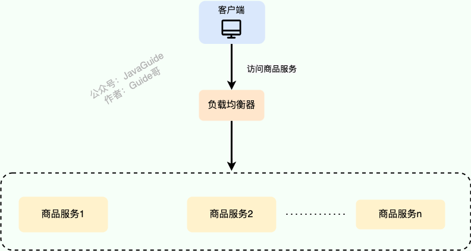
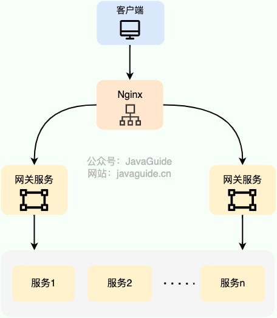
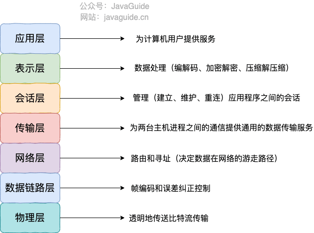
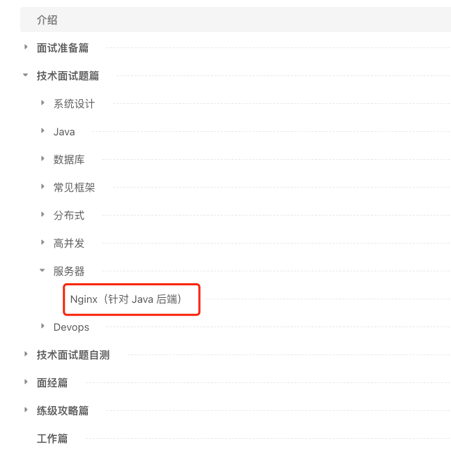
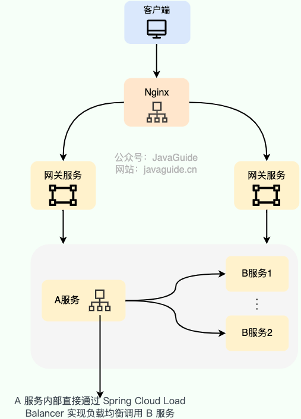
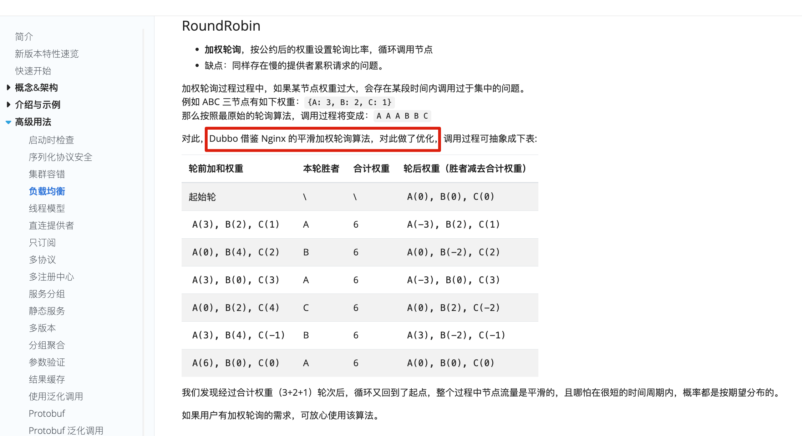
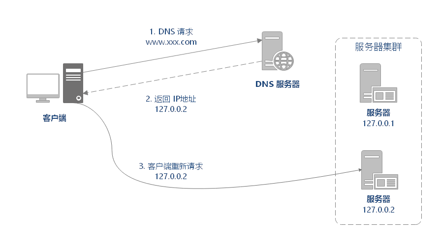
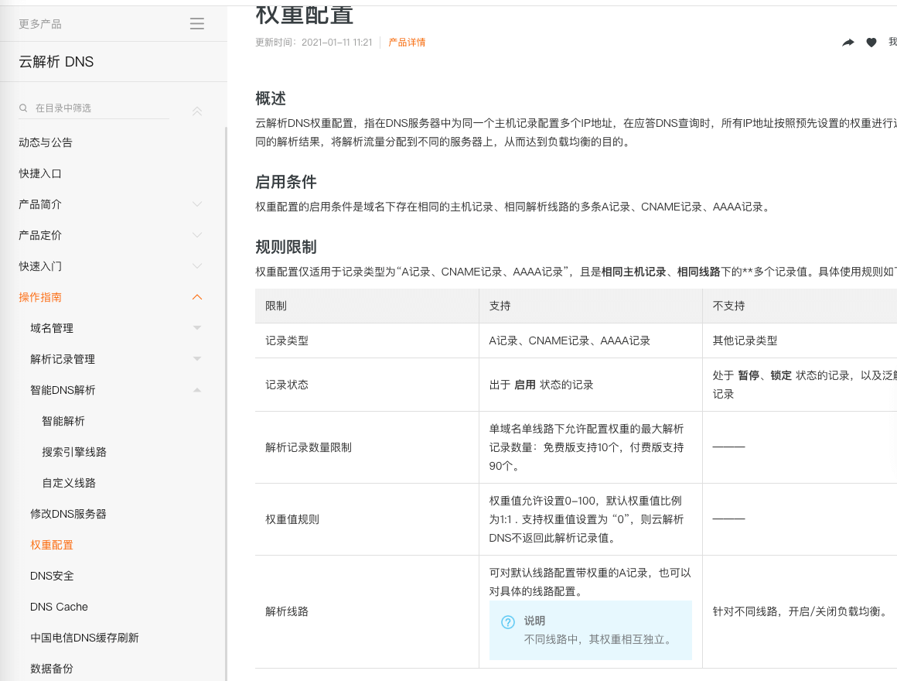
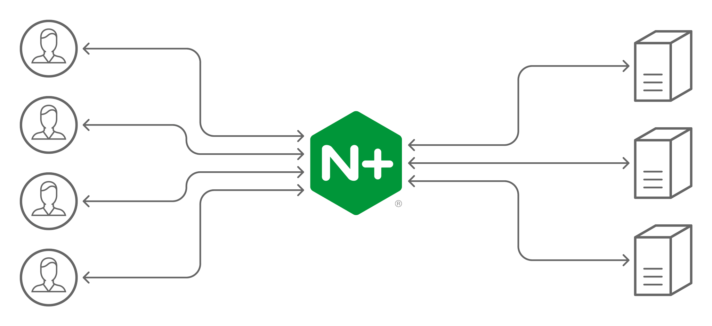
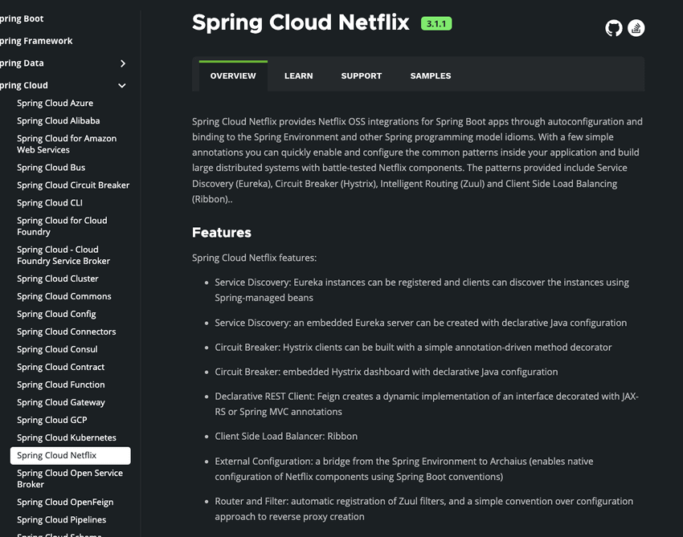

## What Is Load Balancing?

**Load balancing** distributes user requests across multiple servers to increase the system's overall concurrency and reliability. It can be implemented in dedicated hardware or software. Hardware generally offers better performance, while software is less expensive; both are discussed below.

The image below is from the high-concurrency section of [Java Interview Guide](https://mp.weixin.qq.com/s?__biz=Mzg2OTA0Njk0OA==&mid=2247519384&idx=1&sn=bc7e71af75350b755f04ca4178395b1a&chksm=cea1c353f9d64a458f797696d4144b4d6e58639371a4612b8e4d106d83a66d2289e7b2cd7431&token=660789642&lang=zh_CN&scene=21#wechat_redirect). It shows several product-service instances on different servers. Load balancing distributes requests among them.



Load balancing is a common and relatively simple way to improve system concurrency and reliability. It is used in both monolithic and microservice architectures.

Load balancing distributes requests across multiple nodes, but it does not automatically fix slow SQL, exhausted thread pools, cache breakdown, or slow downstream APIs. If all backend nodes are slow, load balancing can distribute the slow requests more evenly, but it cannot make the system faster by itself.

## What Are the Types of Load Balancing?

Load balancing can be divided into **server-side** and **client-side** load balancing.

Server-side load balancing involves more concepts and is more common in practice, so it receives more attention here.

### Server-Side Load Balancing

**Server-side load balancing** is typically placed between **external requests** and the **gateway layer**. It can be implemented in **software** or **hardware**.

The diagram below shows a simple server-side load balancer built with Nginx:



**Hardware load balancers** use dedicated appliances such as **F5, A10, or Array**.

Hardware load balancers offer strong, stable performance, but are expensive. Even an entry-level F5 can cost more than 200,000 yuan, which is beyond the reach of many companies. For workloads that are not large, software load balancing is usually sufficient.

Developers are more likely to work with **software load balancers**, implemented with tools such as **LVS, Nginx, and HAProxy**. They may offer lower performance but cost much less: a basic Linux server costs a few thousand yuan, while a more powerful one costs around 20,000–30,000 yuan.

Under the OSI model, server-side load balancing can also operate at these layers:

- Layer 2 load balancing.
- Layer 3 load balancing.
- Layer 4 load balancing.
- Layer 7 load balancing.

Layer 4 and Layer 7 are the most common, so this guide focuses on them.

> Nginx's website has detailed introductions to Layer 4 and Layer 7 load balancing:
>
> - [What Is Layer 4 Load Balancing?](https://www.nginx.com/resources/glossary/layer-4-load-balancing/)
> - [What Is Layer 7 Load Balancing?](https://www.nginx.com/resources/glossary/layer-7-load-balancing/)



- **Layer 4 load balancing** works at the transport layer of the OSI model, primarily with TCP and UDP. The load balancer can inspect source and destination port addresses and forward packets to backend servers according to a load-balancing algorithm. Its core is balancing at the IP-and-port level; it does not inspect message content.
- **Layer 7 load balancing** works at the application layer, primarily with HTTP. It reads message content, such as HTTP data, and makes routing decisions based on values such as the URL or cookies. A device that performs Layer 7 load balancing is commonly called a **reverse proxy**.

Layer 7 load balancing uses more resources than Layer 4, but is more flexible and can route requests intelligently. It can also optimize traffic with caching, compression, and encryption.

In short, **Layer 4 load balancing offers high performance, while Layer 7 offers more features.** For most workloads, the performance difference is negligible.

Use this comparison when choosing between them:

| Dimension            | Layer 4 load balancing                            | Layer 7 load balancing                                         |
| -------------------- | ------------------------------------------------- | -------------------------------------------------------------- |
| OSI layer            | TCP/UDP                                           | HTTP/HTTPS                                                     |
| Routing criteria     | IP address and port                               | Hostname, path, header, and cookie                             |
| Performance overhead | Lower                                             | Higher                                                         |
| Flexibility          | Lower                                             | Higher                                                         |
| Typical use cases    | High-volume ingress, database proxy, TCP services | Gateways, reverse proxies, canary releases, path-based routing |

Layer 4 is more direct for forwarding TCP traffic. Layer 7 is better when routing by URL, header, or cookie, or when you need compression, caching, or TLS termination.

The following passage is from Nginx's article [What Is Layer 4 Load Balancing?](https://www.nginx.com/resources/glossary/layer-4-load-balancing/).

> Layer 4 load balancing was a popular architectural approach to traffic handling when commodity hardware was not as powerful as it is now, and the interaction between clients and application servers was much less complex. It requires less computation than more sophisticated load balancing methods (such as Layer 7), but CPU and memory are now sufficiently fast and cheap that the performance advantage for Layer 4 load balancing has become negligible or irrelevant in most situations.
>
> Layer 4 load balancing was a popular architectural approach when commodity hardware was less powerful and client-server interactions were less complex. It requires less computation than more sophisticated methods such as Layer 7. However, CPUs and memory are now fast and inexpensive enough that the performance advantage of Layer 4 has become negligible or irrelevant in most cases.

In practice, **Nginx** is commonly used for Layer 7 load balancing, and LVS (Linux Virtual Server, a Layer 4 load balancer in the Linux kernel) for Layer 4.

For common Nginx interview topics, see the technical interview section of [Java Interview Guide](https://javaguide.cn/zhuanlan/java-mian-shi-zhi-bei.html).



Most companies do not need LVS. It is more common at large companies such as Alibaba, Baidu, Tencent, and eBay; Nginx is used more widely.

### Client-Side Load Balancing

**Client-side load balancing** is mainly used between services within a system and can be implemented with an existing load-balancing component.

With client-side load balancing, the client maintains a list of server addresses and selects a server with a load-balancing algorithm before sending each request.

The client-side load balancer runs in the same process as the service, so it adds no network hop. Its implementation may be tied to a programming language; for example, Spring Cloud LoadBalancer is for Java.

Popular Java microservice frameworks such as Dubbo and Spring Cloud include ready-to-use client-side load balancing. Dubbo provides it by default. Spring Cloud provides it as an optional component; common choices are Spring Cloud LoadBalancer (official and recommended) and Ribbon (from Netflix, now deprecated).

The following diagram shows a simple client-side load balancer using Spring Cloud LoadBalancer; Ribbon works similarly:



## Common Load-Balancing Algorithms

### Random Selection

**Random selection** is the simplest load-balancing algorithm.

Without weights, each server has the same probability of being selected. With weights, higher-weight servers are selected more often.

Unweighted random selection suits a cluster of servers with similar performance and capacity. Weighted random selection better suits servers with different capacities, helping distribute requests more appropriately.

One drawback is that a server may not be selected for some time. Since this is a probabilistic algorithm, this can happen even when all servers have the same weight.

This leads to **round robin**.

### Round Robin

Round robin selects servers in turn and can also use weights.

Without weights, requests are assigned to servers in order. With weights, higher-weight servers receive more requests.

Unweighted round robin suits a cluster whose servers have similar performance. Weighted round robin is better when server capacities differ.

Several algorithms improve on weighted round robin, including smooth weighted round robin.

Smooth weighted round robin was first implemented in Nginx. See this [commit](https://github.com/phusion/nginx/commit/27e94984486058d73157038f7950a0a36ecc6e35). Dubbo's weighted round-robin strategy is based on this algorithm and includes further optimizations.



### Power of Two Choices

The power-of-two-choices algorithm samples two servers at random, then selects the better one based on their loads.

It can dynamically balance backend load. A single random choice may leave some servers overloaded while others remain idle.

### Hashing

Hash request parameters and use the resulting value to choose the server that handles the request.

As long as the server count remains unchanged, requests with the same parameters go to the same server. For example, requests can be routed by client IP or user ID.

### Consistent Hashing

Like basic hashing, consistent hashing routes requests with the same key to the same server, while addressing some of the problems of basic hashing.

With basic hashing, changing the number of servers remaps keys to different servers, undermining the purpose of hashing. Consistent hashing maps both data and nodes onto a hash ring, then assigns each key to a node according to its position. Adding or removing a server affects only a portion of the keys instead of remapping the entire cluster.

### Least Connections

For each new request, select the server with the fewest connections. If several servers tie, use weighted random selection.

Least-connections selection assumes that more connections mean higher load. In practice, connection count may not reflect actual server load: some connections use far more resources than others.

### Least Active Requests

Least-active selection is similar to least connections but uses the number of active connections, which approximates requests currently being processed. Fewer active requests suggest more available capacity, so stronger servers can handle more requests. If counts tie, weighted random selection can break the tie.

### Fastest Response Time

Unlike least-connections and least-active selection, this algorithm chooses a server by response time. The client tracks each server's response time and routes every request to the fastest one. Weighted random selection can break ties.

This can reduce request latency but may concentrate too much traffic on high-performance servers.

## How Is Layer 7 Load Balancing Implemented?

Two common Layer 7 load-balancing approaches are DNS resolution and reverse proxies.

HTTP redirects can also be used, but DNS resolution and reverse proxies are more common and generally preferred.

### DNS Resolution

DNS resolution is an early and simple form of Layer 7 load balancing.

To use DNS for load balancing, configure multiple IP addresses for the same hostname, with each address pointing to a different server. When a user requests the hostname, the DNS server returns addresses in round-robin order.



Most DNS providers now support IP weighting, which helps distribute requests across servers with different capacities. For example, Alibaba Cloud DNS supports weights.



### Reverse Proxies

The client sends a request to the reverse proxy, which selects a backend server, retrieves the response, and returns it to the client. The proxy's address is public while the backend server's IP remains hidden. The client does not see the proxying process.

Nginx is a widely used reverse proxy. It distributes client requests across a server cluster according to a load-balancing policy.

Reverse-proxy load balancing is also Layer 7 load balancing.



### Health Checks and Removing Nodes from Traffic

In production, health checks are more important than the algorithm itself. The algorithm decides how to distribute requests under normal conditions; health checks decide whether an unhealthy node should continue receiving traffic.

Common health checks include:

- **TCP check**: Treat a node as available if its port accepts connections. Suitable for Layer 4 balancing, but it cannot confirm that the application is healthy.
- **HTTP check**: Periodically call endpoints such as `/health` or `/actuator/health` and use the status code and response body to determine availability.
- **Application health probe**: Check critical dependencies such as databases and caches. Useful for critical paths, but the probe must remain lightweight.

In production, configure node warm-up and draining. A new node may not yet have warmed its JIT, connection pool, or cache, so sending full traffic immediately can cause instability. Before taking a node offline, stop sending it new requests and let in-flight requests finish.

## How Is Client-Side Load Balancing Usually Implemented?

As mentioned above, client-side load balancing can use an existing load-balancing component.

**Netflix Ribbon** and **Spring Cloud LoadBalancer** are two well-known load-balancing components in the Java ecosystem.

Ribbon is an older component developed by Netflix. It is feature-rich and supports many strategies. Spring created Spring Cloud LoadBalancer to replace Ribbon; it is simpler and has fewer built-in strategies.

Ribbon supports seven load-balancing strategies:

- `RandomRule`: Random selection.
- `RoundRobinRule` (default): Round robin.
- `WeightedResponseTimeRule`: Weighted selection based on response time.
- `BestAvailableRule`: Least-connections selection.
- `RetryRule`: Retry selection. It uses round robin to choose an instance and retries for a configured period if the instance is null or unavailable; it returns null if no instance is found before the timeout.
- `AvailabilityFilteringRule`: Filters out unhealthy instances, then selects one with fewer connections.
- `ZoneAvoidanceRule`: Selects an instance based on zone performance and availability.

Spring Cloud LoadBalancer supports two built-in strategies:

- `RandomLoadBalancer`: Random selection.
- `RoundRobinLoadBalancer` (default): Round robin.

```java
public class CustomLoadBalancerConfiguration {

    @Bean
    ReactorLoadBalancer<ServiceInstance> randomLoadBalancer(Environment environment,
            LoadBalancerClientFactory loadBalancerClientFactory) {
        String name = environment.getProperty(LoadBalancerClientFactory.PROPERTY_NAME);
        return new RandomLoadBalancer(loadBalancerClientFactory
                .getLazyProvider(name, ServiceInstanceListSupplier.class),
                name);
    }
}
```

Spring Cloud LoadBalancer can support more than these two strategies. Implementations of `ServiceInstanceListSupplier` can provide strategies similar to Ribbon's. This capability was added over time and is easy to miss without checking the official documentation.

Two examples from the official documentation are:

- `ZonePreferenceServiceInstanceListSupplier`: Zone-based load balancing.
- `HintBasedServiceInstanceListSupplier`: Load balancing based on hints.

```java
public class CustomLoadBalancerConfiguration {
    // Use zone-based load balancing
    @Bean
    public ServiceInstanceListSupplier discoveryClientServiceInstanceListSupplier(
            ConfigurableApplicationContext context) {
        return ServiceInstanceListSupplier.builder()
                    .withDiscoveryClient()
                    .withZonePreference()
                    .withCaching()
                    .build(context);
    }
}
```

For more detailed and current information about Spring Cloud LoadBalancer, see the [official documentation](https://docs.spring.io/spring-cloud-commons/docs/current/reference/html/#spring-cloud-loadbalancer).

Round robin meets the needs of most projects. Unless there is a special requirement, projects commonly use the default round-robin strategy. Both Ribbon and Spring Cloud LoadBalancer support custom strategies.

Unless you need a Ribbon-specific feature or strategy, prefer Spring's Spring Cloud LoadBalancer.

Here is why Ribbon is generally not recommended for new projects.

Spring Cloud 2020.0.0 removed all Netflix components except Eureka. Spring Cloud Hoxton.M2 was the first release to support Spring Cloud LoadBalancer as a replacement for Netflix Ribbon.

Anyone who studied microservices early on likely encountered Netflix's open-source components Feign, Ribbon, Zuul, Hystrix, and Eureka. Many companies still use them. Netflix helped shape the development of microservices in the Java ecosystem.



**Why did Spring Cloud remove the Netflix components?** In 2018, Netflix announced that core open-source components such as Hystrix, Ribbon, Zuul, and Eureka were entering maintenance mode: no new features, only bug fixes. Spring therefore had to consider alternatives to those components.

**Spring Cloud Alibaba** is another good option, especially for companies and developers in China.

## Production Recommendations

- **Check metrics before tuning the algorithm**: Monitor each node's QPS, RT, P99, error rate, connection count, CPU, and memory instead of checking only whether request counts are evenly distributed.
- **Isolate slow nodes promptly**: Fastest-response-time and least-active strategies may help, but health checks, circuit breakers, and traffic draining are still needed to address the root cause.
- **Avoid dependence on sticky sessions**: If cookies or IP hashing are required to pin sessions, assess the impact of scaling and node failures. Prefer shared session storage such as Redis.
- **Make canary releases reversible**: Layer 7 load balancers often route canaries by header, cookie, or user ID. Canary rules must be easy to disable.
- **Route cross-region traffic to nearby sites**: National or global services often use DNS/GSLB to direct users to a nearby data center or availability zone.

## References

- eBay's Layer 4 software load-balancing implementation: <https://mp.weixin.qq.com/s/bZMxLTECOK3mjdgiLbHj-g>
- HTTP Load Balancing (Nginx documentation): <https://docs.nginx.com/nginx/admin-guide/load-balancer/http-load-balancer/>
- Load Balancing Explained — vivo Internet Technology: <https://www.cnblogs.com/vivotech/p/14859041.html>

<!-- @include: @article-footer.snippet.md -->
