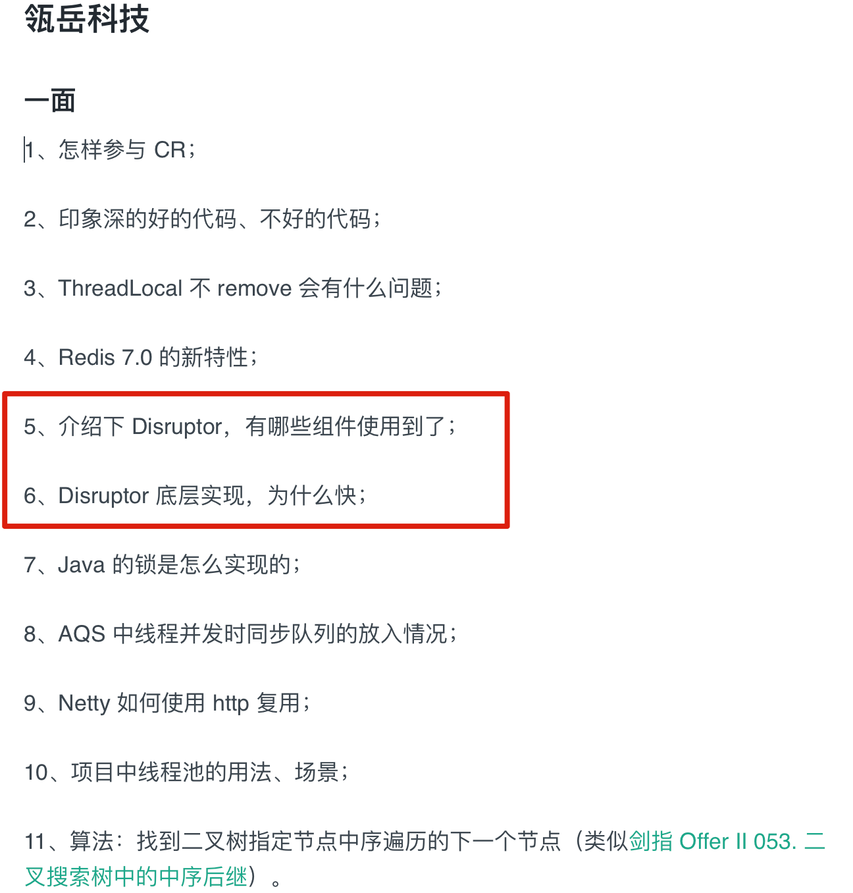
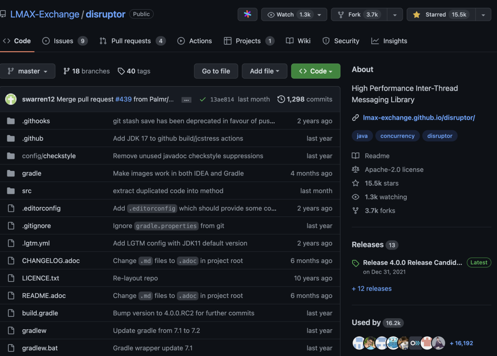
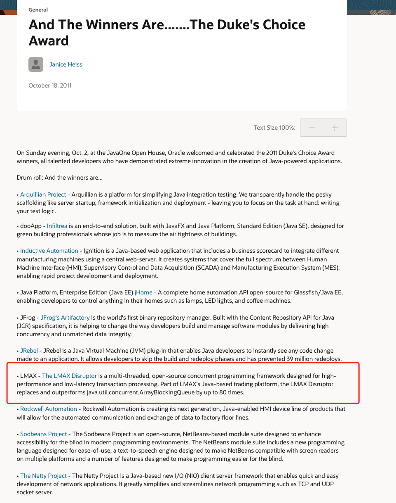
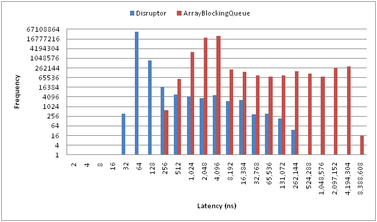
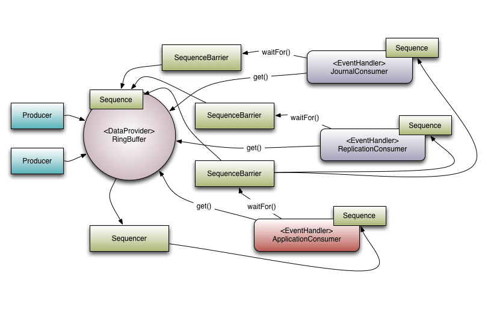
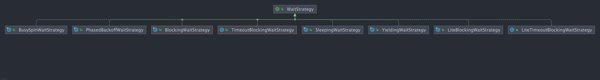
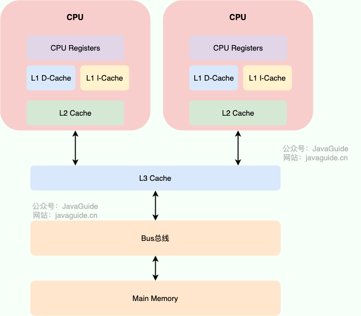

Disruptor is a relatively specialized topic, but if you have used it in a project, you may be asked about it in an interview.

A reader's interview report for experienced roles included several Disruptor questions: [How I landed offers from ByteDance, Taobao, Pinduoduo, and other major companies](https://mp.weixin.qq.com/s/C5QMjwEb6pzXACqZsyqC4A).

This article is a brief overview of Disruptor. The questions are intended for interview preparation or a quick introduction rather than an in-depth treatment.

## What Is Disruptor?

Disruptor is an open-source, high-performance in-memory queue developed by the UK foreign-exchange trading company LMAX. It was created to address performance and memory-safety issues in in-memory queues.

According to the Disruptor project, LMAX, a retail financial trading platform built with Disruptor, can process six million orders per second on a single thread. Martin Fowler described the system's architecture in his 2011 article, [The LMAX Architecture](https://martinfowler.com/articles/lmax.html).

After LMAX presented at QCon in 2010, Disruptor gained industry attention and received Oracle's 2011 Duke's Choice Award.

> The Duke's Choice Awards, hosted by Oracle, recognize influential Java technology applications developed around the world during the previous year.

Oracle's announcement of that year's Duke's Choice Award winners is available [here](https://blogs.oracle.com/java/post/and-the-winners-arethe-dukes-choice-award). Other recipients that year included Netty and JRebel.

Disruptor provides some capabilities similar to distributed queues such as Kafka and RocketMQ, but it operates within a JVM and stores events in memory.

- GitHub: <https://github.com/LMAX-Exchange/disruptor>
- Official guide: <https://lmax-exchange.github.io/disruptor/user-guide/index.html>

For an introduction to using Disruptor in a Spring Boot project, see [Getting Started with Spring Boot and Disruptor](https://mp.weixin.qq.com/s/0iG5brK3bYF0BgSjX4jRiA).

## Why Use Disruptor?

Disruptor addresses performance and memory-safety concerns associated with the thread-safe queues built into the JDK.

**Common thread-safe queues in the JDK include:**

| Queue                   | Synchronization              | Bounded? |
| ----------------------- | ---------------------------- | -------- |
| `ArrayBlockingQueue`    | Lock-based (`ReentrantLock`) | Yes      |
| `LinkedBlockingQueue`   | Lock-based (`ReentrantLock`) | Yes      |
| `LinkedTransferQueue`   | Lock-free (`CAS`)            | No       |
| `ConcurrentLinkedQueue` | Lock-free (`CAS`)            | No       |

As the table shows, these queues are either bounded and lock-based or unbounded and lock-free. Locking can affect performance, while an unbounded queue risks exhausting memory.

The article therefore advises against using the JDK's built-in thread-safe queues in general.

**Disruptor differs in that it provides a bounded, thread-safe queue without locks.**

The following chart from the Disruptor website compares the latency distributions of Disruptor and `ArrayBlockingQueue`.

Disruptor can be very fast; the reasons are described later in this article.

Disruptor also supports features such as batch operations and multiple wait strategies.

## How Do Kafka and Disruptor Differ?

- **Kafka**: A distributed message queue, generally used to pass messages between systems or services. It can also serve as a stream-processing platform.
- **Disruptor**: An in-memory queue, generally used for communication between threads within a system.

They address problems at different levels:

| Dimension         | Kafka/RocketMQ/RabbitMQ                                           | Disruptor                                                           |
| ----------------- | ----------------------------------------------------------------- | ------------------------------------------------------------------- |
| Scope             | Across processes, machines, and services                          | Within a single JVM process                                         |
| Persistence       | Usually supported                                                 | Not provided                                                        |
| Replay            | Usually supported                                                 | Historical replay is not provided                                   |
| Main capabilities | Reliable delivery, traffic smoothing, decoupling, consumer groups | Low latency, less lock contention, high-throughput event processing |
| Typical use cases | Order events, log collection, asynchronous decoupling             | Asynchronous logging, matching engines, in-process pipelines        |

Disruptor cannot replace distributed message queues such as Kafka and RocketMQ. It is better suited to speeding up high-frequency event-processing paths within a service.

## Which Projects Use Disruptor?

Several open-source projects use Disruptor. A few examples:

- **Log4j2**: A commonly used logging framework that uses Disruptor for asynchronous logging.
- **SOFATracer**: An open-source distributed tracing tool from Ant Group that uses Disruptor for asynchronous logging.
- **Storm**: An open-source distributed real-time computation system that uses Disruptor for messaging within a worker process, between threads on the same Storm node without network communication.
- **HBase**: A distributed column-oriented database that uses Disruptor to improve concurrent write performance.
- ...

## What Are Disruptor's Core Concepts?

- **Event**: A message object stored in the queue until it is consumed.
- **EventFactory**: Creates events and is used when initializing the `Disruptor` class.
- **EventHandler**: Processes an event; it plays a role similar to the consumer in a producer-consumer model.
- **EventProcessor**: Holds a particular consumer's `Sequence` and provides the event loop that invokes the event handler.
- **Disruptor**: The object used to publish and consume events.
- **RingBuffer**: A circular array that stores events.
- **WaitStrategy**: Determines how consumers wait for new events when none are available.
- **Producer**: User code that publishes events through a `Disruptor` object. Disruptor does not define a specific producer interface or type.
- **ProducerType**: Specifies whether there is a single event publisher or multiple publishers. The terms publisher and producer are similar; this article uses publisher where appropriate.
- **Sequencer**: The core of Disruptor. Its `SingleProducerSequencer` and `MultiProducerSequencer` implementations define concurrent algorithms for transferring data quickly and correctly between producers and consumers.

The following diagram from the Disruptor website shows an example of how LMAX uses Disruptor.

## What Wait Strategies Does Disruptor Provide?

**A wait strategy (`WaitStrategy`)** determines how consumers wait for new events when none are available.

Common wait strategies include:

- `BlockingWaitStrategy`: Uses `ReentrantLock` and `Condition` for waiting and signaling. It is simple to implement and is Disruptor's default strategy. It is the slowest, but uses the least CPU and is stable; it is recommended for production.
- `BusySpinWaitStrategy`: Offers high performance but continuously spins. Misuse can drive CPU utilization to 100%, so use it with care.
- `LiteBlockingWaitStrategy`: A lightweight version of `BlockingWaitStrategy` that skips signaling when there is no lock contention. The author says it has not been tested sufficiently and does not recommend it.
- `TimeoutBlockingWaitStrategy`: Waits with a timeout and runs the application-defined handling logic when the timeout expires.
- `LiteTimeoutBlockingWaitStrategy`: A `TimeoutBlockingWaitStrategy` variant that skips signaling when there is no lock contention.
- `SleepingWaitStrategy`: Uses three phases: spin, call `Thread.yield()` to yield the CPU, then sleep repeatedly.
- `YieldingWaitStrategy`: Uses two phases: spin, then call `Thread.yield()` to yield the CPU.
- `PhasedBackoffWaitStrategy`: Uses four phases: spin a specified number of times, spin for a specified duration, call `Thread.yield()`, then invoke the `waitFor` method on a fallback strategy. The fallback can be `BlockingWaitStrategy`, `LiteBlockingWaitStrategy`, or `SleepingWaitStrategy`.

Wait strategies trade off latency against CPU usage:

- For latency-sensitive workloads with dedicated machine resources, consider `BusySpinWaitStrategy` or `YieldingWaitStrategy`.
- For typical business services, start with `BlockingWaitStrategy` for predictable stability and resource use.
- To reduce busy waiting while retaining a fast response, consider `SleepingWaitStrategy` or `PhasedBackoffWaitStrategy`.

Avoid using busy-wait strategies blindly on shared application servers; they can saturate the CPU and affect other services on the same machine.

## Why Is Disruptor So Fast?

- **RingBuffer (circular array)**: Disruptor's RingBuffer is implemented as an array. All its elements are created during initialization, so their memory addresses are generally contiguous. As producers add events, this layout can use CPU-cache locality by loading nearby event objects together, improving performance. This is similar to MySQL read-ahead, which loads adjacent pages into memory. The array also supports batch operations and avoids frequent memory allocation and garbage collection. The RingBuffer has a fixed size; when it is full, a new element overwrites the oldest one.
- **Avoiding false sharing**: CPU caches are managed in cache lines, typically around 64 bytes. To give a target field its own cache line, Disruptor adds padding before and after it (56 bytes on each side), reducing false sharing. The array used by the RingBuffer is also designed with padding (128 bytes) around the data.
- **Lock-free design**: Disruptor avoids contention and latency from traditional locks through a more complex lock-free implementation based mainly on CAS, memory barriers, and the RingBuffer.

Disruptor's performance comes from combining several optimizations that use modern CPU-cache behavior and reduce common concurrency problems and bottlenecks.

Disruptor's performance also has prerequisites: event handlers should be lightweight, consumers should not block for long periods, and RingBuffer capacity should be sized for peak traffic. Slow API calls, slow SQL, or long-held locks in consumers can make downstream processing the bottleneck regardless of queue speed.

For more detail on Disruptor's high-performance queue design, see [An Introduction to Disruptor's High-Performance Queue](https://qin.news/disruptor/), which references Meituan's article [High-Performance Queue: Disruptor](https://tech.meituan.com/2016/11/18/disruptor.html).

🌈 One additional point: **Why can contiguous object addresses in an array improve performance?**

CPU caches speed up reads by storing recently used data. They also use prefetching to load nearby memory in advance, taking advantage of locality.

In a computer system, the CPU primarily accesses caches and main memory. A cache is much faster but smaller than main memory. Caches are usually organized into levels: L1, L2, and L3. The closer a cache is to the CPU, the faster and smaller it tends to be. Main memory has greater capacity but is slower.

To speed up reads, the CPU loads data from main memory into a cache. If the same data is needed again, it can be read from the cache without another main-memory access; this is a **cache hit**. To take advantage of **locality**, the CPU may also prefetch data near previously accessed addresses. Programs often access nearby addresses, so prefetching can improve the cache hit rate and performance.

## References

- Disruptor performance: wait strategies: <http://wuwenliang.net/2022/02/28/Disruptor>
- _Java Concurrency in Practice_, Part 40: Case Study (3), the Disruptor high-performance queue: <https://time.geekbang.org/column/article/98134>

<!-- @include: @article-footer.snippet.md -->
