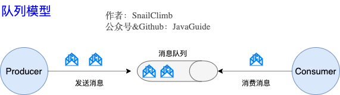
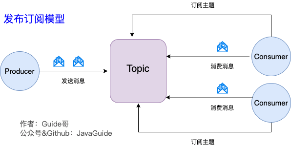
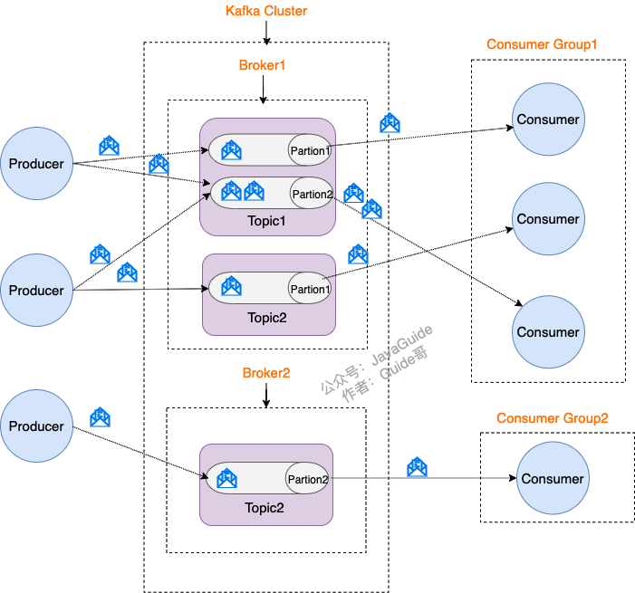
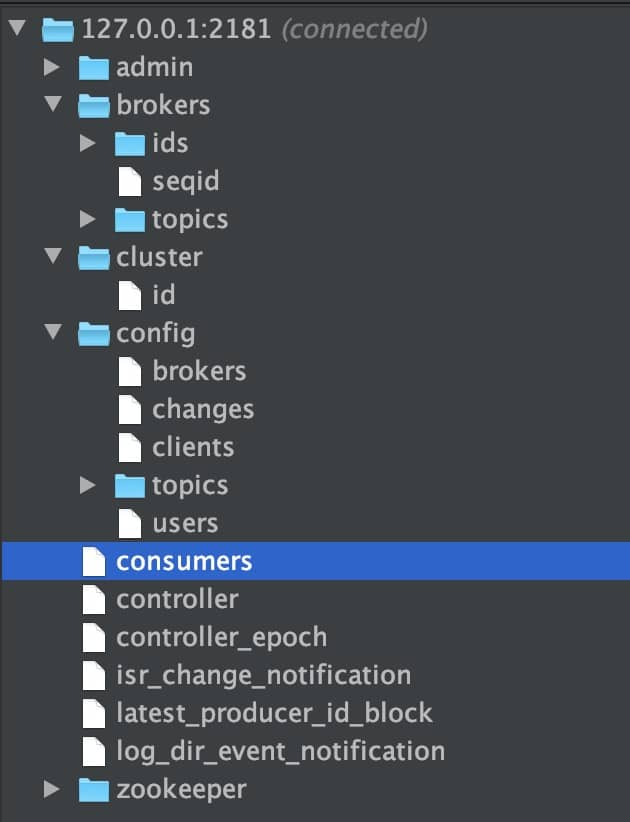
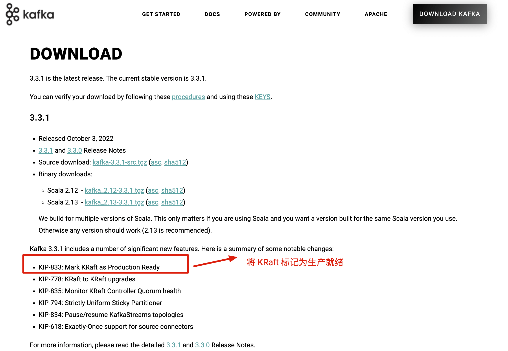
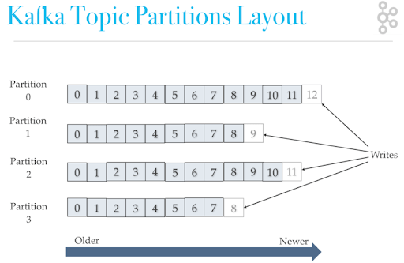
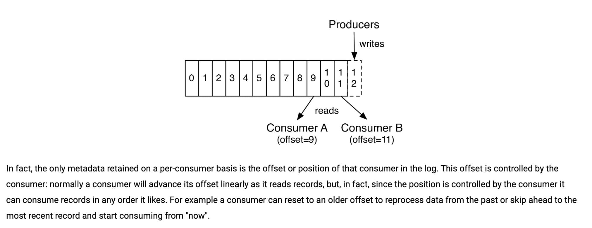

## Kafka Fundamentals

### What Is Kafka, and What Are Its Main Use Cases?

Kafka is a distributed streaming platform. What does that mean?

Streaming platforms have three key capabilities:

1. **Messaging:** Publish and subscribe to streams of messages, which is why Kafka is also classified as a message queue.
2. **Fault-tolerant persistent storage:** Kafka persists messages to disk, reducing the risk of message loss.
3. **Stream processing:** Kafka provides a library for processing data streams as messages are published.

Kafka has two main use cases:

1. **Messaging:** Build real-time data pipelines to transfer data reliably between systems or applications.
2. **Data processing:** Build real-time stream-processing applications that transform or process data.

### What Are Kafka's Advantages Over Other Message Queues?

Kafka is often treated as a strong message-queue option and is frequently compared with RocketMQ and RabbitMQ. Its main advantages include:

1. **High performance:** Kafka is written in Scala and Java and makes extensive use of batching and asynchronous processing. Under suitable workloads, it can process tens of millions of messages per second.
2. **Broad ecosystem support:** Kafka integrates with a wide range of surrounding tools, especially in big-data and stream-processing ecosystems.

Early versions of Kafka lacked some capabilities expected of a reliable message queue, including protections against message loss. This reflected its original purpose: LinkedIn developed Kafka to process large volumes of logs, not specifically as a general-purpose message queue.

Kafka has since improved these capabilities. **The blanket claim that Kafka is unreliable as a message queue is outdated.**

### What Are Queue and Kafka Messaging Models?

> **Aside:** JMS and AMQP were standards created by organizations in the messaging industry. They are discussed in [Message Queues Are Simple](https://github.com/Snailclimb/JavaGuide#%E6%95%B0%E6%8D%AE%E9%80%9A%E4%BF%A1%E4%B8%AD%E9%97%B4%E4%BB%B6). Their evolution has not kept pace with the development of message queues, so individual products may use their own messaging models.

#### Queue Model: An Early Messaging Model



**A queue is the communication channel in the producer-consumer model. Each message is delivered to one consumer, and unconsumed messages remain in the queue until they are consumed or expire.** For example, if a producer sends 100 messages to two consumers, they will usually share the work, consuming about half each in send order.

**A limitation of the queue model:**

Suppose messages from a producer need to be sent to multiple consumers, and every consumer must receive the complete set of messages.

The queue model does not handle this efficiently. One option is to create a queue for each consumer and publish each message multiple times, but this wastes resources and undermines the purpose of using a message queue.

#### Publish/Subscribe Model: Kafka's Messaging Model

The publish/subscribe model addresses this limitation of the queue model.



The publish/subscribe (Pub/Sub) model uses a **topic** as its messaging channel, similar to broadcast. A publisher sends a message to the topic, which delivers it to all current subscribers. **Consumers that subscribe after the message has been published do not receive that message.**

**With only one subscriber, the publish/subscribe model behaves much like a queue, so it can also support the queue model's use case.**

**Kafka uses the publish/subscribe model.**

> **RocketMQ's messaging model is similar to Kafka's. Kafka uses partitions rather than the queue abstraction.**

## Kafka Core Concepts

### What Are Producers, Consumers, Brokers, Topics, and Partitions?

Kafka sends messages published by producers to a **topic**. Consumers that need those messages can subscribe to the topic, as shown below:



The diagram introduces several important Kafka concepts:

1. **Producer:** Publishes messages.
2. **Consumer:** Consumes messages.
3. **Broker:** An individual Kafka server. Multiple brokers form a Kafka cluster.

Each broker also hosts topics and partitions:

- **Topic:** Producers publish messages to a topic, and consumers subscribe to topics to receive them.
- **Partition:** A topic is divided into partitions, which can be distributed across different brokers. A topic can therefore span multiple brokers.

> **Key point:** A Kafka partition is similar to a queue in other messaging systems.

### How Does Kafka's Replication Mechanism Work, and What Does It Provide?

Kafka replicates partitions. One replica is the **leader**, and the others are **followers**. Producers send messages to the leader, and followers fetch messages from it to stay in sync.

> Producers and consumers interact with the leader replica. Followers replicate the leader's data to improve durability and availability. If the leader fails, an eligible follower can be elected as the new leader; a follower that is not sufficiently in sync may not be eligible.

**What are the benefits of Kafka's partitioning and replication mechanisms?**

1. Assigning multiple partitions to a topic and distributing them across brokers provides concurrency and load balancing.
2. Configuring replicas for a partition improves durability and fault tolerance, at the cost of additional storage.

## ZooKeeper and Kafka

### What Role Did ZooKeeper Play in Kafka?

> To understand ZooKeeper's role in Kafka, set up a Kafka environment and inspect the Kafka-related paths and the data stored in each node. Hands-on practice helps reinforce the concepts. This section is based in part on [this article](https://www.jianshu.com/p/a036405f989c).

The image below shows my local ZooKeeper connected to Kafka. The directory structure was captured using the ZooKeeper Tool plugin for IntelliJ IDEA.



ZooKeeper primarily provided metadata management for Kafka.

As shown in the diagram, ZooKeeper was used for tasks such as:

1. **Broker registration:** Each broker registered at startup by creating a node under `/brokers/ids` and recording information such as its IP address and port.
2. **Topic registration:** ZooKeeper maintained topic partition metadata and the mapping between partitions and brokers. For example, a topic named `my-topic` with two partitions would have corresponding paths under `/brokers/topics/my-topic`.
3. **Load balancing:** Kafka distributes a topic's partitions across brokers to improve concurrency. The system also assigned partitions among consumers based on the number of partitions and consumers.
4. Other metadata and coordination tasks.

### Can Kafka Run Without ZooKeeper?

Before Kafka 2.8, one common criticism was its heavy reliance on ZooKeeper. Kafka 2.8 introduced KRaft mode, based on the Raft protocol, initially as an early-access feature. Starting with Kafka 3.3.x, KRaft was marked production-ready for new clusters. Kafka 4.0 removed ZooKeeper mode and supports only KRaft.

Migrating an existing cluster from ZooKeeper mode to KRaft requires following the official migration procedure; changing the configuration and restarting is not sufficient. For new clusters, follow the deployment mode currently recommended in the official documentation.



## Kafka Ordering, Message Loss, and Duplicate Consumption

### How Does Kafka Preserve Message Order?

Some business workflows require messages to be consumed in order. For example, suppose two messages trigger these database operations:

1. Update a user's membership level.
2. Calculate an order price based on that level.

Processing them in the wrong order can produce a different result.

Kafka stores messages in partitions. Partitions belong to topics, and a topic can have multiple partitions.



Messages are appended to the end of a partition, as shown above. **Kafka guarantees ordering only within a partition.**

> Each message appended to a partition receives an offset. Kafka uses offsets to track message order within that partition.

One simple way to preserve order is to use **one partition per topic**. This works, but sacrifices Kafka's parallelism.

Kafka producers send records with a topic and can also specify a partition, key, and value. Specifying a partition sends records there directly. Records with the same key are routed to the same partition, so a table or object ID can be used as the key.

In summary, two ways to preserve ordering are:

1. Use a single partition for the topic.
2. **Recommended:** Specify a key or partition when publishing messages.

These are two straightforward approaches; other designs are possible.

Ordered consumption has two important limitations:

- **Ordering is guaranteed only within a partition:** Multiple partitions are processed in parallel, so Kafka does not guarantee global ordering.
- **Retries can affect business ordering:** If a message fails while later messages are processed, the application may need a state machine or version check to preserve correctness.

In production, a common approach is to route the same business key to one partition, consume that partition in order, and use idempotency or state-machine checks in the consumer.

### How Can Kafka Prevent Message Loss?

#### Producer-Side Message Loss

After a producer calls `send`, a network problem may prevent the message from reaching Kafka.

Do not assume a message was sent successfully just because `send` returned. Check the result. Kafka's `send` operation is asynchronous; calling `get()` waits for the result and makes the operation synchronous, as shown below:

> **For a complete example, see [Part 3 of the Kafka series: Using Kafka as a Message Queue in Spring Boot](https://mp.weixin.qq.com/s?__biz=Mzg2OTA0Njk0OA==&mid=2247486269&idx=2&sn=ec00417ad641dd8c3d145d74cafa09ce&chksm=cea244f6f9d5cde0c8eb233fcc4cf82e11acd06446719a7af55230649863a3ddd95f78d111de&token=1633957262&lang=zh_CN#rd).**

```java
SendResult<String, Object> sendResult = kafkaTemplate.send(topic, o).get();
if (sendResult.getRecordMetadata() != null) {
  logger.info("Producer sent message to " + sendResult.getProducerRecord().topic() + " -> " + sendRe
              sult.getProducerRecord().value().toString());
}
```

This synchronous approach is generally not recommended. Instead, add a callback:

```java
        ListenableFuture<SendResult<String, Object>> future = kafkaTemplate.send(topic, o);
        future.addCallback(result -> logger.info("Producer sent message to topic:{} partition:{}", result.getRecordMetadata().topic(), result.getRecordMetadata().partition()),
                ex -> logger.error("Producer failed to send message: {}", ex.getMessage()));
```

If sending fails, inspect the cause and retry as appropriate.

Set a reasonable producer `retries` value. Retries allow the producer to recover from transient network problems. Also configure retry backoff; if retries happen too quickly, a brief network interruption may exhaust them before connectivity recovers.

#### Consumer-Side Message Loss

Each message appended to a partition receives an offset. The offset tracks a consumer's position in that partition and lets Kafka track its progress.



With automatic offset commits, a consumer may commit an offset as it retrieves messages. If it crashes after retrieval but before processing, Kafka may consider the message consumed even though the application never processed it.

**One option is to disable automatic commits and commit offsets only after processing succeeds.** This can cause duplicate processing: if the consumer crashes after processing but before committing, the message may be delivered again.

#### Broker-Side Message Loss

Kafka replicates partitions. One replica is the leader, and the others are followers. Producers send messages to the leader, and followers fetch them to stay in sync. Producers and consumers interact with the leader; followers provide additional copies for durability and availability.

**If the broker hosting a partition's leader fails before its followers have replicated recent messages, a new leader may be elected without those messages, resulting in data loss.**

**Set `acks=all`**

One mitigation is to set the producer's **`acks=all`** setting.

The default value, `1`, means the leader acknowledges a message once it receives it. With **`acks=all`**, the leader waits for the in-sync replicas (ISR) to acknowledge the message before responding. This improves durability but can increase latency.

**Set `replication.factor >= 3`**

Configure a topic with **`replication.factor >= 3`** to provide at least three replicas per partition. This uses more storage but improves fault tolerance.

**Set `min.insync.replicas > 1`**

Also set **`min.insync.replicas > 1`** so a write requires acknowledgment from at least two in-sync replicas. Its default is `1`; production settings should reflect the required durability and availability tradeoff.

Keep **`replication.factor > min.insync.replicas`**. If the values are equal, losing a replica can leave too few in-sync replicas to accept writes. A common starting point is **`replication.factor = min.insync.replicas + 1`**, adjusted for the failure model.

**Set `unclean.leader.election.enable=false`**

> Starting with Kafka 0.11.0.0, the default for `unclean.leader.election.enable` changed from `true` to `false`.

Messages are sent to the leader and replicated by followers. With **`unclean.leader.election.enable=false`**, Kafka will not elect an out-of-sync replica as leader after a failure, reducing the risk of losing acknowledged messages. This may reduce availability if no eligible replica is available.

In production, also review producer-side settings:

- Enable the idempotent producer to prevent retries from writing duplicates to a partition.
- Set `delivery.timeout.ms`, `request.timeout.ms`, and `linger.ms` according to the required balance of reliability, latency, and throughput.
- Log failed sends or record critical messages in a local message table to support later compensation.

Kafka reliability depends on several factors together: topic replication, ISR configuration, producer acknowledgments, consumer offset commit timing, and business-level idempotency.

### How Can Duplicate Consumption Be Prevented?

**Common causes of duplicate consumption:**

- The consumer processed a message but failed to commit its offset. This is the underlying cause.
- Slow processing or network problems make Kafka consider the consumer unresponsive, triggering a partition rebalance.

**Mitigations:**

- Make consumer processing idempotent, for example with a Redis set or a MySQL primary key. This is usually the most effective safeguard.
- Set **`enable.auto.commit=false`** and commit offsets manually. The commit point matters:
  - **Commit after processing:** A crash after processing but before the commit can still cause duplicate delivery.
  - **Commit immediately after fetching:** This avoids some duplicate processing but risks losing a message if processing fails. It may suit workflows that tolerate delays and have a scheduled reconciliation process to recover missed work.

## What Are the Risks of Rebalancing, and How Can They Be Reduced?

Changes to the number of consumers in a consumer group, topic subscriptions, or a consumer's heartbeat may trigger a rebalance. Partitions are reassigned during a rebalance, and some consumers pause processing. This can cause throughput fluctuations and duplicate consumption.

Common ways to reduce disruption:

- Avoid frequently starting and stopping consumer instances; deploy gradually in batches.
- Set `max.poll.interval.ms` appropriately so a long processing batch does not cause a consumer to leave the group.
- Limit the number of records fetched at once so processing does not exceed the poll interval.
- Use static group membership or a cooperative assignment strategy to reduce unnecessary partition movement.
- Make consumer processing idempotent, since duplicate processing can still occur around offset commits and rebalances.

When discussing rebalancing in an interview, explain more than just "partitions are reassigned." Describe the pauses and duplicate-processing risks, and how configuration, deployment strategy, and idempotency can reduce their impact.

## Kafka Retry Mechanism

The previous section mentioned retries as one way to prevent message loss. This section explains them in more detail.

Many articles about Spring Kafka's default retry behavior are outdated and do not match actual behavior. The following description is based on the [Spring Kafka 2.9.3 source code](https://mvnrepository.com/artifact/org.springframework.kafka/spring-kafka/2.9.3).

### What Happens When Message Processing Fails?

If processing a message throws an exception, does it block later messages in the queue and stall the application?

Producer code:

```Java
 for (int i = 0; i < 10; i++) {
   kafkaTemplate.send(KafkaConst.TEST_TOPIC, String.valueOf(i))
 }
```

Consumer code:

```Java
   @KafkaListener(topics = {KafkaConst.TEST_TOPIC},groupId = "apple")
   private void customer(String message) throws InterruptedException {
       log.info("kafka customer:{}",message);
       Integer n = Integer.parseInt(message);
       if (n%5==0){
           throw new  RuntimeException();
       }
   }
```

With the default configuration, a processing failure is retried. After several attempts, the failed record is skipped and the consumer continues with later messages rather than remaining blocked on it. The log below shows that `test-0@95` is skipped after repeated retries.

```Java
2023-08-10 12:03:32.918 DEBUG 9700 --- [ntainer#0-0-C-1] o.s.kafka.listener.DefaultErrorHandler   : Skipping seek of: test-0@95
2023-08-10 12:03:32.918 TRACE 9700 --- [ntainer#0-0-C-1] o.s.kafka.listener.DefaultErrorHandler   : Seeking: test-0 to: 96
2023-08-10 12:03:32.918  INFO 9700 --- [ntainer#0-0-C-1] o.a.k.clients.consumer.KafkaConsumer     : [Consumer clientId=consumer-apple-1, groupId=apple] Seeking to offset 96 for partition test-0

```

Thus, when a message fails, the Kafka consumer can continue processing later messages after the retry policy is exhausted.

### How Many Retries Are Configured by Default?

By default, a processing failure triggers retries. How many attempts are made, and is there a delay between them?

In the source, the `FailedRecordTracker` class has a `recovered` function that returns a Boolean indicating whether to retry. The relevant logic is shown below:

```java
	@Override
	public boolean recovered(ConsumerRecord<?, ?> record, Exception exception,
	    @Nullable MessageListenerContainer container,
	    @Nullable Consumer<?, ?> consumer) throws InterruptedException {

	    if (this.noRetries) {
         // Retries are not supported.
	        attemptRecovery(record, exception, null, consumer);
	        return true;
	    }
     // Get the set of records that have already failed.
	    Map < TopicPartition, FailedRecord > map = this.failures.get();
	    if (map == null) {
	        this.failures.set(new HashMap < > ());
	        map = this.failures.get();
	    }
     // Get the topic and partition for the failed record.
	    TopicPartition topicPartition = new TopicPartition(record.topic(), record.partition());
	    FailedRecord failedRecord = getFailedRecordInstance(record, exception, map, topicPartition);
     // Notify the registered retry listener that delivery failed.
	    this.retryListeners.forEach(rl - >
	        rl.failedDelivery(record, exception, failedRecord.getDeliveryAttempts().get()));
	    // Get the delay before the next retry.
    long nextBackOff = failedRecord.getBackOffExecution().nextBackOff();
	    if (nextBackOff != BackOffExecution.STOP) {
	        this.backOffHandler.onNextBackOff(container, exception, nextBackOff);
	        return false;
	    } else {
	        attemptRecovery(record, exception, topicPartition, consumer);
	        map.remove(topicPartition);
	        if (map.isEmpty()) {
	            this.failures.remove();
	        }
	        return true;
	    }
	}
```

Here, `BackOffExecution.STOP` has a value of `-1`.

```java
@FunctionalInterface
public interface BackOffExecution {

	long STOP = -1;
	long nextBackOff();

}
```

The `nextBackOff` value comes from the `BackOff` class's `nextBackOff()` function. It returns `STOP` when the current attempt exceeds the configured maximum, ending retries.

```Java
public long nextBackOff() {
  this.currentAttempts++;
  if (this.currentAttempts <= getMaxAttempts()) {
    return getInterval();
  }
  else {
    return STOP;
  }
}
```

What is the value of `getMaxAttempts`? When processing throws an exception, execution reaches `DefaultErrorHandler`. Its default constructor is:

```Java
public DefaultErrorHandler() {
  this(null, SeekUtils.DEFAULT_BACK_OFF);
}
```

`SeekUtils.DEFAULT_BACK_OFF` is defined as follows:

```Java
public static final int DEFAULT_MAX_FAILURES = 10;

public static final FixedBackOff DEFAULT_BACK_OFF = new FixedBackOff(0, DEFAULT_MAX_FAILURES - 1);
```

`DEFAULT_MAX_FAILURES` is `10`, and `currentAttempts` ranges from `0` to `9`, so there are 10 total attempts with a retry interval of zero.

In summary, with this default configuration, the Kafka consumer makes up to 10 attempts with no delay between them. If processing still fails, it stops retrying and treats the message as failed.

### How Can the Retry Count and Interval Be Customized?

The default error handler uses `FixedBackOff` to control retry count and interval. To customize them, pass a configured `FixedBackOff` when initializing `DefaultErrorHandler`, then call `setCommonErrorHandler` on a `KafkaListenerContainerFactory`:

```Java
@Bean
public KafkaListenerContainerFactory kafkaListenerContainerFactory(ConsumerFactory<String, String> consumerFactory) {
    ConcurrentKafkaListenerContainerFactory factory = new ConcurrentKafkaListenerContainerFactory();
    // Set a custom retry interval and count.
    FixedBackOff fixedBackOff = new FixedBackOff(1000, 5);
    factory.setCommonErrorHandler(new DefaultErrorHandler(fixedBackOff));
    factory.setConsumerFactory(consumerFactory);
    return factory;
}
```

### How Can an Alert Be Sent After Retries Fail?

Custom behavior after retries fail must be implemented manually. The example below overrides `DefaultErrorHandler.handleRemaining` to add an alert or other action:

```Java
@Slf4j
public class DelErrorHandler extends DefaultErrorHandler {

    public DelErrorHandler(FixedBackOff backOff) {
        super(null,backOff);
    }

    @Override
    public void handleRemaining(Exception thrownException, List<ConsumerRecord<?, ?>> records, Consumer<?, ?> consumer, MessageListenerContainer container) {
        super.handleRemaining(thrownException, records, consumer, container);
        log.info("Message processing failed after multiple retries");
        // Add custom handling.
    }
}
```

`DefaultErrorHandler` is the default error handler. Spring Kafka also provides the `CommonErrorHandler` interface, which can be implemented for more flexible behavior, such as different retry and business logic for different exception types.

### How Can Messages Be Reprocessed After Retries Fail?

After the maximum number of retries, the consumer skips the failed message and moves on. How can the message be processed again after the code is fixed?

**A dead-letter queue (DLQ)** is a special queue for messages a consumer cannot process successfully, for example because of malformed data, processing failures, or timeouts. After a configured number of failed attempts, a message can be routed to a DLQ instead of being discarded. The message can then be inspected and handled to diagnose the issue, fix the cause, and recover the work.

`@RetryableTopic` is a Spring Kafka annotation for configuring retries for a topic and is the recommended way to set them up:

```Java
// Retry 5 times, starting with a 100 ms delay and a maximum delay of 1 second.
@RetryableTopic(
        attempts = "5",
        backoff = @Backoff(delay = 100, maxDelay = 1000)
)
@KafkaListener(topics = {KafkaConst.TEST_TOPIC}, groupId = "apple")
private void customer(String message) {
    log.info("kafka customer:{}", message);
    Integer n = Integer.parseInt(message);
    if (n % 5 == 0) {
        throw new RuntimeException();
    }
    System.out.println(n);
}
```

If processing still fails after the maximum number of retries, Spring Kafka routes the message to the corresponding dead-letter topic. Handle it with `@DltHandler` or consume it again with `@KafkaListener`.

## References

- [Kafka documentation](https://kafka.apache.org/documentation/)
- GeekTime, _Kafka: Core Concepts and Practice_, Chapter 11: How to Configure Kafka to Avoid Message Loss

<!-- @include: @article-footer.snippet.md -->
