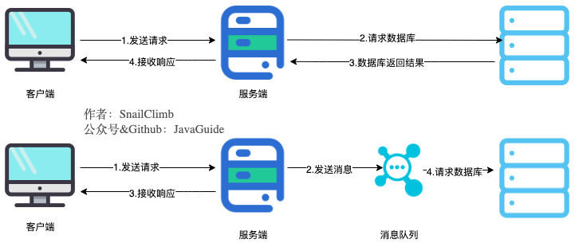
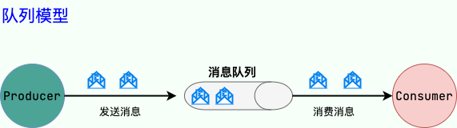
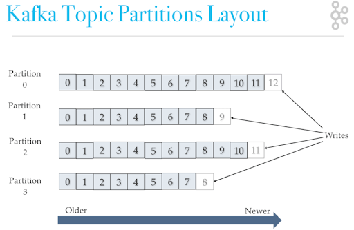
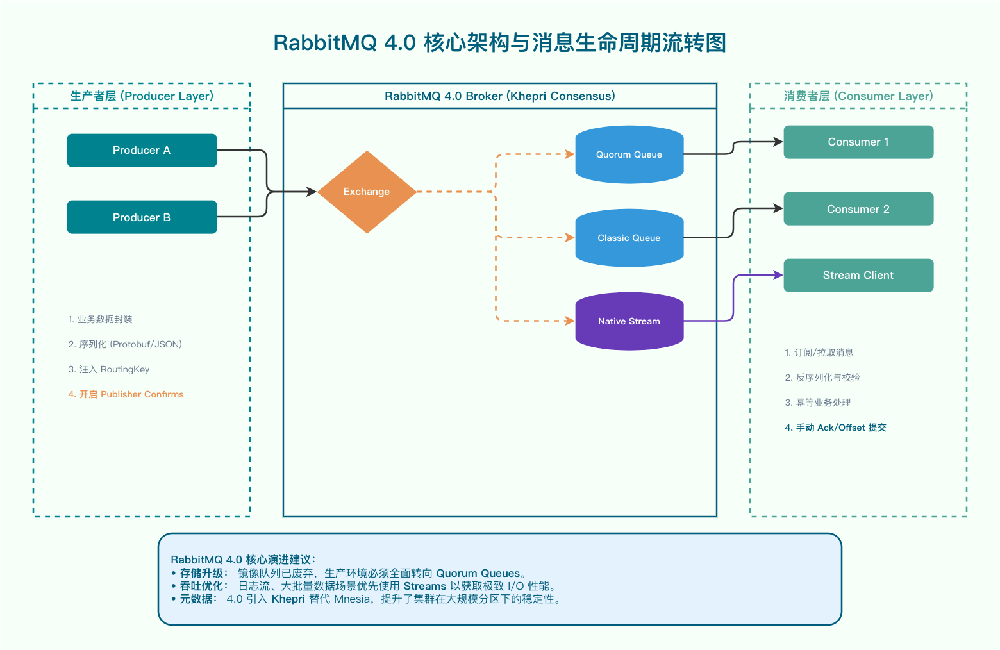

Message-queue interviews often begin with "Why use an MQ?" Follow-up questions then trace a message through its lifecycle: Can the producer retry after a timeout? Does a successful broker response mean the message cannot be lost? What happens if the consumer processes a message but fails to acknowledge it? How should duplicate consumption, ordering problems, and backlogs be handled?

This is the review guide for JavaGuide's message-queue section. It covers four areas: use cases, message reliability, major middleware, and technology selection. Each section lists key review questions; detailed answers and implementation details are in the linked guides.

If you are short on time, start with the interview-cram version, [Message Queue Interview Questions](https://interview.javaguide.cn/high-performance/message-queue-interview-questions.html). Mark the questions you cannot explain, then return here to review the principles and engineering details.

## What Should You Focus on First?

| Area                      | What to explain                                                                                               | Common follow-ups                                                                                      |
| ------------------------- | ------------------------------------------------------------------------------------------------------------- | ------------------------------------------------------------------------------------------------------ |
| Use cases and limits      | Why use an MQ, and which paths should remain synchronous?                                                     | Asynchronous processing, decoupling, traffic smoothing, eventual consistency, RPC vs. MQ               |
| Reliability and semantics | How are messages acknowledged, retried, and recovered from production through consumption?                    | Message loss, duplicate consumption, idempotency, ordering, retries, dead letters, backlogs            |
| Middleware internals      | How do major MQs organize messages, replicate data, and coordinate consumers?                                 | Kafka, RocketMQ, RabbitMQ, partitions, replicas, consumer groups, acknowledgments                      |
| Selection and operations  | How should an MQ be selected and operated based on business needs, operational experience, and failure goals? | Throughput, latency, replay, transactional messages, monitoring, scaling, disaster recovery, Disruptor |

When discussing message reliability, do not cite just one configuration setting. Explain producer acknowledgments, broker persistence and replication, consumer acknowledgments, business idempotency, and reconciliation or compensation together. An incomplete stage can result in message loss, duplication, or inconsistent outcomes.

## Message-Queue Fundamentals and Limitations

Message queues replace synchronous calls between producers and consumers with asynchronous messaging. The main request path can return sooner, and a broker can buffer traffic spikes. However, the system also gains middleware, asynchronous state, and failure-recovery workflows.

Related guides:

- [Message-Queue Fundamentals](./message-queue.md)
- [High-Performance System-Design Interview Questions](../high-performance-system-interview-questions.md)

Common interview questions:

- How do message queues provide asynchronous processing, application decoupling, and traffic smoothing?
- How do system complexity and data consistency change after introducing a message queue?
- Which workloads suit asynchronous processing? Can real-time paths such as payment results and inventory deductions be made asynchronous directly?
- How do RPC and message queues differ in communication direction, response time, coupling, and failure handling?
- Which use cases suit point-to-point and publish-subscribe models?
- Why should an application not report "business success" immediately after writing a message to an MQ?

When answering "Why use an MQ?", use a concrete workflow. For example, after an order is created, which steps must complete synchronously, and which notifications, rewards, or risk-control tasks can run asynchronously? If a consumer fails, how do the user-visible status and background compensation fit together?

## Message Reliability and Delivery Semantics

Explain message reliability across four stages: producer, broker, consumer, and business processing. The producer must know whether the message was accepted, the broker must account for persistence and replicas, the consumer must acknowledge after processing, and the business layer must handle duplicates and uncertain outcomes.

Related guides:

- [Message-Queue Fundamentals](./message-queue.md)
- [Kafka Interview Questions](./kafka-questions-01.md)
- [RocketMQ Interview Questions](./rocketmq-questions.md)
- [RabbitMQ Interview Questions](./rabbitmq-questions.md)

Common interview questions:

- What do At Most Once, At Least Once, and Exactly Once mean?
- At which stages can a message be lost, and how can each risk be reduced?
- Why can At Least Once delivery produce duplicates, and how can consumers ensure business idempotency?
- Why can deduplication by message ID not fully replace a business idempotency key?
- How can messages for the same order or user be processed in order?
- After a consumer fails, which errors should be retried, and which messages should go to a dead-letter queue?
- During a backlog, how can you distinguish a production spike, slow consumers, too few partitions, and downstream failures?

Ordering, reliability, and throughput often affect one another. Assigning the same business key to one queue or partition can preserve local ordering, but limits parallelism. Synchronous disk flushing and additional replicas can reduce message-loss risk, but add write latency and resource costs.

## Common Kafka Questions

Common Kafka questions focus on partitions, replicas, consumer groups, reliability, and high-throughput design. Explain Producer, Broker, Partition, Replica, Consumer Group, and Offset as parts of the same read/write path.

Related guide: [Kafka Interview Questions](./kafka-questions-01.md)

Common interview questions:

- What roles do Topic, Partition, Replica, Consumer Group, and Offset play?
- Why does Kafka guarantee ordering only within a single partition, and how should a business key be chosen?
- How are Leader, Follower, ISR, HW, and LEO related?
- How should `acks=all`, the replica count, and `min.insync.replicas` be configured together?
- Why does Kafka provide high throughput? What do sequential writes, the page cache, zero-copy, batching, and compression contribute?
- What problems do Kafka's idempotent producer and transactions solve? Does Exactly Once cover external databases?
- Why does Kafka 4.0 support only KRaft, and how does it differ from the earlier ZooKeeper mode?
- What effects can a rebalance have, and how can unnecessary rebalances be reduced?

Do not memorize Kafka settings in isolation. For example, `acks=all` waits for acknowledgment from the qualifying replicas in the current ISR; it does not mean that every configured replica has flushed the data to disk. When the consumer commits its Offset after processing also affects the risks of duplicate consumption and message loss.

## Common RocketMQ Questions

RocketMQ interviews often focus on business messaging. Transactional, delayed, and ordered messages, along with message storage, are common follow-up topics. Start by tracing a message through NameServer, Producer, Broker, and Consumer, then review CommitLog, ConsumeQueue, disk flushing, and replication.

Related guide: [RocketMQ Interview Questions](./rocketmq-questions.md)

Common interview questions:

- What are the responsibilities of NameServer, Broker, Producer, Consumer, and Proxy?
- How does RocketMQ provide route discovery when NameServer nodes do not communicate with one another?
- What data do CommitLog, ConsumeQueue, and IndexFile each store?
- How do half messages, commit, rollback, and transaction checks work together in RocketMQ transactional messaging?
- Which scenarios suit delayed and scheduled messages? Why should consumers still check business state?
- How does RocketMQ preserve message ordering within the same business group?
- What are the effects of synchronous versus asynchronous disk flushing and replication?
- Why might adding consumers fail to increase processing speed when messages have accumulated?

Transactional messages coordinate a local transaction with message publication; they do not provide consumer idempotency or compensation. A broker check-back only retrieves the producer's local transaction state. Duplicate consumer execution, downstream failures, and business reconciliation must be handled separately.

## Common RabbitMQ Questions

RabbitMQ questions focus on the AMQP routing model, acknowledgments, dead-letter and delayed queues, and the reliability of different queue types. First explain how Exchange, Routing Key, Binding, and Queue work together.

Related guide: [RabbitMQ Interview Questions](./rabbitmq-questions.md)

Common interview questions:

- How do direct, fanout, topic, and headers exchanges route messages?
- Which stage does a Publisher Confirm acknowledge, and how can unroutable messages be detected?
- Are durable exchanges, queues, and messages alone enough to prevent message loss?
- How do manual ACK, NACK, requeueing, retries, and dead-letter queues work together?
- Why can using TTL and a dead-letter exchange for delayed messages cause head-of-line blocking?
- Which use cases suit Classic Queue, Quorum Queue, and Stream?
- Does deploying a RabbitMQ cluster across multiple nodes mean queue messages are replicated?
- How should Ready and Unacked counts, message age, acknowledgment rate, and replica status be monitored?

Publisher Confirm only indicates that the broker processed the publication. Whether the message reached the intended business queue depends on the routing result. Consumer acknowledgment only indicates that the consumer accepted the processing result; transactions, idempotency, and compensation are still needed to ensure the business database was updated correctly.

## Message-Queue Selection and Project Follow-Ups

When selecting a message queue, first identify the required messaging semantics, then consider the team's deployment and failure-handling experience. Comparing single-node throughput alone is not enough to reach a reliable conclusion.

Related guides:

- [Message-Queue Fundamentals](./message-queue.md)
- [Disruptor Interview Questions](./disruptor-questions.md)

Common interview questions:

- How do Kafka, RocketMQ, and RabbitMQ differ in messaging model, throughput, latency, replay, and operations?
- Which products suit log streams, order events, complex routing, and delayed tasks?
- When is it worth introducing another MQ if a company already operates one reliably?
- Which production, storage, consumption, and business metrics should be monitored?
- How should the system degrade and recover when a broker, consumer, or downstream dependency fails?
- How does Disruptor differ from a distributed message queue?

Project follow-ups often ask for concrete metrics and failure handling: peak production rate, consumer lag, partition or queue count, message retention, maximum retry count, backlog alert thresholds, and recovery procedures. For configurations or incidents you did not handle yourself, answer based on what you have learned; do not invent production data.

## Review Plan by Available Time

| Time available   | Suggested plan                                                                                                                                                                                    | Goal                                                                        |
| ---------------- | ------------------------------------------------------------------------------------------------------------------------------------------------------------------------------------------------- | --------------------------------------------------------------------------- |
| 1–2 days         | Review [Message Queue Interview Questions](https://interview.javaguide.cn/high-performance/message-queue-interview-questions.html), focusing on reliability, idempotency, ordering, and backlogs. | Answer common questions by tracing the message lifecycle.                   |
| 3–7 days         | In addition to the general topics, study the MQ used in your project and learn the roles and main differences of two other products.                                                              | Explain product internals, failure handling, and selection trade-offs.      |
| More than a week | Read the guides in order, diagram production, storage, replication, consumption, acknowledgment, and compensation, then review monitoring and recovery in a project context.                      | Connect business requirements to configuration, trade-offs, and operations. |

<!-- @include: @article-footer.snippet.md -->
