::: tip

This article focuses on distributed message queues.

:::

RabbitMQ? Kafka? RocketMQ? Message queues come up often in software development. Whether you have used them before or are new to the topic, this article explains the fundamentals.

Experienced users may find concepts they have not considered before; newcomers can use this article as a starting point.

## What Is a Message Queue?

Think of a message queue as a container that stores messages until they are needed. A queue is a first-in, first-out data structure, so messages are consumed in order unless the system's behavior or configuration allows otherwise.

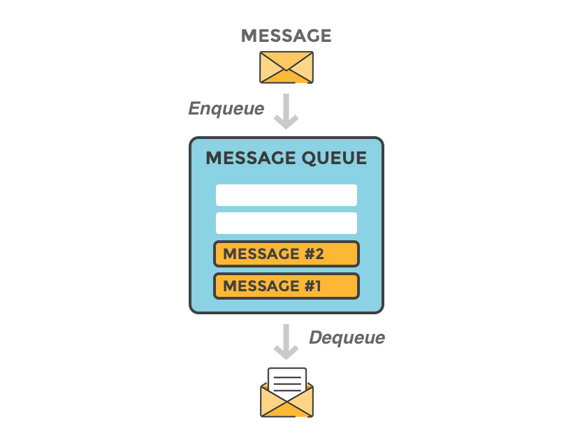

The two roles in message delivery are the **producer**, which sends messages, and the **consumer**, which processes them.

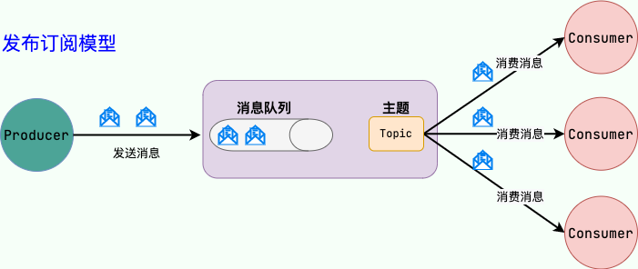

Message queues are also used for inter-process communication in operating systems. Here, the term usually refers to communication between services or components within a system. This kind of message queue is **middleware**.

Wikipedia describes middleware as follows:

> Middleware is software that connects system software and applications, enabling communication between software components and allowing applications built on different technologies to share information and resources. It runs above the client and server operating systems and manages computing resources and network communication.

In short, **middleware provides services to applications, which in turn serve users. Users do not interact with middleware directly.**

Other common middleware includes RPC frameworks, distributed components, HTTP servers, job schedulers, configuration centers, database sharding tools, and data migration tools.

For more on middleware, see this [Taobao Technology answer](https://www.zhihu.com/question/19730582/answer/1663627873).

As distributed systems and microservices have become more common, message queues have taken on a larger role in system design. They can reduce coupling, enable asynchronous processing, and smooth traffic peaks, making them an important component of distributed systems and microservices.

## What Are Message Queues Used For?

Message queues generally provide three main benefits:

1. Asynchronous processing
2. Traffic smoothing and rate limiting
3. Reduced system coupling

They also support other use cases, such as distributed transactions, ordered processing, and data-stream processing.

If asked about message queues in an interview, relate your answer to a project on your resume.

### Asynchronous Processing

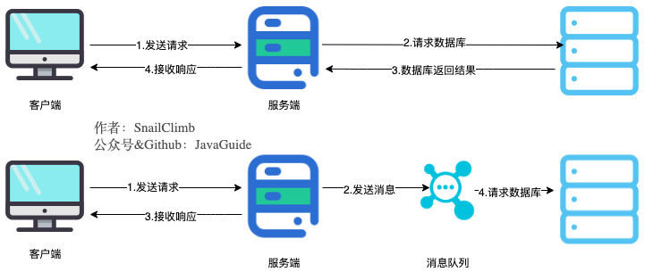

Use a message queue to process time-consuming operations from a user request asynchronously. The application can return a response after sending the message, reducing response time and improving the user experience. The system processes the message later.

The request may fail later during business validation or a database write, even though the application has already returned after publishing the message. Therefore, **asynchronous processing requires a matching business flow**. For example, after a user submits an order, do not report that the order is complete until the order consumer has processed it—and, where necessary, until it has shipped. Notify the user by email or text message. This is similar to booking train or movie tickets on a phone.

### Traffic Smoothing and Rate Limiting

**Store messages produced during a brief traffic spike in a queue, then let backend services consume them at a rate they can handle. This prevents a sudden surge from overwhelming those services.**

For example, during an e-commerce flash sale or promotion, a message queue can absorb the initial wave of orders and protect backend services, as shown below:

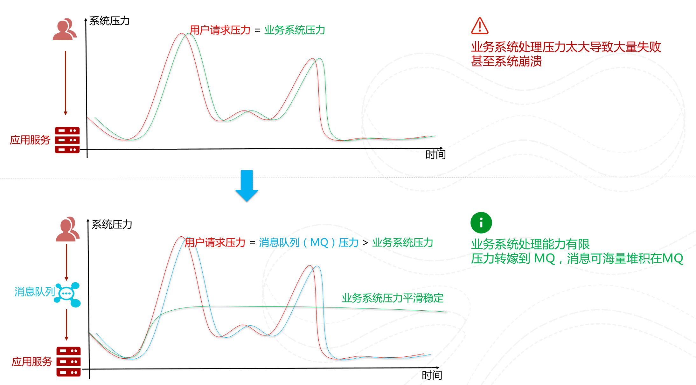

### Reducing System Coupling

Message queues can reduce coupling between system components. If modules do not call one another directly, adding or changing a module has less impact on the others, making the system easier to extend.

The producer sends a message to the queue, and consumers retrieve and process it. A system that needs the message can subscribe without being directly coupled to the producer or other systems, improving extensibility.

**In the publish/subscribe model, a producer publishes messages and one or more consumers subscribe to them.** As shown above, **the producer and consumers are not directly coupled**. Once the producer publishes a message to the distributed queue, its work is done. Consumers retrieve the message and process it without needing to know where it came from. **A new business component can subscribe to messages it needs without changing the existing systems or workflows, making the application easier to extend.**

For example, an online store may have separate user, order, finance, inventory, logistics, notification, and risk-control services. After an order is placed, the system may need to charge the customer, update inventory, arrange shipping, notify the customer, and assess risk. With a message queue, order placement is decoupled from these follow-up operations: the order service publishes an event, and interested services subscribe and process it.

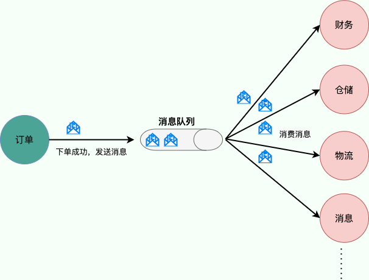

To protect against message loss if a broker fails, producers may retain messages after publishing and delete them only after consumers process them. If a broker fails, the producer can publish to another broker in the distributed queue cluster.

**Note:** Message queues do not use only the publish/subscribe model; it is useful for decoupling in this particular scenario. Point-to-point messaging is another model, in which a message is delivered to one consumer. Publish/subscribe is more common. These two messaging models are provided by JMS, while AMQP defines five additional messaging patterns.

### Implementing Distributed Transactions

MQ transactions are one approach to distributed transactions.

RocketMQ, Kafka, Pulsar, and QMQ provide transaction-related features. Transactions let event-stream applications define message consumption, processing, and production as one atomic operation.

For more detail, see [Distributed Transactions](https://javaguide.cn/distributed-system/distributed-transaction.html).

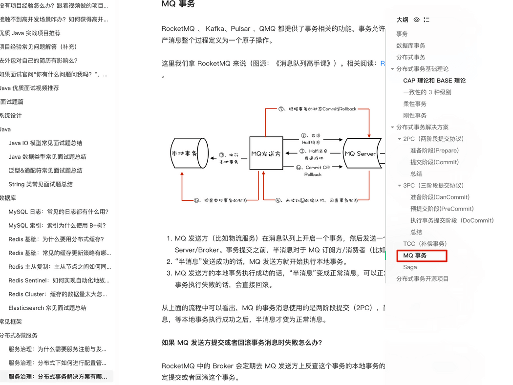

### Message Ordering

In many applications, processing order matters. Message queues can process messages in a defined order for workflows that require it. Most message queues, including RocketMQ, RabbitMQ, Pulsar, and Kafka, support ordered messages.

### Delayed and Scheduled Processing

Delayed or scheduled messages are not consumed immediately; they become available at a specified time. Most message queues, including RocketMQ, RabbitMQ, and Pulsar, support this feature.

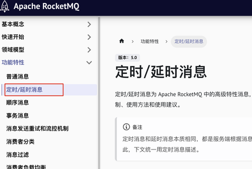

### Instant Messaging

MQTT (Message Queuing Telemetry Transport) is a lightweight protocol that uses the publish/subscribe model. It suits applications such as IoT that operate over low-bandwidth, high-latency, or unreliable networks. It supports real-time messaging and can maintain communication in poor network conditions.

RabbitMQ includes an MQTT plugin, which is disabled by default and must be enabled manually.

### Data-Stream Processing

Message queues can collect large data streams from distributed systems—such as application logs, monitoring data, and user activity—in real time or in batches, then send them to big-data processing engines for efficient stream management and processing.

## What Problems Do Message Queues Introduce?

- **Lower availability:** Before introducing an MQ, the system does not need to handle broker outages or message loss. Afterward, these failure modes must be considered.
- **Greater complexity:** The system must handle duplicate consumption, message loss, ordering, and other delivery concerns.
- **Consistency challenges:** Asynchronous processing can improve response times, but if a consumer fails to process a message correctly, system data may become inconsistent.

To decide whether a workflow should use an MQ, ask:

- Must the caller receive the downstream result immediately? If so, RPC may be a better fit.
- Can the business tolerate eventual consistency? If not, asynchronous processing adds compensation work.
- Does peak traffic exceed downstream capacity? An MQ can buffer traffic and smooth the peak.
- Do downstream failures require retries, compensation, or manual intervention? An MQ can support a recovery workflow.
- Can the team operate, monitor, and troubleshoot an MQ? Otherwise, its complexity may outweigh its benefits.

In short, an MQ suits work that can finish later but must not be lost, must be recoverable, and benefits from decoupling. It is not a reason to convert every synchronous workflow to asynchronous processing.

## How Can Message Delivery Be Made Reliable?

Consider reliability at each stage; enabling persistence alone is not enough:

1. **Producer:** Enable publish confirmations and retry failed sends. For critical workflows, use a local message table or transactional messages to prevent a successful local transaction from leaving its message unpublished.
2. **Broker storage:** Persist messages. Configure replicas or highly available queues for critical topics and queues, and align flush and replica-acknowledgment policies with reliability requirements.
3. **Consumer:** Acknowledge the message or commit the offset only after business processing succeeds. On failure, retry, route it to a dead-letter queue, or start a compensation workflow.
4. **Business recovery:** Use reconciliation and compensation jobs, alerts, and manual handling for exceptional failures.

Implementations vary by MQ, but the main principles are the same: **confirmation, persistence, retries, idempotency, and compensation**.

## How Should Duplicate Delivery and Idempotency Be Handled?

In production, it is difficult to guarantee that each message is consumed exactly once. The more common delivery semantic is "at least once," which means messages may be delivered more than once and consumers must be idempotent.

Common idempotency techniques include:

- **Unique indexes:** Use a business key such as an order number, payment number, or message ID to prevent duplicate writes.
- **State machines:** Allow only valid state transitions, such as an order moving from "paid" to "shipped."
- **Consumption records:** Record message-processing status and skip messages that have already been handled.
- **Redis deduplication:** Useful for short deduplication windows, but account for key expiration and persistence risks.

Idempotency should rely on a business-level unique key rather than an MQ-generated message ID. Retries, compensation, or republishing may assign different message IDs to the same business event.

## How Should a Message Backlog Be Handled?

When messages accumulate, identify the cause before scaling:

- **Producer surge:** A promotion, campaign, crawler, or upstream issue sharply increases the message publish rate.
- **Slow consumers:** Slow SQL, slow external APIs, lock contention, undersized thread pools, or small batches reduce throughput.
- **Too few partitions or queues:** Adding consumer instances may not help if only a limited number can process a queue or partition in parallel.
- **Broker problems:** Disk, network, controller/NameServer, or cluster replication issues may limit throughput.

The usual order is to limit traffic and stabilize the system, scale consumers and partitions where appropriate, find and fix slow consumer logic, then process or replay the existing backlog in batches. Do not simply "add consumers": more instances will not increase throughput if there are too few queues or processing is serialized.

## JMS and AMQP

### What Is JMS?

JMS (Java Message Service) is a Java messaging service that enables asynchronous message transfer between JMS clients. **The JMS API is a messaging standard** that allows application components on the Java EE platform to create, send, receive, and read messages. It reduces coupling in distributed communication and supports reliable, asynchronous messaging.

JMS defines five message body formats:

- `StreamMessage`: A stream of Java primitive values
- `MapMessage`: A set of name-value pairs
- `TextMessage`: A string
- `ObjectMessage`: A serialized Java object
- `BytesMessage`: A stream of bytes

**ActiveMQ implements the JMS specification, but is now obsolete and not recommended.**

### The Two JMS Messaging Models

#### Point-to-Point (P2P) Model

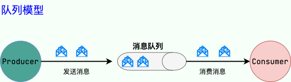

The **queue** is the messaging channel in the **producer-consumer model**. Each message is delivered to one consumer. Unconsumed messages remain in the queue until they are consumed or expire. For example, if a producer sends 100 messages to two consumers, they will usually share the work, consuming about half each in send order.

#### Publish/Subscribe (Pub/Sub) Model

The publish/subscribe model uses a **topic** as the messaging channel, similar to broadcast. A publisher sends a message to the topic, and it is delivered to all subscribers.

### What Is AMQP?

AMQP (Advanced Message Queuing Protocol) is an open application-layer standard for message-oriented middleware. It is a binary protocol designed to provide interoperable messaging. Clients and brokers that support AMQP can exchange messages across different products and programming languages.

**RabbitMQ implements the AMQP protocol.**

### JMS vs. AMQP

|    Comparison    | JMS                                  | AMQP                                                                                                                                                                       |
| :--------------: | :----------------------------------- | :------------------------------------------------------------------------------------------------------------------------------------------------------------------------- |
|    Definition    | Java API                             | Protocol                                                                                                                                                                   |
|  Cross-language  | No                                   | Yes                                                                                                                                                                        |
|  Cross-platform  | No                                   | Yes                                                                                                                                                                        |
| Messaging models | Point-to-point and publish/subscribe | Five exchange types: direct, fanout, topic, headers, and system. The latter four are similar in principle to JMS publish/subscribe, with more detailed routing mechanisms. |
|  Message types   | Several types, as listed above       | `byte[]` (binary)                                                                                                                                                          |

**Summary:**

- AMQP defines a wire-level protocol for messaging, while JMS defines an API specification. JMS lets Java clients interoperate without changing application code, but has limited cross-platform support. AMQP is designed for cross-platform and cross-language communication.
- JMS supports message types such as `TextMessage` and `MapMessage`; AMQP messages are byte arrays (`byte[]`), so complex data must be serialized before sending.
- AMQP exchanges provide multiple routing strategies for delivering messages to queues, while JMS supports point-to-point queues and publish/subscribe topics.

## RPC vs. Message Queues

RPC and message queues are both important components of distributed systems and microservices. Here is a brief comparison:

- **Purpose:** RPC enables remote communication between services without requiring the caller to manage low-level networking. It lets an application invoke a remote service much like a local method. Message queues primarily reduce coupling, enable asynchronous processing, and smooth traffic peaks.
- **Communication:** RPC is direct, bidirectional network communication. A message queue adds an intermediary and generally provides asynchronous, one-way publishing and consumption.
- **Architecture:** Message queues store messages; RPC does not need to.
- **Processing time:** RPC calls are generally handled immediately, while queued messages may be processed later.

RPC and message queues are different mechanisms for network communication with different purposes; they should not be treated as interchangeable.

## Choosing a Distributed Message Queue

### What Are Some Common Message Queues?

#### Kafka

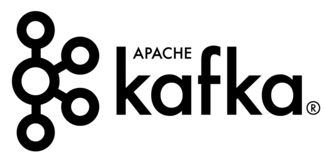

Kafka is a distributed stream-processing platform originally open-sourced by LinkedIn and now an Apache top-level project. It was first used to process large volumes of logs and later developed into a full-featured, high-performance message queue.

Stream-processing platforms have three key capabilities:

1. **Messaging:** Publish and subscribe to streams of messages, which is why Kafka is also classified as a message queue.
2. **Fault-tolerant, persistent storage:** Kafka persists messages to disk, reducing the risk of message loss.
3. **Stream processing:** Kafka provides a stream-processing library for processing messages as they are published.

Kafka is a distributed system of servers and clients that communicate over TCP. It can run on bare-metal hardware, virtual machines, and containers, both on-premises and in the cloud.

Before Kafka 2.8, a common criticism was its heavy reliance on ZooKeeper for metadata management and cluster availability. Kafka 2.8 introduced KRaft mode, which uses the Raft protocol and removes the ZooKeeper dependency, simplifying the architecture.

Migrating an existing cluster from ZooKeeper mode to KRaft requires following the official migration procedure; changing the configuration and restarting is not sufficient. For new clusters, follow the currently recommended deployment mode in the official documentation.

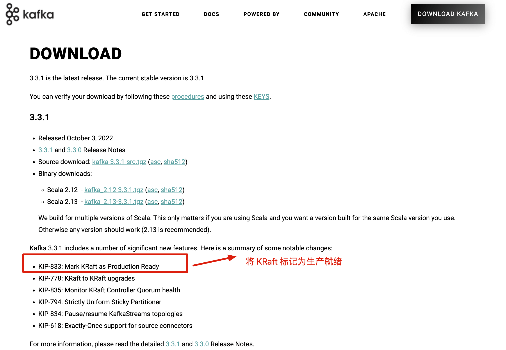

Kafka website: <http://kafka.apache.org/>

Kafka releases: <https://kafka.apache.org/downloads>

#### RocketMQ

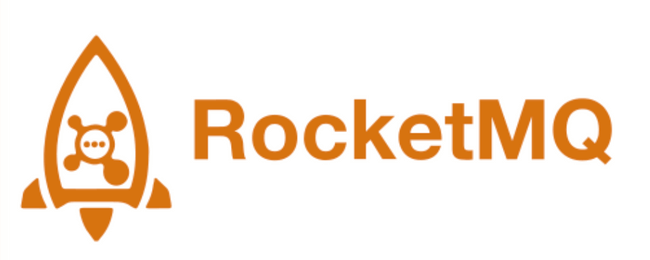

RocketMQ is a cloud-native real-time data platform for messages, events, and streams. Originally open-sourced by Alibaba, it was influenced by Kafka and is now an Apache top-level project.

RocketMQ's key features, as described on its website, include:

- Cloud native: Designed for cloud environments, elastic scaling, and Kubernetes.
- High throughput: Supports large-scale throughput for microservices and big-data workloads.
- Stream processing: Provides a lightweight, extensible, high-performance stream-computing engine.
- Financial-grade reliability: Used in critical transaction workflows.
- Simple architecture: No external dependencies and a shared-nothing architecture.
- Ecosystem integration: Integrates with microservices, stream processing, and data lakes.

The project website describes it as follows:

> Since its launch, Apache RocketMQ has been widely adopted by enterprise developers and cloud providers for its simple architecture, rich business features, and extensibility. After more than a decade of use at scale, RocketMQ has become a widely recognized choice for reliable, financial-grade business messaging across internet, big-data, mobile, and IoT applications.

RocketMQ website: <https://rocketmq.apache.org/> (The documentation is detailed and worth reading.)

RocketMQ releases: <https://github.com/apache/rocketmq/releases>

#### RabbitMQ

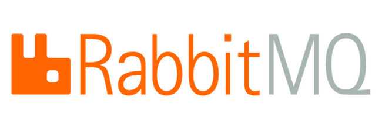

RabbitMQ is an Erlang-based message broker that implements AMQP (Advanced Message Queuing Protocol). It originated in the financial industry and was designed to store and forward messages in distributed systems.

RabbitMQ has gained broad adoption for its usability, extensibility, reliability, and availability. Its main features include:

- **Reliability:** RabbitMQ uses mechanisms such as persistence, delivery acknowledgments, and publisher confirms to improve message reliability.
- **Flexible routing:** Exchanges route messages before they enter queues. RabbitMQ provides built-in exchanges for common routing patterns. For more complex routing, exchanges can be bound together or extended with plugins. These features are covered in the guide to RabbitMQ's core concepts.
- **Extensibility:** Multiple RabbitMQ nodes can form a cluster, and nodes can be added as workload requirements change.
- **High availability:** In RabbitMQ 4.x, Classic Queues no longer use mirrored queues for high availability. For higher reliability, consider Quorum Queues or Streams.
- **Multiple protocols:** In addition to native AMQP, RabbitMQ supports protocols such as STOMP and MQTT.
- **Multilingual clients:** RabbitMQ has clients for many commonly used languages, including Java, Python, Ruby, PHP, C#, and JavaScript.
- **Management UI:** RabbitMQ includes a user interface for monitoring and managing messages and cluster nodes.
- **Plugins:** RabbitMQ offers plugins for extending its capabilities, and custom plugins can also be written. This is somewhat similar to Dubbo's SPI mechanism.

RabbitMQ website: <https://www.rabbitmq.com/>.

RabbitMQ news and releases: <https://www.rabbitmq.com/news.html>

#### Pulsar

Pulsar is a cloud-native distributed messaging and streaming platform originally developed by Yahoo and now an Apache top-level project.

Pulsar combines messaging, storage, and lightweight function-based computing in a compute-storage-separated architecture. It supports multi-tenancy, persistent storage, and cross-region replication. Its streaming-storage features include strong consistency, high throughput, low latency, and scalability, making it a candidate for real-time messaging, storage, and computation in cloud-native systems.

Pulsar's key features, as listed on its website, include:

- A cloud-native distributed messaging and streaming platform.
- A single Pulsar instance natively supports multiple clusters and cross-cluster replication across data centers.
- Low publish and end-to-end latency.
- Scalability to more than one million topics.
- A simple client API with Java, Go, Python, and C++ clients.
- Multiple topic subscription modes: exclusive, shared, and failover.
- Persistent message storage through Apache BookKeeper.
- Stream-native processing with Pulsar Functions, a lightweight serverless computing framework.
- Data import and export through Pulsar IO, a serverless connector framework built on Pulsar Functions.
- Tiered storage that moves older data from hot storage to cold or long-term storage, such as S3 or GCS.

Pulsar website: <https://pulsar.apache.org/>

Pulsar releases: <https://github.com/apache/pulsar/releases>

#### ActiveMQ

ActiveMQ is obsolete and is not recommended for new projects.

### How Should You Choose?

> Based on _Java Engineer Interview Crash Course, Season 1_ by Shi Shan.

| Comparison   | Summary                                                                                                                                                                                                 |
| ------------ | ------------------------------------------------------------------------------------------------------------------------------------------------------------------------------------------------------- |
| Throughput   | ActiveMQ and RabbitMQ handle tens of thousands of messages per second, while RocketMQ and Kafka can reach hundreds of thousands or millions. ActiveMQ has the lowest performance of these systems.      |
| Availability | All can be configured for high availability. ActiveMQ and RabbitMQ use primary-replica architectures; RocketMQ and Kafka are distributed systems with replicated data.                                  |
| Latency      | RabbitMQ is built with Erlang and offers high concurrency and low latency, measured in microseconds in some scenarios. The others are typically measured in milliseconds.                               |
| Features     | Pulsar offers a broad feature set, including multi-tenancy, multiple consumption modes, and persistence options.                                                                                        |
| Message loss | The source characterizes loss as very unlikely in ActiveMQ and RabbitMQ, and theoretically preventable in Kafka, RocketMQ, and Pulsar. Actual guarantees depend on configuration and failure scenarios. |

**Summary:**

- ActiveMQ has an established community, but its performance and release pace lag behind newer alternatives. It is not recommended for new projects.
- RabbitMQ generally has lower throughput than Kafka, RocketMQ, or Pulsar, but offers flexible routing and low latency. It may suit workloads that do not require extremely high throughput. Its Erlang implementation can also affect teams' ability to customize the broker at the source-code level.
- RocketMQ and Pulsar offer consistency-related features for workloads with stricter messaging requirements. Review each product's guarantees and configuration for the specific failure scenarios involved.
- RocketMQ is an Alibaba-originated Java project whose source code can be inspected and customized. It has also been used in Alibaba's production workloads.
- Kafka offers a focused feature set, high throughput, millisecond-level latency, and a distributed architecture that can scale. Its throughput and operations depend on topic, partition, and workload design. Duplicate delivery can occur, so consumers should be idempotent; this is especially important when message processing affects data correctness. Kafka is widely used for real-time data processing and log collection.

The following workload-based guide can help narrow the choice:

| Workload                                      | Common choice | Considerations                                     |
| --------------------------------------------- | ------------- | -------------------------------------------------- |
| Logs, analytics events, and stream processing | Kafka, Pulsar | Throughput, partition scaling, ecosystem           |
| Transactions, orders, and business events     | RocketMQ      | Transactional, delayed, and ordered messages       |
| Flexible routing and simple integration       | RabbitMQ      | Exchange routing, acknowledgments, queue types     |
| High-performance in-process event handling    | Disruptor     | Low latency, lock-free processing, not distributed |

There is no universally best MQ; choose one that fits the team's workload, business semantics, and operational capabilities.

## References

- _The Architecture of Large-Scale Websites_
- [KRaft: Apache Kafka Without ZooKeeper](https://developer.confluent.io/learn/kraft/)
- [What Are Message Queues Used For?](https://mp.weixin.qq.com/s/4V1jI6RylJr7Jr9JsQe73A)

<!-- @include: @article-footer.snippet.md -->
