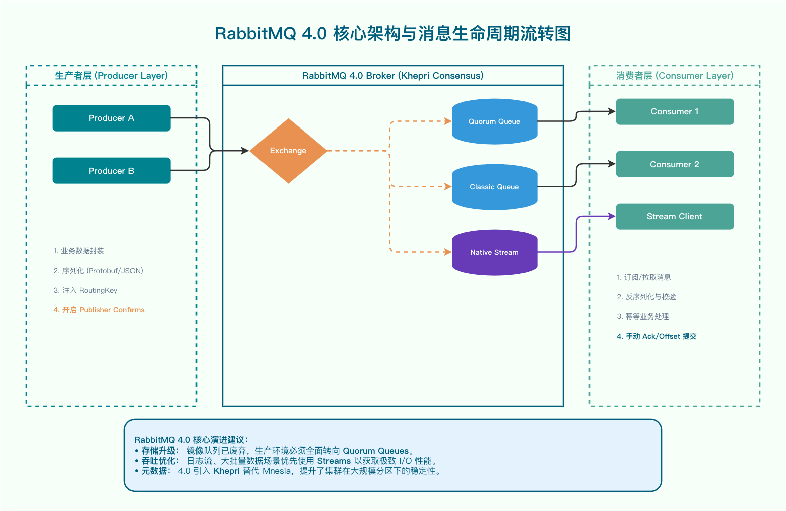
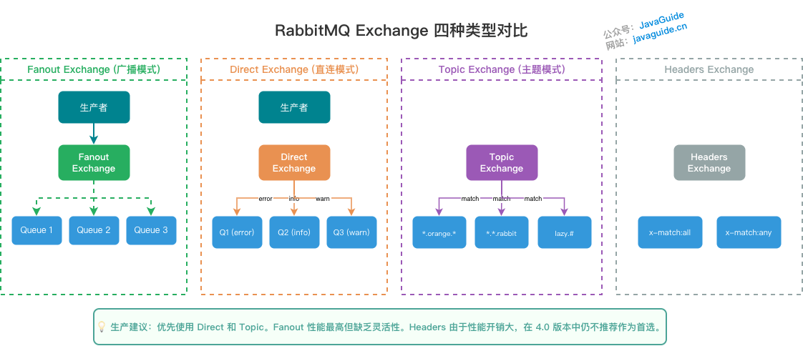
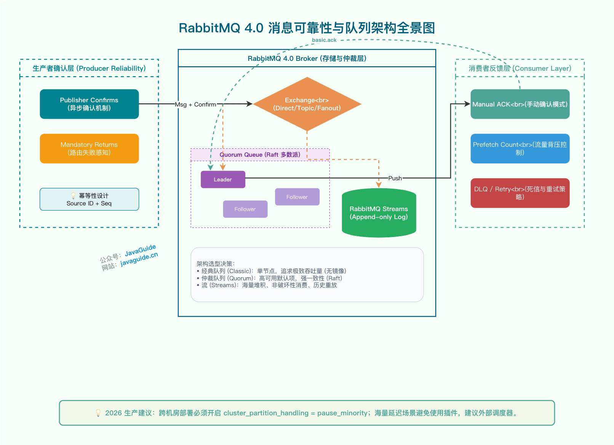

RabbitMQ interview preparation should go beyond the old "Exchange + Queue" model. RabbitMQ 4.0 removed mirrored queues; use Quorum Queues when replication and high availability are required, and consider Streams for log storage, replay, or large backlogs.

This guide focuses on RabbitMQ 4.x while retaining information about mirrored queues found in older 3.x clusters. It covers the AMQP model, exchange routing, message reliability, and how to choose among Classic Queues, Quorum Queues, and Streams.

## What Is RabbitMQ?

RabbitMQ is open-source messaging middleware written in Erlang. It most commonly uses AMQP 0-9-1 and also supports AMQP 1.0, MQTT, STOMP, and other protocols.

RabbitMQ acts as a broker: producers publish messages to exchanges, exchanges route them to queues according to bindings, and consumers retrieve them from queues. Its main strengths include flexible routing, acknowledgment mechanisms, plugins, and clients for many languages.

## RabbitMQ Features

- **Reliability:** Supports message persistence, manual consumer acknowledgments, publisher confirms, and dead-letter exchanges.
- **Flexible routing:** Exchanges route messages to queues based on routing keys and bindings. Built-in exchanges handle common patterns; complex routing can combine exchanges or use plugins.
- **Extensibility:** Multiple RabbitMQ nodes can form a cluster, but queue replication depends on the queue type; clustering alone does not guarantee replicated queues.
- **High availability:** Quorum Queues replicate data using Raft. Streams are also replicated and suit log storage and replay.
- **Multiple protocols:** In addition to AMQP, RabbitMQ supports protocols such as STOMP and MQTT.
- **Multilingual clients:** Clients are available for commonly used languages, including Java, Python, Ruby, PHP, C#, and JavaScript.
- **Management UI:** The Management UI shows queues, connections, channels, exchanges, node status, and common runtime metrics.
- **Plugins:** Plugins extend RabbitMQ with capabilities such as MQTT, STOMP, and Prometheus monitoring.

## What Are the Key RabbitMQ Concepts?

RabbitMQ follows a producer-consumer model and receives, stores, and forwards messages. Think of sending a package through a post office: the office stores it temporarily and routes it to the recipient. RabbitMQ works similarly, but in computing terms it is more accurately described as an exchange-based model.

The overall RabbitMQ architecture is shown below:



The main objects are described below.

### Producers and Consumers

- **Producer:** Publishes messages (like the sender of a package).
- **Consumer:** Processes messages (like the recipient).

Messages generally have two parts: a **header** (or label) and a **body**, also called the **payload**. The broker treats the payload as opaque data. Optional header properties include the routing key, priority, and delivery mode, which indicates whether the message should be persisted. RabbitMQ uses message properties and routing rules to deliver messages to interested consumers.

### Exchanges

In RabbitMQ, messages are not published directly to a **queue**. They first pass through an **exchange**, which routes them to the appropriate queues.

An **exchange** receives messages from producers and routes them to one or more queues. If a message cannot be routed, it may be returned to the producer, sent to an alternate exchange, or dropped, depending on the publish options and exchange configuration.

**RabbitMQ has four exchange types, each with a different routing strategy:** **direct**, **fanout**, **topic**, and **headers**. Their behavior is described in the [Exchange Types](#exchange-types) section.

> **Note:** AMQP 0-9-1 defines a predeclared default exchange. It is a direct exchange with an empty-string name (`""`). When creating a business exchange, specify its type explicitly.

Producers usually publish a **routing key** with a message to help determine its route. The **routing key works together with the exchange type and binding key**.

RabbitMQ uses a **binding** to associate an **exchange** with a **queue**. A binding usually specifies a **binding key**, which RabbitMQ uses when deciding whether to route a message to that queue. A binding is a routing rule, and exchanges and queues can have many-to-many relationships.

When a producer publishes a message with a routing key, RabbitMQ routes it to queues whose binding keys match according to the exchange type. An exchange can be bound to multiple queues, and multiple bindings can use the same key. Whether the binding key is used depends on the exchange type: a fanout exchange ignores it and sends the message to every bound queue.

### Queues

**A queue** stores messages until they are delivered to consumers. It is a message container and destination. A message can be routed to one or more queues and remains there until a consumer retrieves it.

In the classic RabbitMQ model, messages are stored in **queues**, unlike Kafka, which stores messages in topic partitions. RabbitMQ producers publish messages that are ultimately routed to queues, from which consumers retrieve them.

> RabbitMQ 3.9 introduced Streams. A Stream is an append-only log: consuming a message does not delete it, and consumers can replay historical messages by offset. Streams suit event sourcing, log distribution, and large backlogs; ordinary asynchronous tasks are usually better served by Classic Queues or Quorum Queues.

**Multiple consumers can subscribe to the same queue.** Each message is delivered to one of those consumers, not copied to every consumer.

> **Note:** Delivery behavior is affected by `prefetch_count`. In AMQP 0-9-1, `prefetch_count=0` means there is no limit on unacknowledged messages, so a consumer may receive many messages at once. If processing times vary, set a suitable prefetch value to avoid reserving too many messages on one consumer.

**RabbitMQ does not broadcast a queue's messages to every consumer.** To deliver a copy to each consumer, create a separate queue for each consumer and bind them all to the same fanout or topic exchange.

### Brokers

In RabbitMQ, a broker is a service node or instance. In most cases, it can be thought of as one RabbitMQ server.

### Exchange Types

RabbitMQ commonly uses four exchange types: **fanout**, **direct**, **topic**, and **headers**. The AMQP specification also describes system and custom exchange types, which are not covered here.



| Type    | Routing rule                                                 | Common use cases                                                              |
| ------- | ------------------------------------------------------------ | ----------------------------------------------------------------------------- |
| fanout  | Ignores the routing key and sends to every bound queue       | Configuration updates, cache invalidation, and broadcasting logs to consumers |
| direct  | Requires an exact match between binding and routing keys     | Precise routing by severity, business type, or service name                   |
| topic   | Splits routing keys on `.`; binding keys support `*` and `#` | Multi-level filtering by region, module, or event type                        |
| headers | Matches message headers with `x-match=all` or `any`          | Rarely used; prefer topic exchanges when they meet the need                   |

The two topic wildcards are easy to confuse: `*` matches exactly one word, while `#` matches zero or more words. For example, `order.china.*` matches `order.china.beijing` but not `order.china.beijing.created`; `#.client.#` matches `com.rabbitmq.client`.

## What Is AMQP?

RabbitMQ was originally built around AMQP 0-9-1. Concepts such as producers, exchanges, queues, bindings, and routing keys come from the AMQP model. RabbitMQ also supports AMQP 1.0, MQTT, and STOMP; feature details vary by protocol.

RabbitMQ's exchanges, exchange types, queues, bindings, and routing keys are concepts defined by the AMQP model.

> RabbitMQ 4.0 and later supports AMQP 1.0 natively and enables it by default, without requiring the older AMQP 1.0 plugin for protocol conversion. AMQP 0-9-1 remains supported, and much of the Java and Spring AMQP ecosystem is built around it. For a new project, choose AMQP 1.0 based on client-library maturity, interoperability requirements, and RabbitMQ's support for the features you need.

**In AMQP 0-9-1, distinguish the AMQ model from the protocol layers:**

- **AMQ model:** Defines core objects such as exchanges, queues, and bindings, and how messages are routed from producers to consumers.
- **Functional layer:** Defines protocol commands grouped by function, such as exchange, queue, basic, and transaction commands.
- **Transport layer:** Handles frames, channel multiplexing, heartbeats, errors, and data representation.

**The three main components of the AMQP model are:**

- **Exchange:** Routes messages to queues in the broker.
- **Queue:** Stores messages in memory or on disk.
- **Binding:** A rule that tells an exchange which queue should receive a message.

## Producers and Consumers

**Producer:**

- Publishes messages.
- A message generally contains a **body** (payload) and **headers** (metadata).

**Consumer:**

- Receives and processes messages.
- A consumer connects to RabbitMQ and subscribes to a queue. Application logic usually processes the message body. Routing keys, headers, and delivery tags are routing or delivery metadata that can support logging, idempotency, and acknowledgments; they are not part of the business payload itself.

## Brokers, Queues, and Exchanges

- **Broker:** A RabbitMQ service node, usually thought of as one RabbitMQ server.
- **Queue:** An internal RabbitMQ object that stores messages. Multiple consumers can subscribe to the same queue, and messages are distributed among them, commonly using round-robin delivery subject to prefetch and acknowledgment state.
- **Exchange:** Receives messages from producers and routes them to one or more queues. If no route matches, a message may be returned to the producer or dropped, depending on configuration.

## What Is a Dead-Letter Queue, and What Causes a Message to Be Dead-Lettered?

DLX stands for `Dead-Letter Exchange`. When a message becomes dead-lettered in a queue, RabbitMQ can republish it to another exchange, the DLX. A queue bound to that exchange is called a dead-letter queue.

**Common reasons a message is dead-lettered:**

- A message is rejected (`Basic.Reject` or `Basic.Nack`) with `requeue = false`.
- The message TTL expires.
- The queue reaches its length limit and drops the message.
- In a Quorum Queue, the message exceeds the `delivery-limit`.

## What Is a Delayed Queue, and How Can RabbitMQ Implement One?

Delayed queues hold messages that have been published to RabbitMQ but should not be delivered to consumers until later.

RabbitMQ does not provide a general-purpose delayed queue. Common ways to implement delayed delivery include:

1. **TTL + DLX:** Send messages to a queue with a TTL. When they expire, they are routed through a dead-letter exchange to the queue that consumers process. This approach can be affected by head-of-queue blocking, and maintaining separate queues for many delay intervals adds operational overhead.
2. **`rabbitmq-delayed-message-exchange` plugin:** Provides an `x-delayed-message` exchange that sets a delay per message. The project's README positions it for delays measured in seconds, minutes, or hours, up to roughly a day or two. Use external storage and a scheduler for delays measured in days or weeks, or for very large backlogs of delayed messages.

In short, delayed delivery is not a general-purpose feature of ordinary RabbitMQ queues. TTL + DLX and the plugin can both work, depending on the delay range and recovery requirements.

## What Is a Priority Queue?

RabbitMQ assigns priority to messages, not to queues. In a priority queue, messages with higher priority are delivered to consumers before lower-priority messages in the same queue.

Declare a Classic Queue with the `x-max-priority` argument to enable message priorities; Quorum Queues also support priorities. Priority has little effect when consumers keep up with producers and messages do not accumulate.

## What Are RabbitMQ's Messaging Patterns?

- Simple queue
- Work queue
- Publish/subscribe
- Routing
- Topic

## How Does RabbitMQ Transfer Messages?

Creating and closing TCP connections has overhead, including handshakes and slow start, and the number of concurrent connections is limited by system resources. RabbitMQ uses **channels** to multiplex communication over a TCP connection. A channel is a virtual communication path within that connection.

> **Notes:**
>
> - A TCP connection can carry multiple channels, but RabbitMQ recommends keeping the count to roughly 100–200 per connection or fewer.
> - Each channel has its own number but shares the TCP connection's flow control.
> - **Channels are not thread-safe.** Use a separate channel per thread.

## How Can Message Delivery Be Made Reliable?



Failures can occur at three points: producer to broker, broker storage, and broker to consumer.

**1. Producer to broker**

The producer should handle two separate questions: whether the broker accepted the message and whether it was routed to a queue.

- **Publisher confirms:** Confirm that the broker accepted the message. For persistent messages routed to durable queues, the confirmation waits for persistence. For a Quorum Queue, it waits for acceptance by a majority of replicas.

  ```java
  channel.confirmSelect();
  channel.addConfirmListener((sequenceNumber, multiple) -> {
      // The broker processed the message with this sequence number.
  }, (sequenceNumber, multiple) -> {
      // The broker could not process the message; log the failure and retry according to business policy.
  });
  ```

- **`mandatory` + return listener:** If a message reaches an exchange but matches no queue, the producer can receive a return.

  ```java
  channel.basicPublish("exchange", "routingKey",
      true,  // mandatory=true
      null,
      messageBody);

  channel.addReturnListener((replyCode, replyText, exchange, routingKey, properties, body) -> {
      // The message reached the exchange but was not routed to any queue.
      log.error("Message returned: {}", replyText);
  });
  ```

Publisher confirms alone are not enough. A message that could not be routed may still receive `basic.ack`, because the broker processed the publish. Use `mandatory` returns or an alternate exchange to detect routing failures.

- **Transactions (not recommended):** Synchronous and blocking, with substantially lower throughput than publisher confirms in many workloads.
  - Transactions and confirm mode are mutually exclusive; they cannot be used together.

**2. Broker storage**

- `delivery_mode=2`: Treat the message as persistent.
- `durable=true`: Preserve the queue metadata across broker restarts.
- Replicated queues: Mirrored queues were removed in RabbitMQ 4.x. For replication, consider Quorum Queues or Streams.

Persistence alone does not guarantee that messages cannot be lost. Producers should wait for publisher confirms, and consumers should use manual acknowledgments; otherwise, broker failures, connection loss, or consumer failures can still cause message loss or duplicate processing.

**3. Broker to consumer**

- **Manual acknowledgments:** Use `basicAck(deliveryTag, multiple)` to acknowledge only after processing succeeds.
- **Retries:** On failure, use `basicNack` or `basicReject`, then decide whether to `requeue` based on the exception.
- **Dead-letter queues:** Route a message to a DLQ after it is rejected or reaches its retry limit, then alert, compensate, or handle it manually.
- **Idempotency:** Implement this in the business layer to prevent duplicate delivery from causing inconsistent data. See [Idempotency for APIs](https://javaguide.cn/high-availability/idempotency.html).

> **Note:** An alternate exchange can also handle routing failures. If one is configured, unroutable messages are forwarded to it. If that exchange also cannot route a message and `mandatory` is set, the producer receives a return.

## How Can RabbitMQ Message Ordering Be Preserved?

RabbitMQ's FIFO behavior applies within a single queue and can be affected by consumer count, prefetch, retries, and requeueing. Common approaches include:

**1. Single-consumer mode:** Bind one consumer to a queue. This makes ordering easiest to preserve, but limits throughput.

**2. Ordered partitions:** Hash a business key, such as an order ID, to one of several queues, each handled by a separate consumer. Routing the same key to the same queue preserves per-key order while increasing throughput.

Partitioning has two pitfalls. Scaling the queue count can change hash results, routing new and old messages for the same key to different queues. Requeueing after a failure can also change delivery order. For strict ordering, add a state machine, version, or unique constraint in the business data rather than relying only on MQ delivery order.

**3. Queue inside the consumer:** A consumer fetches messages and dispatches them by business key to in-memory queues and worker threads. This requires careful handling of memory growth, process crashes, acknowledgment timing, and backpressure, so use it cautiously in production.

## How Can RabbitMQ High Availability Be Achieved?

Consider RabbitMQ high availability at two levels. A cluster lets multiple nodes manage metadata and connections, but whether queue messages are replicated depends on the queue type.

In RabbitMQ 4.x, Classic Queues are not replicated, mirrored queues have been removed, and the main replicated structures are Quorum Queues and Streams. Mirrored-queue maintenance applies only to older 3.x clusters.

Network partitions also need to be handled explicitly. Ordinary clusters and legacy mirrored queues can be affected by network disruptions. A common strategy is `cluster_partition_handling = pause_minority`, which pauses nodes in the minority partition to prevent both sides from accepting writes. Quorum Queues use Raft and provide clearer consistency guarantees, but still require a majority of replicas to be available; they cannot continue through every network failure.

**Single-node mode**

This mode is suitable for local demos and development, but not for production.

**Ordinary cluster mode**

Run one RabbitMQ instance on each of several machines. A queue resides on one RabbitMQ instance, while each instance synchronizes the queue's metadata—its configuration and location.

If a consumer connects to a different instance, that instance fetches data from the one hosting the queue. This can increase throughput by letting multiple cluster nodes serve operations for a queue, but it does not replicate the queue's messages.

**Mirrored cluster mode** (Classic Queue Mirroring, removed)

Mirrored queues were removed in RabbitMQ 4.0. RabbitMQ 3.8 introduced Quorum Queues as an alternative; mirrored queues remained available but deprecated in 3.13. Do not choose mirrored queues for new projects.

This was an early RabbitMQ high-availability solution. Unlike an ordinary cluster, mirrored mode stored both queue metadata and messages on multiple instances. Each RabbitMQ node held a full copy of the queue, and each new message was replicated to the other queue instances.

Its operation was roughly as follows:

- The queue's primary node received messages and replicated them to N mirror nodes.
- If the primary failed, the oldest mirror was promoted to primary.
- An administrator used a policy to replicate data to all nodes or a specified number of nodes.

Advantages:

- If a machine failed, other nodes still held a complete copy of the queue.
- Consumers could switch to another node and continue processing.

Disadvantages:

- High performance overhead because messages had to be replicated to multiple machines.
- Heavy network bandwidth use.
- A primary-replica design rather than a fully distributed queue architecture.

**Quorum Queues** (3.8 and later)

Quorum Queues are replicated queues based on Raft. They suit long-lived queues with high durability requirements:

- **Raft-based:** Uses log replication and leader election to maintain consistency.
- **Quorum writes:** A majority of nodes (`N/2 + 1`) must confirm a write for it to succeed.
- **Clearer replication semantics:** Handles leader failures and network partitions more predictably than mirrored queues.
- **Use cases:** Order, payment, and inventory workflows where message loss is unacceptable.

Quorum Queues are not suitable for every workload. For transient queues, frequent queue creation and deletion, very low latency, large long-lived backlogs (especially millions of messages), or large-scale fanout, evaluate Classic Queues or Streams first. The official guidance also recommends upgrade and failure testing regardless of queue count.

**Declaring a queue in a client:**

Java：

```java
Map<String, Object> args = new HashMap<>();
args.put("x-queue-type", "quorum");
channel.queueDeclare("my-queue", true, false, false, args);
```

Python：

```python
channel.queue_declare(
    queue='my-queue',
    durable=True,
    arguments={'x-queue-type': 'quorum'}
)
```

> `x-queue-type` must be specified when the queue is declared; it cannot be changed later through a policy. Once a queue type is set, an existing Classic Queue cannot be converted directly to a Quorum Queue.

## How Should Expired or Delayed Messages Be Recovered?

RabbitMQ supports message expiration through TTL. If a message remains in a queue longer than its TTL, it expires. It is routed to a dead-letter exchange if one is configured; otherwise, it is discarded.

If the data can be recovered from a source such as a database, use a batch reload for compensation:

1. During peak traffic, discard data that cannot be processed in time to preserve system availability.
2. During a quiet period, run a temporary job to query the missing records from the database.
3. Republish those records to the MQ so consumers can process them.

**Example:**

- Suppose 10,000 orders are backed up in the MQ.
- Of those, 1,000 expire because of their TTL.
- Query the 1,000 orders from the database and republish them for compensation.

This approach assumes the database contains complete historical data. Compensation consumers must be idempotent, and backlog monitoring and alerts must be in place. Otherwise, a temporary recovery job may republish duplicate or invalid data.

## What Should Be Monitored in Production?

**1. Memory watermark**

- Monitor memory usage relative to `rabbitmq_memory_limit`.
- Alert threshold: The default high watermark is `0.4` (40%).
- Impact: At the high watermark, RabbitMQ blocks publishing connections, slowing or stopping producer writes.
- Example configuration:

  ```ini
  vm_memory_high_watermark.relative = 0.4
  vm_memory_high_watermark_paging_ratio = 0.5
  ```

**2. File descriptor usage**

- Monitor file descriptor usage.
- A sudden increase in connections can exhaust file descriptors, causing new connections to fail and potentially destabilizing a node.
- Increase the system limit in high-connection environments, for example with `ulimit -n 100000`.

**3. Channel creation and closure rate**

- Monitor how often channels are created and closed.
- Frequent channel creation and closure add CPU and Erlang process overhead.
- Reuse channels, but avoid creating too many on one connection; a few dozen to around one hundred is a common range.

**4. Message backlog**

- Monitor queue depth and consumer lag.
- Set an alert threshold based on the workload, such as more than 10,000 messages.
- Tools: RabbitMQ Management UI or Prometheus with Grafana.

**5. Disk space and I/O**

- Monitor free disk space and IOPS.
- Alert when free disk space falls below 20%.
- Quorum Queues have significant disk I/O requirements; NVMe SSDs are recommended.

## What Are Common RabbitMQ Misconceptions?

**Misconception 1: Use Quorum Queues for everything**

Quorum Queues replicate messages and acknowledge writes according to Raft. They suit highly reliable workloads, but not transient queues, very low-latency workloads, many short-lived queues, very large backlogs, or large-scale fanout. For throughput-focused workloads, evaluate non-replicated Classic Queues or Streams; use Quorum Queues when reliability is the priority.

**Misconception 2: A larger prefetch count is always better**

With a very large prefetch count, consumers reserve many messages in advance. The broker-side queue may look empty, while messages accumulate locally in an unacknowledged state. Other consumers cannot process those messages, and client memory may be exhausted.

Start with a conservative value, then tune it using load tests that reflect processing time and throughput:

```java
channel.basicQos(20);
```

**Misconception 3: The delayed-message plugin can replace a scheduler**

`rabbitmq-delayed-message-exchange` suits short delays, not long-term scheduling or backlogs of hundreds of thousands or millions of delayed messages. For large-scale delayed jobs, store scheduling state in a database, Redis, a timing wheel, or a scheduler, then publish to the MQ when each job is due.

**Misconception 4: Network partitions cannot happen in our environment**

Cross-data-center or cross-availability-zone deployments and network-switch disruptions can all cause network partitions. Configure a partition-recovery strategy for ordinary clusters and legacy mirrored queues. For replicated queues, consider Quorum Queues and ensure a majority of replicas can remain available across the chosen availability-zone topology.

**Misconception 5: Transactions make publisher confirms unnecessary**

Transactions are synchronous and blocking; the official documentation notes that they can significantly reduce throughput. Producers generally use publisher confirms, together with mandatory returns or an alternate exchange to handle routing failures.
