> Contributed by FrancisQ, with the following improvements over the original article:
>
> - [Explained the reasons for RocketMQ's high-performance reads and writes, and how ordered consumption works](https://github.com/Snailclimb/JavaGuide/pull/2133)
> - [Added descriptions of message types, consumer types, consumer groups, and producer groups](https://github.com/Snailclimb/JavaGuide/pull/2134)
> - [Added RocketMQ 5.x support for message-level assignment](https://github.com/Snailclimb/JavaGuide/issues/2778)

## Message Queue Fundamentals

RocketMQ interviews rarely stop at “What is a message queue?” Common follow-up questions include: Why can the NameServer be lightweight? How does Broker replication work? What roles do the CommitLog and ConsumeQueue play? How are ordered, transactional, and scheduled messages implemented?

If you have not used a message queue in depth, start with three use cases: asynchronous processing, decoupling, and traffic smoothing. These ideas recur throughout RocketMQ's architecture, storage, and consumption models.

### Why Use a Message Queue?

In a monolithic application, direct calls between components are straightforward. Once a system is split into services, long chains of synchronous calls propagate latency, failures, and traffic spikes. A message queue stores messages so downstream services can consume them at their own pace.

### What Are Message Queues Used For?

#### Asynchronous Processing

You might ask: Message queues are not the only way for applications to communicate, so why add one between them? Why not communicate directly?

This brings us to **synchronous communication**. Dubbo, for example, is a widely used RPC framework for synchronous communication between systems.

Consider a ticket-booking system that sends users an SMS confirmation after a purchase.

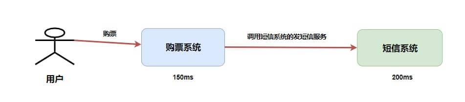

Ignoring network latency, suppose the booking system takes 150 ms and the SMS service takes 200 ms. The full request takes 150 ms + 200 ms = 350 ms.

At first this may seem fine, but the purchase is complete as soon as the booking system finishes. A synchronous call makes the request wait for an auxiliary feature that is not part of the core transaction. The flow becomes **unbalanced**: booking is quick, but the response must wait for the slower SMS operation. What if you also need to send an email?

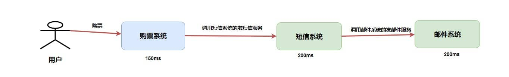

The call chain grows, and the total time becomes 550 ms.

The cafeteria queue is an example of a synchronous model.

We tell the staff, “Please add a chicken drumstick and spicy potatoes, and give me extra rice.”

The staff serve the food, and we wait for them to finish.

Then we collect the meal and find a seat.

We **wait synchronously for the staff to prepare the meal** after placing the order. Adding more items takes longer to prepare and increases our wait.

At a restaurant, we order beef noodles with a fried egg **(send a message)**, then do something else at the table **(continue other work)** until the food arrives. The noodles take just as long to prepare, but we can do other things after placing the order. That is **asynchronous processing**.

To avoid blocking on this work, developers add middleware between the systems: a message queue. The flow then looks like this:


Once the message is stored in the queue, the request can return immediately (we place our order and use our phone). The response time is now just 150 ms + 10 ms = 160 ms.

> Note that the total processing time has not changed, just as placing an order does not make the noodles cook faster.

#### Decoupling

Let's return to the synchronous flow and summarize it with a diagram.

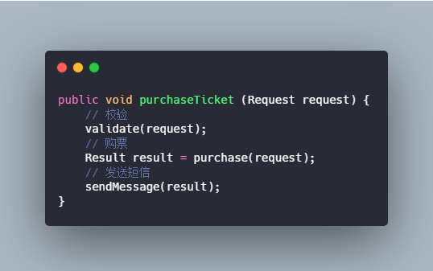

If we add email notifications, we have to change the code again. If we also need to award points after a purchase, we have to change it once more.

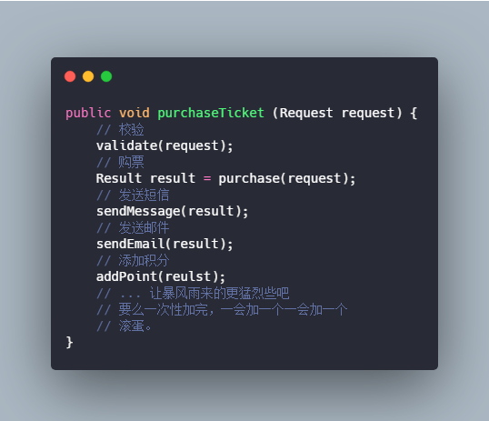

And if the email service is removed, do we have to change the code and restart the application again?


Frequent changes like this are cumbersome. **A message queue can decouple these systems.** SMS, email, and points services all depend on `result`, the booking result (such as the order ID and user account). They can each process the same message using a **publish-subscribe** pattern.

“Broadcast” here does not mean network broadcast. Downstream systems act as consumers and **subscribe** to a topic. For example, the topic could be named `ticket-booking`. The booking system publishes a message to the queue, and subscribers pull and consume messages from that topic. The producer only needs to **publish messages to the topic**; **consumers only need to pull messages from it**.

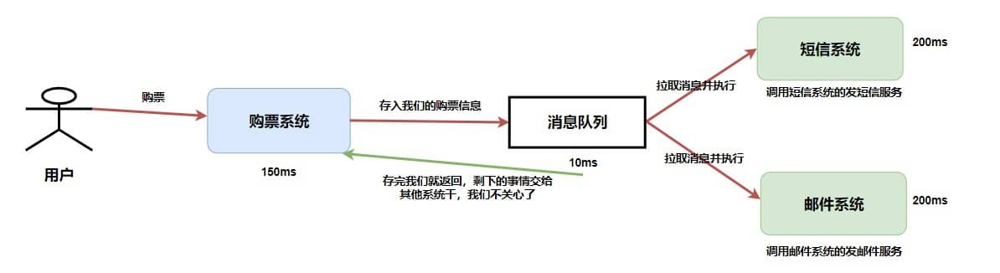

> Without a message queue, each new business integration requires adding a call to the main system, and removing a business requires deleting one. With a queue, the producer only needs to ensure the message reaches it. Downstream services decide whether to subscribe and how to handle each message, reducing development and integration work.

#### Traffic Smoothing

Return to the synchronous system. What happens if many users try to book tickets at once?

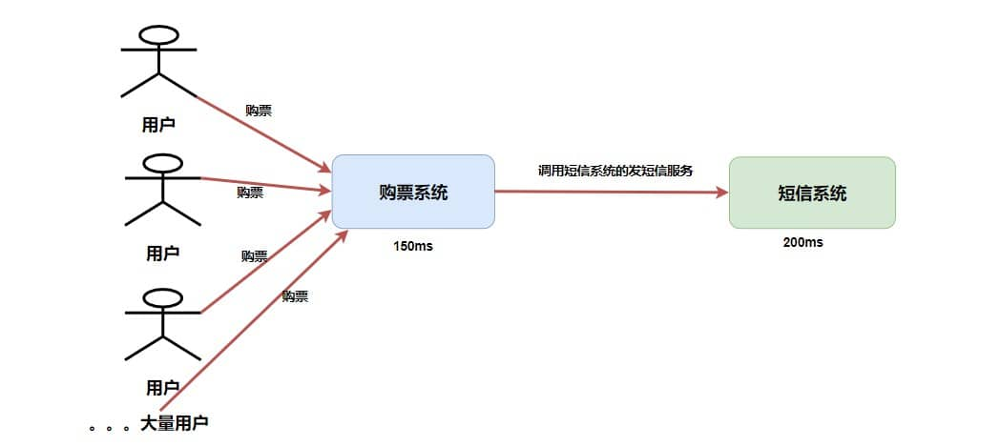

Suppose 10,000 requests reach the booking system. Its servers may be powerful enough to handle them, but the same spike generates 10,000 requests to the SMS service. Since SMS is not the core business, its servers may have fewer resources and could **fail under the load**.

SMS is not the core business, so can we **handle it asynchronously**? Put completed purchase messages in a queue and let the SMS service **consume them at the rate it can handle**. A slower delivery is acceptable as long as the system stays available.

System availability matters most. A delay of a few seconds for a verification code is usually acceptable.

### What Benefits Do Message Queues Provide?

The three key benefits are **asynchronous processing, decoupling, and traffic smoothing**. They are central to message queues and important ideas in distributed-system design.

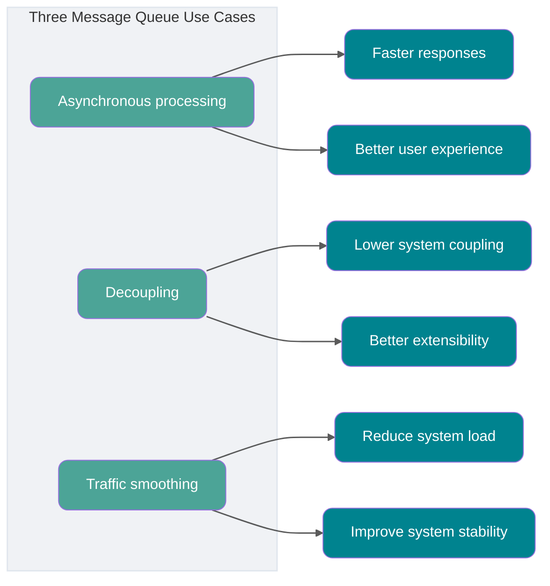

### Do Message Queues Have Drawbacks?

No technology is a silver bullet, and message queues have trade-offs.

For example, adding a message queue between two systems introduces another dependency. What happens if the queue fails? Could it **reduce system availability**?

You may need high availability (HA) and a cluster. **Does this increase the overall system complexity?**

Also, if a producer fails to send a message and retries, it may create duplicate messages.

If a consumer fails while processing a message and it is redelivered, that can also result in duplicates.

Duplicate messages can cause serious problems in microservices. For example, processing a points-award message more than once could unfairly give a user extra points.

So **how can duplicate message processing be prevented?**

What if messages must be processed in strict order? Suppose a producer sends ordered operations for a record with ID 1: delete, add, and update. Messages within a topic are not inherently ordered, so a consumer might process them as update, delete, add. If the record involves money, this could cause serious problems.

So **how can messages be consumed in order?**

In the ticket-booking example, should the user's account receive points after a purchase? Within one system, a transaction can handle this; with Spring, you might add `@Transactional` to the pseudocode above. But how do you guarantee a transaction across separate systems? You cannot allow the payment system to charge successfully while the points system fails to award points, or award points when the payment fails.

So **how can distributed transactions be handled?**

Message queues can smooth traffic spikes. But what if consumers are slow or producers publish messages quickly? Messages may accumulate in the queue.

So **how can message backlogs be handled?**

Message queues can reduce availability and increase complexity. They also raise questions about duplicate and ordered consumption, distributed transactions, and message backlogs. How can these problems be solved?


We will discuss solutions to these problems one by one.

## What Is RocketMQ?


Before discussing solutions, let's look at RocketMQ's internal design. Keep the questions above in mind as you read.

RocketMQ is a **topic-based publish-subscribe messaging system**. A topic can contain multiple MessageQueues, the smallest queue units for storing and transferring messages. Written in Java, RocketMQ is designed for **high performance, reliability, low latency, and distributed operation**. Alibaba contributed it to Apache at the end of 2016, where it became a top-level project. Within Alibaba, it serves thousands of applications and handles trillions of messages during the annual Singles' Day shopping event.

RocketMQ offers high throughput, low latency, and high availability, and has been tested in large-scale events such as Singles' Day.

Starting with RocketMQ 5.x, the project emphasizes cloud-native architecture. The Proxy layer supports gRPC, SDKs for multiple languages, and multiple protocols, while Brokers focus on message storage and availability. When choosing RocketMQ for a new project, consider not only the traditional NameServer, Broker, Producer, and Consumer, but also whether you need a Proxy, gRPC SDKs, Kubernetes deployment, and cloud-native observability.

## Queue and Topic Models

Before looking at RocketMQ's architecture, let's clarify two concepts: the **queue model** and the **topic model**.

First, why are messaging systems often called message queues?

Early messaging middleware used a **queue** model. For historical reasons, we still commonly call messaging middleware “message queues.”

Modern messaging systems such as RocketMQ and Kafka do not store messages in just one **queue**.

### Queue Model

The queue model works like a conventional queue.

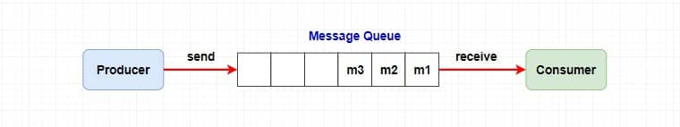

In this model, **each message is consumed by only one consumer**.

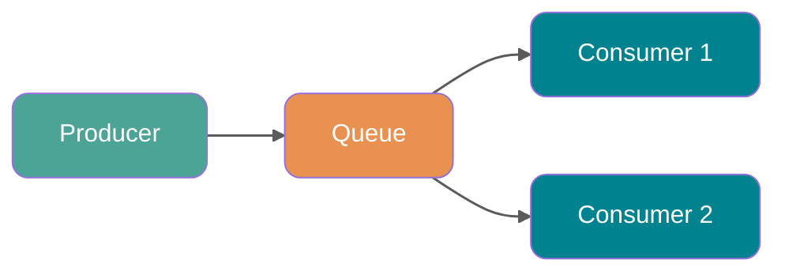

Earlier, we mentioned **broadcasting**. If a message needs to reach multiple consumers, such as both an SMS service and an email service, a single queue is not enough.

You could have the producer copy a message into multiple queues, one for each consumer. But creating queues and duplicate messages consumes resources and can hurt performance. It also requires the producer to know how many consumers there are, which goes against the **decoupling** principle of messaging middleware.

### Topic Model

The **topic model**, also called the **publish-subscribe model**, solves this problem.

> If you are interested, learn about the Observer design pattern and try implementing it yourself.

In the topic model, message producers are **publishers**, message consumers are **subscribers**, and the message container is a **topic**.

Publishers send messages to a topic. Subscribers must **subscribe to the topic in advance** to receive its messages.

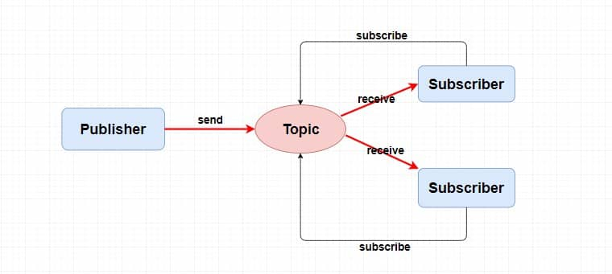

In the topic model, **multiple consumer groups can subscribe to one topic, and each group tracks its own consumption progress**. In clustering mode, typically one consumer instance in a group handles a given message. In broadcasting mode, every consumer in the group receives it.

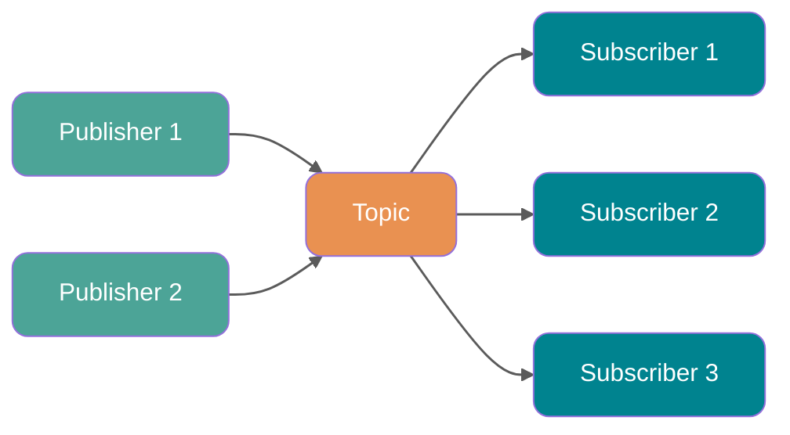

### RocketMQ's Message Model

RocketMQ implements the **topic model**. How does it implement topics?

Each messaging system implements the topic model differently. Kafka uses **partitions**, RocketMQ uses **queues**, and RabbitMQ uses exchanges. The **topic/publish-subscribe model** is a general pattern that each system implements in its own way.

So how does RocketMQ implement the **topic model**? Start with this diagram:

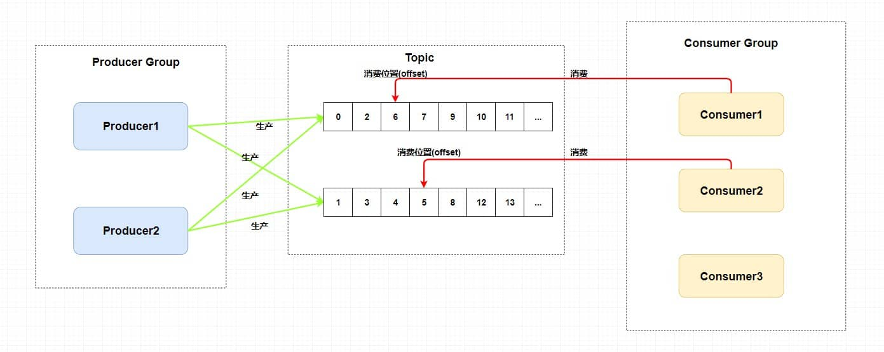

The diagram shows three roles: `Producer Group`, Topic, and `Consumer Group`. It reflects an older and compatibility model. For RocketMQ 5.x, remember that producers in the newer domain model are lightweight and anonymous, so producer groups are no longer a central concept.

- `Producer Group`: In older clients and compatibility scenarios, this represents a type of producer. For example, several flash-sale systems may form one producer group and publish the same type of messages.
- `Consumer Group`: Represents a type of consumer. For example, several SMS services may form one consumer group and consume the same type of messages.
- Topic: Represents a category of messages, such as order or shipping messages.

Producers in a group publish messages to a topic. **A topic contains multiple queues**, and each message is sent to one of those queues.

Each topic has multiple queues, distributed across Brokers and, in a cluster, across servers. In clustering mode, multiple consumer instances work together to consume the queues for a `topic`.

**Load-Balancing Strategies**

The comparison below covers **clustering (shared) consumption within one consumer group**. Load-balancing granularity depends on the client type and consumption protocol, not only the Broker version: consumers using the traditional 3.x/4.x Remoting SDK assign work by queue; the newer 5.x SDK's PushConsumer and SimpleConsumer assign by message; PullConsumer still assigns by queue.

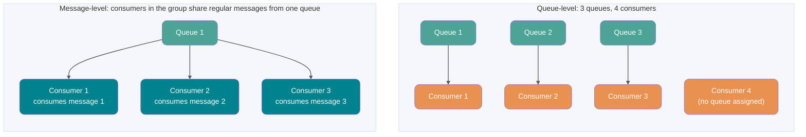

- **Queue-level load balancing:** Once assignment stabilizes, each queue is assigned to one consumer instance within a group, while a consumer can receive multiple queues. If a consumer fails, its queues are reassigned to other consumers. If there are more consumers than queues, some receive no queue. Load can become uneven: a slower consumer or one assigned more messages may accumulate a backlog while others are idle. Different consumer groups can consume the same queue independently.
- **Message-level load balancing:** PushConsumer and SimpleConsumer in the newer 5.x SDK allow multiple consumers in one group to share different messages from the same queue. The diagram shows one possible assignment; messages are not permanently bound to a consumer. After a message is taken, it is not delivered to another consumer in the **same group** during its invisibility period. Failures or timeouts may still trigger retries, so duplicates remain possible. This can reduce backlogs caused by uneven queue assignment or differences in consumer capacity, but it cannot remove every bottleneck, such as slow application processing. Ordered messages are constrained by message-group ordering and cannot be processed arbitrarily in parallel within one group.

The diagram below applies only to **queue-level load balancing**. Having fewer consumers than queues is not a problem; one consumer can handle multiple queues. To ensure every consumer receives a queue after scaling out, configure enough queues. With message-level load balancing, the number of consumer instances is not directly limited by the number of queues.

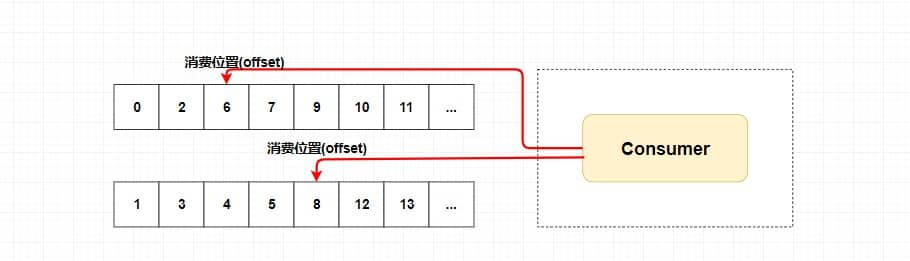

**Why does each consumer group track its own progress for every queue?**

Different consumer groups subscribing to the same topic each need to consume its messages, and they may do so at different rates. In traditional queue-level clustering, offsets are tracked for each **consumer group + topic + queue** combination and shared by consumers in the group. During rebalancing, a consumer assigned a queue can resume from its committed offset.

The consumer offset (`ConsumerOffset`) is the position where the group will resume consuming a queue. It is not a message ID or a sequence number shared by the entire topic. The table below assumes two groups subscribe to the same topic, with no filtering or retries, and consume messages in queue order with offsets committed:

| Consumer group | Progress on queue Q0                     | Progress on queue Q1                     |
| -------------- | ---------------------------------------- | ---------------------------------------- |
| Group A        | Offset 3: consumed 0–2; next starts at 3 | Offset 1: consumed 0; next starts at 1   |
| Group B        | Offset 1: consumed 0; next starts at 1   | Offset 4: consumed 0–3; next starts at 4 |

Offsets for Q0 and Q1 advance independently. Advancing Group A's offset for Q0 does not change Group B's offset or Group A's offset for Q1.

**Offset updates are not simply “add one for each successful message,” and they do not guarantee that a message will never be consumed twice.** Batch pulls, concurrent processing, filtering, and offset commits all affect progress. For example, a later message may finish before an earlier one, but the committed offset cannot skip the unfinished message. If a failure occurs after processing succeeds but before the offset is persisted, the message may be consumed again. PushConsumer and SimpleConsumer in the newer 5.x SDK acknowledge messages individually and have the server manage consumption state, so the explanation “the client increments the offset after each successful message” does not apply to them.

Messages are not deleted immediately after one group consumes them, nor does RocketMQ have to wait for every group to finish. It reclaims messages according to retention policies such as age and storage usage, so unconsumed messages may also be removed. Consumption progress, message retention, and application-level idempotency are separate concerns.

See the official documentation on [consumer load balancing](https://rocketmq.apache.org/zh/docs/featureBehavior/08consumerloadbalance/), [consumption progress](https://rocketmq.apache.org/zh/docs/featureBehavior/09consumerprogress/), and [message storage and cleanup](https://rocketmq.apache.org/zh/docs/featureBehavior/11messagestorepolicy/).

You may also wonder: **Why does a topic need multiple queues?**

The answer is **to increase concurrency**. A topic can have only one queue, and different consumer groups can still subscribe to it and track their progress independently. The diagram below shows a single-queue setup with queue-level load balancing.

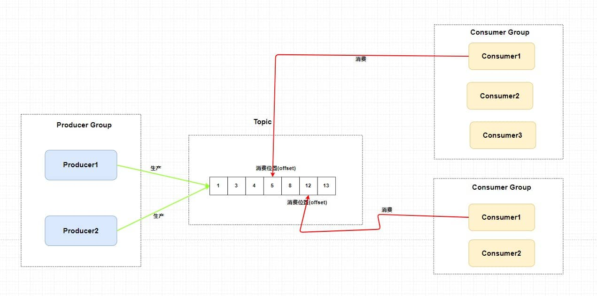

With one queue, all producer messages go to that queue, so they cannot be distributed across multiple Brokers. Under queue-level load balancing, only one consumer instance in a group can be assigned that queue; other instances cannot share its work. This is a limitation of queue assignment, not an inherent consequence of tracking offsets. Message-level load balancing lets multiple consumers in a group share different messages from one queue, while multiple queues still help distribute storage and read/write load.

In summary, RocketMQ implements the **topic/publish-subscribe model** by **configuring multiple queues in a topic and tracking each consumer group's position in every queue**.

## RocketMQ Architecture

With the message model covered, RocketMQ's technical architecture is easier to understand.

RocketMQ's core components are **NameServer, Broker, Producer, and Consumer**. Version 5.0 also introduced the **Proxy** component.

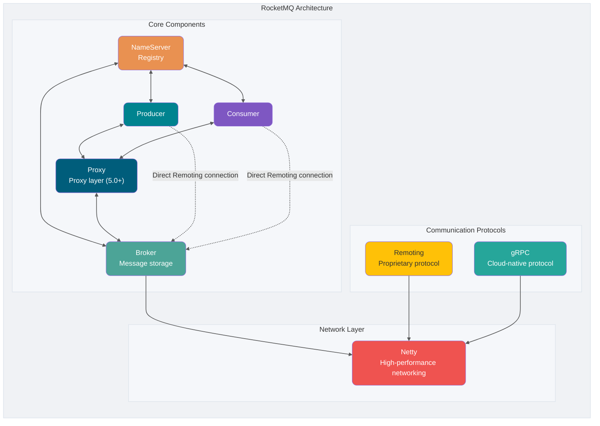

### Core Component Summary

| Component      | Key details                                                    |
| -------------- | -------------------------------------------------------------- |
| **NameServer** | Lightweight registry; nodes do not synchronize data            |
| **Broker**     | Stores and delivers messages; supports primary-replica setup   |
| **Proxy**      | Added in 5.0; optional protocol adaptation and compute offload |
| **Producer**   | Supports synchronous, asynchronous, and one-way sends          |
| **Consumer**   | Supports Push, Pull, and Simple consumption modes              |

### NameServer (Registry)

NameServer stores metadata and acts as the cluster's control center. It provides routing information to producers and consumers so they can find the relevant Broker addresses.

**Core functions:**

1. **Broker management:** A Broker connects to NameServer on startup and registers its metadata.
2. **Route management:** Producers and consumers retrieve Broker routing information from NameServer.

**Heartbeat mechanism:**

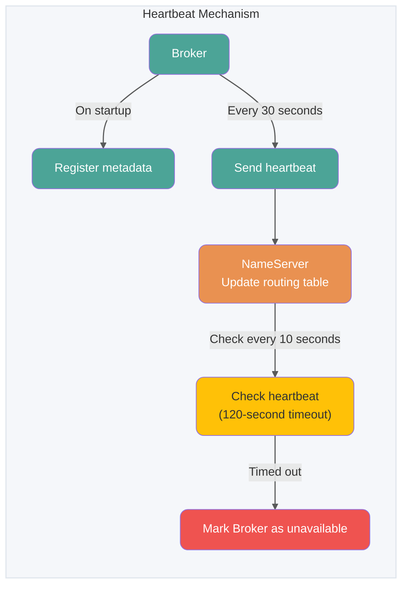

**Metadata includes:**

- Broker address, name, and BrokerId
- Primary node address
- Queue configuration for all topics on the Broker

### Broker (Message Storage)

The Broker stores, delivers, and retrieves messages, and helps ensure service availability.

**Storage mechanism:**

1. **Message writes:** Append messages sequentially to the CommitLog.
2. **File rollover:** Create a new file when the current file exceeds a fixed size (1 GB by default).
3. **Logical partitions:** MessageQueues are logical partitions, and ConsumeQueues index messages.

**A topic can span multiple Brokers, and a Broker can host multiple topics; this is a many-to-many relationship.**

If a topic has a high message volume, configure more queues for it to increase concurrency, as described above, and **spread them across Brokers where possible to reduce the load on any one Broker**.

If message volumes are similar across topics, a Broker with more queues will generally carry more load.


### Producer

**Send flow:**

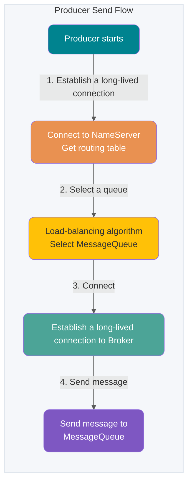

**Three send modes:**

- **One-way:** Return immediately after sending without checking whether it succeeded.
- **Synchronous:** Wait for a response after sending.
- **Asynchronous:** Return immediately and handle the response in a callback.

### Consumer

**Consumption flow:**

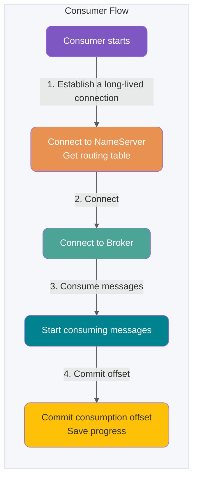

**Three consumption modes:**

- **Pull:** The consumer sends pull requests to the Broker.
- **Push:** Uses long polling; the Broker responds when messages are available.
- **Pop:** Added in RocketMQ 5.0; the server manages rebalancing and offsets.

### Network Protocols

RocketMQ commonly supports two connection methods: Remoting and gRPC.

| Comparison        | Remoting (traditional protocol)                                    | gRPC (newer 5.x SDK)                                                            |
| ----------------- | ------------------------------------------------------------------ | ------------------------------------------------------------------------------- |
| **Maturity**      | Long-established in Java, with a shorter path                      | Suited to multi-language and cloud-native access, usually through a Proxy       |
| **Extensibility** | Each language needs its own integration                            | Standard protocol with a broader client ecosystem and easier gateway management |
| **Trade-off**     | Suited to existing 4.x clients and high-performance internal paths | An additional Proxy hop requires attention to latency and capacity              |

### Networking (Netty)

RocketMQ uses Netty for RPC communication and extends and optimizes the Reactor multithreaded model.

**Thread model:**

- **Reactor main thread:** One thread listens for connections.
- **Reactor worker pool:** Three threads by default, for processing network data.
- **Business thread pool:** Adjusted dynamically based on the number of CPU cores.

### Proxy (Added in 5.0)

RocketMQ 5.0 introduced the **Proxy** component as a key part of its **compute-storage separation** architecture. The Proxy sits between clients and Brokers, moving client protocol adaptation, access control, and consumption management out of the Broker. This lets the Broker focus on message storage and availability. This design is useful in cloud-native deployments because the compute layer can scale independently.

**Two deployment modes:**

| Mode             | Description                                                       | Use case                                                                          |
| ---------------- | ----------------------------------------------------------------- | --------------------------------------------------------------------------------- |
| **Local mode**   | Proxy and Broker run in the same process; add Proxy configuration | Smooth upgrade from an older version, or deployments with no special requirements |
| **Cluster mode** | Proxy and Broker run as separate processes                        | Independent scaling or customized protocol adaptation                             |

**Core functions:**

- **Protocol adaptation:** Supports gRPC, making it easier to connect clients written in different languages.
- **Compute offload:** Moves authentication, authorization, and consumption management out of the Broker to reduce its load.
- **Elastic scaling:** The stateless Proxy can scale horizontally on its own.

> **Note:** In version 5.0, clients using the newer SDK and gRPC protocol must connect through a Proxy. Older SDKs using Remoting can still connect directly to a Broker.

The Proxy's value is more than adding another hop. In cloud-native deployments, it moves protocol access, authentication, traffic management, and consumption management out of the Broker so the Broker can focus on storage. The trade-off is an extra network hop, so monitor Proxy scaling, latency, rate limits, and health.

### Why Is NameServer Needed?

Consider this simplified architecture:

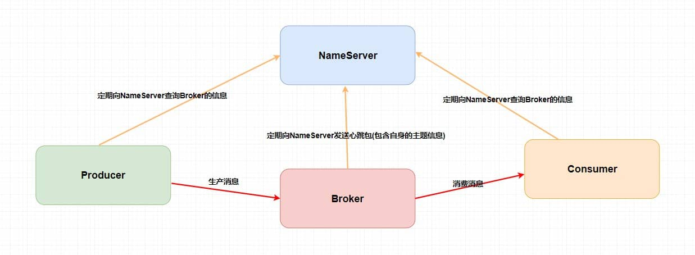

You might ask: What does NameServer do? Could Producers and Consumers not publish and consume messages directly with Brokers?

Brokers need to be highly available. Relying on one Broker would put too much load on it, so multiple Brokers are used for **load balancing**. If every Producer and Consumer connected directly to multiple Brokers, a Broker change would affect them all and create tight coupling. NameServer solves this by acting as a registry.

**NameServer's design:**

NameServer is **stateless, and its nodes do not communicate with one another**. This contrasts with ZooKeeper's strong consistency and election mechanism, reflecting RocketMQ's focus on **performance and architectural simplicity**. Each Broker keeps a long-lived connection to every NameServer and periodically reports its information. If one NameServer goes down, the cluster can remain available.

The following diagram is from the official documentation:

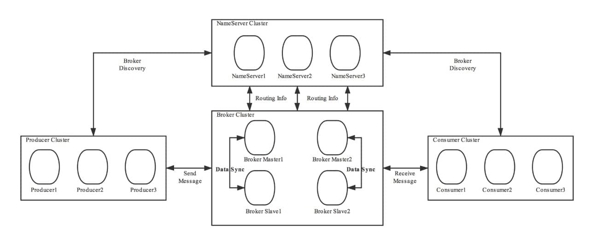

Compared with the simplified diagram above, this one adds a few details:

First, Brokers run in a cluster with primary-replica deployment. Since messages are distributed across Brokers, a Broker failure affects reads and writes for its messages. RocketMQ supports a `master/slave` structure in which the `slave` periodically synchronizes data from the `master` (with synchronous or asynchronous disk flushing). If the `master` fails, **the `slave` can serve consumers but cannot accept message writes**; this is explained in more detail later.

Second, NameServer is also deployed as a cluster for high availability, but it is **decentralized** and has no primary node. NameServer nodes do not replicate information with one another. In RocketMQ, **each Broker keeps a long-lived connection to every NameServer** and sends a heartbeat to each one **every 30 seconds**, including its topic configuration. NameServer checks heartbeats **every 10 seconds** and considers a Broker unavailable if it has not received a heartbeat for **more than 120 seconds**.

Third, before sending messages to Brokers, a Producer **retrieves Broker routing information from NameServer** and uses **round-robin selection** across queues for **load balancing**.

Fourth, Consumers retrieve Broker routes from NameServer and send `Pull` requests to Brokers. A Consumer can run in **broadcast** or **clustering** mode. In broadcast mode, a message is delivered to **every consumer in the same group**; in clustering mode, it is delivered to only one consumer in the group.

## RocketMQ Messages

### Regular Messages

Regular messages are commonly used for microservice decoupling, event-driven systems, and data integration. These use cases usually require reliable message delivery but do not require precise processing times or ordering. For example, in an online store, the order system can package a purchase event as a regular message and send it to RocketMQ. Downstream services subscribe to the message and process it according to their own logic. Messages are independent and do not need to be related. A logging system is another example: an instrumentation component collects user activity logs from a frontend application and forwards them to RocketMQ for offline processing.

**Regular message lifecycle**


- **Initialized:** The producer has created and initialized the message; it is ready to be sent to the server.
- **Ready for consumption:** The message has been sent to the server and is visible to consumers.
- **Being consumed:** A consumer receives and processes the message according to its local business logic. The server waits for the consumer to finish and submit the result. If no response arrives within a certain period, RocketMQ retries the message.
- **Consumption committed:** The consumer finishes processing and submits the result to the server. On failure or timeout, the message is redelivered according to the retry policy and may enter a dead-letter queue after the retry limit. RocketMQ does not immediately delete a message when one consumer group succeeds. It removes old messages according to retention policies; until then, consumers can seek back and consume them again.
- **Message deleted:** RocketMQ removes the oldest message data from physical files according to its retention policy.

### Scheduled and Delayed Messages

> **Note:** Scheduled and delayed messages work in the same way: the server delivers the message to consumers at a specified time.

Distributed scheduling and task-timeout handling require accurate and reliable event triggering. RocketMQ scheduled messages can simplify scheduling logic and provide high-performance, scalable, and reliable triggers.

**Use case 1: Distributed scheduling**

Distributed schedulers run tasks at different intervals, such as cleaning up files every day at 5 a.m. or sending a notification every two minutes. Traditional database-based scheduling can be complex and perform poorly in distributed environments.

**Use case 2: Task timeout handling**

For example, an unpaid order should not be closed immediately after it is placed; the system must wait for a period first. A RocketMQ scheduled message can trigger the timeout check.

Scheduled messages offer these advantages for timeout handling:

- **Flexible scheduling with less implementation effort:** Version 5.x is no longer limited to fixed delay levels and can schedule delivery by timestamp. However, default delivery granularity is still at the second level; this is not a guarantee of exact millisecond-level timing.
- **High performance and scalability:** Database polling is complex and requires frequent scans that can become a bottleneck. RocketMQ scheduled messages support high concurrency and horizontal scaling.

**Setting a scheduled time**

The scheduled time is a system timestamp for the expected delivery time. A delay must also be converted into a timestamp in the future, rather than specified as a duration.

- **Format:** Unix timestamp in milliseconds.
- **Maximum scheduling horizon:** 24 hours by default; this limit cannot be customized.
- **The scheduled time must be in the future.** Otherwise, scheduling has no effect and the server delivers the message immediately.

**Examples:**

- Scheduled message: If the current time is 2022-06-09 17:30:00 and the message should be delivered at 19:20:00, use timestamp `1654773600000`.
- Delayed message: If the current time is 2022-06-09 17:30:00 and the message should be delivered one hour later, use timestamp `1654770600000`.

**Differences between versions 4.x and 5.x**

- **Version 4.x:** Supports delayed messages with 18 default levels (1s, 5s, 10s, 30s, 1m, 2m, 3m, 4m, 5m, 6m, 7m, 8m, 9m, 10m, 20m, 30m, 1h, and 2h). Custom delay levels and durations can also be added in the configuration file.
- **Version 5.x:** Supports delivery timestamps in milliseconds, which is more flexible than the fixed delay levels in 4.x. However, the default scheduling precision is 1,000 ms, and actual delivery also depends on server load and storage recovery. It does not guarantee exact millisecond-level timing.

**Scheduled message lifecycle**


- **Initialized:** The producer has created and initialized the message; it is ready to be sent to the server.
- **Scheduled:** The server stores the scheduled message **in a dedicated scheduling store** instead of immediately building a regular message index. It waits until the scheduled time.
- **Ready for consumption:** When the scheduled time arrives, the server writes the message to the regular storage engine, making it visible to downstream consumers.
- **Being consumed:** A consumer processes the message according to its local business logic. The server waits for the result and retries if it does not receive a response in time.
- **Consumption committed:** The consumer submits the result. On failure or timeout, the message is redelivered according to the retry policy and may enter a dead-letter queue after the retry limit. RocketMQ does not immediately delete a message when one group consumes it; messages are removed according to retention policies.
- **Message deleted:** Apache RocketMQ removes the oldest message data from physical files according to its retention policy.

**Restrictions**

1. **Message type:** Scheduled messages can only be used with topics whose `MessageType` is `Delay`.
2. **Scheduling precision:** The duration parameter is specified in milliseconds, but the default precision is 1,000 ms (one second).

**Recommendation**

Scheduled messages wait in scheduled storage until their delivery time. If many messages are scheduled for the same time, they may all need processing at once, increasing system load, delaying delivery, and reducing scheduling accuracy.

### Ordered Messages

**What are ordered messages?**

Ordered messages are an advanced Apache RocketMQ message type. They let consumers receive messages in the order they were sent so applications can process events in sequence.

**Use cases**

Ordered event processing is useful in trade matching and real-time incremental data synchronization, where different systems must maintain consistent state and process upstream changes in order.

- **Trade matching:** For securities and stock trading, orders with the same price follow a first-come, first-served rule. The downstream order-processing system must process them in that order.
- **Real-time incremental synchronization:** A source database performs inserts, updates, and deletes. Its binary operation logs are sent through RocketMQ to a downstream search system, which replays them in order to refresh its state.

**How ordering is guaranteed**

Message ordering in RocketMQ has two parts: **production order** and **consumption order**.

**Production order**

To preserve production order, meet these conditions:

1. **Single producer:** Ordered production is supported only for a single producer.
2. **Serial sends:** If a producer sends messages concurrently from multiple threads, their order cannot be determined.

When these conditions are met, RocketMQ stores messages with the same **message group** in the same queue, in the order they were sent.

**Message groups (`MessageGroup`)**

RocketMQ uses message groups to determine ordering. Set a message group for every ordered message.

- Messages in the **same message group** follow first-in, first-out order.
- Messages in **different groups** or without a group have no ordering relationship.

Message groups let you partition ordering by business entity. This preserves local ordering while increasing system parallelism and throughput.

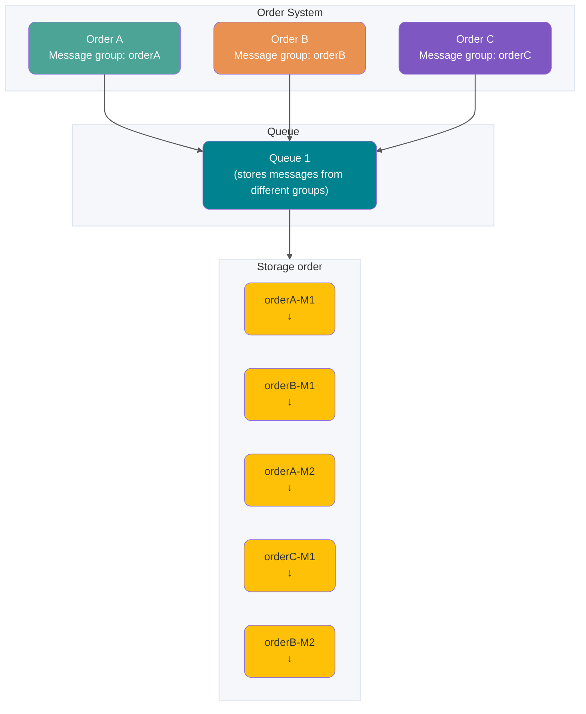

**Notes:**

- M1 and M2 in the `orderA` group stay in order.
- M1 and M2 in the `orderB` group stay in order.
- Messages from different groups can be stored together in one queue.

**Consumption order**

To preserve consumption order, meet these conditions:

1. **Delivery order:** The RocketMQ client SDK and server protocol deliver messages in the order stored by the server.
2. **Bounded retries:** Ordered delivery retries only up to a limit. After the maximum retry count is reached, RocketMQ stops retrying and skips that message.

**How consumer type affects ordered consumption**

- **PushConsumer:** RocketMQ delivers messages to the consumer one at a time in storage order.
- **SimpleConsumer:** A consumer may pull multiple messages at once, so the application must preserve their processing order.

**Combining production and consumption ordering**

| Production order                             | Consumption order | Ordering behavior                                      |
| -------------------------------------------- | ----------------- | ------------------------------------------------------ |
| Message group set; messages sent in order    | Ordered           | Strict ordering within each message group              |
| Message group set; messages sent in order    | Concurrent        | Concurrent processing; order is best-effort            |
| No message group; messages sent out of order | Ordered           | Preserves queue storage order, not business send order |
| No message group; messages sent out of order | Concurrent        | Concurrent processing; order is best-effort            |

**Restrictions**

1. **Message type:** Ordered messages are supported only on topics whose `MessageType` is `FIFO`. In RocketMQ 5.x, also set `MessageGroup` for ordered messages and configure the consumer group for ordered delivery; otherwise, messages may still be delivered concurrently.
2. If ordered message processing fails and is retried, later messages cannot be consumed until the earlier message succeeds, preserving order.

**Recommendations**

1. **Process serially:** Consume messages serially to avoid reordering when handling multiple messages at once.
2. **Distribute messages across groups:** Partition by a business key, such as order ID or user ID. This preserves ordering for one user while allowing messages for different users to be processed independently.

### Transactional Messages

**What are transactional messages?**

Transactional messages are an advanced Apache RocketMQ message type that helps maintain eventual consistency between message production and a local transaction in a distributed system. In simple terms, they coordinate a local transaction (database DML operations) with message publication.

**Use case**

In a distributed system, a core operation may also require work from multiple downstream services. A key challenge for distributed transactions is keeping the results of the core operation and downstream work consistent.

For example, paying for an order in an online store may require updates to several downstream systems:

- **Order system:** Change the order status from unpaid to paid.
- **Logistics system:** Create a pending-shipment record for the order.
- **Points system:** Update the user's points balance and record.
- **Shopping cart system:** Clear the cart and update the user's cart record.

**Problems with traditional approaches**

- **Traditional XA transactions:** XA-based distributed transaction systems can provide consistency, but locking across multiple branches reduces concurrency.
- **Regular messages:** A regular message cannot be made atomic with the order transaction. The message may be sent while the order fails, or the order may succeed while sending the message fails.

**RocketMQ transactional messages**

RocketMQ transactional messages provide a high-performance, scalable approach that is straightforward to implement. They use a two-phase commit process tied to the local transaction to achieve eventual consistency between **the local transaction and message publication**.

**Transactional message flow**

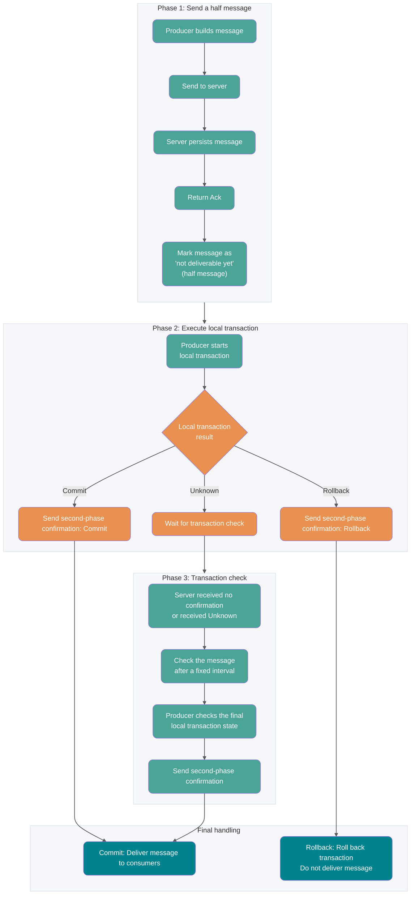

1. The producer sends a message to the RocketMQ server.
2. After persisting the message, the server returns an acknowledgment (Ack). The message is marked “not deliverable yet” and is called a **half message**.
3. The producer executes the local transaction.
4. Based on the transaction result, the producer sends a second-phase confirmation (`Commit` or `Rollback`) to the server.
5. If the server receives no confirmation or receives `Unknown`, it **checks the message's transaction status** with the producer after a fixed interval.
6. After receiving the check request, the producer determines the final result of the corresponding local transaction.
7. The producer sends a second-phase confirmation based on that final result.

**Transactional message lifecycle**

- **Initialized:** The producer creates and initializes a half message before sending it to the server.
- **Transaction pending:** The server persists the half message in transaction-related storage, but does not make it available to consumers. It waits for the local transaction to return `Commit` or `Rollback` in the second phase.
- **Message rolled back:** If the second phase returns `Rollback`, the server rolls back the half message and ends the transaction flow.
- **Committed and ready for consumption:** If the second phase returns `Commit`, the server stores the half message in regular storage and makes it visible to downstream consumers.
- **Being consumed:** A consumer receives and processes the message according to its local business logic.
- **Consumption committed:** The consumer finishes processing and submits the result. On failure or timeout, retries, a dead-letter queue, or compensation may follow.
- **Message deleted:** RocketMQ removes the oldest message data according to its retention policy.

**Restrictions**

1. **Message type:** Transactional messages are supported only on topics whose `MessageType` is `Transaction`.
2. **Consumer transactions:** RocketMQ transactional messages coordinate the local main transaction with downstream message publication, but do not guarantee that downstream message processing succeeds together with the upstream transaction.
3. **Intermediate state:** Transactional messages provide eventual consistency. Before downstream consumers finish processing a committed message, the upstream and downstream states may differ.
4. **Transaction timeout:** If the server cannot confirm whether to commit or roll back a half message within the specified time, it rolls the message back by default.
5. **Transaction checks:** By default, the server checks unconfirmed half messages **every 60 seconds**. A half message has a default maximum timeout of **4 hours**, after which it is forcibly rolled back. Older versions or some cloud-provider implementations may expose a maximum check count; confirm the behavior for the version in use.

**Recommendations**

1. **Avoid too many unresolved transactions:** Minimize cases where the producer returns an unknown local transaction result; excessive transaction checks can hurt performance.
2. **Handle in-progress transactions correctly:** When a transaction is still running, return `Unknown` during a message check rather than `Rollback` or `Commit`.
3. **Make transaction state queryable:** Transaction checks rely on the producer retrieving the final local transaction state. Persist it in a database or reliable storage instead of keeping it only in process memory.
4. **Keep downstream processing idempotent:** Transactional messages coordinate the local transaction and message publication, but do not guarantee successful consumer processing. Consumers still need retries, idempotency, and compensation.

### Sending Messages

#### Avoid Creating Too Many Producers in One Process

Apache RocketMQ supports a many-to-many relationship between producers and topics: one producer can send messages to multiple topics. Create only as many producers as needed and reuse them. If messages need to go to multiple topics, you do not need to create one producer per topic.

#### Avoid Frequently Creating and Destroying Producers

Apache RocketMQ producers are reusable resources, much like database connections in a connection pool. Do not create a producer for every message and destroy it after sending. Frequent creation and destruction generate many short-lived connections and can seriously affect performance.

Example:

```java
Producer p = ProducerBuilder.build();
for (int i =0;i<n;i++){
    Message m= MessageBuilder.build();
    p.send(m);
 }
p.shutdown();
```

## Consumer Types

### PushConsumer

**Key characteristics:**

A high-level consumer type that processes messages through a listener and returns a result. The RocketMQ client SDK handles message retrieval, consumption status, and retries.

**Use it when:**

- Message processing time is predictable.
- You do not need asynchronous processing or advanced customization.
- You want to get started quickly.

**Example:**

```java
public static void main(String[] args) throws InterruptedException, MQClientException {
    // Create a PushConsumer.
    DefaultMQPushConsumer consumer = new DefaultMQPushConsumer("CID_JODIE_1");

    // Subscribe to a topic.
    consumer.subscribe("TopicTest", "*");

    // Set where consumption starts.
    consumer.setConsumeFromWhere(ConsumeFromWhere.CONSUME_FROM_FIRST_OFFSET);

    // Register a message listener.
    consumer.registerMessageListener(new MessageListenerConcurrently() {
        @Override
        public ConsumeConcurrentlyStatus consumeMessage(
                List<MessageExt> msgs,
                ConsumeConcurrentlyContext context) {
            System.out.printf("Receive New Messages: %s %n", msgs);
            // Business processing.
            return ConsumeConcurrentlyStatus.CONSUME_SUCCESS;
        }
    });

    consumer.start();
}
```

**Listener results:**

- **Return success:** The message was processed successfully, and the server updates consumption progress accordingly.
- **Return failure:** The message was not processed successfully; the retry policy determines whether it is retried.
- **Throw an exception:** Treated as a processing failure and handled according to the retry policy.

**Important:**

Do not handle PushConsumer messages in the following ways:

1. **Returning success before processing finishes:** If processing later fails, the RocketMQ server cannot detect the failure and will not retry the message.

2. **Dispatching to another thread from the listener:** If the listener returns before the work in that thread finishes, the server cannot detect a later failure and will not retry the message.

**How Push mode works in the traditional Remoting SDK** (as in the `DefaultMQPushConsumer` example above):

1. **Load balancing:** The `RebalanceService` thread assigns queues based on the number of queues and consumers, then publishes pull requests to `pullRequestQueue`.
2. **Message retrieval:** `PullMessageService` reads pull requests from `pullRequestQueue`, pulls messages from the Broker, and caches them in `ProcessQueue`.
3. **Message processing:** `ConsumeMessageService` retrieves messages from `ProcessQueue` and invokes the listener to process them.
4. **Offset commit:** The consumer offset is committed automatically after processing.
5. **Flow control:** Before pulling messages, the client checks cache thresholds (1,000 messages or 100 MB) and delays pulling if a threshold is exceeded.

### SimpleConsumer

SimpleConsumer provides an explicit API for each operation. The application logic calls the API to retrieve messages, submit consumption results, and retry failed messages.

**Message invisibility time (`Invisible Time`):**

SimpleConsumer relies on **message invisibility time**. After a consumer receives a message, it is hidden from other consumers for a specified period. If the consumer finishes processing and submits an ACK within that period, the message is marked as consumed. If it does not submit an ACK before the timeout, the message becomes visible again and another consumer can receive it. Unlike PushConsumer's scheduled retry queue, SimpleConsumer provides more flexible retry control by dynamically changing the invisibility period.

Example from the official documentation:

```java
// Consume regular messages with SimpleConsumer: receive, process, and acknowledge them.
ClientServiceProvider provider = ClientServiceProvider.loadService();
String topic = "YourTopic";
FilterExpression filterExpression = new FilterExpression("YourFilterTag", FilterExpressionType.TAG);
SimpleConsumer simpleConsumer = provider.newSimpleConsumerBuilder()
        // Set the consumer group.
        .setConsumerGroup("YourConsumerGroup")
        // Set the endpoint.
        .setClientConfiguration(ClientConfiguration.newBuilder().setEndpoints("YourEndpoint").build())
        // Set the subscription.
        .setSubscriptionExpressions(Collections.singletonMap(topic, filterExpression))
        // Set the maximum wait time for receiving messages from the server.
        .setAwaitDuration(Duration.ofSeconds(1))
        .build();
try {
    // SimpleConsumer explicitly receives and processes messages.
    List<MessageView> messageViewList = simpleConsumer.receive(10, Duration.ofSeconds(30));
    messageViewList.forEach(messageView -> {
        System.out.println(messageView);
        // Acknowledge the message after processing is complete.
        try {
            simpleConsumer.ack(messageView);
        } catch (ClientException e) {
            logger.error("Failed to ack message, messageId={}", messageView.getMessageId(), e);
        }
    });
} catch (ClientException e) {
    // Retry receiving if the request fails because of system flow control or another cause.
    logger.error("Failed to receive message", e);
}
```

SimpleConsumer is suitable for these use cases:

- **Unpredictable processing time:** If processing duration varies or is often long, SimpleConsumer lets you set an estimated processing time and adjust it through the API when needed.
- **Advanced customization, such as asynchronous or batch processing:** SimpleConsumer has fewer thread abstractions in the SDK, so application logic can customize dispatch and batch processing.
- **Custom consumption rate:** Because application logic explicitly calls the receive API, it can adjust how frequently messages are retrieved.

**How SimpleConsumer works:**

1. **Receive messages:** The application calls `receive()` to retrieve messages.
2. **Process messages:** The application handles the messages.
3. **Acknowledge explicitly:** After processing, the application calls `ack()` to submit the result.
4. **Fine-grained control:** The application controls when and how quickly messages are processed.

### PullConsumer

**Key characteristic:**

With Pull mode, **the application has direct control over message retrieval** and decides when to pull messages and from which offset.

**Compared with Push mode:**

| Feature            | Push mode                      | Pull mode                        |
| ------------------ | ------------------------------ | -------------------------------- |
| **Control**        | Client SDK pulls automatically | Application pulls explicitly     |
| **Control level**  | Lower                          | Higher                           |
| **Implementation** | Simple; implement a listener   | Manage the pull process          |
| **Use case**       | Predictable processing time    | Fine-grained control is required |

**Example (`DefaultMQPullConsumer`):**

```java
@Test
public void testPullConsumer() throws Exception {
    DefaultMQPullConsumer consumer = new DefaultMQPullConsumer("group1_pull");
    consumer.setNamesrvAddr(this.nameServer);
    String topic = "topic1";
    consumer.start();

    // Get the message queues for the topic.
    Set<MessageQueue> messageQueues = consumer.fetchSubscribeMessageQueues(topic);
    int maxNums = 10; // Maximum number of messages per pull.

    while (true) {
        boolean found = false;
        for (MessageQueue messageQueue : messageQueues) {
            // Get the consumption offset.
            long offset = consumer.fetchConsumeOffset(messageQueue, false);
            // Pull messages.
            PullResult pullResult = consumer.pull(messageQueue, "tag8", offset, maxNums);

            switch (pullResult.getPullStatus()) {
                case FOUND:
                    found = true;
                    List<MessageExt> msgs = pullResult.getMsgFoundList();
                    System.out.println("Received messages, count: " + msgs.size());
                    // Process messages.
                    for (MessageExt msg : msgs) {
                        System.out.println("Processing message: " + msg.getMsgId());
                    }
                    // Update the consumption offset.
                    long nextOffset = pullResult.getNextBeginOffset();
                    consumer.updateConsumeOffset(messageQueue, nextOffset);
                    break;
                case NO_NEW_MSG:
                    System.out.println("No new messages");
                    break;
                case NO_MATCHED_MSG:
                    System.out.println("No matching messages");
                    break;
                case OFFSET_ILLEGAL:
                    System.err.println("Invalid offset");
                    break;
            }
        }
        if (!found) {
            // Wait briefly if no queue has new messages.
            TimeUnit.MILLISECONDS.sleep(5000);
        }
    }
}
```

**Example (`DefaultLitePullConsumer`, recommended):**

```java
DefaultLitePullConsumer litePullConsumer =
        new DefaultLitePullConsumer("lite_pull_consumer_test");
litePullConsumer.setConsumeFromWhere(ConsumeFromWhere.CONSUME_FROM_FIRST_OFFSET);
litePullConsumer.subscribe("TopicTest", "*");
litePullConsumer.start();

try {
    while (running) {
        // The application calls poll() to pull messages.
        List<MessageExt> messageExts = litePullConsumer.poll();
        System.out.printf("%s%n", messageExts);
    }
} finally {
    litePullConsumer.shutdown();
}
```

**Use cases:**

- **Fine-grained control over retrieval:** Pull messages when the application needs them.
- **Control over consumption rate:** Adjust the polling frequency.
- **Batch consumption:** Pull many messages at once for batch processing.
- **Special requirements:** For example, start at a specific offset or pause consumption.

**How Pull mode works:**

1. **Load balancing:** When the `RebalanceService` thread detects a change in the consumption snapshot, it starts message-pulling tasks.
2. **Message retrieval:** `PullTaskImpl` puts retrieved messages into `consumeRequestCache`.
3. **Message processing:** The application calls `poll()` to retrieve messages from `consumeRequestCache` and process them.

### Comparing the Three Consumer Types

| Comparison                     | PushConsumer                                                         | SimpleConsumer                                                     | PullConsumer                                                              |
| ------------------------------ | -------------------------------------------------------------------- | ------------------------------------------------------------------ | ------------------------------------------------------------------------- |
| **API**                        | Listener returns the result; processing logic stays in the listener  | Application processes messages and submits results through the API | Application pulls messages by queue and can choose when to submit results |
| **Concurrency management**     | Managed by the SDK                                                   | Managed by application logic                                       | Managed by application logic                                              |
| **Load-balancing granularity** | Message-level by default in 5.x SDK; queue-level in earlier versions | Message-level by default in 5.x SDK                                | Queue-level; efficient for batching but may be uneven                     |
| **Flexibility**                | Highly abstracted, less flexible                                     | Atomic APIs that can be customized                                 | Atomic APIs that can be customized                                        |
| **Use case**                   | Business messaging without a custom processing flow                  | Business flows requiring extensive customization                   | Primarily integration with stream-processing frameworks                   |

**Recommendations:**

- **Typical use:** Prefer **PushConsumer** for simple development and SDK-managed retrieval and acknowledgment.
- **Unpredictable processing time:** Use **SimpleConsumer** to configure the processing time.
- **Fine-grained control:** Use **PullConsumer** to manage retrieval yourself.

**Note:** Do not mix PullConsumer with the other consumer types under the same `ConsumerGroup` in production. This can cause consumption errors.

## Consumer and Producer Groups

### Producer Groups

In the newer RocketMQ 5.x domain model, **producers are lightweight, anonymous runtime entities**, so ProducerGroups are generally less important than in earlier versions. However, `ProducerGroup` configuration may still appear in 3.x/4.x clients, the Spring ecosystem, or compatibility mode. Do not remove it blindly during migration; check the client version in use.

### Consumer Groups

A consumer group is a logical load-balancing group of consumers with consistent consumption behavior. It is not a concrete entity. Consumer groups enable horizontal scaling of consumption and high availability.

**Core roles of consumer groups:**

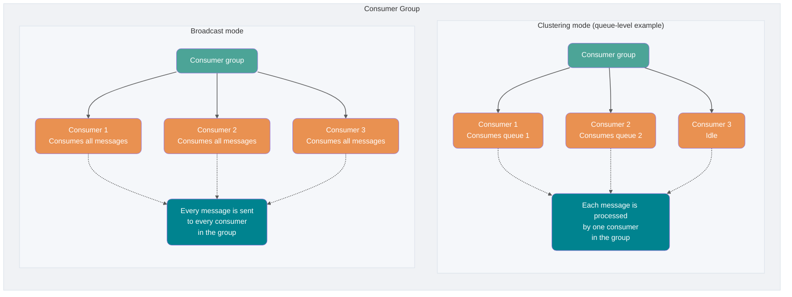

Consumers in a group share the same subscriptions, delivery-order settings, and retry policy.

- **Subscriptions:** Apache RocketMQ manages subscriptions by consumer group, which supports subscription management and auditing.
- **Delivery order:** The server supports ordered and concurrent delivery. The delivery mode is configured for the consumer group.
- **Retry policy:** Defines how failed message consumption is retried, including retry limits and dead-letter queue settings.

**RocketMQ 5.x server:** Consumers obtain these settings from their associated consumer group, so all consumers in the group behave consistently without extra client-side configuration.

**Historical RocketMQ 3.x/4.x servers:** Consumption behavior was defined by the consumer client API, so you had to configure clients in the same group consistently. (From the official website.)

**Comparing the two consumption modes:**

| Comparison           | Clustering mode                                        | Broadcast mode                             |
| -------------------- | ------------------------------------------------------ | ------------------------------------------ |
| **Message delivery** | Each message is processed by one consumer in the group | Each message is sent to all consumers      |
| **Scaling**          | Add or remove consumers to adjust processing capacity  | Scaling consumers does not change capacity |
| **Use case**         | Increase processing capacity and avoid duplicate work  | Every consumer must receive every message  |

## Handling Ordered and Duplicate Consumption

These issues came up when discussing the drawbacks of message queues. They are not specific to RocketMQ; every messaging system must address them.

The architecture section above explained **how RocketMQ provides high availability**. This article does not cover operational setup; if you are interested, follow the examples in the official documentation to build a RocketMQ cluster.

> Kafka's architecture is broadly similar to RocketMQ's. Earlier Kafka versions used ZooKeeper for metadata, and Kafka **partitions** serve a role similar to RocketMQ **queues**. Other differences are noted below.
>
> Note: Earlier Kafka versions used ZooKeeper for metadata, while newer versions introduced KRaft mode. The comparison here is about using partitions or queues to increase parallelism; Kafka should not be described as always depending on ZooKeeper.

### Ordered Consumption

As explained in the architecture section, **RocketMQ does not guarantee ordering across a topic; ordering is guaranteed only within a queue**.

This leads to two concepts: **normal ordering** and **strict ordering**.

**Normal ordering** means that messages received from **the same queue are ordered**, while messages from different queues may not be. Normal ordering is not guaranteed for a short period if a Broker restarts.

**Strict ordering** means that **all messages** received by a consumer are ordered. It **preserves order even during failures**.

Strict ordering comes at a high cost. In this mode, if one machine in the Broker cluster becomes unavailable, the entire cluster becomes unavailable. Its main use today is `binlog` synchronization.

Most applications can tolerate brief reordering, so normal ordering is generally recommended.

With **normal ordering**, a Producer sends messages to different queues in the same topic according to its load-balancing strategy, such as round robin. If messages represent the creation, payment, and shipment of one order, **they may be sent to different queues**. RocketMQ's per-queue ordering cannot preserve their order across those queues.

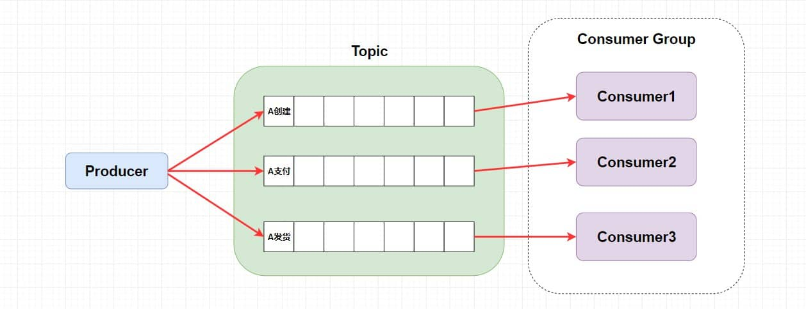

How can this be solved?

The solution is to put messages for the same business entity (such as one order) in the same queue. A **hash-modulo strategy** can map every message for an order to the same queue.

**Version 4.x: Use `MessageQueueSelector`**

In RocketMQ 4.x, extend `MessageQueueSelector` to define custom queue selection logic:

```java
SendResult sendResult = producer.send(msg, new MessageQueueSelector() {
    @Override
    public MessageQueue select(List<MessageQueue> mqs, Message msg, Object arg) {
        // Calculate the queue index from a business key such as the order ID.
        Long orderId = (Long) arg;
        int index = Math.floorMod(Long.hashCode(orderId), mqs.size());
        return mqs.get(index);
    }
}, orderId);
```

**Version 5.x: Use a message group (`MessageGroup`)**

RocketMQ 5.x introduced **message groups**. Set a message group to preserve ordering within that group:

```java
Message message = messageBuilder.setTopic("topic")
        .setTag("messageTag")
        // Set the group used to order messages.
        .setMessageGroup("fifoGroup001")  // For example, use the order ID as the message group.
        .setBody("messageBody".getBytes())
        .build();
```

**Queue selection algorithms**

RocketMQ implements two queue selection algorithms:

- **Round robin (default):** Sends messages to the topic's queues in turn to distribute them evenly.
- **Minimal delivery latency:** Tracks delivery latency and prefers queues with lower latency.

```java
// Enable the minimal delivery latency algorithm.
producer.setSendLatencyFaultEnable(true);
```

### Handling Special Cases

#### Send Failures

After selecting a queue, the producer connects to the Broker and sends the message over the network. If the Broker fails or a network issue causes a timeout, RocketMQ retries the send.

It selects a queue on another Broker for the retry. The default is two retries, which can be changed:

```java
producer.setRetryTimesWhenSendFailed(5);
```

#### Oversized Messages

Distinguish two limits: a client can compress message bodies above a configured threshold (4 KB is a common default in the Java 4.x client), while RocketMQ 5.x sets a 4 MB default maximum message body size. Compression does not expand this limit. Avoid placing large files directly in messages; store them in object storage or a file system and send only a business ID and file address through the queue.

### Duplicate Consumption

Like most messaging systems, RocketMQ is generally designed for **at-least-once delivery**. If processing fails, times out, a client restarts, or the network becomes unstable, the same business message may be delivered again. The core solution is **idempotency**: an operation is idempotent if repeating it any number of times has the same effect as performing it once. For example, a points service adds points to a user's account when it receives an order message. Suppose the queue sends an order for FrancisQ that should add 500 points. The points service processes it and sends a success response, but a network failure prevents the response from reaching the queue. (A Broker restart or other failure could have the same effect.)

The queue did not receive the response, so it may resend the message. What if the points service adds another 500 points to FrancisQ's account?

Consumers must therefore be **idempotent**, so processing the same message repeatedly does not change the result.

How to implement idempotency depends on the business. Redis `SETNX` can help with short-term deduplication or weaker idempotency requirements, but should not be the only safeguard in every case. For orders, payments, and inventory, use **database unique keys, an idempotency table, or a business state machine** to prevent duplicate writes or deductions.

The main principle is to **choose a solution for the specific use case**. Determine whether duplicate processing is unacceptable or tolerable, then choose stronger or weaker validation accordingly. There are few silver bullets in computer science.

For RocketMQ consumer idempotency, prefer a business key over relying only on the message ID. For example, use the payment or order number as the key for payment messages, and a transaction number for inventory deductions. Retries, compensation, or redelivery then cannot cause duplicate writes as long as the business key remains the same.

Idempotency is useful beyond duplicate message consumption. The same techniques can **prevent duplicate requests or calls in other scenarios**. For example, idempotent HTTP services can **handle duplicate form submissions from a frontend or app**, and idempotent microservices can handle **duplicate calls caused by automatic RPC retries**.

## How Does RocketMQ Handle Distributed Transactions?

What is a distributed transaction? A transaction should **either complete entirely or not at all**. This is straightforward within one system, but distributed architectures involve services deployed separately and calling one another. For example, placing an order and awarding points must be coordinated. Without a distributed transaction, System A might place the order while System B fails to award points, or System A might fail to place the order while System B still awards points. Neither outcome is acceptable.

How can this problem be addressed?

Common distributed transaction approaches include 2PC, TCC, and transactional messages (the half-message mechanism). Each suits certain use cases and has limitations; **none is a perfect solution**.

RocketMQ addresses distributed transactions with **transactional messages and transaction checks**. The diagram below illustrates the flow.

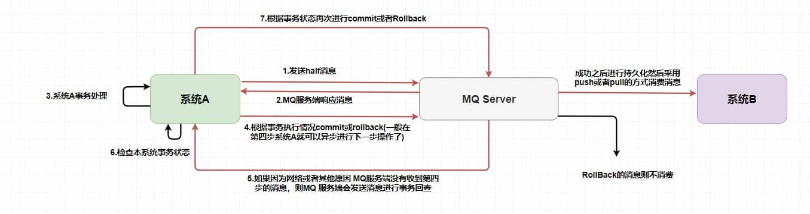

**Transactional message flow in detail**

1. **Send a half message:** The producer sends the message to the RocketMQ server.
2. **Server acknowledgment:** After persisting the message, the server returns an Ack. The message is marked “not deliverable yet” and is called a **half message**.
3. **Execute the local transaction:** The producer runs the local transaction logic.
4. **Send the second-phase result:** The producer sends `Commit` or `Rollback` to the server based on the local transaction result.
5. **Check the transaction:** If the server receives no second-phase result, or receives `Unknown`, it **checks the message status** with the producer after a fixed interval.
6. **Check the local transaction:** The producer determines the final result of the corresponding local transaction.
7. **Send confirmation again:** The producer sends a second-phase result based on the final transaction state.

The half message sent in step 1 is **invisible to consumers until the transaction commits**.

> How can a message be written without being visible to consumers? For a half message, RocketMQ saves the original topic and queue, then **changes the topic** to `RMQ_SYS_TRANS_HALF_TOPIC`. Since consumer groups do not subscribe to this topic, they cannot consume the half message. **RocketMQ then starts a scheduled task to pull messages from `RMQ_SYS_TRANS_HALF_TOPIC`** and check their transaction status with a producer in the producer group. The result determines whether to commit or roll back the message.

Without the **transaction check** in step 5, a network failure could prevent step 4 from succeeding, leaving the message queue unable to determine whether the message should be delivered. RocketMQ uses the transaction check described above; Kafka typically throws an exception and leaves handling to the application.

Note that after the `MQ Server` sends a message to System B, that operation is separate from System A. In a message-queue-based distributed transaction, **the local transaction and storing the message in the queue are the atomic unit**. This provides **eventual consistency**: the process is asynchronous, and **each system only needs to guarantee its own transaction**.

One practical issue is that transactional messages use a listener to check whether the local transaction succeeded, and the listener interface can only be implemented once. Putting every local transaction in one listener method creates tight coupling and many type checks. One approach is to wrap each business operation in a `Function`, pass it to the listener method, and invoke its `apply()` method to run the operation. This decouples the listener from business logic.

Do not rely only on Redis when checking a transaction. The final state should come from the transaction or business table committed in the same database as the local transaction. Redis may be used as a cache or read replica. The Redis code below is for illustration; in production, persist transaction state reliably and make consumers idempotent with a business key or database constraint.

1. Simulate adding a user browsing-history record.

```java
@PostMapping("/add")
@ApiOperation("Add a user browsing-history record")
public Result<TransactionSendResult> add(Long userId, Long forecastLogId) {

        // Use a function to save the browsing-history record.
        Function<String, Boolean> function = transactionId -> viewHistoryHandler.addViewHistory(transactionId, userId, forecastLogId);

        Map<String, Long> hashMap = new HashMap<>();
        hashMap.put("userId", userId);
        hashMap.put("forecastLogId", forecastLogId);
        String jsonString = JSON.toJSONString(hashMap);

        // Send a transactional message and pass the local transaction as a Function argument.
        TransactionSendResult transactionSendResult = mqProducerService.sendTransactionMessage(jsonString, MQDestination.TAG_ADD_VIEW_HISTORY, function);
        return Result.success(transactionSendResult);
}
```

2. Method for sending a transactional message.

```java
/**
 * Send a transactional message.
 *
 * @param msgBody
 * @param tag
 * @param function
 * @return
 */
public TransactionSendResult sendTransactionMessage(String msgBody, String tag, Function<String, Boolean> function) {
    // Build the message body.
    Message<String> message = buildMessage(msgBody);

    // Build the message destination.
    String destination = buildDestination(tag);

    TransactionSendResult result = rocketMQTemplate.sendMessageInTransaction(destination, message, function);
    return result;
}
```

3. Producer message listener. Only one class can implement this listener.

```java
@Slf4j
@RocketMQTransactionListener
public class TransactionMsgListener implements RocketMQLocalTransactionListener {

    @Autowired
    private RedisService redisService; // Example cache; do not use as the only source of transaction state in production.

    /**
     * Execute the local transaction after the message is sent successfully.
     *
     * @param message
     * @param o
     * @return commit or rollback or unknown
     */
    @Override
    public RocketMQLocalTransactionState executeLocalTransaction(Message message, Object o) {

            // 1. Get the transaction ID.
        String transactionId = null;
        try {
            transactionId = message.getHeaders().get("rocketmq_TRANSACTION_ID").toString();
            // 2. If no function was provided, there is no business operation to execute; discard the message.
            if (o == null) {
                // A message returned with ROLLBACK is discarded.
                log.info("Rolling back transactional message; no business operation to process. transactionId={}", transactionId);
                return RocketMQLocalTransactionState.ROLLBACK;
            }
            // Cast o to a Function.
            Function<String, Boolean> function = (Function<String, Boolean>) o;
            // Run the business operation; the transaction executes inside function.apply().
            Boolean apply = function.apply(transactionId);
            if (apply) {
                log.info("Transaction committed; message can be processed. transactionId={}", transactionId);
                // A message returned with COMMIT is immediately available to consumers.
                return RocketMQLocalTransactionState.COMMIT;
            }
        } catch (Exception e) {
            log.info("Exception occurred; returning ROLLBACK. transactionId={}", transactionId);
            return RocketMQLocalTransactionState.ROLLBACK;
        }
        return RocketMQLocalTransactionState.ROLLBACK;
    }

    /**
     * Check the local transaction status.
     *
     * @param message
     * @return
     */
    @Override
    public RocketMQLocalTransactionState checkLocalTransaction(Message message) {

        String transactionId = message.getHeaders().get("rocketmq_TRANSACTION_ID").toString();

        // The example checks Redis; in production, query the final state in a local transaction or business table.
        MqTransaction mqTransaction = redisService.getCacheObject("mqTransaction:" + transactionId);
        if (Objects.isNull(mqTransaction)) {
            return RocketMQLocalTransactionState.ROLLBACK;
        }
        return RocketMQLocalTransactionState.COMMIT;
    }
}
```

4. Example business operation. Move this method to a separate class; if the caller and callee are in the same class, the transaction may not take effect.

```java
@Component
public class ViewHistoryHandler {

    @Autowired
    private IViewHistoryService viewHistoryService;

    @Autowired
    private IMqTransactionService mqTransactionService;

    @Autowired
    private RedisService redisService; // Example cache; the database remains the source of truth for transaction state.

    /**
     * Save a browsing-history record.
     *
     * @param transactionId
     * @param userId
     * @param forecastLogId
     * @return
     */
    @Transactional
    public Boolean addViewHistory(String transactionId, Long userId, Long forecastLogId) {
        // Build the browsing-history record.
        ViewHistory viewHistory = new ViewHistory();
        viewHistory.setUserId(userId);
        viewHistory.setForecastLogId(forecastLogId);
        viewHistory.setCreateTime(LocalDateTime.now());
        boolean save = viewHistoryService.save(viewHistory);

        // Local transaction information.
        MqTransaction mqTransaction = new MqTransaction();
        mqTransaction.setTransactionId(transactionId);
        mqTransaction.setCreateTime(new Date());
        mqTransaction.setStatus(MqTransaction.StatusEnum.VALID.getStatus());

        // Persist the transaction state in the same transaction as the local business data.
        mqTransactionService.save(mqTransaction);

        // Redis is only a cache; it must not be the only source of transaction state.
        redisService.setCacheObject("mqTransaction:" + transactionId, mqTransaction, 4L, TimeUnit.HOURS);

        // Uncomment to simulate an exception and roll back the transaction.
        // int i = 10 / 0;

        return save;
    }
}
```

5. Consume the message and handle idempotency.

```java
@Service
@RocketMQMessageListener(topic = MQDestination.TOPIC, selectorExpression = MQDestination.TAG_ADD_VIEW_HISTORY, consumerGroup = MQDestination.TAG_ADD_VIEW_HISTORY)
public class ConsumerAddViewHistory implements RocketMQListener<Message> {
    // Called when a message is received.
    @Override
    public void onMessage(Message message) {
        // Check idempotency.
        String transactionId = message.getTransactionId();

        // The example checks Redis; for strong consistency, use a business key, idempotency table, or database constraint.
        MqTransaction mqTransaction = redisService.getCacheObject("mqTransaction:" + transactionId);

        // No transaction record exists.
        if (Objects.isNull(mqTransaction)) {
            return;
        }

        // Already consumed.
        if (Objects.equals(mqTransaction.getStatus(), MqTransaction.StatusEnum.CONSUMED.getStatus())) {
            return;
        }

        String msg = new String(message.getBody());
        Map<String, Long> map = JSON.parseObject(msg, new TypeReference<HashMap<String, Long>>() {
        });
        Long userId = map.get("userId");
        Long forecastLogId = map.get("forecastLogId");

        // Downstream business processing.
        // TODO: Record user preferences and update the user profile.

        // TODO: Update views for the securities forecast article and recalculate its ranking.

        // Mark the message as consumed.
        mqTransaction.setUpdateTime(new Date());
        mqTransaction.setStatus(MqTransaction.StatusEnum.CONSUMED.getStatus());
        redisService.setCacheObject("mqTransaction:" + transactionId, mqTransaction, 4L, TimeUnit.HOURS);
        log.info("Received message: msg={}", JSON.toJSONString(map));
    }
}
```

## How to Handle Message Backlogs

Above, we discussed an important function of message queues: **smoothing traffic spikes**. What if a spike is so large that messages accumulate in the queue?

There are two main causes of a backlog: producers publish too quickly or consumers process too slowly.

There are several ways to address this. If a traffic spike overwhelms consumers because producers are publishing too quickly, apply **rate limiting or graceful degradation**, or add consumer instances to scale out and match the load. If consumers are slow, check for **a high rate of processing errors** and inspect logs for blocked threads, unreleased locks, or other issues.

> Adding consumer instances can often reduce backlogs caused by insufficient processing capacity. Whether to add queues depends on the load-balancing strategy and current queue count.
>
> **Note:** With queue-level load balancing in the traditional Remoting SDK, **each queue is assigned to only one consumer instance in a group**. Some consumers receive no queue only when the group has more consumers than assignable queues.
>
> PushConsumer and SimpleConsumer in RocketMQ 5.x use **message-level load balancing** by default. Multiple consumers in the same group can share messages from one queue, so adding consumers can still increase parallelism even when there are more consumers than queues. PullConsumer remains queue-level, so consider the queue count when scaling it out.


When investigating a production backlog, follow these steps:

1. **Determine the scope:** Check whether the backlog affects one topic, one queue, or the entire Broker.
2. **Compare production and consumption rates:** Rate-limit or smooth a producer spike; investigate consumers if the consumption rate drops.
3. **Measure consumer processing time:** Look for slow SQL queries, external calls, lock contention, thread pools, and batch sizes.
4. **Check queue-to-consumer assignment:** For 4.x and PullConsumer, check whether the queue count limits concurrency. For 5.x PushConsumer and SimpleConsumer, also inspect message-level load balancing.
5. **Scale temporarily and recover:** If needed, add consumers or queues, split the topic, and use batch jobs to gradually catch up on old messages.

Do not focus only on “adding consumers.” If ordered consumption is blocked on one queue or business processing itself is slow, adding consumers may not help.

## What Is Replay Consumption?

Replay consumption means consuming messages that were already processed successfully because the business now needs to process them again. In RocketMQ, **messages remain stored** after they have been delivered to consumers. Replay is usually requested by time: for example, after recovering from a consumer failure, the application may need to reprocess messages from one hour earlier. The Broker provides a way to rewind consumption progress by time. RocketMQ supports time-based replay with millisecond precision.

## How RocketMQ Achieves High-Performance Reads and Writes

### Traditional I/O

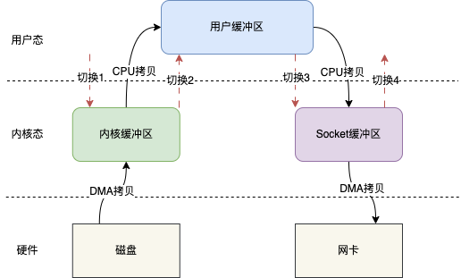

Traditional I/O consists of `read` and `write` operations. The process has these steps:

- The user calls `read()` to start reading data, causing a context switch from user mode to kernel mode (switch 1 in the diagram).
- DMA copies data from disk to the kernel buffer.
- The data is copied from the kernel buffer to the user buffer, where the application can access it.
- `read()` returns, switching from kernel mode back to user mode (switch 2).
- The application calls `write()`, switching from user mode to kernel mode (switch 3).
- The CPU copies data from the user buffer to the socket buffer.
- Data is copied from the socket buffer to the network interface card.
- `write()` returns, switching from kernel mode back to user mode (switch 4).

This process involves four context switches and four data copies, which can severely affect performance under high concurrency. Zero-copy techniques help reduce this overhead.

### Zero-Copy

#### mmap

`mmap` (memory mapping) maps a file or other object into a process's address space, creating a mapping between the file's disk locations and a range of virtual addresses in the process.

In simple terms, the kernel and application share a buffer, avoiding one CPU copy from the read buffer to the user buffer. The architecture diagram therefore changes as follows:

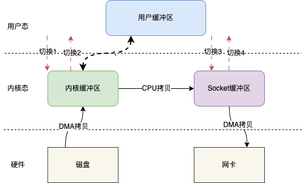

With `mmap`, I/O becomes an `mmap` plus `write` operation: `mmap` replaces the traditional `read` call.

When a process calls `mmap`, the kernel primarily creates a mapping between the file and the process's virtual address space; it does not copy the entire file into memory at that point. When the mapped region is accessed, a page fault loads the data from disk if the page is not already in the page cache. The subsequent `write` still copies data from the kernel buffer to the socket buffer.

This involves four context switches and three I/O copies. In Java:

```java
FileChannel fileChannel = new RandomAccessFile("test.txt", "rw").getChannel();
MappedByteBuffer mappedByteBuffer = fileChannel.map(FileChannel.MapMode.READ_WRITE, 0, fileChannel.size());
```

#### sendfile

Like `mmap()`, `sendfile()` reduces one CPU copy, and it also reduces two context switches.

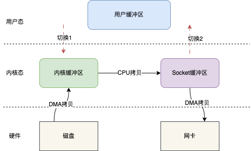

As shown, calling `sendfile()` causes switch 1. DMA then copies data to a kernel buffer, and the kernel sends it to the socket buffer and eventually the network interface. When `sendfile()` returns, switch 2 occurs. The exact number of copies varies by operating system and network hardware, but the main benefit is fewer copies and context switches between user and kernel mode. Java provides a corresponding API:

```java
FileChannel channel = FileChannel.open(Paths.get("./test.txt"), StandardOpenOption.WRITE, StandardOpenOption.CREATE);
// Transfer data to the target with transferTo().
channel.transferTo(position, len, target);
```

The code above does not explicitly read or write the file; it transfers file data directly to the target. This means `sendfile` cannot inspect or modify the file contents, while `mmap` can modify the mapped data. If the file must be changed before transfer, `mmap` is the suitable option.

In summary, zero-copy techniques reduce CPU copies and context switches, improving file I/O and network transfer efficiency.

RocketMQ's performance is not due to `mmap` alone. Sequential appends to CommitLog, the page cache, fixed-length ConsumeQueue indexes, and trade-offs in disk flushing and replication all matter. `mmap` is one part of the design that reduces extra copies and system calls in file I/O.

## RocketMQ Disk Flushing

Now that we have covered RocketMQ's architecture and design, let's consider a few key questions:

- **How are queues represented within a topic?**
- **How are messages in a queue persisted?**
- What are **synchronous** and **asynchronous disk flushing**, and how do they affect durability?

### Synchronous and Asynchronous Disk Flushing

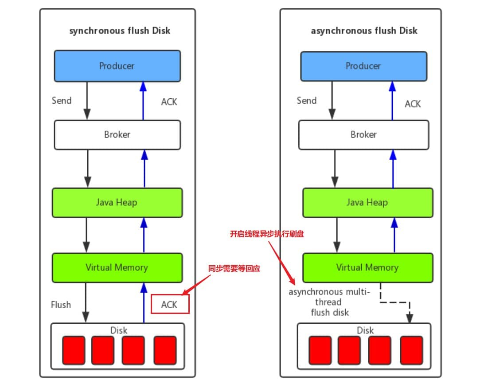

As shown above, synchronous flushing waits for an acknowledgment that the data has been flushed to disk. This can improve `MQ` message reliability, but **has a significant performance cost**. It is generally used in specific cases, such as financial systems.

Asynchronous flushing uses a background thread to flush messages to disk. This **reduces read and write latency** and improves `MQ` performance and throughput. It is typically used in scenarios with less stringent durability requirements, such as sending verification codes.

In general, **asynchronous flushing may lose some data if the Broker crashes unexpectedly**. Configure the Broker's `FlushDiskType` parameter to choose a flushing strategy (`ASYNC_FLUSH` or `SYNC_FLUSH`).

### Synchronous and Asynchronous Replication

Synchronous and asynchronous flushing apply to a single node. Synchronous and asynchronous replication determine whether the `Broker` primary must synchronize with its replicas before returning a response to the client.

- **Synchronous replication**, also called synchronous dual writing: **Return success only after the message has been written to both the primary and replica.**
- **Asynchronous replication:** **Return success as soon as the message is written to the primary.**

There is no perfect approach. Writing a message to more nodes can improve reliability, but reduces performance. Choose a replication strategy that fits the business requirements.

**Does asynchronous replication affect message reliability, as asynchronous flushing does?**

Yes. Flushing determines whether a message reaches the local disk; replication determines whether it has reached a replica. With asynchronous replication, a message may not yet be copied when the primary returns success. If the primary then fails and its data cannot be recovered, the replica may be missing that message. For higher reliability, use synchronous flushing with synchronous replication, or a quorum-based replication approach such as DLedger.

With asynchronous replication, for example, the primary may return success before the message is copied to a replica. If the primary is only temporarily unavailable, replication may catch up after recovery. If its data is lost or it suffers an irreversible failure, the replica may permanently lack those messages. This affects reliability as well as availability.

In a single-primary, replica setup, the system cannot produce messages if the primary fails. **A multi-primary architecture can address this availability issue**; as shown in the earlier diagram, topics are distributed across different Brokers.

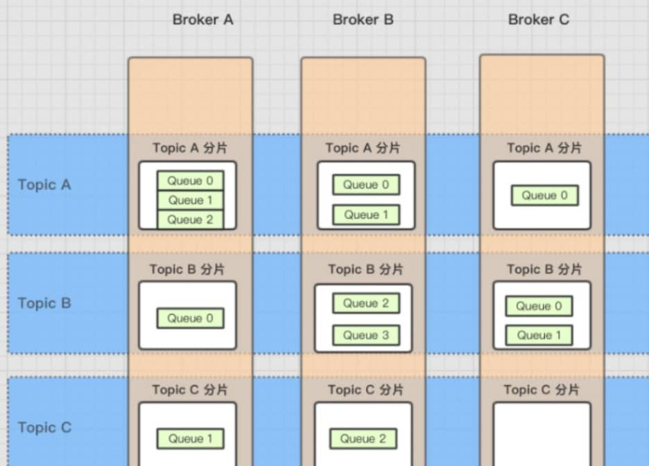

However, this replication approach cannot guarantee **strict ordering**. As discussed above, ordering is preserved by sending messages for one business entity to the same queue. If primary A handles a sequence of messages for order A and then fails, another node cannot simply take over that queue. If any node could write any message, ordering would be lost.

RocketMQ uses DLedger to address this. DLedger returns success only **after the message has been replicated to a majority of nodes** and supports dynamically electing a new primary.

> DLedger is not perfect either: it cannot serve requests during an election, requires at least three nodes, and cannot guarantee availability if a majority of nodes fail. Replicating messages to a majority is also slower than asynchronous replication.

### Storage Mechanism

At this point, we have covered disk flushing and replication.

Next, **how are queues represented, and how are their messages stored persistently?** These questions involve RocketMQ's storage design. First, let's look at its three main storage components: CommitLog, ConsumeQueue, and IndexFile.

**Three storage components:**

- **CommitLog:** The primary store for **message bodies and metadata** written by Producers. Message bodies are variable-length. A file is **1 GB** by default, and its 20-digit filename is zero-padded and represents the starting offset. For example, `00000000000000000000` is the first file, with offset 0. When it fills, the next file is `00000000001073741824`, with offset 1,073,741,824. Messages are **written sequentially**; when a file is full, writing continues in the next one.
- **ConsumeQueue:** A physical index file for a MessageQueue under a topic, introduced mainly to **improve message-consumption performance**. Searching the CommitLog by topic and queue would be inefficient. ConsumeQueue stores each message's **physical starting offset** in the CommitLog, its size, and the hash of its tag. Its directory structure has three levels (topic/queue/file), with the path `$HOME/store/consumequeue/{topic}/{queueId}/{fileName}`. Entries have a fixed length of **20 bytes** (8-byte CommitLog offset + 4-byte message size + 8-byte tag hash). Each file contains **300,000 entries** and is about **5.72 MB**.
- **IndexFile:** An index that supports looking up messages by key or time range.

In summary, `CommitLog` and `ConsumeQueue` are the main parts of message storage. A MessageQueue is a logical queue under a topic; its ConsumeQueue is the corresponding physical index file. They are related, but not interchangeable.

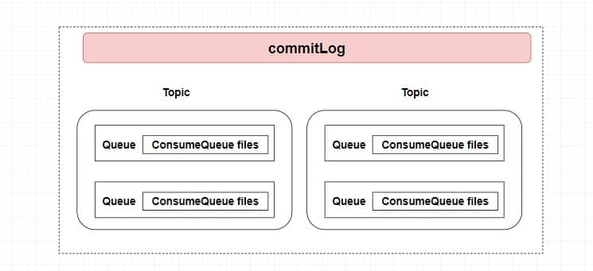

RocketMQ uses a **hybrid storage structure**: all queues in one Broker instance share a log data file (CommitLog) for message storage. Kafka assigns a separate storage file to each partition.

RocketMQ does this to **improve write efficiency**. Storing messages without separating them by topic increases the chance of writing **batches** sequentially. However, searching the entire CommitLog to read messages would be inefficient.

RocketMQ therefore uses ConsumeQueue as an index for each queue to **speed up message reads**. Given a message's sequence number, it can calculate the index's global position (index number × fixed index length of 20 bytes), read that entry, and locate the message using its global position in the CommitLog.

The diagram below illustrates the storage structure:

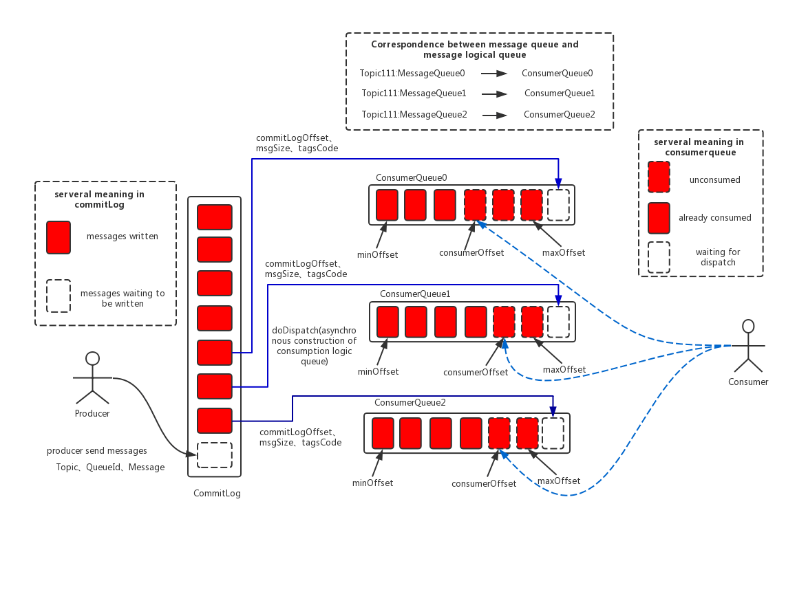

> If the diagram above is unclear, read the following explanation carefully.

At the top of the diagram, `ConsumeQueue` represents the index file for a MessageQueue, not the message body itself.

On the left, red boxes represent messages already written and dashed boxes represent messages waiting to be written. Producers specify the topic, `QueueId`, and message content. The Broker does not separate messages by type; it **stores all messages sequentially in the CommitLog**. It then uses the topic and `QueueId` to write the message's CommitLog offset, size, and tag hash to the corresponding ConsumeQueue index file.

Each queue tracks a `ConsumeOffset`, the consumption position for each consumer group. When a consumer pulls messages, it uses this offset to find the next message that has not been consumed.

That is the core of RocketMQ's storage architecture.

One final question: **Why are CommitLog files designed with a fixed size?** Hint: It is related to **memory mapping (`mmap`)**.

## Summary

This article covered RocketMQ's core concepts. Here is a summary:

**Key benefits of message queues**

- **Asynchronous processing:** Improve response times by handling non-core work asynchronously.
- **Decoupling:** Reduce coupling between systems through publish-subscribe.
- **Traffic smoothing:** Relieve sudden load spikes and protect downstream systems.

**RocketMQ architecture**

| Component      | Responsibility                                                           |
| -------------- | ------------------------------------------------------------------------ |
| **NameServer** | Stateless registry; nodes do not communicate, favoring simplicity        |
| **Broker**     | Stores and delivers messages; supports primary-replica and DLedger modes |
| **Proxy**      | Added in 5.0; separates compute from storage and supports gRPC           |
| **Producer**   | Publishes messages synchronously, asynchronously, or one-way             |
| **Consumer**   | Consumes messages in Push, Pull, or Simple mode                          |

**Message types**

| Message type      | Use case                        | Key characteristic                         |
| ----------------- | ------------------------------- | ------------------------------------------ |
| **Regular**       | Microservice decoupling, events | Independent messages; no ordering required |
| **Ordered**       | Order processing, data sync     | Strict ordering within a message group     |
| **Scheduled**     | Delayed tasks, timeout handling | Version 5.x supports delivery timestamps   |
| **Transactional** | Distributed transactions        | Half-message flow and transaction checks   |

**Key improvements in version 5.x**

- **Message-level load balancing:** Used by PushConsumer and SimpleConsumer in 5.x to reduce uneven queue-level load.
- **Compute-storage separation:** The Proxy handles protocol adaptation and compute logic while the Broker focuses on storage.
- **Improved scheduled messages:** Delivery times are no longer limited to fixed delay levels; timestamps can be specified in milliseconds, though default precision is one second.
- **Multilingual gRPC SDKs:** Reduce integration effort for clients in different languages and suit cloud-native, multi-protocol deployments.

**Performance design**

- **Sequential writes:** CommitLog uses sequential disk I/O for high write performance.
- **Zero-copy:** Mechanisms such as `mmap` and the page cache reduce data copies and system-call overhead.
- **Indexing:** ConsumeQueue indexes messages and avoids scanning the CommitLog.

**Reliability**

- **Disk flushing:** Synchronous flushing improves local durability; asynchronous flushing improves performance.
- **Primary-replica replication:** Synchronous replication improves replica reliability; asynchronous replication improves throughput but may lose messages not yet replicated.
- **DLedger:** Uses the Raft protocol for automatic primary-replica failover and improved availability.

<!-- @include: @article-footer.snippet.md -->
