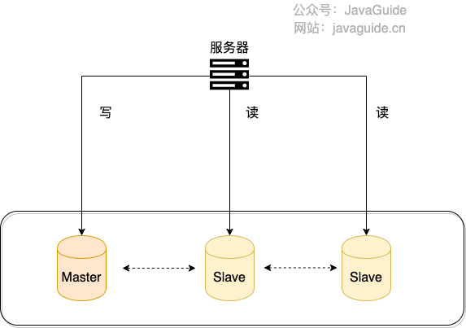
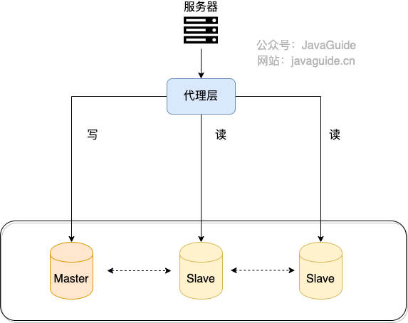
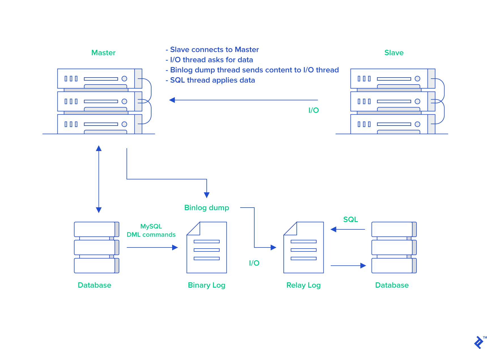
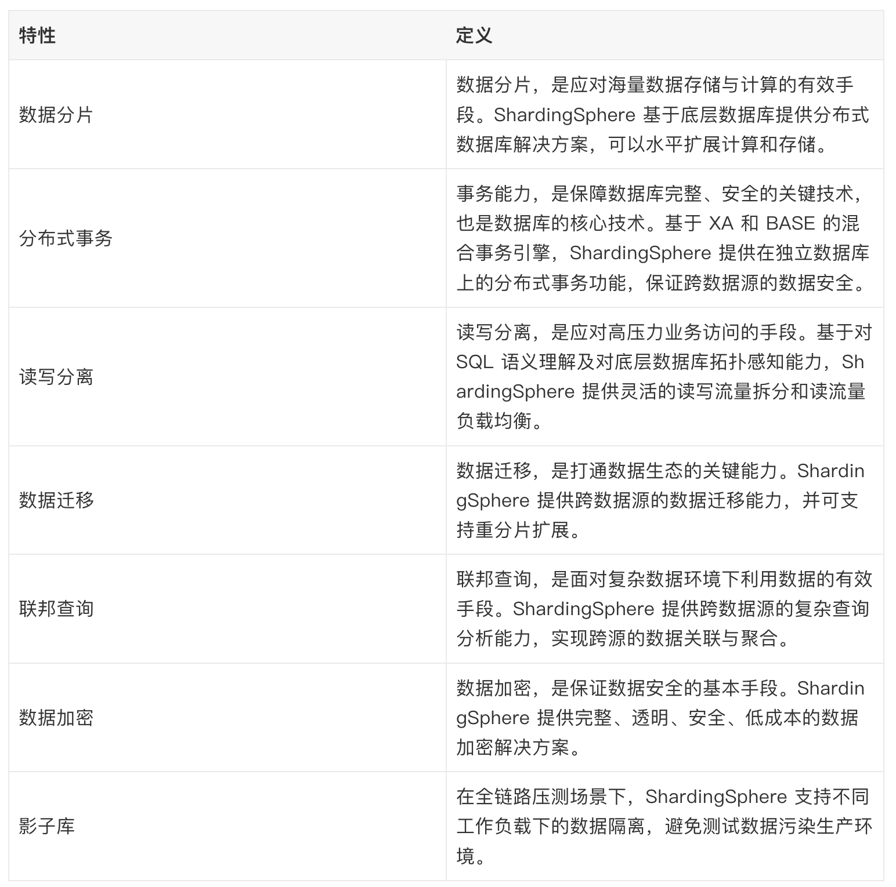

## Read/Write Splitting

### What Is Read/Write Splitting?

**Read/write splitting distributes database reads and writes across different database nodes.** Writes still go to the primary, while reads are spread across one or more read-only replicas. Its main benefit is read scalability. Moving reads away from the primary may also indirectly help writes if read traffic was slowing it down.

The diagram below illustrates read/write splitting.



The common setup is one primary and multiple replicas: the primary handles writes, while the replicas handle reads. Data is replicated from the primary to keep the replicas up to date. This relatively simple architecture suits workloads with more reads than writes.

### How Is Read/Write Splitting Implemented?

Regardless of the implementation, read/write splitting generally involves these steps:

1. Deploy multiple database instances and designate one as the primary and the others as replicas.
2. Configure replication between the primary and replicas. MySQL replication is asynchronous by default, so replicas may briefly lag behind the primary.
3. Route write requests to the primary and read requests to the replicas.

There are two common ways to implement this in an application:

**1. Proxy**



Add a proxy layer between the application and the databases. The application sends all database requests to the proxy, which separates reads from writes and routes them to the appropriate instances.

Middleware with similar capabilities includes **MySQL Router** (the official replacement for MySQL Proxy), **ProxySQL**, **MaxScale**, and **MyCat**. **Atlas** is an older solution based on MySQL Proxy. When evaluating tools for a new project, check maintenance status, compatibility with current MySQL versions, and community activity.

One additional note about MySQL Router: transparent read/write splitting was introduced in MySQL Router 8.2 and remains documented. Router sends reads to read-only instances and writes to writable instances, so the application does not need to classify SQL statements itself. See the official blog post [MySQL 8.2 – Transparent Read/Write Splitting](https://blogs.oracle.com/mysql/post/mysql-82-transparent-readwrite-splitting) and the [Read/Write Splitting documentation](https://dev.mysql.com/doc/mysql-router/9.7/en/router-read-write-splitting.html).

Transparent read/write splitting does not mean every SQL statement can be sent to Router without review. Statements such as `FOR UPDATE`, `LOCK IN SHARE MODE`, and `GET_LOCK()` must go to a writable instance. Some statements that appear read-only may also have side effects and fail on a read-only instance. Before production use, verify your application queries against the official statement support list.

**2. Client-side component**

With this approach, a library or framework component routes read and write requests.

For Java projects, **ShardingSphere-JDBC** is a common choice. It can be added as a JAR dependency and typically has lower operational overhead than a separate proxy.

See the ShardingSphere documentation for [ShardingSphere-JDBC read/write splitting](https://shardingsphere.apache.org/document/current/en/features/readwrite-splitting/).

### How Does Primary-Replica Replication Work?

The MySQL binary log (binlog) records database changes, including DDL and DML statements. Replicas use the primary's binlog to synchronize data.

This guide uses primary/replica terminology. Starting with MySQL 8.0, the documentation gradually replaced master/slave with source/replica: MySQL 8.0.22 recommended aliases such as `START REPLICA`, and 8.0.23 introduced commands such as `CHANGE REPLICATION SOURCE TO`. MySQL 8.4 removed older statements including `START SLAVE` and `CHANGE MASTER TO`. Prefer the newer names in scripts and monitoring, such as `SHOW REPLICA STATUS`, `replica_parallel_workers`, and `rpl_semi_sync_source_wait_point`.

The replication flow is as follows (image source: [MySQL Master-Slave Replication on the Same Machine](https://www.toptal.com/mysql/mysql-master-slave-replication-tutorial)):



1. The primary writes database changes to the binlog.
2. A replica connects to the primary and requests binlog events.
3. The primary starts a binlog dump thread and sends the events to the replica.
4. The replica's I/O receiver thread receives the events and writes them to the relay log.
5. The replica's applier thread reads the relay log and applies its events locally. With statement-based logging, this is similar to replaying SQL; with row-based logging, the replica applies row-change events.

The binlog is central to replication and can also support data recovery.

A couple of other uses of the binlog:

Alibaba's open-source **Canal** can synchronize data from MySQL to other systems, such as Elasticsearch or another MySQL database. It works by parsing the binlog and emulating the MySQL replication process.

Redis also uses primary-replica replication to support read/write splitting.

In short:

**MySQL replication depends on the binlog. Tools that synchronize MySQL data to other systems, such as Canal, commonly rely on it as well.**

### How Can You Avoid Stale Reads from Replicas?

Read/write splitting can increase read throughput, but replication introduces lag between the primary and replicas. After a write to the primary, it takes time for the change to reach a replica, so the data may be temporarily inconsistent. This is called **replication lag**.

An application generally cannot eliminate replication lag; it can avoid routing strongly consistent reads to a lagging replica. If a workflow cannot tolerate stale data, consider the following options.

Pay special attention to transaction and request boundaries. If a business transaction writes and then reads, route the subsequent read to the primary; otherwise, a proxy or middleware may send it to a replica and the application may not see its own write. For read-your-writes workflows—such as session updates, payment status, or viewing an order immediately after creation—route reads to the primary for a short period based on the user session, request context, or a business marker.

#### Route Reads to the Primary

For the few operations that require strong consistency, such as checking a balance immediately after payment, use a hint to force a read from the primary.

```java
try (HintManager hintManager = HintManager.getInstance()) {
    hintManager.setWriteRouteOnly();
    // Continue with JDBC operations.
}
```

> ShardingSphere 5.x uses `setWriteRouteOnly()`. In older 4.x versions, the corresponding method is `setMasterRouteOnly()`. Adjust the example for your version.

> **Note:** Do not apply this approach broadly. Read/write splitting is intended to reduce read load on the primary. If many reads fall back to it because of replication lag, high-traffic events can overload the primary. Route only critical strongly consistent reads to the primary, and let non-critical workflows tolerate eventual consistency where appropriate (for example, by showing a "data is syncing" message).

Use this approach only for reads that must return the latest data.

#### Delay the Read

One might try waiting before reading from a replica—for example, waiting one second when replication usually takes 0.5 seconds. This seems simple but is unreliable because replication lag can vary.

It can work better to design the user flow so that a read does not happen immediately after a write. For example, after payment, show a success page; the user may return to the account page later.

#### Wait for a Replica to Reach a Specific Position

With GTID replication, capture the transaction's GTID after a successful write, then call `WAIT_FOR_EXECUTED_GTID_SET(gtid_set, timeout)` on a replica before reading. Similarly, `SOURCE_POS_WAIT()` can wait for a replica to receive and apply a specified binlog position.

This lets a read wait until a specific replica catches up, but increases latency and implementation complexity, so it is not suitable for every frequent request. For high-throughput critical paths, a common approach is to read from the primary for a short time after a write or route read-your-writes requests by session or user.

#### Summary

We covered three ways to avoid stale reads from replicas. Delaying a read cannot guarantee fresh data; it only reduces the chance of reading stale data and is rarely a primary solution in production.

In general, route reads that require strong consistency to the primary. If most workflows do not require immediate consistency, non-critical paths can tolerate eventual consistency.

Replica capacity is not free. Complex reports, full table scans, deep pagination, and slow queries can compete with the replication applier and increase lag. Read/write splitting does not remove the need to manage slow queries, indexes, connection pools, and reporting workloads.

### What Causes Replication Lag, and How Can It Be Reduced?

We have discussed replication lag and ways to avoid stale reads. This section examines common causes of lag and ways to reduce it.

First, it helps to understand how replication lag occurs.

Replication lag means that a replica's data trails the primary's data. It can occur for two reasons:

1. The replica's I/O receiver cannot receive binlog events as quickly as the primary writes them, so the replica's relay log falls behind the primary's binlog.
2. The replica's applier cannot apply relay-log events as quickly as the I/O receiver receives them, so the replica's data falls behind its relay log.

Three key points in replication are:

1. **T1:** The primary completes a transaction and writes it to the binlog.
2. **T2:** The replica's I/O receiver receives the event and writes it to the relay log.
3. **T3:** The replica's applier reads the relay log and applies the event locally.

> **Note:** This describes MySQL's default **asynchronous replication**. With semisynchronous replication and `rpl_semi_sync_source_wait_point=AFTER_SYNC`, the primary waits for at least one replica to acknowledge receipt of the transaction event after the binlog is written and synchronized, then commits to the storage engine and returns to the client. This improves data safety during failover, but does not mean the replica has finished applying the event.

Based on the replication flow described above:

- The difference between T2 and T1 reflects the replica's I/O receiver and network transfer performance. A smaller difference means events reach the relay log sooner.
- The difference between T3 and T2 reflects the applier's speed. A smaller difference means events are applied sooner.

Common causes of replication lag include:

1. **The replica is less powerful than the primary:** It may receive binlog events, write relay logs, and apply events more slowly, increasing T2−T1 and T3−T2. Use a replica with comparable or better resources, or tune it with suitable configuration, more cache, or SSD storage.
2. **The replica handles too many reads:** A replica must apply all primary writes while also serving reads. Heavy read traffic consumes CPU, memory, and network resources and can slow replication. Add a cache, spread reads across multiple replicas, or send analytical queries to systems such as Hadoop or Elasticsearch through the binlog.
3. **Large transactions:** Long-running, uncommitted transactions take time and resources to apply on replicas and can cause lag. Avoid large bulk updates; split them into smaller batches. Long-running slow queries can also contribute and should be optimized.
4. **Too many replicas:** The primary must send binlog events to every replica, increasing its replication workload and potentially T2−T1. Reduce the number of replicas or use a hierarchy in which upper-level replicas feed lower-level replicas.
5. **Network problems:** Low bandwidth, packet loss, or jitter can slow binlog transfer. Improve bandwidth, latency, and network stability.
6. **Single-threaded replication:** MySQL 5.5 and earlier supported only single-threaded replication. MySQL 5.6 introduced multithreaded replication with per-database parallelism; MySQL 5.7 added parallel application based on group commit. From MySQL 8.0.22, use the newer names such as `replica_parallel_workers > 0` to enable multithreaded appliers, and consider strategies such as `replica_parallel_type=LOGICAL_CLOCK`.
7. **Replication mode:** Asynchronous replication can lag. Fully synchronous replication avoids this at the cost of performance. Semisynchronous replication is a compromise that primarily improves data safety rather than eliminating read lag. The primary waits for at least one replica to receive a transaction event before acknowledging the commit, but whether that replica has applied the event depends on the applier. Semisynchronous replication therefore does not guarantee that an immediate read from a replica will return the latest write. MySQL added semisynchronous replication as a plugin in 5.5 and enhanced semisynchronous replication in 5.7.
8. ……

## Database and Table Sharding

Read/write splitting mainly addresses read concurrency; it does not solve storage limits. **What if a MySQL table becomes too large?**

In other words, **how can we address MySQL storage pressure?**

One option is **database and table sharding**.

Before sharding, check that:

1. Slow queries, indexes, pagination, caching, and read/write splitting have already been optimized.
2. Table size, database capacity, connection count, or write QPS is actually nearing a limit.
3. A stable shard key can support the core queries.
4. The application can handle the added complexity of cross-shard queries, distributed transactions, and data migrations.

Sharding is not the first step in database optimization. It is a capacity-scaling option after conventional optimizations are no longer sufficient.

### What Is Database Sharding?

**Database sharding** distributes data across multiple databases. It can be vertical or horizontal.

**Vertical sharding** splits a database by business domain, with different domains using separate databases. This distributes the load across databases.

For example, move the user, order, and product tables into separate user, order, and product databases.


**Horizontal sharding** splits rows from the same table across multiple databases according to a rule. The databases can run on different servers, allowing horizontal scaling beyond a single table's storage and performance limits.

For example, split a large order table into two physical tables and place them in separate databases.


In practice, horizontal database sharding usually comes with horizontal table sharding: split one logical table by rows into multiple physical tables, then distribute those tables across database instances.

### What Is Table Sharding?

**Table sharding** splits the data in a table, either vertically or horizontally.

**Vertical table sharding** splits a table by columns, moving groups of columns into separate tables.

For example, move some columns from a user table into a separate table.

**Horizontal table sharding** splits a table by rows, moving subsets of rows into separate tables to address an oversized table.

For example, split a large user table into multiple user tables so that no single table grows too large.

Horizontal table sharding addresses the size of an individual table. To improve performance, the resulting tables are often placed in different databases, so horizontal table and database sharding commonly go together.


### When Should You Consider Sharding?

Consider sharding in situations such as:

- A table has tens of millions of rows or more and database reads or writes are slowing down. The threshold depends on schema complexity, index count, and hardware.
- Database storage keeps growing and backups take increasingly longer.
- Application concurrency is high, though other performance optimizations should be considered first.

Sharding has significant costs, so avoid it unless necessary. A table does not automatically need to be sharded when it reaches tens of millions of rows; acceptable capacity depends on its columns, indexes, workload, and hardware.

If the bottleneck is mainly caused by slow queries, index design, or date and time storage, apply conventional MySQL optimizations before considering sharding:

- [MySQL execution plans](https://javaguide.cn/database/mysql/mysql-query-execution-plan.html)
- [A detailed guide to MySQL indexes](https://javaguide.cn/database/mysql/mysql-index.html)
- [Common cases where MySQL does not use an index](https://javaguide.cn/database/mysql/mysql-index-invalidation.html)
- [Guidance on storing MySQL date and time values](https://javaguide.cn/database/mysql/some-thoughts-on-database-storage-time.html)

For a discussion of [how much data a height-three InnoDB B+Tree can hold](https://juejin.cn/post/7165689453124517896), see this related article.

### What Are Common Sharding Algorithms?

Sharding algorithms determine which table should store each record after horizontal partitioning.

Common algorithms include:

- **Hash-based sharding:** Hash the shard key and use the result to choose a table. This suits random reads and writes but is less suitable for range queries. Hashing can distribute data evenly, but makes dynamic scaling—such as adding a table or database—more difficult.
- **Range-based sharding:** Assign data according to ranges, such as time or ID ranges. For example, IDs from `1` to `299999` might go to one table and IDs from `300000` to `599999` to another. Range sharding suits range queries when data is evenly distributed, but can create hotspots when access is uneven.
- **Consistent hashing:** Arrange the hash space as a ring, map shard keys and nodes (databases or tables) onto it, and assign each key to the next node clockwise. This reduces the amount of remapping required during scaling compared with ordinary hash modulo. Consistent hashing is more common for key-value stores and caches than for relational sharding; range queries, cross-shard transactions, and secondary indexes still need separate design.

Business requirements can also call for more advanced routing strategies:

- **Lookup-table routing:** Maintain a separate routing table that maps shard keys to data nodes. This is flexible but adds routing data that must be cached, kept consistent, scaled, and made highly available; otherwise, the routing table may become a bottleneck or single point of failure.
- **Geographic routing:** Use location as a shard key, often with range or lookup-table routing, to store data close to users in specific data centers. This is common in active-active NewSQL architectures.

### How Should You Choose a Shard Key?

The shard key is the field used to partition data. It directly affects data distribution and query performance. Ideally, it should:

- **Cover common queries:** Minimize the number of shards involved in each query and reduce database load.
- **Distribute values evenly:** Avoid skew and hotspots.
- **Remain stable:** A changing shard key can require data migration and create consistency issues.
- **Support scaling:** Allow shards to be added or removed without expensive repartitioning.

In practice, a shard key rarely meets all these criteria, so tradeoffs are necessary. Some systems encode a logical shard identifier in a business ID—for example, a `buyer_route` segment in an order ID—so the route can be derived from the ID alone. Avoid simply using the last few digits of a user ID: IDs from Snowflake, sequence allocation, or other structured generators may not have uniformly distributed low-order digits. Hash the ID before taking a modulo when appropriate.

The following table lists candidate shard keys for common workloads:

| Workload            | Candidate shard keys         | Considerations                                                               |
| ------------------- | ---------------------------- | ---------------------------------------------------------------------------- |
| Order system        | User ID, seller ID, order ID | Choose based on the main queries; user and seller order lookups may conflict |
| IM messages         | Conversation ID, user ID     | Account for message ordering within a conversation and hot group chats       |
| Multi-tenant system | Tenant ID                    | Large tenants can become hotspots and may need separate shards               |
| Payment records     | User ID, transaction ID      | Design strongly consistent reads and reconciliation workflows in advance     |

If a workload has several frequent query paths, consider duplicating data for another query dimension or moving some queries to a search engine, denormalized table, or reporting system instead of forcing one shard key to serve every need.

Do not choose the shard count based only on current data volume. Too few physical shards require frequent expansion; too many increase connection, routing, aggregation, and operational costs. A common approach is to define many logical shards—for example, 512 or 1,024 buckets—and map them to a smaller number of physical databases and tables. During expansion, move bucket mappings instead of changing the application's modulo rule.

The following order-system example illustrates these tradeoffs.

Order tables are a common sharding example because they naturally have several query paths:

- **User:** View an order list, order details, or after-sales records, often filtered by `buyer_id` and `create_time` or status.
- **Order:** Look up details by `order_id`, handle payment callbacks, or find after-sales records.
- **Seller:** View orders in a seller dashboard, filter by status, or export recent orders.

Most order systems prioritize user order lists rather than sharding only by `order_id`. Order-detail lookups are point queries, while user order lists are frequent range queries. If orders are distributed by hashing `order_id`, one user's orders may span many shards, making pagination, sorting, and filtering cross-shard operations.

When sharding by buyer ID, calculate the route as follows:

```text
slot = hash(buyer_id) % (db_count * table_count)
db_index = slot / table_count
// Divide by the number of tables per database, not by the number of databases.
table_index = slot % table_count
```

The easy mistake is calculating `db_index`: divide `slot` by the number of tables in each database to get the database index, then take the modulo to get the table index.

Sharding only by `buyer_id` is not enough. To query by `order_id`, common options are to maintain a routing table from `order_id` to `buyer_route`, or encode `buyer_route` at a fixed position in the order ID. The first adds a lookup and storage; the second requires the ID format to reserve enough bits in advance.

Seller queries need a separate design. In B2C systems, sellers and buyers usually have a many-to-many relationship, so encoding the buyer route in the order ID does not solve seller lookups. For infrequent seller-dashboard queries, limit the time range and use Elasticsearch, ClickHouse, or a denormalized table. For a frequent, critical path, create a seller-order index table sharded by `seller_id` or maintain a separate seller-order read model.

Use the same routing rule for the order and order-item tables where possible. If both `t_order` and `t_order_item` are sharded by `buyer_route`, order creation and detail queries can stay on one shard. ShardingSphere supports binding tables for this pattern, provided the tables use the same sharding rule and join conditions include the shard key. Configuring binding tables alone does not prevent cross-shard routing if the SQL omits the shard key.

### What Challenges Does Sharding Introduce?

When making a technical decision, consider not only whether a technology meets the requirements and fits the workload, but also the costs it introduces.

Sharding introduces challenges such as:

- **Joins:** Distinguish joins within one database from cross-shard joins. With suitable indexes and an execution plan, joins are a fundamental relational-database feature. Cross-shard joins are harder: data may span multiple databases and tables, requiring middleware to broadcast queries, route them, merge results, or even compute Cartesian combinations. This increases both cost and complexity. Multiple queries assembled in the application are one option, but consider the consistency requirements across those reads.
- **Transactions:** A transaction spanning multiple databases cannot rely on a single database's built-in transaction. It may require a distributed transaction. See the guide to [common distributed transaction solutions](https://javaguide.cn/distributed-system/distributed-transaction.html).
- **Distributed IDs:** Once data is spread across databases on different servers, auto-incrementing keys from one database cannot guarantee globally unique IDs. The system needs a distributed ID strategy. See [Distributed IDs: Concepts and Implementation Strategies](https://javaguide.cn/distributed-system/distributed-id.html).
- **Global uniqueness constraints:** A unique index in a database guarantees uniqueness only within that shard. If phone numbers, usernames, or seller order numbers are not shard keys, the database cannot easily enforce global uniqueness. Options include a global unique-index table, reserving values through a business-level registry, or changing the shard key and constraints.
- **Queries without the shard key:** Without the shard key in a query, middleware cannot identify the target shard and may have to broadcast the SQL to multiple shards and merge the results. This may be acceptable with few shards, but read fan-out can slow critical paths as the shard count grows. Add a routing table or redundant index table, or move back-office search to a search engine, denormalized table, or reporting system.
- **Cross-database aggregation and pagination:** Operations such as `GROUP BY` and `ORDER BY` become more complex because results must be aggregated and sorted across shards. Cross-shard pagination is also costly: to return page 1,000, each shard may need to return candidates from earlier pages before middleware can merge, sort, and select the requested page. The cost grows with the number of shards. Use a search engine, denormalized table, or offline reporting system for large result sets.
- **Resharding:** With ordinary hash modulo, changing from `hash(key) % 32` to `% 64` remaps much of the data. A more stable approach is to define logical shards, such as 1,024 buckets, and map them to physical databases and tables; move selected buckets during expansion instead of tying business IDs to the physical shard count. Consistent hashing or a distributed database with automatic rebalancing, such as TiDB, are other options.
- **Operational and change costs:** DDL changes, index tuning, backups, data corrections, incident response, and capacity planning must cover multiple databases and tables. Prepare bulk-change tools, rollback procedures, and shard-level monitoring before launch to keep maintenance manageable.
- **More operational overhead:** Sharding usually requires DBA involvement and additional database servers, both of which add cost.

### What Sharding Solution Should You Consider?

Apache ShardingSphere is a distributed database ecosystem that adds capabilities such as sharding, elastic scaling, and encryption on top of existing databases.

The project was contributed to Apache by Dangdang. Its main integration options are **ShardingSphere-JDBC** and **ShardingSphere-Proxy**.

ShardingSphere suits teams that want to keep using a traditional relational database while adding sharding, read/write splitting, encryption, and governance through a middleware layer. It does not modify the MySQL kernel; it provides transparent routing, SQL rewriting, result merging, and governance at the JDBC or proxy layer. In addition to read/write splitting and sharding, it supports distributed transactions, database governance, shadow databases, encryption, and data masking.

Compared with building a routing layer from scratch, ShardingSphere offers three main advantages: ShardingSphere-JDBC stays closer to the native JDBC call path and avoids a network proxy hop; its JDBC and Proxy options support both Java applications and polyglot systems; and sharding, read/write splitting, encryption, shadow databases, and governance can be configured in one rule system, simplifying future expansion.

ShardingSphere provides the following capabilities:



When choosing between them, consider which integration model best fits the team:

- **ShardingSphere-JDBC:** Added as a JAR dependency, suitable for Java applications. It avoids an extra network hop, but each application must manage its dependency and configuration.
- **ShardingSphere-Proxy:** Deployed as a separate proxy service and accessed over the MySQL or PostgreSQL protocol. It suits polyglot systems or teams that want shard rules centralized in the proxy, but adds proxy operations overhead.

Many companies also choose distributed relational databases such as TiDB. TiDB divides data into Regions by key range, splits Regions when they exceed a threshold, and schedules them across TiKV nodes. This reduces some of the routing, scaling, and migration work associated with manual sharding, but teams still need to assess SQL compatibility, migration cost, operational capabilities, and ecosystem fit.

Automatic Region splitting does not eliminate hotspots. Sequential auto-increment keys, time-ordered keys, large tenants, and initial writes concentrated in one Region can still create hotspots. Assess the workload's write patterns in production.

### How Should You Migrate Data After Sharding?

Sharding, splitting a service's database, or switching databases requires moving existing data to new storage. The approach depends first on how long the application can tolerate write downtime and how much synchronization complexity the team can manage.

| Approach                                        | Suitable when                                                          | Main cost                                                                                                          |
| ----------------------------------------------- | ---------------------------------------------------------------------- | ------------------------------------------------------------------------------------------------------------------ |
| Full migration after stopping writes            | Small dataset and a long maintenance window is acceptable              | Downtime includes export, import, and validation; estimate it in advance                                           |
| Full load + CDC + brief write pause for cutover | Large dataset and a brief cutover pause is acceptable                  | Full and incremental data must join correctly; drain old writes and confirm all changes are applied before cutover |
| Application-level dual writes                   | A maintenance pause is unacceptable and all write paths can be changed | Must handle partial success, out-of-order writes, retries, compensation, and concurrent writes during cutover      |

**Dual writes in the application do not provide atomicity between databases.** Even if the main request writes to both databases, scheduled jobs, message consumers, and manual scripts may not. The migration plan must identify the authoritative database and define how to recover if a write to the other database fails. Two database calls alone do not make a migration safe.

#### How Should Full and Incremental Migration Be Coordinated?

The following example uses a full load, CDC for incremental changes, and a brief write pause for cutover. Most data can be moved while the application remains online, but the final cutover still requires a controlled write pause.

1. **Inventory and prepare the target:** Confirm the tables, shard rules, indexes, unique constraints, character sets, auto-increment IDs, and all read/write entry points. If schemas change, verify CDC mappings and DDL handling.
2. **Establish a consistent snapshot and log position:** Use a migration tool's supported method to coordinate a consistent snapshot with a binlog position, and ensure the required logs will not be purged early. Do not wait until the full import finishes to start consuming changes from the current position, or changes made during the import may be missed.
3. **Load data in batches and keep applying changes:** Limit read pressure on the source and write pressure on the target, and record resumable progress. Follow the tool's snapshot and incremental-apply protocol for updates and deletes so older snapshot rows do not overwrite newer changes.
4. **Validate data and read behavior:** Compare data in chunks and use shadow reads for critical queries: continue returning results from the old database while comparing results from the new one in the background. Gradually route reads that can tolerate brief staleness. Reads that must see a recent write should continue using the authoritative database or wait for a replication position.
5. **Stop business writes to the old database and drain in-flight transactions:** Cover APIs, scheduled jobs, message consumers, and scripts. Confirm that old writes have committed or rolled back, then record the final log position. Use explicit entry-point controls or database write restrictions; do not create errors by temporarily routing writes to a read-only replica.
6. **Wait for the target to apply the final position and validate:** Confirm that the target has committed all changes through that position and that the migration has no errors, unapplied backlog, or skipped events. Then stop replication from the old database to avoid overwriting subsequent writes to the new one.
7. **Switch read/write routing and resume writes:** Route writes in the migration scope to the new database, confirm that old instances and connections no longer write to the old database, then monitor error rates, query latency, connection counts, and shard hotspots. Keep a rollback plan that has been rehearsed in advance.

To determine whether the target has caught up, check **the data position already applied by the target**, not just how many log events the capture process has received. With native MySQL replication, `Seconds_Behind_Source = 0` does not guarantee that the replica is fully synchronized with the source; for example, it may still show `0` while the receiver thread is behind. See [MySQL replication status](https://dev.mysql.com/doc/refman/8.4/en/show-replica-status.html). With CDC tools, check their apply progress and error status as well.

If you implement synchronization yourself, replays must be idempotent and preserve event order for each record, or use comparable business versions to reject stale events. A binlog position tracks progress in a particular log stream; a GTID identifies an executed transaction. GTIDs from different sources are not globally increasing row versions. Preserve enough ordering or version information for delete events too, so a retried stale insert cannot recreate deleted data.

#### How Can You Validate the Migration?

Row counts alone are not enough. The two databases may have the same number of rows but differ in amounts, statuses, relationships, or deleted records. Compare chunks by primary-key range, starting with counts and checksums, then locate differing rows. Also compare business totals, status distributions, and results from important queries.

Validation must compare data from a well-defined point in time. While the source continues to receive writes and the target applies them asynchronously, comparing two live queries can mistake normal replication lag for data loss. Run preliminary checks during migration, then perform the final comparison after writes stop and all changes are applied. If a large table cannot be fully rechecked during the write pause, validate a consistent-snapshot approach in advance or track and recheck every primary key changed after the preliminary check; do not skip validation at the last minute.

`update_time` can narrow the validation scope, but checking only recently updated rows may miss physical deletes, writes that do not maintain the timestamp, and historical backfills. Validation tools also have assumptions. For example, [sync-diff-inspector](https://docs.pingcap.com/tidb/stable/sync-diff-inspector-overview/) compares data in chunks across MySQL-compatible databases. Verify table mappings, column types, and consistency requirements before using it, and review any repair SQL it generates before execution.

#### Why Is Keeping the Old Database Not Enough for Rollback?

**Once the new database accepts business writes, the old database may fall behind.** Switching back directly can hide updates to orders or payment statuses made after cutover, or allow later writes to overwrite them.

- **Failure before writes resume on the new database:** The old database remains authoritative. Restore the old routing after confirming that the new database has not accepted business writes.
- **Failure after writes resume on the new database:** Stop new writes, apply the new changes to the old database through a preconfigured reverse-sync or change-replay process, and verify that the changes were applied before switching back. Also confirm that reverse transformations are possible and will not create a replication loop.

If reverse synchronization has not been implemented and rehearsed, treat the resumption of writes on the new database as the point after which rollback changes. Recovery may require repairing the new database or copying data back during a maintenance window; an immediate lossless switchback cannot be guaranteed.

Estimate the write-pause window based on data volume, incremental backlog, and final validation time. Rehearse the full routing cutover to confirm that the window meets business requirements.

## Summary

- Read/write splitting distributes reads and writes across database nodes. Its main benefit is read scalability and reduced read load on the primary.
- Read/write splitting relies on replication; MySQL replication relies on the binlog.
- **Database sharding** distributes data across databases. **Table sharding** splits one table vertically by columns or horizontally by rows.
- Sharding requires deliberate solutions for transactions, distributed IDs, cross-shard joins, queries without the shard key, cross-database aggregation, and data migration.
- For order tables, consider user order lists, seller dashboards, payment callbacks, and operational searches—not just point lookups by `order_id`.
- If manual sharding is necessary, evaluate ShardingSphere first. Teams open to a distributed relational database can also assess TiDB, while accounting for migration and operational costs.

<!-- @include: @article-footer.snippet.md -->
