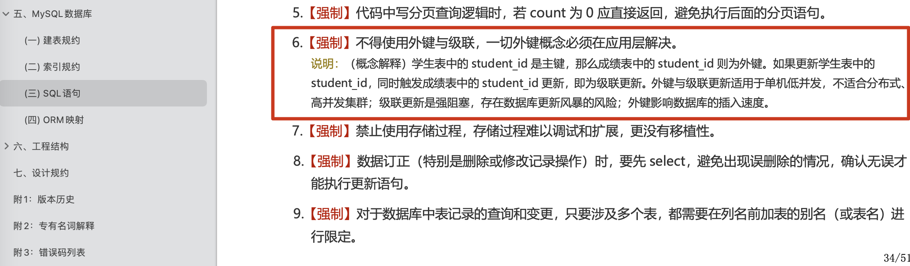

When SQL is slow, do not immediately apply rules such as "add an index" or "avoid `SELECT *`." First identify the slow query and determine whether it is scanning too many rows, sorting, performing table lookups, waiting on locks, or running too frequently. Compare the execution plan with the application's access pattern, then decide whether to change the index, query, or schema—or move the workload to a cache, search engine, or offline report.

Use this sequence to investigate:

1. Identify whether the issue is average latency, P99, or occasional timeouts, and whether one query or the database as a whole is slow.
2. Find frequent slow queries with the slow query log, APM, or database monitoring.
3. Inspect `type`, `key`, `rows`, `filtered`, and `Extra` in the execution plan for full table scans, excessive lookups, temporary tables, or filesorts.
4. Choose a fix that fits the access pattern: select fewer columns, add an index, rewrite the query, split large transactions, or limit pagination depth.
5. Retest with the same data volume and conditions; do not validate only against a small dataset.

## Avoid `SELECT *`

- `SELECT *` can increase I/O, network transfer, deserialization, and application memory costs, especially with large `VARCHAR`, `BLOB`, or `TEXT` columns.
- `SELECT *` makes a covering-index lookup less likely.
- Selecting an explicit column list reduces the impact of schema changes.

## Use Complex Joins Carefully; Do Not Ban Joins Categorically

Alibaba's _Java Development Manual_ states:

> **Required:** Do not join more than three tables. Columns used in a join must have exactly matching data types. In multi-table joins, ensure that the joined columns are indexed.


Joins are a fundamental relational-database feature and are not inherently inefficient. Within one database, when join-column types match, indexes are appropriate, and the result size is manageable, a join is often clearer and more consistent than issuing several queries and assembling the results in the application.

Use extra care with complex joins when:

1. Join columns lack indexes or use different data types.
2. Many tables are joined, making the execution plan complex.
3. The result is large, increasing the cost of table lookups, temporary tables, or filesorts.
4. A cross-database or cross-shard join requires querying, merging, and sorting across nodes.
5. The query path is expected to use database or table sharding later.

Since MySQL 8.0.20, Hash Join has replaced Block Nested-Loop Join. Do not rely only on older descriptions of join algorithms. Inspect the actual plan with `EXPLAIN` or `EXPLAIN ANALYZE`, focusing on `type`, `key`, `rows`, `filtered`, `Extra`, temporary tables, filesorts, and excessive table lookups.

If a query crosses services or databases, or the data may be sharded later, consider replacing the join with separate queries and assembling the results in the application. This is not always faster: it can add network round trips, N+1 queries, application memory use, and consistency issues. Decide based on query frequency, data volume, network cost, and consistency requirements.

Another common approach is **data denormalization**: copy a small number of stable fields needed by frequent queries into a primary or wide table to reduce runtime joins. Denormalization adds consistency and maintenance costs, so it suits stable schemas with read-heavy workloads and well-defined query paths.

## Optimize Deep Pagination

Deep pagination becomes expensive because a large `LIMIT` offset makes MySQL scan and skip many rows before reaching the requested page. The optimizer may choose a full table scan over an index, and even when it uses an index, many table lookups can sharply degrade performance.

The table compares four common approaches to deep pagination:

| Approach           | Core idea                                                                                         | Suitable use                                             | Limitations                                                                                   |
| ------------------ | ------------------------------------------------------------------------------------------------- | -------------------------------------------------------- | --------------------------------------------------------------------------------------------- |
| **Range query**    | Record the last ID on the previous page and fetch the next page with `WHERE id > last_id LIMIT n` | ID-ordered results and cursor-style pagination           | Cannot jump to an arbitrary page; other sort orders need a composite cursor                   |
| **Subquery**       | Use a subquery to get the starting primary key, then filter by that key                           | Traditional `OFFSET` pagination is required              | May create a temporary table and depends on an index for the sort columns                     |
| **Deferred join**  | Paginate through the primary-key index with an `INNER JOIN` to reduce table lookups               | Large datasets that require traditional pagination       | More complex SQL                                                                              |
| **Covering index** | Create a composite index containing the queried columns to avoid table lookups                    | Query columns are fixed and a suitable index is feasible | More columns increase index-maintenance cost; large result sets may still lead to a full scan |

Choose an approach based first on whether the product interaction can change. If users can browse with a "next page" flow, range queries (cursor pagination) are usually the most reliable. They suit social-media feeds and infinite scrolling.

If `LIMIT offset, size` and arbitrary page jumps are required, consider deferred joins, covering indexes, or a search engine. A covering index can help when the queried columns are few and fixed. When the offset reaches millions, first ask whether the product really needs such deep pagination instead of trying to solve it in SQL alone.

Whichever approach you use, inspect the actual execution plan. A well-written query is not useful if `EXPLAIN` shows that the intended index is not being used.

For more detail, see [Deep Pagination: Introduction and Optimization](https://javaguide.cn/high-performance/deep-pagination-optimization.html).

## Avoid Foreign Keys and Cascades When Appropriate

Alibaba's _Java Development Manual_ states:

> Do not use foreign keys or cascades. Handle referential integrity at the application layer.



This guideline mainly targets high-concurrency internet services, microservices, and sharded databases. In these environments, foreign keys and cascades increase coupling between tables, migration costs, and the complexity of production changes.

Foreign keys are not useless, though. In monolithic applications, back-office systems, or core master-data tables with manageable sizes and clear consistency requirements, they can enforce referential integrity at the database level. Decide based on the architecture, data volume, and operational cost rather than assuming that foreign keys are inherently slow.

## Choose Appropriate Column Types

Smaller data types use less storage and can improve performance.

**a. Some strings can be stored as numeric values. For example, an IP address can be stored as an integer.**

Numeric values are compact and can be more efficient to process.

MySQL provides several functions for handling IP addresses:

- `INET_ATON()`: Converts IPv4 to an unsigned integer. Store it as `INT UNSIGNED` and use `INET_NTOA()` to convert it back to a string.
- `INET6_ATON()`: Converts IPv6 to a binary string and also handles IPv4. For systems that need IPv6 support, consider storing all addresses as `VARBINARY(16)` or `BINARY(16)` and converting them back with `INET6_NTOA()`.

For IPv4 only, `INET_ATON()` with `INT UNSIGNED` is sufficient. If IPv6 may be needed later, designing for 16-byte binary storage from the start is safer.

**b. Prefer unsigned integer types for nonnegative values such as auto-increment IDs, integer IP addresses, and ages.**

Unsigned types do not change an integer's storage size. They change its range to start at zero instead of including negative values. For example, both signed and unsigned `INT` use 4 bytes:

```sql
SIGNED INT -2147483648~2147483647
UNSIGNED INT 0~4294967295
```

For storage sizes and value ranges, see the MySQL documentation: [Integer Types](https://dev.mysql.com/doc/refman/8.0/en/integer-types.html) and [Data Type Storage Requirements](https://dev.mysql.com/doc/refman/8.0/en/storage-requirements.html).

**c. Use `TINYINT` for small values such as ages or binary states (0/1).**

**d. Do not store dates as strings. Consider `DATETIME`, `TIMESTAMP`, or a numeric timestamp.**

Each option has tradeoffs. Choose based on the use case. The table compares them:

> **Note:** Storage sizes below apply to MySQL 5.6.4 and later, which support fractional seconds. Before 5.6.4, `DATETIME` always used 8 bytes and `TIMESTAMP` 4 bytes. Fractional-second precision of 1–2, 3–4, or 5–6 digits adds 1, 2, or 3 bytes, respectively.

| Type              | Storage      | Format                         | Range                                                        | Time zone handling                  |
| ----------------- | ------------ | ------------------------------ | ------------------------------------------------------------ | ----------------------------------- |
| DATETIME          | 5–8 bytes    | YYYY-MM-DD hh:mm:ss[.fraction] | 1000-01-01 00:00:00[.000000] to 9999-12-31 23:59:59[.999999] | No time zone conversion             |
| TIMESTAMP         | 4–7 bytes    | YYYY-MM-DD hh:mm:ss[.fraction] | 1970-01-01 00:00:01[.000000] to 2038-01-19 03:14:07[.999999] | Converted using session `time_zone` |
| Numeric timestamp | 4 or 8 bytes | Digits, e.g. `1578707612`      | Depends on the integer type and precision                    | No time zone conversion             |

`TIMESTAMP` does not store a time zone name; values are converted on read and write using the current session's `time_zone`. `DATETIME` represents a literal date and time and is not converted. A seconds-based Unix timestamp can use `INT UNSIGNED`, subject to its range; millisecond timestamps usually need `BIGINT`.

For more on choosing MySQL date and time types, see [Guidance on Storing MySQL Date and Time Values](https://javaguide.cn/database/mysql/some-thoughts-on-database-storage-time.html).

**e. Use `DECIMAL` for monetary values to avoid precision loss.**

`DECIMAL` stores exact values and is suitable for data that requires precise decimal arithmetic, such as monetary values. It avoids the rounding issues associated with floating-point types.

In Java, MySQL's `DECIMAL` type maps to `java.math.BigDecimal`.

For details, see [A Detailed Guide to `BigDecimal`](https://javaguide.cn/java/basis/bigdecimal.html).

**f. Prefer auto-incrementing IDs as primary keys when appropriate.**

With an auto-incrementing primary key, new rows are appended to the end of the B+ tree, avoiding page splits in the middle of the tree. When a data page fills up, MySQL can allocate a new page and continue writing.

With a non-sequential primary key, MySQL must insert new entries in the appropriate position among the B+ tree's leaf pages. If the target page is full, it may need a **page split**, moving some data to a new page. This adds data movement and locking overhead.

For sharded databases, a single database's auto-incrementing ID is not a suitable global key. Common alternatives include Snowflake IDs, ID segments, roughly time-ordered IDs, and UUIDv7/ULID. Avoid using random UUID strings directly as InnoDB primary keys; consider `BINARY(16)`, time-ordered UUIDs, or MySQL's `UUID_TO_BIN()` for compact binary storage.

Related reading: [Should Database Primary Keys Always Auto-Increment? When Should They Not?](https://mp.weixin.qq.com/s/vNRIFKjbe7itRTxmq-bkAA).

**g. Use `NULL` according to its meaning; do not ban it categorically.**

`NULL` differs from an empty string (`''`) and the number `0`; it represents an unknown or missing value. Test for it with `IS NULL` or `IS NOT NULL`, not comparison operators such as `=`, `!=`, `<`, or `>`.

Do not make every column nullable by default, since that can complicate semantics and query handling. But `NULL` does not automatically prevent index use; MySQL can use indexes for `IS NULL`. Choose based on the data's meaning: for values that may genuinely be unknown, such as `paid_at`, `deleted_at`, or `last_login_at`, `NULL` is usually clearer than a magic default value.

`NULL` also affects aggregate results. Functions such as `SUM`, `AVG`, `MIN`, and `MAX` ignore `NULL` values. `COUNT(*)` counts all rows, while `COUNT(column_name)` counts only non-`NULL` values.

## Prefer `UNION ALL` to `UNION` When Possible

`UNION` removes duplicate rows from the combined result, which can require extra work and CPU time.

`UNION ALL` does not remove duplicates, so the result may contain repeated rows.

If the result sets cannot contain duplicates, or duplicates are acceptable, prefer `UNION ALL`. Use `UNION` or explicit deduplication when duplicates must be removed.

## Prefer Batch Operations

For database updates, use batch operations where practical to reduce the number of database requests and improve performance.

```sql
# One statement per row
INSERT INTO `cus_order` (`id`, `score`, `name`) VALUES (1, 426547, 'user1');
INSERT INTO `cus_order` (`id`, `score`, `name`) VALUES (1, 33, 'user2');
INSERT INTO `cus_order` (`id`, `score`, `name`) VALUES (1, 293854, 'user3');

# Batch insert
INSERT into `cus_order` (`id`, `score`, `name`) values(1, 426547, 'user1'),(1, 33, 'user2'),(1, 293854, 'user3');
```

## `SHOW PROFILE` Is Deprecated; Use Current Tools

MySQL has deprecated [`SHOW PROFILE`](https://dev.mysql.com/doc/refman/8.0/en/show-profile.html) and `SHOW PROFILES`, and may remove them in a future release. To investigate SQL performance, find problematic queries in the slow query log and inspect the optimizer's plan with `EXPLAIN`. MySQL 8.0.18 and later also support `EXPLAIN ANALYZE` for actual timings and row counts; use Performance Schema to inspect resource usage.

To inspect the execution times of recent statements, query `events_statements_history_long`:

```sql
SELECT
    EVENT_ID,
    SQL_TEXT,
    TIMER_WAIT / 1000000000 AS duration_ms,
    LOCK_TIME / 1000000000 AS lock_ms,
    ROWS_EXAMINED,
    ROWS_SENT,
    CPU_TIME / 1000000000 AS cpu_ms
FROM performance_schema.events_statements_history_long
WHERE SQL_TEXT IS NOT NULL
ORDER BY TIMER_WAIT DESC
LIMIT 10;
```

`CPU_TIME` requires MySQL 8.0.28 or later. On older versions, inspect fields such as `TIMER_WAIT`, `LOCK_TIME`, `ROWS_EXAMINED`, and `ROWS_SENT`. `events_statements_history_long` stores only a bounded set of the most recently completed statement events globally; older records are evicted when it fills. If the relevant consumers and instruments are disabled, it may not collect enough information.

## Optimize Slow SQL

Before optimizing slow SQL, identify which statements are taking too long.

The MySQL slow query log records statements whose execution time exceeds a configured threshold. Analyzing it helps find slow queries.

The slow query log is disabled by default for performance reasons. Enable it with:

```sql
# Enable the slow query log.
SET GLOBAL slow_query_log = 'ON';
# Set the slow query log file.
SET GLOBAL slow_query_log_file = '/var/lib/mysql/ranking-list-slow.log';
# Also log queries that do not use indexes, even if they are not slow. Enable this briefly and cautiously in production.
SET GLOBAL log_queries_not_using_indexes = 'ON';
# Log queries that exceed this threshold in seconds.
SET GLOBAL long_query_time = 1;
# Log only queries that examine more rows than this limit.
SET GLOBAL min_examined_row_limit = 100;
```

`SET GLOBAL` affects only new connections; existing connections may retain their current session values. In production, it is usually better to update the configuration file and deploy the change through the normal change process.

After applying the settings, check them with `SHOW VARIABLES LIKE 'slow%';`.

```bash
| Variable_name       | Value                                |
+---------------------+--------------------------------------+
| slow_launch_time    | 2                                    |
| slow_query_log      | ON                                   |
| slow_query_log_file | /var/lib/mysql/ranking-list-slow.log |
+---------------------+--------------------------------------+
3 rows in set (0.01 sec)
```

For demonstration, run a sorting query against a million-row table without a suitable index:

```sql
SELECT `score`,`name` FROM `cus_order` ORDER BY `score` DESC;
```

Do not change permissions on the MySQL data directory just to read the slow query log. Instead, use an account with the required access, write the log to a dedicated directory, or collect it through a logging system.

Inspect the corresponding slow query log:

```bash
 cat /var/lib/mysql/ranking-list-slow.log
```

The slow query log contains the statement we just ran:

```plain
# Time: 2022-10-09T08:55:37.486797Z
# User@Host: root[root] @  [172.17.0.1]  Id:    14
# Query_time: 0.978054  Lock_time: 0.000164 Rows_sent: 999999  Rows_examined: 1999998
SET timestamp=1665305736;
SELECT `score`,`name` FROM `cus_order` ORDER BY `score` DESC;
```

The log fields mean:

- `Time`: When the statement was logged on the server.
- `User@Host`: The user and host that ran the statement.
- `Query_time`: Total statement execution time.
- `Lock_time`: Time spent waiting for locks.
- `Rows_sent`: Number of rows returned by the query.
- `Rows_examined`: Number of rows scanned by the query.

In production, slow query logs can be complex, so use tools to analyze them. MySQL's built-in `mysqldumpslow`, for example, groups similar statements and reports execution counts and timings for each group.

When investigating slow queries, track these metrics together:

| Metric              | Description                  | Common issues                                               |
| ------------------- | ---------------------------- | ----------------------------------------------------------- |
| `Query_time`        | Total query time             | Slow execution, lock waits, slow I/O                        |
| `Lock_time`         | Time spent waiting for locks | Row-lock contention, table locks, DDL impact                |
| `Rows_examined`     | Rows scanned                 | Missing indexes or low index selectivity                    |
| `Rows_sent`         | Rows returned                | Queries that return too much data or paginate too deeply    |
| Execution frequency | Calls per unit of time       | A fast query that overloads the database through repetition |

Do not focus only on the slowest statement. A frequent query that takes 50 ms but runs thousands of times per second may be more dangerous.

After identifying a slow query, use `EXPLAIN` to analyze its `SELECT` statement. Before and after deploying an optimization, save the same query's `EXPLAIN FORMAT=TREE`, `EXPLAIN ANALYZE`, slow-log metrics, and key business QPS. This helps catch cases where an index changed but the execution plan did not.

```sql
mysql> EXPLAIN SELECT `score`,`name` FROM `cus_order` ORDER BY `score` DESC;
+----+-------------+-----------+------------+------+---------------+------+---------+------+--------+----------+----------------+
| id | select_type | table     | partitions | type | possible_keys | key  | key_len | ref  | rows   | filtered | Extra          |
+----+-------------+-----------+------------+------+---------------+------+---------+------+--------+----------+----------------+
|  1 | SIMPLE      | cus_order | NULL       | ALL  | NULL          | NULL | NULL    | NULL | 997572 |   100.00 | Using filesort |
+----+-------------+-----------+------------+------+---------------+------+---------+------+--------+----------+----------------+
1 row in set, 1 warning (0.00 sec)
```

Important fields include:

- `select_type`: Query type. Common values include `SIMPLE` (no joins or subqueries), `PRIMARY` (outer query), `UNION` (a query after `UNION`), and `SUBQUERY`.
- `table`: A table or derived table involved in the query.
- `type`: Access method and an important indicator of query efficiency. From generally less to more selective: **ALL** (full table scan) < **index** (full index scan) < **range** (index range scan) < **index_merge** (index merge) < **ref** (non-unique index lookup) < **eq_ref** (unique index lookup) < **const** (single-row constant lookup) < **system** (system table). Assess actual performance with `rows`, `Extra`, and other fields too.
- `rows`: Estimated number of rows the query must read to produce the result. Fewer is generally better.
- …

> **Further reading:** [MySQL Execution Plan Analysis](https://javaguide.cn/database/mysql/mysql-query-execution-plan.html) explains `EXPLAIN` columns such as `id`, `select_type`, `type`, `key`, `rows`, and `Extra`, including `EXPLAIN ANALYZE`, added in MySQL 8.0.18. Alibaba's [Experience in Managing Slow SQL](https://mp.weixin.qq.com/s/LZRSQJufGRpRw6u4h_Uyww) is also useful.

## Use Indexes Effectively

Correct index use can speed up data retrieval by reducing the amount of data scanned.

### Choose Appropriate Columns for Indexes

- **Columns with clear semantics and few `NULL` values:** Prefer columns with clear business meaning, and avoid unnecessary complexity from `NULL`. If a value can genuinely be unknown, keep it nullable rather than using an ambiguous magic value for "performance."
- **Frequently queried columns:** Consider indexing columns used often in queries.
- **Filter columns:** Consider indexing columns frequently used in `WHERE` conditions.
- **Sort columns:** An index is ordered, so queries may use it to avoid or reduce sorting.
- **Join columns:** Frequently joined columns may be foreign-key columns, but this does not mean a foreign-key constraint is required. Consider indexes on columns commonly used in joins.

### Avoid Making Indexes Ineffective

Ineffective index use is a common cause of slow queries. Common causes fall into two groups:

**1. The SQL form prevents effective index use**

These issues often come from query form: a lookup that could follow the ordered B+Tree becomes a scan followed by filtering.

- **Violating the leftmost-prefix rule:** Skipping a leading column in a composite index, or using a range condition (such as `>`, `<`, `BETWEEN`, or `LIKE "abc%"`), usually prevents later columns from further narrowing the exact index range. They may still help with ICP filtering, covering-index access, or sorting. Check `key_len`, `rows`, `Extra`, and `EXPLAIN ANALYZE`.
- **Applying a function to an indexed column:** When a regular index is built on the original column, doing arithmetic or applying a function to that column in `WHERE` can make the index difficult to use. Move the function to the constant side or rewrite the predicate as a range condition. For frequent expression queries, consider a generated-column index or functional index.
- **Implicit type conversion:** Comparing a string column with a numeric value may cause MySQL to convert the column, preventing an ordered index lookup.
- **Leading wildcard in `LIKE`:** In a predicate such as `LIKE "%abc"`, the unknown prefix prevents the optimizer from identifying the start of an index range.
- **Extra sorting for `ORDER BY`:** If the sort columns are not indexed, or the sort direction does not match the index structure, MySQL may sort in memory or on disk. The plan often shows `Using filesort`.

**2. The optimizer estimates that a table scan costs less**

Sometimes an index is available, but the optimizer estimates that a full table scan will cost less.

- **Too many table lookups for `SELECT *`:** When a query needs many columns not covered by an index and matches a large share of the table (often over 20–30%), the optimizer may prefer sequential I/O from a table scan over repeated random I/O for lookups, and choose not to use the index.
- **`OR` conditions:** If one side of an `OR` has no matching index, a full table scan may be more efficient. Even when both sides are indexed, the optimizer may reject Index Merge if its estimated cost is too high.
- **Long `IN` lists:** Cost estimates may be inaccurate for very long lists. MySQL uses `eq_range_index_dive_limit` to control when it switches from index dives to statistics estimates for equality ranges. Behavior varies by version and configuration; do not just memorize "200." Check `EXPLAIN`, table statistics, and `ANALYZE TABLE`.

For details, see [Common Cases Where MySQL Does Not Use an Index](https://javaguide.cn/database/mysql/mysql-index-invalidation.html).

### Be Cautious About Indexing Frequently Updated Columns

Indexes can improve reads, but maintaining them has a cost. If a column is updated often but rarely queried, it may not be worth indexing.

### Consider Composite Indexes Instead of Several Single-Column Indexes

Indexes use disk space; each index can be thought of as a B+Tree. Too many indexes can consume substantial storage as a table grows, and index maintenance adds write cost. A composite index can cover several columns in one structure, potentially saving space and reducing maintenance compared with several separate indexes. Choose its column order based on query patterns and the leftmost-prefix rule.

### Avoid Redundant Indexes

An index may be redundant when another index can serve the same queries. For example, a query that can use `(name, city)` may also use `(name)`, so the single-column index may be redundant. In many cases, extend an existing index rather than adding another one, but check sort direction, uniqueness, and workload before removing an index.

### Consider Prefix Indexes for String Columns

Prefix indexes apply only to string columns and use less space than full-column indexes. Consider them when the chosen prefix provides sufficient selectivity.

### Remove Indexes That Are No Longer Needed

Long-unused indexes add unnecessary maintenance cost. In MySQL 5.7, query the `schema_unused_indexes` view in the `sys` schema to find indexes that have not been used.

This view is useful only after the server has run long enough to observe a representative workload. In MySQL 8.0 and later, make an index invisible before dropping it, then monitor execution plans and business metrics before deciding whether to remove it:

```sql
ALTER TABLE t ALTER INDEX idx_name INVISIBLE;
```

## Production Optimization Considerations

- **Do not add indexes during peak traffic without planning:** Indexing a large table can use resources for a long time. Assess online DDL, metadata locks, disk space, backups, rollback, a low-traffic window, and replica lag.
- **Do not trade write performance for a rarely used query without justification:** More indexes increase the cost of inserts, updates, and deletes.
- **Account for data distribution:** A query that is fast in test may get a different plan in production because of skewed data or stale statistics.
- **Do not optimize SQL text alone:** Some issues require limiting query scope in the product, adding a cache, or moving work to asynchronous reports or a data warehouse.
- **Keep monitoring after optimization:** Track slow-query counts, CPU, I/O, Buffer Pool hit rate, connections, and lock waits after deployment.

## References

- MySQL 8.2 [Optimizing SQL Statements](https://dev.mysql.com/doc/refman/8.0/en/statement-optimization.html)
- Hollis: [Why Alibaba Prohibits Multi-Table Joins in Databases](https://mp.weixin.qq.com/s/GSGVFkDLz1hZ1OjGndUjZg)
- Hollis: [MySQL COUNT Queries: A Difficult Interview Question](https://mp.weixin.qq.com/s/IOHvtel2KLNi-Ol4UBivbQ)
- [Analyzing MySQL's EXPLAIN for Performance Optimization](https://segmentfault.com/a/1190000008131735)
- [How to Use the MySQL Slow Query Log for Performance Optimization](https://kalacloud.com/blog/how-to-use-mysql-slow-query-log-profiling-mysqldumpslow/)
