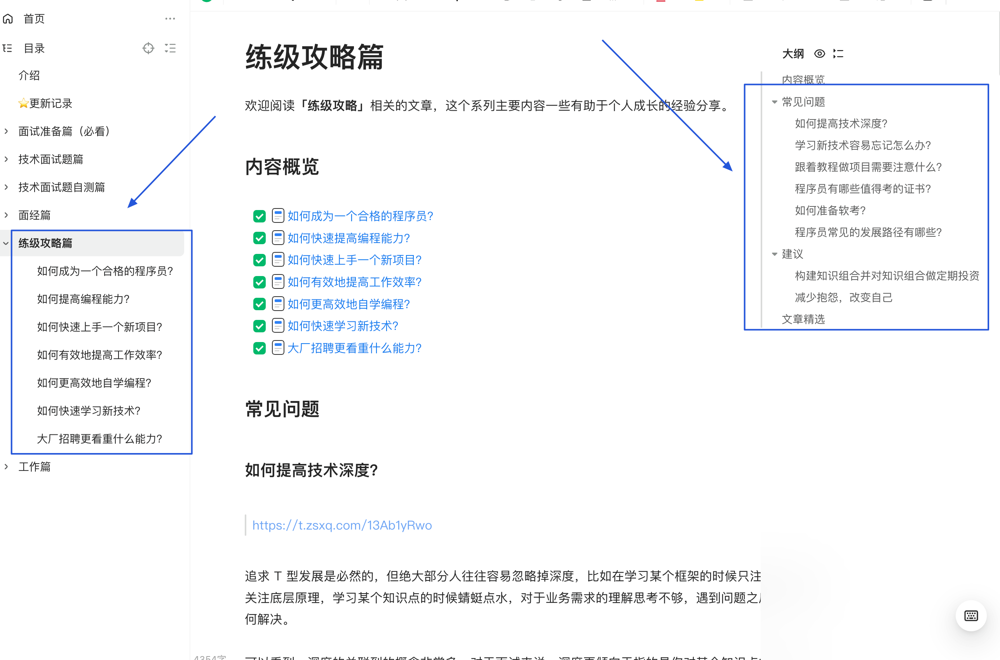
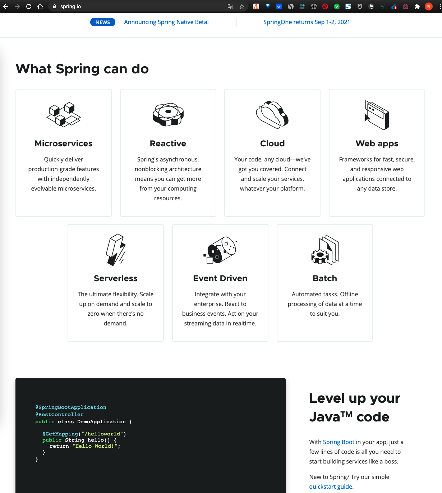

> **Editor's note:** This article is from the career-growth section of [The Java Interview Guide](https://javaguide.cn/zhuanlan/java-mian-shi-zhi-bei.html). It shares my approach to learning a new technology quickly.
>
> 

Work may require you to learn a technology quickly and use it in a project. Or a company you want to interview with may expect experience with a technology you have not used before.

As a self-taught developer, here is how I approach learning something new.

First, understand what problem the technology solves. Before studying it in depth, get an overview: identify its main components and capabilities, and consider how it compares with similar technologies.

For example, Spring's official documentation explains its latest developments, modules, and the problems it is designed to solve.

When learning a message queue, I first look at its role in a system and the problems it addresses. Then I compare it with message queues I already know. When I studied RocketMQ, for example, I compared it with ActiveMQ, the first message queue I had learned: What had RocketMQ improved? Which ActiveMQ limitations did it address? What did the two have in common, and how did they differ?

**One of the fastest ways to learn a technology is to connect it to what you already know.**

Next, read the official getting-started guide, run its examples, and build a small project.

Official documentation is often in English, and only some projects—especially projects developed in China—offer Chinese documentation. Documentation can also be terse, which may make it difficult for beginners.

If the official documentation is hard to follow, look for high-quality articles or videos. **Do not start by trying to understand every internal detail.**

For Spring, after understanding the problems it solves, try its core features—IoC (Inversion of Control) and AOP (Aspect-Oriented Programming). Write a few examples or a small project before studying the framework's internals or source code.

In short, **learn how to use a technology before studying how it works internally**.

This gradual approach makes progress easier to see and helps you avoid getting discouraged by abstract internals too early.

Hands-on work also makes it easier to understand the internals. If you are studying Tomcat's thread pool, for example, try implementing a custom thread pool. If you are studying Dubbo, build a simple RPC framework.

There is also a difference between learning a technology for a project and learning it for an interview.

For project work, focus on usage, best practices, and common operational problems. Your goal is to use the technology effectively and produce a positive result for the project.

For an interview, focus on the questions commonly asked about that technology. These questions are sometimes called “interview prep notes” in Chinese developer communities.

Some people dismiss interview questions as rote memorization. Instead of memorizing answers, think about the underlying problems. This can deepen your understanding of the technology while you prepare.

Most important, **put what you learn into practice**. In programming and other fields, what you do with your knowledge matters more than how much information you have memorized.
