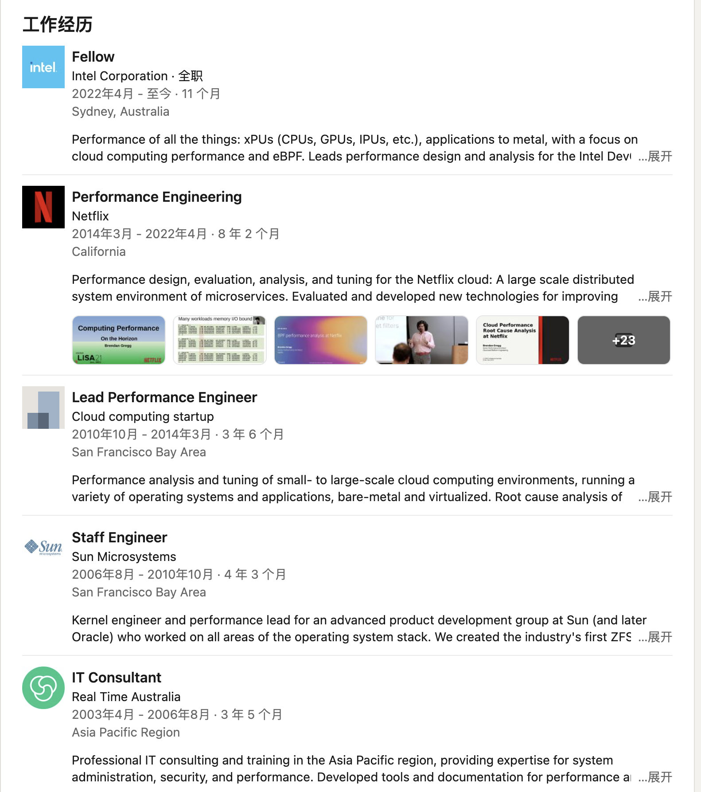
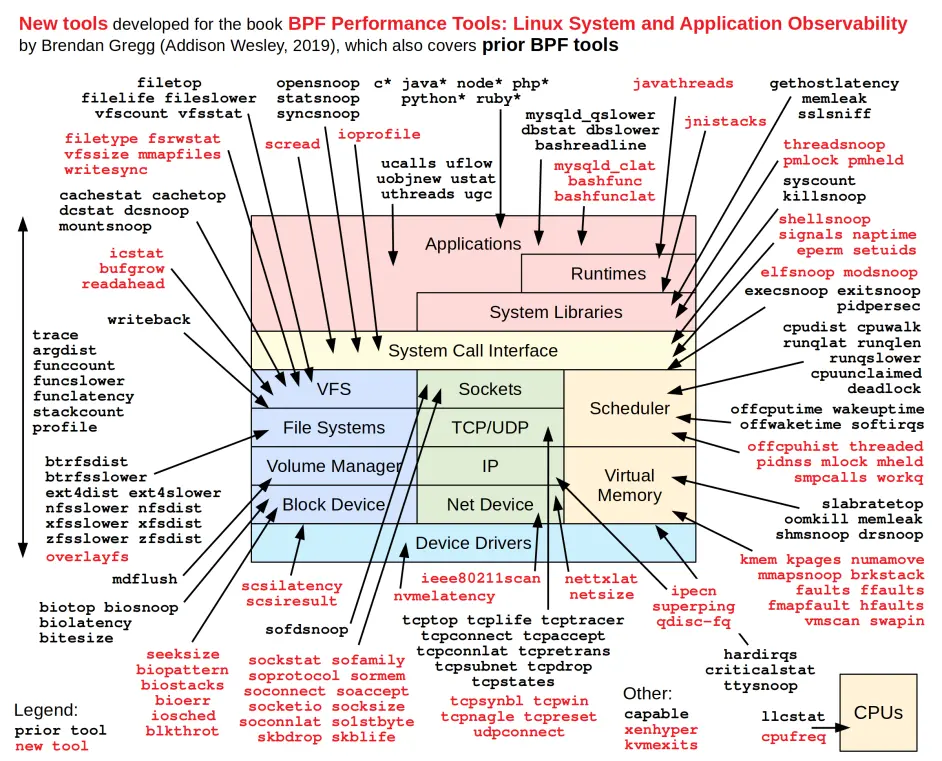
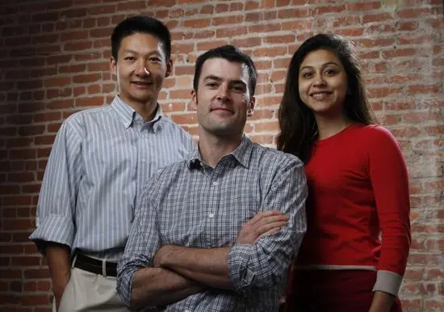
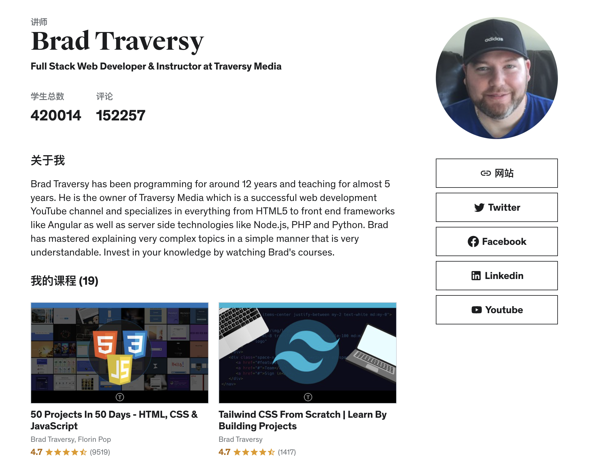
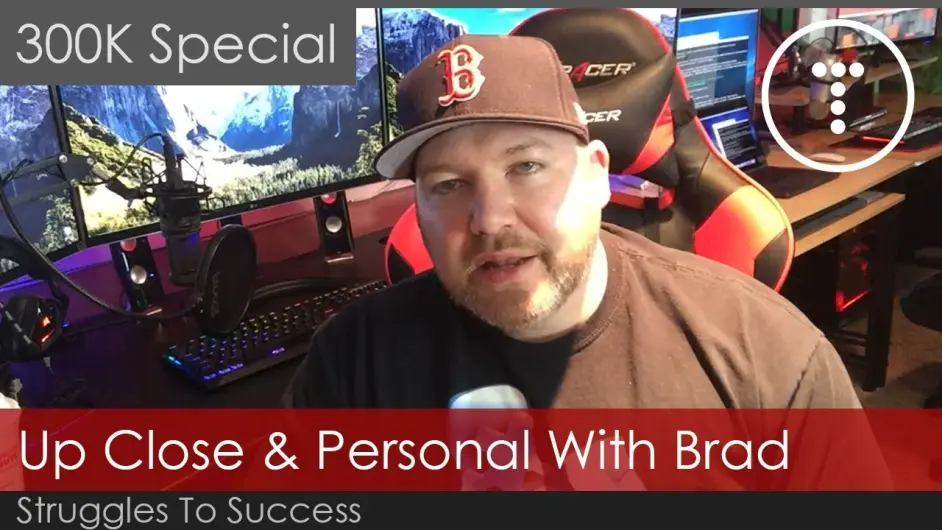
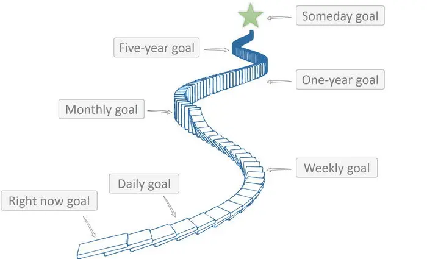
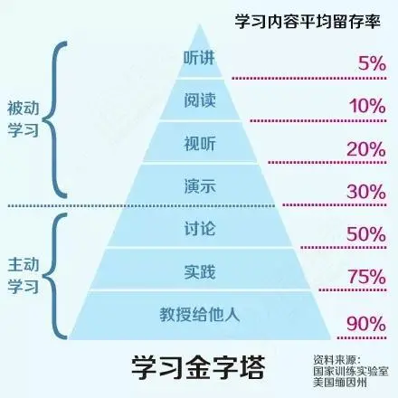
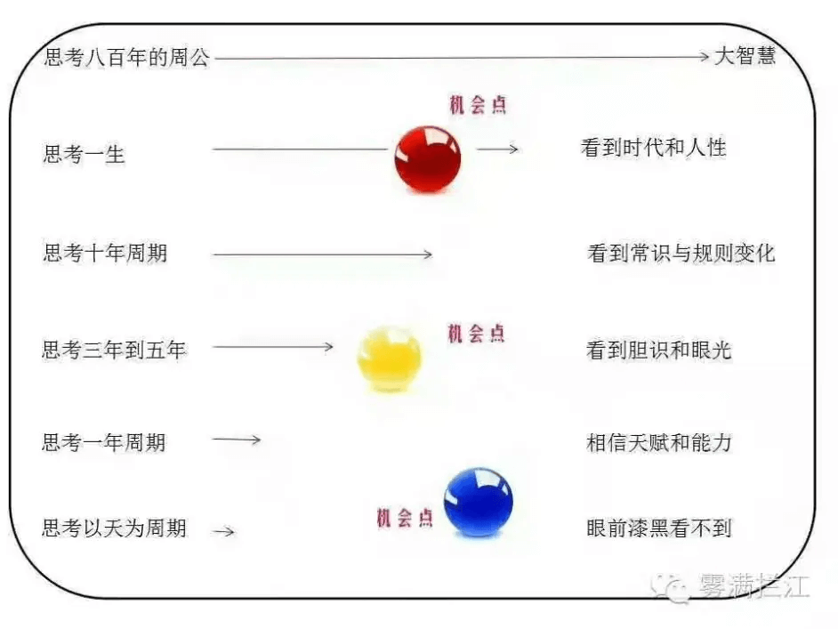

> **Editor's note**: An excellent article by Bobo. Its advice applies not only to technical growth but to other fields as well. Read it more than once and develop your own growth strategy.
>
> **Original article**: <https://mp.weixin.qq.com/s/YrN8T67s801-MRo01lCHXA>

## 1. Introduction

In Bobo's WeChat group for technology professionals, students often ask how to learn and grow. Even through online conversations, I can sense their anxiety.

**Why are technology professionals anxious?** In my view, they may lack confidence and perspective. Anxiety often comes from fearing an uncertain future. A lack of perspective makes it hard to understand the world around you, yourself, or which path suits you. People who are easily anxious may have a narrow outlook and modest ambitions. From a strategy and management perspective, they lack a clear understanding of themselves and the world around them, a long-term learning and growth strategy, and actionable milestones with disciplined execution.

So many students asked similar questions that I decided to write this article rather than repeat my answers. If someone asks again, I can point them here and encourage them to think for three months, a year, or longer about one question: **What is your technical growth strategy?** If you have a clear and practical answer, congratulations: follow it step by step. There is no need to worry; reaching your goals and accomplishing something will take time. If you do not have an answer, keep practicing and reflecting until you work through this important question in life.

Let's look at how some well-known technology professionals have grown.

## 2. Learn Growth Strategies from Technology Leaders

Software design has design patterns. Technical professionals also have growth patterns. Bobo often studies the career histories of technology leaders on LinkedIn to understand these patterns and develop ideas for a personal growth strategy.

Few technology leaders spell out their growth strategy or detailed annual plans. But we can infer them from their careers and output. **The more accomplished the professional, the clearer their strategy and path tend to be, and the easier it is to identify patterns in their success.**

### 2.1 A Systems Performance Expert

Many developers are interested in performance optimization. Some often talk about high performance and concurrency, but few reach expert-level depth in the field.

One expert I want to introduce is **Brendan Gregg**, author of the classic systems performance book _Systems Performance: Enterprise and the Cloud_ ([Chinese edition](https://www.amazon.cn/dp/B08GC261P9)) and creator of the well-known [FlameGraph performance analysis tool](https://github.com/brendangregg/FlameGraph).

Brendan Gregg was a senior performance architect at Netflix for nearly seven years. In April 2022, he left Netflix to become an Intel Fellow.

He has spent more than a decade specializing in systems performance. You can see his [career history](https://www.linkedin.com/in/brendangregg/) on LinkedIn. Alongside his books, he has produced more than a hundred technical documents, presentations, talks, and software tools related to systems performance. He shares them on [his technical blog](http://www.brendangregg.com/), making him an exceptionally productive expert.

The diagram above comes from Brendan Gregg's book _BPF Performance Tools: Linux System and Application Observability_. It shows how deeply he understands every layer of systems performance—from hardware and operating systems to applications. Bobo considers him a world-class expert in systems performance.

### 2.2 From Open Source to an Enterprise Company

The second technology leader I want to discuss is **Jay Kreps**, co-founder and CEO of Confluent, and a creator and architect of Kafka, the well-known open-source messaging system. Confluent builds enterprise products and services around Kafka.

Jay Kreps's [LinkedIn history](https://www.linkedin.com/in/jaykreps/) shows that he spent more than seven years at LinkedIn, from June 2007 to September 2014. He advanced from senior engineer to engineering lead and then principal staff engineer. Around 2010, he started Kafka at LinkedIn to address the company's needs for collecting, storing, and consuming large volumes of data. He and his team then focused on improving Kafka, open-sourcing it in early 2011, and building its community.

By late 2014, Kafka had become successful in the community and had a substantial user base. Jay Kreps and several early contributors left LinkedIn to found [Confluent](https://tech.163.com/14/1107/18/AAFG92LD00094ODU.html), bringing Kafka and related products to the enterprise market. In April 2020, Confluent raised $250 million in a Series E round and was valued at $4.5 billion. Jay Kreps had spent about a decade building Kafka and the company around it.

The three founders of Confluent make an interesting group: a Chinese founder on the left, an Indian founder on the right, and American Jay Kreps in the middle.

Kafka and Jay Kreps made a strong impression on me. In the second half of 2012, I worked on big data collection in Ctrip's framework department and built a Log Collector + Agent product with functionality similar to Kafka. At the time, there were at least four other open-source products in this space: Facebook Scribe, Apache Chukwa, Apache Flume, and Apache Kafka. Looking back, Kafka was the one that continued to thrive. That is closely connected to its founders' focus and sustained investment, as well as their broader technical vision.

At the time, I had little strategic thinking. I wanted to learn every technology and believed that working on more projects would make me better. After half a year on data collection, I turned to other projects that seemed “more interesting.” This also shows how limited my perspective was then. I followed some of Jay's entrepreneurial work but did not expect Confluent to grow to its current scale. In retrospect, Jay Kreps had a clear technical growth strategy and the vision and qualities needed to build something significant even a decade ago. Jay Kreps and Kafka gave me a vivid lesson in technical strategy and execution.

### 2.3 A Technology Educator and Influencer

Some readers may object that these leaders had strong educational backgrounds and technical foundations, which gave them an advantage. That is not always the case. Consider **Brad Traversy**, a well-known technology educator. His [LinkedIn profile](https://www.linkedin.com/in/bradtraversy/) shows a modest background: he attended a community college, had no experience at a major technology company, and held a few jobs doing contract web development.

Yet Brad Traversy has become a major figure in technology education. His [YouTube channel](https://www.youtube.com/c/TraversyMedia) now has more than 1.38 million subscribers. Over ten years, he published more than 800 tutorials about web development and programming. He is also a successful [Udemy](https://www.udemy.com/user/brad-traversy/) instructor, with 19 courses and nearly 420,000 students.

Brad Traversy now works independently and earns a good income from YouTube ads and Udemy courses.

It is hard to imagine that, when he was younger, he struggled with delinquency, alcohol, smoking, drugs, tattoos, and prison. After the birth of his first child, he began taking responsibility and changing his life. With a strong interest in technology, he started publishing free courses on YouTube. He found a strategic goal that suited him, and his life began to change for the better. If you are interested in his story, watch his account, [“My Struggles & Success”](https://www.youtube.com/watch?v=zA9krklwADI).

I browsed [Brad Traversy's YouTube videos](https://www.youtube.com/c/TraversyMedia/videos). Over ten years, he published more than 800 videos, averaging over 80 per year. His first video was posted in August 2010. He had very few subscribers in the early years, reaching 50,000 only in January 2017—about six years later. In October 2017, the count rose to 200,000, and in March 2018 it reached 300,000. By January 2021, it had reached 1.38 million. His growth seems to have accelerated around 2017, after six or seven years of steady work. **Plotted over time, these numbers would form a striking compounding curve.**

### 2.4 Lessons from These Examples

Brendan Gregg, Jay Kreps, and Brad Traversy followed different paths, but their success shares several patterns:

**1. They found a long-term goal that suited them.**

- Brendan Gregg: Become a leading expert in systems performance.
- Jay Kreps: Build an enterprise company around the open-source Kafka messaging system and take it public.
- Brad Traversy: Become a technology educator and course instructor, and make that his career.

**2. They focused on one niche, or a small number of related areas, and did not switch fields casually.**

- Brendan Gregg: Systems performance.
- Jay Kreps: Messaging middleware, stream processing, and entrepreneurship.
- Brad Traversy: Technology education, web development, and programming languages.

**3. They made a long-term commitment. All three invested a decade.**

**4. They set annual plans and produced sustained, measurable value.**

- Brendan Gregg: In addition to his day job, he produced more than ten technical documents and talks per year, and an average of 2.5 open-source tools per year. Over a decade, he published two books; _Systems Performance_ is now in its second edition.
- Jay Kreps: He contributed open-source products and built a company, published a book, and released Kafka and related products regularly.
- Brad Traversy: He published free YouTube videos—over 80 per year on average—and about 1.5 paid Udemy courses per year.

**5. Thinking from the end goal backward is a key difference between high achievers and most people.**

Most people take things one step at a time without much long-term planning. High achievers often start with a major goal, then work backward to create detailed plans for each year, month, and week. Brendan Gregg, Jay Kreps, and Brad Traversy are examples of this approach.

The examples above point to one important pattern: these professionals grew through **sustained, valuable output**. Why is output so important? The learning pyramid helps explain.

## 3. The Learning Pyramid and Deliberate Practice

The learning pyramid is attributed to research by the National Training Laboratories in Bethel, Maine. It proposes the following average retention rates:

> 1. Listening to a lecture: about 5%.
> 2. Reading: about 10%.
> 3. Learning with audiovisual material: about 20%.
> 4. Watching a teacher demonstrate an experiment: about 30%.
> 5. Group discussion, especially debate: about 50%.
> 6. Applying what you learned in practice: about 75%.
> 7. Organizing what you learned and teaching it to others: about 90%.

The first four methods are called **passive learning**; the last three are **active learning**.

Think of learning to swim. Passive learning is watching someone else swim; active learning means getting into the water yourself. Swimming and running burn calories, which helps exercise the body and build muscle. Watching someone swim does not build your muscles. In the same way, active learning requires mental effort to train the brain and build its “muscles.”

Burning physical calories is uncomfortable. If it felt comfortable, perhaps there would be no such thing as being overweight. Mental effort can also feel uncomfortable: you may feel tense, sweat, or struggle to express yourself. If thinking hard felt comfortable, everyone might be brilliant and reach their full potential. This discomfort is temporary; over time, it can make you healthier and more capable. Bobo believes that people's innate physical differences are relatively small, while differences in fitness and ability largely come from the quality, frequency, and intensity of training.

Once you understand this, you can deliberately train with maturity and discipline. Deliberate practice includes physical training. Bobo runs 3 km and walks 3 km each day, does 60 sit-ups, and holds a plank for five minutes to burn a consistent amount of energy. It also includes mental training. He works on projects and writes code daily (training the brain and hands), publishes an average of ten minutes of free video on Bilibili each day (training the brain and speaking), and regularly writes WeChat articles (training the brain and writing). He also plays a balance-ball game (below) or _Tomb Raider_ for about half an hour a day (training coordination and hand skills). These activities keep the brain active with a moderate level of effort.

For the theory and methods behind deliberate practice, I recommend the book _Peak: Secrets from the New Science of Expertise_.

If you have never lifted weights, suddenly doing so may feel uncomfortable or even cause an injury. Mental training is similar. If you have never made videos, your first attempts may feel awkward and look poor. That is fine: all training improves gradually through continued effort. As you build the relevant “muscles,” the work becomes smoother and creates a positive feedback loop. Like physical fitness, mental fitness requires incremental, persistent deliberate practice. Do not give up when you encounter difficulty.

Now reconsider the work of Brendan Gregg, Jay Kreps, and Brad Traversy. Their growth was built on sustained, valuable output—the result of deliberate practice and sustained mental effort. Some output came directly from practice, such as Jay Kreps's Kafka project and Confluent. Other output organized and taught what they had learned, such as Brendan Gregg's presentations, videos, and books, and Brad Traversy's tutorials. In other words, they practiced active learning at levels five through seven of the learning pyramid. Their work also reached users and created customer value. Users provide feedback and measurable results. Remember: learning with feedback and measurement forms a closed loop that can improve over time. Learning without feedback or measurement cannot be refined as effectively.

It is easy to share a reading list or a skills chart. Reading books and taking courses are not hard. It is much harder to set a five-to-ten-year growth strategy, turn it into annual plans—especially output goals—and follow through. That takes a great deal of practical training and reflection, or “mental calories.” But growth works this way: becoming a technology leader, like becoming a world-class athlete, requires effort proportionate to the goal. It also requires producing social value in proportion to the recognition you seek. Society rewards contributions that help it progress.

## 4. Developing Strategic Thinking

When new graduates start working, they often think in days, weeks, or months: which technology to learn today or which language to study tomorrow. They rarely plan for a year or longer. It is a period of uncertainty when the future is hard to see, and the ability to spot opportunities is limited.

After about three years of work, people with good judgment often start thinking in annual cycles and making yearly plans. This is a stage of testing their talents and abilities, when they may spot smaller opportunities.

After about five years, some develop greater confidence and perspective. They plan over three-to-five-year periods and proactively position themselves to pursue medium-sized opportunities.

After about ten years, people with strong judgment may recognize changing patterns and rules, such as industry trends and how people develop. Strategic thinking begins to emerge. They plan over five-to-ten-year periods and position themselves to pursue larger opportunities. Brendan Gregg, Jay Kreps, and Brad Traversy reached this stage.

Some exceptional people understand their era and human nature and think in terms of a lifetime or longer. They are beyond the scope of this article.

## 5. Recommendations

**1. Plan your strategy over a five-to-ten-year horizon.**

Most university students graduate at 22 or 23. After ten years of work, at 32 or 33, you should have developed a deeper understanding of yourself and the world around you—your industry and field. **If you are still drifting between unrelated pursuits at that age, you may lack confidence and perspective.** In today's competitive IT industry, losing your job at 35 may be a real possibility.

Once you start thinking strategically, plan over five-to-ten-year periods. The examples of Brendan Gregg, Jay Kreps, and Brad Traversy suggest that **significant achievements often require about a decade of investment**. Starting at 33, you may have roughly three decades before 60, when age can make major work more difficult. If you start planning at 40, you may have about two decades. With a clear strategy, those two or three decades can be enough to accomplish a great deal. Without one, you may struggle to build something of your own and spend your career advancing someone else's goals.

**2. Focus your energy.**

You may have only two or three decades to build a career. Life is short. Put your energy into the strategy you have chosen instead of wasting it on online arguments and idle chatter.

**3. Break the strategy into practical plans, especially output goals.**

Once you have a ten-year direction, create detailed annual plans, particularly plans for what you will produce. These plans should emphasize levels five, six, and seven of the learning pyramid. **Output should come from deliberate practice and effort: keep your body and mind active every day.**

**4. Produce valuable work and build a positive feedback loop.**

Your output should create customer value, help you learn and grow, and help others and society grow. This brings **user feedback and measurable results**, forming a loop that lets you keep improving your learning.

**5. Less is more.**

Go deep in one field or a small number of related fields. Keep every detailed plan aligned with your strategy. Control the urge to take on too much or lose focus, and do not be distracted by the noise around you.

**6. Write down your strategy and detailed plans, then review and improve them regularly.**

**7. Stay focused and keep working.**

The path to a strategy is never straight. You will need to adjust your direction and detailed plans as circumstances change, especially early on, but they should eventually converge. If they keep changing without converging, you may lack strategic focus; examine and address that problem.

You can learn from other people's strategies, but do not copy them. You have your own character. **Become your own person.**

Once your direction and detailed plans are clear, execute them steadily, year after year.

**8. Slow is fast.**

Strategic goals grow over time, like a tree, and require patience. Remember: **slow is fast.** When you feel anxious or stuck, repeat this teaching from Wang Yangming's _Instructions for Practical Living_:

> Applying oneself to a goal is like planting a tree. At first there is only a root and a bud, with no trunk. Once the trunk grows, branches can appear; then come leaves, flowers, and fruit. When you first plant the tree, focus on cultivating and watering it. Do not keep wondering when the branches will grow, when it will flower, or when it will bear fruit. What good does worrying do? If you keep tending the tree, why fear that it will never grow branches, leaves, flowers, or fruit?

<!-- @include: @article-footer.snippet.md -->
