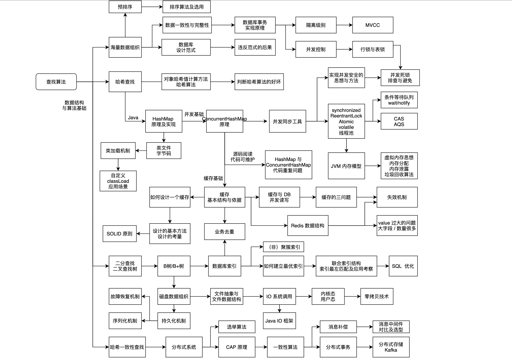

> **Editor's note:** This article discusses technical interviews from the perspectives of both interviewer and candidate.
>
> **Overview:**
>
> - Combine theory with practice. After a candidate describes the JVM memory layout, ask what can cause an `OutOfMemoryError`, how to prevent it, and how they have diagnosed and fixed memory leaks.
> - Discuss no more than two projects in depth; each takes time. Let the candidate choose a project they found rewarding, challenging, memorable, or interesting. Explore its context, stack, components and interactions, technical challenges, troubleshooting, maintainability, and engineering quality.
> - Ask more and talk less so the candidate can demonstrate their abilities. Use their answers to guide follow-up questions, explore a topic more deeply, or move to related topics.
>
> **Original article:** <https://www.cnblogs.com/lovesqcc/p/15169365.html>

## Three Key Questions

1. What is your assessment of the candidate? Consider communication, learning, summarizing, reflection and improvement, handling pressure and emotions, influence, and team management.
2. Could the candidate independently design and implement a project? Consider system design and project management.
3. How well does the candidate analyze and solve problems? Consider their understanding of principles and ability to apply them.

## Assessment Goals and Approach

The first technical interview should assess:

- The candidate's technical foundations.
- Their approach and ability to solve problems.

I give technical foundations 70% of the emphasis and practical problem-solving 30%. In the iceberg analogy, foundations are below the surface and their application is visible above it. Business experience and technical fundamentals receive the same 30/70 split.

The central goal is to assess the ability to analyze and solve problems.

Assess technical depth, application, and breadth. For graduates and experienced candidates below P6, emphasize depth and application; breadth is a bonus. For roles above P6, give breadth more weight.

- **Graduate hiring:** Look for solid fundamentals and agile thinking. Topics include data structures and algorithms, processes and concurrency, memory management, system calls and I/O, networking, database normalization and design, design patterns and principles, and coding habits.
- **Experienced hiring:** Look for practical experience and understanding of internals. Topics include the Java Memory Model and memory leaks, JVM and class loading, database indexes and query optimization, caching, messaging, projects, architecture, and engineering practices.

### What Are Technical Foundations?

How should an interviewer assess fundamentals? Established knowledge is important, but so is knowing how to reason. Knowing _what_ means understanding existing concepts; knowing _why_ means deriving ideas from the ground up and understanding the choices behind them. Software is built on logic and rarely has only one solution. Technical foundations include reasoning carefully about design, implementation, and details.

### Why Assess Technical Foundations?

Two important engineering skills are logical reasoning and abstract design. Questions about fundamental concepts and their relationships test logical reasoning. Questions that ask candidates to model a business problem as a technical problem test abstraction and design.

Many business problems can be expressed as technical problems in a particular domain.

Fundamentals can therefore reveal a candidate's technical depth and breadth.

### Why Not Assess Business Experience Alone?

Candidates are usually familiar with their business domain and may repeat an existing solution. That can make it difficult to assess deeper understanding, transfer to related problems, and ability to summarize lessons.

Ask targeted reflection questions, such as: “What lessons can you share from building or maintaining microservices or improving system stability and performance?”

### Why Assess Business Experience?

Fundamentals alone can miss qualities such as communication, organization, project leadership, handling pressure, solving practical problems, influence within a team, and other personal traits.

## Assessment Methods

### Assessing Technical Foundations

Use questions from several angles.

**What and why**

“What” tests basic understanding; “why” explores the principles behind an implementation.

For example: “What is an index? How is it implemented?”

**Guide, explore related topics, and go deeper**

Start with a prompt such as “Are you familiar with Java synchronization utilities?” If the answer is yes, ask which utilities the candidate knows to assess breadth.

Then ask, “How are `ConcurrentHashMap` or AQS implemented?”

The clarity with which a candidate explains the approach and details can reveal how well they understand the technology.

**Ask questions at increasing levels of depth**

Use three levels:

- Basic concepts: assess understanding of the concept.
- Principles and mechanisms: assess understanding of its internals and implications.
- Application: assess how the candidate uses the concept and adapts their reasoning.

**Move between related topics**

For example, a discussion of hash-based lookup can lead to consistent hashing. The topics are related but differ in important ways, making this a way to assess breadth.

**Ask for lessons learned**

For example: “What lessons from this work could you share?” This tests the ability to reflect and summarize.

**Combine theory and practice**

- After a candidate describes JVM memory layout, ask what causes an `OutOfMemoryError`, how to prevent it, and how they have diagnosed and fixed memory leaks.
- If they discuss SQL and index optimization, ask how indexes work and how they choose an appropriate index.
- If they discuss transactions, ask about transaction internals, isolation levels, and snapshot implementation.

**Explore familiar and unfamiliar areas**

Ask about both stated skills and areas not listed on the resume. For someone who lists JVM memory knowledge, ask about memory management and then Java concurrency utilities, whose familiarity is less certain.

**Combine recall and application**

“Which search algorithms do you know?” may elicit linear search, binary search, and hash lookup. This checks recall.

Follow with: “When is each appropriate? Where have you used one, and why?” These questions assess application.

**Use questions from your own learning and work**

Problems encountered while learning or working can become interview questions.

For example, while reading the concurrency section of _Operating Systems: Three Easy Pieces_, I encountered a chapter on thread-safe data structures. It suggested questions: How would you implement a lock, a thread-safe counter, a linked list, or a map? How would you improve concurrency performance?

Workplace problems can likewise be distilled into questions about fundamentals.

**Assess familiarity with the technology stack**

If a candidate's resume lists technologies used by your company, ask detailed questions to understand their experience with them.

Do not reject someone solely for lacking the exact stack. For example, a candidate without MongoDB experience who has used MySQL, Redis, Elasticsearch, and HBase may be just as capable of learning MongoDB as someone whose experience is limited to MySQL and MongoDB.

**Look beyond memorized answers**

Memorized answers show that a candidate prepared, but an employer also needs to assess whether they can apply what they know.

Explore a topic's depth and breadth through guided and related follow-up questions, then present a practical problem to see how flexibly the candidate applies it.

For example, after discussing Java synchronization, ask: “Thread A starts an asynchronous task on thread B and must wait for B to finish before continuing. How would you implement this?”

Combine theory with application questions, varying the scenario as needed. An opponent may know that you adapt without knowing the form your response will take; the possibilities are countless.

**Favor practical topics**

Assess knowledge and skills used regularly at work instead of obscure trivia.

I favor data structures and algorithms, concurrency, and design because they are foundational.

**Connect questions across topics**

Knowledge is connected. Avoid assessing every concept in isolation.

Start with a topic such as search algorithms, then branch into related concepts:

At each point, use the techniques above to explore different branches and assess depth, breadth, and application.

**Build your own question bank**

Maintain a question bank and add useful questions as they occur to you in daily work.

### Assessing Problem-Solving Ability

Fundamentals alone are not enough. Use the candidate's project experience to frame technical questions around real business problems.

Build the discussion step by step. This requires careful listening, technical depth, and business experience. Listen to the candidate's explanation, identify a useful technical starting point, and ask follow-up questions. Without that starting point, the assessment can easily stall.

Common questions include:

- What were the QPS and TPS? What optimizations were made, and what did they achieve?
- How would you handle a large data volume and maintain stability?
- What are the critical parts of this feature, module, or system? What solutions are available?
- Why did you choose one technology over another?
- How would you index a long field?
- What alternative approaches exist, and what are their tradeoffs?
- How do you handle an unreliable third-party API?
- How do you keep integration code maintainable when connecting many external systems?
- What scenarios could cause financial loss or a serious outage?
- How would you investigate high CPU usage, an `OutOfMemoryError`, or an I/O spike in production?
- What production problems occurred, and how did you resolve them?
- How is data kept consistent across subsystems?
- How would you extend the system for a new requirement?
- What would you improve if you built it again?

Related topics to explore in a system discussion include:

- Performance. I believe most systems have performance concerns; if a system has none because it is small, I do not consider it worth examining in depth.
- Technology choices in medium-sized and large systems.
- Possible improvements to the system.
- Extensibility and maintainability of business systems.
- Lessons from serious production incidents.
- Stability with large data volumes.
- Latency and backlog in consumer systems.
- Reliability of third-party integrations.
- Availability in distributed systems.
- Data consistency across cooperating subsystems.
- Financial loss and failure scenarios in transaction systems.

**Design questions**

- Many business objects are shared across machines, and some have duplicate combinations of fields. How would you deduplicate them? What if the fields are long?
- How would you keep a server stable during a sudden request surge?
- **Component:** Design a local cache or distributed cache.
- **Module:** Design a task scheduler. What factors matter?
- **System:** Design an internal reporting system that collects sales data from departments. Where is the complexity? What are the key quality attributes, modules, interactions, and technology choices?

**Project experience**

Discuss no more than two projects in depth; understanding one project takes significant time.

Let the candidate choose a project they found rewarding, challenging, memorable, interesting, or frustrating. Start with its context, then explore the technology stack, components and interactions, technical challenges and solutions, troubleshooting, maintainability, quality practices, and what they would improve.

## The Interview Process

### Prepare in Advance

Interviewers should review the candidate's strengths and work history and plan the discussion.

Be ready when the interview begins. Know the company's technology stack, business and direction, responsibilities, and promotion process; technical candidates often ask about these.

### Start the Interview

Interviews often start with an introduction, but candidates may cover too much ground. I ask directly: “What are your strengths, and what would you like to improve?”

I then start the technical discussion with a relatively simple question: “Which search algorithms do you know?” Most candidates can mention linear search, binary search, and hash lookup.

### Design Questions

Read the resume in advance, identify key topics, and prepare targeted questions.

If it mentions MVVM, ask how it differs from MVC. If it mentions the observer pattern, discuss it and ask which other design patterns the candidate knows.

One approach is “strengths, standard questions, and a random question”:

- First, ask which technologies interest the candidate and where they have invested most. Explore the principles and practical application of a strength.
- Next, ask standardized questions to assess understanding and application.
- Finally, choose another question at random and explore its principles and use.

Use a similar approach for projects:

- Ask about a project the candidate is proud of: its stack, modules and interactions, technology choices, key design problems, solutions, implementation details, and possible improvements.
- Ask about a frustrating project: what went wrong, what they tried, and what they would improve.

### Create a Relaxed Atmosphere

Keep the atmosphere relaxed even when asking many difficult questions.

An appropriate light remark about something in the candidate's background can help. For example, when interviewing Wang Kui, I mentioned a former teammate named Yuan Kui whom we called “Master Kui.”

A useful hint or a brief perspective during the interview can also ease tension.

### Listen

Ask more and talk less. Let candidates demonstrate their abilities, and use their answers to guide deeper or related questions.

Help candidates show their strengths. Both sides invest time and effort, so an interview should be a useful exchange, not an opportunity to belittle someone. You may learn from the candidate too.

Interviewer and candidate have different roles; the interviewer is not necessarily more capable.

### Record Key Points

Record answers carefully and objectively. Avoid adding your own interpretation or summarizing for the candidate; their ability to summarize is itself relevant.

### Practice

Conduct mock interviews.

### Make a Decision

The interview provides evidence for a decision.

Avoid expecting every candidate to be both exceptionally deep and broad. Such candidates may have better options, and technical strength alone does not establish strengths in areas such as teamwork.

Consider whether the candidate can do the current job, how their skills compare with the team, whether their experience and ability align, and whether they can grow into more complex work.

### Consider Experience Level

For engineers with less than three years of experience, emphasize fundamentals as an indicator of potential. Also consider teamwork, business experience, resilience, and enthusiasm and ability to learn.

For engineers with more than three years of experience, give more weight to business experience and problem-solving. Explore how they analyze concrete problems and apply their technical knowledge.

I am still learning how to assess a candidate's true ability and fit.

## Getting Started as an Interviewer

- Prepare the camera and audio; test them with headphones if needed.
- Read the resume, identify key topics, and prepare basic questions.
- Ask about fundamentals to build interviewing experience.
- Explore principles and implementation where appropriate.
- Start with a standout area on the resume. Otherwise, ask for project context and use it to guide questions.
- Practice connecting follow-up questions until it feels natural.
- Focus on analysis and problem-solving; use a coding problem when appropriate.
- Leave time for the candidate's questions and explain that they will hear the result within three working days.

## Assessing Efficiently

Once you are comfortable interviewing, improve efficiency: assess technical depth and breadth in less time. Prepare common questions to provide a consistent baseline.

I often cover memory management, algorithms, database indexes, caching, concurrency, system design, and problem analysis.

- Which data structures and algorithms for lookup do you know? Explain one and what you find interesting about it.
- When a Java method creates a list of objects, how is memory allocated? What can cause a stack overflow or `OutOfMemoryError`? How can you prevent an OOM? Have you resolved one in production?
- How does generational garbage collection work in Java? Which collector did your project use, and why?
- Which Java concurrency utilities do you know, and when would you use each?
- How do the `Atomic` classes and `ConcurrentHashMap` work internally?
- How would you implement a reentrant lock?
- Which fields were indexed in a project, and why? What could be improved? How do you design a good index?
- Which cache settings can be configured, and what does each affect?
- What expiration strategies does Redis use, and how would you choose settings?
- How would you deduplicate virus-scanning tasks?
- Which design patterns and principles do you know?
- How would you start building a module or complete system from scratch?

If a candidate does not know an implementation, ask how they would design it themselves.

One possible schedule is 25–30 minutes on fundamentals, 20–25 minutes on projects, and 5–10 minutes for the candidate's questions.

## Advice for Candidates

**Why focus on technical foundations?**

A common question is: if business development rarely requires implementing data structures and algorithms, why ask about `HashMap` internals or study algorithms, operating systems, and networking?

Here is my view:

- Business problems often lead to fundamentals such as data structures, memory management, concurrency, and networking. These help engineers understand large systems and diagnose difficult problems, unless they never encounter such problems and are content to write only CRUD code.
- I find these fundamentals among the most interesting parts of programming. If they do not interest you, it may be difficult to go deeper in the field; other careers offer many opportunities too. I sometimes want to explore beyond technology myself.
- Fundamentals are like a martial artist's underlying strength; individual technologies are techniques. Techniques without a strong foundation may not hold up against difficult problems or competition.
- Strong foundations can help you solve more complex problems and find better solutions to familiar ones.
- People often work well with others who have similar foundations. On a team with strong fundamentals, a large gap can increase collaboration costs; strengthening yours can help you contribute alongside experienced peers.
- Building other skills alongside CRUD development is another career choice. In my view, without deeper technical study, that path is less like being a dedicated programmer and more like becoming a technically literate product manager, project manager, HR professional, operations specialist, or customer-service professional. That career choice is beyond the scope of assessing programmers.

**Do not dwell on one unanswered question**

If you cannot answer every question, do not dwell on it. The interviewer may be exploring your depth and breadth to determine whether you meet the role's requirements.

What matters is that some answers demonstrate depth and thoughtful reasoning.

I learned this after becoming an interviewer. Not every interviewer thinks this way, but I believe it is a better approach.

## References

- [Nine Common Mistakes Made by Technical Interviewers](https://zhuanlan.zhihu.com/p/51404304)
- [How Can You Be a Good Interviewer?](https://www.zhihu.com/question/26240321)

<!-- @include: @article-footer.snippet.md -->
