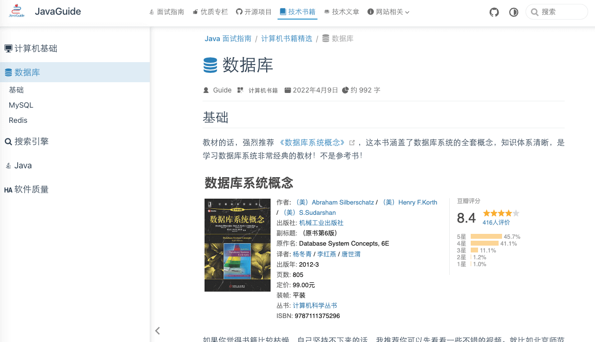

> **Editor's note:** A comprehensive and popular post on Nowcoder. The author applied for summer internships at Alibaba, Tencent, and ByteDance, and received offers from Alibaba and Tencent.
>
> **Original article:** <https://www.nowcoder.com/discuss/640519>
>
> **Next article:** [Ten Years of Ice, Still Burning with Passion: An Autumn Recruiting Retrospective](https://www.nowcoder.com/discuss/804679)

## Background

By the time I wrote this article, I had received an offer from Tencent and spring recruiting was over. Unlike the previous year, when I applied broadly for regular internships, this time I applied only to the three major companies known as BAT: Baidu, Alibaba, and Tencent. Alibaba and Tencent gave me offers. ByteDance did not invite me to interview—perhaps my online assessment went badly.

I was a junior undergraduate at a university outside the elite Project 985 and 211 groups. My spring recruiting period ran from February 20 until I received an offer from Alibaba on March 23. After my final technical interview with Ant Group on March 7, I did not have any more technical interviews—only two HR interviews. I spent the rest of the time waiting for offers.

At first, a friend referred me for a regular internship on ByteDance's finance team. My resume is still under review there. Later, I also applied for its summer internship, but after the online assessment, my application remained stuck in the process. Tencent initially picked me up for an interview with its TiMi studio. After I failed the first round, PCG picked up my application, and I completed the process. I applied to many Alibaba teams in the early batch. Ant Group was the first to complete its final interview and enter my application in the system, and I eventually received an offer.

The experience had its ups and downs. I felt insecure about my university background and even considered graduate school. Overall, find a study partner to prepare with. For example, my lab partner and team lead, @You're Probably an Idiot. They are genuinely talented and received offers from Alibaba's core teams. They helped me a lot during my preparation.

## Why I Wrote This Post

1. **For myself:** To reflect on my first three years at university and my job search.
2. **For people still looking for internships:** I hope my experience and interview notes offer some useful ideas.
3. **For younger students who, like me, dream of working at a major tech company:** You still have plenty of time to prepare. Whatever you have been doing—or whether you lack a goal or have been drifting—if you choose the right direction and keep studying for a year or two, you can realize your dream.

## My University Experience

First, here is a little about my time at university.

I had no papers, competitions, ACM awards, or other major honors. My GPA was okay—not terrible, but not outstanding. I was unlikely to qualify for a recommendation-based graduate admission, and I was not confident I could pass the graduate entrance exam.

I joined a programming studio in my first year. In the first semester, I taught myself C and data structures. I started learning Java over winter break. At the time, I did not know how competitive the Java job market was. I had heard that Java offered good job prospects. This really shows the importance of information gaps.

I knew about frontend, backend, and Android development, and I was interested in backend development. But because I lacked information, I only knew Java could be used for backend work. I did not understand that “backend” was a broad category; only later did I learn terms such as server-side development. I also did not know that C++ and Go could be used for backend systems. That is why I chose Java.

In practice, Java is better suited to business applications, while C++ is often used for lower-level and server-side development. I do not mind business development, but I am more interested in operating systems and networks. I study those topics in my spare time.

### My Learning Path

My approximate study path was: Java SE fundamentals → MySQL → Java Web (mainly JDBC, Servlets, and JSP) → SSM (Spring, Spring MVC, and MyBatis; Spring Boot was already gaining popularity, but I thought it would be hard to learn without the SSM fundamentals) → Spring Boot → Spring Cloud (I learned some concepts about distributed systems, but without project experience I did not know how to use it) → Redis → Nginx → computer networks (a required CS course at my university, but we did not take it until the second half of junior year, so I studied it early) → Dubbo → ZooKeeper → JVM → JUC → Netty → RabbitMQ → operating systems (also taught later in the curriculum) → computer organization (the course was not offered).

I had learned these topics by the second half of my sophomore year, mostly from video courses. I knew how to use them but did not understand their underlying principles or know them well enough to answer typical interview questions. Once I had built a knowledge map, I began preparing for interviews, around June of the previous year. I read interview reports on Nowcoder and wrote my own summaries.

During interview preparation, I think reading books and practicing problems are most important; memorized interview notes are only supplementary. We jokingly say that interviews are about memorizing canned answers, but at companies like Alibaba, memorization alone will not get you through—unless you have an exceptional project or internship background.

### Recommended Books

- _Thinking in Java_: A great book, but very thick. I bought it and never finished it.
- _Understanding the Java Virtual Machine_: A JVM classic. I read it twice and learned something different each time.
- _The Art of Java Concurrency Programming_: Written by Alibaba engineers; it covers many concurrency topics asked about in interviews.
- _MySQL Technology Insider_: Detailed, but not very beginner-friendly. At first, I found it deep and scattered. Reading the chapters separately later was very rewarding.
- _Redis in Action_: As the title suggests, it explains Redis internals in depth and draws on the source code. A must-read.
- _Computer Systems: A Programmer's Perspective_ (CSAPP): A famous classic. It may not help much with Java interviews, but it covers computer systems, architecture, organization, operating systems, and more. In my second Ant interview, the interviewer asked about the biggest challenge I had faced. I talked about problems I encountered while reading this book. I also discussed it with an interviewer in my second Taobao interview, and we agreed that it deserved a second read.
- _TCP/IP Illustrated, Volume 1_: I read only the TCP chapters, but the book is worth reading in full. I discussed it with my TiMi interviewer.
- _Operating Systems: Three Easy Pieces_ (OSTEP): A well-known book and a textbook for Nanjing University's operating-systems course. You can read it alongside Professor Jiang Yanyan's videos on Bilibili; I include a link below.

If you understand these books thoroughly, I believe you can discuss technical topics in depth with interviewers and leave a strong impression. But most people will not remember everything after one read. Forgetting is normal. I read many of these books only once and have forgotten details; I am preparing to read them again.

For more book recommendations, see the [JavaGuide book list](https://javaguide.cn/books/), which is comprehensive.

### Recommended Courses

For the learning path above, I recommend following video courses. Tutorials from Shang Silicon Valley and Dark Horse Programmer are both useful. Make sure to type out the code yourself.

- [Nanjing University 2021: Operating Systems—Design and Implementation (Jiang Yanyan)](https://www.bilibili.com/video/BV1HN41197Ko): The comments speak for themselves.
- [SpringSecurity-Social-OAuth2 social login, authorization, and authentication course](https://www.bilibili.com/video/BV16J41127jq): The Spring Security lessons by Zimu Ge are also good. Spring Security or Shiro is essential for project work. Learn one and choose based on the use case and your preference.
- [Tsinghua University: Data Structures and Algorithms (Deng Junhui)](https://www.bilibili.com/video/BV1jt4y117KR): It is Tsinghua; need I say more?
- [45 Lessons on MySQL in Practice](https://time.geekbang.org/column/intro/100020801): Reviewing the first 27 lessons several times should help with most MySQL interview questions.
- [Redis Core Technologies and Practice](https://time.geekbang.org/column/intro/100056701): Covers many production use cases for Redis. Pair it with _Redis in Action_ to prepare for most Redis interview questions.
- [JavaGuide](https://javaguide.cn/books/): A Java learning and interview guide covering much of the core knowledge Java developers need.
- [The Java Interview Guide](https://mp.weixin.qq.com/s?__biz=Mzg2OTA0Njk0OA==&mid=2247519384&idx=1&sn=bc7e71af75350b755f04ca4178395b1a&chksm=cea1c353f9d64a458f797696d4144b4d6e58639371a4612b8e4d106d83a66d2289e7b2cd7431&token=660789642&lang=zh_CN&scene=21#wechat_redirect): A guide to preparing for interviews more efficiently. It covers common interview topics—including system design, frameworks, distributed systems, and high concurrency—as well as useful interview reports.

## Job Search

Around November of the previous year, regular internship interview reports began appearing on Nowcoder, and I realized it was time to look for an internship. I reviewed material while applying to many companies. Only a few gave me interviews. I failed Tencent's second round twice, which completely crushed my confidence and made me pessimistic about spring recruiting.

Fortunately, I eventually got an internship. I kept studying outside work, in the evenings and on weekends, and quietly promised myself I would come back stronger for spring recruiting.

In late February, I applied broadly to Alibaba's early recruiting batch and received interviews from most teams. On the day the application system opened, I received 16 referral emails. My earlier articles contain the detailed interview reports.

From March 1 to March 7, I averaged three interviews a day. It was exhausting. At one point I wanted to take the graduate entrance exam; I felt anxious, cried, and laughed. Fortunately, things worked out, and I joined Alipay, where I had always wanted to work.

I mainly want to share some advice based on my interview experience. Experienced engineers, please be kind.

### Interview Preparation

First, prepare a resume. I think a good resume should have three parts:

1. **Complete contact and personal information:** This needs little explanation. If your information is incomplete, interviewers and HR cannot reach you. Include your university even if you do not think highly of it; I have heard that some companies cannot evaluate a resume without the school listed. If you are not a CS major or your university is not well known, you can put education near the bottom.
2. **Projects and internships:** Projects are important, and much of the interview may focus on them. If you know your projects well, you can guide the discussion toward areas you understand; I learned this the hard way. If you lack project experience, find an open-source project on GitHub, build it yourself, and add your own ideas. Do not only make the feature work; consider performance and optimization. Interviewers care less about the implementation itself than about how you reasoned through it: what was your original design, what did you choose, how did it improve performance, and what could be improved further?
3. **Technical skills:** Briefly list the relevant knowledge you have studied so interviewers can ask focused fundamentals questions. Do not list everything. Put your strongest skills first.

After writing your resume, start applying. A reliable referral can help track interview progress, communicate with HR when necessary, and explain why you were rejected and what you could improve. Referrals are no longer a barrier to entry; they are the minimum ticket to get in. If you do not know anyone, you can ask alumni on Nowcoder for a referral. They are often happy to help.

Try not to be nervous in interviews. Your first-round interviewer may not be much older than you or may have only a few years of experience. So, no need to panic and lose your words. If you do not know something, say so with a smile. If you do, explain it clearly. An interview is not just a series of questions and answers; it is a conversation. Share your reasoning. Communication is also part of how interviewers evaluate you.

I think an interview is a bit like dating: you want the other person to get to know you quickly and notice your strengths. The difference is that you want the interviewer to understand your technical ability. That makes the self-introduction especially important. After briefly introducing yourself, talk about your projects. Make the introduction long enough to give the interviewer time to read your resume—they may not have read it beforehand (just kidding). You can write your introduction and project descriptions in a document, read them several times, and memorize them for the interview. If necessary, you can even read from the document.

### Projects

I want to emphasize project experience. I used to think projects were unpredictable, but interviews taught me that they are the easiest way to guide the conversation. Interviewers ask about projects to test your fundamentals, so know your project thoroughly. Think about edge cases and optimizations, understand the middleware you used, and know how it handles problems such as message-queue recovery after a crash, Redis clusters and Sentinel, cache avalanches, cache breakdowns, and cache penetration.

Possible optimizations include caching, using message queues to decouple services, adding indexes, multithreading, asynchronous tasks, and using Elasticsearch for search. The main goals are often to reduce database access and synchronous calls. Caching and Elasticsearch reduce database access; message queues and asynchronous tasks reduce synchronous calls.

Projects can also teach you many concepts, for example:

1. Access control (ABAC and RBAC)
2. JWT
3. Single sign-on
4. Database sharding and table partitioning
5. Resumable or chunked uploads and exports
6. Distributed locks
7. Load balancing

There are many more. Projects differ, so what you learn varies widely. But assume interviewers may know the technologies you have encountered, and prepare thoroughly so you are not caught off guard.

At its core, project experience can also be broken down into interview topics. Prepare for it the same way you prepare technical fundamentals.

### Algorithms

Turning project experience into canned answers makes it harder to distinguish candidates accurately. That brings us to the third interview criterion: algorithms. During one interview's question period, I asked how algorithm practice helps. The interviewer answered directly: it helps you find a job.

I think algorithm skills can also improve with practice and repetition. If you solve the first 200 LeetCode problems three times, surely you will be able to write code in an interview. Keep practicing algorithms while preparing.

### Interview Tips

1. Make your self-introduction substantial and prepare how you will describe your projects.
2. If you do not know an answer, do not just say “I don't know” and freeze. You can say that you are not familiar with that topic but know something related, then explain it. If the interviewer is interested, you can continue; otherwise, they will move on. Interviewers usually will not interrupt. This helps them learn about you quickly.
3. Show your enthusiasm for technology. For example, discuss new features in Java releases or recent technology news. As far as I know, Alibaba also evaluates technical enthusiasm.
4. Remember that interviews are a two-way process. Do not act overly ingratiating.
5. Use the question period well. Ask useful questions, such as how new hires are trained and how the internship-to-full-time process works.

## Experience and Advice

1. **If you are a freshman:** Learn about career paths in the internet industry and consider your interests. Start by building fundamentals such as data structures, operating systems, computer networks, and computer organization. These are common graduate entrance exam subjects and frequent interview topics.
2. **If you are a sophomore:** Choose a direction and build self-motivation. Learn what knowledge the direction requires and what level is needed for a job. Plan your time and set milestones for each stage.
3. **If your academic background puts you at a disadvantage or you are not a CS major:** I recommend working harder than average. In the many interview reports I have read on Nowcoder, candidates from better-known schools often get easier questions, while others get harder ones. This may be because graduates from elite universities tend to have stronger overall backgrounds.
4. **Try to get an internship early.** If you are a sophomore and already have the skills to intern, start applying, especially for summer internships. Trust me: if you intern this summer, you will be in a much stronger position next year.
5. Building on the previous point, if you cannot find an internship, work on several challenging projects and find a clear way to demonstrate their value.
6. Spend time on Nowcoder. I met many like-minded people there, and they helped me a lot during my job search.

## Recommendations

1. **Prepare together.** Create a group with classmates who are also looking for jobs, whether they are from your university or people you met online. Share what you learn. The sum of several people working together is greater than the effort of one person alone.
2. **Both depth and breadth matter.** Learn about new technologies, and try to understand how each one works internally. Otherwise, you are learning English terminology rather than computer science, and your job is closer to calling APIs than doing software engineering.
3. **Maintain your CSDN, Juejin, or other technical blog.** One of my junior classmates became a CSDN expert in their second year and was already contacted by recruiters. Commit your code to GitHub, whether it is a project or an experiment. If you can, record videos and post them on Bilibili; this gives interviewers a way to assess your communication before meeting you.
4. **Keep a healthy mindset.** A difficult interview does not necessarily mean you lack ability. The company may have few openings or objective requirements you do not meet. Keep trying different options.
5. **Talk to people.** Do not work alone all the time. You will need to collaborate after joining a company, so communication is a basic skill worth developing early.

## Informal Reflections

### Information Gaps

I think the difference between universities is not only the quality of teaching. Elite universities do have stronger teaching and labs, but the information gap is the bigger difference. Students at Project 985 universities have access to more recruiting talks and lectures from good companies, as well as a stronger employment culture. More alumni go to major tech companies, foreign companies, or study abroad. Alumni referrals are only part of it; you can also learn non-technical things from them. Fewer graduates from non-elite universities reach major companies, so they can influence fewer people. That is the information gap.

How does it hurt? Students at one school may start looking for regular internships in their sophomore year, while students elsewhere think job hunting is for seniors. Some students get summer internships in their junior year, while others spend their summer in school-run training. The gap builds one step at a time.

Fortunately, the internet has made information more transparent. You can search online for what you need. I met several like-minded people on Nowcoder who helped me with my job search. Browsing Nowcoder regularly can help narrow the information gap.

### The Competition in Java

Is Java competitive? Absolutely. In my view, software development has a relatively low barrier to entry, and undergraduates are well suited to it. But algorithm roles are even more competitive, so many graduate students have moved into software development, often Java backend development.

That is not the only cause of competition. Training programs have lowered the barrier further: they provide a study plan and tell students what to learn. A third reason is the move into tech from non-CS fields. As other industries decline and the internet industry grows, more people from different backgrounds teach themselves computing and seek tech jobs. The number of people sharing the same limited opportunities keeps increasing.

Competition is not necessarily bad. It means the path to upward mobility is not completely closed and that many people still believe effort can change their situation. This may also help the industry and society develop. The choice is yours: return to your hometown and take it easy, or join the tech industry and compete. If you choose the latter, I suggest getting a foothold early, because the only constant is change. You never know what things will look like three years from now.

## Best Wishes

May you all have a bright future!

<!-- @include: @article-footer.snippet.md -->
