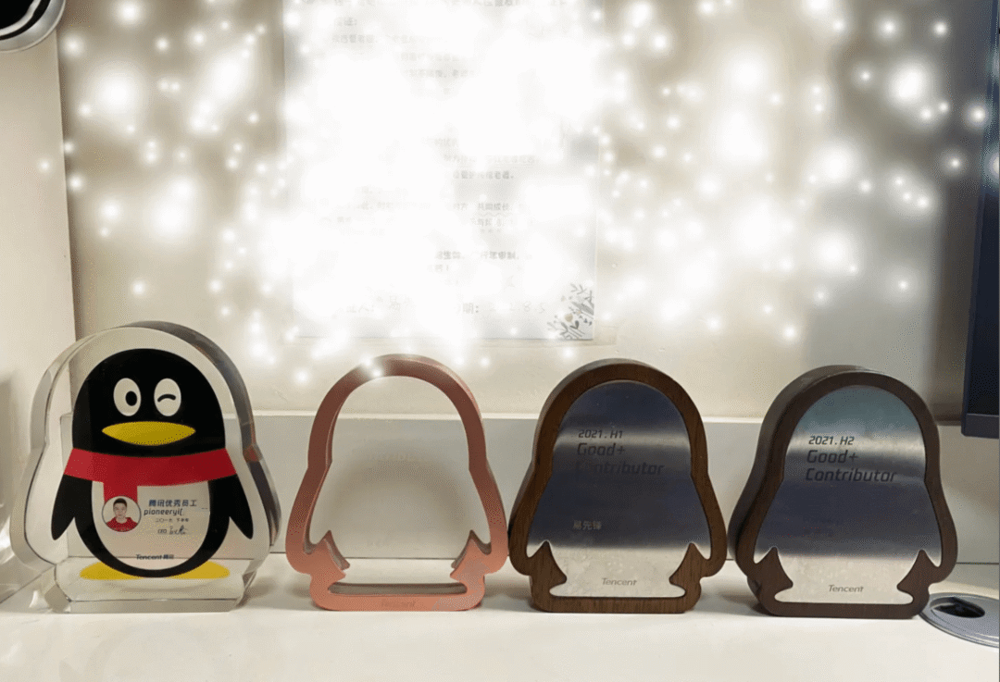

Software engineering has high turnover. New people join, and others leave, sometimes by choice and sometimes not.

Competition has also intensified in recent years. People do more work for less in return, and the tech industry may not seem as attractive as it once did.

After a while, the constant changes start to feel normal.

For most employees, the best way forward is to keep improving their skills and building expertise. That way, whatever changes and wherever they go, they can still make a living.

Today, I am sharing the story of a blogger who joined Tencent through campus recruitment, worked there for four years, and then left.

I do not know why the author left. Perhaps a better opportunity came along, or the job no longer offered enough room to grow.

**In the article below, “I” refers to the original author.**

> Original article: <https://zhuanlan.zhihu.com/p/602517682>

I joined Tencent after graduate school and ended up working there for four years. I am not used to reflecting on my progress; I was so focused on moving forward that I rarely stopped to think. I once read a career-planning document that described three-year and five-year stages. Now, after four years and a departure from Tencent, it seems like a good time to look back.

Here is my brief assessment: I do not think I wasted these four years. Comparing myself with others does not mean much—many people are doing better than me, and many are doing worse. I am an ordinary person, neither exceptionally talented nor outstanding. I have accepted that and focus instead on whether I am satisfied with what I have done.

I will cover my work, performance reviews, EPC, workplace culture, and what I learned.

## Work and Projects

I did not transfer to another role within Tencent, but I worked on a range of projects: BUGLY, the distributed tracing system Huskie, the crowdsourcing system SOHO, and the EPC engineering productivity metrics platform. Some were external products and others were internal systems that readers may not know. I am grateful for these experiences. I worked on both business applications and framework-oriented systems and learned a lot from them.

Here is a brief overview of the projects, each of which took a great deal of effort:

- **BUGLY** collects and reports application crashes over the network. Many apps use it.
- **Huskie** is a distributed tracing system built on Zipkin.
- **SOHO** is a crowdsourcing platform for data labeling and voice collection tasks.
- **EPC** measures engineering productivity.

These projects shaped how I think about business development. Like many developers, I used to wonder how to grow when doing business development every day—in other words, when writing CRUD code all the time. My perspective changed.

I think system complexity can be roughly divided into technical complexity and business complexity. Business systems tend to have more business complexity, while framework systems tend to have more technical complexity. Both can be challenging to solve.

The crowdsourcing system involved many interconnected business rules, which made it business-complex. To address this, we explored and applied Domain-Driven Design (DDD). It helped keep the system from becoming so chaotic. What I learned about DDD later helped me divide, design, and develop other systems.

DDD is not a silver bullet, and I do not claim it is universally best. Learning it simply gave me another way to approach design and development.

Business development can be difficult to do well. Exploring and applying useful methods, ideas, and architectures can benefit both the developer and the business.

## Performance Reviews

Tencent reviewed performance twice a year. During my four years there, I had eight reviews: three-star, three-star, five-star, three-star, five-star, four-star, four-star, and three-star. Four of the eight ratings were four or five stars.

Fortunately, I still had a few trophies to remember those achievements. Tencent may no longer give them out.

I remember how I earned the two five-star ratings. The first came in my second year, when I was working on the crowdsourcing project. The project itself was not especially difficult, so I spent some time improving the team's foundations: I set up Java and Go project templates and gave several internal technical talks. My manager felt I had stood out, so I received a five-star rating. Taking initiative helped both me and the team, and it brought some recognition.

The second five-star rating was related to EPC. Here is a funny story I learned later. Early in the project, our director demonstrated the system to senior management, but the metrics took a long time to load. The director apologized and said we were optimizing it. At a later demo, the metrics were still slow, and the director awkwardly said we were still working on it. I had apparently embarrassed the director twice! In the end, I wrote a query engine to replace Mondrian, and the issue did not recur. I was rewarded with a strong performance rating.

The EPC project helped me grow, especially in handling pressure. When you build a system from scratch, the first step is to keep it running; optimization comes later. If your project is important, especially when it involves data, even a small problem can be stressful. You have to find ways to reduce risk and prevent incidents.

I also had a different sense of responsibility. On previous projects, I was mostly a developer. For EPC, I was the system owner. Owning a system meant being accountable for it, planning its direction, assigning work, and tracking progress. It was a very different role.

## EPC

Many people criticize or mock EPC. As one of the core developers of its metrics platform, I want to offer an objective perspective.

The original goal was good: measure engineering quality across multiple dimensions and stages, then use those metrics to improve the business and engineering productivity. In practice, however, the tools were not ready, and the focus on metric scores encouraged people to make the numbers look better, undermining the original goal.

Why say anything good about EPC? If you look closely, you will find a fairly complete and advanced metrics framework. It covered requirements, code, defects, testing, continuous integration, operations, and deployment.

Some people and teams manipulated metrics, but many teams did make improvements. For example, people on the Weishi team said their code had been very poor, but its quality improved after EPC was introduced. Weishi eventually shut down, but EPC could not save a business already in decline, and its closure should not be blamed on EPC.

## Workplace Culture and “Inner Circles”

People often say that Tencent has a strong inner-circle culture. I think this exists in every company. People tend to trust those they already know. As a manager, would you give important work to someone you do not know well?

I do not know whether I was part of an inner circle. Someone once asked on Maimai how to tell. One answer was memorable: “If you do not know whether you are in the inner circle, you are not.” By that logic, perhaps I was not.

On the other hand, later I was responsible for important work across the center, owned a direction independently, and reported directly to a director. That might suggest otherwise.

Another blunt take online is that you can tell by how much you are paid. I received stock when I reached level 7, which felt pretty good. I thought my career and earnings might keep going well if nothing unexpected happened. Something did happen: EPC did not meet expectations the following year, and both the department general manager and the director were replaced. A new director joined the center.

I had to build trust again. Later, it stopped mattering whether I was considered part of the inner circle. The industry was struggling, layoffs followed, and most people left, voluntarily or otherwise.

To sum up, inner circles have understandable reasons for existing. I do not know exactly how to become part of one. But instead of focusing on that, it is better to show your value and ability. When people recognize them, more opportunities are likely to come your way. Make the most of those opportunities and you may receive greater rewards.

## What I Gained

What counts as a gain? I would include both external things—compensation, skills, and job level—and internal ones, such as insights and perspective.

First, some measurable gains:

- **Level:** I was promoted to level 9, Senior Engineer. People say Tencent's levels have lost some of their prestige, but I know what a senior engineer should be capable of. I feel that my effort brought me to the level I once thought I needed to reach.
- **Performance:** I would not describe myself as someone who pushes hard just for its own sake. But when I decide something needs to be done well, I take ownership and responsibility. I think my performance over four years was reasonable.

I also gained some other skills.

**1. Documentation**

Documentation is an important skill for programmers. I did not think I was especially good at it, but both of my directors said my documents were good. Perhaps I was above average after all.

**2. A Clearer Direction**

Finally, I gained something less tangible but, to me, more valuable: I gradually clarified the direction I wanted to take—data engineering.

Finding and committing to a goal is difficult. Few people around me had a clear direction; most were uncertain.

In a recent conversation about career planning, someone suggested thinking about it in two ways:

- Choose a business domain, such as e-commerce or advertising, and keep building domain knowledge and related skills. With enough experience, you can become an expert in that field.
- Go deep in a technical area and keep studying the underlying technology, with the goal of becoming a technical expert.

Although I had studied and applied DDD to model and solve complex business problems, I was more interested in exploring technology. I was also interested in big data, so I decided to pursue data-related work.

My four years at Tencent were my first job. I met many talented people and learned a lot. I chose to leave, and I am glad I did so on my own terms—even though I gave up a generous severance package. I am still grateful to Tencent.

<!-- @include: @article-footer.snippet.md -->
