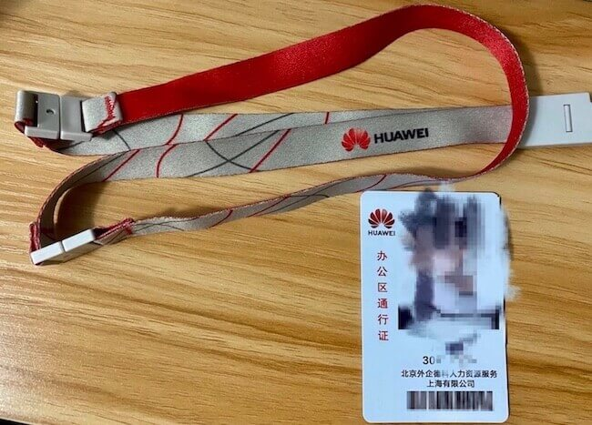
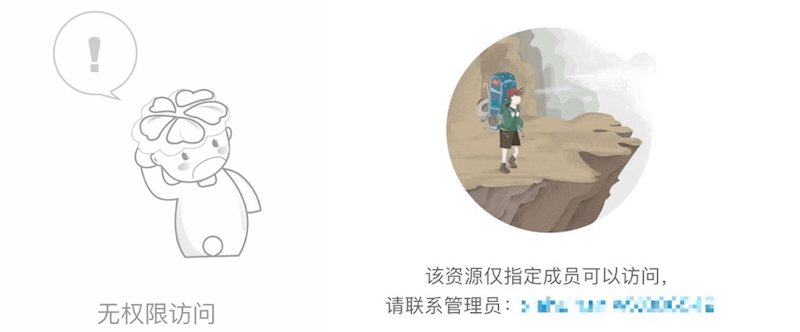

> **Editor's note:** A friend shares his experience working as a Huawei OD contractor and interviewing at Tencent. It's a useful read.
>
> **Original article:** <https://www.cnblogs.com/shoufeng/p/14322931.html>

## Timeline

- July 2018: Graduated with a computer science degree from a relatively unknown Project 985 university.
- Before graduation: Completed six months of Java EE (backend development) training.
- First job (July 2018–December 2019): Worked with big data and felt it had better prospects.
- December 2019: Joined Ping An Property & Casualty Insurance as a full-time employee, only to find that the role was in backend development 😢.
- March 2020: Left Ping An and joined Huawei OD to work on a big data platform.
- January 2021: Joined Tencent.

## Summary of My Huawei OD Experience

### Why I Joined Huawei OD

I spent only three months as a full-time employee at Ping An Property & Casualty before moving to Huawei OD. My friends could not understand why I would leave a permanent role for a contractor position 😂.

But I was determined to work in big data and wanted a break from endless CRUD tasks. The role I passed the interview for was in Huawei Cloud's big data group, working on a platform widely used by government and enterprise customers in China.
The platform and work both sounded good. I could not pass up an opportunity like that 💪.

> I had considered transferring to a big data role within Ping An, but did not meet the requirement of having worked there for at least a year.
> “Waiting is wasting your life.” Before my conversion to a permanent employee had been approved, I moved on 😂.

### The Work at Huawei OD

**I was full of anticipation when I hurried over to start at Huawei.**

As the recruiter had said, I worked alongside Huawei employees and did the same work:

> Managers assign work based on your ability and gradually increase its difficulty; capable people take on more.
> The probation period is six months, with a mentor, usually a Huawei employee two levels above you and one of the department's top engineers.

So it is not true that **contractors only do basic, procedural, or low-skill work**. If that is your concern, ask what the specific department or team works on, then decide whether the role suits you.

One thing that stood out to me was the number of processes and policies at a company with nearly 200,000 employees. The benefit is that you see how a large company develops, tests, releases, and operates its products. Experienced engineers with internal certifications reviewed my code. In review meetings, I could learn how they analyzed problems and kept the whole product in view.

There were drawbacks too. In my view, complex processes reduced efficiency. Even a change of a few lines could require a full CI run, which sometimes took a long time, as well as self-test and VT reports.

### OD Contractors Compared with Huawei Employees

What is OD? It stands for Outstanding Dispatcher, a staffing arrangement. Huawei emphasizes that OD is different from what is usually called outsourcing.

Here is what I learned about OD:

- OD compensation follows Huawei's pay framework and is reasonably competitive. In my experience, it may even be slightly higher than that of Huawei employees at the same level.
- OD contractors can work on Huawei's core products. This differs from staff supplied by other vendors.
- External internet access (yes, a VPN) can be requested, and most internal department documents are accessible.
- OD employees have IDs in a separate 300 series; IDs for other vendor staff start with 8 or WX.
- The badge strap is red, like those of Huawei employees, but the badge itself is different. OD badges say “Office Area Access” and include a note identifying the staffing company:



I also heard these internal claims:

- No stock, no TUP, and a smaller year-end bonus; only the salary might be slightly higher than at my company.
- OD staff cannot take Huawei's consumer loan or buy its discounted insurance.

### So, Should You Join Huawei OD?

If you found this article, you probably already lean one way and just need one last nudge ❄️ to make a decision.

As someone who has been through it, here are a few things to consider 😃.

1. **Do you have a better option than Huawei OD?** Consider overtime (996, or even 9106 and more), salary, the work itself, and how this experience may affect your career.

2. I have seen comments such as: “If OD is so good, why don't people volunteer to switch to it?” Or: “OD is the same as Huawei? If so, why have OD at all? It's just a way to cut costs.”

3. Are you prepared for the distinction? No one may call you an OD contractor to your face, but some things will remind you that **you are not a Huawei employee**. For example:

a) You may not have permission to read internal announcements or most posts on the employee voice platform:



b) Your attendance and performance are managed through a system for leased personnel.

c) Huawei employees can use their badges to pay, including for late-night meals. OD badges cannot be used for payments, so you need a separate payment card. OD staff also claim late-night meals through a phone app, while Huawei employees use their badges.

d) To receive double pay for overtime, you must submit an electronic overtime request. Otherwise, you can only take time off, and unused time cannot be converted to double pay when you leave. The author says Huawei employees receive N+1 compensation even when they resign voluntarily, and can convert overtime to double pay.

### Can OD Contractors Become Huawei Employees?

I gave this question its own section because many people are concerned about it.

**The answer is yes.**

According to unofficial sources, such as posts on Zhihu, there are conditions for becoming a Huawei employee (<https://www.zhihu.com/question/356592219/answer/1562692667>):

1. At least one year of service.
2. Two consecutive A performance ratings.
3. Pass the trusted professional certification.
4. Other conditions depend on the business unit's staffing needs and targets.

Here is some context on these conditions 😃.

**Condition 2: Two consecutive A performance ratings**

The linked post says:

> An A rating goes to roughly the top 10% of the department. Two consecutive A ratings means ranking in the top 10% in both reviews during the year. People who manage that are high performers at Huawei. Would the company give such a rare rating to a leased worker?

Can an OD contractor get an A? I don't know. I joined too late to go through a full performance review cycle.

(Updated June 5, 2021) More than a year later, an OD colleague who was still there told me that OD staff were rated separately. About one in five received an A, which came with a four-month year-end bonus; a B came with a two-month bonus.

In my view, if you earn an A in your probation review, you are likely to receive another A in the following half-year review.

Overall, it depends on ability, work ethic (including willingness to work long hours), and luck (whether your manager recognizes your contributions).

**Condition 3: Pass the trusted professional certification**

What is the trusted professional certification? Huawei promotes this certification for technical staff as part of its security and compliance program.
The professional level has four exams:

- Exam 1: Advanced programming, roughly equivalent to two medium and one hard LeetCode problems.
- Exam 2: Programming knowledge and application, including programming language fundamentals.
- Exam 3: Secure programming, quality, privacy, and developer testing.
- Exam 4: Refactoring concepts, including design patterns and code refactoring.

Each exam could be taken only once per quarter (some may have been limited to three attempts a year). They all required preparation, from three days to a week; without studying, passing was unlikely.
About four months in, while I was still on probation, I passed exams 2, 3, and 4. I could not pass exam 1 for more than six months (my algorithm skills really were not good enough 😂).
Some colleagues failed several times without preparing.

**Condition 4: Department staffing needs and targets?**

This condition sounds vague. As I said, ability and luck matter. Here is a photo of someone who successfully became a Huawei employee:


### Grateful to OD and Huawei

I was lucky that Huawei hired me less than three months after I changed jobs.

I had a great manager who guided and helped me like an older brother at work.

My mentor was the strongest engineer I had met in my career: clear in diagnosing problems, excellent at coding, and thoughtful about the bigger picture and solution design.

Everyone on the team and in the department was kind. For more than nine months, I was energized almost every day. Looking back, I am not sure why I had so much drive 😂.

Honestly, my skills alone probably would not have gotten me into Huawei 😂. OD gave me a chance to experience Huawei's work culture and learn many professional skills:

- Be proactive and willing to take responsibility. Volunteer for good work instead of waiting for it to come to you.
- Share progress regularly, including what is done, what remains, and any risks or blockers, so your manager knows where things stand.
- Summarize and share what you learn. It helps others and builds your professional reputation.
- Ask questions when you are unsure. Be humble and do not be afraid to seek help.
- No matter how busy you are, write meeting notes for every meeting, large or small, and email them to the relevant people.

Thanks again. Keep going, everyone, and aim high 💪.

## Applying for Jobs to Get Challenged in Interviews

One day in early November 2020, my colleagues were talking about someone who had been poached by another company for a much higher salary and a promising future.

It suddenly hit me that after more than six months at Huawei, I had mostly learned its systems and processes. Had I grown or made any progress?

I started wondering: companies poach strong engineers, so how much was I worth in the job market at that point?

I remembered advice a former colleague had shared at a farewell gathering:

> Engineers should not work in isolation. Talk to others and keep up with what is happening outside your company.
>
> If you feel too comfortable, put your résumé out there. Find out what technologies other companies use and what problems they care about. A few interviews can help you decide what to learn next.

That gave me an idea: get challenged in interviews to push myself and choose a better direction for learning.

So I reinstalled a job-search app and applied to a few companies recommended on its home page.

## The Interviews Begin

I applied on November 10. That same day, two companies scheduled online interviews for the afternoon of November 11, including Tencent 🐧.

As it happened, I was on duty for the Double 11 sales event that night and did not finish work until 2:30 a.m.

Staying up that late is rough, but I was able to take a compensatory day off, so I did not need to make up an excuse to take leave 🙊.

I interviewed with three companies during that period:

> The first was a company in Guangzhou. I completed two online rounds on the evening of the 11th, but declined because the offer was a bit low.
> The second, and the focus of this article, was Tencent.
> The third was a cross-border e-commerce company. I failed the first round (and it became one of the two worst interview experiences of my career 🙂).

## Tencent: Should I Go?

I had always dreamed of joining a major tech company, but I was still a beginner and had failed several technical interviews before.

So I came up with a roundabout plan: build experience elsewhere first, then try for a major tech company when the opportunity came 💪.

I was lucky, and a little surprised, to pass all of Tencent's interviews this time.

It was already the end of the year, but if I passed up this rare opportunity, I did not know when I would get another chance.

So, **I chose the Tencent offer in hand over waiting until after the New Year to receive my bonus before changing jobs 😄.**

## My Tencent Interviews

As the title says, I passed five interview rounds in 16 days. On the 17th day, I finally received the Tencent offer I had been hoping for.

You may be curious about the questions asked in Tencent's technical interviews. Here is what I was asked.

I applied for a big data development role using Java. I have summarized my interviews here for anyone considering a role at Tencent 😊.

> Detailed answers to almost all of these questions are available online.
> To keep this article concise, I list only the questions and some follow-ups.

### Technical Round 1

#### Java

1. Do you understand Java class loaders? How would you create a custom class loader?

> Follow-up: Can a class be loaded more than once? Can classes in the `java` or `javax` packages be loaded more than once?

2. How do you create an object in Java 🐘?

3. Do you understand multithreading? In what situations would you use it?

> Follow-up: What does **thread safety** mean? What do you know about thread pools and their use cases?

4. What do you know about garbage collection?

5. What do you know about JVM generations?

6. What do you know about NIO? Have you used `RandomAccessFile`?

> Follow-up: How do you understand **synchronous vs. asynchronous** and **blocking vs. non-blocking**?
>
> What are the benefits of I/O multiplexing?

7. How do `ArrayList` and `LinkedList` differ? What are their respective use cases?

8. What should you consider when implementing a hash-based set?

> Follow-up: What are key design details of the JDK's `HashMap`, such as initial capacity, resizing, converting a list to a red-black tree, and differences between JDK 7 and 8?

#### Computer Science Fundamentals

1. The TCP three-way handshake.

2. Common Linux commands, such as:

> ```shell
> ps aux / ps -ef、top C
> df -h、du -sh *、free -g
> vmstat、mpstat、iostat、netstat
> ```

#### Project and Frameworks

1. How does Kafka differ from other message queues? Why is its throughput high?

> Consumers pull data to control the consumption rate and allow messages to be consumed again.
>
> High throughput comes from sequential writes to each partition and batching data before it is flushed to disk (the OS page cache handles flushing), which is faster than random I/O. Reads use `sendfile` zero-copy, and batches can be compressed.

2. How do Hive and Spark SQL differ?

3. Ranger's authorization model, protected resources, authorization process, and policy refresh mechanism.

#### Troubleshooting

1. How would you troubleshoot a failed SSH connection?

> Can you ping the host? Is DNS configured correctly? Is the remote port blocked by a firewall? Is the remote service running?

2. A server running a Java application has reached 100% CPU usage. How would you investigate?

> Use `ps aux | grep xxx` or `jps` to find the Java process ID (`pid`).
>
> Then run `top -Hp pid` to find the thread consuming CPU and **convert its ID to hexadecimal**.
>
> Use `jstack pid` to dump the Java process's thread stacks. Search for the hexadecimal thread ID to find the thread name and its stack trace.

3. A Java application has run out of memory. How would you investigate?

> Use `jmap` to inspect heap information and check changes in the Eden and Old spaces.

### Technical Round 2

This round focused mainly on my previous projects:

1. How do Solr and Elasticsearch differ? What are their strengths and weaknesses?

2. Elasticsearch optimization, its indexing process, leader election, and related topics.

3. What challenges did you encounter in your projects, and how did you solve them?

There were a few basic questions that overlapped with the first round, as well as some big data questions I can no longer remember clearly 😅.

### Technical Round 3

This was an interview with a director. Most questions were about my career plans, what I had learned at my previous companies, and what I expected from my next role.

There were a few technical questions too. I remember this one in particular:

> How would you sort a 1 TB file containing one unique number per line using a machine with 8 GB of memory?

My first thought was to use MapReduce: split the file into smaller files, sort each one, then merge the results.

**Then came a series of follow-up questions:**

> Q: How could you make better use of memory?
>
> A: Use a bitmap and map the numbers in order. (You need to understand how the mapping works.)
>
> Q: What if you also need fast lookups after sorting?
>
> A: Build an index, similar to a Redis skip list, with multiple levels to speed up lookups.
>
> Q: The index still points to the file. How could you use even more memory?
>
> A: Add a cache to keep previously read numbers in memory.
>
> Q: What properties should the cache have?
>
> A: It should use an LRU cache.

Phew. That was finally the end of the follow-up questions 😂.

---

There were also GM and HR interviews, but their questions were about my personal experience, so I will leave them out here.

## A Few Final Thoughts

**I had been at Tencent for a little over a month. Different roles and responsibilities bring different challenges.**

What stood out to me is that developers need to be self-motivated and keep improving their technical skills, both broadly and in depth, to build a lasting career.

<!-- @include: @article-footer.snippet.md -->
