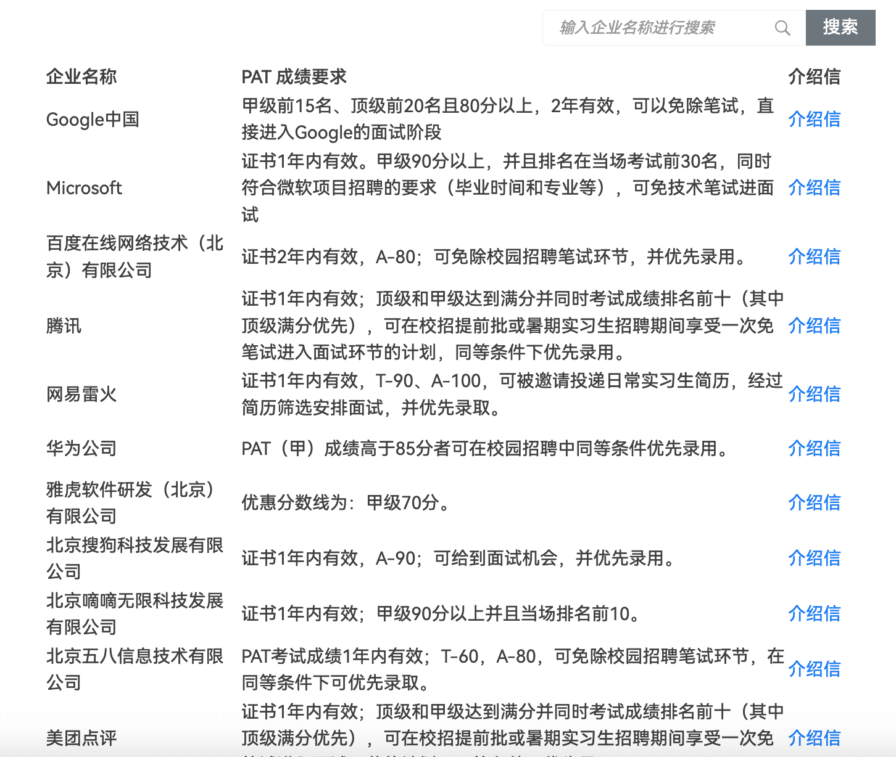
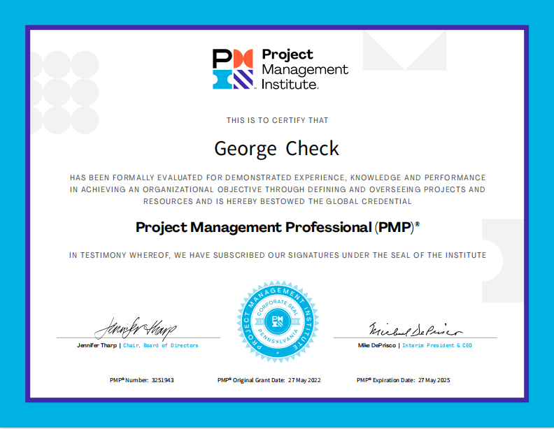
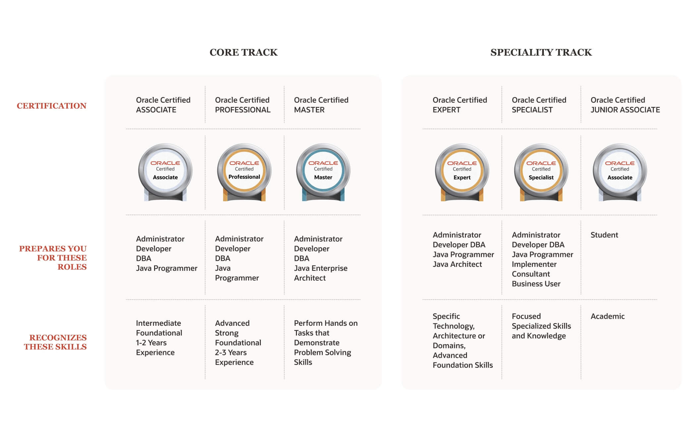
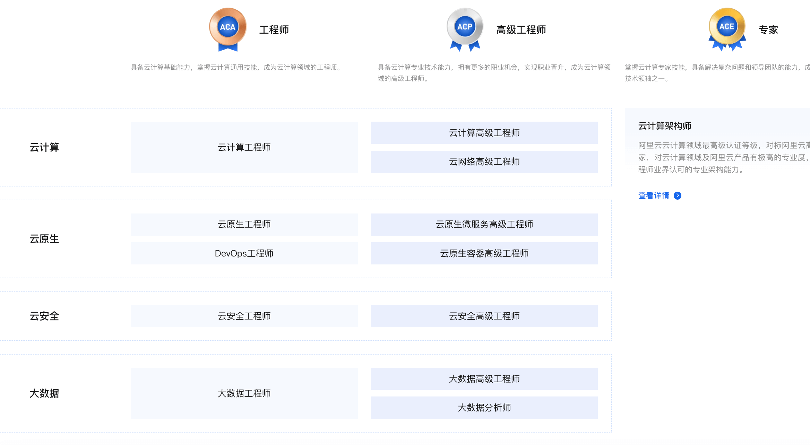
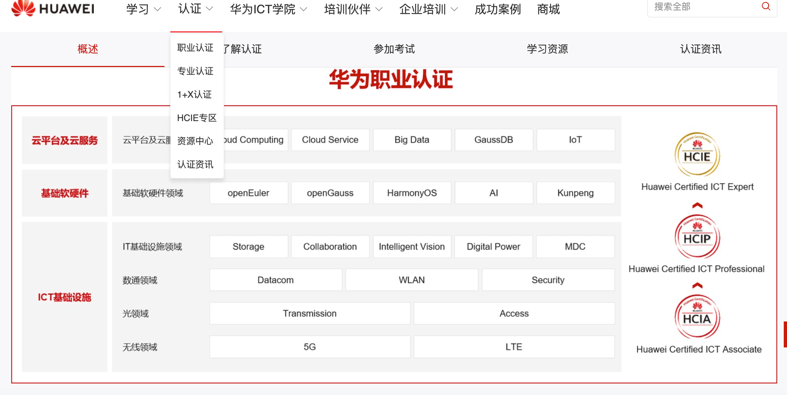
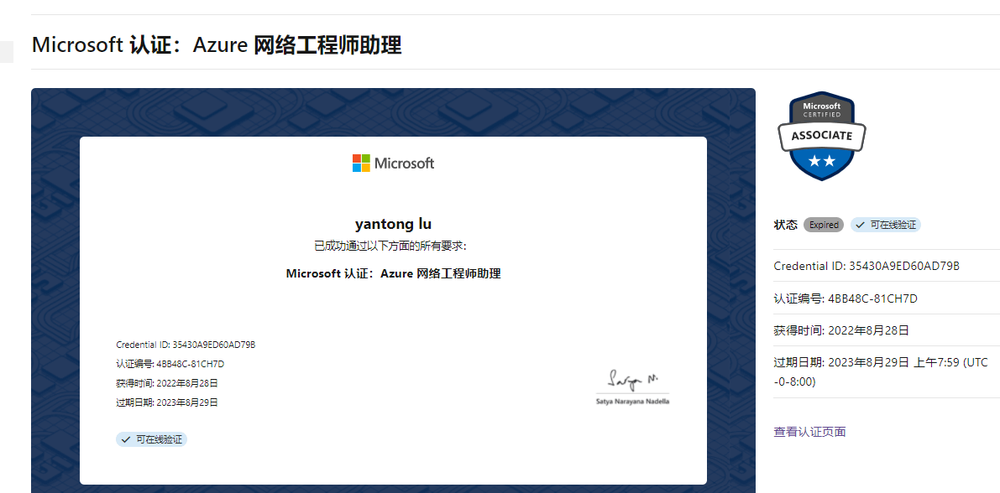
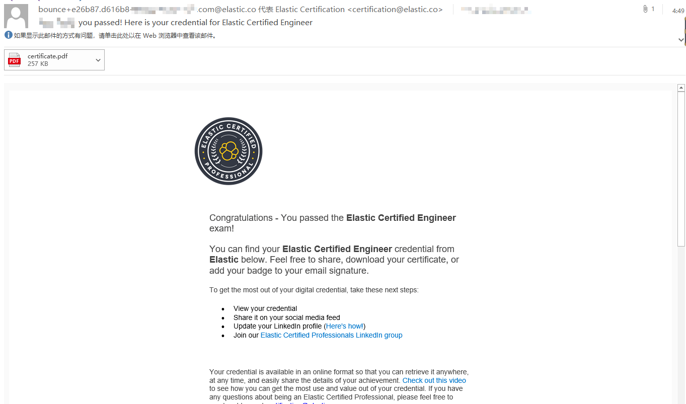

Certifications can provide evidence of your skills and help you stand out in a short interview. Earning one can be a cost-effective way to develop your skills. However, the IT industry offers fewer professional certifications than fields such as finance, construction, and healthcare.

Here are some common certifications programmers can consider.

## China's Software Qualification Examination

The National Computer Technology and Software Professional Technical Qualification (Level) Examination, commonly called the **Software Qualification Examination** or **Ruankao**, is a widely recognized IT certification in China. Some people question its practical value, but it can be useful in specific situations. For example, state-owned enterprises and public institutions value it, some cities accept it for residency points, and it may qualify for personal income tax benefits.

The exam has three levels: elementary, intermediate, and advanced. I recommend considering the advanced level. Compared with the PMP (Project Management Professional) exam, the advanced Ruankao is more difficult. Many candidates struggle with its essay section. Some employers allow employees who pass the advanced exam to register their certificate with the organization for a small monthly bonus.

Official site: <https://www.ruankao.org.cn/>.

Study advice: [How I Passed the Advanced Software Architect Exam on My First Attempt in the First Half of 2024 - Alibaba Cloud Developer](https://mp.weixin.qq.com/s/9aUXHJ7dXgrHuT19jRhCnw)

## PAT

The Programming Ability Test (PAT), hosted by Zhejiang University, assesses algorithm skills. It has four levels: Basic, Level B, Level A, and Advanced.

Candidates who meet the required PAT score and level for participating companies can bypass education requirements, resume screening, and written tests and go straight to an interview. Check the [official site](https://www.patest.cn/company) for the list of companies.

For students applying to Zhejiang University's graduate programs, a Level A PAT score may be used as the computer-based portion of the graduate admissions re-examination if it was earned within the past year.

## PMP

The Project Management Professional (PMP) certification is offered by the Project Management Institute (PMI) in the United States. It is one of the most widely recognized project management credentials worldwide. The certification aims to develop project managers' knowledge and skills so they can deliver projects successfully.

PMP is often described as a credential that is recognized around the world. It can be valuable for project managers, and many successful companies use it as a hiring qualification for project management roles.

However, the real value lies less in the certificate itself than in the project management framework in the _PMBOK Guide_. The guide includes project cases from business, industry, organizational planning, construction, and other fields.

PMP is a foundational certification, not an advanced one.

## ACP

The Agile Certified Practitioner (ACP) certification is also offered by PMI and is another important project management credential. Unlike PMP, which focuses on traditional waterfall methods, ACP focuses on Agile approaches such as Scrum, Kanban, Lean, and Extreme Programming (XP).

## OCP

Oracle Certified Professional (OCP) is a professional certification from Oracle. It focuses on Oracle Database and related technologies, and validates a person's knowledge and skills in using and administering Oracle Database.

The chart below shows Oracle's certification paths and levels: the Core Track and the Specialty Track.

## Alibaba Cloud Certification

Alibaba Cloud offers professional certifications in areas such as cloud computing, big data, AI, and DevOps. Its professional certifications have three levels: ACA, ACP, and ACE. It also offers Clouder, a skills certification designed specifically for developers.

Official site: <https://edu.aliyun.com/certification/>.

## Huawei Certification

Huawei Technologies offers professional certifications in information and communications technology (ICT), including networking, storage, cloud computing, big data, and AI. Its certification program covers a wide range of topics.

## AWS Certification

AWS Certification exams are official credentials for Amazon Web Services. They validate IT professionals' skills in designing, deploying, and managing AWS infrastructure.

AWS certifications are available at several levels: Foundational, Associate, Professional, and Specialty. They cover a range of roles and skills:

- **Foundational:** AWS Certified Cloud Practitioner is suitable for beginners and validates basic knowledge of AWS. It is the easiest entry-level certification.
- **Associate:** Includes AWS Certified Solutions Architect – Associate, AWS Certified Developer – Associate, and AWS Certified SysOps Administrator – Associate. These certifications are for intermediate professionals and validate skills in designing, developing, and managing AWS applications.
- **Professional:** Includes AWS Certified Solutions Architect – Professional and AWS Certified DevOps Engineer – Professional. These are for advanced professionals and validate skills in complex, large-scale AWS environments.
- **Specialty:** Includes AWS Certified Advanced Networking – Specialty and AWS Certified Big Data – Specialty, among others. These certifications focus on in-depth skills in specific technical areas.

Study advice: [A Great Way for Beginners to Get Started with Cloud Computing Is to Earn an AWS Certification (Including My Study Experience)](https://mp.weixin.qq.com/s/xAqNOnfZ05GDRuUbAiMHIA)

## Google Cloud Certification

Unlike AWS, Google Cloud offers only one Associate-level certification (Associate Cloud Engineer); most of its other certifications are Professional-level.

Study advice: [How to Prepare for a Google Cloud Certification](https://mp.weixin.qq.com/s/Vw5LGPI_akA7TQl1FMygWw)

Official site: <https://cloud.google.com/certification>

## Microsoft Certification

Microsoft's certification program mainly covers its Azure cloud platform. It has Fundamentals, Associate, and Expert levels, with certifications in cloud computing, data management, development, productivity tools, and other areas.

## Elastic Certification

Elastic offers professional certifications that validate skills with the Elastic Stack, including Elasticsearch, Logstash, Kibana, and Beats.

If your day-to-day work focuses on Elasticsearch, earning a certification may be worthwhile; it is well regarded.

Elastic currently offers four certifications: Elastic Certified Engineer, Elastic Certified Analyst, Elastic Certified Observability Engineer, and Elastic Certified SIEM Specialist.

I recommend **Elastic Certified Engineer**. It is the foundational Elastic Stack certification and covers core skills such as installing, configuring, administering, and maintaining Elasticsearch clusters.

## Other Certifications

- **PostgreSQL certifications:** In China, PostgreSQL certifications have three levels: PCA, PCP, and PCM. They focus on PostgreSQL administration and optimization. They are relatively expensive, so I would not generally recommend them.
- **Kubernetes certifications:** The Cloud Native Computing Foundation (CNCF) offers several official certifications, including Certified Kubernetes Administrator (CKA) and Certified Kubernetes Application Developer (CKAD). They assess Kubernetes skills and knowledge.
