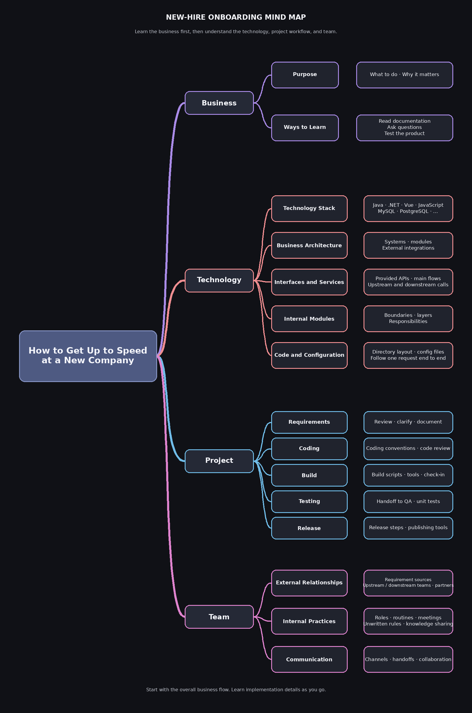

> **Editor's note:** Anyone about to start or already working at a new company should read this. It is clear and comprehensive, and can help you avoid common mistakes.
>
> **Original article:** <https://www.cnblogs.com/hunternet/p/14675348.html>

The annual spring hiring season is almost over. Many people changing jobs have found a role they like and are about to start—or have already started—somewhere new.

Anyone who has changed jobs knows that a new company may mean a new business domain, technology stack, and team. These can challenge your existing work habits, coding practices, and ways of collaborating.

At the same time, a company can't give you several months to settle in at your own pace. It is important to get up to speed and start contributing as soon as possible.

Some people are lucky enough to join a company with well-established onboarding, mentoring, and training. Others are less fortunate. A few years ago, when I joined a large tech company, the onboarding process was not as mature as it is now. The team was extremely busy, and on my first afternoon I was asked to investigate several production issues, with no documentation or training. People who struggle to adapt under this pressure may eventually think about quitting.

**How can we get into the flow of work quickly and adapt to a new pace?**

Faced with a new set of repositories, many people don't know where to begin. But we can draw on experience from previous jobs and projects. A new project usually follows a cycle: requirements, design, development, testing, and release.

Four areas run through this process: business, technology, projects, and the team. As a new hire, your first goal is to become capable of contributing to team projects. Start by learning these four areas.

## Business

Some people think technology should be the first priority for a technical employee. They join a company and immediately study technical documents and system architecture—or start reading the source code. That is a mistake. At almost every company, technology is a tool for supporting the business. Technology answers how to do something; the business explains what to do and why. Without a business purpose, the technology has little meaning.

There are two important ways to learn the business.

**First, ask questions.**

If your team has a thorough business-training program and detailed requirements documents, you may not need to ask much. Most companies don't have that, so you will need to ask. As a new hire, be willing to speak up when you don't understand. I've seen many newcomers hesitate because they are shy or introverted. As a result, it takes them much longer to join the team and take on more responsibility. Don't be afraid of being criticized or challenged. Most developers are easy to talk to.

**Second, test the product.**

Testing is one of the fastest ways to learn the business. Follow the end-to-end workflows of the projects your team owns. When you get stuck or something doesn't make sense, ask someone. This helps you understand the core business flows naturally.

While learning the business, don't get caught up in details. First, try to understand the overall flow: who the users are, and what services the system provides.

## Technology

Once you have a basic understanding of the business, you can turn to the technology. You may be eager to open the source code, but don't rush.

First, use what you've learned about the business and your previous experience to think about how you would build the system. This step is important: later, when you study the implementation, you can compare it with your own approach, ask why they differ, identify what works better, and learn from the good ideas. You can also suggest improvements where appropriate.

Next, study the technology, but don't start by reading the source code. **Analyze the system from the outside in, moving from the big picture to the details.**

Start by learning your team's or project's **technology stack**: Java or .NET, or several languages? Is the project frontend-backend separated or full stack? Does it use MySQL or PostgreSQL? This gives you an idea of the tools and frameworks involved and what you may be responsible for. You may already have learned some of this during the interview.

Next, understand the **high-level business architecture**. Which systems does your team own? What modules does each system contain? Which external systems does it interact with? Use a flowchart or mind map to organize this information.

Then identify the **interfaces and services your team provides** and the functionality each one offers. Test the system and follow its main flows. Note which pages are involved, which backend APIs each page calls, and which repository contains each API. If your team only provides backend services, identify the services you offer, your upstream services, and the calls each upstream service makes to your team's services. Again, a diagram can help.

Then find out **which external services your system depends on**. These could come from another team, another part of your company, or a third party. Look at how your code integrates with them, including the communication framework (REST or RPC) and protocol.

At the code level, first learn the layers in each module and what each layer is responsible for. This gives you a basic understanding of the system design. Then learn the directory layout and find the configuration files.

Finally, pick an example, such as an API or a page, and follow the code from its inputs to its outputs. This helps validate your understanding of the system.

At this point, you should have an initial understanding of the technology. You don't need to learn every detail yet; you'll have plenty of time for that later.

## Projects and the Team

As mentioned earlier, the first goal at a new company is to become capable of contributing to team projects. Next, learn how projects are run.

Understand the key steps from requirements and design through implementation, code review and check-in, and release. For example: Does the team use Agile or Waterfall? How long is an iteration? Where do requirements come from, and how are they documented? What coding conventions are used? How do you build and check in code? Are there commit conventions? How is work handed to QA? What needs to happen before a release, and how are releases performed?

You can usually understand how the project works by observing your colleagues or taking part in one full iteration yourself.

As you learn the project process, learn about the team too. Start with external relationships: Which teams do you work with? Where do requirements come from? Do you work with teams outside the company? Which upstream teams use your services, and which downstream teams do you depend on? How do teams communicate, and which channels do they use?

Then learn how the team works internally: Which roles are there, and what is each person's responsibility? Knowing this helps you find the right colleague when you need help. Are there regular events or meetings, such as daily stand-ups and weekly meetings? Are there unwritten conventions, internal reviews, or knowledge-sharing sessions?

## Summary

Starting at a new company brings new challenges. Getting into the flow of work quickly and contributing effectively is a strong start.

For a programmer, that means becoming able to work on projects with the team. From the perspective of a backend developer, this article shares ways to learn the business, technology, project process, and team.

If you have other advice for getting up to speed at a new company, share it in the comments.

The mind map below summarizes the article. If you found it useful, follow the public account at the end of the original article. I often share lessons from my own growth so we can learn together.

<!-- @include: @article-footer.snippet.md -->
