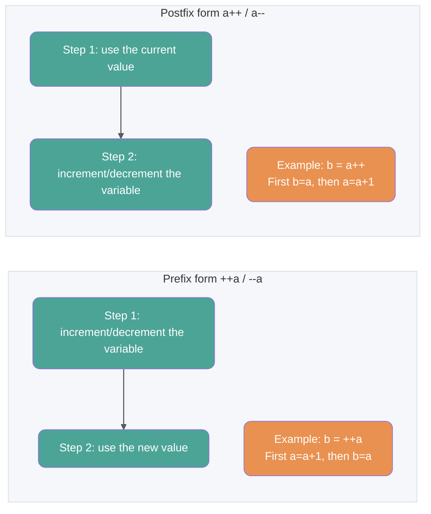
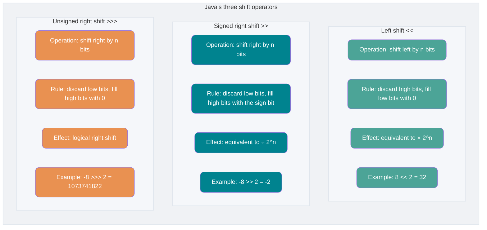
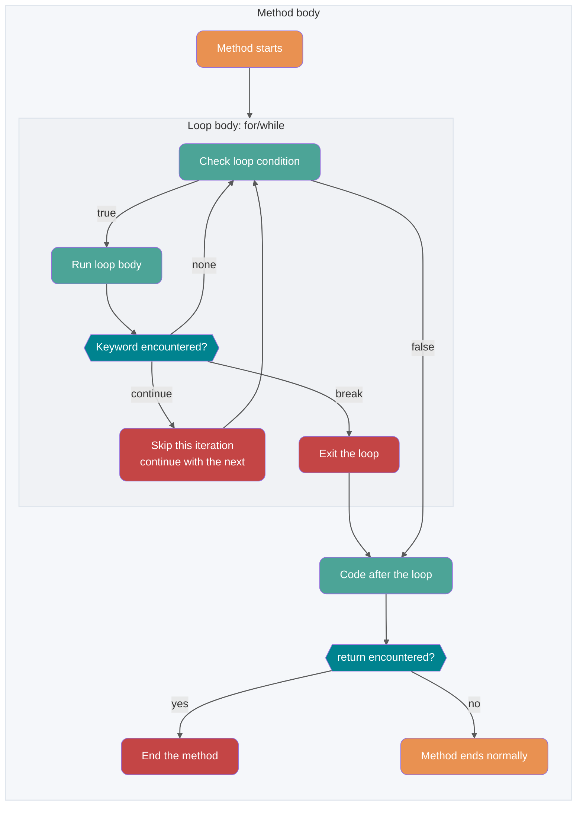
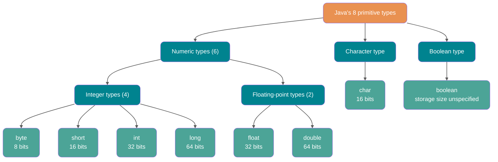
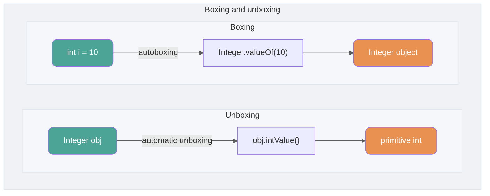

## Basic Concepts

### What are the features of Java?

1. Easy to learn, with a relatively simple syntax;
2. Object-oriented, with encapsulation, inheritance, and polymorphism;
3. Platform-independent, thanks to the Java Virtual Machine (JVM);
4. Supports multithreading. C++ added a standard threading library in C++11, while Java has included concurrency support from the start;
5. Reliable, with exception handling and automatic memory management;
6. Secure, with features such as access modifiers and restrictions on direct access to operating system resources;
7. Efficient, with optimizations such as Just-in-Time (JIT) compilation;
8. Provides convenient support for network programming;
9. Combines compilation and interpretation;
10. ……

> **🐛 Correction (see [issue #544](https://github.com/Snailclimb/JavaGuide/issues/544)):** C++ added a threading library in C++11 (released in 2011). On Windows, Linux, and macOS, you can use `std::thread` and `std::async` to create threads. Reference: <http://www.cplusplus.com/reference/thread/thread/?kw=thread>

🌈 A little more context:

“Write Once, Run Anywhere” is a classic slogan that has lasted for decades. Even today, many people consider portability Java's biggest advantage. In practice, portability is no longer Java's main selling point, and neither are the latest JDK features. Virtualization technologies are mature, and tools such as Docker make it easy to build portable applications. In my view, Java's strong ecosystem is its biggest advantage.

### Java SE vs Java EE

- Java SE (Java Platform, Standard Edition) is the foundation of the Java platform. It includes the core libraries and runtime components needed to develop and run Java applications. Java SE can be used to build desktop applications and simple server applications.
- Java EE (Java Platform, Enterprise Edition) is built on Java SE and defines standards for developing and deploying enterprise applications, including Servlet, JSP, EJB, JDBC, JPA, JTA, JavaMail, and JMS. It is used to build distributed, portable, robust, scalable, and secure server-side applications such as web applications.

In short, Java SE provides the core platform, while Java EE adds enterprise application specifications. Java SE is suitable for desktop and simple server applications; Java EE targets more complex enterprise and web applications.

Java also has Java ME (Java Platform, Micro Edition), a smaller platform for applications on embedded consumer devices such as phones, PDAs, set-top boxes, refrigerators, and air conditioners. It is useful to know that Java ME exists, though it is rarely used today.

### ⭐️ JVM vs. JDK vs. JRE

#### JVM

The Java Virtual Machine (JVM) runs Java bytecode. JVM implementations are available for different operating systems, such as Windows, Linux, and macOS. They are designed to produce the same results from the same bytecode. Bytecode and platform-specific JVM implementations make Java's “Write Once, Run Anywhere” approach possible.

As shown below, languages such as Java, Groovy, Kotlin, JRuby, and Clojure can be compiled into `.class` files and run on different platforms (Windows, macOS, and Linux) through the JVM.


**There is more than one JVM. Any company, organization, or individual can develop a JVM implementation as long as it meets the JVM specification.** HotSpot VM, which most of us use, is just one such implementation.

Besides the commonly used HotSpot VM, other JVMs include J9 VM, Zing VM, and JRockit VM. See [Comparison of Java virtual machines](https://en.wikipedia.org/wiki/Comparison_of_Java_virtual_machines) for an overview. The JVM specification for each JDK version is available in the [Java SE Specifications](https://docs.oracle.com/javase/specs/index.html).


#### JDK and JRE

The JDK (Java Development Kit) is a full-featured toolkit for creating and compiling Java programs. It includes the JRE (Java Runtime Environment), the `javac` compiler, and other tools such as `javadoc` (documentation generator), `jdb` (debugger), `jconsole` (monitoring tool), and `javap` (class file disassembler).

The JRE is the environment needed to run compiled Java programs. It mainly consists of:

1. **JVM**: The Java Virtual Machine described above.
2. **Java class libraries**: Standard libraries that provide common features and APIs, such as I/O, networking, and data structures.

In short, the JRE contains the environment and libraries needed to run Java programs. The JDK includes the JRE and tools for developing and debugging Java programs.

Install the JDK if you need to write or compile Java programs, or use the development tools it provides. Some applications that compile Java source code at runtime (such as those that translate JSP into servlets) may also need the JDK. Java's core reflection API is part of the runtime libraries, so reflection alone does not require a full JDK.

The diagram below shows the relationship between the JDK, JRE, and JVM.


Starting with JDK 9, the module system and the [jlink](http://openjdk.java.net/jeps/282) tool changed how custom runtimes are created. The JDK was reorganized into modules, and `jlink` can create a custom runtime image containing only the modules an application needs. Oracle stopped providing separate JRE downloads starting with JDK 11.

In [Overview of Java 9 Features](https://javaguide.cn/java/new-features/java9.html), the section on the module system explains:

> With the module system, the JDK was reorganized into modules. Java applications can use the new `jlink` tool to create a custom runtime image containing only the JDK modules they depend on. This can greatly reduce the size of the Java runtime environment.

In other words, `jlink` lets you create a smaller runtime tailored to your application instead of using the same JRE for every application.

Custom modular runtime images can simplify Java application deployment, save memory, and improve security and maintainability. These benefits matter for modern architectures such as virtualization, containers, microservices, and cloud-native development.

### ⭐️ What is bytecode, and what are its benefits?

In Java, bytecode is the code understood by the JVM and is stored in `.class` files. It targets the virtual machine rather than any specific processor. Bytecode helps Java address the performance limits of traditional interpreted languages while retaining their portability. As a result, Java programs can run efficiently (though they may still trail languages such as C, C++, Rust, and Go) and can run on different operating systems without recompilation.

**The diagram below shows how a Java program goes from source code to execution:**


Pay particular attention to the `.class` to machine code step. In HotSpot, for example, the JVM can first interpret loaded bytecode and identify frequently called methods and code blocks (hot code). The **Just-in-Time (JIT) compiler** can then compile that hot bytecode into machine code, which the JVM process can use on subsequent executions. This is why Java is often described as a language that combines compilation and interpretation. The JVM specification does not require a particular implementation to include an interpreter or a JIT compiler.

> 🌈 Further reading:
>
> - [Java Fundamentals: How the JIT Compiler Works - Meituan Tech](https://mp.weixin.qq.com/s/7PH8o1tbjLsM4-nOnjbwLw)
> - [Building Microservices with Static Compilation - Alibaba Middleware](https://mp.weixin.qq.com/s/4haTyXUmh8m-dBQaEzwDJw)


> HotSpot uses lazy evaluation. In line with the Pareto principle, a small portion of the code (the hot code) consumes most system resources, so that is the code JIT needs to compile. The JVM gathers information as code runs and uses it to optimize execution. As a result, frequently executed code can run faster over time.

The diagram below shows the relationship between the JDK, JRE, JVM, and JIT.


The diagram below shows a simplified model of the JVM.


### ⭐️ Why is Java described as combining compilation and interpretation?

We touched on this when discussing bytecode, but it is important enough to revisit.

High-level programming languages can be grouped by how they execute programs:

- **Compiled languages** translate source code into machine code for a target platform before execution. They generally run faster, while development can take longer. Common examples include C, C++, Go, and Rust.
- **Interpreted languages** use an interpreter to translate and execute code one statement at a time. They can be quicker to develop with, but generally run more slowly. Common examples include Python, JavaScript, and PHP.


According to Wikipedia:

> Just-in-time compilation, developed to improve the performance of interpreted languages, has narrowed the gap between the two approaches. It combines advantages of compiled and interpreted languages: like a compiled language, it first compiles source code into bytecode; at runtime, the bytecode is interpreted and executed. Java and LLVM are examples of this approach.
>
> Related reading: [How the Java JIT compiler works: concepts and practice](https://mp.weixin.qq.com/s/7PH8o1tbjLsM4-nOnjbwLw)

**Why is Java described as combining compilation and interpretation?**

Common Java implementations use both compilation and interpretation. The Java compiler first turns source code into bytecode (`.class` files). The JVM can interpret the bytecode or compile it into machine code at runtime with a JIT compiler. Bytecode does not have to be interpreted; the JVM implementation determines how it is executed.

### What are the benefits of AOT, and why not use it for everything?

JDK 9 introduced the experimental AOT (Ahead-of-Time Compilation) tool `jaotc` through JEP 295, but the tool was removed in JDK 17. Standard JDKs from JDK 17 onward no longer include this built-in AOT compiler. The discussion below covers AOT in general and separate toolchains such as GraalVM Native Image (an AOT technology provided by GraalVM, discussed later). Unlike JIT, AOT compiles code to machine code before execution. This can reduce runtime warmup and improve startup speed, though memory use, peak performance, and suitable use cases depend on the implementation and workload.

The comparison below uses HotSpot JIT and GraalVM Native Image as examples. AOT tools differ in implementation, and results also depend on build options, application workload, and whether PGO (Profile-Guided Optimization, which uses data collected during real program execution) is used.

| Aspect                       | JIT (just-in-time compilation)                                  | AOT (ahead-of-time compilation)                                                   |
| ---------------------------- | --------------------------------------------------------------- | --------------------------------------------------------------------------------- |
| **When compilation happens** | Compiled at runtime based on code execution                     | Compiled ahead of time during the build                                           |
| **Startup and warmup**       | Often interprets and compiles hot code after startup            | Usually starts faster, without JIT warmup                                         |
| **Long-running performance** | Can continuously optimize hot code using runtime data           | Has less runtime information; results depend on implementation and build settings |
| **Runtime memory**           | Stores the compiler, profiling data, and generated machine code | Implementations such as Native Image usually use less runtime memory              |
| **Runtime requirements**     | Requires a JVM and its runtime                                  | Native Image can produce a standalone executable                                  |
| **Dynamic features**         | Supports runtime loading, reflection, and bytecode generation   | Closed-world tools often need metadata or build-time processing                   |
| **Common use cases**         | Long-running services that need sustained throughput            | CLI tools, Serverless, rapid scaling, and cold-start-sensitive services           |


AOT's main advantages are faster startup and lower runtime memory use. It can suit applications with frequent cold starts, short-lived instances, or rapid scaling needs. JIT can optimize hot code using information collected while the program runs, which often benefits long-running services. Compilation strategy alone does not determine throughput or latency; test the actual toolchain under a representative workload.

Any discussion of AOT should mention [GraalVM](https://www.graalvm.org/). GraalVM is a high-performance JDK distribution that can run Java and other JVM languages, as well as non-JVM languages such as JavaScript and Python. It supports both AOT and JIT compilation. See the [GraalVM documentation](https://www.graalvm.org/latest/docs/) or these articles:

- [Building Microservice Applications with Static Compilation](https://mp.weixin.qq.com/s/4haTyXUmh8m-dBQaEzwDJw)
- [Native Spring and Dubbo: AOT Examples and How They Work](https://cn.dubbo.apache.org/zh-cn/blog/2023/06/28/%e8%b5%b0%e5%90%91-native-%e5%8c%96springdubbo-aot-%e6%8a%80%e6%9c%af%e7%a4%ba%e4%be%8b%e4%b8%8e%e5%8e%9f%e7%90%86%e8%ae%b2%e8%a7%a3/)

**If AOT has so many benefits, why not use it everywhere?**

For example, GraalVM Native Image performs closed-world analysis when building a native executable. Starting from the program entry point, the builder analyzes which classes, methods, and fields may be accessed at runtime, and includes reachable code and required metadata in the final artifact. The program can still accept dynamic input and create objects, but code that is completely unknown at build time is not automatically included in the analysis.

In the following code, the class name comes from a runtime argument, so the builder cannot determine which classes to keep from static call relationships alone:

```java
String className = args[0];
Class<?> clazz = Class.forName(className);
Object instance = clazz.getDeclaredConstructor().newInstance();
```

Reflection, dynamic proxies, and JNI can still be used with Native Image. Dynamic access that static analysis cannot infer usually requires [reachability metadata](https://www.graalvm.org/latest/reference-manual/native-image/metadata/) to declare in advance the classes, methods, fields, proxy interfaces, and JNI elements that may be accessed at runtime. Dynamically loading unknown classes or generating and loading new bytecode at runtime is more restricted because that code does not exist during the build.

Spring uses AOT processing to support this execution model. At build time, it analyzes the application context and generates Java source, proxy bytecode, and `RuntimeHints` for reflection, resources, and proxies. CGLIB normally uses ASM to generate proxy classes at runtime; with Native Image, this work can be moved to the build. With the required build-time support from the framework or application, Spring, CGLIB, and ASM can still be used to build and run AOT applications. See the [official Spring AOT documentation](https://docs.spring.io/spring-framework/reference/core/aot.html).

AOT moves some runtime work and information to the build stage, but adds build time, metadata maintenance, and compatibility work. JIT is usually simpler for applications that rely on runtime class loading, Java agents, or extensive dynamic bytecode generation. AOT is more attractive when cold-start time and memory use are critical.

### Oracle JDK vs. OpenJDK

Before reading this, many people may not have used OpenJDK, just as I had not. Are there major differences between Oracle JDK and OpenJDK? Here is a summary of the available information.

Sun open-sourced Java in 2006, creating OpenJDK. Oracle acquired Sun in 2009 and developed Oracle JDK based on OpenJDK. Oracle JDK was not fully open source, and early versions (Java 8 through Java 11) included some additional features and tools.

For Java 7, OpenJDK and Oracle JDK were very similar. Oracle JDK was built from OpenJDK 7 with a few additions and was maintained with contributions from Oracle engineers.

The following excerpt is from an Oracle blog post published in 2012:

> Q: How does the source code in the OpenJDK repository differ from the code used to build Oracle JDK?
>
> A: They are very close. Our Oracle JDK release process is based on OpenJDK 7, with a few additions, such as deployment code (including Oracle's Java plug-in and Java Web Start implementations), some closed-source third-party components such as a graphics rasterizer, some open-source third-party components such as Rhino, and a few other items such as extra documentation and third-party fonts. Going forward, our goal is to open-source every part of Oracle JDK except those we consider commercial features.

Here is a brief summary of the differences between Oracle JDK and OpenJDK:

1. **Open source**: OpenJDK is an open-source reference implementation. Oracle JDK is based on OpenJDK but is not entirely open source. (My view: Sun developed the JDK and later sold it to Oracle. Oracle is known for its closed-source database, but Sun had already open-sourced the JDK. Closing it again after the acquisition could have damaged developers' confidence in Java. Oracle instead released some core code as OpenJDK, kept Oracle JDK as a separate distribution, and could incorporate useful community improvements into later releases.) [OpenJDK source repository](https://github.com/openjdk/jdk).
2. **Cost**: Oracle JDK licensing depends on the release and update. Specific updates of Oracle JDK 21 and later are free for use, including commercial production, while the NFTC license applies. For example, Oracle plans to apply NFTC to JDK 21 updates through September 2026 and JDK 25 updates through September 2028. After a free-use period ends, the license changes for subsequent updates; versions already downloaded remain under the license that applied when they were downloaded. Oracle OpenJDK builds use GPLv2 with the Classpath Exception.
3. **Features**: Oracle JDK historically added some features and tools to OpenJDK, such as Java Flight Recorder (JFR) and Java Mission Control (JMC), both monitoring tools. Since Java 11, Oracle JDK and OpenJDK have been largely feature-equivalent, and most formerly proprietary components have been contributed to open-source projects.
4. **Long-term support**: The OpenJDK project itself does not provide commercial LTS services. Oracle and other OpenJDK distributors offer long-term support for selected releases. Java 8, 11, 17, 21, and 25 are Oracle LTS releases; Oracle plans to release an LTS version every two years.
5. **License**: Oracle JDK's license varies by release and update and may be NFTC or OTN. BCL applies only to releases published before April 16, 2019. Oracle OpenJDK uses GPLv2 with the Classpath Exception.

> If Oracle JDK is so good, why do we still need OpenJDK?
>
> A:
>
> 1. OpenJDK is open source, so you can modify and optimize it for your needs. For example, Alibaba built Dragonwell 8 based on OpenJDK: [https://github.com/alibaba/dragonwell8](https://github.com/alibaba/dragonwell8).
> 2. OpenJDK can be used commercially at no cost. This is why package managers such as `yum` typically install OpenJDK rather than Oracle JDK by default. Some Oracle JDK versions are also free for commercial use, but this does not apply to every version.
> 3. OpenJDK and Oracle JDK feature releases follow a six-month cadence, while update and support schedules may vary by distribution.
>
> For these reasons, OpenJDK still has an important role.


**Which should you choose: Oracle JDK or OpenJDK?**

Consider OpenJDK or a distribution based on it, such as Amazon Corretto from AWS or Alibaba Dragonwell.

🌈 A little more context:

- BCL (Oracle Binary Code License Agreement): Allows use of the JDK, including commercially, but does not allow modification.
- OTN (Oracle Technology Network License Agreement): Used for some JDK releases from version 11 onward. It allows personal use, but commercial use requires a paid license.

### How does Java differ from C++?

You may not have studied C++, but interviewers often compare it with Java. It is still useful to know the main differences.

Java and C++ are both object-oriented languages that support encapsulation, inheritance, and polymorphism, but they differ in several ways:

- Java does not provide pointers for direct memory access, which helps make memory access safer.
- Java classes support single inheritance, while C++ supports multiple inheritance. Java classes cannot inherit from multiple classes, but interfaces can extend multiple interfaces.
- Java has automatic garbage collection (GC), so programmers do not need to manually free unused memory.
- C++ supports both method and operator overloading, while Java supports method overloading but not operator overloading. Operator overloading can add complexity and was not part of Java's original design.
- ……

## Basic Syntax

### What types of comments does Java support?

Java has three types of comments:

1. **Single-line comments**: Usually explain a line of code inside a method.

2. **Multiline comments**: Usually explain a block of code.

3. **Documentation comments**: Usually used to generate Java API documentation.

Single-line and documentation comments are the most common. Multiline comments are used less often in practice.


When a codebase is small, you and your teammates may be able to understand it easily. As a project grows more complex, comments can help explain the logic. Comments are not executed; the compiler removes ordinary comments before compiling, so they are not present in bytecode. Comments act as notes for programmers and can help readers follow the relationships between parts of the code. Adding useful comments is a good habit.

The book _Clean Code_ makes this point:

> **More comments do not necessarily make code better. Well-written code can explain itself, so aim to make code clear and reduce unnecessary comments.**
>
> **When a programming language is expressive enough, explain the intent through code where possible.**
>
> For example:
>
> The complex comment below can be replaced with a function whose name states the intent:
>
> ```java
> // check to see if the employee is eligible for full benefits
> if ((employee.flags & HOURLY_FLAG) && (employee.age > 65))
> ```
>
> Replace it with:
>
> ```java
> if (employee.isEligibleForFullBenefits())
> ```

### What is the difference between identifiers and keywords?

When writing programs, we need names for programs, classes, variables, and methods. These names are called **identifiers**. Simply put, **an identifier is a name**.

Some identifiers have a special meaning in Java and can only be used in specific contexts. These are **keywords**. In other words, **a keyword is an identifier with a reserved meaning**. For example, you can name a store, but you cannot use “police station” as its name because that phrase already has a specific meaning. In this analogy, “police station” is a keyword.

### What are Java's keywords?

| Category                              | Keywords |            |          |              |            |           |        |
| :------------------------------------ | -------- | ---------- | -------- | ------------ | ---------- | --------- | ------ |
| Access control                        | private  | protected  | public   |              |            |           |        |
| Class, method, and variable modifiers | abstract | class      | extends  | final        | implements | interface | native |
|                                       | new      | static     | strictfp | synchronized | transient  | volatile  | enum   |
| Flow control                          | break    | continue   | return   | do           | while      | if        | else   |
|                                       | for      | instanceof | switch   | case         | default    | assert    |        |
| Exception handling                    | try      | catch      | throw    | throws       | finally    |           |        |
| Packages                              | import   | package    |          |              |            |           |        |
| Primitive types                       | boolean  | byte       | char     | double       | float      | int       | long   |
|                                       | short    |            |          |              |            |           |        |
| Variable references                   | super    | this       | void     |              |            |           |        |
| Reserved words                        | goto     | const      |          |              |            |           |        |

> **Tip:** All keywords are lowercase and usually appear in a distinct color in an IDE.
>
> The `default` keyword is unusual: it is used in flow control, as a method modifier, and in access control.
>
> - In a `switch` statement, `default` specifies the branch used when no other case matches.
> - Since JDK 8, interfaces can use `default` to provide a default implementation for a method.
> - A method with no access modifier has package-private access. Writing `default` as an access modifier is a compile-time error.

⚠️ Note: `true`, `false`, and `null` may look like keywords, but they are literals. You also cannot use them as identifiers.

Official documentation: [Java Language Keywords](https://docs.oracle.com/javase/tutorial/java/nutsandbolts/_keywords.html)

### ⭐️ Increment and decrement operators

You will often need to increase or decrease an integer variable by 1. Java provides the increment (`++`) and decrement (`--`) operators for this.

The `++` and `--` operators can appear before or after a variable:

- **Prefix form** (such as `++a` or `--a`): Change the variable first, then use its new value. For example, `b = ++a` increments `a` before assigning it to `b`.
- **Postfix form** (such as `a++` or `a--`): Use the variable's current value first, then change it. For example, `b = a++` assigns the current value of `a` to `b`, then increments `a`.

To remember the order: **prefix changes the value first; postfix changes it afterward.**



Here is a common exam question about increment and decrement operators: what are the values of `a`, `b`, `c`, `d`, and `e` after this code runs?

```java
int a = 9;
int b = a++;
int c = ++a;
int d = c--;
int e = --d;
```

Answer: `a = 11`, `b = 9`, `c = 11`, `d = 10`, and `e = 10`.

### ⭐️ Shift operators

Shift operators are among the most basic operators and are found in nearly every programming language. They treat the operand as a binary number and move its bits left or right by a specified number of positions.

Shift operators are widely used in frameworks and the JDK itself. For example, the `hash` method in `HashMap` (JDK 8) uses them:

```java
static final int hash(Object key) {
    int h;
    // key.hashCode(): returns the hash code
    // ^: bitwise XOR
    // >>>: unsigned right shift; fills empty positions with 0
    return (key == null) ? 0 : (h = key.hashCode()) ^ (h >>> 16);
  }

```

**Why use shift operators?**

1. **Efficiency**: Shift operators map directly to processor instructions. Modern processors have dedicated hardware instructions for shifts, which often complete in one clock cycle. Multiplication and division can take more cycles.
2. **Memory savings**: A single integer such as `int` or `long` can store multiple boolean values or flags as bits.

Shift operators are often used to multiply or divide by powers of 2. They are also useful for:

- **Bit field management**: Store and manipulate multiple boolean values.
- **Hashing and cryptography**: Combine shifts with bitwise AND and OR to transform data.
- **Data compression**: Process binary data efficiently, for example when generating compact encodings.
- **Data integrity checks**: CRC (cyclic redundancy check) uses shifts and polynomial division to calculate and verify checksums.
- **Memory alignment**: Calculate and adjust aligned addresses.

Understanding the basics of shift operators helps you use them in your own code and read source code that uses them.



Java has three shift operators:

- `<<`: Left shift. Discard high bits and fill low bits with 0. If there is no overflow, `x << n` is equivalent to multiplying `x` by 2 to the power of `n`.
- `>>`: Signed right shift. Discard low bits and fill high bits with the sign bit (0 for positive values, 1 for negative values). `x >> n` is similar to dividing `x` by 2 to the power of `n`.
- `>>>`: Unsigned right shift. Ignore the sign and fill empty positions with 0.

Although shifts are either left or right, right shifts must account for how the sign bit is handled.

`double` and `float` values have a different binary representation and cannot be shifted.

Shift operators work with `int` and `long`. Before shifting a `short`, `byte`, or `char`, the compiler promotes it to `int`.

**What happens when the shift distance is greater than or equal to the number of bits in the value?**

For an `int`, Java masks the shift distance to its lowest 5 bits, so shifting by 32 is the same as shifting by 0, and shifting by 42 is the same as shifting by 10 (`42 % 32 = 10`). For a `long`, the distance is masked to its lowest 6 bits because it has 64 bits.

Thus, `x << 42` is equivalent to `x << 10`, `x >> 42` to `x >> 10`, and `x >>> 42` to `x >>> 10`.

**Example of the left shift operator:**

```java
int i = -1;
System.out.println("Initial value: " + i);
System.out.println("Binary representation of the initial value: " + Integer.toBinaryString(i));
i <<= 10;
System.out.println("Value after shifting left by 10 bits: " + i);
System.out.println("Binary representation after shifting left by 10 bits: " + Integer.toBinaryString(i));
```

Output:

```plain
Initial value: -1
Binary representation of the initial value: 11111111111111111111111111111111
Value after shifting left by 10 bits: -1024
Binary representation after shifting left by 10 bits: 11111111111111111111110000000000
```

Because an `int` shift distance is masked to 5 bits, shifting left by 42 is equivalent to shifting left by 10 (`42 % 32 = 10`). The following code produces the same output as the previous example.

```java
int i = -1;
System.out.println("Initial value: " + i);
System.out.println("Binary representation of the initial value: " + Integer.toBinaryString(i));
i <<= 42;
System.out.println("Value after shifting left by 10 bits: " + i);
System.out.println("Binary representation after shifting left by 10 bits: " + Integer.toBinaryString(i));
```

Right shift operators work similarly, so they are not shown here.

### What is the difference between `continue`, `break`, and `return`?

Loops end normally when their condition is no longer met or the required number of iterations is reached. Sometimes, you need to change the flow before then. These keywords help:

1. `continue` skips the rest of the current iteration and starts the next one.
2. `break` exits the loop and continues with the statement after it.

`return` exits the current method. It is commonly used in two ways:

1. `return;` ends a method that does not return a value.
2. `return value;` ends a method and returns a value.



What is the output of the following code?

```java
public static void main(String[] args) {
    boolean flag = false;
    for (int i = 0; i <= 3; i++) {
        if (i == 0) {
            System.out.println("0");
        } else if (i == 1) {
            System.out.println("1");
            continue;
        } else if (i == 2) {
            System.out.println("2");
            flag = true;
        } else if (i == 3) {
            System.out.println("3");
            break;
        } else if (i == 4) {
            System.out.println("4");
        }
        System.out.println("xixi");
    }
    if (flag) {
        System.out.println("haha");
        return;
    }
    System.out.println("heihei");
}
```

Output:

```plain
0
xixi
1
2
xixi
3
haha
```

## ⭐️ Primitive Data Types

### What primitive data types does Java have?

Java has eight primitive data types:

- Six numeric types:
  - Four integer types: `byte`, `short`, `int`, and `long`
  - Two floating-point types: `float` and `double`
- One character type: `char`
- One boolean type: `boolean`.



The default values and sizes of these eight primitive types are shown below:

| Primitive type | Bits          | Bytes         | Default value | Range                                                                                                                                          |
| :------------- | :------------ | :------------ | :------------ | ---------------------------------------------------------------------------------------------------------------------------------------------- |
| `byte`         | 8             | 1             | 0             | -128 ~ 127                                                                                                                                     |
| `short`        | 16            | 2             | 0             | -32768（-2^15） ~ 32767（2^15 - 1）                                                                                                            |
| `int`          | 32            | 4             | 0             | -2147483648 ~ 2147483647                                                                                                                       |
| `long`         | 64            | 8             | 0L            | -9223372036854775808（-2^63） ~ 9223372036854775807（2^63 -1）                                                                                 |
| `char`         | 16            | 2             | '\u0000'      | 0 ~ 65535（2^16 - 1）                                                                                                                          |
| `float`        | 32            | 4             | 0f            | Approximately -3.4028235E38 to 3.4028235E38; smallest positive nonzero value about 1.4E-45; also includes ±0, ±∞, and NaN                      |
| `double`       | 64            | 8             | 0d            | Approximately -1.7976931348623157E308 to 1.7976931348623157E308; smallest positive nonzero value about 4.9E-324; also includes ±0, ±∞, and NaN |
| `boolean`      | Not specified | Not specified | false         | true, false                                                                                                                                    |

Notice that the maximum positive value for `byte`, `short`, `int`, and `long` is one less than the corresponding power of two. In two's-complement representation, the highest bit indicates the sign (0 for nonnegative, 1 for negative), while the remaining bits encode the value. Setting all remaining bits to 1 gives the largest positive value; adding 1 overflows into a negative value.

The Java specification does not define the storage size of `boolean`; it depends on the JVM implementation. Although a boolean has two logical states and could be represented with one bit, implementations may use more space for efficient storage.

Unlike many languages, the storage size of Java's primitive types does not vary with the machine's hardware architecture. This consistency is one reason Java programs are portable (see section 2.2 of _Thinking in Java_).

**Notes:**

1. Integer literals are `int` by default. Add **L** to a value that exceeds the `int` range or to explicitly make it a `long` literal. An `int` literal that fits can be assigned to a `long`, for example, `long n = 1;`.
2. Floating-point literals with a decimal point or exponent are `double` by default. Add **f** or **F** when assigning one to a `float`. An integer literal can be assigned to a `float` when the conversion is valid, for example, `float n = 1;`.
3. `char a = 'h'` uses single quotes, while `String a = "hello"` uses double quotes.

Each of the eight primitive types has a corresponding wrapper class: `Byte`, `Short`, `Integer`, `Long`, `Float`, `Double`, `Character`, and `Boolean`.

### What is the difference between primitive and wrapper types?

- **Use cases**: Primitive types are common for constants and local variables. Wrapper types are often used for method parameters and object fields, and are required in generics.
- **Storage**: Primitive local variables are stored in the current stack frame's local variable table; primitive instance fields are part of an object's state. Wrapper instances are objects and are usually allocated on the heap, though the JIT may eliminate allocations through escape analysis and scalar replacement.
- **Size**: Primitive values generally use less space than wrapper objects.
- **Default values**: An uninitialized wrapper field defaults to `null`; primitive fields have a type-specific default value.
- **Comparison**: For primitive values, `==` compares values. For wrappers, `==` compares whether the references point to the same object (or are both `null`). Use `equals()`, `compare()`, or `compareTo()` to compare the represented values.

**Why are objects usually said to live on the heap?** The JVM specification defines the heap as the runtime area from which class instances and arrays are allocated. However, the JIT may eliminate some allocations through escape analysis and scalar replacement. This does not mean that a complete object must be allocated on the stack.

⚠️ Note: **It is a common misconception that primitive values are always stored on the stack.** Storage depends on the kind of variable: local variables are kept in a stack frame's local variable table, instance fields are part of heap objects, and static fields belong to the class. Their exact storage is JVM-specific, so it is inaccurate to say they are always in the method area or Metaspace.

```java
public class Test {
    // Instance field, part of the object
    int a = 10;
    // Static field storage is JVM-specific; in HotSpot since JDK 8, it is on the Java heap.
    // This variable belongs to the class, not an object.
    static int b = 20;

    public void method() {
        // Local variable in the stack frame
        int c = 30;
        static int d = 40; // Compile error: local variables cannot be static
    }
}
```

### How does wrapper type caching work?

Most Java primitive wrapper classes use caching to improve performance.

The `Byte`, `Short`, `Integer`, and `Long` wrappers cache values from **-128 to 127** by default. `Character` caches values from **0 to 127**, and `Boolean` returns the predefined `TRUE` or `FALSE` instance.

For `Integer`, the JVM option `-XX:AutoBoxCacheMax=<size>` can raise the cache's upper limit, but not its lower limit of -128. Avoid setting it too high, as this can waste memory or even cause an out-of-memory error.

`Byte`, `Short`, `Long`, and `Character` have no equivalent option for changing their cache ranges, so those ranges are fixed. `Boolean` always returns its predefined `TRUE` or `FALSE` instance, so it has no cache range.

**Integer cache source:**

```java
public static Integer valueOf(int i) {
    if (i >= IntegerCache.low && i <= IntegerCache.high)
        return IntegerCache.cache[i + (-IntegerCache.low)];
    return new Integer(i);
}
private static class IntegerCache {
    static final int low = -128;
    static final int high;
    static {
        // high value may be configured by property
        int h = 127;
    }
}
```

**`Character` cache source:**

```java
public static Character valueOf(char c) {
    if (c <= 127) { // must cache
      return CharacterCache.cache[(int)c];
    }
    return new Character(c);
}

private static class CharacterCache {
    private CharacterCache(){}
    static final Character cache[] = new Character[127 + 1];
    static {
        for (int i = 0; i < cache.length; i++)
            cache[i] = new Character((char)i);
    }

}
```

**`Boolean` cache source:**

```java
public static Boolean valueOf(boolean b) {
    return (b ? TRUE : FALSE);
}
```

Values outside the cached ranges may result in new objects. The cache size is a tradeoff between performance and resource use.

The floating-point wrappers `Float` and `Double` do not implement caching.

```java
Integer i1 = 33;
Integer i2 = 33;
System.out.println(i1 == i2);// prints true

Float i11 = 333f;
Float i22 = 333f;
System.out.println(i11 == i22);// prints false

Double i3 = 1.2;
Double i4 = 1.2;
System.out.println(i3 == i4);// prints false
```

What does the following code print: `true` or `false`?

```java
Integer i1 = 40;
Integer i2 = new Integer(40);
System.out.println(i1==i2);
```

The line `Integer i1 = 40` performs boxing and is equivalent to `Integer i1 = Integer.valueOf(40)`. So `i1` uses the cached object. By contrast, `new Integer(40)` creates a new object.

Therefore, the answer is `false`.

Remember: **Use `equals()` to compare the values of integer wrapper objects.**


### What are boxing and unboxing, and how do they work?

**What are autoboxing and unboxing?**

- **Boxing** converts a primitive value to its corresponding wrapper type.
- **Unboxing** converts a wrapper value to its corresponding primitive type.



For example:

```java
Integer i = 10;  // boxing
int n = i;       // unboxing
```

The bytecode corresponding to these two lines is:

```java
   L1

    LINENUMBER 8 L1

    ALOAD 0

    BIPUSH 10

    INVOKESTATIC java/lang/Integer.valueOf (I)Ljava/lang/Integer;

    PUTFIELD AutoBoxTest.i : Ljava/lang/Integer;

   L2

    LINENUMBER 9 L2

    ALOAD 0

    ALOAD 0

    GETFIELD AutoBoxTest.i : Ljava/lang/Integer;

    INVOKEVIRTUAL java/lang/Integer.intValue ()I

    PUTFIELD AutoBoxTest.n : I

    RETURN
```

The bytecode shows that boxing calls the wrapper's `valueOf()` method, while unboxing calls its `xxxValue()` method.

So:

- `Integer i = 10` is equivalent to `Integer i = Integer.valueOf(10)`.
- `int n = i` is equivalent to `int n = i.intValue()`.

Note: **Frequent boxing and unboxing can hurt performance. Avoid unnecessary conversions.**

```java
private static long sum() {
    // Use long instead of Long
    Long sum = 0L;
    for (long i = 0; i <= Integer.MAX_VALUE; i++)
        sum += i;
    return sum;
}
```

### Why can floating-point arithmetic lose precision?

The following code demonstrates precision loss in floating-point arithmetic:

```java
float a = 2.0f - 1.9f;
float b = 1.8f - 1.7f;
System.out.printf("%.9f", a);// 0.100000024
System.out.println(b);// 0.099999905
System.out.println(a == b);// false
```

**Why does this happen?**

This is due to how computers represent floating-point numbers. A `float` or `double` uses a binary format with a limited number of bits. Many decimal fractions have repeating binary expansions, so they must be rounded to fit, which can cause precision loss. Values such as 0.5 and 0.25 have finite binary representations and can be represented exactly.

For example, decimal 0.2 cannot be represented exactly as a binary fraction:

```java
// To convert 0.2 to binary, repeatedly multiply the fractional part by 2.
// The resulting integer parts, read from top to bottom, form the binary digits.
0.2 * 2 = 0.4 -> 0
0.4 * 2 = 0.8 -> 0
0.8 * 2 = 1.6 -> 1
0.6 * 2 = 1.2 -> 1
0.2 * 2 = 0.4 -> 0 (cycle repeats)
...
```

For more about floating-point numbers, see [Computer Systems Basics (4): Floating-Point Numbers](http://kaito-kidd.com/2018/08/08/computer-system-float-point/).

### How can you avoid precision loss in floating-point arithmetic?

`BigDecimal` can represent decimal values precisely and provides operations with explicitly specified precision and rounding rules. Rounding can still occur with finite precision, rounded division, or conversion to `float` or `double`. `BigDecimal` is commonly used in business scenarios that require accurate decimal results, such as financial calculations.

```java
BigDecimal a = new BigDecimal("1.0");
BigDecimal b = new BigDecimal("1.00");
BigDecimal c = new BigDecimal("0.8");

BigDecimal x = a.subtract(c);
BigDecimal y = b.subtract(c);

System.out.println(x); /* 0.2 */
System.out.println(y); /* 0.20 */
// Compare scale and value, not just the numeric value.
System.out.println(Objects.equals(x, y)); /* false */
// Use compareTo() to compare numeric value; equal values return 0.
System.out.println(0 == x.compareTo(y)); /* true */
```

For a detailed introduction to `BigDecimal`, see [BigDecimal in Detail](https://javaguide.cn/java/basis/bigdecimal.html).

### How should you represent an integer larger than `long`?

Primitive numeric types have a limited range. Values outside that range can overflow.

In Java, the 64-bit `long` is the largest primitive integer type.

```java
long l = Long.MAX_VALUE;
System.out.println(l + 1); // -9223372036854775808
System.out.println(l + 1 == Long.MIN_VALUE); // true
```

`BigInteger` uses an `int[]` internally to store integers of arbitrary size.

`BigInteger` operations are generally slower than operations on primitive integer types.

## Variables

### ⭐️ What is the difference between instance fields and local variables?

| Aspect        | Instance fields                                                                                                      | Local variables                                                                                   |
| ------------- | -------------------------------------------------------------------------------------------------------------------- | ------------------------------------------------------------------------------------------------- |
| Where defined | In a class, outside methods; includes instance and static fields                                                     | In a method, constructor, or code block                                                           |
| Modifiers     | Can use access modifiers, `static`, `final`, and others                                                              | Cannot use access modifiers or `static`; can use `final`                                          |
| Storage       | Instance fields are part of object state; static field storage is JVM-specific                                       | Stored in the stack frame's local variable table in the JVM execution model                       |
| Lifetime      | Instance fields exist with their object; static fields exist while their class is loaded                             | Tied to scope and execution; the stack frame is destroyed when the method returns                 |
| Default value | Has a type-specific default such as `0`, `false`, or `null`; `final` fields must also meet definite assignment rules | No default value; may be declared without an initial value but must be assigned before being read |

Method and constructor parameters are separate variable categories in the JLS and are initialized from arguments when the method or constructor is called. They should not be confused with local variables in the method body that have not yet been assigned. Also distinguish a local reference from the object it points to: the reference is stored in the local variable table, while the object is usually allocated on the heap. JIT optimizations may eliminate some physical storage.

**Why do fields have default values?**

The JLS specifies that class variables, instance variables, and array elements are initialized to their type's default value when created: for example, numeric types to 0, `boolean` to `false`, and reference types to `null`. Local variables are not initialized by default and are subject to definite assignment rules: the compiler must be able to determine that a local variable has been assigned before it is read. These are separate rules in the language specification, not a result of the compiler being unable to predict when a field will be assigned.

**`final` fields are not exempt from default initialization.** Default initialization and the compiler's definite assignment checks are separate. A `final` field still needs an explicit assignment in the program. It can be initialized at its declaration; an instance `final` field initialized later must be assigned before every constructor completes normally (or in an instance initializer), while a static `final` field must be assigned in a static initializer.

You can declare a local variable and assign it later, or leave it unused:

```java
int unused; // Valid: declared but never read, so no assignment is required.
int count;
// System.out.println(count); // Compile error: count is not definitely assigned before being read.
count = 10;
System.out.println(count); // Valid
```

References: [JLS §4.12.5 Initial Values of Variables](https://docs.oracle.com/javase/specs/jls/se21/html/jls-4.html#jls-4.12.5), [JLS §8.3.1.2 `final` Fields](https://docs.oracle.com/javase/specs/jls/se21/html/jls-8.html#jls-8.3.1.2).

Example of instance fields and local variables:

```java
public class VariableExample {

    // Instance fields
    private String name;
    private int age;

    // Local variables in a method
    public void method() {
        int num1 = 10; // Local variable in the stack frame
        String str = "Hello, world!"; // Local variable in the stack frame
        System.out.println(num1);
        System.out.println(str);
    }

    // Local variables in a method with parameters
    public void method2(int num2) {
        int sum = num2 + 10; // Local variable in the stack frame
        System.out.println(sum);
    }

    // Local variables in a constructor
    public VariableExample(String name, int age) {
        this.name = name; // Assign the field
        this.age = age; // Assign the field
        int num3 = 20; // Local variable in the stack frame
        String str2 = "Hello, " + this.name + "!"; // Local variable in the stack frame
        System.out.println(num3);
        System.out.println(str2);
    }
}

```

### What are static variables used for?

A static variable is declared with the `static` keyword. It is shared by all instances of the class, so every object uses the same variable. It is allocated once regardless of how many objects are created.


Access a static variable through its class, for example, `StaticVariableExample.staticVar` (unless it is `private`).

```java
public class StaticVariableExample {
    // Static variable
    public static int staticVar = 0;
}
```

Static variables are often declared `final` to make them constants.

```java
public class ConstantVariableExample {
    // Constant
    public static final int constantVar = 0;
}
```

### What is the difference between character and string literals?

- **Form**: A character literal is one character in single quotes. A string literal is zero or more characters in double quotes.
- **Meaning**: A character literal is a `char` value representing a UTF-16 code unit and can be used in numeric operations. A string literal is a reference to a `String` object; it is not a memory address exposed by the language.
- **Size**: A `char` value is a 16-bit unsigned integer. The memory used by a `String` object is JVM-specific and cannot be determined from the byte length of its encoded text.

⚠️ Note that `char` uses two bytes in Java.

Example of character and string literals:

```java
public class StringExample {
    // Character literal
    public static final char LETTER_A = 'A';

    // String literal
    public static final String GREETING_MESSAGE = "Hello, world!";
    public static void main(String[] args) {
        System.out.println("Bytes used by a char value: " + Character.BYTES);
        System.out.println("Bytes in the string's UTF-8 encoding: " + GREETING_MESSAGE.getBytes(java.nio.charset.StandardCharsets.UTF_8).length);
    }
}
```

Output:

```plain
Bytes used by a char value: 2
Bytes in the string's UTF-8 encoding: 13
```

## Methods

### What is a method's return value? What types of methods are there?

**A method's return value** is the result produced when its body runs, if the method produces a result. The caller can use that value in other operations.

Methods can be grouped by whether they take parameters and return a value:

**1. No parameters and no return value**

```java
public void f1() {
    //......
}
// This method also has no return value, even though it uses return.
public void f(int a) {
    if (...) {
        // End the method; the print statement below will not run.
        return;
    }
    System.out.println(a);
}
```

**2. Parameters but no return value**

```java
public void f2(Parameter 1, ..., Parameter n) {
    //......
}
```

**3. Return value but no parameters**

```java
public int f3() {
    //......
    return x;
}
```

**4. Parameters and a return value**

```java
public int f4(int a, int b) {
    return a * b;
}
```

### Why can't a static method call an instance member directly?

A static method runs in a static context and has no implicit current instance (`this`), so it cannot access instance members directly. It can still access an instance member through an explicit object reference. This is unrelated to whether the class has been loaded or memory has been allocated for a member.

```java
public class Example {
    // Declare a character constant
    public static final char LETTER_A = 'A';

    // Declare a string constant
    public static final String GREETING_MESSAGE = "Hello, world!";

    public static void main(String[] args) {
        // Print the character constant
        System.out.println("Character constant: " + LETTER_A);

        // Print the string constant
        System.out.println("String constant: " + GREETING_MESSAGE);
    }
}
```

### ⭐️ How do static methods differ from instance methods?

**1. How to call them**

You can call a static method with either `ClassName.methodName` or `object.methodName`. An instance method requires an object. In other words, **you can call a static method without creating an object**.

It is generally best not to call a static method with `object.methodName`, since this can be confusing. A static method belongs to the class, not to a particular object.

So it is generally better to call static methods with `ClassName.methodName`.

```java
public class Person {
    public void method() {
      //......
    }

    public static void staicMethod(){
      //......
    }
    public static void main(String[] args) {
        Person person = new Person();
        // Call an instance method
        person.method();
        // Call a static method
        Person.staicMethod()
    }
}
```

**2. Restrictions on accessing members**

When accessing members of its class, a static method can directly access only static members (static fields and methods), not instance members (instance fields and methods). Instance methods have no such restriction.

### ⭐️ What is the difference between overloading and overriding?

> Overloading lets methods with the same name handle different inputs in different ways.
>
> Overriding lets a subclass provide a different implementation of an inherited method while keeping the same inputs.

#### Overloading

Overloading can occur within the same class or across a superclass and subclass. The methods must have the same name but different parameter types, counts, or order. Their return types and access modifiers may differ.

_Core Java_ describes overloading as follows:

> When several methods (such as the constructors of `StringBuilder`) have the same name but different parameters, they are overloaded.
>
> ```java
> StringBuilder sb = new StringBuilder();
> StringBuilder sb2 = new StringBuilder("HelloWorld");
> ```
>
> The compiler must choose which method to call. It compares the parameter types of each method with the types of the values used in the call. If it cannot find a match, or if no match is better than the others, compilation fails. This process is called overload resolution.
>
> Java allows any method to be overloaded, not just constructors.

In short, overloading lets methods with the same name perform different logic based on their parameters.

#### Overriding

Overriding is a declaration relationship between a subclass instance method and an accessible superclass instance method, checked by the compiler. At runtime, calls to the overridden method are dynamically dispatched.

1. The method name and parameter list must match. The subclass method's return type must be the same as, or a subtype of, the superclass method's return type. It cannot throw broader checked exceptions, and its access level cannot be more restrictive.
2. A subclass cannot override a superclass method declared `private`, `final`, or `static`. A `static` method can be hidden by another static method with the same signature.
3. Constructors cannot be overridden.

#### Summary

In short, **overriding lets a subclass change a superclass method's implementation while keeping its method signature.**

| Aspect               | Overloading                                                                                | Overriding                                                                                                    |
| -------------------- | ------------------------------------------------------------------------------------------ | ------------------------------------------------------------------------------------------------------------- |
| **Where it occurs**  | Usually within the same class.                                                             | Between a superclass and subclass (inheritance required).                                                     |
| **Method signature** | The name **must match**, but the parameter lists **must differ** in type, count, or order. | The name and parameter list **must match exactly**.                                                           |
| **Return type**      | Not part of overload selection; it may differ.                                             | Must match the superclass return type or be a subtype.                                                        |
| **Access modifier**  | May differ.                                                                                | Cannot be more restrictive than the superclass method. (`public` > `protected` > package-private > `private`) |
| **Binding**          | Compile-time (static) binding                                                              | Runtime (dynamic) binding                                                                                     |

**Overriding follows the “two same, two narrower, one broader” rule** (from _Crazy Java Lectures_, [issue #892](https://github.com/Snailclimb/JavaGuide/issues/892)):

- “Two same” means the method name and parameter list are the same.
- “Two narrower” means the subclass method's return type is the same as or a subtype of the superclass return type, and its declared exceptions are the same as or narrower than the superclass method's.
- “One broader” means the subclass method's access level is the same as or broader than the superclass method's.

⭐️ **A note on return types when overriding:** The rule above can be stated more precisely. A method returning `void` or a primitive type cannot change its return type when overridden. A method returning a reference type can return a subtype of that type.

```java
public class Hero {
    public String name() {
        return "superhero";
    }
}
public class SuperMan extends Hero{
    @Override
    public String name() {
        return "Superman";
    }
    public Hero hero() {
        return new Hero();
    }
}

public class SuperSuperMan extends SuperMan {
    @Override
    public String name() {
        return "super-superhero";
    }

    @Override
    public SuperMan hero() {
        return new SuperMan();
    }
}
```

### What are variable-length arguments?

Since Java 5, methods can declare variable-length arguments (varargs), allowing callers to pass any number of arguments. For example, the following method accepts zero or more arguments.

```java
public static void method1(String... args) {
   //......
}
```

Varargs must be the last parameter in a method declaration, but may be preceded by any number of other parameters.

```java
public static void method2(String arg1, String... args) {
   //......
}
```

**When overloaded methods include both fixed-arity and varargs versions, which one is selected?**

The fixed-arity method is preferred because it is a more specific match.

The following example demonstrates this.

```java
/**
 * Search for JavaGuide on WeChat and reply "Interview Prep" to get the original Java interview guide for free.
 *
 * @author Guide
 * @date 2021/12/13 16:52
 **/
public class VariableLengthArgument {

    public static void printVariable(String... args) {
        for (String s : args) {
            System.out.println(s);
        }
    }

    public static void printVariable(String arg1, String arg2) {
        System.out.println(arg1 + arg2);
    }

    public static void main(String[] args) {
        printVariable("a", "b");
        printVariable("a", "b", "c", "d");
    }
}
```

Output:

```plain
ab
a
b
c
d
```

Java varargs are compiled into an array, as you can see in the generated `.class` file.

```java
public class VariableLengthArgument {

    public static void printVariable(String... args) {
        String[] var1 = args;
        int var2 = args.length;

        for(int var3 = 0; var3 < var2; ++var3) {
            String s = var1[var3];
            System.out.println(s);
        }

    }
    // ......
}
```

## References

- What is the difference between JDK and JRE?：<https://stackoverflow.com/questions/1906445/what-is-the-difference-between-jdk-and-jre>
- Oracle vs OpenJDK：<https://www.educba.com/oracle-vs-openjdk/>
- Differences between Oracle JDK and OpenJDK：<https://stackoverflow.com/questions/22358071/differences-between-oracle-jdk-and-openjdk>
- [A Complete Guide to Java Shift Operators](https://juejin.cn/post/6844904025880526861)

<!-- @include: @article-footer.snippet.md -->
