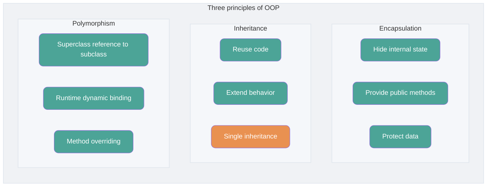
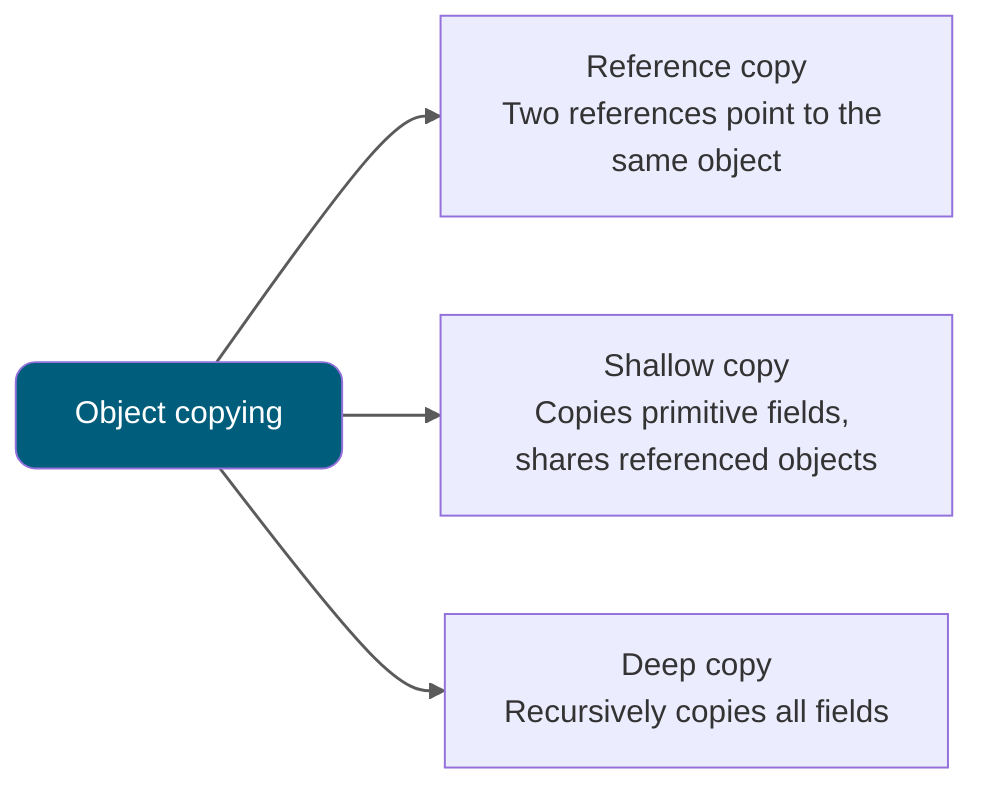

<!-- @include: @article-header.snippet.md -->

## Object-Oriented Basics

### ⭐️ Object-oriented vs. procedural programming

Procedural-oriented programming (POP) and object-oriented programming (OOP) are two common programming paradigms. Their main difference is how they approach a problem:

- **Procedural programming (POP)** breaks a problem into procedures or functions and solves it by executing them.
- **Object-oriented programming (OOP)** models the problem as objects and solves it by having those objects perform operations.

Compared with POP, OOP programs often have these advantages:

- **Maintainability**: Clear structure and encapsulation can make OOP programs easier to maintain.
- **Reusability**: Inheritance and polymorphism can make code easier to reuse and extend.
- **Extensibility**: Modular design can make a system easier and more flexible to extend.

POP is often simpler and more direct, making it suitable for some straightforward tasks.

Performance differences between POP and OOP depend mainly on how they are implemented, not on the paradigms alone. A simple comparison of their performance is therefore misleading (related issue: [Is procedural programming faster than object-oriented programming?](https://github.com/Snailclimb/JavaGuide/issues/431)).


Performance is not the only factor when choosing a programming paradigm. Maintainability, extensibility, and development efficiency also matter.

Most modern programming languages support multiple paradigms, including both procedural and object-oriented programming.

The following example calculates a circle's area and circumference using both approaches.

**Object-oriented:**

```java
public class Circle {
    // Define the circle's radius
    private double radius;

    // Constructor
    public Circle(double radius) {
        this.radius = radius;
    }

    // Calculate the circle's area
    public double getArea() {
        return Math.PI * radius * radius;
    }

    // Calculate the circle's circumference
    public double getPerimeter() {
        return 2 * Math.PI * radius;
    }

    public static void main(String[] args) {
        // Create a circle with a radius of 3
        Circle circle = new Circle(3.0);

        // Print the circle's area and circumference
        System.out.println("Area: " + circle.getArea());
        System.out.println("Circumference: " + circle.getPerimeter());
    }
}
```

We define a `Circle` class with a radius field and methods for calculating the area and circumference.

**Procedural:**

```java
public class Main {
    public static void main(String[] args) {
        // Define the circle's radius
        double radius = 3.0;

        // Calculate the circle's area and circumference
        double area = Math.PI * radius * radius;
        double perimeter = 2 * Math.PI * radius;

        // Print the circle's area and circumference
        System.out.println("Area: " + area);
        System.out.println("Circumference: " + perimeter);
    }
}
```

Here, we define the radius directly and use it to calculate the area and circumference.

### Which operator creates an object? What is the difference between an object and an object reference?

Use the `new` operator to create an object. The JVM heap is used to allocate class instances and arrays. A reference can be stored in a local variable, an object field, a static field, or an array element; it is not necessarily stored on the stack.

- An object reference can point to zero or one object (like a string that is tied to zero or one balloons).
- An object can be pointed to by any number of references (like a balloon tied to many strings).

### ⭐️ Object equality vs. reference equality

- Object equality is usually defined by `equals()` and compares logical state or values according to the type's contract.
- Reference equality is checked with `==` and indicates whether two references point to the same object (or are both `null`). Java does not expose or compare physical memory addresses.

For example:

```java
String str1 = "hello";
String str2 = new String("hello");
String str3 = "hello";
// Use == to compare string references
System.out.println(str1 == str2);
System.out.println(str1 == str3);
// Use equals() to compare string values
System.out.println(str1.equals(str2));
System.out.println(str1.equals(str3));

```

Output:

```plain
false
true
true
true
```

The output shows that:

- `str1` and `str2` are not reference-equal, while `str1` and `str3` are. The `==` operator compares references.
- All three strings have equal content. The `equals()` method compares string contents, so different objects are equal when their contents match.

### Can a class work if it declares no constructor?

A constructor is a special method whose main purpose is to initialize an object.

A class with no declared constructor can still be used because Java provides a default no-argument constructor. If you declare any constructor, with or without parameters, Java no longer provides the default no-argument constructor.

Constructors are called whenever we create objects, which is why object creation uses parentheses. If you declare a constructor with parameters and still need to create objects without arguments, declare a no-argument constructor as well.

### What are the features of constructors? Can they be overridden?

Constructors have these features:

- **Same name as the class**: A constructor's name must exactly match the class name.
- **No return type**: A constructor has no return type and cannot be declared with `void`.
- **Called automatically**: The constructor runs when an object is created; you do not call it separately.

Constructors **cannot be overridden**, but they **can be overloaded**. A class can therefore have multiple constructors with different parameter lists for different ways of initializing objects.

### ⭐️ The three principles of object-oriented programming

#### Encapsulation

Encapsulation hides an object's state (its fields) inside the object, preventing outside code from accessing it directly. The class can provide methods that let callers work with that state. Think of an air conditioner: you do not see its internal components, but you can control it with a remote. If a field should not be accessible externally, do not provide a method for it. A class that provides no way to use its behavior may not be useful (though, of course, air conditioners can be controlled in other ways; this is just an example).

```java
public class Student {
    private int id; // Keep the id field private
    private String name; // Keep the name field private

    // Get the id
    public int getId() {
        return id;
    }

    // Set the id
    public void setId(int id) {
        this.id = id;
    }

    // Get the name
    public String getName() {
        return name;
    }

    // Set the name
    public void setName(String name) {
        this.name = name;
    }
}
```

#### Inheritance

Different types of objects often share some characteristics. For example, several students share properties such as class and student ID, while each student also has distinct traits. Inheritance uses an existing class as the basis for a new class. The new class can add fields or behavior and use inherited behavior, but it cannot selectively inherit only some parts of the parent class. Inheritance can speed up class creation, improve code reuse and maintainability, and save development time.

**Keep these three points about inheritance in mind:**

1. A subclass object includes instance state declared by its superclass, but the superclass's `private` members are not inherited and cannot be accessed directly by the subclass.
2. A subclass can have its own fields and methods, extending the superclass.
3. A subclass can provide its own implementation of a superclass method (discussed later).

#### Polymorphism

Polymorphism means that an object can take multiple forms. In Java, this is commonly represented by a superclass reference pointing to a subclass instance.

**Characteristics of polymorphism:**

- The object's class must extend or implement the reference type.
- The specific implementation called through a reference is determined at runtime.
- Polymorphism does not let you call a method that exists only in the subclass when it is absent from the reference type.
- If the subclass overrides a superclass method, the subclass implementation runs. Otherwise, the superclass implementation runs.



### ⭐️ What do interfaces and abstract classes have in common, and how do they differ?

#### Similarities between interfaces and abstract classes

- **Instantiation**: Neither interfaces nor abstract classes can be instantiated directly. A concrete class must implement the interface or extend the abstract class.
- **Abstract methods**: Both can contain abstract methods. These methods have no body and must be implemented by a concrete subclass or implementing class.

#### Differences between interfaces and abstract classes

- **Purpose**: Interfaces define behavior that a class agrees to provide. Abstract classes are often used to share code and represent a common base type.
- **Inheritance and implementation**: A class can extend only one class, including an abstract class, because Java does not support multiple class inheritance. A class can implement multiple interfaces, and an interface can extend multiple interfaces.
- **Fields**: Interface fields are implicitly `public static final`, must be initialized, and cannot be reassigned. Abstract class fields can use access modifiers such as `private`, `protected`, and `public`.
- **Methods**:
  - Before Java 8, interface methods were implicitly `public abstract` and could only declare behavior. Since Java 8, interfaces can define `default` and `static` methods. Since Java 9, they can also have `private` methods.
  - Abstract classes can contain both abstract and concrete methods. Subclasses must implement abstract methods; concrete methods can be used as-is or overridden.

Java 8 added `default` and `static` methods to interfaces, and Java 9 added `private` methods. These additions made interfaces more flexible.

An interface `default` method provides a default implementation that an implementing class can override. This lets an interface add behavior without requiring changes to existing implementing classes, improving extensibility and backward compatibility.

```java
public interface MyInterface {
    default void defaultMethod() {
        System.out.println("This is a default method.");
    }
}
```

An interface `static` method cannot be overridden by an implementing class and is called through the interface name (for example, `MyInterface.staticMethod()`), like a static class method. It is often used for utility methods related to the interface.

```java
public interface MyInterface {
    static void staticMethod() {
        System.out.println("This is a static method in the interface.");
    }
}
```

Java 9 allows `private` methods in interfaces. They can share implementation code inside the interface without exposing it to callers.

```java
public interface MyInterface {
    // Default method
    default void defaultMethod() {
        commonMethod();
    }

    // Static method
    static void staticMethod() {
        commonMethod();
    }

    // Private static method, callable from static and default methods
    private static void commonMethod() {
        System.out.println("This is a private method used internally.");
    }

      // Private instance method, callable only from default methods.
    private void instanceCommonMethod() {
        System.out.println("This is a private instance method used internally.");
    }
}
```

### What is the difference between a deep copy and a shallow copy? What is a reference copy?



Here is the short version of the difference between shallow and deep copies:

- **Shallow copy**: Creates a new object on the heap, unlike a reference copy. If the original object has reference-type fields, their references are copied, so the original and copy share those nested objects.
- **Deep copy**: Copies the entire object, including the objects it contains.

If that is not clear yet, the example below should help.

#### Shallow copy

The following shallow-copy example implements `Cloneable` and overrides `clone()`.

The implementation is simple: it calls the superclass's `Object.clone()` method.

```java
public class Address implements Cloneable{
    private String name;
    // Constructor, getters, and setters omitted
    @Override
    public Address clone() {
        try {
            return (Address) super.clone();
        } catch (CloneNotSupportedException e) {
            throw new AssertionError();
        }
    }
}

public class Person implements Cloneable {
    private Address address;
    // Constructor, getters, and setters omitted
    @Override
    public Person clone() {
        try {
            Person person = (Person) super.clone();
            return person;
        } catch (CloneNotSupportedException e) {
            throw new AssertionError();
        }
    }
}
```

Test:

```java
Person person1 = new Person(new Address("Wuhan"));
Person person1Copy = person1.clone();
// true
System.out.println(person1.getAddress() == person1Copy.getAddress());
```

The output shows that the clone of `person1` still uses the same `Address` object as `person1`.

#### Deep copy

To make a deep copy, update `Person.clone()` to copy the `Address` object contained in the `Person` as well.

```java
@Override
public Person clone() {
    try {
        Person person = (Person) super.clone();
        person.setAddress(person.getAddress().clone());
        return person;
    } catch (CloneNotSupportedException e) {
        throw new AssertionError();
    }
}
```

Test:

```java
Person person1 = new Person(new Address("Wuhan"));
Person person1Copy = person1.clone();
// false
System.out.println(person1.getAddress() == person1Copy.getAddress());
```

The output shows that the cloned `Person` and its `Address` are now separate objects.

**What is a reference copy?** It means two different references point to the same object.

The following diagram illustrates shallow copies, deep copies, and reference copies:


## ⭐️ Object

### What are the common methods of the `Object` class?

`Object` is a special class and the superclass of all classes. It provides the methods below. Note that `finalize()` has been deprecated since JDK 9 and marked for removal in JDK 18. Do not use it in new code:

```java
/**
 * Native method that returns the Class object for this runtime object. It is final, so subclasses cannot override it.
 */
public final native Class<?> getClass()
/**
 * Native method that returns the object's hash code, mainly used by hash tables such as HashMap.
 */
public native int hashCode()
/**
 * Compares whether two references point to the same object. String overrides it to compare string values.
 */
public boolean equals(Object obj)
/**
 * Native method that creates and returns a copy of this object.
 */
protected native Object clone() throws CloneNotSupportedException
/**
 * Returns a string representation of the object. It is generally useful for subclasses to override this method.
 */
public String toString()
/**
 * Native, final method that wakes one thread waiting on this object's monitor (a monitor is similar to a lock). If several threads are waiting, one is chosen arbitrarily.
 */
public final native void notify()
/**
 * Native, final method that wakes all threads waiting on this object's monitor.
 */
public final native void notifyAll()
/**
 * Native, final method that makes the current thread wait. Unlike sleep, wait releases the monitor lock. timeout is the wait duration.
 */
public final native void wait(long timeout) throws InterruptedException
/**
 * The nanos parameter adds extra wait time in nanoseconds (from 0 to 999,999) to the timeout.
 */
public final void wait(long timeout, int nanos) throws InterruptedException
/**
 * Like the other wait methods, but waits indefinitely without a timeout.
 */
public final void wait() throws InterruptedException
/**
 * Called when the garbage collector is about to reclaim the object (deprecated; avoid using it).
 */
protected void finalize() throws Throwable { }
```

### What is the difference between `==` and `equals()`?

**`==`** behaves differently for primitive and reference types:

- For primitive types, `==` compares values.
- For reference types, `==` checks whether the references point to the same object (or are both `null`); it does not compare physical memory addresses.

> In both cases, `==` compares the operand values. A reference value identifies the object it refers to, but Java does not define it as a visible physical memory address.

**`equals()`** is for comparing objects, not primitive variables. It is declared in `Object`, the direct or indirect superclass of every class, so every class has an `equals()` method.

The `equals()` method in `Object` is:

```java
public boolean equals(Object obj) {
     return (this == obj);
}
```

There are two cases for `equals()`:

- **The class does not override `equals()`**: Comparing two objects with `equals()` is equivalent to comparing them with `==`, because the `Object` implementation is used.
- **The class overrides `equals()`**: The implementation commonly compares the objects' fields and returns `true` when they are equal according to the class's value semantics.

For example (this is only an illustration; IDEs such as IntelliJ IDEA will suggest using `equals()` instead of `==` here):

```java
String a = new String("ab"); // a is a reference
String b = new String("ab"); // b is another reference with the same content
String aa = "ab"; // Stored in the string pool
String bb = "ab"; // Reuses the string from the pool
System.out.println(aa == bb);// true
System.out.println(a == b);// false
System.out.println(a.equals(b));// true
System.out.println(42 == 42.0);// true
```

`String` overrides `equals()`: `Object.equals()` checks whether references point to the same object, while `String.equals()` compares string values.

When a string literal creates a `String` object (for example, `String aa = "ab"`), the JVM looks for an equal string in the pool and reuses it if present; otherwise, it creates one there. With `new` (for example, `String a = new String("ab")`), the JVM **creates a new object on the heap** and initializes it using the pooled value (creating the pooled string first if needed).

The `equals()` implementation in `String` is:

```java
public boolean equals(Object anObject) {
    if (this == anObject) {
        return true;
    }
    if (anObject instanceof String) {
        String anotherString = (String)anObject;
        int n = value.length;
        if (n == anotherString.value.length) {
            char v1[] = value;
            char v2[] = anotherString.value;
            int i = 0;
            while (n-- != 0) {
                if (v1[i] != v2[i])
                    return false;
                i++;
            }
            return true;
        }
    }
    return false;
}
```

### What is `hashCode()` used for?

`hashCode()` returns an integer hash code. A hash table uses it to help determine where to store the object.


`hashCode()` is defined in `Object`, so every Java class has this method. The `Object` implementation is native, meaning it is implemented outside Java, commonly in C or C++.

> ⚠️ Note: In **Oracle OpenJDK 8**, the default implementation uses thread-local state to generate a Marsaglia xorshift random number. It is not an address or a value derived from an address, though implementations can differ across JDKs and VMs. Oracle OpenJDK 8 has six generation modes; the fifth returns an address and can be enabled with `-XX:hashCode=4`. See the source:
>
> - <https://hg.openjdk.org/jdk8u/jdk8u/hotspot/file/87ee5ee27509/src/share/vm/runtime/globals.hpp> (line 1127)
> - <https://hg.openjdk.org/jdk8u/jdk8u/hotspot/file/87ee5ee27509/src/share/vm/runtime/synchronizer.cpp> (starting at line 537)

```java
public native int hashCode();
```

Hash tables store key-value pairs and can **quickly retrieve a value by its key**. Hash codes help them find the relevant object efficiently.

### Why does Java have `hashCode()`?

The way `HashSet` checks for duplicates helps explain why `hashCode()` is useful.

When you add an object to a `HashSet`, it calls the object's `hashCode()` and applies an internal hash function to determine which bucket (a slot in the backing array) should hold it:

1. If the bucket is empty, the object is inserted there.
2. If the bucket already contains elements, `HashSet` compares the object with entries in the bucket's linked list or red-black tree:
   - Nodes with a **different hash value** are skipped.
   - For nodes with the **same hash value**, `equals()` checks whether the objects are equal:
     - If `equals()` returns `true`, an equivalent element is already present, so `HashSet` does not add the object again.
     - If it returns `false`, the object is a new element and is added to the **same bucket**.

By using `hashCode()` to narrow the candidates to a bucket and then calling `equals()` on the few entries there, `HashSet` reduces the number of equality checks and improves lookup and insertion performance.

**Why does the JDK provide both methods?**

In collections such as `HashMap` and `HashSet`, `hashCode()` makes it faster to determine whether an element may already be present (see the insertion process above).

As described above, if several objects in a `HashSet` have the same hash code, it uses `equals()` to check whether they are actually equal. The hash code narrows the search.

**Why not provide only `hashCode()`?**

Because two objects with the same hash code are not necessarily equal.

**Why can two objects have the same hash code but still be unequal?**

The hash algorithm used by `hashCode()` may return the same value for different objects. Poorer hash functions cause more collisions, though the distribution of input values also matters. A hash collision occurs when different objects have the same hash code.

In summary:

- Two objects with the same hash code are not necessarily equal (they may collide).
- If two objects have the same hash code and `equals()` returns `true`, they are considered equal.
- If two objects have different hash codes, they are not equal.

With that explanation of `hashCode()` and `equals()`, the next question should be straightforward.

### Why must you override `hashCode()` when overriding `equals()`?

Because equal objects must have equal hash codes. If `equals()` considers two objects equal, their `hashCode()` values must also be equal.

If you override `equals()` but not `hashCode()`, two objects that `equals()` considers equal may have different hash codes.

**Think about it:** What problems can occur when using a `HashMap` if you override `equals()` but not `hashCode()`?

**Summary:**

- If `equals()` considers two objects equal, they must have the same hash code.
- Two objects with the same hash code are not necessarily equal (a hash collision).

For more about `hashCode()` and `equals()`, see [Questions and Answers about Java's `hashCode()` and `equals()`](https://www.cnblogs.com/skywang12345/p/3324958.html).

## String

### ⭐️ What is the difference between `String`, `StringBuffer`, and `StringBuilder`?

**Mutability**

`String` is immutable (the reasons are explained below). Each modification creates a new object and points the reference to it. `StringBuffer` and `StringBuilder` are mutable; they modify their underlying character data instead of creating a new object for every change.

`StringBuilder` and `StringBuffer` both extend `AbstractStringBuilder`, which stores string data in an array that is not declared `final` or `private`. Most importantly, `AbstractStringBuilder` provides methods for modifying strings, such as `append()`.

```java
abstract class AbstractStringBuilder implements Appendable, CharSequence {
    char[] value;
    public AbstractStringBuilder append(String str) {
        if (str == null)
            return appendNull();
        int len = str.length();
        ensureCapacityInternal(count + len);
        str.getChars(0, len, value, count);
        count += len;
        return this;
    }
    //...
}
```

**Thread safety**

`String` objects are immutable and therefore safe to share between threads. `AbstractStringBuilder`, the common superclass of `StringBuilder` and `StringBuffer`, defines basic string operations such as `expandCapacity`, `append`, `insert`, and `indexOf`. `StringBuffer` synchronizes its methods and is thread-safe; `StringBuilder` does not, so it is not thread-safe.


**Performance**

The performance difference mainly comes from their thread-safety mechanisms:

- `StringBuffer` methods are generally synchronized, which adds some overhead.
- `StringBuilder` has no synchronization overhead and often performs better in single-threaded scenarios. In comparable cases, it may be about 10–15% faster, but it is not safe for concurrent use.
- The exact difference is not fixed. JVM lock optimizations, such as lock elimination, can make the gap small in some cases.

**In summary:**

- Use `String` for a small number of string operations.
- Use `StringBuilder` for many string operations in a single-threaded context.
- Use `StringBuffer` when a mutable string buffer must be shared across threads.

### ⭐️ Why is `String` immutable?

The `String` class uses a `final` array to store string data. ~~Therefore, `String` objects are immutable.~~

```java
public final class String implements java.io.Serializable, Comparable<String>, CharSequence {
    private final char value[];
  //...
}
```

> 🐛 Correction: A `final` class cannot be extended, a `final` method cannot be overridden, and a `final` variable cannot be reassigned (for a primitive, its value cannot change; for a reference, it cannot point to another object). A `final` array reference alone does not make the string immutable, because the array's contents could still be changed.
>
> `String` is immutable for these reasons:
>
> 1. The array storing the string is `private final`, and `String` does not expose a way to modify its contents.
> 2. `String` is `final`, so subclasses cannot break its immutability.
>
> Related reading: [How should we understand the immutability of String values?](https://www.zhihu.com/question/20618891/answer/114125846)
>
> Additional note (from [issue 675](https://github.com/Snailclimb/JavaGuide/issues/675)): Since Java 9, `String`, `StringBuilder`, and `StringBuffer` have used a `byte` array to store string data.
>
> ```java
> public final class String implements java.io.Serializable,Comparable<String>, CharSequence {
>     // @Stable indicates that the variable is expected to be modified at most once.
>     @Stable
>     private final byte[] value;
> }
>
> abstract class AbstractStringBuilder implements Appendable, CharSequence {
>     byte[] value;
>
> }
> ```
>
> **Why did Java 9 change `String`'s internal representation from `char[]` to `byte[]`?**
>
> The newer `String` implementation supports Latin-1 and UTF-16. It uses Latin-1 when every character can be represented by it; otherwise, it uses UTF-16. Chinese characters are outside the Latin-1 range. Latin-1 uses one byte per character, which can halve the character data size compared with the earlier `char[]` representation.
>
> The JDK team notes that most string objects contain only characters representable in Latin-1.
>
> 
>
> If a string contains characters that Latin-1 cannot represent (such as Chinese characters), it uses UTF-16, with two bytes per code unit.
>
> See the official description: <https://openjdk.java.net/jeps/254>.

### ⭐️ Should you concatenate strings with `+` or `StringBuilder`?

Java does not support user-defined operator overloading, but the language defines `+` and `+=` specifically for string concatenation.

```java
String str1 = "he";
String str2 = "llo";
String str3 = "world";
String str4 = str1 + str2 + str3;
```

The bytecode for the code above is shown below:


In the JDK 8 bytecode shown here, `javac` translates string concatenation with `+` into calls to `StringBuilder.append()`. Starting with JDK 9, `javac` uses `invokedynamic` and `StringConcatFactory` by default, so `StringBuilder` is not the implementation used by every Java version.

However, concatenating strings with `+` inside a loop has a clear drawback: **the compiler does not create one reusable `StringBuilder`, so many temporary objects may be created.**

```java
String[] arr = {"he", "llo", "world"};
String s = "";
for (int i = 0; i < arr.length; i++) {
    s += arr[i];
}
System.out.println(s);
```

The `StringBuilder` is created inside the loop, so a new one may be created on every iteration.


Using one `StringBuilder` directly for concatenation avoids this issue.

```java
String[] arr = {"he", "llo", "world"};
StringBuilder s = new StringBuilder();
for (String value : arr) {
    s.append(value);
}
System.out.println(s);
```


If you use IntelliJ IDEA, its code inspections can suggest this change.

In JDK 9, string concatenation with `+` was changed to use the dynamic method `makeConcatWithConstants()`, which can reduce some temporary allocations by allocating space in advance. This optimization mainly targets simple concatenations such as `a + b + c`. Large numbers of concatenations in a loop still require repeated allocation, so a manually reused `StringBuilder` can be more efficient. This change was introduced by [JEP 280](https://openjdk.org/jeps/280). For details, see [Still using StringBuilder everywhere? A refresher on string concatenation](https://juejin.cn/post/7182872058743750715) and [issue #2442](https://github.com/Snailclimb/JavaGuide/issues/2442).

### How do `String.equals()` and `Object.equals()` differ?

`String` overrides `equals()` to compare string values. `Object.equals()` checks whether two references point to the same object.

### ⭐️ What is the purpose of the string pool?

The **string pool** is an area the JVM uses to improve performance and reduce memory use by avoiding duplicate `String` objects.

```java
// 1. Look for "ab" in the string pool; create and add it if it is absent.
// 2. Assign a reference to the pooled "ab" string to aa.
String aa = "ab";
// Reuse the pooled "ab" string and assign its reference to bb.
String bb = "ab";
System.out.println(aa==bb); // true
```

For more about the string pool, see [Java Memory Areas in Detail](https://javaguide.cn/java/jvm/memory-area.html).

### ⭐️ How many string objects does `String s1 = new String("abc");` create?

The answer is one or two string objects:

1. If the string pool does not contain `"abc"`, two string objects are created: one in the pool when the `ldc` instruction loads it, and one on the heap by `new String()`, initialized with the pooled string.
2. If the pool already contains `"abc"`, one object is created: the heap object created by `new String()`, initialized with the pooled string.

Here is a more detailed explanation.

1. If the string pool does not contain `"abc"`, the JVM first creates it in the pool, then creates another `"abc"` object on the heap.

Example (JDK 8):

```java
String s1 = new String("abc");
```

Corresponding bytecode:

```java
// Allocate an uninitialized String object on the heap.
// #2 is a symbolic reference in the constant pool to java/lang/String.
// During class loading, it is resolved to a direct reference to the actual class.
0 new #2 <java/lang/String>
// Duplicate the top String reference in preparation for the constructor call.
// The operand stack now has two references: one for the constructor and one to store in the local variable table afterward.
3 dup
// The JVM checks whether "abc" is already in the string pool.
// If it is, the existing reference is returned.
// Otherwise, the JVM creates the string literal in the pool and returns its reference.
// The reference is pushed onto the operand stack as the constructor argument.
4 ldc #3 <abc>
// Initialize the heap String object using "abc" loaded from the pool.
// The new String has the same content as the pooled string but is a separate heap object.
6 invokespecial #4 <java/lang/String.<init> : (Ljava/lang/String;)V>
// Store the heap String reference in the local variable table.
9 astore_1
// Return and end the method.
10 return
```

The `ldc` (load constant) instruction loads different kinds of constants from the constant pool, including strings, integers, floating-point values, and class references. For string constants, it works as follows:

1. **Load a string from the pool**: `ldc` checks whether a string with the same content is already in the string pool.
2. **Reuse an existing string**: If it is present, `ldc` loads its reference onto the operand stack.
3. **Create and pool a string if needed**: If it is absent, the JVM creates the string object in the pool and loads its reference onto the operand stack.

4. If the string pool already contains `"abc"`, only one `"abc"` object is created on the heap.

Example (JDK 8):

```java
// The string pool already contains "abc".
String s1 = "abc";
// The following line creates only one "abc" object on the heap.
String s2 = new String("abc");
```

Corresponding bytecode:

```java
0 ldc #2 <abc>
2 astore_1
3 new #3 <java/lang/String>
6 dup
7 ldc #2 <abc>
9 invokespecial #4 <java/lang/String.<init> : (Ljava/lang/String;)V>
12 astore_2
13 return
```

The bytecode above does not need further annotation. The `ldc` at offset 7 does not create a new `"abc"` object on the heap. The `ldc` at offset 0 has already loaded the pooled string, so the instruction at offset 7 returns the reference to that same pooled object.

### What does `String.intern()` do?

`String.intern()` is a native method that works with string references in the string pool. Its behavior can be summarized in two cases:

1. **An equal string is already in the pool**: If the pool contains a `String` with the same content, `intern()` returns its reference.
2. **No equal string is in the pool**: `intern()` adds the current string's reference to the pool and returns it.

In summary:

- `intern()` ensures that the string pool contains a canonical reference for a string value.
- If an equal string is already in the pool, `intern()` returns its reference; otherwise, it adds the current string's reference and returns it.

Example (JDK 8):

```java
// s1 refers to the pooled "Java" string.
String s1 = "Java";
// s2 also refers to the pooled "Java" string, the same object as s1.
String s2 = s1.intern();
// Create a new "Java" object on the heap; s3 refers to it.
String s3 = new String("Java");
// s4 refers to the pooled "Java" string, the same object as s1.
String s4 = s3.intern();
// s1 and s2 refer to the same object in the string pool.
System.out.println(s1 == s2); // true
// s3 refers to a heap object and s4 to a pooled object, so they differ.
System.out.println(s3 == s4); // false
// s1 and s4 both refer to the same object in the string pool.
System.out.println(s1 == s4); // true
```

### What happens when you use `+` with `String` variables and constants?

First, consider concatenation without the `final` keyword (JDK 8):

```java
String str1 = "str";
String str2 = "ing";
String str3 = "str" + "ing";
String str4 = str1 + str2;
String str5 = "string";
System.out.println(str3 == str4); // false
System.out.println(str3 == str5); // true
System.out.println(str4 == str5); // false
```

> **Note:** Use `equals()` to compare string values. `String` overrides `equals()`: `Object.equals()` checks whether two references point to the same object, while `String.equals()` compares string values. IntelliJ IDEA will suggest using `equals()` instead of `==` for string comparison.


**For string expressions whose values are known at compile time, the compiler performs constant folding and stores the result as a string constant in the class file's constant pool. The corresponding string object is created at runtime and placed in the string pool.**

During compilation, `javac` performs an optimization called **constant folding**. This is also discussed in _Understanding the Java Virtual Machine_:


Constant folding evaluates constant expressions and embeds their values as constants in the generated code. It is one of the few optimizations `javac` performs on source code; most code optimization happens in the JIT compiler.

The compiler optimizes `String str3 = "str" + "ing";` to `String str3 = "string";`.

Not every constant expression can be folded. The compiler must be able to determine its value at compile time. Examples include:

- Primitive values (`byte`, `boolean`, `short`, `char`, `int`, `float`, `long`, and `double`) and string constants.
- Primitive and string variables declared `final`.
- Strings concatenated with `+`, arithmetic operations on primitive values, and bitwise operations on primitive values (`<<`, `>>`, `>>>`).

**An object's reference value is not known at compile time, so the compiler cannot optimize it this way.**

When object references are concatenated with `+`, the compiler may use `StringBuilder` and its `append()` method, then call `toString()` to produce a `String` object.

```java
String str4 = new StringBuilder().append(str1).append(str2).toString();
```

In your code, avoid repeatedly concatenating strings when it would create many objects. Use `StringBuilder` or `StringBuffer` when you need to build a string incrementally.

However, declaring strings with `final` can allow the compiler to treat them as constants.

Example:

```java
final String str1 = "str";
final String str2 = "ing";
// These two expressions are equivalent.
String c = "str" + "ing"; // Pooled string
String d = str1 + str2;   // Pooled string
System.out.println(c == d); // true
```

When a `String` is declared `final`, the compiler may treat it as a constant if its value is known at compile time, just like a literal constant.

If the compiler cannot determine the value until runtime, it cannot apply this optimization.

Example (`str2` is only known at runtime):

```java
final String str1 = "str";
final String str2 = getStr();
String c = "str" + "ing"; // Pooled string
String d = str1 + str2;   // A new object on the heap
System.out.println(c == d); // false
public static String getStr() {
      return "ing";
}
```

## References

- [A Deep Dive into `String.intern()`](https://tech.meituan.com/2014/03/06/in-depth-understanding-string-intern.html)
- [Reading the Java String Source Code](http://keaper.cn/2020/09/08/java-string-mian-mian-guan/)
- [RednaxelaFX on Constant Folding](https://www.zhihu.com/question/55976094/answer/147302764)

<!-- @include: @article-footer.snippet.md -->
