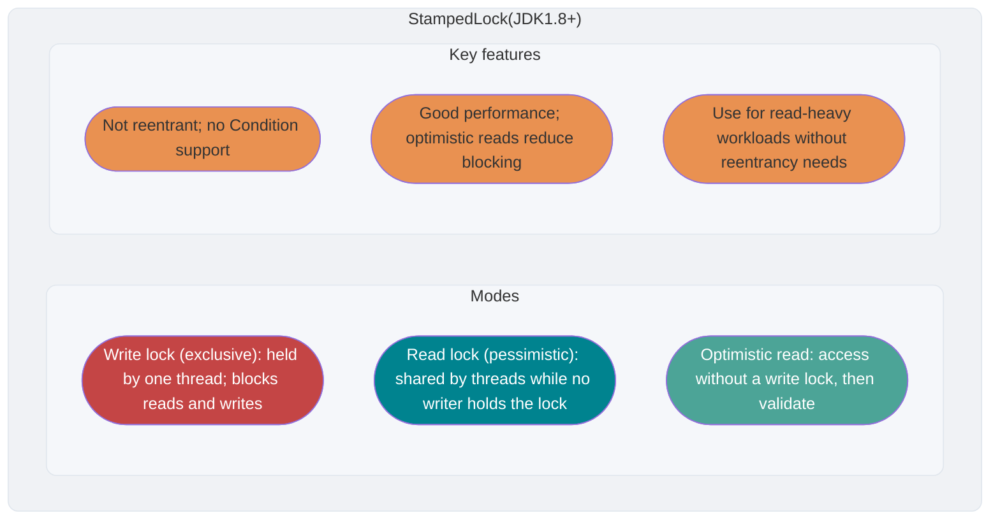

<!-- @include: @article-header.snippet.md -->

## ⭐️ Java Memory Model (JMM)

The Java Memory Model (JMM) comes up often in interviews, so it has a dedicated guide: [The Java Memory Model Explained](https://javaguide.cn/java/concurrent/jmm.html).

## ⭐️ The `volatile` Keyword

### How Does `volatile` Ensure Visibility?

In Java, `volatile` guarantees visibility. A write to a `volatile` variable happens-before a subsequent read of that same variable. The reading thread therefore sees the write and any prior writes that happen-before it. This is the JMM's guarantee; it does not mean every access bypasses the CPU cache and directly reads or writes physical memory.


The `volatile` keyword is not unique to Java, but its meaning differs across languages. Java's `volatile` provides visibility and ordering guarantees defined by the JMM; it does not “disable the CPU cache.”

`volatile` guarantees visibility but not atomicity. `synchronized` guarantees both.

### How Does `volatile` Prevent Instruction Reordering?

**In Java, `volatile` provides visibility and also prevents certain instruction reorderings.** When a variable is declared `volatile`, the JVM uses specific **memory barriers** around reads and writes to enforce the required ordering.

Java's `Unsafe` class provides three ready-to-use methods related to memory barriers, abstracting away lower-level platform differences:

```java
public native void loadFence();
public native void storeFence();
public native void fullFence();
```

In theory, you could use these methods to implement ordering similar to `volatile`, but it would be more cumbersome.

#### Four Types of Memory Barriers

The following four types of memory barriers are commonly used to describe ordering constraints in JVM implementations. They are a useful implementation model, not a JLS requirement for the exact barrier instructions a JVM must insert:

| Barrier type   | Instruction example          | Description                                                                                                                                                                                            |
| -------------- | ---------------------------- | ------------------------------------------------------------------------------------------------------------------------------------------------------------------------------------------------------ |
| **LoadLoad**   | `Load1; LoadLoad; Load2`     | Ensures the `Load1` read completes before `Load2` and subsequent reads.                                                                                                                                |
| **StoreStore** | `Store1; StoreStore; Store2` | Orders two writes so that `Store1` is not made visible to other processors after `Store2`.                                                                                                             |
| **LoadStore**  | `Load1; LoadStore; Store2`   | Ensures the `Load1` read completes before `Store2` and subsequent writes are flushed to memory.                                                                                                        |
| **StoreLoad**  | `Store1; StoreLoad; Load2`   | Ensures `Store1` is visible to other processors before `Load2` and subsequent reads. It is the most expensive barrier and has the effects of the other three, so it is also called a **full barrier**. |

#### Memory Barriers Around `volatile` Reads and Writes

The following conservative barrier placement helps explain `volatile` semantics. A JVM may select, combine, or omit specific barriers based on the target processor's memory model, as long as the resulting behavior meets the JMM requirements:

**For a `volatile` write:**

Insert a `StoreStore` barrier **before** each `volatile` write and a `StoreLoad` barrier **after** it.

```
StoreStore barrier
volatile write
StoreLoad barrier
```

- The preceding `StoreStore` barrier prevents ordinary writes before the `volatile` write from being reordered after it.
- The following `StoreLoad` barrier orders the `volatile` write with later `volatile` reads and writes. It is the most expensive barrier, but it prevents the write from being reordered with a later `volatile` access.

**For a `volatile` read:**

Insert a `LoadLoad` barrier and a `LoadStore` barrier **after** each `volatile` read.

```
volatile read
LoadLoad barrier
LoadStore barrier
```

- `LoadLoad` barrier: Prevents ordinary reads after a `volatile` read from being reordered before it.
- `LoadStore` barrier: Prevents ordinary writes after a `volatile` read from being reordered before it.

Together, a `volatile` write-read pair has semantics similar to **lock release-acquire**: **all actions before the `volatile` write are visible to actions after a subsequent read of that variable.**

The following common interview question illustrates how `volatile` prevents reordering.

An interviewer may ask: “Can you implement a singleton and explain how double-checked locking works?”

**Thread-safe singleton with double-checked locking:**

```java
public class Singleton {

    private volatile static Singleton uniqueInstance;

    private Singleton() {
    }

    public static Singleton getUniqueInstance() {
       // Check whether the instance already exists before acquiring the lock.
        if (uniqueInstance == null) {
            // Lock the Class object.
            synchronized (Singleton.class) {
                if (uniqueInstance == null) {
                    uniqueInstance = new Singleton();
                }
            }
        }
        return uniqueInstance;
    }
}
```

Declaring `uniqueInstance` as `volatile` is also necessary. The statement `uniqueInstance = new Singleton();` consists of three steps:

1. Allocate memory for the `Singleton` object.
2. Initialize the object.
3. Assign the reference to `uniqueInstance`.

The JVM may reorder these steps as 1 → 3 → 2. This is harmless in a single-threaded context, but in a multithreaded program another thread could see a reference to an uninitialized object. For example, T1 completes steps 1 and 3, then T2 calls `getUniqueInstance()` and sees a non-null `uniqueInstance` before initialization has finished.

#### Why Double-Checked Locking Needs `volatile`: A Memory Barrier View

The previous section explained why the DCL singleton's `uniqueInstance` needs `volatile` in terms of instruction reordering. This section looks at how memory barriers address the issue.

Without `volatile`, steps 2 and 3 in `uniqueInstance = new Singleton();` (object initialization and reference assignment) may be reordered as 1 → 3 → 2. With `volatile`, the write in step 3 is subject to the barrier rules described above:

1. A `StoreStore` barrier **before** the `volatile` write ensures that memory allocation and object initialization happen before the reference assignment, **preventing steps 2 and 3 from being reordered**.
2. A `StoreLoad` barrier **after** the `volatile` write orders it with subsequent reads and writes, working with the `volatile` read to provide the visibility required by the JMM.

Therefore, when T2 reads `uniqueInstance` and sees a non-null value, the object has been fully initialized.

### `volatile` and Happens-Before

The JMM's happens-before relationship is an important way to reason about data races and thread safety. Reads and writes of `volatile` variables are closely related to it.

> For more about happens-before, see [The Java Memory Model Explained](https://javaguide.cn/java/concurrent/jmm.html).

The happens-before rule directly related to `volatile` is the **volatile variable rule**:

> **A write to a `volatile` variable happens-before every subsequent read of that same variable.**

If Thread A writes a `volatile` variable and Thread B later reads it, Thread B can also see all changes Thread A made before that write, including changes to non-`volatile` variables.

Together with the **transitivity rule** (if A happens-before B and B happens-before C, then A happens-before C), this enables lightweight communication between threads:

```java
public class VolatileHappensBeforeDemo {
    private int a = 0;
    private int b = 0;
    private volatile boolean flag = false;

    // Thread A
    public void writer() {
        a = 1;           // Action 1: ordinary write
        b = 2;           // Action 2: ordinary write
        flag = true;     // Action 3: volatile write
    }

    // Thread B
    public void reader() {
        if (flag) {      // Action 4: volatile read
            int x = a;   // Action 5: ordinary read; x is 1
            int y = b;   // Action 6: ordinary read; y is 2
            System.out.println("x=" + x + ", y=" + y);
        }
    }
}
```

The happens-before chain in this example is:

1. Actions 1 and 2 happen-before action 3 (**program order rule**: within one thread, earlier actions happen-before later actions).
2. Action 3 happens-before action 4 (**volatile variable rule**: a `volatile` write happens-before a `volatile` read).
3. Action 4 happens-before actions 5 and 6 (**program order rule**).

By **transitivity**, actions 1 and 2 happen-before actions 5 and 6.

Therefore, when Thread B reads `flag == true` in action 4, it also sees Thread A's updates to `a` and `b` before action 3. The key point is that **a `volatile` write-read pair ensures visibility of the `volatile` variable itself and, through happens-before transitivity, of related ordinary variables as well.**

This is why `volatile` is often used for a **state flag**, such as `flag` above. It can safely communicate state between threads without a lock while also making related data visible.

### Does `volatile` Guarantee Atomicity?

**`volatile` guarantees visibility, but it does not make compound operations atomic.**

The following code demonstrates this:

```java
/**
 * Search WeChat for "JavaGuide" and reply "Interview Prep" to get the Java interview guide.
 *
 * @author Guide
 * @date 2022/08/03 13:40
 **/
public class VolatileAtomicityDemo {
    public volatile static int inc = 0;

    public void increase() {
        inc++;
    }

    public static void main(String[] args) throws InterruptedException {
        ExecutorService threadPool = Executors.newFixedThreadPool(5);
        VolatileAtomicityDemo volatileAtomicityDemo = new VolatileAtomicityDemo();
        for (int i = 0; i < 5; i++) {
            threadPool.execute(() -> {
                for (int j = 0; j < 500; j++) {
                    volatileAtomicityDemo.increase();
                }
            });
        }
        // Wait 1.5 seconds for the tasks above to finish.
        Thread.sleep(1500);
        System.out.println(inc);
        threadPool.shutdown();
    }
}
```

The code might appear to print `2500`, but when you run it, the result is usually lower.

Why does this happen if `volatile` guarantees visibility?

If `volatile` made `inc++` atomic, every thread would see each increment immediately. With five threads performing 500 increments each, the final value would be `5 * 500 = 2500`.

It is easy to assume that `inc++` is atomic, but it is a compound operation with three steps:

1. Read the value of `inc`.
2. Add 1 to `inc`.
3. Write the new value back.

`volatile` does not make these three steps atomic. For example:

1. Thread 1 reads `inc` but has not updated it yet. Thread 2 also reads `inc`, increments it, and writes the value back.
2. Thread 1 then increments its stale value and writes it back.

Both threads incremented `inc`, but the value increased by only 1.

To make the code correct, use `synchronized`, a `Lock`, or `AtomicInteger`.

Using `synchronized`:

```java
public synchronized void increase() {
    inc++;
}
```

Using `AtomicInteger`:

```java
public AtomicInteger inc = new AtomicInteger();

public void increase() {
    inc.getAndIncrement();
}
```

Using `ReentrantLock`:

```java
Lock lock = new ReentrantLock();
public void increase() {
    lock.lock();
    try {
        inc++;
    } finally {
        lock.unlock();
    }
}
```

## ⭐️ Optimistic and Pessimistic Locking

### What Is Pessimistic Locking?

Pessimistic locking assumes the worst: every access to a shared resource may conflict with another access. It acquires a lock before accessing the resource, blocking other threads until the lock is released. In other words, **only one thread can use the shared resource at a time; other threads wait until it is released**.

Exclusive locks such as Java's `synchronized` and `ReentrantLock` follow the pessimistic locking approach.

```java
public void performSynchronisedTask() {
    synchronized (this) {
        // Operations that need synchronization
    }
}

private Lock lock = new ReentrantLock();
lock.lock();
try {
   // Operations that need synchronization
} finally {
    lock.unlock();
}
```

Under high contention, locks can block threads and lead to many context switches, adding overhead. Pessimistic locking can also cause deadlocks that prevent the program from progressing.

### What Is Optimistic Locking?

Optimistic locking assumes conflicts are rare. Threads proceed without locking or waiting, then check when committing an update whether another thread changed the data. Common implementations use version numbers or CAS.

Java's atomic variable classes, such as `AtomicInteger` and `LongAdder` in `java.util.concurrent.atomic`, use **CAS**, one implementation of optimistic locking.


```java
// LongAdder can outperform AtomicInteger and AtomicLong under high contention.
// The trade-off is higher memory usage.
LongAdder sum = new LongAdder();
sum.increment();
```

Under high concurrency, optimistic locking avoids lock contention and deadlocks, and can perform better than pessimistic locking. However, frequent conflicts, especially in write-heavy workloads, cause repeated failures and retries that can hurt performance and drive up CPU usage.

Some designs can reduce retry costs. For example, `LongAdder` trades additional space for better performance under contention.

As a rule of thumb:

- Pessimistic locking is often used in write-heavy, highly contended workloads to avoid repeated failures and retries. Its overhead is more predictable. Optimistic approaches may still work if they address retries effectively, as `LongAdder` does; choose based on the workload.
- Optimistic locking is often used in read-heavy workloads with fewer conflicts, avoiding the cost of frequent locking. It is commonly applied to individual shared variables, as in the atomic variable classes in `java.util.concurrent.atomic`.

### How Is Optimistic Locking Implemented?

Optimistic locking is commonly implemented with version numbers or CAS. CAS is especially common.

#### Versioning

A versioning scheme adds a `version` field to a database record to track the number of updates. Increment it whenever the data changes. When Thread A reads a record, it also reads its version. On update, it writes only if the version still matches; otherwise, it retries with the latest data.

**Example:** Suppose an account record has a `version` field with value 1 and a `balance` of $100.

1. Operator A reads the record at version 1 and deducts $50, leaving a balance of $50.
2. While A is working, Operator B also reads version 1 and deducts $20, calculating a balance of $80.
3. A submits the new balance with version 1. Since the database record is still at version 1, the update succeeds and the stored version becomes 2.
4. B submits its update with version 1 and a balance of $80. The database is now at version 2, so the version check fails and B's update is rejected.

This prevents B's update based on stale version 1 data from overwriting A's change.

#### CAS

CAS stands for **Compare-And-Swap**. It is widely used to implement optimistic locking. CAS compares a variable with an expected value and updates it only if the values match.

CAS is an atomic operation and typically relies on an atomic CPU instruction.

> **Atomic operation** means an indivisible operation: once it starts, it cannot be interrupted before it completes.

CAS uses three operands:

- **V**: The variable to update.
- **E**: The expected value.
- **N**: The new value to write.

CAS atomically updates V to N only if V equals E. Otherwise, another thread has changed V, and the current thread does not update it.

**Example:** Thread A wants to change `i` from 1 to 6 (`V = 1`, `E = 1`, `N = 6`; assume there is no ABA problem).

1. Compare `i` with 1. If they match, no other thread has changed it, so `i` can be set to 6.
2. If they do not match, another thread changed `i`; the current thread gives up and the CAS operation fails.

When multiple threads use CAS on the same variable, one succeeds and the others fail. Failed threads are not suspended; they can retry or give up.

Java code can express CAS semantics through atomic classes, `VarHandle`, and other APIs. HotSpot often recognizes these calls as intrinsics and maps them to atomic instructions supported by the target processor, or an equivalent implementation. The Java specification does not require a fixed implementation such as “JNI calling C++ inline assembly.”

The `Unsafe` class in `sun.misc` provides `compareAndSwapObject`, `compareAndSwapInt`, and `compareAndSwapLong` methods for CAS operations on `Object`, `int`, and `long` values.

```java
/**
  *  CAS
  * @param o         the object containing the field to modify
  * @param offset    the field offset within the object
  * @param expected  the expected value
  * @param update    the new value
  * @return          true | false
  */
public final native boolean compareAndSwapObject(Object o, long offset,  Object expected, Object update);

public final native boolean compareAndSwapInt(Object o, long offset, int expected,int update);

public final native boolean compareAndSwapLong(Object o, long offset, long expected, long update);
```

For more about `Unsafe`, see [The Java `Unsafe` Class Explained](https://javaguide.cn/java/basis/unsafe.html).

### How Is CAS Implemented in Java?

One key class used to implement CAS (Compare-And-Swap) in Java is `Unsafe`.

`Unsafe` is a low-level class in the `sun.misc` package. Because its powerful operations can be dangerous, it is mainly used internally by the JVM and by libraries that need low-level access or very high performance. It is not recommended for ordinary application code. For details, see [The Java `Unsafe` Class Explained](https://javaguide.cn/java/basis/unsafe.html).

The `Unsafe` class in `sun.misc` provides `compareAndSwapObject`, `compareAndSwapInt`, and `compareAndSwapLong` methods for CAS operations on `Object`, `int`, and `long` values:

```java
/**
 * Atomically updates the value of an object field.
 *
 * @param o        the object to operate on
 * @param offset   the memory offset of the field
 * @param expected the expected old value
 * @param x        the new value
 * @return true if the value was updated; otherwise, false
 */
boolean compareAndSwapObject(Object o, long offset, Object expected, Object x);

/**
 * Atomically updates an int field in an object.
 */
boolean compareAndSwapInt(Object o, long offset, int expected, int x);

/**
 * Atomically updates a long field in an object.
 */
boolean compareAndSwapLong(Object o, long offset, long expected, long x);
```

In JDK 8, these CAS methods in `Unsafe` are `native`. Java code uses them to express atomic compare-and-swap semantics. HotSpot usually treats these calls as intrinsics and maps them to atomic instructions supported by the target processor, or an equivalent implementation. The details depend on the JVM and CPU architecture; it is inaccurate to summarize them as “JNI calling C++ inline assembly.”

The `java.util.concurrent.atomic` package provides classes for atomic operations. These classes use low-level atomic instructions to make operations thread-safe.


For an introduction to the atomic classes, see [Java Atomic Classes](https://javaguide.cn/java/concurrent/atomic-classes.html).

`AtomicInteger` is an atomic class for operations on `int` values. It uses low-level operations from `Unsafe` to provide thread safety without locks.

The following walkthrough of `AtomicInteger`'s core source code in JDK 8 shows how Java uses `Unsafe` methods to implement atomic operations.

Here is the relevant `AtomicInteger` source code:

```java
// Get the Unsafe instance.
private static final Unsafe unsafe = Unsafe.getUnsafe();
private static final long valueOffset;

static {
    try {
        // Get the memory offset of AtomicInteger's "value" field.
        valueOffset = unsafe.objectFieldOffset
            (AtomicInteger.class.getDeclaredField("value"));
    } catch (Exception ex) { throw new Error(ex); }
}
// Ensure visibility of the "value" field.
private volatile int value;

// Atomically set the value to newValue if it matches the expected value.
// Uses Unsafe.compareAndSwapInt for CAS.
public final boolean compareAndSet(int expect, int update) {
    return unsafe.compareAndSwapInt(this, valueOffset, expect, update);
}

// Atomically add delta to the current value and return the old value.
public final int getAndAdd(int delta) {
    return unsafe.getAndAddInt(this, valueOffset, delta);
}

// Atomically increment the current value and return the old value.
// Uses Unsafe.getAndAddInt for CAS.
public final int getAndIncrement() {
    return unsafe.getAndAddInt(this, valueOffset, 1);
}

// Atomically decrement the current value and return the old value.
public final int getAndDecrement() {
    return unsafe.getAndAddInt(this, valueOffset, -1);
}
```

Here is the source code for `Unsafe.getAndAddInt`:

```java
// Atomically get and add to an integer value.
public final int getAndAddInt(Object o, long offset, int delta) {
    int v;
    do {
        // Read the int at the given object offset with volatile semantics.
        v = getIntVolatile(o, offset);
    } while (!compareAndSwapInt(o, offset, v, v + delta));
    // Return the old value.
    return v;
}
```

`getAndAddInt` uses a `do-while` loop and retries until `compareAndSwapInt` succeeds. It tries to update `value` with CAS. If another thread changes the value first, it reads the latest value and tries again.

Because CAS can fail due to contention, it is often used in a loop that retries until the operation succeeds. This is called **spinning**.

### What Problems Can CAS Have?

The ABA problem is the most common issue with CAS.

#### The ABA Problem

If a variable V initially contains A and still contains A when we try to update it, can we conclude that no other thread changed it? No. It could have changed to another value and then back to A. CAS would then treat it as unchanged. This is called the **ABA problem**.

One way to address ABA is to pair the variable with a **version number or timestamp**. `AtomicStampedReference`, available since JDK 1.5, checks both the reference and its stamp in `compareAndSet()`. If both match the expected values, it atomically updates the reference and stamp.

```java
public boolean compareAndSet(V   expectedReference,
                             V   newReference,
                             int expectedStamp,
                             int newStamp) {
    Pair<V> current = pair;
    return
        expectedReference == current.reference &&
        expectedStamp == current.stamp &&
        ((newReference == current.reference &&
          newStamp == current.stamp) ||
         casPair(current, Pair.of(newReference, newStamp)));
}
```

#### Long Retries Can Be Expensive

CAS often retries by spinning until it succeeds. If it keeps failing for a long time, it can use a significant amount of CPU.

If the JVM supports the processor's `pause` instruction, spinning can be more efficient. The instruction has two main effects:

1. **Delay instruction execution in the pipeline**: This can reduce CPU resource use. The delay depends on the processor and may be zero on some processors.
2. **Reduce memory-order conflicts**: When leaving a loop, `pause` can help avoid flushing the CPU pipeline due to a memory-order conflict, improving execution efficiency.

#### CAS Applies to One Shared Variable at a Time

CAS operates on one shared variable at a time. To update multiple values atomically, you can wrap them in one object and use `AtomicReference` to CAS the reference.

Locking is another option.

### Summary

| **Dimension**                 | **Optimistic locking**                                                    | **Pessimistic locking**                                                                  |
| ----------------------------- | ------------------------------------------------------------------------- | ---------------------------------------------------------------------------------------- |
| **Core assumption**           | Conflicts are rare; validate when committing.                             | Conflicts are expected; lock when accessing data.                                        |
| **Common implementations**    | **CAS** or versioning.                                                    | Java monitors, `Lock`, database locks; implementations may spin, queue, or park threads. |
| **Behavior under contention** | Application logic retries, gives up, or falls back after a failed update. | A thread may spin, queue, or park, depending on the lock.                                |
| **Concurrency cost**          | **CPU use** from repeated retries under write contention.                 | **Context switching** when threads are parked and resumed.                               |
| **Deadlock risk**             | No lock-based deadlock from waiting while holding locks.                  | Deadlocks are possible when locks wait on each other.                                    |
| **Database example**          | `UPDATE ... SET version = version + 1`                                    | `SELECT ... FOR UPDATE`                                                                  |
| **Java examples**             | `AtomicInteger`, `LongAdder`, `StampedLock`                               | `synchronized`, `ReentrantLock`                                                          |
| **Use cases**                 | **Read-heavy** workloads with few conflicts.                              | **Write-heavy** workloads with strict consistency requirements.                          |

## The `synchronized` Keyword

### What Is `synchronized` and What Is It Used For?

`synchronized` is a Java keyword for synchronizing access to resources across threads. It ensures that only one thread at a time can execute a method or block guarded by the same monitor.

In early Java versions, `synchronized` was considered a **heavyweight lock**. Monitor locks relied on operating system mutexes, and Java threads mapped to native OS threads. Suspending or waking a thread required operating system support and a switch from user mode to kernel mode, which added latency.

Since Java 6, `synchronized` has gained optimizations such as spinning, adaptive spinning, lock elimination, lock coarsening, biased locking, and lightweight locking. These reduce locking overhead, so `synchronized` remains practical and is widely used in the JDK and open-source frameworks.

One note about biased locking: it increased JVM complexity and did not improve performance for every application. It was disabled by default in JDK 15 and deprecated in JDK 18, where it could no longer be enabled from the command line.

### How Do You Use `synchronized`?

There are three common ways to use `synchronized`:

1. On an instance method.
2. On a static method.
3. On a code block.

**1. On an instance method (locks the current object)**

The current object is locked. A thread must acquire **the current object's monitor** before entering the synchronized method.

```java
synchronized void method() {
    // Business logic
}
```

**2. On a static method (locks the class)**

The class is locked for all its instances. A thread must acquire **the class's monitor** before entering the synchronized method.

Static members belong to the class rather than any particular object, so they are shared by all instances.

```java
synchronized static void method() {
    // Business logic
}
```

Do static and instance `synchronized` methods block each other? No. Thread A can call an object's instance method while Thread B calls the class's static method. The static method locks the class, while the instance method locks the object.

**3. On a code block (locks a specified object or class)**

The object or class in parentheses is locked:

- `synchronized(object)` requires **the specified object's monitor** before entering the block.
- `synchronized(SomeClass.class)` requires **the specified class's monitor**.

```java
synchronized(this) {
    // Business logic
}
```

**Summary:**

- `synchronized` on a static method or `synchronized(SomeClass.class)` locks the `Class` object.
- `synchronized` on an instance method locks that object instance.
- Avoid `synchronized(String a)`: strings may be shared through the JVM's string pool.

### Can a Constructor Be `synchronized`?

A constructor cannot be declared `synchronized`, but it can contain a synchronized block.

Construction itself is not inherently thread-safe when it accesses shared resources. Add appropriate synchronization if the constructor performs such operations.

### ⭐️ How Does `synchronized` Work Internally?

The implementation of `synchronized` is handled at the JVM level.

#### Synchronized Blocks

```java
public class SynchronizedDemo {
    public void method() {
        synchronized (this) {
            System.out.println("synchronized block");
        }
    }
}
```

Use the JDK's `javap` command to inspect the bytecode for `SynchronizedDemo`. First, go to the class directory and run `javac SynchronizedDemo.java` to generate the `.class` file. Then run `javap -c -s -v -l SynchronizedDemo.class`.


The bytecode shows that **a `synchronized` block uses `monitorenter` and `monitorexit`: `monitorenter` marks the start of the block, and `monitorexit` marks its end.**

The bytecode contains one `monitorenter` and two `monitorexit` instructions so the lock is released both when the block completes normally and when it throws an exception.

When `monitorenter` executes, the thread tries to acquire the lock, or ownership of the **object monitor**.

> In HotSpot, monitors are implemented in C++ by [`ObjectMonitor`](https://github.com/openjdk-mirror/jdk7u-hotspot/blob/50bdefc3afe944ca74c3093e7448d6b889cd20d1/src/share/vm/runtime/objectMonitor.cpp). Each object has an associated `ObjectMonitor`.
>
> Methods such as `wait()` and `notify()` also rely on the monitor. That is why they can only be called from a synchronized block or method; otherwise, they throw `java.lang.IllegalMonitorStateException`.

When `monitorenter` runs, it tries to acquire the object's lock. A lock count of 0 means the lock is available; after acquisition, the count is incremented.


Only the thread that owns the object's lock can release it with `monitorexit`. This decrements the lock count; when the count reaches 0, the lock is released and other threads can try to acquire it.


If a thread cannot acquire the object lock, it blocks until another thread releases it.

#### Synchronized Methods

```java
public class SynchronizedDemo2 {
    public synchronized void method() {
        System.out.println("synchronized method");
    }
}

```


Methods marked `synchronized` do not use `monitorenter` and `monitorexit`. Instead, they have the `ACC_SYNCHRONIZED` flag, which tells the JVM to invoke them as synchronized methods.

For an instance method, the JVM tries to acquire the instance's lock. For a static method, it tries to acquire the class's lock.

#### Summary

Synchronized blocks use `monitorenter` and `monitorexit` to mark the start and end of the block.

Synchronized methods use the `ACC_SYNCHRONIZED` flag instead of `monitorenter` and `monitorexit`.

**Both approaches ultimately acquire an object monitor.**

Related reading: [Java Locks and Threads](https://tech.youzan.com/javasuo-yu-xian-cheng-de-na-xie-shi/).

🧗🏻 **Further reading:** If you want to go deeper, study object monitors.

### What Optimizations Were Made to `synchronized` After JDK 6? How Does Lock Inflation Work?

Since Java 6, `synchronized` has gained optimizations such as spinning, adaptive spinning, lock elimination, lock coarsening, biased locking, and lightweight locking. These reduce locking overhead. Biased locking was removed in JDK 18, as noted above.

Locks are commonly described as having four states: unlocked, biased, lightweight, and heavyweight. They can move toward heavier states as contention increases. This is often called lock inflation and is intended to improve acquisition and release efficiency.

Lock inflation is complex and rarely asked about in interviews. For details, see [An Overview of `synchronized` Lock Inflation](https://www.cnblogs.com/star95/p/17542850.html).

### Why Was Biased Locking Deprecated?

OpenJDK's announcement: [JEP 374: Deprecate and Disable Biased Locking](https://openjdk.org/jeps/374).

Biased locking was disabled by default in JDK 15 (it could still be enabled with `-XX:+UseBiasedLocking`) and removed in JDK 18.

The announcement gives two main reasons:

- **Limited performance benefits:**

Biased locking is a HotSpot optimization that can improve single-threaded access to synchronized blocks.

Applications that benefited often used older Java collection APIs such as `Hashtable` and `Vector`, which use `synchronized`. Biased locking reduced synchronization overhead when one thread accessed these collections repeatedly.

As the JDK evolved, collections such as `ConcurrentHashMap` gained their own performance optimizations, making the benefits of biased locking less significant.

Biased locking only helped when a single thread accessed a synchronized block.

With contention, the JVM had to **revoke the bias**, which was expensive. Revocation required a global safepoint, where all threads pause while the JVM checks their state and revokes the bias.

- **High JVM maintenance cost:**

Biased locking added complex code to the synchronization subsystem and affected other HotSpot components. This made the code harder to understand and refactor, so OpenJDK chose to disable and remove it.

### ⭐️ How Do `synchronized` and `volatile` Differ?

`synchronized` and `volatile` are complementary, not competing, features.

- `volatile` is a lightweight synchronization mechanism and is often cheaper than `synchronized`, but it can only be applied to variables. `synchronized` can be applied to methods and blocks.
- `volatile` guarantees visibility but not atomicity. `synchronized` guarantees both.
- `volatile` is mainly used to make variable updates visible across threads. `synchronized` coordinates access to shared resources.

#### Performance: `volatile` vs. `synchronized`

`volatile` is often described as a lightweight alternative to `synchronized`. The table below compares their underlying mechanisms and helps explain when to use each.

_Understanding the Java Virtual Machine_ by Zhou Zhihong notes:

> Reading a volatile variable has nearly the same cost as reading an ordinary variable. A write may be slower because it needs memory barriers to prevent processor reordering. Even so, volatile usually has lower overhead than a lock.

Their performance differs because they use different mechanisms:

| Dimension            | `volatile`                                                              | `synchronized`                                                                 |
| -------------------- | ----------------------------------------------------------------------- | ------------------------------------------------------------------------------ |
| **Implementation**   | Uses memory barriers; does not block threads or cause context switches. | Uses monitors; contended locks may block threads and require context switches. |
| **Read cost**        | Nearly the same as an ordinary variable.                                | Acquires a monitor; this has some cost even without contention.                |
| **Write cost**       | Uses `StoreStore` and `StoreLoad` barriers, but does not block threads. | Acquires and releases a monitor; contention can block threads.                 |
| **Under contention** | Does not block threads.                                                 | Can cause frequent blocking, waking, and context switches.                     |
| **Scope**            | Applies to variables; provides visibility and ordering.                 | Applies to methods and blocks; provides visibility, ordering, and atomicity.   |

**Guidance:**

- If you only need visibility, such as for a state flag or the instance reference in a DCL singleton, prefer `volatile` because its overhead is lower.
- To make a compound operation atomic, such as `i++` or check-then-act, use `synchronized`, a `Lock`, or an atomic class. `volatile` is not enough.

## ReentrantLock

### What Is `ReentrantLock`?

`ReentrantLock` implements the `Lock` interface. Like `synchronized`, it is reentrant and exclusive, but it also provides features such as polling, timeouts, interruption, and fair or non-fair modes.

```java
public class ReentrantLock implements Lock, java.io.Serializable {}
```

`ReentrantLock` contains an inner class called `Sync`, which extends AQS (`AbstractQueuedSynchronizer`). Most lock and unlock operations are implemented in `Sync`. Its two subclasses, `FairSync` and `NonfairSync`, implement fair and non-fair locking.


`ReentrantLock` uses a non-fair lock by default. You can request a fair lock through its constructor.

```java
// Pass true for a fair lock or false for a non-fair lock.
public ReentrantLock(boolean fair) {
    sync = fair ? new FairSync() : new NonfairSync();
}
```

As shown above, `ReentrantLock` is built on AQS. For more, see [AQS Explained](https://javaguide.cn/java/concurrent/aqs.html).

### What Is the Difference Between Fair and Non-Fair Locks?

- **Fair lock**: When threads contend, the thread that has waited longest usually gets the lock first. This does not guarantee that OS scheduling follows a strict time order. `ReentrantLock.tryLock()` without arguments also ignores the fairness setting.
- **Non-fair lock**: A thread that requests the lock later may acquire it first after release. This can improve performance, but may cause some threads to wait indefinitely.

### ⭐️ How Do `synchronized` and `ReentrantLock` Differ?

#### Both Are Reentrant Locks

A **reentrant lock**, also called a recursive lock, allows a thread to acquire a lock it already holds. For example, a thread can acquire an object's lock again before releasing it. With a non-reentrant lock, this would deadlock.

Common JDK locks such as `synchronized`, `ReentrantLock`, and `ReentrantReadWriteLock` are reentrant, but not every `Lock` implementation is. `StampedLock`, for example, is not reentrant.

In the following example, both `method1()` and `method2()` are synchronized, and `method1()` calls `method2()`.

```java
public class SynchronizedDemo {
    public synchronized void method1() {
        System.out.println("method1");
        method2();
    }

    public synchronized void method2() {
        System.out.println("method2");
    }
}
```

Because `synchronized` is reentrant, the thread can acquire the object's lock in `method1()` and acquire it again when calling `method2()`, without deadlocking. If it were not reentrant, the thread would wait for a lock it already held and deadlock.

#### `synchronized` Is Built into the JVM; `ReentrantLock` Is a Library API

`synchronized` is implemented by the JVM. As mentioned earlier, JDK 6 introduced many optimizations, but they are implemented inside the JVM and are not directly exposed through the API.

`ReentrantLock` is implemented at the JDK API level. You pair `lock()` and `unlock()` with `try/finally`, and its implementation can be inspected in the source code.

#### `ReentrantLock` Provides Additional Features

Compared with `synchronized`, `ReentrantLock` provides several additional features:

- **Interruptible lock acquisition**: `lock.lockInterruptibly()` lets a thread stop waiting for a lock when interrupted and throw `InterruptedException` for the caller to handle.
- **Configurable fairness**: `ReentrantLock` supports fair and non-fair modes. It is non-fair by default; use `ReentrantLock(boolean fair)` to configure it. `synchronized` has no fairness setting and does not guarantee that waiting threads acquire the monitor in arrival order.
- **Flexible condition signaling**: Multiple `Condition` objects let you group waiting threads and signal selected groups. This can avoid waking every thread, as with `notifyAll()`, in coordination patterns that need more control.
- **Timeouts**: `tryLock(timeout)` lets you set a maximum wait. If the lock is not acquired in time, the call returns without waiting indefinitely.

Choose `ReentrantLock` when you need these features.

About the `Condition` interface:

> Added in JDK 1.5, `Condition` provides flexible signaling. A `Lock` can have multiple `Condition` instances, and threads can wait on a specific condition. This allows selective signaling. With `notify()` or `notifyAll()`, the JVM chooses which waiting thread to notify, or notifies all of them. A `Condition` lets you signal only threads waiting on that instance, which can be more efficient for complex coordination.

About **interruptible lock acquisition**:

> `lockInterruptibly()` lets a thread respond to interruption while blocked waiting for a lock held by another thread.
>
> If another thread interrupts the waiting thread, `lockInterruptibly()` throws `InterruptedException`, which the caller can handle.
>
> The following example, adapted from Stack Overflow, shows how `lockInterruptibly()` responds to interruption:
>
> ```JAVA
> public class MyReentrantLock {
>     Thread t = new Thread() {
>         @Override
>         public void run() {
>             ReentrantLock r = new ReentrantLock();
>             // 1.1. Acquire the lock on the first attempt.
>             r.lock();
>
>             // 1.2. The hold count is now 1.
>             System.out.println("lock() : lock count :" + r.getHoldCount());
>
>             // 2. Interrupt the current thread; isInterrupted() now returns true.
>             interrupt();
>             System.out.println("Current thread is interrupted");
>
>             // 3.1. Try to acquire the lock again; this succeeds.
>             r.tryLock();
>             // 3.2. The hold count is now 2.
>             System.out.println("tryLock() on interrupted thread lock count :" + r.getHoldCount());
>             try {
>                 // 4. The thread is interrupted, so lockInterruptibly() throws InterruptedException.
>                 System.out.println("Current Thread isInterrupted:" + Thread.currentThread().isInterrupted());
>                 r.lockInterruptibly();
>                 System.out.println("lockInterruptibly() --NOt executable statement" + r.getHoldCount());
>             } catch (InterruptedException e) {
>                 r.lock();
>                 System.out.println("Error");
>             } finally {
>                 r.unlock();
>             }
>
>             // 5. Check the hold count to confirm lockInterruptibly() did not acquire the lock.
>             System.out.println("lockInterruptibly() not able to Acqurie lock: lock count :" + r.getHoldCount());
>
>             r.unlock();
>             System.out.println("lock count :" + r.getHoldCount());
>             r.unlock();
>             System.out.println("lock count :" + r.getHoldCount());
>         }
>     };
>     public static void main(String str[]) {
>         MyReentrantLock m = new MyReentrantLock();
>         m.t.start();
>     }
> }
> ```
>
> Output:
>
> ```BASH
> lock() : lock count :1
> Current thread is interrupted
> tryLock() on interrupted thread lock count :2
> Current Thread isInterrupted:true
> Error
> lockInterruptibly() not able to Acqurie lock: lock count :2
> lock count :1
> lock count :0
> ```

About **timeouts**:

> **Why use `tryLock(timeout)`?**
>
> `tryLock(timeout)` tries to acquire the lock within the specified time. It returns `true` if successful or `false` if it times out. It is useful in several situations:
>
> - **Avoiding deadlocks:** A thread can give up after a reasonable wait and retry.
> - **Improving responsiveness:** Prevents a thread from blocking indefinitely.
> - **Handling time-sensitive work:** Lets a thread take an alternative action if it cannot acquire the lock in time.

### What Is the Difference Between Interruptible and Non-Interruptible Locks?

The difference is **whether a thread blocked while acquiring a lock can stop waiting when interrupted.**

- **Non-interruptible lock acquisition**: An interrupt does not stop the thread from waiting. It waits until the lock is acquired; the interrupt status is preserved.
  - `synchronized` is non-interruptible.
  - `ReentrantLock.lock()` is also non-interruptible.
- **Interruptible lock acquisition**: If interrupted while waiting, the thread stops waiting and throws `InterruptedException`, allowing cancellation or error handling.
  - `ReentrantLock.lockInterruptibly()` is interruptible.
  - `ReentrantLock.tryLock(long time, TimeUnit unit)` is also interruptible.

## `ReentrantReadWriteLock`

`ReentrantReadWriteLock` is not especially common in application code or interviews, so a basic understanding is enough. JDK 8 introduced `StampedLock`, another read-write lock with different performance trade-offs.

### What Is `ReentrantReadWriteLock`?

`ReentrantReadWriteLock` implements `ReadWriteLock`. It is a reentrant read-write lock that allows concurrent reads while keeping writes thread-safe.

```java
public class ReentrantReadWriteLock
        implements ReadWriteLock, java.io.Serializable{
}
public interface ReadWriteLock {
    Lock readLock();
    Lock writeLock();
}
```

- A typical exclusive lock: reads block reads, reads block writes, and writes block writes.
- A read-write lock: reads do not block other reads, but reads and writes block each other, as do writes.

`ReentrantReadWriteLock` contains two locks: a `WriteLock` and a `ReadLock`. The read lock is shared, so multiple threads can hold it at once. The write lock is exclusive and can be held by only one thread.

Like `ReentrantLock`, `ReentrantReadWriteLock` is built on AQS.


`ReentrantReadWriteLock` supports fair and non-fair modes. It uses a non-fair lock by default; you can choose the mode in its constructor.

```java
// Pass true for a fair lock or false for a non-fair lock.
public ReentrantReadWriteLock(boolean fair) {
    sync = fair ? new FairSync() : new NonfairSync();
    readerLock = new ReadLock(this);
    writerLock = new WriteLock(this);
}
```

### When Is `ReentrantReadWriteLock` a Good Fit?

Because `ReentrantReadWriteLock` allows concurrent reads while protecting writes, it can improve performance in read-heavy, write-light workloads.

### What Is the Difference Between Shared and Exclusive Locks?

- **Shared lock**: Multiple threads can hold the lock at the same time.
- **Exclusive lock**: Only one thread can hold the lock at a time.

### Can a Thread Acquire a Write Lock While Holding a Read Lock?

- A thread holding a read lock cannot acquire the write lock. The write lock cannot be acquired while any read lock is held, including one held by the same thread.
- A thread holding the write lock can acquire the read lock. A read-lock request fails only if the write lock is held by another thread.

For a source code analysis, see [A Look at Several JVM-Level Locks in Java](https://mp.weixin.qq.com/s/h3VIUyH9L0v14MrQJiiDbw).

### Why Can't a Read Lock Be Upgraded to a Write Lock?

A write lock can be downgraded to a read lock, but `ReentrantReadWriteLock` does not support upgrading a read lock directly to a write lock. Multiple threads can hold read locks at once; if they all wait for a write lock without releasing their read locks, none can acquire the exclusive write lock. To upgrade, release the read lock, acquire the write lock, and recheck the shared state.

## StampedLock



`StampedLock` is rarely asked about in interviews, so a basic understanding is usually enough.

### What Is `StampedLock`?

Introduced in JDK 8, `StampedLock` is a read-write lock with optimistic reads. It is not reentrant and does not support `Condition` variables.

Unlike most lock classes, `StampedLock` does not implement `Lock` or `ReadWriteLock`. It has an independent implementation based on a **CLH lock**, as does AQS.

```java
public class StampedLock implements java.io.Serializable {
}
```

`StampedLock` provides three access modes: read lock, write lock, and optimistic read.

- **Write lock**: Exclusive; only one thread can hold it. Other threads requesting a read or write lock must wait. Like the `ReentrantReadWriteLock` write lock, it is not reentrant.
- **Read lock (pessimistic read)**: Shared; multiple threads can hold it as long as no thread holds the write lock. Other readers block while a writer holds the lock. Like the `ReentrantReadWriteLock` read lock, it is not reentrant.
- **Optimistic read**: Multiple threads can obtain optimistic or read locks, while a writer can also acquire the write lock.

`StampedLock` can also convert between these modes under certain conditions.

```java
long tryConvertToWriteLock(long stamp){}
long tryConvertToReadLock(long stamp){}
long tryConvertToOptimisticRead(long stamp){}
```

Lock acquisition methods return a `long` stamp, which is later used to release the lock. A stamp of 0 means acquisition failed. If a thread tries to acquire another lock while holding one, the result depends on the current lock, the requested lock, and whether it uses a blocking or `try` method:

- **The thread holds a write lock and requests another write lock**: The write lock is exclusive, so the second request waits. The first lock cannot be released until the second call returns, so the thread deadlocks itself.
- **The thread calls `tryWriteLock()`**: It does not wait; it tries immediately and returns a nonzero stamp on success or 0 on failure.
- **The thread requests another pessimistic read lock**: Read locks are shared, so it can acquire another one and gets a new stamp.

A reentrant lock tracks which thread owns it. Although one thread can acquire two read locks from `StampedLock` and receive two stamps, `StampedLock` does not track lock ownership by thread. Its write lock cannot be acquired recursively by the same thread, so `StampedLock` is not reentrant.

```java
// Write lock
public long writeLock() {
    long s, next;  // bypass acquireWrite in fully unlocked case only
    return ((((s = state) & ABITS) == 0L &&
             U.compareAndSwapLong(this, STATE, s, next = s + WBIT)) ?
            next : acquireWrite(false, 0L));
}
// Read lock
public long readLock() {
    long s = state, next;  // bypass acquireRead on common uncontended case
    return ((whead == wtail && (s & ABITS) < RFULL &&
             U.compareAndSwapLong(this, STATE, s, next = s + RUNIT)) ?
            next : acquireRead(false, 0L));
}
// Optimistic read
public long tryOptimisticRead() {
    long s;
    return (((s = state) & WBIT) == 0L) ? (s & SBITS) : 0L;
}
```

### Why Can `StampedLock` Perform Better?

Optimistic reads are the main reason `StampedLock` can outperform traditional read-write locks. They do not block a writer from acquiring the write lock, which can reduce writer starvation and improve throughput in read-heavy workloads.

### When Is `StampedLock` a Good Fit?

Like `ReentrantReadWriteLock`, `StampedLock` suits read-heavy, write-light workloads and may offer better performance.

Keep in mind that `StampedLock` is not reentrant, does not support `Condition`, and has limited support for interruption. Misuse can cause high CPU usage. If you need advanced `ReentrantLock` features, `StampedLock` may not be a good fit.

`StampedLock` can perform well, but it is more complex to use and mistakes can cause production issues. Before using it, review the examples in the [official `StampedLock` documentation](https://docs.oracle.com/javase/8/docs/api/java/util/concurrent/locks/StampedLock.html).

### How Does `StampedLock` Work Internally?

`StampedLock` does not implement `Lock` or `ReadWriteLock`; it uses a **CLH lock**, as AQS does. A CLH lock improves on a spin lock by using an implicit linked queue. `StampedLock` manages threads through this queue and uses the `state` value to represent the lock's state and mode.

`StampedLock` works in a way similar to AQS, so its internals are not covered here. For more, see:

- [AQS Explained](https://javaguide.cn/java/concurrent/aqs.html)
- [An Analysis of `StampedLock` Internals](https://segmentfault.com/a/1190000015808032)

If you are preparing for interviews, focus on understanding AQS. `StampedLock` internals rarely come up.

## Atomic Classes

Atomic classes are covered separately in [Java Atomic Classes](./atomic-classes.md).

## References

- _Understanding the Java Virtual Machine_
- _Practical Java High-Concurrency Programming_
- Guide to the Volatile Keyword in Java - Baeldung：<https://www.baeldung.com/java-volatile>
- _Java Locks: What You Need to Know_ - Meituan: <https://tech.meituan.com/2018/11/15/java-lock.html>
- [Why Can't a Read Lock Be Upgraded to a Write Lock?](https://cloud.tencent.com/developer/article/1176230)
- [StampedLock: A High-Performance Solution to Thread Starvation](https://mp.weixin.qq.com/s/2Acujjr4BHIhlFsCLGwYSg)
- [Understanding `ThreadLocal` in Java](https://droidyue.com/blog/2016/03/13/learning-threadlocal-in-java/)
- ThreadLocal (Java Platform SE 8 ) - Oracle Help Center：<https://docs.oracle.com/javase/8/docs/api/java/lang/ThreadLocal.html>

<!-- @include: @article-footer.snippet.md -->
