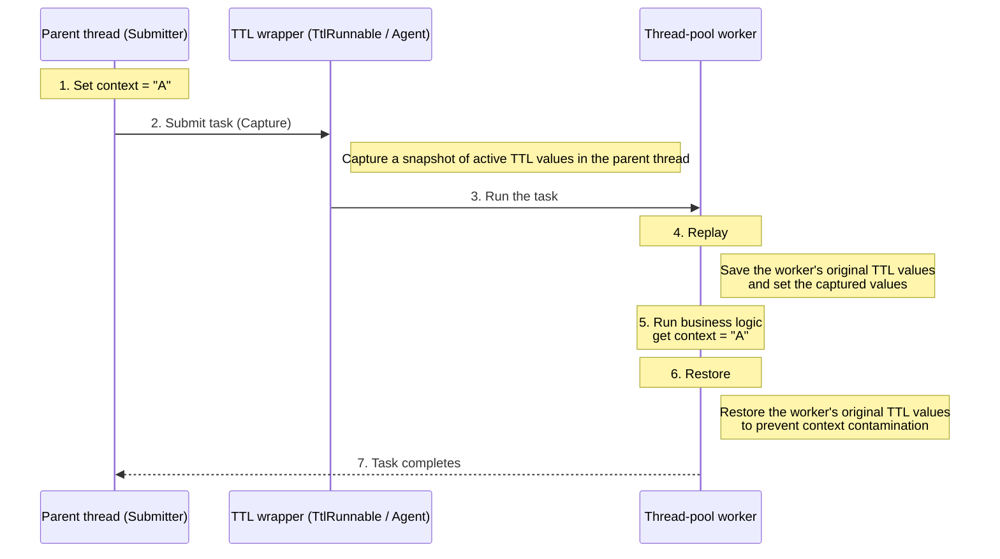

<!-- @include: @article-header.snippet.md -->

## ThreadLocal

### What Is `ThreadLocal` Used For?

By default, any thread can access and modify a variable. This can cause data races and thread-safety issues. **How can each thread have its own local variable?**

The JDK provides `ThreadLocal` for this purpose. **It lets each thread bind its own value** to a variable. You can think of it as a box: each thread has a separate box for private data, so values do not interfere across threads.

When a thread accesses a `ThreadLocal` variable, it gets its own copy. Each thread can read its copy with `get()` or update it with `set()`, avoiding conflicts between threads.

For example, imagine two people collecting treasure. If they share one bag, they may interfere with each other. If each has a separate bag, they can collect independently. If the people represent threads, `ThreadLocal` gives each thread its own storage.

```java
public class ThreadLocalExample {
    private static ThreadLocal<Integer> threadLocal = ThreadLocal.withInitial(() -> 0);

    public static void main(String[] args) {
        Runnable task = () -> {
            int value = threadLocal.get();
            value += 1;
            threadLocal.set(value);
            System.out.println(Thread.currentThread().getName() + " Value: " + threadLocal.get());
        };

        Thread thread1 = new Thread(task, "Thread-1");
        Thread thread2 = new Thread(task, "Thread-2");

        thread1.start(); // Output: Thread-1 Value: 1
        thread2.start(); // Output: Thread-2 Value: 1
    }
}
```

### ⭐️ How Does `ThreadLocal` Work?

Start with the `Thread` class source code.

```java
public class Thread implements Runnable {
    //......
    // ThreadLocal values for this thread, maintained by ThreadLocal.
    ThreadLocal.ThreadLocalMap threadLocals = null;

    // InheritableThreadLocal values for this thread.
    ThreadLocal.ThreadLocalMap inheritableThreadLocals = null;
    //......
}
```

The `Thread` source shows two `ThreadLocalMap` fields: `threadLocals` and `inheritableThreadLocals`. You can think of `ThreadLocalMap` as a specialized map used by `ThreadLocal`. Both fields are `null` by default and are created when the thread calls `ThreadLocal.set()` or `get()`. Those methods then call the corresponding methods on `ThreadLocalMap`.

The `set()` method in `ThreadLocal`

```java
public void set(T value) {
    // Get the current thread.
    Thread t = Thread.currentThread();
    // Get the threadLocals map from the Thread object.
    ThreadLocalMap map = getMap(t);
    if (map != null)
        // Store the value in the map.
        map.set(this, value);
    else
        createMap(t, value);
}
ThreadLocalMap getMap(Thread t) {
    return t.threadLocals;
}
```

From this, we can conclude that **the value is stored in the current thread's `ThreadLocalMap`, not in the `ThreadLocal` object. `ThreadLocal` is a wrapper that provides access to the value in that map.** It calls `Thread.currentThread()` and then `getMap(Thread t)` to access the current thread's map.

**Each `Thread` has a `ThreadLocalMap`, which stores key-value pairs with a `ThreadLocal` as the key and an object as the value.**

```java
ThreadLocalMap(ThreadLocal<?> firstKey, Object firstValue) {
    //......
}
```

If a thread uses two `ThreadLocal` objects, both values are stored in the same `ThreadLocalMap`. Each `ThreadLocal` is a key, and the value is what was passed to its `set()` method.

The diagram below shows the `ThreadLocal` data structure:


`ThreadLocalMap` is a static inner class of `ThreadLocal`.


### ⭐️ How Can `ThreadLocal` Cause a Memory Leak?

The risk of a `ThreadLocal` memory leak comes from its internal implementation.

As described above, each thread maintains a map called `ThreadLocalMap`. When you store a value in a `ThreadLocal`, it is placed in the current thread's map. The `ThreadLocal` instance is the key, and the value you store is the map value.

Here is the `ThreadLocal.set()` implementation:

```java
public void set(T value) {
    Thread t = Thread.currentThread(); // Get the current thread.
    ThreadLocalMap map = getMap(t);   // Get this thread's ThreadLocalMap.
    if (map != null) {
        map.set(this, value);         // Store the value.
    } else {
        createMap(t, value);          // Create a ThreadLocalMap.
    }
}
```

`ThreadLocalMap.set()` and `createMap()` do not store the `ThreadLocal` object directly. They use its hash code to calculate an array index and store the entry in an array of type `static class Entry extends WeakReference<ThreadLocal<?>>`.

```java
int i = key.threadLocalHashCode & (len-1);
```

`ThreadLocalMap.Entry` is defined as follows:

```java
static class Entry extends WeakReference<ThreadLocal<?>> {
    Object value;

    Entry(ThreadLocal<?> k, Object v) {
        super(k);
        value = v;
    }
}
```

Reference behavior for `ThreadLocalMap` keys and values:

- **The key is a weak reference**: A `ThreadLocalMap` key is a weak reference to a `ThreadLocal` (`WeakReference<ThreadLocal<?>>`). If no strong reference points to the `ThreadLocal`, the next GC can reclaim it, leaving a `null` key in the map.
- **The value is a strong reference**: Even after the key is reclaimed, the `ThreadLocalMap.Entry` still strongly references the value, so the value cannot be garbage-collected yet.

When a `ThreadLocal` loses its strong reference, its value remains in the map because the entry strongly references it. If the thread stays alive, as with a thread pool worker, its `ThreadLocalMap` also remains. The stale entry with a `null` key can then retain the value and cause a memory leak.

Two conditions are needed for this leak:

1. The `ThreadLocal` instance no longer has a strong reference.
2. The thread stays alive, keeping its `ThreadLocalMap` around.

`ThreadLocalMap` tries to clean up entries with `null` keys during `get()`, `set()`, and `remove()`, but this cleanup is opportunistic and not guaranteed to remove every stale entry promptly.

**How can you avoid the leak?**

1. Always call `remove()` when you are done with a `ThreadLocal`. This is the safest and recommended approach. It explicitly removes the entry from the map. Even if the `ThreadLocal` is `static final`, call `remove()` after each use.
2. When threads are reused, such as in a thread pool, call `remove()` in a `try-finally` block so it runs even if an exception occurs.

#### Why Is the Entry Key a Weak Reference?

This is a common follow-up interview question. Many people know that `ThreadLocalMap` uses weak keys, but not **why** or what would happen with strong references.

First, consider the reference chain when a thread uses a `ThreadLocal`:

```
Strong reference (stack/static field) ──→ ThreadLocal instance
                              ↑
Thread ──→ ThreadLocalMap ──→ Entry ─── key（WeakReference）──┘
                              │
                              └─── value (strong reference) ──→ stored object
```

With this reference chain in mind, compare the two designs:

**If the key were a strong reference (it is not):**

If application code drops its `ThreadLocal` reference, the `ThreadLocalMap.Entry` would still hold a **strong reference** to the key. The `ThreadLocal` could not be reclaimed, and as long as the thread stayed alive, both the key and its value would remain in memory.

**With a weak key (the actual design):**

When application code drops its `ThreadLocal` reference, the weak key allows GC to reclaim the instance and set the key to `null`. The value remains strongly referenced, but `ThreadLocalMap` can detect and clear this stale entry during `get()`, `set()`, or `remove()`, releasing the value.

**Weak keys are a fallback defense.** Even if a developer forgets to call `remove()`, GC and `ThreadLocalMap` cleanup may still reclaim stale values. With strong keys, forgetting `remove()` would leave no such fallback.

> This cleanup is **passive**: it happens only during `get()`, `set()`, or `remove()`, and may not promptly remove every stale entry. **Weak references reduce the risk but do not eliminate memory leaks**, so you still need to call `remove()` yourself.

#### Special Risks in Thread Pools

One condition for a memory leak is that the thread remains alive. When a thread is created with `new Thread()`, it is destroyed after its work finishes, and its `ThreadLocalMap` can then be reclaimed by GC. The impact of a leak is therefore limited.

The problem is much worse with **thread pools**. Core threads are not terminated by default and are reused for different tasks. This means:

1. **Memory leaks can accumulate**: If tasks keep creating temporary `ThreadLocal` instances, or use multiple instances without cleaning them up, values may remain in a reused thread's `ThreadLocalMap` after their weak keys are reclaimed. Repeatedly calling `set()` on the same reachable `ThreadLocal` usually replaces its previous value, but the latest value remains until it is overwritten, removed, cleaned up, or the thread terminates.
2. **Data contamination (stale data)**: If a task does not clear its `ThreadLocal` value, the next task assigned to the same thread can read it. This can cause serious logic errors, such as user A's request reading user B's identity.

**A real incident reported by Meituan's engineering team:**

Meituan's article [How Java Thread Pools Work and How Meituan Uses Them](https://tech.meituan.com/2020/04/02/java-pooling-pratice-in-meituan.html) describes a production incident caused by incorrect `ThreadLocal` usage. A web application used `ThreadLocal` to pass user context and handled requests with a thread pool, but did not clear the value when a request ended. **A later request reused the same thread and read user information left by the previous request**, mixing user data.

#### Alibaba Java Coding Guidelines: Mandatory Rule

Because thread pools and `ThreadLocal` are easy to misuse together, the Alibaba Java Coding Guidelines include this **mandatory** rule in the concurrency section:

> **[Mandatory]** Always remove values stored in custom `ThreadLocal` variables from the current thread. Threads are frequently reused in thread pools, so failing to clear these values can affect later tasks and cause memory leaks. Use a `try-finally` block in the surrounding code to clean them up.

Use the following pattern:

```java
// Declare as static final to avoid repeatedly creating ThreadLocal instances.
private static final ThreadLocal<UserContext> userContextHolder = new ThreadLocal<>();

public void processRequest(HttpServletRequest request) {
    try {
        // Set the value in the try block.
        UserContext context = buildUserContext(request);
        userContextHolder.set(context);

        // Run business logic.
        doBusinessLogic();
    } finally {
        // Always clean up in finally, whether or not an exception occurs.
        userContextHolder.remove();
    }
}
```

There are three key points:

1. **Declare `ThreadLocal` fields as `static final`**: This prevents a new instance from being created on every call and avoids stale entries after old instances lose their strong references. It does not mean an application can have only one `ThreadLocal` instance.
2. **Use `try-finally` to ensure `remove()` is called**: The `finally` block clears the value even if business logic throws an exception.
3. **Clear the value immediately after use instead of waiting for the next call to overwrite it**: Calling `set()` on the same `ThreadLocal` replaces its previous value, but the current value remains attached to the thread until the next task runs. If the code switches to another `ThreadLocal`, a stale entry may remain for much longer. Call `remove()` in `finally` to prevent retained memory and data contamination.

### ⭐️ How Can You Pass ThreadLocal Values Across Threads?

**Why doesn't ThreadLocal work across asynchronous tasks by default?**

The value is not stored in the `ThreadLocal` object. It is stored in the `Thread`:

```java
Thread → ThreadLocalMap → Entry(ThreadLocal, value)
```

The diagram below shows the `ThreadLocal` data structure:


Asynchronous execution often moves a task to another thread, such as a worker in a thread pool. Each thread maintains its own `ThreadLocalMap`, so context is not automatically passed to the other thread.

**How can you pass ThreadLocal values across threads?**

There are two common approaches: one built into the JDK and one open-sourced by Alibaba.

1. `InheritableThreadLocal`: Added in JDK 1.2, this `ThreadLocal` subclass copies values to a child thread when it is created. It does not pass values reliably through thread pools.
2. `TransmittableThreadLocal`: Often called TTL, this Alibaba library extends `InheritableThreadLocal` and supports passing values through thread pools. See the [project repository](https://github.com/alibaba/transmittable-thread-local).

#### How InheritableThreadLocal Works

`InheritableThreadLocal` lets a newly created thread inherit values from its parent. The JDK implements this by adding support to the `Thread` class.

**Where are `InheritableThreadLocal` values stored?**

The `Thread` class has a separate `ThreadLocalMap` named `inheritableThreadLocals` for values that should be inherited by child threads:

```JAVA
class Thread implements Runnable {
    ThreadLocal.ThreadLocalMap threadLocals = null;
    ThreadLocal.ThreadLocalMap inheritableThreadLocals = null;
}
```

**How are `ThreadLocal` values passed to a child thread?**

The `Thread` constructor copies the parent thread's `inheritableThreadLocals` map to the child thread. The relevant code looks like this:

```JAVA
// The Thread constructor calls init().
private void init(/* ... */) {
	// 1. Get the parent thread.
    Thread parent = currentThread();
    // 2. Copy inheritableThreadLocals from the parent to the child.
    if (inheritThreadLocals && parent.inheritableThreadLocals != null)
        this.inheritableThreadLocals =
        	ThreadLocal.createInheritedMap(parent.inheritableThreadLocals);
}
```

**What is the limitation of `InheritableThreadLocal`?**

Its limitation is that inheritance happens **only once**, when the child thread is created. Modern applications use thread pools heavily, and their threads are reused.

Suppose task A runs on thread 1 and passes its `ThreadLocal` value to child thread 2 in a pool. After task A finishes, thread 1 becomes idle. Task B then runs on thread 3, while the pool reuses child thread 2 for part of its work. Thread 2 still has task A's value, and task B's context from thread 3 was never passed to it. This can cause data contamination and lost context.

#### How TransmittableThreadLocal Works

The JDK does not pass `ThreadLocal` values through thread pools by default. Alibaba's `TransmittableThreadLocal` library provides this capability.

Since Alibaba cannot modify the JDK, TTL uses the **decorator pattern** to wrap tasks (`Runnable`/`Callable`) or executors (`Executor`). This moves context propagation from thread creation to task submission and execution.

TTL's core logic has three stages (CRR):

- **Capture**: When a task is submitted, such as through `execute`, `TtlRunnable` calls `TransmittableThreadLocal.Transmitter.capture()`. It collects active TTL values from the parent thread into a snapshot.
- **Replay**: Before a worker runs the task, it calls `replay()`. This sets the snapshot values on the worker and saves the worker's previous values.
- **Restore**: After the task completes, it calls `restore()` to return the worker to its previous state and prevent context contamination or memory leaks.

This sequence diagram of the CRR process is from the TTL project:


The following diagram shows the same CRR process in more detail:



In short, TTL captures context when a task is submitted, replays it before execution, and restores the worker's state afterward. This safely passes `ThreadLocal` values through a thread pool.

TTL offers two main integration options. Choose based on the required code changes and migration cost.

**1. Explicit wrapping (manual integration)**

Wrap tasks with `TtlRunnable.get(Runnable)` or `TtlCallable.get(Callable)`, and wrap executors with `TtlExecutors.getTtlExecutor(Executor)` or `getTtlExecutorService(...)`. This approach is explicit and easy to control, but requires changes to application code.

The following example uses TTL's CRR process to pass and isolate `ThreadLocal` context while supporting thread reuse and rejection policies.

```java
public class TtlContextHolder {
    private static final Logger log = LoggerFactory.getLogger(TtlContextHolder.class);

    // 1. Declare the TTL instance as static final to avoid repeated creation.
    // Optionally override copy(): deep-copy reference types when needed.
    private static final TransmittableThreadLocal<String> CONTEXT = new TransmittableThreadLocal<String>() {
        @Override
        public String copy(String parentValue) {
            // By default, this returns the reference. Create a new object here for mutable values such as Map.
            return parentValue;
        }
    };

    // 2. Initialize the thread pool and wrap it with TtlExecutors only once.
    private static final ExecutorService TTL_EXECUTOR_SERVICE;

    static {
        ExecutorService rawExecutor = new ThreadPoolExecutor(
                2, 4, 60L, TimeUnit.SECONDS,
                new LinkedBlockingQueue<>(1000), (Runnable r) -> new Thread(r, "ttl-worker-" + r.hashCode()),
                new ThreadPoolExecutor.CallerRunsPolicy() // TTL supports this rejection policy.
        );
        // Wrap the original thread pool.
        TTL_EXECUTOR_SERVICE = TtlExecutors.getTtlExecutorService(rawExecutor);
    }

    public static void main(String[] args) throws Exception {
        try {
            // 3. Set context in the parent thread.
            CONTEXT.set("value-set-in-parent");
            log.info("Parent thread context: {}", CONTEXT.get());

            // 4. Use a lambda to submit tasks.
            TTL_EXECUTOR_SERVICE.execute(() -> {
                log.info("Async Runnable task context: {}", CONTEXT.get());
                // Simulate business logic.
                // Whether child-thread changes affect the parent depends on whether copy() performs a deep copy.
                CONTEXT.set("value-modified-in-child");
            });

            Future<String> future = TTL_EXECUTOR_SERVICE.submit(() -> {
                log.info("Async Callable task context: {}", CONTEXT.get());
                return "Success";
            });

            future.get();

            // 5. Verify that the parent thread's context was not changed.
            log.info("Final parent thread context: {}", CONTEXT.get());

        } finally {
            // 6. Clear the parent thread's context. TTL's restore step resets worker-thread context.
            CONTEXT.remove();
        }
    }
}
```

Output:

```ba
09:06:31.438 INFO  [main] TtlContextHolder - Parent thread context: value-set-in-parent
09:06:31.452 INFO  [ttl-worker-1663166483] TtlContextHolder - Async Runnable task context: value-set-in-parent
09:06:31.453 INFO  [ttl-worker-841283083] TtlContextHolder - Async Callable task context: value-set-in-parent
09:06:31.453 INFO  [main] TtlContextHolder - Final parent thread context: value-set-in-parent
```

To run this example, add the TTL dependency to your Maven project:

```XML
<dependency>
    <groupId>com.alibaba</groupId>
    <artifactId>transmittable-thread-local</artifactId>
    <version>2.14.4</version>
</dependency>
```

**2. Transparent integration (Java Agent)**

At class-loading time, a Java Agent instruments thread-pool classes with TTL's context-propagation logic. This passes context without changes to application code, though the setup is more complex.

By default, the TTL Agent instruments these JDK executor components:

1. **Standard thread pools**: `java.util.concurrent.ThreadPoolExecutor` and `java.util.concurrent.ScheduledThreadPoolExecutor`.
2. **ForkJoin components**: `java.util.concurrent.ForkJoinTask`, which also supports `CompletableFuture` and Java 8 parallel streams.
3. **Legacy component**: `java.util.TimerTask` (supported since v2.7.0 and enabled by default since v2.11.2).

Add the `-javaagent` option to the Java startup command:

```bash
# Basic configuration.
java -javaagent:path/to/transmittable-thread-local-2.x.y.jar \
     -cp classes \
     com.your.app.Main
```

#### Use Cases

1. **Load-test traffic markers**: Store a marker in `ThreadLocal` to distinguish load-test traffic from production traffic. If the marker is lost, load-test traffic may be handled as production traffic.
2. **Context propagation**: Pass tracing information, such as a Trace ID, or user context through a distributed system.

#### Summary

By default, `ThreadLocal` values are not passed across threads. Each `Thread` object stores its own values in a `ThreadLocalMap`, and parent and child threads are separate objects.

There are two main ways to address this:

1. **JDK's `InheritableThreadLocal`**: It **copies** values to a child thread when the thread is **created**. It does not work reliably with **thread pools**, which **reuse** threads and may expose **stale values** from earlier tasks.
2. **Alibaba's `TransmittableThreadLocal` (TTL)**: This library addresses the thread-pool limitation. When a task is **submitted**, TTL **captures** the parent thread's values and **binds** them to the task. When a worker runs the task, TTL **sets** those values on the worker and **restores** its prior state when the task finishes.

In short, **`InheritableThreadLocal` is tied to a thread and applies only when it is created; TTL is tied to a task and supports thread pools.**

## Thread Pools

### What Is a Thread Pool?

A thread pool manages a set of reusable threads. When a task arrives, the pool assigns it to a thread. After completing the task, the thread waits for another one instead of being destroyed immediately.

### ⭐️ Why Use a Thread Pool?

Thread pools, database connection pools, and HTTP connection pools all apply the same pooling idea: reduce the cost of acquiring resources and use them more efficiently.

A thread pool provides a way to limit and manage resources used to execute tasks. It can also track basic statistics, such as the number of completed tasks. Thread pools offer several benefits:

1. **Lower resource use**: Threads are reused after completing tasks, avoiding the cost of repeatedly creating and destroying them.
2. **Faster response**: A pool usually keeps core threads ready. A new task can run on an idle thread without waiting for a new thread to be created.
3. **Easier thread management**: You can configure the core and maximum thread counts, queue type and capacity, and rejection policy. This controls concurrency and helps prevent resource exhaustion. Monitoring interfaces can also report active threads and queued tasks, which helps with tuning.

### How Do You Create a Thread Pool?

There are two main ways to create a thread pool in Java:

**Option 1: Create one directly with the `ThreadPoolExecutor` constructor (recommended)**


“Default thread factory” and “default rejection policy” in the diagram refer to the implementations `ThreadPoolExecutor` uses when those arguments are omitted. They are not mismatched labels.

This is the recommended approach because it lets you set the pool's core parameters explicitly and control its behavior, reducing the risk of resource exhaustion.

**Option 2: Create one with the `Executors` utility class (not recommended for production)**

The diagram below shows the thread pool factory methods provided by `Executors`:


The `Executors` utility class can create several types of thread pools:

- `FixedThreadPool`: Uses a fixed maximum number of worker threads during normal operation. A thread that terminates due to an exception can be replaced, and all threads exit when the pool is shut down. If a worker is idle, a new task runs immediately; otherwise, it waits in the task queue.
- `SingleThreadExecutor`: Uses one thread. Additional tasks wait in a queue and run in FIFO order when the thread becomes available.
- `CachedThreadPool`: Adjusts the thread count as needed. It reuses idle threads when possible and creates new ones if all existing threads are busy. Threads return to the pool after completing their tasks.
- `ScheduledThreadPool`: Runs tasks after a delay or at fixed intervals.

### ⭐️ Why Avoid Built-in Thread Pool Factories?

The concurrency section of the Alibaba Java Coding Guidelines says that threads should be provided through a thread pool rather than created directly by application code.

**Why?**

> Thread pools reduce the time and system resources spent creating and destroying threads, and help address resource shortages. Without a pool, an application may create too many similar threads, exhaust memory, or cause excessive context switching.

The guidelines also require creating thread pools with the `ThreadPoolExecutor` constructor instead of `Executors`. This makes the pool's behavior explicit and helps avoid resource exhaustion.

The thread pools returned by `Executors` have these drawbacks:

- `FixedThreadPool` and `SingleThreadExecutor` use an unbounded `LinkedBlockingQueue` with a maximum size of `Integer.MAX_VALUE`. A large number of requests can accumulate and cause an OOM.
- `CachedThreadPool` uses a `SynchronousQueue` and allows up to `Integer.MAX_VALUE` threads. A large number of slow tasks can create too many threads and cause an OOM.
- `ScheduledThreadPool` and `SingleThreadScheduledExecutor` use an unbounded `DelayedWorkQueue` with a maximum size of `Integer.MAX_VALUE`. A large number of requests can accumulate and cause an OOM.

```java
public static ExecutorService newFixedThreadPool(int nThreads) {
    // LinkedBlockingQueue defaults to Integer.MAX_VALUE, so it is effectively unbounded.
    return new ThreadPoolExecutor(nThreads, nThreads,0L, TimeUnit.MILLISECONDS,new LinkedBlockingQueue<Runnable>());

}

public static ExecutorService newSingleThreadExecutor() {
    // LinkedBlockingQueue defaults to Integer.MAX_VALUE, so it is effectively unbounded.
    return new FinalizableDelegatedExecutorService (new ThreadPoolExecutor(1, 1,0L, TimeUnit.MILLISECONDS,new LinkedBlockingQueue<Runnable>()));

}

// SynchronousQueue has no capacity; the maximum thread count is Integer.MAX_VALUE.
public static ExecutorService newCachedThreadPool() {

    return new ThreadPoolExecutor(0, Integer.MAX_VALUE,60L, TimeUnit.SECONDS,new SynchronousQueue<Runnable>());

}

// DelayedWorkQueue
public static ScheduledExecutorService newScheduledThreadPool(int corePoolSize) {
    return new ScheduledThreadPoolExecutor(corePoolSize);
}
public ScheduledThreadPoolExecutor(int corePoolSize) {
    super(corePoolSize, Integer.MAX_VALUE, 0, NANOSECONDS,
          new DelayedWorkQueue());
}
```

### ⭐️ What Are the Common ThreadPoolExecutor Parameters?

```java
    /**
     * Creates a ThreadPoolExecutor with the given initial parameters.
     */
    public ThreadPoolExecutor(int corePoolSize, // Number of core threads.
                              int maximumPoolSize, // Maximum number of worker threads.
                              long keepAliveTime, // Maximum idle time for threads beyond the core count.
                              TimeUnit unit, // Time unit.
                              BlockingQueue<Runnable> workQueue, // Queue for tasks waiting to run.
                              ThreadFactory threadFactory, // Factory used to create threads.
                              RejectedExecutionHandler handler // Policy for tasks the pool cannot handle.
                               ) {
        if (corePoolSize < 0 ||
            maximumPoolSize <= 0 ||
            maximumPoolSize < corePoolSize ||
            keepAliveTime < 0)
            throw new IllegalArgumentException();
        if (workQueue == null || threadFactory == null || handler == null)
            throw new NullPointerException();
        this.corePoolSize = corePoolSize;
        this.maximumPoolSize = maximumPoolSize;
        this.workQueue = workQueue;
        this.keepAliveTime = unit.toNanos(keepAliveTime);
        this.threadFactory = threadFactory;
        this.handler = handler;
    }
```

The three most important `ThreadPoolExecutor` parameters are:

- `corePoolSize`: The number of threads kept in the pool by default, even when idle. If core-thread timeouts are disabled and the worker count is below this value, a new task can trigger creation of a worker.
- `maximumPoolSize`: The maximum number of worker threads allowed in the pool.
- `workQueue`: Once the worker count reaches `corePoolSize`, new tasks are offered to the queue. The pool creates more threads only if the queue rejects the task and the worker count is below `maximumPoolSize`.

Other common `ThreadPoolExecutor` parameters:

- `keepAliveTime`: When the pool has more than `corePoolSize` threads, excess idle threads are kept alive for this duration before being terminated.
- `unit`: The time unit for `keepAliveTime`.
- `threadFactory`: Used by the executor to create new threads.
- `handler`: Rejection policy, discussed below.

The diagram below illustrates how the thread pool parameters relate to one another (from _Java Performance Tuning in Practice_):


### Are Core Threads Reclaimed?

By default, `ThreadPoolExecutor` does not reclaim core threads, even when they are idle. This avoids the cost of creating threads again, since core threads are usually expected to stay active. For an infrequently used pool with long idle periods, you can set `allowCoreThreadTimeOut(boolean value)` to `true`. Idle core threads will then be reclaimed after the `keepAliveTime` interval.

```java
public void allowCoreThreadTimeOut(boolean value) {
    // Core threads need a nonzero keepAliveTime for the timeout to work.
    if (value && keepAliveTime <= 0) {
        throw new IllegalArgumentException("Core threads must have nonzero keep alive times");
    }
    // Set allowCoreThreadTimeOut.
    if (value != allowCoreThreadTimeOut) {
        allowCoreThreadTimeOut = value;
        // When timeouts are enabled, interrupt all idle workers, including core threads.
        if (value) {
            interruptIdleWorkers();
        }
    }
}
```

### What State Are Idle Core Threads In?

Idle core threads behave in one of two ways:

- **Core-thread timeouts are enabled**: An idle core thread waits for a task in the `WAITING` state. If it waits longer than its keep-alive time, it exits and is removed from the pool; its state becomes `TERMINATED`.
- **Core-thread timeouts are disabled**: An idle core thread remains in the `WAITING` state until a task arrives and stays in the pool.

When a task becomes available in the queue, a waiting thread is woken up, changes from `WAITING` to `RUNNABLE`, and executes the task.

The following source code shows how the thread pool handles this internally.

The pool represents a thread as a `Worker`. Once started, a worker repeatedly retrieves tasks from the queue.

When retrieving a task, the worker uses the `timed` value to choose how to read from the `BlockingQueue`.

If core-thread timeouts are enabled or the worker count exceeds the core-thread count, `timed` is set to `true`. The worker then calls `poll()` with a timeout.

- `timed == true`: Call `poll(timeout, unit)` to retrieve a task. If it times out, the worker exits (`TERMINATED`) and is removed from the pool.
- `timed == false`: Call `take()` to retrieve a task. This blocks the worker in the `WAITING` state until a task is available.

Here is the relevant source code:

```JAVA
// ThreadPoolExecutor
private Runnable getTask() {
    boolean timedOut = false;
    for (;;) {
        // ...

        // 1. Set timed if core-thread timeouts are enabled or the worker count exceeds corePoolSize.
        boolean timed = allowCoreThreadTimeOut || wc > corePoolSize;
        // 2. Decrement the worker count when a worker should exit.
        // wc > maximumPoolSize means the worker count exceeds the maximum.
        // timedOut means that waiting for a task timed out.
        // This happens when core-thread timeouts are enabled or the worker count exceeds corePoolSize.
        if ((wc > maximumPoolSize || (timed && timedOut))
            && (wc > 1 || workQueue.isEmpty())) {
            if (compareAndDecrementWorkerCount(c))
                return null;
            continue;
        }
        try {
            // 3. Use poll() when timed is true; otherwise, use take().
            Runnable r = timed ?
                workQueue.poll(keepAliveTime, TimeUnit.NANOSECONDS) :
                workQueue.take();
            // 4. Return the task.
            if (r != null)
                return r;
            timedOut = true;
        } catch (InterruptedException retry) {
            timedOut = false;
        }
    }
}
```

### ⭐️ What Are the Thread Pool Rejection Policies?

When the pool has reached its maximum number of threads and its queue is full, `ThreadPoolExecutor` applies a rejection policy:

- `ThreadPoolExecutor.AbortPolicy`: Rejects the new task by throwing `RejectedExecutionException`.
- `ThreadPoolExecutor.CallerRunsPolicy`: Runs the rejected task on the thread that called `execute()`. This slows task submission and can reduce overall performance. If the executor is shut down, it discards the task. Consider it when the application can tolerate the delay and needs to avoid rejecting tasks while the pool is running.
- `ThreadPoolExecutor.DiscardPolicy`: Silently discards the new task.
- `ThreadPoolExecutor.DiscardOldestPolicy`: Discards the oldest task that has not started.

For example, when creating a pool with Spring's `ThreadPoolTaskExecutor` or the `ThreadPoolExecutor` constructor, the default policy is `AbortPolicy` unless a `RejectedExecutionHandler` is specified. If the queue is full, `ThreadPoolExecutor` throws `RejectedExecutionException`, and the task is not handled. To avoid rejecting tasks while the pool is running, `CallerRunsPolicy` runs the task on the thread that called `execute()`. It still discards tasks after shutdown.

```java
public static class CallerRunsPolicy implements RejectedExecutionHandler {

        public CallerRunsPolicy() { }

        public void rejectedExecution(Runnable r, ThreadPoolExecutor e) {
            if (!e.isShutdown()) {
                // Run on the calling thread instead of a thread-pool worker.
                r.run();
            }
        }
    }
```

### Which Rejection Policy Helps Avoid Dropping Tasks When the Pool Is Saturated?

Consider `CallerRunsPolicy` when the pool is running and the calling thread can execute the task synchronously. It does not guarantee that tasks are never lost: tasks are discarded after shutdown, and an in-memory policy cannot recover tasks after a process crash. Use persistent storage or a message queue when stronger guarantees are required.

The `CallerRunsPolicy` source shows this behavior:

```java
public static class CallerRunsPolicy implements RejectedExecutionHandler {

        public CallerRunsPolicy() { }


        public void rejectedExecution(Runnable r, ThreadPoolExecutor e) {
            // Run the task on the thread calling execute(), unless the executor is shut down.
            if (!e.isShutdown()) {

                r.run();
            }
        }
    }
```

As the source shows, the thread that called `execute()` runs the task as long as the executor is not shut down.

### What Are the Risks of CallerRunsPolicy, and How Can You Address Them?

As mentioned above, `CallerRunsPolicy` is one option when you want the calling thread to apply backpressure and avoid rejecting tasks when the pool is saturated.

However, if a long-running task is rejected and the submitting thread is the main thread, the main thread may block and affect normal application behavior.

In this example, the pool has a maximum of two threads and a queue capacity of one, so the fourth task triggers the rejection policy. `ThreadUtil` is a utility class from Hutool:

```java
public class ThreadPoolTest {

    private static final Logger log = LoggerFactory.getLogger(ThreadPoolTest.class);

    public static void main(String[] args) {
        // Create a pool with one core thread and a maximum of two threads.
        // Extra idle threads are kept alive for up to 60 seconds.
        // Use an ArrayBlockingQueue with capacity one and CallerRunsPolicy.
        ThreadPoolExecutor threadPoolExecutor = new ThreadPoolExecutor(1,
                2,
                60,
                TimeUnit.SECONDS,
                new ArrayBlockingQueue<>(1),
                new ThreadPoolExecutor.CallerRunsPolicy());

        // Submit the first task; the core thread runs it.
        threadPoolExecutor.execute(() -> {
            log.info("Core thread runs the first task");
            ThreadUtil.sleep(1, TimeUnit.MINUTES);
        });

        // Submit a second task. The core thread is busy, so this task waits in the queue.
        threadPoolExecutor.execute(() -> {
            log.info("Extra thread runs the queued second task");
            ThreadUtil.sleep(1, TimeUnit.MINUTES);
        });

        // Submit a third task. The core thread is busy and the queue is full, so an extra thread is created.
        threadPoolExecutor.execute(() -> {
            log.info("Extra thread runs the third task");
            ThreadUtil.sleep(1, TimeUnit.MINUTES);
        });

        // Submit a fourth task. Both threads and the queue are busy, so CallerRunsPolicy runs it on the submitting thread (main).
        threadPoolExecutor.execute(() -> {
            log.info("Main thread runs the fourth task");
            ThreadUtil.sleep(2, TimeUnit.MINUTES);
        });

        // The main thread is blocked by task four, so it cannot submit task five until that task finishes.
        threadPoolExecutor.execute(() -> {
            log.info("Core thread runs the fifth task");
        });

        // Shut down the thread pool.
        threadPoolExecutor.shutdown();
    }
}

```

Output:

```bash
18:19:48.203 INFO  [pool-1-thread-1] c.j.concurrent.ThreadPoolTest - Core thread runs the first task
18:19:48.203 INFO  [pool-1-thread-2] c.j.concurrent.ThreadPoolTest - Extra thread runs the third task
18:19:48.203 INFO  [main] c.j.concurrent.ThreadPoolTest - Main thread runs the fourth task
18:20:48.212 INFO  [pool-1-thread-2] c.j.concurrent.ThreadPoolTest - Extra thread runs the queued second task
18:21:48.219 INFO  [pool-1-thread-2] c.j.concurrent.ThreadPoolTest - Core thread runs the fifth task
```

The output shows that `CallerRunsPolicy` ran the long task on the main thread. This blocked task submission and delayed later tasks. In severe cases, this can contribute to an OOM.

The goal of choosing `CallerRunsPolicy` is to execute tasks instead of rejecting them; tasks that cannot run immediately wait in the `BlockingQueue`. If memory permits, increase the queue capacity and heap size to accommodate more tasks.

You can also adjust `maximumPoolSize` to use CPU capacity more effectively and process tasks faster, reducing the chance that too many tasks accumulate in the queue.


If the server has reached its resource limits, the scheduling strategy needs to change. The main thread blocks because we want to avoid dropping tasks. Can we preserve tasks and process them when the server has capacity?

One option is **task persistence**, for example:

1. Store tasks in a MySQL task table.
2. Cache tasks in Redis.
3. Submit tasks to a message queue.

Here is a high-level outline using the first option:

1. Implement `RejectedExecutionHandler` and persist tasks that the pool cannot accept to MySQL. The rejection policy runs only after the task queue is full.
2. Extend `BlockingQueue` to create a combined queue that includes an `ArrayBlockingQueue`. Override `take()` so workers read the oldest task from the database first, then read from the in-memory queue if the database is empty.


The key pieces are the custom rejection policy and queue. When the pool is saturated, the policy persists new tasks in MySQL. When capacity becomes available, workers process persisted tasks first to avoid starvation.

You can also look at how other frameworks handle rejection. Netty's policy creates a thread outside the pool to run each rejected task. This may require sufficient hardware to keep tasks responsive, and these temporary threads are harder to monitor:

```java
private static final class NewThreadRunsPolicy implements RejectedExecutionHandler {
    NewThreadRunsPolicy() {
        super();
    }
    public void rejectedExecution(Runnable r, ThreadPoolExecutor executor) {
        try {
            // Create a temporary thread to run the task.
            final Thread t = new Thread(r, "Temporary task executor");
            t.start();
        } catch (Throwable e) {
            throw new RejectedExecutionException(
                    "Failed to start a new thread", e);
        }
    }
}
```

ActiveMQ tries to enqueue the task within a specified time to improve delivery rates:

```java
new RejectedExecutionHandler() {
                @Override
                public void rejectedExecution(final Runnable r, final ThreadPoolExecutor executor) {
                    try {
                        // Wait for a limited time to improve the chance of enqueuing the task.
                        executor.getQueue().offer(r, 60, TimeUnit.SECONDS);
                    } catch (InterruptedException e) {
                        throw new RejectedExecutionException("Interrupted waiting for BrokerService.worker");
                    }
                    throw new RejectedExecutionException("Timed Out while attempting to enqueue Task.");
                }
            });
```

### Which Blocking Queues Are Commonly Used in Thread Pools?

When a task arrives, the pool checks whether the worker count has reached `corePoolSize`. If so, it places the task in the queue.

Different thread pool factories use different blocking queues:

- `LinkedBlockingQueue` with capacity `Integer.MAX_VALUE` (effectively unbounded): Used by `FixedThreadPool` and `SingleThreadExecutor`. The former creates at most `corePoolSize` threads, while the latter creates one. Their queues are effectively unbounded.
- `SynchronousQueue`: Used by `CachedThreadPool`. It has no capacity and stores no elements. Each task is handed to an idle thread or causes a new thread to be created. Since the maximum thread count is `Integer.MAX_VALUE`, this pool can create too many threads and cause an OOM.
- `DelayedWorkQueue`: Used by `ScheduledThreadPool` and `SingleThreadScheduledExecutor`. It orders tasks by delay using a heap. It is unbounded and grows as needed, so the pool does not grow beyond its core thread count; `maximumPoolSize` has no effect for pools using this queue.
- `ArrayBlockingQueue` (bounded blocking queue): Uses an array, and its capacity cannot be changed after creation.

### ⭐️ How Does a Thread Pool Process Tasks?


1. If the worker count is below `corePoolSize`, the pool creates a worker to run the task.
2. If the worker count is at least `corePoolSize` but below `maximumPoolSize`, the pool queues the task.
3. If the queue rejects the task because it is full and the worker count is below `maximumPoolSize`, the pool creates another worker.
4. If the worker count has reached `maximumPoolSize`, the pool rejects the task and calls `RejectedExecutionHandler.rejectedExecution()`.

One more question: **Can a thread pool create threads before tasks are submitted?**

Yes. `ThreadPoolExecutor` provides two methods to start core threads in advance and warm up the pool:

- `prestartCoreThread()`: Starts one thread to wait for a task. Returns `false` if all core threads have already been started; otherwise, returns `true`.
- `prestartAllCoreThreads()`: Starts all core threads and returns the number started.

### ⭐️ Are Threads Reused or Replaced After an Exception?

There are two cases:

- **Task submitted with `execute()`**: If an exception escapes the task, the worker thread terminates and the exception is printed to the console or logs. The pool detects the termination and creates a replacement worker.
- **Task submitted with `submit()`**: An exception is captured in the returned `Future` instead of being printed directly. Calling `Future.get()` throws an `ExecutionException`. The worker thread remains in the pool and can run later tasks.

In short, an uncaught exception from an `execute()` task terminates its worker, which the pool replaces. An exception from a `submit()` task is stored in its `Future`, and the worker can be reused.

This lets callers handle `submit()` failures through the `Future`. Use `execute()` for tasks whose results do not need to be collected.

For a source-level analysis, see [What Happens to a Thread After an Exception in a Thread Pool?](https://mp.weixin.qq.com/s/9ODjdUU-EwQFF5PrnzOGfw).

### ⭐️ How Do You Name Threads in a Thread Pool?

Set a thread name prefix when initializing the pool to make problems easier to diagnose.

By default, thread names look like `pool-1-thread-n`. They do not identify the relevant application component.

There are two common ways to name pool threads:

**1. Use Guava's `ThreadFactoryBuilder`**

```java
ThreadFactory threadFactory = new ThreadFactoryBuilder()
                        .setNameFormat(threadNamePrefix + "-%d")
                        .setDaemon(true).build();
ExecutorService threadPool = new ThreadPoolExecutor(corePoolSize, maximumPoolSize, keepAliveTime, TimeUnit.MINUTES, workQueue, threadFactory);
```

**2. Implement `ThreadFactory` yourself**

```java
import java.util.concurrent.ThreadFactory;
import java.util.concurrent.atomic.AtomicInteger;

/**
 * Thread factory that assigns names to threads for easier troubleshooting.
 */
public final class NamingThreadFactory implements ThreadFactory {

    private final AtomicInteger threadNum = new AtomicInteger();
    private final String name;

    /**
     * Creates a thread factory with the given name.
     */
    public NamingThreadFactory(String name) {
        this.name = name;
    }

    @Override
    public Thread newThread(Runnable r) {
        Thread t = new Thread(r);
        t.setName(name + " [#" + threadNum.incrementAndGet() + "]");
        return t;
    }
}
```

### How Do You Choose a Thread Pool Size?

It may seem that a larger pool is always better, but that is not the case. Adding more people to a task can increase coordination costs; similarly, too many threads increase **context-switching** overhead. The following section explains context switching.

> Context switching:
>
> In multithreaded programs, there are often more threads than CPU cores, and each core can run only one thread at a time. The CPU gives each thread a time slice in turn. When a time slice ends, the thread becomes ready and another thread runs. Before switching, the CPU saves the current task's state so it can restore it later. **Saving and restoring task state is a context switch.**
>
> Context switching consumes CPU time. Each switch takes nanoseconds, and dozens or hundreds of switches per second can add up. It can become one of the operating system's most expensive operations.
>
> One advantage of Linux over many other operating systems, including Unix-like systems, is its low context-switching and mode-switching overhead.

As with team size, a thread pool can be too large or too small. The right size depends on the workload.

- If the pool is too small, many tasks may wait in the queue. The queue can fill up and tasks may be rejected, or a large backlog may cause an OOM. The CPU may also be underutilized.
- If the pool is too large, many threads may compete for CPU time. More context switching increases execution time and reduces overall efficiency.

These widely used rules of thumb can help:

- **CPU-bound tasks (N+1):** These tasks mainly use CPU resources. A common starting point is N (the number of CPU cores) + 1. The extra thread can use the CPU when another task pauses, for example, due to a page fault.
- **I/O-bound tasks (2N):** These tasks spend much of their time waiting for I/O and do not use the CPU during that time. More threads can use the CPU while others wait. A common starting point is 2N.

**How can you tell whether a task is CPU-bound or I/O-bound?**

CPU-bound tasks mainly use the CPU for computation, such as sorting a large amount of data in memory. Tasks involving network or file access are usually I/O-bound: they spend much more time waiting for I/O than computing.

> 🌈 Further reading (see [issue #1737](https://github.com/Snailclimb/JavaGuide/issues/1737)):
>
> A more precise estimate is: `optimal thread count = N (CPU cores) × (1 + WT (waiting time) / ST (compute time))`, where `WT = total thread runtime - ST`.
>
> The higher the proportion of waiting time, the more threads may help. The higher the proportion of compute time, the fewer threads are needed.
>
> You can use the JDK's VisualVM tool to inspect the `WT/ST` ratio.
>
> For CPU-bound tasks, `WT/ST` is close to zero, so the estimate is N (CPU cores) × (1 + 0) = N, close to the N + 1 rule above.
>
> I/O-bound tasks spend most of their time waiting. In theory, this allows a larger thread count; 2N is a practical starting point that also avoids creating too many threads.

These formulas are only starting points. Adjust the pool based on measurements in the production environment. The dynamic configuration approach described below is one practical option.

### ⭐️ How Can You Change Thread Pool Parameters at Runtime?

Meituan's article [How Java Thread Pools Work and How Meituan Uses Them](https://tech.meituan.com/2020/04/02/java-pooling-pratice-in-meituan.html) describes an approach for making thread pool parameters configurable.

The approach makes three core parameters configurable:

- **`corePoolSize`:** The number of threads kept in the pool by default, even when idle. If the worker count is below this value, a new task can trigger a worker being created.
- **`maximumPoolSize`:** The maximum number of worker threads allowed in the pool.
- **`workQueue`:** Once the worker count reaches `corePoolSize`, new tasks are offered to the queue. The pool creates additional threads only if the queue rejects a task and the worker count is below `maximumPoolSize`.

**Why these three parameters?**

As explained in [Java Thread Pool Explained](https://javaguide.cn/java/concurrent/java-thread-pool-summary.html), these are the most important `ThreadPoolExecutor` parameters and largely determine how the pool handles tasks.

**How can you change them at runtime?** `ThreadPoolExecutor` provides the methods shown below.


Pay special attention to `corePoolSize`. If you lower it at runtime, existing threads above the new core count terminate when they next become idle. If you raise it while the queue contains tasks, the pool may start new threads to process them.

There is no method above for changing queue capacity. Meituan uses a custom `ResizableCapacityLinkedBlockingQueue`, which makes the `LinkedBlockingQueue` capacity mutable.

The result is a thread pool whose parameters can be changed at runtime:


For more detail, see [High-Frequency Backend System Design and Scenario Questions](https://javaguide.cn/zhuanlan/back-end-interview-high-frequency-system-design-and-scenario-questions.html), which also covers designing a dynamic thread pool.


You can also use an existing open-source project:

- **[Hippo4j](https://github.com/opengoofy/hippo4j)**: An asynchronous thread pool framework with dynamic configuration, monitoring, and alerts.
- **[Dynamic TP](https://github.com/dromara/dynamic-tp)**: A lightweight dynamic thread pool with monitoring and alerts, third-party middleware integration, and support for configuration centers such as Nacos, Apollo, ZooKeeper, Consul, and Etcd. Custom integrations are available through SPI.

### ⭐️ How Can You Build a Thread Pool That Runs Tasks by Priority?

This common interview question tests your understanding of thread pools and blocking queues.

As mentioned above, different thread pools use different task queues. `FixedThreadPool` uses a `LinkedBlockingQueue` with a default capacity of `Integer.MAX_VALUE`, which is effectively unbounded. It therefore typically creates only `corePoolSize` workers.

To build a pool that runs tasks by priority, you can use a `PriorityBlockingQueue` as the task queue. Pass it through the `workQueue` argument of the `ThreadPoolExecutor` constructor.


`PriorityBlockingQueue` is an unbounded blocking queue that supports priorities. It is similar to a thread-safe `PriorityQueue`; both use a min-heap, so the smallest element is removed first. Unlike `PriorityBlockingQueue`, `PriorityQueue` does not support blocking operations.

To sort tasks in a `PriorityBlockingQueue`, tasks must be comparable. You can do this in either of two ways:

1. Have tasks implement `Comparable` and override `compareTo` to define their priority.
2. Pass a `Comparator` to the `PriorityBlockingQueue` constructor to define the ordering (recommended).

There are some risks to consider:

- `PriorityBlockingQueue` is unbounded, so many queued requests can cause an OOM.
- Low-priority tasks may starve if higher-priority tasks keep arriving.
- Sorting tasks and ensuring thread safety with a `ReentrantLock` can reduce performance.

To limit memory use, extend `PriorityBlockingQueue` and override `offer()` to return `false` when the queue reaches a configured capacity.

Starvation can be addressed with a more involved design, such as removing tasks that have waited too long and re-adding them with higher priority.

The sorting overhead cannot be avoided, but it is acceptable for many applications.

## Future

Focus on using `CompletableFuture` and understanding common interview questions.

Along with the questions below, see [CompletableFuture Explained](https://javaguide.cn/java/concurrent/completablefuture-intro.html).

### What Is the Future Interface Used For?

The `Future` interface is a common way to represent asynchronous work. It is useful for long-running tasks because the program does not have to wait idly for them to finish. A task can run on another thread while the current thread does other work, and the result can be retrieved from the `Future` later.

This is the classic **Future pattern** in multithreaded programming. It is a design pattern based on asynchronous calls and is not specific to Java.

In Java, `Future` is a generic interface in `java.util.concurrent`. Its five classic abstract methods provide four main capabilities. JDK 19 added three default query methods: `resultNow()`, `exceptionNow()`, and `state()`.

- Cancel a task.
- Check whether a task was cancelled.
- Check whether a task has completed.
- Retrieve a task's result.

```java
// V is the result type returned by the task.
public interface Future<V> {
    // Cancel the task. Returns true if cancellation succeeds.
    boolean cancel(boolean mayInterruptIfRunning);
    // Check whether the task was cancelled.
    boolean isCancelled();
    // Check whether the task has completed.
    boolean isDone();
    // Retrieve the task result.
    V get() throws InterruptedException, ExecutionException;
    // Throw TimeoutException if the result is not available within the given time.
    V get(long timeout, TimeUnit unit)

        throws InterruptedException, ExecutionException, TimeoutExceptio

}
```

In simple terms, submit a task and let a `Future` track it. While it runs, you can do other work, cancel the task, or check its state. Later, retrieve the result from the `Future`.

### How Are Callable and Future Related?

`FutureTask` helps explain the relationship between `Callable` and `Future`.

`FutureTask` is a basic implementation of `Future`. It wraps a `Callable` or `Runnable` and provides methods to cancel the task, check whether it has completed, and retrieve its result. `ExecutorService.submit()` returns a `Future` implementation that is typically a `FutureTask`.

```java
<T> Future<T> submit(Callable<T> task);
Future<?> submit(Runnable task);
```

`FutureTask` implements both `Future` and `Runnable`, so a thread can execute it directly.


`FutureTask` has constructors that accept either a `Callable` or a `Runnable`. A `Runnable` is internally adapted to a `Callable`.

```java
public FutureTask(Callable<V> callable) {
    if (callable == null)
        throw new NullPointerException();
    this.callable = callable;
    this.state = NEW;
}
public FutureTask(Runnable runnable, V result) {
    // Adapt the Runnable to a Callable with RunnableAdapter.
    this.callable = Executors.callable(runnable, result);
    this.state = NEW;
}
```

`FutureTask` wraps a `Callable`, tracks its execution, and stores the result returned by `Callable.call()`.

For a detailed source-code walkthrough, see [How Does Java Implement the Future Pattern?](https://juejin.cn/post/6844904199625375757).

### What Is CompletableFuture Used For?

`Future` has some practical limitations. It does not support composing asynchronous tasks, and its `get()` method blocks while waiting for a result.

Introduced in Java 8, `CompletableFuture` addresses these limitations. In addition to a more capable `Future` API, it supports functional programming and composing asynchronous tasks into a pipeline.

Here is a brief look at the `CompletableFuture` class definition.

```java
public class CompletableFuture<T> implements Future<T>, CompletionStage<T> {
}
```

`CompletableFuture` implements both `Future` and `CompletionStage`.


`CompletionStage` represents one stage of an asynchronous computation. When a computation has multiple steps, the stages can be composed into an asynchronous pipeline.

`CompletionStage` provides many methods, including the functional operations used by `CompletableFuture`. Its method parameters make extensive use of the functional programming features introduced in Java 8.


### ⭐️ How Do You Run a Task After Two Other Tasks Complete?

`CompletableFuture` is well suited to this kind of task orchestration. Suppose task T3 should run after both T1 and T2 finish.

Here is an example. For brevity, it uses Hutool's `ThreadUtil` and `DateUtil` utilities:

```java
// T1
CompletableFuture<Void> futureT1 = CompletableFuture.runAsync(() -> {
    System.out.println("T1 is executing. Current time：" + DateUtil.now());
    // Simulate a long-running operation.
    ThreadUtil.sleep(1000);
});
// T2
CompletableFuture<Void> futureT2 = CompletableFuture.runAsync(() -> {
    System.out.println("T2 is executing. Current time：" + DateUtil.now());
    ThreadUtil.sleep(1000);
});

// Combine T1 and T2 with allOf() and wait for both to complete.
CompletableFuture<Void> bothCompleted = CompletableFuture.allOf(futureT1, futureT2);
// Run T3 after both T1 and T2 complete.
bothCompleted.thenRunAsync(() -> System.out.println("T3 is executing after T1 and T2 have completed.Current time：" + DateUtil.now()));
// Wait for all tasks to finish and verify the result.
ThreadUtil.sleep(3000);
```

`T1` and `T2` are started with `runAsync()`. `allOf()` combines their completion stages, so T3 runs after both finish. Whether T1 and T2 run in parallel depends on how they are created and which executor they use, not on `allOf()` itself.

### ⭐️ How Do You Handle a Failed Task in CompletableFuture?

Handle exceptions explicitly when using `CompletableFuture` to avoid losing failures or leaving them unobserved.

Here are some options:

- `whenComplete` runs a callback when a stage completes normally or exceptionally. It is useful for observing results and logging errors, and normally preserves the original result or exception.
- `exceptionally` runs only when a stage completes exceptionally. Its return value recovers the stage with a normal result; rethrow an exception from the callback if the failure should continue downstream.
- `handle` runs after either normal or exceptional completion and produces a new result from the result and exception.
- `CompletableFuture.allOf` waits for all stages to complete. If any stage fails, the returned future also fails; inspect the individual stages to get each task's result or exception.
- ……

### ⭐️ Why Use a Custom Thread Pool with CompletableFuture?

By default, asynchronous `CompletableFuture` methods that do not receive an `Executor` usually use the shared `ForkJoinPool.commonPool()`. A subclass can override `defaultExecutor()` to change the default executor for non-static async methods. As a result, applications and libraries using the default implementation often share the same pool.

Although `ForkJoinPool` is efficient, submitting many tasks at once can cause resource contention and thread starvation, affecting system performance.

Using a custom executor for `CompletableFuture` has several benefits:

- **Isolation**: Give different task groups separate pools to prevent contention for a shared pool.
- **Resource control**: Choose pool sizes and queue types based on each workload.
- **Exception handling**: Use a custom `ThreadFactory` to handle thread-level failures more effectively.

```java
private ThreadPoolExecutor executor = new ThreadPoolExecutor(10, 10,
        0L, TimeUnit.MILLISECONDS,
        new LinkedBlockingQueue<Runnable>());

CompletableFuture.runAsync(() -> {
     //...
}, executor);
```

## AQS

For a detailed source-code analysis, see [AQS Explained](https://javaguide.cn/java/concurrent/aqs.html).

### What Is AQS?

AQS (`AbstractQueuedSynchronizer`) is a core Java concurrency component introduced in JDK 1.5.

AQS provides a general framework for implementing synchronizers such as **reentrant locks** (`ReentrantLock`), **semaphores** (`Semaphore`), and **countdown latches** (`CountDownLatch`). By encapsulating low-level thread synchronization, it hides much of the thread-management logic so developers can focus on the synchronizer's behavior.

In short, AQS is an abstract class that provides a general **execution framework** for synchronizers. It defines the common process for **acquiring and releasing resources**, while concrete synchronizers implement their acquisition logic by overriding template methods. AQS is the foundation; synchronizers built on it provide the specific behavior.

### ⭐️ How Does AQS Work?

> Note: The internal fields and code shown below, including `waitStatus` and `Unsafe.compareAndSwapInt()`, are based on JDK 8. AQS has evolved since then. JDK 11 retains the main structures discussed here, while JDK 17 and later versions have changed node fields and queueing and waiting logic. The core ideas of synchronization state, a wait queue, and template methods still apply.

AQS works as follows: if the requested shared resource is available, the requesting thread becomes active and the resource is marked as acquired. If the resource is already in use, AQS blocks the thread and later coordinates its wake-up and resource acquisition. This mechanism is an optimized version of the **CLH lock** (Craig, Landin, and Hagersten lock).

A **CLH lock** is a linked-list-based spin lock. Threads waiting for a lock form a singly linked queue. Each waiting thread spins while checking the state of its predecessor, and can acquire the lock after that predecessor releases it. The diagram below shows the queue structure.


The **wait queue** used by AQS is a variation of the CLH lock queue (referred to below as the CLH variant queue).

The AQS CLH variant is a doubly linked queue. Threads that cannot acquire a lock are added to it. It differs from the original CLH queue in two main ways:

- **Spin-only becomes spin plus blocking**: Spinning can be fast, but excessive spinning uses CPU resources. The CLH variant first tries to acquire the lock by spinning, then blocks if that fails.
- **A singly linked queue becomes a doubly linked queue**: Waiting threads can be blocked. When a thread releases the lock, a later thread must be woken, so the queue adds a `next` pointer.

AQS wraps each thread requesting a shared resource in a queue node. Each node represents a thread and stores a reference to the thread (`thread`), the node's state (`waitStatus`), its predecessor (`prev`), and its successor (`next`).

The diagram below shows the AQS CLH variant queue:


Core AQS (`AbstractQueuedSynchronizer`) structure:


AQS uses the **`int` field `state` to represent synchronization state** and an internal **thread wait queue** to line up threads requesting a resource.

The `volatile` `state` field indicates whether the shared resource is currently acquired.

```java
// Shared state; volatile ensures visibility across threads.
private volatile int state;
```

The `protected` methods `getState()`, `setState()`, and `compareAndSetState()` access `state`. They are all `final` and cannot be overridden by subclasses.

```java
// Return the current synchronization state.
protected final int getState() {
     return state;
}
 // Set the synchronization state.
protected final void setState(int newState) {
     state = newState;
}
// Atomically set the state to update if its current value equals expect.
protected final boolean compareAndSetState(int expect, int update) {
      return unsafe.compareAndSwapInt(this, stateOffset, expect, update);
}
```

For example, `ReentrantLock` starts with `state` set to 0, meaning unlocked. When thread A calls `lock()`, `tryAcquire()` acquires the lock exclusively and increments `state`. Other threads cannot acquire it until A calls `unlock()` enough times to return `state` to 0. Thread A can acquire the lock repeatedly before releasing it, incrementing `state` each time. This is reentrancy. The thread must release the lock the same number of times it acquired it to return `state` to zero.

With `CountDownLatch`, `state` starts at N, representing the number of `countDown()` calls required. N counts events, not threads: one thread may call `countDown()` multiple times, or multiple threads may each call it. When `state` reaches 0, threads blocked in `await()` are woken and continue.

### What Is Semaphore Used For?

`synchronized` and `ReentrantLock` allow one thread at a time to access a resource. A `Semaphore` can limit how many threads access a resource concurrently.

Suppose N threads (where N > 5) request a shared resource guarded by a `Semaphore`. The following code allows five threads to acquire permits at once. Other threads block until a permit is released.

```java
// Number of available permits.
final Semaphore semaphore = new Semaphore(5);
// Acquire one permit.
semaphore.acquire();
// Release one permit.
semaphore.release();
```

With one permit, a `Semaphore` limits concurrent access to one thread. Unlike a mutex, it has no ownership requirement: one thread can acquire a permit and another can release it.

`Semaphore` supports two modes:

- **Fair mode:** When threads contend, blocking `acquire()` methods select threads from the internal queue in FIFO order. The no-argument `tryAcquire()` does not honor the fairness setting and may barge ahead.
- **Nonfair mode:** Threads may acquire permits out of order.

`Semaphore` provides these two constructors:

```java
public Semaphore(int permits) {
    sync = new NonfairSync(permits);
}

public Semaphore(int permits, boolean fair) {
    sync = fair ? new FairSync(permits) : new NonfairSync(permits);
}
```

**Both constructors require the number of permits. The second also lets you select fair or nonfair mode; nonfair mode is the default.**

`Semaphore` is useful when a resource has a fixed concurrency limit, such as single-process rate limiting. For distributed rate limiting, Redis with Lua is often a better fit.

### How Does Semaphore Work?

`Semaphore` implements shared acquisition. Its constructor initializes AQS `state` to `permits`, the number of available permits. A thread must acquire a permit before proceeding.

When a thread calls `semaphore.acquire()`, it tries to acquire a permit. If permits are available, a CAS operation decrements `state`. If none are available, the thread is added to the wait queue and blocked.

```java
/**
 * Acquire one permit.
 */
public void acquire() throws InterruptedException {
    sync.acquireSharedInterruptibly(1);
}
/**
 * Acquire permits in shared mode. On failure, enqueue and block the thread.
 */
public final void acquireSharedInterruptibly(int arg)
    throws InterruptedException {
    if (Thread.interrupted())
      throw new InterruptedException();
        // Try to acquire permits. If not enough are available, enqueue and block the thread.
    if (tryAcquireShared(arg) < 0)
      doAcquireSharedInterruptibly(arg);
}
```

When a thread calls `semaphore.release()`, it returns a permit and increments `state` with CAS. A successful release wakes a waiting thread, which retries acquisition by decrementing `state`. If no permit is available, it waits again.

```java
// Release one permit.
public void release() {
    sync.releaseShared(1);
}

// Release a shared permit and wake a thread in the wait queue.
public final boolean releaseShared(int arg) {
    // Release the shared permit.
    if (tryReleaseShared(arg)) {
      // Wake a thread in the wait queue.
      doReleaseShared();
      return true;
    }
    return false;
}
```

### What Is CountDownLatch Used For?

`CountDownLatch` lets any number of threads wait at `await()` until `countDown()` has been called `count` times. The count represents events or operations, not necessarily distinct threads.

`CountDownLatch` is one-shot. Its count is initialized in the constructor and cannot be reset, so the latch cannot be reused after it reaches zero.

### How Does CountDownLatch Work?

`CountDownLatch` is a shared synchronizer that initializes AQS `state` to `count`. Each `countDown()` call decrements `state` through `tryReleaseShared` until it reaches zero. If `state` is nonzero when `await()` is called, the caller waits. When the count reaches zero, the no-timeout `await()` returns normally and the timed version returns `true`. Interruption throws `InterruptedException`, and a timed wait returns `false` if it expires first. The number of `countDown()` calls does not have to match the number of threads.

### Have You Used CountDownLatch? In What Scenario?

`CountDownLatch` lets any number of threads wait until `countDown()` has been called `count` times. One use case is processing several files concurrently and then combining their results before responding to the user.

Suppose six files need to be read and processed. The tasks are independent, but their results must be combined before returning a response to the user.

Create a thread pool and a `CountDownLatch` with a count of six. Each worker processes one file and calls `countDown()` when finished. The main flow continues after all six files have been processed.

The pseudocode looks like this:

```java
public class CountDownLatchExample1 {
    // Number of files to process.
    private static final int threadCount = 6;

    public static void main(String[] args) throws InterruptedException {
        // Create a fixed-size thread pool (prefer the constructor for explicit configuration).
        ExecutorService threadPool = Executors.newFixedThreadPool(10);
        final CountDownLatch countDownLatch = new CountDownLatch(threadCount);
        for (int i = 0; i < threadCount; i++) {
            final int threadnum = i;
            threadPool.execute(() -> {
                try {
                    // Process the file.
                    //......
                } catch (InterruptedException e) {
                    e.printStackTrace();
                } finally {
                    // Mark this file as processed.
                    countDownLatch.countDown();
                }

            });
        }
        countDownLatch.await();
        threadPool.shutdown();
        System.out.println("finish");
    }
}
```

**Can this be improved?**

You can use `CompletableFuture` instead. Java 8's `CompletableFuture` provides convenient methods for asynchronous, sequential, and parallel tasks, including waiting for all tasks to complete.

```java
CompletableFuture<Void> task1 =
    CompletableFuture.supplyAsync(()->{
        // Perform application-specific work.
    });
......
CompletableFuture<Void> task6 =
    CompletableFuture.supplyAsync(()->{
    // Perform application-specific work.
    });
......
CompletableFuture<Void> headerFuture=CompletableFuture.allOf(task1,.....,task6);

try {
    headerFuture.join();
} catch (Exception ex) {
    // Handle the exception.
}
System.out.println("all done. ");
```

The example can be improved further. Listing every task separately is impractical when there are many tasks, so you can create them in a loop.

```java
// File paths.
List<String> filePaths = Arrays.asList(...)
// Process all files asynchronously.
List<CompletableFuture<String>> fileFutures = filePaths.stream()
    .map(filePath -> doSomeThing(filePath))
    .collect(Collectors.toList());
// Combine the futures.
CompletableFuture<Void> allFutures = CompletableFuture.allOf(
    fileFutures.toArray(new CompletableFuture[fileFutures.size()])
);
```

### What Is CyclicBarrier Used For?

`CyclicBarrier` is similar to `CountDownLatch`: it lets threads wait for one another, but provides more complex behavior. Its use cases are similar to those of `CountDownLatch`.

> `CountDownLatch` is based on AQS. `CyclicBarrier` uses `ReentrantLock` (which is also an AQS synchronizer) and `Condition`.

The name `CyclicBarrier` means a reusable barrier. It blocks a group of threads when they reach a barrier (or synchronization point). Once the last thread arrives, the barrier opens and all waiting threads continue.

### How Does CyclicBarrier Work?

`CyclicBarrier` uses a `count` variable initialized from `parties`. Each thread that reaches the barrier decrements the count. When it reaches zero, the last thread to arrive runs the optional action supplied to the constructor.

```java
// Number of threads required at the barrier.
private final int parties;
// Arrival counter.
private int count;
```

Here is a brief look at the implementation.

1. The basic constructor is `CyclicBarrier(int parties)`. Its argument is the number of threads that must arrive. Each thread calls `await()` to signal that it has reached the barrier, then blocks.

```java
public CyclicBarrier(int parties) {
    this(parties, null);
}

public CyclicBarrier(int parties, Runnable barrierAction) {
    if (parties <= 0) throw new IllegalArgumentException();
    this.parties = parties;
    this.count = parties;
    this.barrierCommand = barrierAction;
}
```

`parties` is the number of participating threads. The barrier opens when that many threads have arrived.

2. Calling `await()` invokes `dowait(false, 0L)`. The thread blocks at the barrier until the number of arrivals reaches `parties`, at which point all waiting threads can proceed.

```java
public int await() throws InterruptedException, BrokenBarrierException {
  try {
      return dowait(false, 0L);
  } catch (TimeoutException toe) {
      throw new Error(toe); // cannot happen
  }
}
```

The relevant `dowait(false, 0L)` implementation is shown below:

```java
    // Code after await proceeds when the number of arrivals reaches count.
    private int count;
    /**
     * Main barrier code, covering the various policies.
     */
    private int dowait(boolean timed, long nanos)
        throws InterruptedException, BrokenBarrierException,
               TimeoutException {
        final ReentrantLock lock = this.lock;
        // Acquire the lock.
        lock.lock();
        try {
            final Generation g = generation;

            if (g.broken)
                throw new BrokenBarrierException();

            // Throw if the thread has been interrupted.
            if (Thread.interrupted()) {
                breakBarrier();
                throw new InterruptedException();
            }
            // Decrement the count.
            int index = --count;
            // When count reaches zero, the last thread has arrived and the barrier is tripped.
            if (index == 0) {  // tripped
                boolean ranAction = false;
                try {
                    final Runnable command = barrierCommand;
                    if (command != null)
                        command.run();
                    ranAction = true;
                    // Reset count to the initial parties value.
                    // Wake the waiting threads.
                    // Start the next generation.
                    nextGeneration();
                    return 0;
                } finally {
                    if (!ranAction)
                        breakBarrier();
                }
            }

            // Wait until the barrier is tripped, broken, interrupted, or times out.
            for (;;) {
                try {
                    if (!timed)
                        trip.await();
                    else if (nanos > 0L)
                        nanos = trip.awaitNanos(nanos);
                } catch (InterruptedException ie) {
                    if (g == generation && ! g.broken) {
                        breakBarrier();
                        throw ie;
                    } else {
                        // Preserve the interrupt for the next execution, since
                        // this thread is about to finish waiting anyway.
                        Thread.currentThread().interrupt();
                    }
                }

                if (g.broken)
                    throw new BrokenBarrierException();

                if (g != generation)
                    return index;

                if (timed && nanos <= 0L) {
                    breakBarrier();
                    throw new TimeoutException();
                }
            }
        } finally {
            lock.unlock();
        }
    }
```

## Virtual Threads

Virtual threads became a standard feature in Java 21. Although they are not yet a common interview topic, it is useful to understand the basics. See [Virtual Thread FAQ](https://javaguide.cn/java/concurrent/virtual-thread.html), which covers:

1. What are virtual threads?
2. How do virtual threads relate to platform threads?
3. What are the advantages and disadvantages of virtual threads?
4. How do you create virtual threads?
5. How do virtual threads work internally?

## References

- _Deep Understanding of the Java Virtual Machine_
- _Practical Java High Concurrency Programming_
- How Java Thread Pools Work and Best Practices in Production (Alibaba Cloud): <https://mp.weixin.qq.com/s/icrrxEsbABBvEU0Gym7D5Q>
- An Introduction to SynchronousQueue (Concurrency Queues): <https://juejin.cn/post/7031196740128768037>
- Blocking Queue: DelayedWorkQueue Source Analysis: <https://zhuanlan.zhihu.com/p/310621485>
- Java Multithreading (III): FutureTask and CompletableFuture: <https://www.cnblogs.com/iwehdio/p/14285282.html>
- AQS in Java Concurrency: <https://www.cnblogs.com/waterystone/p/4920797.html>
- AQS: The Foundation of Java's Concurrency Package: <https://www.cnblogs.com/chengxiao/archive/2017/07/24/7141160.html>

<!-- @include: @article-footer.snippet.md -->
