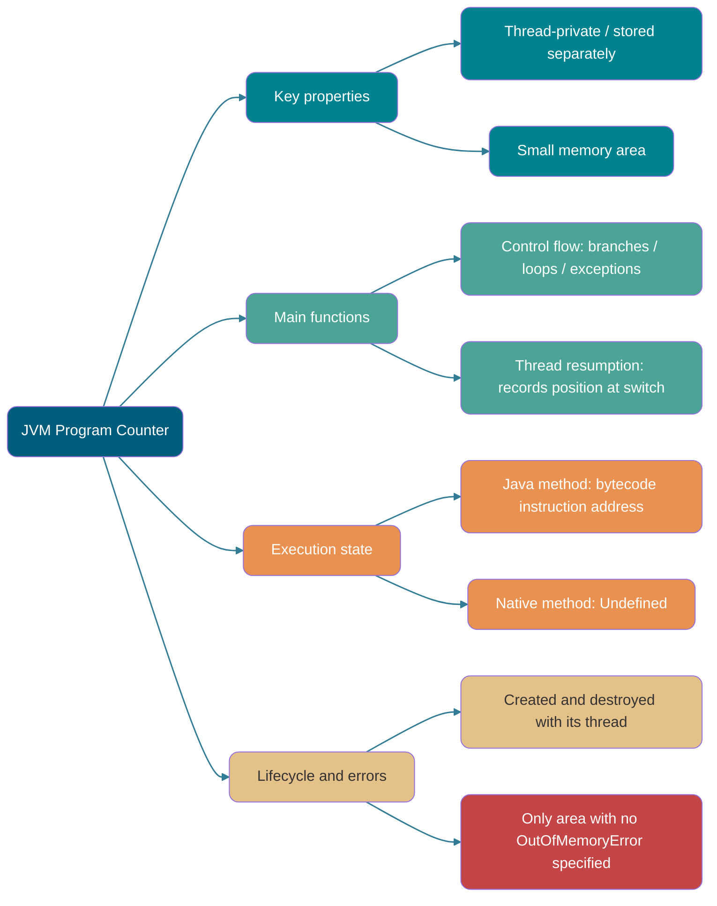
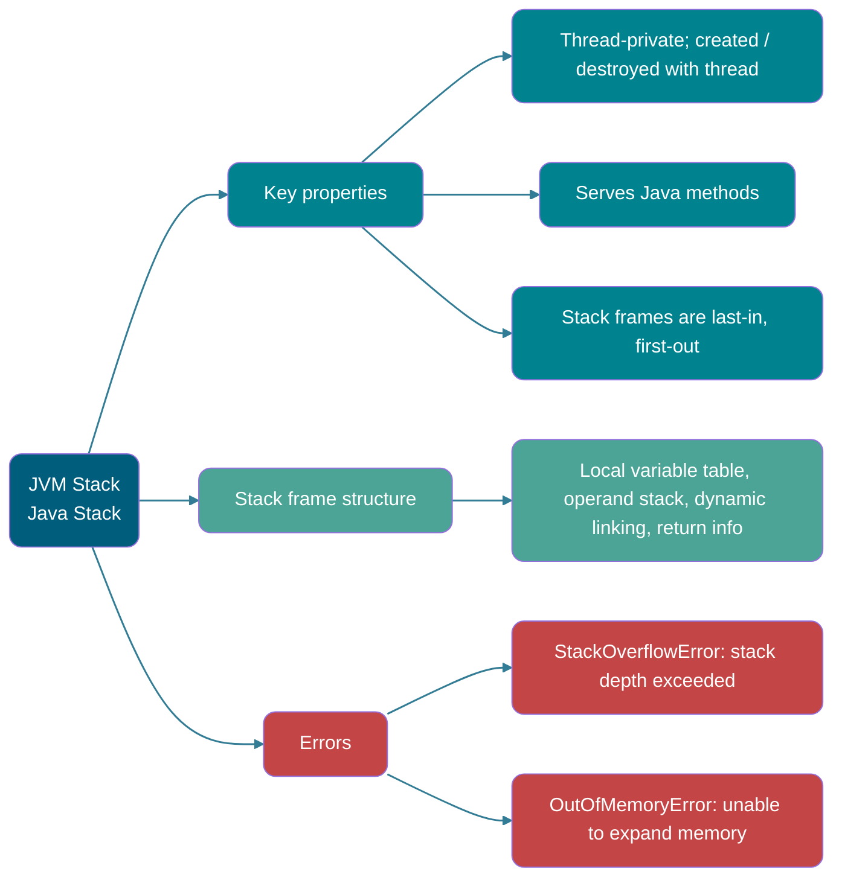
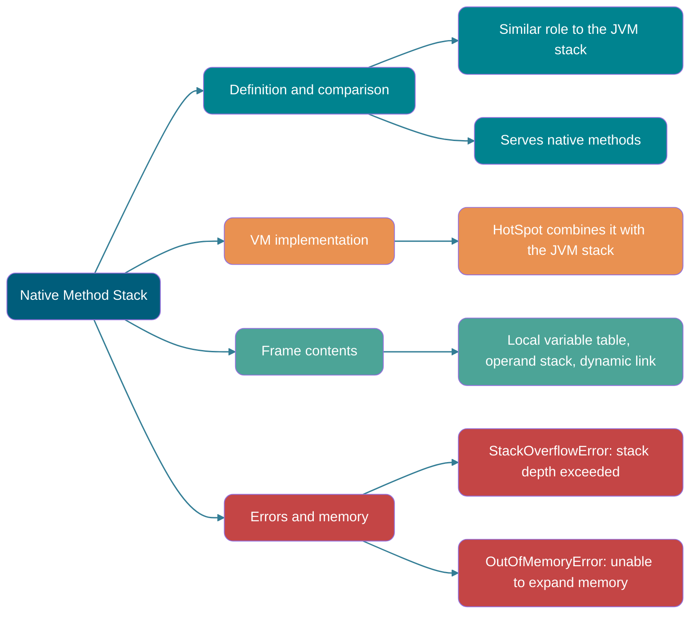
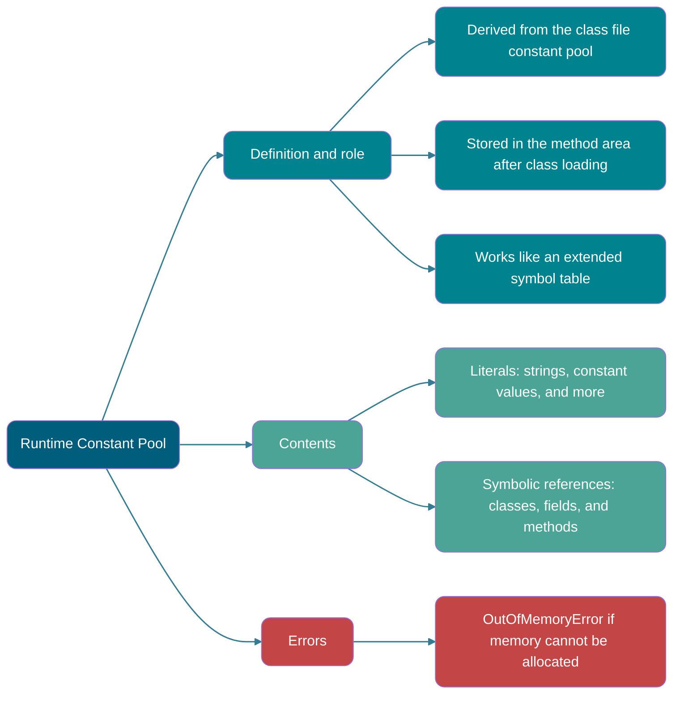
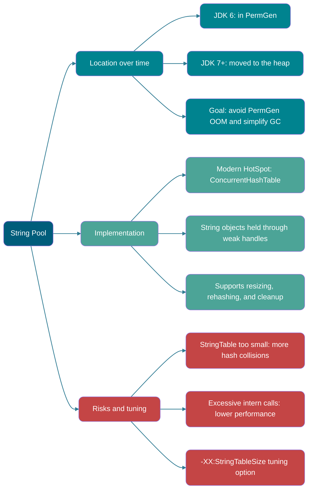
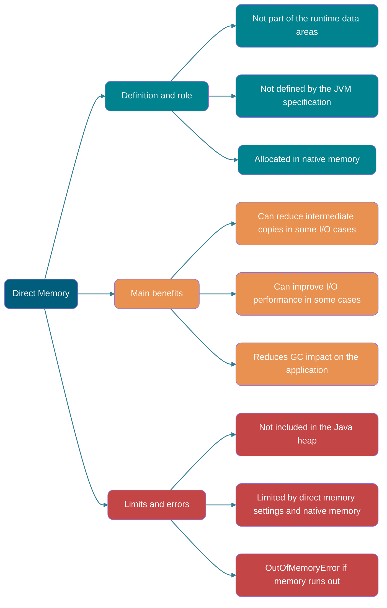
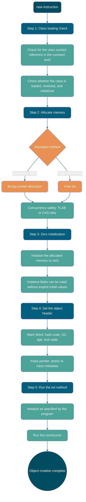

> Unless stated otherwise, this article refers to the HotSpot VM.
>
> This article summarizes and expands on _Understanding the Java Virtual Machine: Advanced Features and Best Practices_.
>
> Common interview questions:
>
> - Describe the Java memory areas (runtime data areas).
> - What are the five steps in Java object creation? Be able to list them and explain what the VM does at each step.
> - What are the two ways to access an object: handles and direct pointers?

## Introduction

Java's automatic memory management means developers do not need to write a matching `delete` or `free` for every `new`, as they would in C or C++. This makes some memory leaks and overflows less likely, but Java developers also hand memory management to the JVM. When memory problems occur, diagnosing them can be difficult without understanding how the JVM uses memory.

## Runtime Data Areas

While running a Java program, the JVM divides the memory it manages into several data areas.

The memory layout changed slightly in JDK 8. This section compares JDK 7 and JDK 8.

**JDK 1.7**：


**JDK 1.8**：


**Thread-private areas:**

- Program counter
- JVM stack
- Native method stack

**Shared areas:**

- Heap
- Method area

Direct memory is often discussed alongside these areas, but it is not a runtime data area defined by the Java Virtual Machine Specification and should not be described as a specification-defined shared runtime area.

The Java Virtual Machine Specification leaves many details of runtime data areas to the implementation. For example, the heap may be contiguous or non-contiguous, and its size may be fixed or grow as needed at runtime. A VM implementation may manage the heap with any garbage collection algorithm, or even choose not to collect garbage.

### Program Counter



The program counter is a small memory area that acts as a line-number indicator for the bytecode currently being executed by a thread. The bytecode interpreter changes its value to select the next instruction. Branches, loops, jumps, exception handling, and resuming a thread all depend on it.

Each thread needs its own program counter so it can resume at the correct position after a context switch. The counters are independent, so this area is considered thread-private.

The program counter has two main roles:

- The bytecode interpreter changes the counter to read instructions in sequence and control program flow, including sequential execution, branching, loops, and exception handling.
- In a multithreaded program, the counter records where a thread is executing so it can resume from that point when scheduled again.

The program counter's lifecycle matches that of its thread:

- **Created:** When the thread is created.
- **Destroyed:** When the thread ends.

When executing a **Java method** (not a native method), the program counter records the **address of the current JVM bytecode instruction**. When a thread executes a **native method**, its program counter is **undefined** because the thread is not executing JVM bytecode.

⚠️ Note: The program counter is the only memory area for which the JVM specification does not define an `OutOfMemoryError` condition. The specification does not require a particular fixed-size representation across all implementations.

### JVM Stack



Like the program counter, the JVM stack (the stack, for short) is thread-private. Its lifecycle matches the thread's: it is created with the thread and destroyed when the thread ends.

The stack is a core part of the JVM runtime data areas. Except for native method calls, which use the native method stack described below, Java method calls use the JVM stack. It also works with other runtime areas, such as the program counter.

Method call data is passed through the stack. Each method call pushes a corresponding stack frame, and each completed call pops one.

The stack consists of stack frames. Each frame contains a local variable table, operand stack, dynamic link, and method return address. Like the stack data structure, it is last-in, first-out and supports push and pop operations.


The **local variable table** stores values of types known at compile time (`boolean`, `byte`, `char`, `short`, `int`, `float`, `long`, and `double`) and object references. A reference is not the object itself: it may be a pointer to the object's start, a handle to the object, or another location associated with it.


The **operand stack** acts as an intermediary during method execution. It stores intermediate calculation results and temporary values.

**Dynamic linking** is a function of a stack frame. Each frame holds a reference to the runtime constant pool of the type that owns the current method. It uses this reference to resolve symbolic references to methods and offsets for accessing variables in runtime storage. Resolving an unresolved symbol may also trigger class loading. Choosing a virtual method implementation based on the receiver's runtime type is dynamic dispatch, which is distinct from the dynamic linking described here.


The stack is finite, but ordinary method calls usually do not cause problems. Infinite recursion can push too many frames onto the stack. If a thread's requested stack depth exceeds the maximum allowed by the JVM, it throws `StackOverflowError`.

**A Java method can return in two ways:**

- **Normal return:** The method executes a `return` statement and passes the return value to its caller.
- **Abrupt return:** The method throws an exception that is not caught during execution.

Either kind of return pops the stack frame. **A frame is created when a method is called and destroyed when the method ends, whether it completes normally or abruptly.**

The stack can also cause `OutOfMemoryError`. If its size can grow dynamically and the VM cannot allocate enough memory while expanding it, the VM throws this error.

In summary, the stack can cause two kinds of errors:

- **`StackOverflowError`:** Thrown when a thread needs more stack space than the JVM allows.
- **`OutOfMemoryError`:** If the stack can grow dynamically, thrown when the VM cannot allocate enough memory to expand it.


### Native Method Stack



The native method stack has a role similar to that of the JVM stack, but they serve different methods: **the JVM stack serves Java methods (bytecode), while the native method stack serves native methods used by the VM.** HotSpot combines the native method stack with the JVM stack.

When executing a native method, a VM implementation may use a traditional native stack, often called a C stack. The Java Virtual Machine Specification does not require the native method stack to use the same local variable table, operand stack, and dynamic link structure as JVM stack frames.

After a native method finishes, its implementation-specific stack data is released. The native method stack can also cause `StackOverflowError` and `OutOfMemoryError`.

### Heap

```mermaid
graph LR
    %% Color definitions.
    classDef main fill:#005D7B,color:#fff,rx:10,ry:10;
    classDef compare fill:#00838F,color:#fff,rx:10,ry:10;
    classDef structure fill:#4CA497,color:#fff,rx:10,ry:10;
    classDef implement fill:#E99151,color:#fff,rx:10,ry:10;
    classDef error fill:#C44545,color:#fff,rx:10,ry:10;

    %% Main node.
    Root(Java Heap):::main

    %% Branch 1: Definition and role.
    Root --> Def[Definition and role]:::compare
    Def --> Def1[Largest JVM memory area]:::compare
    Def --> Def2[Shared by all threads]:::compare
    Def --> Def3[Created at VM startup; long-lived]:::compare

    %% Branch 2: Main uses.
    Root --> Use[Main uses]:::structure
    Use --> Use1[Stores object instances (not static fields)]:::structure
    Use --> Use2[Stores array data]:::structure
    Use --> Use3[Centralized object memory management]:::structure

    %% Branch 3: Generational structure (GC heap).
    Root --> GC[Generational structure]:::implement
    GC --> GC1[Young generation: Eden + two Survivor spaces]:::implement
    GC --> GC2[Old generation]:::implement
    GC --> GC3[Purpose: improve collection efficiency]:::implement

    %% Line style.
    linkStyle default stroke:#005D7B,stroke-width:1.5px,opacity:0.8
```

The Java heap is the largest area of memory managed by the JVM. It is shared by all threads and created when the VM starts. **Its purpose is to store object instances; nearly all object instances and arrays are allocated here.**

Nearly all Java objects are allocated on the heap. However, a JIT compiler can use escape analysis and scalar replacement to eliminate some object allocations. This HotSpot optimization should not be oversimplified as "objects are allocated directly on the JVM stack."

The Java heap is the main area managed by garbage collectors, so it is also called the **GC heap (Garbage Collected Heap)**. Most collectors use generational collection, so the heap may be divided into a young generation and an old generation, with spaces such as Eden, Survivor, and Old. These divisions can help reclaim memory or allocate it more quickly.

In HotSpot JDK 7 and earlier, the GC-managed memory is often described in three parts. PermGen is an implementation of the method area and is not part of the Java heap:

1. Young generation
2. Old generation
3. Permanent generation (PermGen)

In the diagram below, Eden and the two Survivor spaces, S0 and S1, belong to the young generation. The middle layer is the old generation, and the bottom layer is PermGen.


**Starting with JDK 8, PermGen was replaced by Metaspace, which uses native memory.** The method area section below covers this in more detail.

In most cases, objects are first allocated in Eden. If an object survives a young-generation collection, it moves to S0 or S1 and its age increases by one (its initial age becomes 1 when it moves from Eden to a Survivor space). Once it reaches the promotion threshold, it moves to the old generation. The threshold depends on the collector, adaptive policies, and `-XX:MaxTenuringThreshold`; 15 is not the default for every collector. For classic generational collectors that use a 4-bit age field, the parameter's maximum is 15.

```bash
MaxTenuringThreshold of 20 is invalid; must be between 0 and 15
```

**Why is the age limited to 0–15?**

The age is stored in the object header, usually in a 4-bit field. Four bits can represent at most `1111` in binary, or 15 in decimal, so the age is limited to 0–15.

The object layout helps explain this limit.

In HotSpot, an object's memory layout has three parts: the object header, instance data, and alignment padding. The header contains a mark word and a class pointer (Klass Word). The object layout is covered in more detail later.

The age is stored in the mark word, which also holds other object information such as the hash code and lock state. The image below shows the mark word structure in an older version of HotSpot's `markOop.hpp`; the implementation and object header layout have changed in modern JDKs:


As shown, the object age occupies 4 bits.

> **🐛 Correction (see [issue 552](https://github.com/Snailclimb/JavaGuide/issues/552))**: "HotSpot traverses objects in ascending order of age and adds up the space they occupy. When the total for an age exceeds half the Survivor space, the smaller of that age and `MaxTenuringThreshold` becomes the new promotion threshold."
>
> **The dynamic age calculation is implemented as follows:**
>
> ```c++
> uint ageTable::compute_tenuring_threshold(size_t survivor_capacity) {
>  // survivor_capacity is the size of the Survivor space.
> size_t desired_survivor_size = (size_t)((((double) survivor_capacity)*TargetSurvivorRatio)/100);// TargetSurvivorRatio is 50.
> size_t total = 0;
> uint age = 1;
> while (age < table_size) {
> total += sizes[age];// sizes contains the size of objects at each age.
> if (total > desired_survivor_size) break;
> age++;
> }
> uint result = age < MaxTenuringThreshold ? age : MaxTenuringThreshold;
>   ...
> }
> ```

The heap is a common source of `OutOfMemoryError`. The error can take several forms, including:

1. **`java.lang.OutOfMemoryError: GC Overhead Limit Exceeded`**: This occurs when the JVM spends too much time collecting garbage but recovers very little heap space.
2. **`java.lang.OutOfMemoryError: Java heap space`**: This occurs when the heap does not have enough space for a newly created object. It depends on the maximum heap size and available physical memory. Configure the maximum heap with `-Xmx`; if it is not set, the JVM uses a default value. See [Default Java 8 max heap size](https://stackoverflow.com/questions/28272923/default-xmxsize-in-java-8-max-heap-size).
3. ……

### Method Area

```mermaid
graph LR
    %% Color definitions.
    classDef main fill:#005D7B,color:#fff,rx:10,ry:10;
    classDef compare fill:#00838F,color:#fff,rx:10,ry:10;
    classDef structure fill:#4CA497,color:#fff,rx:10,ry:10;
    classDef implement fill:#E99151,color:#fff,rx:10,ry:10;
    classDef error fill:#C44545,color:#fff,rx:10,ry:10;

    %% Main node.
    Root(Method Area):::main

    %% Branch 1: Definition and role.
    Root --> Def[Definition and role]:::compare
    Def --> Def1[Shared by threads]:::compare
    Def --> Def2[Logical area defined by the JVM specification]:::compare
    Def --> Def3[Implementation varies by VM]:::compare

    %% Branch 2: Main contents.
    Root --> Store[Main contents]:::structure
    Store --> Store1[Class metadata: structure, fields, and methods]:::structure
    Store --> Store2[Method bytecode: instruction sequences]:::structure
    Store --> Store3[Runtime constant pool: literals and symbolic references]:::structure

    %% Branch 3: HotSpot changes (JDK 7+).
    Root --> Change[Location changes and exceptions]:::implement
    Change --> Change1[Static variables: moved to Java heap (JDK 7)]:::implement
    Change --> Change2[String pool: moved to Java heap (JDK 7)]:::implement
    Change --> Change3[JIT code cache: separate Code Cache area]:::implement

    %% Line style.
    linkStyle default stroke:#005D7B,stroke-width:1.5px,opacity:0.8
```

The method area is a logical part of the JVM runtime data areas and is shared by all threads.

The Java Virtual Machine Specification defines the method area and its purpose, but leaves its implementation to each VM. As a result, the method area can be implemented differently by different VMs.

When the VM loads a class, it parses information from the class file and stores the resulting **metadata** in the method area. The method area mainly stores:

1. **Class metadata:** The class's full structure, including its name, superclass, implemented interfaces, access modifiers, and details about its fields and methods (names, types, modifiers, and more).
2. **Method bytecode:** The original instruction sequence for each method.
3. **Runtime constant pool:** A per-class structure derived from the class file's constant pool. It stores compile-time literals and symbolic references to types, fields, and methods.

Note that the following data is logically related to classes but is not stored in the method area in HotSpot:

- **Static variables:** Since JDK 7, a class's static variables are stored on the Java heap together with the corresponding `java.lang.Class` object.
- **String pool:** Since JDK 7, the string pool has also been **moved to the Java heap**.
- **JIT code cache:** The JIT compiler translates hot methods into native machine code and stores it in a **separate memory area called the Code Cache**, not in the method area. This supports more efficient execution and memory management.


**How are the method area, PermGen, and Metaspace related?** Think of the method area as an interface and PermGen and Metaspace as two implementations. They are HotSpot's implementations of the method area defined by the JVM specification. PermGen was used before JDK 8; Metaspace has been used since JDK 8.


**Why was PermGen replaced by Metaspace?**

The following diagram is from section 2.2.5 of the third edition of _Understanding the Java Virtual Machine_.


1. PermGen's capacity was limited by `-XX:MaxPermSize`. Metaspace uses native memory and can be limited with `-XX:MaxMetaspaceSize`. Either can run out of space; the actual risk depends on the configuration and growth of class metadata.

> When Metaspace runs out of space, the JVM reports: `java.lang.OutOfMemoryError: Metaspace`

Use `-XX:MaxMetaspaceSize` to set the maximum Metaspace size. If it is not set, class metadata can continue to grow until limited by available native memory and other constraints. `-XX:MetaspaceSize` is not the initial Metaspace capacity; it is the initial high-water mark that triggers metadata GC, and the JVM adjusts it dynamically.

2. Metaspace stores class metadata, so the number of classes that can be loaded is no longer limited by `MaxPermSize`; it depends on available system memory, which may allow more classes to be loaded.

3. When HotSpot and JRockit code was combined in JDK 8, there was no need to retain PermGen because JRockit had never used it.

4. PermGen added unnecessary complexity to GC and was relatively inefficient to reclaim.

**Which options are commonly used to configure the method area?**

Before PermGen was removed in JDK 8, these options were commonly used to adjust the method area size:

```java
-XX:PermSize=N // Initial method area (PermGen) size.
-XX:MaxPermSize=N // Maximum method area (PermGen) size; exceeding it causes java.lang.OutOfMemoryError: PermGen.
```

Garbage collection in this area is relatively uncommon, but data does not remain there "permanently."

In JDK 8, HotSpot removed PermGen as its method area implementation, a change that began in JDK 7. Metaspace, which uses native memory, replaced it. Common options include:

```java
-XX:MetaspaceSize=N // Initial high-water mark that triggers metadata GC.
-XX:MaxMetaspaceSize=N // Maximum Metaspace size.
```

Unlike PermGen, Metaspace has no fixed upper limit set by this option if `MaxMetaspaceSize` is omitted. Continued growth in class metadata can consume substantial native memory.

### Runtime Constant Pool



In addition to class version information and descriptions of fields, methods, and interfaces, a class file contains a **constant pool table** for literals and symbolic references generated at compile time.

Literals represent fixed values in source code. Their values can be understood directly from their notation. Integer, floating-point, and string values are examples of literals. Common symbolic references include references to classes, fields, methods, and interface methods.

The third edition of _Understanding the Java Virtual Machine_ explains symbolic and direct references in section 7.34:


After class loading, the constant pool table is stored in the method area's runtime constant pool.

The runtime constant pool works like a symbol table in traditional programming languages, though it contains a wider range of data than a typical symbol table.

Because the runtime constant pool is part of the method area, it is limited by the memory available to that area. It can throw `OutOfMemoryError` if it cannot allocate more memory.

### String Pool



The **string pool** is an area the JVM uses to improve performance and reduce memory use by avoiding duplicate `String` objects.

```java
// 1. Look for "ab" in the string pool. If it is absent, create it and add it to the pool.
// 2. Assign the reference to the pooled "ab" string to aa.
String aa = "ab";
// Return the pooled "ab" string and assign it to bb.
String bb = "ab";
System.out.println(aa==bb); // true
```

The string pool implementation in HotSpot can be found in `src/hotspot/share/classfile/stringTable.cpp`. Modern HotSpot uses a native `StringTable` implemented as a concurrent hash table. It holds heap string objects through weak handles and supports resizing, rehashing, and removing stale entries. `-XX:StringTableSize` sets the initial number of buckets. The description "fixed-size array plus linked lists" applies only to some older implementations, not to current HotSpot in general.

Before JDK 7, the string pool was stored in PermGen. JDK 7 moved the string pool and class static variables to the Java heap.


**Why did JDK 7 move the string pool to the heap?**

One reason was that GC of PermGen, the method area implementation, was relatively inefficient and generally occurred only during a Full GC. Java programs often create many strings that can later be reclaimed. Moving the string pool to the heap made it possible to reclaim their memory more efficiently and promptly.

Related discussion: [Does the JVM constant pool store objects or references? — RednaxelaFX](https://www.zhihu.com/question/57109429/answer/151717241)

Finally, here's a note from Zhou Zhiming in [issue 112](https://github.com/fenixsoft/jvm_book/issues/112) of the GitHub repository for the [sample code and errata for _Understanding the Java Virtual Machine_, 3rd edition](https://github.com/fenixsoft/jvm_book):

> **The runtime constant pool, method area, and string pool are logical concepts that do not change with a VM implementation; they are general and abstract. Metaspace and the heap are physical concepts tied to a specific VM implementation; they are concrete and implementation-specific.**

### Direct Memory



Direct memory is a special kind of memory buffer. It is allocated in native memory rather than in the Java heap or method area. The allocation mechanism is VM-specific and does not necessarily use JNI.

Direct memory is not part of the VM runtime data areas or a memory area defined by the JVM specification, but it is used frequently and can also cause `OutOfMemoryError`.

Introduced in JDK 1.4, **NIO (New I/O)** provides I/O APIs based on **channels** and **buffers**. Direct byte buffers can be allocated outside the Java heap and accessed through a `DirectByteBuffer` object on the heap. The JVM tries to perform native I/O directly on these buffers, which can reduce intermediate copies in some cases. Only parts of NIO, such as selectable channels used with a `Selector`, provide non-blocking I/O; NIO as a whole does not mean Non-Blocking I/O.

Direct memory is not included in the Java heap, but it is still limited by total native memory, the processor's address space, and other conditions. For NIO direct buffers, [`-XX:MaxDirectMemorySize`](https://docs.oracle.com/en/java/javase/25/docs/specs/man/java.html#extra-options-for-java) can limit the total allocation.

Another related term is **off-heap memory**. Some articles use it as a synonym for direct memory, but the terms are not quite equivalent.

Off-heap memory is a general term for memory allocated outside the Java heap, usually using native memory provided by the operating system. Whether and how the JVM or JDK manages it depends on the allocation mechanism. For example, in OpenJDK/HotSpot, native memory used by a `DirectByteBuffer` is associated with a buffer object on the Java heap and can be cleaned up through mechanisms such as `Cleaner` after the object becomes unreachable. Because applications do not directly control when cleanup occurs, off-heap memory can reduce pressure on the Java heap, but native memory leaks and `OutOfMemoryError` remain possible.

## HotSpot Object Internals

The previous sections introduced the VM's memory areas. Next, we'll look at how HotSpot allocates, lays out, and accesses objects in the Java heap.

### Object Creation

It's useful to memorize the steps in Java object creation and understand what happens at each step.



#### Step 1: Class Loading Check

When the VM encounters a `new` instruction, it first checks whether the instruction's operand can be resolved to a symbolic reference for the class in the constant pool. It then checks whether that class has been loaded, resolved, and initialized. If not, the corresponding class loading process must run first.

#### Step 2: Allocate Memory

After the **class loading check** passes, the VM **allocates memory** for the new object. Its required size is known after class loading, so allocation means carving out a block of that size from the Java heap. The two **allocation methods** are **bump-pointer allocation** and a **free list**. **The choice depends on whether the heap is contiguous, which in turn depends on whether the collector compacts memory.**

**The two memory allocation methods** (additional material worth knowing):

- **Bump-pointer allocation:**
  - **When used:** When the heap is contiguous (that is, it has no fragmentation).
  - **How it works:** Used memory is grouped on one side and free memory on the other. A pointer marks the boundary between them. Allocation moves the pointer forward by the object's size.
  - **Collectors that use it:** Serial and ParNew.
- **Free list:**
  - **When used:** When the heap is fragmented.
  - **How it works:** The VM maintains a list of free memory blocks. For an allocation, it finds a block large enough for the object and updates the list.
  - **Collectors that use it:** CMS.

The choice between these methods depends on whether the Java heap is contiguous. That depends on the collector's algorithm: mark-sweep or mark-compact (also called mark-compact). Note that copying collectors also leave memory contiguous.

**Concurrent memory allocation** (additional material worth knowing)

Object creation is frequent, so allocation must be thread-safe. VMs commonly use two approaches:

- **CAS and retry:** CAS is one way to implement optimistic locking. An operation proceeds assuming there is no conflict; if it fails because of a conflict, it retries until successful. **The VM uses CAS with retries to make updates atomic.**
- **TLAB:** The VM reserves a region of Eden for each thread. It first allocates that thread's objects in its TLAB. If an object is larger than the remaining space or the TLAB is full, the VM falls back to the CAS-based allocation described above.

#### Step 3: Zero Initialization

After allocation, the VM initializes the allocated memory to zero, excluding the object header. This lets Java code use instance fields without explicitly assigning initial values: each field has the zero value for its type.

#### Step 4: Set the Object Header

After zero initialization, **the VM sets the object's metadata**, including its class, how to find the class metadata, its hash code, and its GC age. **This information is stored in the object header.** The header layout depends on the JDK version and VM configuration. For example, biased locking was disabled by default in JDK 15, and its implementation was later removed.

#### Step 5: Run the `init` Method

After these steps, the VM considers the new object created. From the Java program's perspective, however, construction has just begun: `<init>` has not run, and all fields still hold zero values. The `new` instruction is generally followed by `<init>`, which initializes the object as specified by the program. Only then is the object ready to use.

### Object Memory Layout

In HotSpot, an object has three memory regions: the **object header**, **instance data**, and **alignment padding**.

The object header contains two parts:

1. **Mark word:** Stores runtime data about the object, such as its hash code, GC age, and lock state. A biased thread ID and timestamp apply only to older HotSpot versions that implemented and enabled biased locking.
2. **Klass pointer:** A pointer to the object's class metadata, which the VM uses to determine the object's class.

**Instance data is the information the object actually stores**, including the fields defined by the program.

**Alignment padding is optional and has no special meaning; it fills space to meet alignment requirements.** HotSpot aligns objects on a boundary that is usually 8 bytes by default and can be affected by options such as `-XX:ObjectAlignmentInBytes`. The total object size is padded to that boundary. The object header itself is not always a multiple of 8 bytes; for example, a common header size with compressed class pointers is 12 bytes.

### Object Access

Objects are created to be used. Java code uses references in stack frames to access objects on the heap. The access method depends on the VM implementation. Two common approaches are **handles** and **direct pointers**.

#### Handles

With handles, the Java heap contains a handle pool. A reference stores the address of an object's handle, which in turn contains the addresses of the object's instance data and type data.


#### Direct Pointers

With direct pointer access, the reference stores the object's address directly.


Both approaches have advantages. With handles, a reference contains a stable handle address. When an object moves, only the instance data pointer in the handle changes; the reference itself does not. Direct pointer access is faster because it avoids one level of pointer indirection.

HotSpot mainly uses direct pointer access.

## References

- _Understanding the Java Virtual Machine: Advanced Features and Best Practices_, 2nd edition
- _Write Your Own Java Virtual Machine_
- Chapter 2. The Structure of the Java Virtual Machine：<https://docs.oracle.com/javase/specs/jvms/se8/html/jvms-2.html>
- JVM stack frame internals: dynamic linking: <https://chenxitag.com/archives/368>
- When does the string literal in `new String("literal")` enter the string pool? — Zhihu answer by Mu Nühai: <https://www.zhihu.com/question/55994121/answer/147296098>
- Does the JVM constant pool store objects or references? — Zhihu answer by RednaxelaFX: <https://www.zhihu.com/question/57109429/answer/151717241>
- <http://www.pointsoftware.ch/en/under-the-hood-runtime-data-areas-javas-memory-model/>
- <https://dzone.com/articles/jvm-permgen-%E2%80%93-where-art-thou>
- <https://stackoverflow.com/questions/9095748/method-area-and-permgen>

<!-- @include: @article-footer.snippet.md -->
