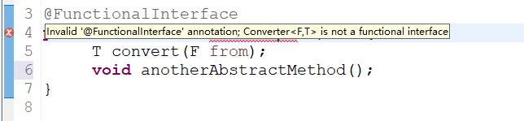
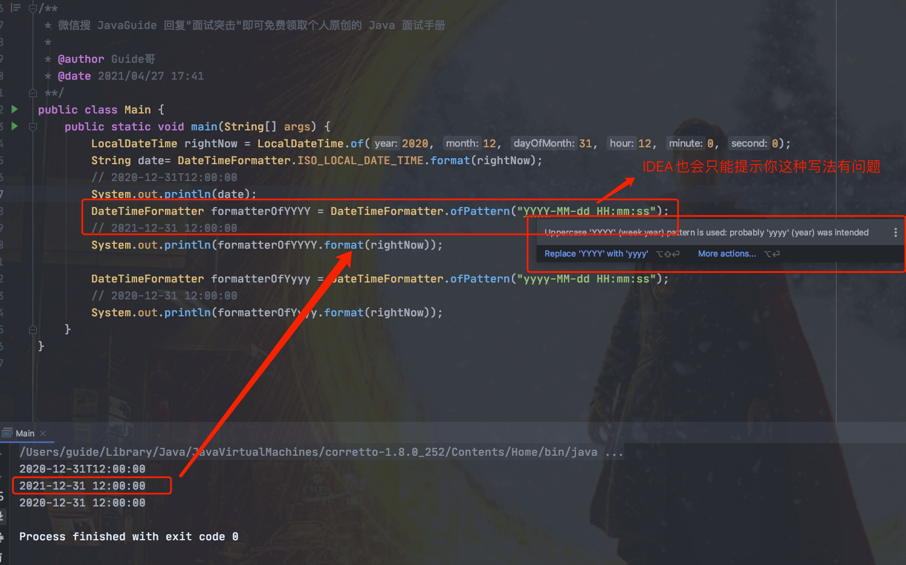

# Java 8 Tutorial

JDK 8 was released on March 18, 2014. It is an LTS (Long-Term Support) release and one of the most important versions in Java's history. Oracle's listed LTS releases are JDK 8, 11, 17, 21, and 25.

JDK 8 introduced many important features. This article covers some of the key ones:

- Lambda expressions
- Method references
- Interface default methods
- Stream API
- Functional interfaces
- The Optional class
- The Date-Time API
- Annotation improvements

The chart below shows the number of features and release dates for each update from JDK 8 through JDK 24:


As Java 8 became more widely used, its features also became common interview topics. I planned to write a summary and found a related repository on GitHub: [https://github.com/winterbe/java8-tutorial](https://github.com/winterbe/java8-tutorial). The repository is in English. I translated it and added or revised some material. The tutorial begins below.

---

Welcome to this introduction to Java 8. This tutorial walks through its new language features. With short code examples, you will learn about interface default methods, Lambda expressions, method references, and repeatable annotations. The final sections cover API updates such as Stream, functional interfaces, Map enhancements, and the Date-Time API. The tutorial focuses on annotated code examples rather than long explanations.

## Default Methods for Interfaces

Java 8 lets you add non-abstract method implementations to interfaces with the `default` keyword. This feature is also known as [virtual extension methods](http://stackoverflow.com/a/24102730).

Here is a first example:

```java
interface Formula{

    double calculate(int a);

    default double sqrt(int a) {
        return Math.sqrt(a);
    }

}
```

The `Formula` interface defines an abstract method, `calculate`, and a default method, `sqrt`. A class implementing the interface only needs to implement `calculate`; it can use `sqrt` directly. The example below uses an anonymous class to implement the interface.

```java
public class Main {

  public static void main(String[] args) {
    // Implement the interface with an anonymous class.
    Formula formula = new Formula() {
        @Override
        public double calculate(int a) {
            return sqrt(a * 100);
        }
    };

    System.out.println(formula.calculate(100));     // 100.0
    System.out.println(formula.sqrt(16));           // 4.0

  }

}
```

`formula` is an instance of an anonymous class. The code is straightforward: six lines implement `sqrt(a * 100)`. The next section shows a simpler way to implement a single-method interface in Java 8.

**Translator's note:** You can use an anonymous class with either an abstract class or an interface, but you cannot instantiate either one directly. In the example above, the anonymous class implements the interface's abstract method and creates an object. The interface reference then points to that object.

## Lambda Expressions

First, here is how to sort strings in older versions of Java:

```java
List<String> names = Arrays.asList("peter", "anna", "mike", "xenia");

Collections.sort(names, new Comparator<String>() {
    @Override
    public int compare(String a, String b) {
        return b.compareTo(a);
    }
});
```

Pass a `List` and a comparator to the static method `Collections.sort` to sort the list. The usual approach is to create an anonymous comparator and pass it to `sort`.

In Java 8, you can use the more concise Lambda syntax instead of an anonymous class:

```java
Collections.sort(names, (String a, String b) -> {
    return b.compareTo(a);
});
```

This is shorter and easier to read, and it can be simplified further:

```java
Collections.sort(names, (String a, String b) -> b.compareTo(a));
```

For a one-line function body, you can omit the braces and `return` keyword. You can shorten it further:

```java
names.sort((a, b) -> b.compareTo(a));
```

The `List` class has its own `sort` method, and the Java compiler infers the parameter types, so you do not need to write them again. Next, we will look at other uses of Lambda expressions.

## Functional Interfaces

**Translator's note:** The explanation in the original was unclear, so this section has been revised.

The Java language designers considered how to make existing APIs work well with Lambda expressions. One result was the functional interface: **an interface with exactly one abstract method, though it can have multiple non-abstract methods (such as the default methods described above).** A functional interface can be the target type of a Lambda expression. `java.lang.Runnable` and `java.util.concurrent.Callable` are common examples. Java 8 added the `@FunctionalInterface` annotation, but it is optional. Any interface that meets the definition can be a Lambda target type. It is recommended to use the annotation so the compiler reports an error if the interface no longer meets the requirements.



Example:

```java
@FunctionalInterface
public interface Converter<F, T> {
  T convert(F from);
}
```

```java
    // TODO Convert the numeric string to an integer.
    Converter<String, Integer> converter = (from) -> Integer.valueOf(from);
    Integer converted = converter.convert("123");
    System.out.println(converted.getClass()); //class java.lang.Integer
```

**Translator's note:** You usually do not need to write functional interfaces yourself. Java 8 provides many of them in the `java.util.function` package.

## Method and Constructor References

The code from the previous section can also use a static method reference:

```java
    Converter<String, Integer> converter = Integer::valueOf;
    Integer converted = converter.convert("123");
    System.out.println(converted.getClass());   //class java.lang.Integer
```

Java 8 lets you pass method or constructor references with the `::` operator. The previous example shows a static method reference. You can also reference an instance method:

```java
class Something {
    String startsWith(String s) {
        return String.valueOf(s.charAt(0));
    }
}
```

```java
Something something = new Something();
Converter<String, String> converter = something::startsWith;
String converted = converter.convert("Java");
System.out.println(converted);    // "J"
```

To reference a constructor with `::`, first define a simple class with multiple constructors:

```java
class Person {
    String firstName;
    String lastName;

    Person() {}

    Person(String firstName, String lastName) {
        this.firstName = firstName;
        this.lastName = lastName;
    }
}
```

Next, define a factory interface for creating `Person` objects:

```java
interface PersonFactory<P extends Person> {
    P create(String firstName, String lastName);
}
```

Use a constructor reference to connect them instead of implementing a full factory:

```java
PersonFactory<Person> personFactory = Person::new;
Person person = personFactory.create("Peter", "Parker");
```

Use `Person::new` to reference a `Person` constructor. The Java compiler selects the appropriate constructor based on the parameter types of `PersonFactory.create`.

## Lambda Scopes

### Accessing Local Variables

You can access local variables from the enclosing scope inside a Lambda expression:

```java
final int num = 1;
Converter<Integer, String> stringConverter =
        (from) -> String.valueOf(from + num);

stringConverter.convert(2);     // 3
```

Unlike with anonymous classes, `num` does not have to be declared `final`:

```java
int num = 1;
Converter<Integer, String> stringConverter =
        (from) -> String.valueOf(from + num);

stringConverter.convert(2);     // 3
```

However, `num` must not be reassigned later (it must be effectively final). The following code does not compile:

```java
int num = 1;
Converter<Integer, String> stringConverter =
        (from) -> String.valueOf(from + num);
num = 3; // Reassigning num after it is captured by the Lambda is not allowed.
```

### Accessing Fields and Static Variables

Unlike local variables, instance fields and static variables can be read and written inside a Lambda expression. This matches the behavior of anonymous classes.

```java
class Lambda4 {
    static int outerStaticNum;
    int outerNum;

    void testScopes() {
        Converter<Integer, String> stringConverter1 = (from) -> {
            outerNum = 23;
            return String.valueOf(from);
        };

        Converter<Integer, String> stringConverter2 = (from) -> {
            outerStaticNum = 72;
            return String.valueOf(from);
        };
    }
}
```

### Accessing Interface Default Methods

Remember the `formula` example from the first section? Each instance of the anonymous class could access the `sqrt` default method defined in `Formula`. Lambda expressions do not work the same way.

You cannot access a default method from a Lambda expression, so the following code does not compile:

```java
Formula formula = (a) -> sqrt(a * 100);
```

## Built-in Functional Interfaces

The JDK 8 API includes many built-in functional interfaces. Some, such as `Comparator` and `Runnable`, were already familiar from earlier Java versions. They can be used with Lambda expressions because they meet the functional interface requirements.

The Java 8 API also adds many functional interfaces to make common programming tasks easier. Some were inspired by the [Google Guava](https://code.google.com/p/guava-libraries/) library. Even if you already know them, it is useful to see how they work with Lambda expressions.

### `Predicate`

`Predicate` is a **predicate** interface that takes one argument and returns a boolean. It includes default methods for combining predicates into more complex logic, such as AND, OR, and NOT:

**Translator's note:** Here is the `Predicate` interface source:

```java
package java.util.function;
import java.util.Objects;

@FunctionalInterface
public interface Predicate<T> {

    // Takes a value and returns a boolean result.
    boolean test(T t);

    // Like the && operator: both predicates must be true.
    default Predicate<T> and(Predicate<? super T> other) {
        Objects.requireNonNull(other);
        return (t) -> test(t) && other.test(t);
    }
    // Like the ! operator: negates the predicate.
    default Predicate<T> negate() {
        return (t) -> !test(t);
    }
    // Like the || operator: either predicate can be true.
    default Predicate<T> or(Predicate<? super T> other) {
        Objects.requireNonNull(other);
        return (t) -> test(t) || other.test(t);
    }
   // Returns a predicate that checks whether its input is equal to the given object.
    static <T> Predicate<T> isEqual(Object targetRef) {
        return (null == targetRef)
                ? Objects::isNull
                : object -> targetRef.equals(object);
    }
```

Example:

```java
Predicate<String> predicate = (s) -> s.length() > 0;

predicate.test("foo");              // true
predicate.negate().test("foo");     // false

Predicate<Boolean> nonNull = Objects::nonNull;
Predicate<Boolean> isNull = Objects::isNull;

Predicate<String> isEmpty = String::isEmpty;
Predicate<String> isNotEmpty = isEmpty.negate();
```

### `Function`

`Function` takes one argument and returns a result. Its default methods can chain functions using `compose` and `andThen`:

**Translator's note:** Here is the `Function` interface source:

```java

package java.util.function;

import java.util.Objects;

@FunctionalInterface
public interface Function<T, R> {

    // Applies this function to the input and returns the result.
    R apply(T t);
    // Composes this function with another function that runs first.
    default <V> Function<V, R> compose(Function<? super V, ? extends T> before) {
        Objects.requireNonNull(before);
        return (V v) -> apply(before.apply(v));
    }
    // Runs another function after this one.
    default <V> Function<T, V> andThen(Function<? super R, ? extends V> after) {
        Objects.requireNonNull(after);
        return (T t) -> after.apply(apply(t));
    }

    static <T> Function<T, T> identity() {
        return t -> t;
    }
}
```

```java
Function<String, Integer> toInteger = Integer::valueOf;
Function<String, String> backToString = toInteger.andThen(String::valueOf);
backToString.apply("123");     // "123"
```

### `Supplier`

`Supplier` produces a result of a given type. Unlike `Function`, it takes no arguments.

```java
Supplier<Person> personSupplier = Person::new;
personSupplier.get();   // new Person
```

### `Consumer`

`Consumer` represents an operation that accepts a single input argument.

```java
Consumer<Person> greeter = (p) -> System.out.println("Hello, " + p.firstName);
greeter.accept(new Person("Luke", "Skywalker"));
```

### `Comparator`

`Comparator` is a familiar interface from earlier Java versions. Java 8 adds several default methods to it:

```java
Comparator<Person> comparator = (p1, p2) -> p1.firstName.compareTo(p2.firstName);

Person p1 = new Person("John", "Doe");
Person p2 = new Person("Alice", "Wonderland");

comparator.compare(p1, p2);             // > 0
comparator.reversed().compare(p1, p2);  // < 0
```

## Optional

`Optional` is not a functional interface. It is a container that explicitly represents a value that may be absent. Used appropriately, it can reduce some manual `null` checks, but it does not prevent all `NullPointerException`s. Here is a quick look at how `Optional` works.

`Optional` is a simple container that either holds a non-`null` value or is empty. For return values that may be absent, you can return an `Optional` instead of using `null` to represent no result.

**Translator's note:** Comments explain what each method does.

```java
// of(): Creates an Optional for a non-null value.
Optional<String> optional = Optional.of("bam");
// isPresent(): Returns true if a value is present; otherwise, false.
optional.isPresent();           // true
// get(): Returns the value or throws NoSuchElementException if empty.
optional.get();                 // "bam"
// orElse(): Returns the value or the specified fallback.
optional.orElse("fallback");    // "bam"
// ifPresent(): Calls the consumer if a value is present; otherwise, does nothing.
optional.ifPresent((s) -> System.out.println(s.charAt(0)));     // "b"
```

Recommended reading: [How to Use Optional Correctly in Java 8](https://blog.kaaass.net/archives/764)

## Streams

`java.util.stream.Stream` represents a sequence of operations that can be applied to a group of elements. Stream operations are intermediate or terminal. A terminal operation returns a result of a specific type, while an intermediate operation returns a Stream so that operations can be chained. Streams can be created from collections, arrays, generator functions, and other sources. A `Map` does not have a `stream()` method, but you can create streams from its key, value, or entry views. Stream operations can run sequentially or in parallel.

First, create a list of data for the Stream examples:

```java
List<String> stringList = new ArrayList<>();
stringList.add("ddd2");
stringList.add("aaa2");
stringList.add("bbb1");
stringList.add("aaa1");
stringList.add("bbb3");
stringList.add("ccc");
stringList.add("bbb2");
stringList.add("ddd1");
```

Java 8 adds `Collection.stream()` and `Collection.parallelStream()` to create a Stream from a collection. The following sections explain common Stream operations.

### Filter

`filter` uses a predicate to keep only matching elements. It is an **intermediate operation**, so you can apply other Stream operations (such as `forEach`) to the result. `forEach` applies a function to each filtered element. It is a terminal operation, so no further Stream operations can follow it.

```java
        // Test filter.
        stringList
                .stream()
                .filter((s) -> s.startsWith("a"))
                .forEach(System.out::println); // aaa2 aaa1
```

`forEach` works naturally with Lambda expressions and keeps the code concise. Lambda expressions can also be reused.

### Sorted

Sorting is an **intermediate operation** that returns a sorted Stream. **If you do not provide a custom Comparator, natural ordering is used.**

```java
        // Test sorting.
        stringList
                .stream()
                .sorted()
                .filter((s) -> s.startsWith("a"))
                .forEach(System.out::println); // aaa1 aaa2
```

Sorting creates a new sorted Stream and does not modify the source list, `stringList`:

```java
    System.out.println(stringList);// ddd2, aaa2, bbb1, aaa1, bbb3, ccc, bbb2, ddd1
```

### Map

The intermediate `map` operation applies a `Function` to each element and transforms it into another value.

The following example converts strings to uppercase. You can also use `map` to convert objects to other types; the returned Stream type is determined by the function's return type.

```java
        // Test the map operation.
        stringList
                .stream()
                .map(String::toUpperCase)
                .sorted((a, b) -> b.compareTo(a))
                .forEach(System.out::println); // DDD2, DDD1, CCC, BBB3, BBB2, BBB1, AAA2, AAA1
```

### Match

Stream provides several matching operations to test whether elements satisfy a given `Predicate`. All matching operations are **terminal operations** and return a boolean.

```java
        // Test matching operations.
        boolean anyStartsWithA =
                stringList
                        .stream()
                        .anyMatch((s) -> s.startsWith("a"));
        System.out.println(anyStartsWithA);      // true

        boolean allStartsWithA =
                stringList
                        .stream()
                        .allMatch((s) -> s.startsWith("a"));

        System.out.println(allStartsWithA);      // false

        boolean noneStartsWithZ =
                stringList
                        .stream()
                        .noneMatch((s) -> s.startsWith("z"));

        System.out.println(noneStartsWithZ);      // true
```

### Count

Counting is a **terminal operation** that returns the number of elements in the Stream. **The return type is `long`.**

```java
      // Test counting.
        long startsWithB =
                stringList
                        .stream()
                        .filter((s) -> s.startsWith("b"))
                        .count();
        System.out.println(startsWithB);    // 3
```

### Reduce

This is a **terminal operation** that combines the Stream's elements into one result using the given function. The result is represented by `Optional`:

```java
        // Test reduction.
        Optional<String> reduced =
                stringList
                        .stream()
                        .sorted()
                        .reduce((s1, s2) -> s1 + "#" + s2);

        reduced.ifPresent(System.out::println);//aaa1#aaa2#bbb1#bbb2#bbb3#ccc#ddd1#ddd2
```

**Translator's note:** `reduce` combines Stream elements. It can take an initial value (the identity) and a `BinaryOperator` that combines it with each element. String concatenation and numeric sum, minimum, maximum, and average are examples of reduction. For example, summing a Stream is similar to `Integer sum = integers.reduce(0, (a, b) -> a + b);`. Without an initial value, `reduce` combines the first two elements and returns an `Optional` because the Stream may be empty.

```java
// Concatenate strings; concat = "ABCD".
String concat = Stream.of("A", "B", "C", "D").reduce("", String::concat);
// Find the minimum; minValue = -3.0.
double minValue = Stream.of(-1.5, 1.0, -3.0, -2.0).reduce(Double.MAX_VALUE, Double::min);
// Sum with an initial value; sumValue = 10.
int sumValue = Stream.of(1, 2, 3, 4).reduce(0, Integer::sum);
// Sum without an initial value; sumValue = 10.
sumValue = Stream.of(1, 2, 3, 4).reduce(Integer::sum).get();
// Filter and concatenate strings; concat = "ace".
concat = Stream.of("a", "B", "c", "D", "e", "F").
 filter(x -> x.compareTo("Z") > 0).
 reduce("", String::concat);
```

In the first example, the first argument (an empty string) is the initial value, and the second (`String::concat`) is the `BinaryOperator`. A `reduce()` call with an initial value returns a concrete value. The fourth example has no initial value, so it returns an `Optional` in case the Stream has too few elements. For more, see [IBM: Processing Data with Java SE 8 Streams](https://www.ibm.com/developerworks/cn/java/j-lo-java8streamapi/index.html).

## Parallel Streams

As mentioned earlier, Streams can be sequential or parallel. A sequential Stream processes operations on one thread, while a parallel Stream can process them across multiple threads.

The following example compares performance with a parallel Stream.

First, create a large list of unique values:

```java
int max = 1000000;
List<String> values = new ArrayList<>(max);
for (int i = 0; i < max; i++) {
    UUID uuid = UUID.randomUUID();
    values.add(uuid.toString());
}
```

Sort the list sequentially and in parallel, then compare the execution times.

### Sequential Sort

```java
// Sequential sort.
long t0 = System.nanoTime();
long count = Arrays.stream(list.stream().sorted().toArray()).count();
System.out.println(count);

long t1 = System.nanoTime();

long millis = TimeUnit.NANOSECONDS.toMillis(t1 - t0);
System.out.println(String.format("sequential sort took: %d ms", millis));
```

```plain
1000000
sequential sort took: 709 ms // Time for sequential sorting.
```

### Parallel Sort

```java
// Parallel sort.
long t0 = System.nanoTime();

long count = Arrays.stream(list.parallelStream().sorted().toArray()).count();
System.out.println(count);

long t1 = System.nanoTime();

long millis = TimeUnit.NANOSECONDS.toMillis(t1 - t0);
System.out.println(String.format("parallel sort took: %d ms", millis));

```

```java
1000000
parallel sort took: 475 ms // Time for parallel sorting.
```

The code is almost identical, but the parallel version is about 50% faster in this run. The only change is replacing `stream()` with `parallelStream()`.

## Maps

As mentioned earlier, `Map` does not provide a `stream()` method, but it has useful methods for common tasks. You can create streams from its keys, values, or entries with `map.keySet().stream()`, `map.values().stream()`, and `map.entrySet().stream()`.

`Map` also supports several new methods for common tasks.

```java
Map<Integer, String> map = new HashMap<>();

for (int i = 0; i < 10; i++) {
    map.putIfAbsent(i, "val" + i);
}

map.forEach((id, val) -> System.out.println(val)); // val0 val1 val2 val3 val4 val5 val6 val7 val8 val9
```

`putIfAbsent` avoids extra null-checking code. `forEach` accepts a consumer that is applied to each map entry.

This example shows how to compute values in a map:

```java
map.computeIfPresent(3, (num, val) -> val + num);
map.get(3);             // val33

map.computeIfPresent(9, (num, val) -> null);
map.containsKey(9);     // false

map.computeIfAbsent(23, num -> "val" + num);
map.containsKey(23);    // true

map.computeIfAbsent(3, num -> "bam");
map.get(3);             // val33
```

The following example removes an entry only when both its key and value match:

```java
map.remove(3, "val3");
map.get(3);             // val33
map.remove(3, "val33");
map.get(3);             // null
```

Another useful method:

```java
map.getOrDefault(42, "not found");  // not found
```

Merging map values is also straightforward:

```java
map.merge(9, "val9", (value, newValue) -> value.concat(newValue));
map.get(9);             // val9
map.merge(9, "concat", (value, newValue) -> value.concat(newValue));
map.get(9);             // val9concat
```

`merge` inserts the value if the key is absent. Otherwise, it combines the existing value with the new value and stores the result.

## Date-Time API

Java 8 includes a new date and time API in the `java.time` package. It is similar to, but different from, the Joda-Time library. The examples below cover its most important parts. The translator revised much of this section using additional references.

**Translator's summary:**

- `Clock` provides access to the current date and time. It is time-zone-aware and can provide the current time in milliseconds. `Instant` represents a specific moment and can be used to create a legacy `java.util.Date` object.

- The new API represents time zones with `ZoneId`, which you can obtain with the static `of` method. `ZoneId` represents a region identifier and provides `getAvailableZoneIds()` to list all available identifiers.

- JDK 8 adds types such as `LocalDate` and `LocalDateTime` for date handling, and `DateTimeFormatter` for formatting. Use `Instant` instead of `Date`, `LocalDateTime` instead of `Calendar`, and `DateTimeFormatter` instead of `SimpleDateFormat` where appropriate.

### Clock

`Clock` provides access to the current date and time. It is time-zone-aware and can provide the current time in milliseconds. `Instant` represents a specific moment and can be used to create a legacy `java.util.Date` object.

```java
Clock clock = Clock.systemDefaultZone();
long millis = clock.millis();
System.out.println(millis);//1552379579043
Instant instant = clock.instant();
System.out.println(instant);
Date legacyDate = Date.from(instant); //2019-03-12T08:46:42.588Z
System.out.println(legacyDate);//Tue Mar 12 16:32:59 CST 2019
```

### Time Zones

The new API represents time zones with `ZoneId`. Use its static `of` method to obtain a zone. `ZoneId` represents a region identifier and provides `getAvailableZoneIds()` to list all available identifiers.

```java
// Print all available region IDs.
System.out.println(ZoneId.getAvailableZoneIds());

ZoneId zone1 = ZoneId.of("Europe/Berlin");
ZoneId zone2 = ZoneId.of("Brazil/East");
System.out.println(zone1.getRules());// ZoneRules[currentStandardOffset=+01:00]
System.out.println(zone2.getRules());// ZoneRules[currentStandardOffset=-03:00]
```

### LocalTime

`LocalTime` represents a time without a time zone, such as 10 p.m. or 17:30:15. The example below creates two local times in the zones defined earlier, compares them, and calculates the difference in hours and minutes:

```java
LocalTime now1 = LocalTime.now(zone1);
LocalTime now2 = LocalTime.now(zone2);
System.out.println(now1.isBefore(now2));  // false

long hoursBetween = ChronoUnit.HOURS.between(now1, now2);
long minutesBetween = ChronoUnit.MINUTES.between(now1, now2);

System.out.println(hoursBetween);       // -3
System.out.println(minutesBetween);     // -239
```

`LocalTime` provides factory methods to simplify object creation, including parsing time strings.

```java
LocalTime late = LocalTime.of(23, 59, 59);
System.out.println(late);       // 23:59:59
DateTimeFormatter germanFormatter =
    DateTimeFormatter
        .ofLocalizedTime(FormatStyle.SHORT)
        .withLocale(Locale.GERMAN);

LocalTime leetTime = LocalTime.parse("13:37", germanFormatter);
System.out.println(leetTime);   // 13:37
```

### LocalDate

`LocalDate` represents a date, such as 2014-03-11. It is immutable and works much like `LocalTime`. The example below adds and subtracts days, months, and years. Since these objects are immutable, each operation returns a new instance.

```java
LocalDate today = LocalDate.now(); // Get today's date.
System.out.println("Today's date: " + today); // 2019-03-12
LocalDate tomorrow = today.plus(1, ChronoUnit.DAYS);
System.out.println("Tomorrow's date: " + tomorrow); // 2019-03-13
LocalDate yesterday = tomorrow.minusDays(2);
System.out.println("Yesterday's date: " + yesterday); // 2019-03-11
LocalDate independenceDay = LocalDate.of(2019, Month.MARCH, 12);
DayOfWeek dayOfWeek = independenceDay.getDayOfWeek();
System.out.println("Day of the week: " + dayOfWeek); // TUESDAY
```

Parsing a `LocalDate` from a string is as simple as parsing a `LocalTime`. Here is an example using `DateTimeFormatter`:

```java
    String str1 = "2014==04==12 01:06:09";
        // Define a formatter for the date and time string.
        DateTimeFormatter fomatter1 = DateTimeFormatter
                .ofPattern("yyyy==MM==dd HH:mm:ss");

        LocalDateTime dt1 = LocalDateTime.parse(str1, fomatter1);
        System.out.println(dt1); // Prints 2014-04-12T01:06:09.

        String str2 = "2014$$$Apr$$$13 20 hours";
        DateTimeFormatter fomatter2 = DateTimeFormatter
                .ofPattern("yyyy$$$MMM$$$dd HH 'hours'")
                .withLocale(Locale.ENGLISH);
        LocalDateTime dt2 = LocalDateTime.parse(str2, fomatter2);
        System.out.println(dt2); // Prints 2014-04-13T20:00.

```

Here is an example of formatting a date with `DateTimeFormatter`:

```java
LocalDateTime rightNow=LocalDateTime.now();
String date=DateTimeFormatter.ISO_LOCAL_DATE_TIME.format(rightNow);
System.out.println(date);//2019-03-12T16:26:48.29
DateTimeFormatter formatter=DateTimeFormatter.ofPattern("yyyy-MM-dd HH:mm:ss");
System.out.println(formatter.format(rightNow));//2019-03-12 16:26:48
```

**🐛 Correction (see [issue #1157](https://github.com/Snailclimb/JavaGuide/issues/1157)):** `YYYY` displays the week-based year, which can produce unexpected results in weeks that cross calendar years. Use `yyyy` in most cases to display the calendar year.

Example of an incorrect date caused by a year boundary:

```java
LocalDateTime rightNow = LocalDateTime.of(2020, 12, 31, 12, 0, 0);
String date= DateTimeFormatter.ISO_LOCAL_DATE_TIME.format(rightNow);
// 2020-12-31T12:00:00
System.out.println(date);
DateTimeFormatter formatterOfYYYY = DateTimeFormatter.ofPattern("YYYY-MM-dd HH:mm:ss");
// 2021-12-31 12:00:00
System.out.println(formatterOfYYYY.format(rightNow));

DateTimeFormatter formatterOfYyyy = DateTimeFormatter.ofPattern("yyyy-MM-dd HH:mm:ss");
// 2020-12-31 12:00:00
System.out.println(formatterOfYyyy.format(rightNow));
```

The image below shows the issue. IntelliJ IDEA also recommends using `yyyy` instead of `YYYY`.



### LocalDateTime

`LocalDateTime` combines a date and a time in one object. Like `LocalTime` and `LocalDate`, it is immutable. It provides methods for accessing individual fields.

```java
LocalDateTime sylvester = LocalDateTime.of(2014, Month.DECEMBER, 31, 23, 59, 59);

DayOfWeek dayOfWeek = sylvester.getDayOfWeek();
System.out.println(dayOfWeek);      // WEDNESDAY

Month month = sylvester.getMonth();
System.out.println(month);          // DECEMBER

long minuteOfDay = sylvester.getLong(ChronoField.MINUTE_OF_DAY);
System.out.println(minuteOfDay);    // 1439
```

Add a time zone to convert it to an `Instant`, which can then be converted to a legacy `java.util.Date`.

```java
Instant instant = sylvester
        .atZone(ZoneId.systemDefault())
        .toInstant();

Date legacyDate = Date.from(instant);
System.out.println(legacyDate);     // Wed Dec 31 23:59:59 CET 2014
```

Formatting a `LocalDateTime` works like formatting a date or time. You can use predefined formats or define your own:

```java
DateTimeFormatter formatter =
    DateTimeFormatter
        .ofPattern("MMM dd, yyyy - HH:mm");
LocalDateTime parsed = LocalDateTime.parse("Nov 03, 2014 - 07:13", formatter);
String string = formatter.format(parsed);
System.out.println(string);     // Nov 03, 2014 - 07:13
```

Unlike `java.text.NumberFormat`, `DateTimeFormatter` is immutable and thread-safe. See the [DateTimeFormatter documentation](https://docs.oracle.com/javase/8/docs/api/java/time/format/DateTimeFormatter.html) for details about date and time formats.

## Annotations

Java 8 supports repeating the same annotation. The following example shows how this works. First, define a container annotation, `Hints`, to hold a group of `Hint` annotations:

```java
@Retention(RetentionPolicy.RUNTIME)
@interface Hints {
    Hint[] value();
}
@Repeatable(Hints.class)
@interface Hint {
    String value();
}
```

Java 8 lets you apply the same annotation more than once by marking it with `@Repeatable`.

Example 1: Use the container annotation to hold multiple annotations (the old approach).

```java
@Hints({@Hint("hint1"), @Hint("hint2")})
class Person {}
```

Example 2: Repeat the annotation directly (the new approach).

```java
@Hint("hint1")
@Hint("hint2")
class Person {}
```

In the second example, the Java compiler implicitly creates the `@Hints` container. This is useful to know when retrieving annotations with reflection:

```java
Hint hint = Person.class.getAnnotation(Hint.class);
System.out.println(hint);                   // null
Hints hints1 = Person.class.getAnnotation(Hints.class);
System.out.println(hints1.value().length);  // 2

Hint[] hints2 = Person.class.getAnnotationsByType(Hint.class);
System.out.println(hints2.length);          // 2
```

Even though `@Hints` is not declared on `Person`, you can retrieve it with `getAnnotation(Hints.class)`. More conveniently, `getAnnotationsByType` returns all `@Hint` annotations directly. Java 8 also adds two annotation targets:

```java
@Target({ElementType.TYPE_PARAMETER, ElementType.TYPE_USE})
@interface MyAnnotation {}
```

## Where to Go from Here

That covers the Java 8 features in this tutorial, though there is more to explore. JDK 8 also includes useful features such as `Arrays.parallelSort`, `StampedLock`, and `CompletableFuture`.

<!-- @include: @article-footer.snippet.md -->
