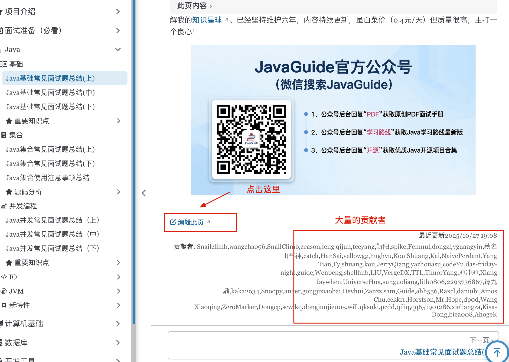

Hi, I'm Guide! Welcome to the JavaGuide open-source community.

Contributing to an open-source project is a practical way to build your skills and deepen your understanding of technical topics.

Your words and code can help developers around the world.

## Why Contribute to JavaGuide?

Open-source communities can seem difficult to join, but contributing to JavaGuide has practical benefits:

1. **Strengthen your understanding**: Reviewing or improving content encourages you to study a topic in depth. This is more effective than memorizing interview answers.
2. **Build your track record**: JavaGuide has nearly 160,000 stars. If your pull request is accepted, your name will appear in the `Contributors` list. This is useful experience to discuss in job interviews.
3. **Contributor rewards**: I occasionally send frequent contributors gifts such as headphones and mechanical keyboards, and sometimes offer cash rewards.

## How Can You Contribute?

Choose an area based on your time and experience:

- **Corrections (beginner)**: Fix typos, punctuation, or code formatting. These are simple but valuable contributions.
- **Improvements (intermediate)**: Improve existing interview answers, such as by fixing gaps in the reasoning or adding analysis of newer technical features.
- **New content (advanced)**: Add detailed answers to frequently asked interview questions or explain important technical topics based on current interview trends.

## How to Contribute

### Quick edit: Use “Edit this page”

Every page has an **Edit this page** button in the lower-left corner.

1. **Open the editor**: Go to the GitHub editor for that page.
2. **Make your changes**: Edit the content in your browser without cloning the repository.
3. **Submit your changes**: Enter a commit message and submit. GitHub will open a pull request.

This is the easiest way to fix a typo or make a small improvement.

### Fork and submit a pull request

For larger changes or new content, use the standard GitHub workflow:

1. **Fork the repository**: Click `Fork` in the top-right corner of the [original repository](https://github.com/Snailclimb/JavaGuide) to create a copy under your account.
2. **Work locally**: Clone your fork, make your changes, and push them to your fork.
3. **Open a pull request**: Click `New Pull Request` to propose merging your changes into JavaGuide's main branch.

Git skills are useful for contributing and for professional software development. These guides can help:

- [Git: Core Concepts](https://javaguide.cn/tools/git/git-intro.html)
- [Practical GitHub Tips](https://javaguide.cn/tools/git/github-tips.html)

### Open an issue to start a discussion

If you spot something that could be improved but do not have time to code, or want to propose a new topic, open an **issue**.

Here is an example issue:

> **Title**: Compare approaches for keeping Redis and a database consistent during dual writes
>
> **Description**: Cache consistency is a common challenge in interviews and production. The current documentation does not compare the main approaches. Please consider covering:
>
> 1. **Approach comparison**: Compare updating the database before deleting the cache, delayed double deletion, and asynchronous deletion by subscribing to the binlog.
> 2. **Failure scenarios**: Explain how to preserve eventual consistency during replication lag or network instability.
>
> **Offering to contribute**: I have studied this topic and prepared a comparison table and diagrams. I would like to contribute them to JavaGuide.

## Contribution Guidelines

### Follow the style guide

Use consistent punctuation and spacing between English and Chinese text. For Chinese-language contributions, see one of these guides:

- [Chinese Copywriting Guidelines](https://github.com/sparanoid/chinese-copywriting-guidelines)
- [Chinese Technical Writing Style Guide](https://github.com/yikeke/zh-style-guide/)
- [Chinese Copywriting Rules by Dawner](https://dawner.top/posts/chinese-copywriting-rules/)
- [Chinese Typesetting Guide](https://zhuanlan.zhihu.com/p/20506092)

### Write original content

You can consult other articles, but **do not copy and paste**.

Do more than collect information: explain it in your own words, make it easier to understand, and focus on the key points. Clear explanations are more useful to readers.

## Thanks

Open source is a shared effort. If you are preparing for Java interviews, start with JavaGuide. I look forward to seeing your name in the `Contributors` list.
