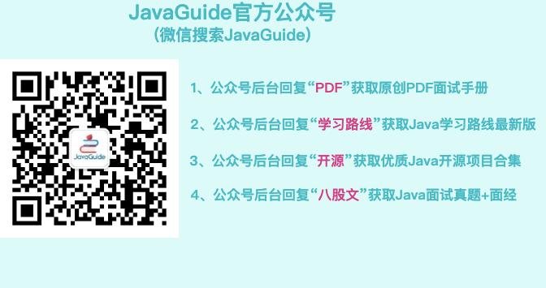

## Does JavaGuide Support RSS?

Yes! Subscribe to the site's RSS feed to receive the latest updates.

## Is There a PDF Version of JavaGuide?

JavaGuide is continuously updated, so there is no PDF version that stays fully in sync with the site. If you would like a PDF, consider **the JavaGuide Interview Crash Course**, a condensed summary of the site's content.

To get the **JavaGuide Interview Crash Course** for free, reply **PDF** to my official WeChat account. You will also receive several other high-quality interview handbooks at no cost.

## What Does JavaGuide's High Star Count Mean?

At present, [JavaGuide](https://github.com/Snailclimb) is one of the most-starred projects in the Java ecosystem and has topped GitHub Trending several times.

Still, there is not much to boast about. Tutorials are not necessarily as substantial as other projects, and they have a broad audience. Many people star a tutorial because they find it useful, much like bookmarking it. Excellent frameworks may have only a few thousand stars. So star counts alone do not say much—take them with a grain of salt.

While maintaining this project, I have also heard criticism such as: “It's just a Markdown project, not worth much, and an embarrassment to the country!”

Comments like that do not affect me. I'll keep improving JavaGuide and making it better. Many projects from around the world are written entirely in Markdown, including the Awesome lists and job-search and interview guides. Actions speak for themselves!

Collaboration is an important part of open source. If you open-source a project but stop maintaining it and ignore issues and pull requests, there is little value in open-sourcing it.

## Will JavaGuide Be Published as a Print Book?

The short answer is: **I am not planning to publish a book for now.**

About a year after JavaGuide started, publishers contacted me about writing a book. I politely declined because I felt I needed more experience. The project has become more well known over the years, and more publishers have reached out, but I have declined each offer.

**Writing a book could bring recognition and some income. Why not do it?**

- I am not satisfied with all of JavaGuide's content yet, and it is still being maintained. You can see this in the [commit history](https://github.com/Snailclimb/JavaGuide/commits/main).
- The open-source version is easier to maintain and update, and makes it easier for more people to contribute. That was one of my original reasons for starting the project.
- I consider publishing a book a serious undertaking, and I do not feel ready yet.
- My time is limited. I have a full-time job, run a [Knowledge Planet](https://javaguide.cn/about-the-author/zhishixingqiu-two-years.html) for some extra income, and maintain JavaGuide.
- ……

I have been quietly improving JavaGuide over the years and hope it continues to get better and help more people. Contributions are welcome!

## Why Are Some JavaGuide Articles Paid?

There are a very small number of paid articles on JavaGuide—fewer than ten—which is only a tiny fraction of the site's content.

These articles are exclusive to the [Knowledge Planet](https://javaguide.cn/about-the-author/zhishixingqiu-two-years.html) community. They help introduce readers to the community and have little effect on the overall reading experience.

I know readers dislike aggressive marketing, so I try to keep it in check. I do not exploit readers or sell anxiety; I simply earn a little extra to improve my family's quality of life.

**I put care into the content and sincerely hope it helps others.**
