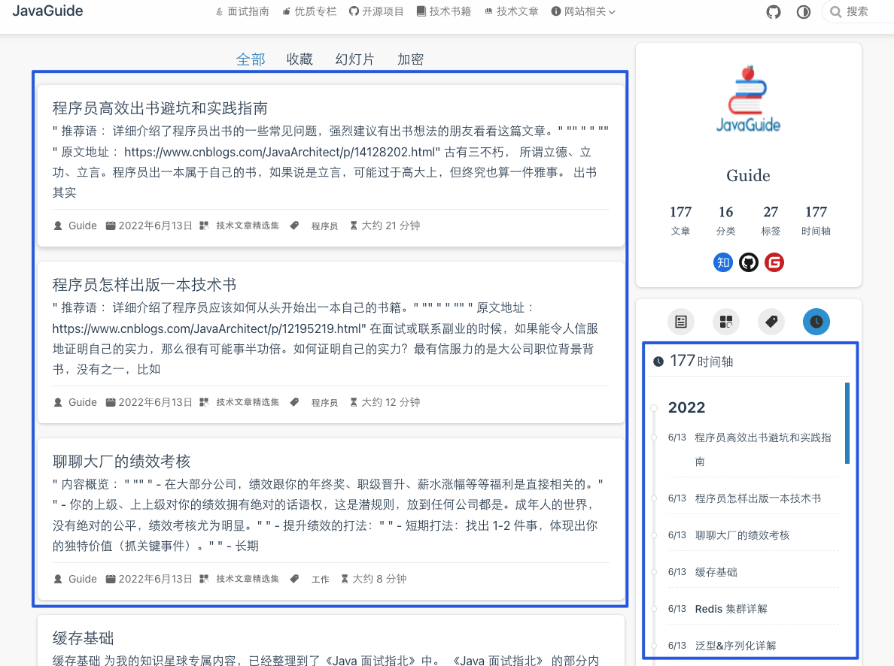

The project is updated continuously, so this page does not list individual content changes.

You can follow the latest site updates through the [RSS feed](https://javaguide.cn/feed.json) or browse the newest articles at [https://javaguide.cn/article/](https://javaguide.cn/article/).

This page records a few important milestones:

- [2022-06-13](https://github.com/Snailclimb/JavaGuide/commit/83efb36fb56d197f2c4b471084b884c6a4f23e37): Improved the site's layout and styling.
- [2022-04-09](https://github.com/Snailclimb/JavaGuide/commit/618477f96c4a976cfe5a3bba2f646c0d20e3137e): Added a [curated list of technical books](https://javaguide.cn/books/).
- [2021-03-13](https://github.com/Snailclimb/JavaGuide/commit/5c45af9c7a7cff0d3bc905b09b3bc42f2ee8a88a): Added a [curated list of open-source projects](https://javaguide.cn/open-source-project/).
- [2021-03-03](https://github.com/Snailclimb/JavaGuide/commit/827996e7722fd51718863d4bee156a8c6c759ff5): Removed some developer tool content.
- [2021-03-03](https://github.com/Snailclimb/JavaGuide/commit/5a5f8ccb3bfb8d6ba8ac41295f1a1e4555395260): Updated the vuepress-theme-hope theme from version 1.x to 2.x, improving site performance.
- [2021-11-09](https://github.com/Snailclimb/JavaGuide/commit/dc45389934b7763f4f9789168f71c72ef303d3c4): Rebuilt the entire project with VuePress to improve the reading experience.
