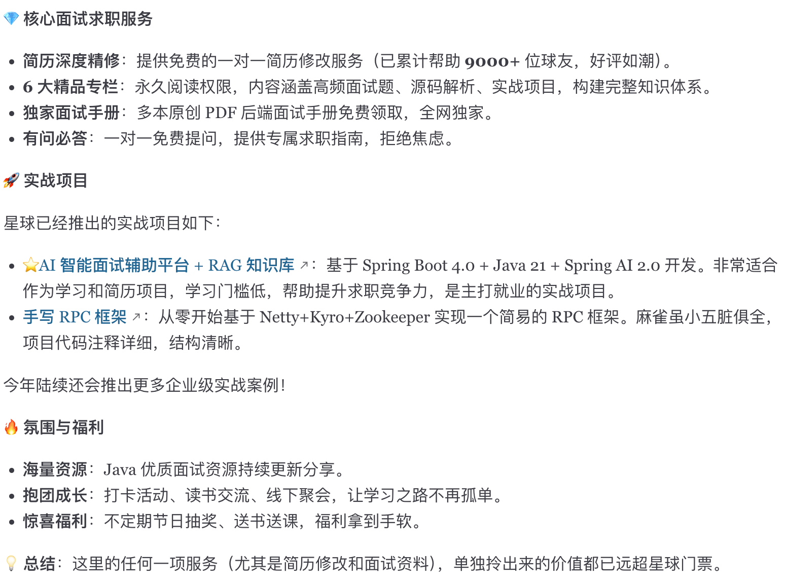

I graduated from university in 2019. While preparing for interviews in my third year, I open-sourced JavaGuide and shared all the notes I had made during my interview preparation.

The idea for JavaGuide came from a period when I felt lost in my own studies. I wanted to use this open-source project to help people who run into difficulties while learning Java or preparing for interviews.

- **For Java beginners:** This guide provides a detailed learning path and a clear overview of the Java knowledge landscape. After studying a topic through a video or book, you can find a summary here to help you master it.
- **For more experienced Java developers:** This guide is better suited to reviewing concepts and preparing for interviews. It can help you focus on the right topics.

**The site is fully open source and maintained by its community, which helps keep the content useful and high quality.** If you would like to help maintain JavaGuide, see the [contribution guidelines](./contribution-guideline.md).

JavaGuide means more to me than it does to people who have learned from it or used it to get a job offer. Honestly, sometimes it feels like watching my child grow up, and I have cared for it along the way. Maintaining it has taken a lot of time, but I think it has been worthwhile and meaningful.

Still, do not count on luck to pass an interview. You need solid skills. **I hope this guide helps you find direction as you learn Java, rather than serving only as interview prep.**

JavaGuide cannot cover every interview topic, especially for companies such as Alibaba and Meituan, whose interviews go into considerable depth. Study the topics relevant to your target companies, read interview reports to find gaps, quiz yourself regularly, and reflect on what you learn.

You’ve got this!

## Official Knowledge Planet Community

If you are preparing for interviews, I highly recommend the [Java interview community](../about-the-author/zhishixingqiu-two-years.md) I created. It offers plenty of practical content and a supportive learning environment.

Here are some of the community's services (click the image below for more details):

## Project Details

- The [online guide](https://javaguide.cn) is built with VuePress and the [vuepress-theme-hope](https://github.com/vuepress-theme-hope/vuepress-theme-hope) theme.
- The project's Markdown follows the [GitHub Markdown format](https://guides.github.com/features/mastering-markdown/). Emoji references come from the [Emoji Cheat Sheet](https://www.webpagefx.com/tools/emoji-cheat-sheet/).
- The badges under the logo are generated with [Shields.io](https://shields.io/).

## Contributors

[View all JavaGuide contributors here.](https://github.com/Snailclimb/JavaGuide/graphs/contributors) Thank you for making JavaGuide better! If you ever visit Wuhan, let me know—I'll treat you to a meal and show you around.
