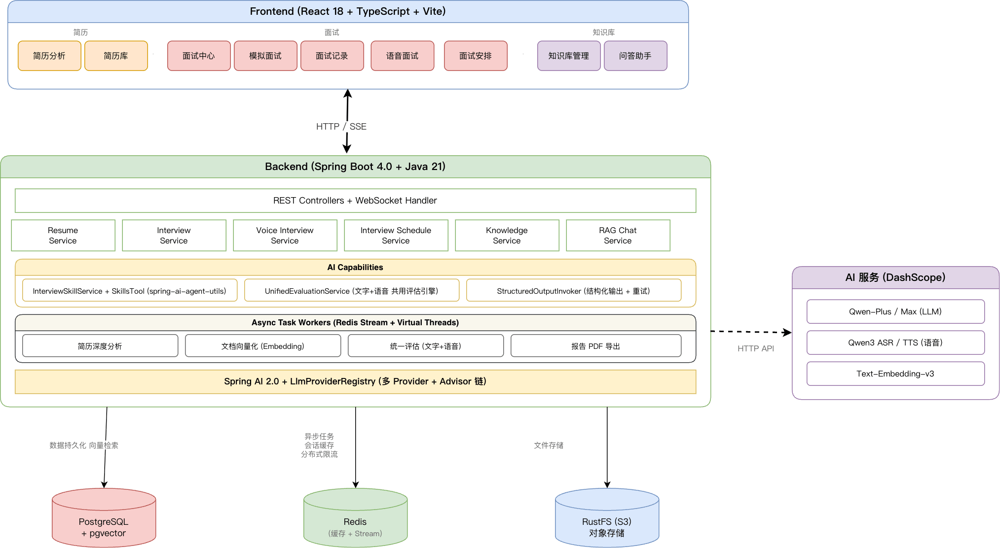

For Spring Boot developers, the question is no longer whether Java can be used to build AI applications. First decide whether your project needs model integration, RAG, Agent orchestration, or model execution on the JVM.

These projects address different problems. Spring AI and LangChain4j focus on model and application integration. AgentScope, LangGraph4j, and Embabel focus on Agent execution and orchestration. DJL supports model inference and training. Compare projects at the same layer before choosing one.

## Core Frameworks

### Spring AI

[Spring AI](https://github.com/spring-projects/spring-ai) is Spring's framework for AI applications. It provides Spring-style abstractions for integrating models, vector databases, and tool calling.

It fits naturally into existing Spring Boot projects and provides abstractions for:

- **Model interaction (`ChatClient`)**: A unified interface for models such as OpenAI, Ollama, and Google Gemini.
- **Prompts**: Structured management of prompts sent to models.
- **Retrieval-augmented generation (RAG)**: Connect external knowledge bases through abstractions such as `VectorStore`.
- **Function calling**: Let a model invoke methods defined in a Java application.
- **Memory (`ChatMemory`)**: Manage conversation history across turns.

Documentation: <https://spring.io/projects/spring-ai#learn>.

### Spring AI Alibaba

[Spring AI Alibaba](https://github.com/alibaba/spring-ai-alibaba) extends the Spring AI ecosystem and is designed for multi-Agent systems and workflow orchestration. Its architecture has three layers:

- **Agent Framework**: An Agent development framework based on the ReAct design, with automatic context engineering and human interaction.
- **Graph**: A low-level workflow and multi-Agent coordination framework. It provides the runtime for the Agent Framework and supports complex application orchestration.
- **Augmented LLM**: Builds on Spring AI abstractions to provide models, tools, multimodal components such as MCP, and vector storage.

The project also has two platform-oriented components:

- **Admin**: An Agent platform with visual development, observability, evaluation, MCP management, and integration with low-code platforms such as Dify. It also supports DSL migration.
- **A2A (Agent-to-Agent)**: Supports communication between Agents and distributed coordination through Nacos.

Documentation: <https://java2ai.com/>.

### LangChain4j

[LangChain4j](https://github.com/langchain4j/langchain4j) is a community-maintained Java framework for LLM applications. It provides unified APIs for models, embeddings, vector stores, tool calling, and RAG.

It suits projects that need to switch between models or vector databases, or that want a framework independent of a specific vendor. Large systems may still need additional engineering structure, governance, and observability from their existing infrastructure.

Documentation: <https://docs.langchain4j.dev/>.

### AgentScope

[AgentScope](https://github.com/agentscope-ai/agentscope-java) is a multi-Agent framework that supports ReAct reasoning, tool calling, memory management, and collaboration among Agents. It has both Python and Java versions.

Its focus differs from Spring AI Alibaba:

- **AgentScope Java** is designed around the Agentic paradigm. It emphasizes Agent autonomy, ReAct reasoning loops, and complex collaboration among multiple Agents.
- **Spring AI Alibaba** focuses more on Workflow orchestration. Built on the Spring AI ecosystem, it integrates AI capabilities as tools into predefined business flows.

Documentation: <https://java.agentscope.io/zh/intro.html>.

### Other Frameworks and Tools

- [Solon-AI](https://github.com/opensolon/solon-ai): A Java AI framework for LLMs, RAG, MCP, and Agents. It supports Java 8 through Java 25 and works with Spring Boot, JFinal, Vert.x, Quarkus, and other frameworks.
- [Agent-Flex](https://github.com/agents-flex/agents-flex): A lightweight Java framework for LLM applications, with model integration, prompts, tools, memory, embeddings, and vector storage.
- [Smile](https://github.com/haifengl/smile): A machine-learning library for Java and Scala.
- [LangGraph4j](https://github.com/langgraph4j/langgraph4j): A Java library for stateful, multi-Agent applications. It integrates with LangChain4j and Spring AI and focuses on Agent execution graphs and state management, rather than model integration.
- [Embabel Agent](https://github.com/embabel/embabel-agent): A JVM Agent framework that combines LLM interactions, Java or Kotlin code, and domain models. It can plan execution paths dynamically based on goals.
- [Deep Java Library (DJL)](https://github.com/deepjavalibrary/djl): A Java deep-learning framework that is decoupled from the underlying engine and can load, train, and deploy models in Java applications. It addresses model inference and training, not RAG or Agent orchestration.

### Comparison

| Framework             | Key features                                                                                                                                                   | Suitable for                                                                                                    |
| --------------------- | -------------------------------------------------------------------------------------------------------------------------------------------------------------- | --------------------------------------------------------------------------------------------------------------- |
| **Spring AI**         | Spring abstractions for models, vector stores, tools, memory, RAG, observability, and structured output; emphasizes portability and modularity.                | Adding AI features to existing Spring Boot applications.                                                        |
| **Spring AI Alibaba** | Production stack for Agentic applications, workflows, and multi-Agent systems: Agent Framework, Graph Runtime, and Admin/Studio; supports MCP, A2A, and Nacos. | Multi-Agent orchestration, complex workflows, platform governance, and migration, including visual development. |
| **LangChain4j**       | Community framework with a unified API for models and vector stores, Agents, tools, RAG, and MCP; integrates with Spring, Quarkus, and Helidon.                | Rapid prototyping, flexibility, and switching models quickly.                                                   |
| **Solon-AI**          | Supports Java 8–25 and the full LLM, RAG, MCP, Agent, and AI Flow stack; embeddable in multiple frameworks.                                                    | Legacy or multi-framework environments that need broad compatibility.                                           |
| **Agent-Flex**        | Lightweight LLM, prompt, tool, MCP, memory, embedding, vector-store, and document-processing features; observability through OpenTelemetry.                    | LLM applications that need quick integration and few dependencies.                                              |
| **AgentScope Java**   | Agent-native ReAct, tools, memory, multi-Agent support, MCP and A2A with Nacos, reactive streams with Reactor, and serverless deployment with GraalVM.         | Autonomous Agents and distributed multi-Agent applications requiring production control and performance.        |

## Projects in Practice

### AI Interview Platform

[interview-guide](https://github.com/Snailclimb/interview-guide) uses Spring Boot 4.0, Java 21, Spring AI, PostgreSQL, pgvector, RustFS, and Redis. It supports resume analysis, AI mock interviews, and RAG retrieval from a knowledge base. It is a practical learning and portfolio project with a relatively low barrier to entry.

**System architecture:**

> **Note:** The architecture diagram was created in draw.io and exported as SVG. It may not display correctly in GitHub's dark mode.

### AI Workflow Orchestration System

[PaiAgent](https://github.com/itwanger/PaiAgent) is a visual AI workflow platform. Drag and drop model and processing nodes to define an execution flow that coordinates multiple models.

**System architecture:**

