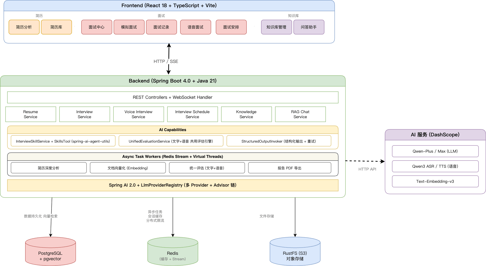
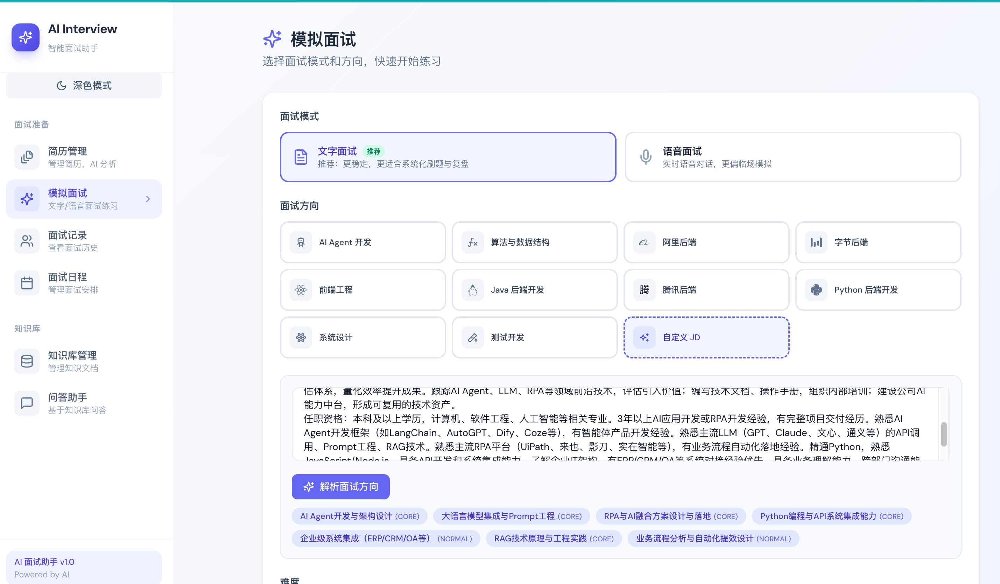
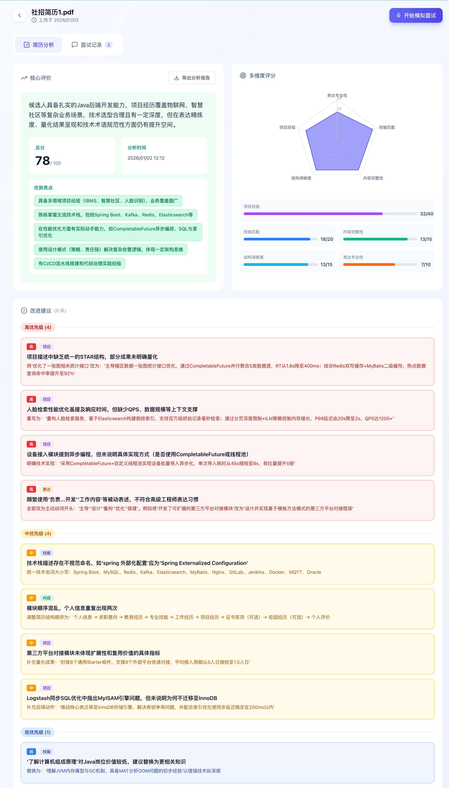
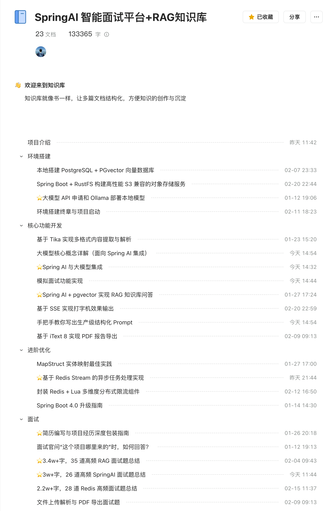

## ⭐️ Recommended RAG Project

Here's an open-source hands-on project built with Spring Boot 4.0, Java 21, Spring AI, PostgreSQL, pgvector, RustFS, and Redis. It includes resume analysis, AI mock interviews, and RAG-based knowledge base search. It's suitable as a learning and portfolio project, with a gentle learning curve.

**System architecture:**

**Screenshots:**

The full source code is free and open source, with no Pro or paid edition.

**Project repositories** (Stars are welcome):

- GitHub: <https://github.com/Snailclimb/interview-guide>
- Gitee: <https://gitee.com/SnailClimb/interview-guide>

The detailed project introduction and learning tutorial are available to Knowledge Planet members: [Spring AI Interview Assistant and RAG Knowledge Base](https://javaguide.cn/zhuanlan/interview-guide.html).

The tutorial is complete and contains more than **180,000 words**:

