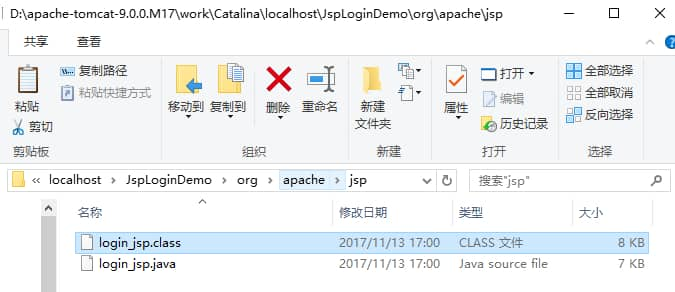

## Servlet Overview

> Note: J2EE is a historical name. It was later renamed Java EE, and the current specification is Jakarta EE. This article focuses on the traditional Servlet/JSP programming model.

In Java Web applications, a **Servlet** receives user requests through `HttpServletRequest`, handles them in methods such as `doGet()` and `doPost()`, and returns responses through `HttpServletResponse`. A Servlet can also define initialization parameters for its own use. In a non-distributed environment, a Servlet container usually uses one instance for **each Servlet declaration**; multiple declarations of the same Servlet class may still result in multiple instances. The container calls `init()` during initialization and `destroy()` when the instance is taken out of service. A Servlet can be declared with `@WebServlet`, in `web.xml`, or through a programmatic API. One Servlet declaration can also map to multiple URLs. The container may execute `service()` concurrently on multiple threads for the same instance, so do not store mutable per-request state in instance fields.

## How Do Servlets Differ from CGI?

### Limitations of CGI

1. The server must start a system process to run a CGI program for each request. Frequent requests create significant overhead.
2. A CGI program must be loaded and run for each request, which also creates significant overhead.
3. Network protocol handling and encoding code must be written repeatedly, which takes time.

### Advantages of Servlets

1. The server starts only one operating-system process and loads one JVM, greatly reducing overhead.
2. When multiple requests need the same processing, the class only needs to be loaded once, which also reduces overhead.
3. Dynamically loaded classes can share network protocol handling and request decoding, reducing duplicated work.
4. A Servlet can interact directly with a Web server, unlike a regular CGI program. Servlets can also share data across programs, making features such as database connection pools easier to implement.

Sun Microsystems released Servlet technology in 1996 to compete with CGI. A Servlet is a special Java program, and a Java-based Web application usually contains one or more Servlet classes. A Servlet cannot create and run itself; it runs in a Servlet container. The container passes user requests to the Servlet and returns its response to the user. A Servlet is often associated with one or more JSP pages. CGI was often criticized for performance overhead, but FastCGI addressed many of those efficiency concerns long ago. In an interview, avoid dismissing CGI without qualification; many familiar websites use CGI technology.

Reference: _Java Web Integration Development: The Return of the King_, p. 7.

## What Methods Does the Servlet Interface Define? What Is the Servlet Lifecycle?

The Servlet interface defines five methods. **The first three are related to the Servlet lifecycle:**

- `void init(ServletConfig config) throws ServletException`
- `void service(ServletRequest req, ServletResponse resp) throws ServletException, java.io.IOException`
- `void destroy()`
- `java.lang.String getServletInfo()`
- `ServletConfig getServletConfig()`

**Lifecycle:** The Servlet lifecycle begins when the Web container loads and instantiates the Servlet. The container initializes it by calling **`init()`**. When a request arrives, the container calls **`service()`**, which dispatches to a method such as **`doGet()` or `doPost()`** as appropriate. When the server shuts down or the application is unloaded, the container destroys the Servlet instance by calling **`destroy()`**. The `init()` and `destroy()` methods are called once per instance, while `service()` is called for each request to the Servlet. If the Servlet uses resources that must be initialized or released, put the initialization code in `init()` and the cleanup code in `destroy()` instead of repeating it for each request.

Reference: _Java Web Integration Development: The Return of the King_, p. 81.

## What Is the Difference Between GET and POST?

This topic has been widely discussed on Zhihu: <https://www.zhihu.com/question/28586791>.


GET and POST are two commonly used HTTP request methods. They have different semantics and are suited to different purposes. The main differences are:

- **Semantics:** GET retrieves a representation of a target resource and is a safe, idempotent method. POST asks the target resource to process the request content according to its own semantics. It is often used to create resources, submit data, or trigger operations, and is not inherently idempotent.
- **Format:** GET query parameters are usually placed in the URL query string. POST data is usually sent in the request body and may use media types such as `application/x-www-form-urlencoded`, `multipart/form-data`, or `application/json`. The HTTP specification does not set a universal fixed size limit for URLs or POST bodies; practical limits are set by browsers, servers, gateways, and other components.
- **Caching:** GET responses are cacheable by default, subject to response headers such as `Cache-Control`. POST responses are not categorically uncacheable, but the server must explicitly provide caching information, and this is uncommon in practice.
- **Security:** Neither GET nor POST is inherently secure. HTTP is plaintext, so the URL, headers, and body can all be intercepted or modified. Use HTTPS to encrypt data in transit. In some situations, GET parameters are more likely to expose sensitive data because URLs may be recorded in browser history, server logs, and proxy logs. For private data, POST with a request body is generally preferred.

Choose GET or POST based on the standard semantics of the HTTP method. Designing every request as POST is technically possible, but gives up advantages of GET in caching, safe retries, and intermediary behavior. “The team agreed on it” is not sufficient justification by itself.

## When Are `doGet()` and `doPost()` Called?

When a form's `method` attribute is `get`, the Servlet calls `doGet()`. When it is `post`, the Servlet calls `doPost()`.

## What Is the Difference Between Forwarding and Redirecting?

**Forwarding is a server-side operation; redirecting is a client-side operation.**

**Forwarding**

Forwarding is performed using the `forward(HttpServletRequest request, HttpServletResponse response)` method of a `RequestDispatcher`. Obtain a `RequestDispatcher` with `HttpServletRequest#getRequestDispatcher()`. For example, the following code forwards the request to `login_success.jsp`:

```java
request.getRequestDispatcher("login_success.jsp").forward(request, response);
```

**Redirecting**

The server redirects by returning a 3xx status code and a `Location` response header. The client then makes a request to the new URL. In a Servlet, use `HttpServletResponse#sendRedirect()`, or set the status and `Location` header manually. Historically, 301, 302, and 303 may change a follow-up POST request to GET. When the request method must be preserved, use 307 or 308 as appropriate.

1. **URL shown in the address bar**

   With forwarding, the server directly accesses the target resource, reads its response, and sends it to the browser. The browser does not know where the content came from, so its address bar still shows the original URL.

   With redirection, the server returns a status code telling the browser to make a new request. The address bar shows the new URL.

2. **Sharing data**

   With forwarding, the source and target pages can share data stored in the request.

   With redirection, they cannot share the original request data.

3. **Typical use cases**

   Forwarding is commonly used to route a user to a role-specific module after login.

   Redirection is commonly used to return to the home page after logout or to navigate to another website.

4. **Efficiency**

   Forwarding is generally more efficient because it does not require a second client request.

   Redirection is generally less efficient because the client makes another request.

## Automatic Refresh (Refresh)

Some browsers support the non-standard `Refresh` response header for delayed refreshes or redirects. A Servlet can set it through `HttpServletResponse`:

```java
response.setHeader("Refresh", "5; url=http://localhost:8080/servlet/example.htm");
```

The delay is in seconds. Because `Refresh` is not a standard HTTP response header, do not use it instead of a standard 3xx redirect. Page refreshes can also be implemented on the frontend, depending on the requirements.

## Servlet Thread Safety

**Servlets are not inherently thread-safe. Concurrent reads and writes can cause race conditions.** Avoid defining mutable fields such as `name`; keep per-request variables inside `doGet()` or `doPost()`. A `synchronized(name) {}` block can address some concurrency issues, but it can make requests wait and is generally not a good solution.

Concurrent reads and writes of Servlet instance fields can cause race conditions. Concurrent reads alone do not cause this problem. Read-only fields in a Servlet should preferably be declared `final`.

Reference: _Java Web Integration Development: The Return of the King_, p. 92.

## What Is the Relationship Between JSP and Servlets?

A Servlet is a special Java program that runs in the server's JVM and uses server capabilities to return content to a browser. JSP is essentially a simpler way to write a Servlet. The server translates a JSP into a Java program similar to a Servlet, which can simplify page generation.

The main difference is that a Servlet's application logic is written in a Java file and kept separate from presentation-layer HTML. A JSP file, by contrast, can combine Java and HTML in a `.jsp` file. It is sometimes said that “a Servlet writes HTML in Java, while a JSP writes Java in HTML,” but this is an oversimplification. JSP is more suited to the view, while Servlets are more suited to control logic. In the MVC pattern, JSP can act as the view and a Servlet as the controller.

## How Does JSP Work?

A JSP container translates a JSP page into a Servlet implementation class and compiles it. For HTTP, the generated class implements `HttpJspPage`, which extends `JspPage`. With on-demand compilation, translation and compilation occur on the first request; a container may also precompile JSPs, so this does not always happen on the first request. Generated Java source and class files are usually stored in the container's work directory. The example below describes on-demand compilation.

Suppose the `JspLoginDemo` project contains a JSP file named `login.jsp`. After deploying the project to the server and requesting the page for the first time, the following two files appear in the directory:

The `.class` file is the Servlet corresponding to the JSP. The container runs this compiled class to respond to the client. On later requests to `login.jsp`, Tomcat calls the class file instead of recompiling the JSP.



With on-demand compilation, the first request must perform translation and compilation, so it is usually slower than later requests. If the generated class file is deleted, the container recompiles the JSP when needed.

During Web development, JSP files are often changed. Tomcat can detect changes to a JSP and recompile it on the next request without restarting Tomcat. This automatic change detection is enabled by default and adds a small amount of overhead. It can be disabled in `web.xml` when deploying the Web application.

Reference: _Java Web Integration Development: The Return of the King_, p. 97.

## What Are the Nine JSP Implicit Objects and What Do They Do?

[JSP Implicit Objects — CSDN Blog](http://blog.csdn.net/qq_34337272/article/details/64310849)

JSP provides nine implicit objects:

- `request`: Encapsulates the client request, including parameters from GET or POST requests.
- `response`: Encapsulates the server's response to the client.
- `pageContext`: Provides access to other objects.
- `session`: Encapsulates the user's session.
- `application`: Encapsulates the server's application environment.
- `out`: The output stream used to write the server response.
- `config`: The Web application's configuration object.
- `page`: The JSP page itself (equivalent to `this` in a Java program).
- `exception`: Encapsulates an exception thrown by the page.

## What Are the Main Methods of the Request Object?

- `setAttribute(String name, Object value)`: Set a request attribute named `name`.
- `getAttribute(String name)`: Return the attribute specified by `name`.
- `getAttributeNames()`: Return an enumeration of all request attribute names.
- `getCookies()`: Return the client's cookies as an array of `Cookie` objects.
- `getCharacterEncoding()`: Return the character encoding used by the request.
- `getContentLength()`: Return the request body size in bytes, or -1 if the length is unknown or exceeds the `int` range. Use `getContentLengthLong()` for large requests.
- `getHeader(String name)`: Return the value of the specified HTTP header.
- `getHeaders(String name)`: Return an enumeration of all request header values with the specified name.
- `getHeaderNames()`: Return the names of all request headers.
- `getInputStream()`: Return the input stream used to read request data.
- `getMethod()`: Return the HTTP method used by the client.
- `getParameter(String name)`: Return the value of the request parameter specified by `name`.
- `getParameterNames()`: Return an enumeration of all request parameter names.
- `getParameterValues(String name)`: Return all values for the request parameter specified by `name`.
- `getProtocol()`: Return the protocol used by the client to send the request.
- `getQueryString()`: Return the query string.
- `getRequestURI()`: Return the URI path from the protocol name up to, but not including, the query string.
- `getRemoteAddr()`: Return the client's IP address.
- `getRemoteHost()`: Return the client's hostname.
- `getSession()`: Return the session associated with the request, creating one if necessary.
- `getSession(boolean create)`: Return the session associated with the request; if `create` is `false` and no session exists, return `null`.
- `getServerName()`: Return the server's name.
- `getServletPath()`: Return the path to the requested Servlet.
- `getServerPort()`: Return the server's port number.
- `removeAttribute(String name)`: Remove the named request attribute.

## What Is the Difference Between `request.getAttribute()` and `request.getParameter()`?

`getParameter()` reads parameters submitted by the client, such as URL query parameters or parsed form fields. It returns a `String`. Use `getParameterValues()` when a parameter can have multiple values.

`getAttribute()` reads an object that server-side code placed on the request with `setAttribute()`. It returns an `Object`. During a server-side forward, the components handle the same request object and can share request attributes. A client redirect creates a new request and does not preserve the original request's attributes. The container is not copying a block of memory between pages.

## What Is the Difference Between the JSP `include` Directive and Action?

**The `include` directive:** JSP can include another file using the `include` directive. The included file can be a JSP, HTML, or text file. It is treated as part of the current JSP and compiled with it. Syntax:

```jsp
<%@ include file="relative-url" %>
```

**The `include` action:** The `<jsp:include>` action element includes a static or dynamic resource in the page being generated. Syntax:

```jsp
<jsp:include page="relative-URL" flush="true" />
```

## The Nine JSP Implicit Objects, Seven Actions, and Three Directives

[Summary of the Nine JSP Implicit Objects, Seven Actions, and Three Directives](http://blog.csdn.net/qq_34337272/article/details/64310849)

## What Are the Four JSP Scopes?

The four JSP scopes are `page`, `request`, `session`, and `application`:

- **`page`**: Objects and attributes associated with one page.
- **`request`**: Objects and attributes associated with a Web client request. A request may span multiple pages and involve multiple Web components. Use this scope for temporary data needed while rendering a page.
- **`session`**: Objects and attributes associated with a user's session with the server. Put user-specific data in that user's session.
- **`application`**: Objects and attributes associated with the entire Web application. It is a global scope shared across pages, requests, and sessions.

## How Should a Servlet Handle Concurrent Requests?

Historically, JSP offered `<%@ page isThreadSafe="false" %>`, and Servlets offered the `SingleThreadModel` marker interface. `SingleThreadModel` has been deprecated since Servlet 2.4 and was removed in Jakarta Servlet 6.0. It also does not guarantee thread safety for sessions or static state, so it should not be used as a modern solution.

The right approach is to keep Servlets stateless where possible and store mutable per-request data in local variables, not Servlet instance fields. If state must be shared, use suitable concurrency controls or thread-safe data structures, and keep critical sections small.

## What Techniques Can Be Used for Session Tracking?

1. **Cookies**

   Send a cookie to the client:

   ```java
   Cookie cookie = new Cookie("name", "value"); // Create a cookie
   cookie.setMaxAge(60 * 60 * 24); // Set the maximum age to one day
   response.addCookie(cookie); // Add the cookie to the HTTP response
   ```

   Read a cookie from the client:

   ```java
   String name = "name";
   Cookie[] cookies = request.getCookies();
   if (cookies != null) {
       for (Cookie cookie : cookies) {
           if (name.equals(cookie.getName())) {
               // Get the cookie value
               cookie.getValue();
           }
       }
   }
   ```

   **Advantages:** Data can persist without using server-side storage. Cookies use a simple text-based key–value format.

   **Disadvantages:** Size is limited, users can disable cookies, and client-side storage has security risks.

2. **URL rewriting**

   Add session information as a request parameter or append a unique session ID to the URL.

   **Advantage:** It can work when cookies are disabled.

   **Disadvantages:** URLs must be encoded, all pages must be generated dynamically, and users cannot rely on previously recorded URLs.

3. **Hidden form fields**

   ```html
   <input type="hidden" name="session" value="..." />
   ```

   **Advantage:** They can be used when cookies are disabled.

   **Disadvantage:** Every page must be the result of a form submission.

4. **`HttpSession`**

   `HttpSession` is not necessarily created just because a user visits a site for the first time. The container creates one when application code calls `HttpServletRequest#getSession()`, or when a framework or JSP feature requests a session for the current request. Use `setAttribute()` and `getAttribute()` to store and retrieve session attributes. Session data is managed by the server and may be stored in memory, a distributed store, or persistent storage. Avoid storing very large objects. For distributed deployments or session persistence, attributes may also need to be serializable, depending on the container and session storage solution.

## What Is the Difference Between Cookies and Sessions?

Cookies and sessions both help track a browser user's state, but they are used differently.

**Cookies are commonly used to store user information.** For example: (1) A cookie can store information about a logged-in user, so a site can prefill basic details on the next visit. (2) A site may keep a user signed in by storing a token in a cookie and looking up the user from the token later; for security, a token is often rotated when the user signs in again. (3) After signing in once, a user may visit other pages without signing in again. **A session primarily lets the server keep track of a user's state.** A shopping cart is a typical example. Since HTTP is stateless, the server does not know which user is adding an item. After creating a `Session` for that user, it can identify and track them.

Cookie data is stored on the client (usually the browser), while session state is generally managed by the server.

However, server-managed session state is not automatically more secure. A common session still relies on a cookie to carry a session identifier, which can be replayed if stolen. Session cookies should use high-entropy, opaque identifiers, be sent over HTTPS, and be configured with appropriate `Secure`, `HttpOnly`, `SameSite`, `Path`, and `Domain` attributes. Do not put passwords, card numbers, or other sensitive business data directly in a cookie. Encryption alone does not replace integrity protection, expiration, revocation, and server-side authorization checks.
