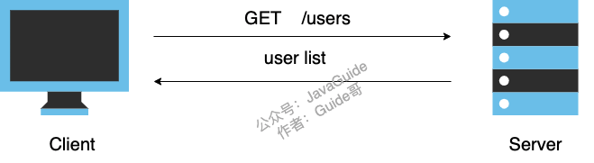
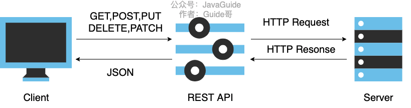

This article introduces RESTful API concepts that backend developers should know.

Before discussing RESTful APIs, we should first answer: **What is an API?**

## What Is an API?

**API** stands for **Application Programming Interface**.

In backend development, much of our work involves providing APIs for the frontend or other backend services, such as an API for querying user data.



However, APIs are not limited to interfaces exposed by backend systems. Methods provided by a framework are APIs too.

Here are a few examples 🌰:

1. When you search for a product on an e-commerce site, the frontend calls a backend API for product search.
2. When writing a Java program with the JDK, you use its I/O APIs to read user input.
3. …

You can think of an API as a bridge that allows programs to communicate. At its core, an API is a function. Using an API also follows rules defined by its provider, such as the formats of input and output data.

## What Is a RESTful API?

A **RESTful API**, often called a **REST API**, is an API built around REST. We will explain REST later; it involves several concepts.

Articles about RESTful APIs can be difficult to understand because some REST concepts are abstract. But the RESTful API practices used in everyday development are actually simple and easy to summarize.

For example, if I give you these two APIs, you can immediately tell what they do. That is one strength of RESTful APIs:

```plain
GET    /classes: List all classes
POST   /classes: Create a class
```

**With a RESTful API, the URL and HTTP method tell you what the endpoint does, and the HTTP status code tells you the result of the request.**

When designing APIs, we should meet at least the basic RESTful conventions: use nouns where possible, use `POST` to create resources, and use `DELETE` to remove them. For example, `GET /notes/{id}` retrieves a specific note.

## Understanding REST

**REST** stands for `REpresentational State Transfer`.

The phrase is often translated into Chinese as “representational state transfer.” More plainly, REST describes how a client moves an application from one state to another through a resource's representation. If that still sounds abstract, keep reading; the examples below should make REST clearer.

Let's look at the concepts one by one. You do not need to understand every detail to follow the API practices in the next section, but a deeper understanding will help when you discuss RESTful APIs with others.

- **Resource:** Real-world object data can be represented as resources. A resource can be a collection or an individual item. For example, `classes` represents a collection, while a particular class is an individual resource. Each resource has a URI (Uniform Resource Identifier). To retrieve it, request that URI—for example, `/classes/12` retrieves a specific class. A resource may also contain subresources, such as `/classes/{classId}/teachers`, which lists all teachers in a class.
- **Representation:** A resource is an information entity that can have different external forms. Formats such as `json`, `xml`, `image`, and `txt` are representations of the resource.
- **State transfer:** At first, this phrase may seem confusing. Put simply, the client uses a resource's representation and control information, such as links, to move the application from one state to another. HTTP methods can create, read, update, and delete resources, which may also change their state on the server. Note that HTTP is a stateless protocol: the server does not need to retain the client's session state between requests.

Putting these ideas together, a RESTful architecture has three characteristics:

1. Each URI identifies a resource.
2. The client and server exchange a representation of the resource, such as `json`, `xml`, `image`, or `txt`.
3. The client uses specific HTTP methods to operate on server resources, transferring the application's representational state.

## RESTful API Conventions



### HTTP Methods

- `GET`: Retrieve a specific resource from the server. For example, `GET /classes` retrieves all classes.
- `POST`: Ask the target resource to process the request according to its semantics; commonly used to create resources. For example, `POST /classes` creates a class.
- `PUT`: Create or replace the current state of the target resource. The client usually supplies the complete updated resource. For example, `PUT /classes/12` updates class 12.
- `DELETE`: Remove the association between the target URI and its current resource functionality. For example, `DELETE /classes/12` deletes class 12.
- `PATCH`: Update a resource on the server. The client supplies the properties to change, so this is generally a partial update. It is less commonly used, so no example is included here.

`GET` is safe and idempotent. `PUT` and `DELETE` are idempotent. `PATCH` is not guaranteed to be idempotent by default.

### Paths (Endpoint Naming)

A path, also called an endpoint, is the URL of a specific API. Common conventions include:

1. **Resource-oriented HTTP API paths generally use nouns, often in the plural.** This is a common URI naming convention, not a requirement of REST. If an operation, such as calculation or translation, is not easy to model as a resource, a verb may be appropriate. For example: `GET /calculate?param1=11&param2=33`.
2. **Avoid uppercase letters. Use hyphens instead of underscores.** For example, write `invitation-code` rather than ~~`invitation_code`~~.
3. **Version APIs.** When a breaking API change is not compatible with an earlier version, you can version the URL, for example, `http://api.example.com/v1` or `http://apiv1.example.com`. Versions do not have to be numbers, although numbers are most common; dates or seasons can also work if the team agrees on a convention.
4. **Prefer nouns over verbs in endpoint paths.** RESTful APIs use HTTP methods to operate on resources (nouns) rather than encoding actions as verbs in the path.

Talk is cheap—here is a practical example. Suppose an API provides information about classes, including each class's students and teachers. The paths could look like this:

```plain
GET    /classes: List all classes
POST   /classes: Create a class
GET    /classes/{classId}: Get a specific class
PUT    /classes/{classId}: Replace a specific class
PATCH  /classes/{classId}: Partially update a specific class
DELETE /classes/{classId}: Delete a class
GET    /classes/{classId}/teachers: List all teachers in a specific class
GET    /classes/{classId}/students: List all students in a specific class
DELETE /classes/{classId}/teachers/{ID}: Delete a specific teacher from a class
```

Anti-examples:

```plain
/getAllclasses
/createNewclass
/deleteAllActiveclasses
```

Clarify the hierarchy of your resources. If the API covers schools, then `/schools` can be the top-level resource, with teachers and students as subresources: `/schools/{schoolId}/teachers` and `/schools/{schoolId}/students`.

### Filtering

When you need to add conditions to a query, it is generally best to use URL query parameters. For example, to find a class whose `state` is `active` and whose `name` is `guidegege`:

```plain
GET    /classes?state=active&name=guidegege
```

For pagination:

```plain
GET    /classes?page=1&size=10 // Page 1, 10 items per page
```

### Status Codes

**Status code ranges:**

| 2xx: Success | 3xx: Redirection      | 4xx: Client error      | 5xx: Server error         |
| ------------ | --------------------- | ---------------------- | ------------------------- |
| 200 OK       | 301 Moved permanently | 400 Bad request        | 500 Internal server error |
| 201 Created  | 304 Not modified      | 401 Unauthorized       | 502 Bad gateway           |
|              |                       | 403 Forbidden          | 504 Gateway timeout       |
|              |                       | 404 Not found          |                           |
|              |                       | 405 Method not allowed |                           |

## HATEOAS in REST

> **In Fielding's original definition of REST, HATEOAS is part of the uniform interface constraint. Many HTTP/JSON APIs called REST APIs in practice do not implement it.**

The conventions above are the basics of RESTful APIs and are the easiest to apply in everyday development. HATEOAS requires hypermedia to drive application state: responses provide links and other control information so users can discover what to do next without consulting documentation.

For example, when a user requests the root endpoint at `api.example.com`, the server might return:

```javascript
{"link": {
  "rel":   "collection",
  "href":  "https://api.example.com/classes",
  "title": "List of classes",
  "type":  "application/vnd.yourformat+json"
}}
```

The response has a `link` property that tells the client which API to call next. `rel` describes the target resource's relationship to the current context, `href` gives its path, `title` gives the link title, and `type` indicates the media type of the target representation. This kind of hypermedia API design is called [HATEOAS](https://roy.gbiv.com/untangled/2008/rest-apis-must-be-hypertext-driven).

Spring provides a library called HATEOAS that makes it easier to create APIs using this design. Related articles:

- [Using HATEOAS with Spring Boot](https://blog.aisensiy.me/2017/06/04/spring-boot-and-hateoas/)
- [Building REST Services with Spring](https://spring.io/guides/tutorials/rest/) (Spring official site)
- [An Introduction to Spring HATEOAS](https://www.baeldung.com/spring-hateoas-tutorial)
- [spring-hateoas-examples](https://github.com/spring-projects/spring-hateoas-examples/tree/master/hypermedia)
- [Spring HATEOAS](https://spring.io/projects/spring-hateoas#learn) (Spring official site)

## References

- [Fielding's dissertation: Representational State Transfer](https://ics.uci.edu/~fielding/pubs/dissertation/rest_arch_style.htm)
- [RFC 9110: HTTP Semantics](https://www.rfc-editor.org/rfc/rfc9110.html)
- [RFC 5789: PATCH Method for HTTP](https://www.rfc-editor.org/rfc/rfc5789.html)
- [RFC 8288: Web Linking](https://www.rfc-editor.org/rfc/rfc8288.html)
- <https://RESTfulapi.net/>
- <https://www.ruanyifeng.com/blog/2014/05/restful_api.html>
- <https://juejin.im/entry/59e460c951882542f578f2f0>
- <https://phauer.com/2016/testing-RESTful-services-java-best-practices/>
- <https://www.seobility.net/en/wiki/REST_API>
- <https://dev.to/duomly/rest-api-vs-graphql-comparison-3j6g>

<!-- @include: @article-footer.snippet.md -->
