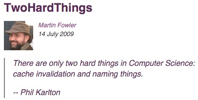
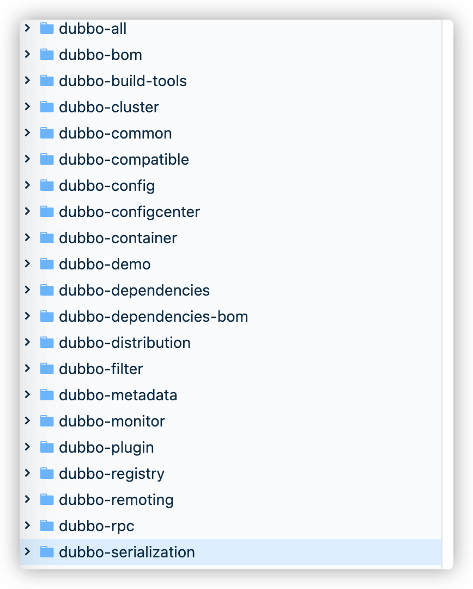

When I first started working, I often got called out in code reviews for poor variable names.

I lacked experience and had not paid much attention to naming in university projects. I thought the only thing that mattered was making the feature work.

At work, things were different. Our team cared about code quality, readability, and maintainability.

Recently, a new intern on my team was also called out in code reviews for inconsistent variable names. It reminded me of when I first joined the company.

I wrote this short guide to help others who have the same problem.

Programming already gives us plenty to worry about: naming, maintaining other people's code, writing tests, communicating with others, and more.

On Quora, nearly 5,000 programmers once voted “naming” the hardest problem in programming.

Martin Fowler, author of _Refactoring_, mentioned two of the hardest problems in computer science in [“Two Hard Things”](https://martinfowler.com/bliki/TwoHardThings.html): **cache invalidation** and **naming things**.



Fowler was quoting someone else; many similar sayings exist. In distributed systems, for example, two of the hardest problems are **maintaining message order** and **exactly-once delivery**.


Today, let's focus on **naming**.

For more examples, see my earlier article, [“Five Minutes to Code, Two Hours to Name? The Most Complete Java Naming Convention Guide”](https://mp.weixin.qq.com/s?__biz=Mzg2OTA0Njk0OA==&mid=2247486449&idx=1&sn=c3b502529ff991c7180281bcc22877af&chksm=cea2443af9d5cd2c1c87049ed15ccf6f88275419c7dbe542406166a703b27d0f3ecf2af901f8&token=999884676&lang=zh_CN#rd).

## Why Naming Matters

First, understand why naming matters in programming and how it affects our work.

**Good names matter because they act like comments: a reader can tell what a variable, method, or class does.**

In short, **readers should be able to understand what your code means from its names**. This assumes that they have basic English skills and know common programming terms.

Here is a simple example.

_Clean Code_ says:

> **Good code is its own best documentation. We should write clear code to avoid unnecessary comments.**
>
> **If the programming language is expressive enough, explain intent through the code instead of comments.**
>
> For example, replace the following code and its long comment with a function whose name describes the same intent:
>
> ```java
> // check to see if the employee is eligible for full benefits
> if ((employee.flags & HOURLY_FLAG) && (employee.age > 65))
> ```
>
> ```java
> if (employee.isEligibleForFullBenefits())
> ```

## Common Naming Styles and When to Use Them

This section introduces three common naming styles.

### Camel Case

Camel case uses a mix of uppercase and lowercase letters to distinguish words, without spaces or separators between them.

#### UpperCamelCase

**Use UpperCamelCase for class names.**

Good examples:

```java
ServiceDiscovery, ServiceInstance, LruCacheFactory
```

Poor examples:

```java
serviceDiscovery, Serviceinstance, LRUCacheFactory
```

#### lowerCamelCase

**Use lowerCamelCase for method names, parameters, fields, and local variables.**

Good examples:

```java
getUserInfo()
createCustomThreadPool()
setNameFormat(String nameFormat)
UserService userService;
```

Poor examples:

```java
GetUserInfo(), CreateCustomThreadPool(), setNameFormat(String NameFormat)
UserService user_service;
```

### snake_case

**Teams may use snake_case for test method names. Constants and enum constants usually use uppercase snake case.**

Snake case joins words with underscores, for example `should_get_200_status_code_when_request_is_valid` and `CLIENT_CONNECT_SERVER_FAILURE`.

Snake case is useful when a name contains many words. Compare it with the lowerCamelCase version: `shouldGet200StatusCodeWhenRequestIsValid`.

Which one is easier to read?

Good example:

```java
@Test
void should_get_200_status_code_when_request_is_valid() {
  ...
}
```

Another common style:

```java
@Test
void shouldGet200StatusCodeWhenRequestIsValid() {
  ...
}
```

### kebab-case

kebab-case joins words with hyphens, for example `dubbo-registry`.

Use kebab-case for project directory names. For example, the Dubbo project's modules use names like these:



## Common Naming Conventions

### Basic Java Naming Conventions

**1. Use UpperCamelCase for class names and lowerCamelCase for methods, parameters, fields, and local variables.**

**2. There is no single correct style for test method names; teams may use snake_case**, such as `should_get_200_status_code_when_request_is_valid`. Constants and enum constants usually use uppercase snake case, such as `CLIENT_CONNECT_SERVER_FAILURE`. Enum type names still use UpperCamelCase.

**3. Use kebab-case for project directory names**, such as `dubbo-registry`.

**4. Use lowercase package names. Prefer a single noun, and separate multiple words with dots. Use singular nouns.**

Good example: `org.apache.dubbo.common.threadlocal`

Poor example: ~~`org.apache_dubbo.Common.threadLocals`~~

**5. Prefix abstract class names with `Abstract`.**

```java
// Abstract class for remote transport (from the Dubbo source code)
public abstract class AbstractClient extends AbstractEndpoint implements Client {

}
```

**6. End exception class names with `Exception`.**

```java
// Custom NoSuchMethodException (from the Dubbo source code)
public class NoSuchMethodException extends RuntimeException {
    private static final long serialVersionUID = -2725364246023268766L;

    public NoSuchMethodException() {
        super();
    }

    public NoSuchMethodException(String msg) {
        super(msg);
    }
}
```

**7. Start test class names with the name of the class under test and end them with `Test`.**

```java
// Test class for AnnotationUtils (from the Dubbo source code)
public class AnnotationUtilsTest {
  ...
}
```

For Boolean fields in POJOs, choose an `is` prefix based on accessor-generation rules and the serialization framework. A common convention is to name a primitive field `active` and expose `isActive()`, and to name a boxed `Boolean` field `active` and expose `getActive()`. If a framework infers a different property name than intended, define the accessor explicitly or use a serialization annotation to fix the property name.

If a module, interface, class, or method uses a design pattern, reflect that pattern in its name.

### Naming for Readability

**1. Avoid abbreviations unless they are widely understood.** For example, do not shorten `CustomThreadFactory` to ~~`CustomTF`~~.

**2. Unlike function bodies, names do not need to be as short as possible. Prefer a clear name over a short one, even if it is longer.**

**3. Avoid meaningless names. Every name should convey intent.**

Good examples: `UserService userService;` and `int userCount;`

Poor examples: ~~`UserService service`~~ and ~~`int count`~~

**4. Avoid excessively long names. Aim for fewer than 50 characters; longer names are difficult to read and look awkward.**

**5. Do not use pinyin or Chinese names.** Widely recognized international names such as `alibaba`, `wuhan`, and `taobao` are exceptions.

Good example: `discount`

Poor example: ~~`dazhe`~~

## Codelf: A Naming Tool?

Codelf is a website developed by a Chinese programmer. Many people online call it a variable-naming tool, but after trying it for a few days, I did not find it especially useful. Try it yourself and decide.

Codelf is available online at [https://unbug.github.io/codelf/](https://unbug.github.io/codelf/). Here is how it works:

I selected Java and searched for the term “serialization.” It returned many possible names related to serialization.


Codelf also has a VS Code extension. Judging by its reviews, many people like this naming tool.


## Further Reading

1. _Alibaba Java Development Manual_
2. _Clean Code_
3. [Google Java Style Guide](https://google.github.io/styleguide/javaguide.html)
4. [Five Minutes to Code, Two Hours to Name? The Most Complete Java Naming Convention Guide](https://www.cnblogs.com/liqiangchn/p/12000361.html)

## Summary

Every programmer should understand that code communicates intent. Good names are the first step toward high-quality code.

Good names help everyone, including you, understand the code. The easier code is to understand, the easier it is to maintain, which often reflects better design.

Remember common conventions: use UpperCamelCase for class names, and do not use pinyin or Chinese names.

Codelf, a website created by a Chinese developer, is often called a “variable-naming tool.” If you get stuck on a name, its examples may give you ideas.

I hope naming becomes easier for you.

<!-- @include: @article-footer.snippet.md -->
