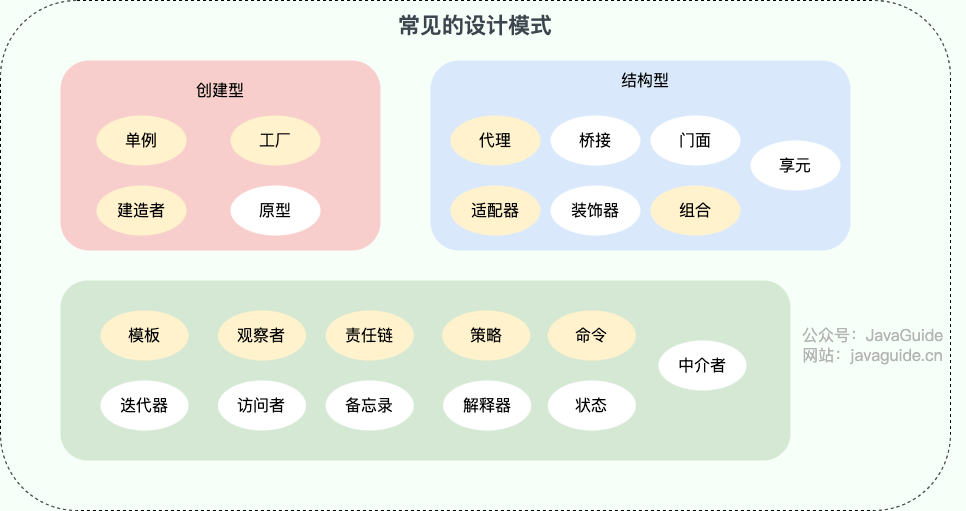
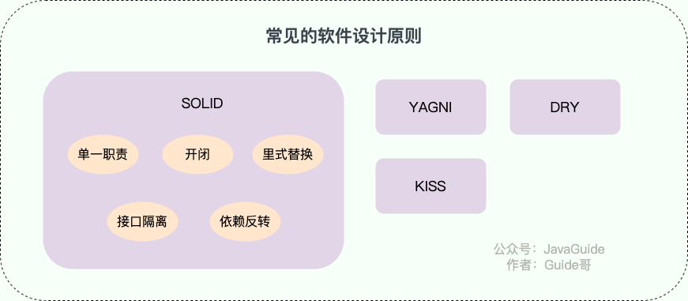
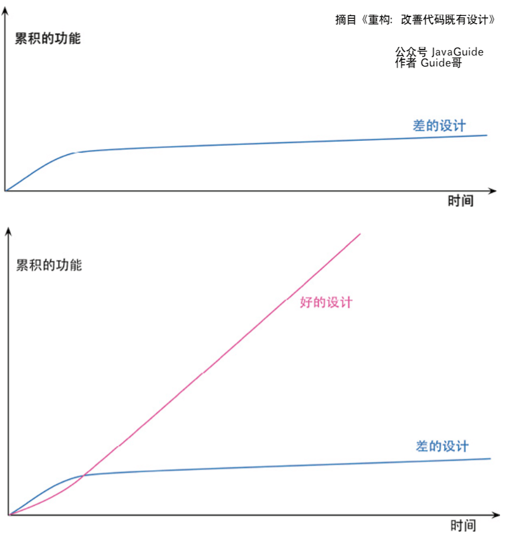
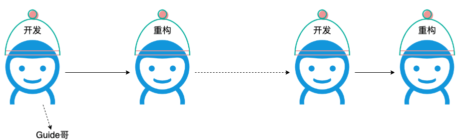

I recently reread [_Refactoring: Improving the Design of Existing Code_](https://book.douban.com/subject/30468597/) and found it valuable. Here are some of my thoughts on refactoring.

## What Is Refactoring?

The classic book _Refactoring: Improving the Design of Existing Code_ defines refactoring in two ways:

> - **Refactoring (noun):** A change to the internal structure of software that makes it easier to understand and cheaper to modify, without changing its observable behavior.
> - **Refactor (verb):** To restructure software through a series of refactorings without changing its observable behavior.

In practical terms, **refactoring means making small structural changes that make code easier to understand and modify, without changing its observable behavior.** Design patterns and software design principles can guide refactoring, while automated tests provide an important safety net.

Software design principles guide how we organize and maintain code. Refactoring helps bring code closer to those principles.

The key to safe refactoring is to **keep each step small**. Every change should leave the software working, and you should be able to stop at any point.

**Common design patterns:**

For a more comprehensive catalog of design patterns, see the open-source project **[java-design-patterns](https://github.com/iluwatar/java-design-patterns)**.

**Common software design principles:**

For a broader overview of design principles, see **[java-design-patterns](https://github.com/iluwatar/java-design-patterns)** and **[hacker-laws-zh](https://github.com/nusr/hacker-laws-zh)**.

## Why Refactor?

As described above, the main purpose of refactoring is to make code easier to understand and reduce the cost of future changes.

What does that mean for a real project? Refactoring can:

1. **Make code easier to understand:** Comments, consistent naming, and clearer logic help readers follow the code.
2. **Prevent code from deteriorating:** Remove code smells before they accumulate.
3. **Deepen your understanding of the code:** The refactoring process helps you understand the code you are changing.
4. **Reveal hidden bugs:** Refactoring often exposes bugs that were not obvious before.
5. …

Ultimately, refactoring aims to **improve software development speed and quality**.

Refactoring does not slow development down. When code quality and design are poor, adding features becomes increasingly slow. Eventually, the team may even want to rewrite the entire system.

The book _Refactoring: Improving the Design of Existing Code_ puts it this way:

> The only purpose of refactoring is to make us develop faster, creating more value with less effort.

## Is Performance Optimization Refactoring?

Refactoring improves readability, maintainability, and flexibility. It focuses on internal structure: making code easier for developers to understand and maintain. Performance optimization aims to make code run faster and use fewer resources. It focuses on external behavior, such as reducing latency, lowering resource consumption, and increasing throughput. Though they may seem at odds, both contribute to overall software quality.

In practice, first **make the code readable and maintainable**, then choose performance optimizations based on actual needs. Good software design does not maximize performance at any cost; it balances maintainability and performance. This helps build systems that are both **easy to maintain** and **perform well**.

## When Should You Refactor?

Refactoring can happen throughout development as opportunities arise. You do not need to set aside a day or two just for it.

### Before Committing Code

The book _Refactoring: Improving the Design of Existing Code_ introduces the **Boy Scout Rule**:

> Always leave the code you are working on healthier than you found it.

The idea is simple: before committing, ask whether your change makes the codebase healthier, makes it worse, or leaves it about the same.

If everyone on the team avoids making the codebase worse, the project can keep moving toward a healthier state.

**When you leave the campsite (the codebase), do not leave trash behind (code smells). Try to leave it cleaner than you found it.**

### Before or After Adding a Feature

After adding a feature, look for opportunities to improve the code. Before starting a feature, consider whether refactoring would make it easier to implement.

Completing a feature is not just about making it pass validation; you should also aim to maintain code quality.

One useful metaphor is switching between two hats. Before implementing a feature, you may put on the refactoring hat to make the work easier. Then switch back to the feature-development hat. After the feature is complete, you may find the code hard to understand, so put the refactoring hat back on. A good workflow moves between refactoring and feature development as needed.

### After Code Review

Code review can improve overall code quality by revealing code smells and potential problems. It also helps teammates understand the business logic you own and reduces the risk of a single person becoming the only one who understands a module.

A code review may give you several suggestions for improving your code.

### Opportunistic Refactoring

When you notice a code smell but do not want to stop your current work, consider this:

- If it is easy to fix, refactor it right away.
- If it will take more effort, make a note and come back to it after finishing your current task.

### While Reading Code

Developers often spend more time reading code than writing it. We read code written by teammates as well as code we wrote in the past.

When you find a code smell while reading, you can refactor it.

For example, if you find a teammate's code overly complex and difficult to understand, and see a clearer way to express the logic, you can refactor it.

## What Should You Keep in Mind?

### Automated Tests Are a Safety Net

**Automated tests give you confidence when refactoring and reduce its cost. Unit tests are usually the fastest to provide feedback; integration and acceptance tests can add further protection. Treat test code with the same care as production code.**

Continuous integration also depends on fast, reliable automated tests. After a CI service builds new code, it runs tests to catch problems.

**What counts as a unit test?** Definitions online can be abstract and confusing. The answer depends on your project: a function or even a class can be a unit. For example, you might write a unit test for a method that calculates the return on a stock investment, or for a class that masks sensitive data.

**Test code also needs to be refactored and updated.** _Clean Code: A Handbook of Agile Software Craftsmanship_ ([Chinese edition](https://book.douban.com/subject/4199741/)) says:

> Test code must evolve with production code. If tests are not kept clean, they will become increasingly difficult to change.

### Do Not Refactor for Its Own Sake

**Refactoring should create value for the project.** In some cases, you should not refactor:

- Applying a design pattern or engineering practice just because you learned it, without considering whether it fits the project. Avoid cargo-cult programming.
- Reworking the internals of an API used by your project when a deadline is tight and the change would bring no value to its callers.
- Rewriting the code would be easier and less costly than refactoring it.
- …

### Follow Established Techniques

_Refactoring: Improving the Design of Existing Code_ describes common code smells, such as duplicated code and long functions, as well as techniques such as Extract Function, Extract Variable, and Extract Class. Take time to learn these concepts and practice them in your code.

## How Can You Practice Refactoring?

In addition to practicing on project code, try these resources:

- [What I Think About When I Refactor](https://mp.weixin.qq.com/s/pFaFKMXzNCOuW2SD9Co40g): A Zhuanzhuan engineering article about common refactoring scenarios and techniques.
- [Refactoring Practice](https://linesh.gitbook.io/refactoring/): Learn refactoring step by step through small examples.
- [Refactoring Guru](https://refactoringguru.cn/): A free site for learning refactoring, design patterns, and SOLID principles: Single Responsibility, Open/Closed, Liskov Substitution, Interface Segregation, and Dependency Inversion.
- [IntelliJ IDEA's code refactoring tutorial](https://www.jetbrains.com/help/idea/refactoring-source-code.html#popular-refactorings): Learn how to refactor code with IntelliJ IDEA.

## References

- [Rereading _Refactoring_ - ThoughtWorks Insights - 2020](https://insights.thoughtworks.cn/reread-refactoring/): Covers small-step refactoring, opportunistic cleanup, and other key ideas.
- [Common Code Refactoring Techniques - VectorJin - 2021](https://juejin.cn/post/6954378167947624484): Practical techniques covering design principles, design patterns, layering, and naming conventions.

<!-- @include: @article-footer.snippet.md -->
